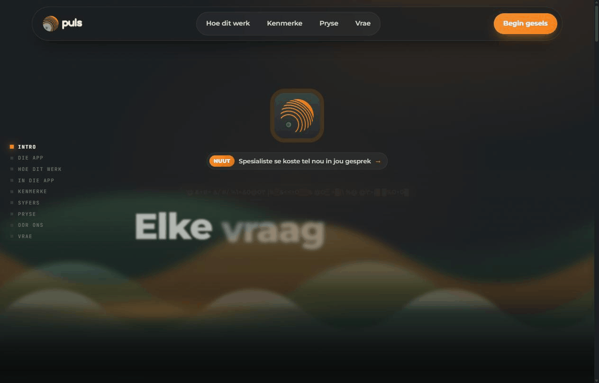
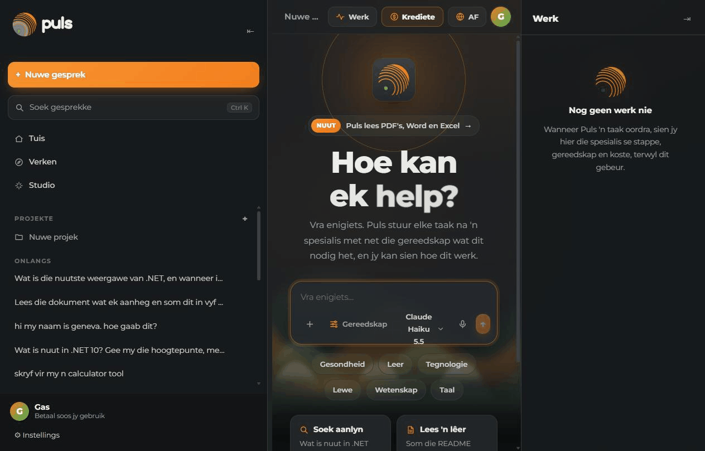

# Louis Agent

A self-hosted AI coding agent for .NET, built on [Microsoft.Extensions.AI](https://learn.microsoft.com/dotnet/ai/microsoft-extensions-ai),
and **Puls**, a South African assistant in everyday Afrikaans built on the same core.

The coding agent works on your repository with real tools — files, git, `dotnet`, Python, PowerShell, bash, web search, Azure DevOps and
Paymo — and talks to you through JetBrains Rider, a web app, an HTTP API or the terminal. Answers stream as they are
written, including the model's thinking and every tool call, and each answer says what it used and cost
(`turn: 3 requests · 28k tokens (26k cached) · $0.006`; `/usage` for the whole session).

Runs on Claude (Anthropic) by default; Ollama and OpenAI-compatible endpoints work too.

## See it

**Puls's landing page** tells the idea by playing it: a question goes out to a specialist and comes back as an
answer, in the app's own pieces, over the water.



**The app**, one real question: Puls hands it to a researcher, the Werk panel shows the specialist's steps, the
sources it read and what it cost, and the answer streams in.



Both recorded from the running app (`docker compose -f docker/docker-compose.puls.yml ... up`, then
http://127.0.0.1:5070); nothing is mocked.

## Puls

**Puls** (*Elke vraag op pad na 'n antwoord*) is a general AI assistant that speaks everyday South African Afrikaans.
It doesn't answer with tools itself: it hands each task to a **specialist**, a second louis-agent that opens a
session with only the toolsets the task needs and a role that says how to work and report back. There are five roles:
a researcher (web), a reader (files and documents), a historian (git), an analyst (counting and calculating with a
script) and a general specialist. Puls then writes the answer in its own voice.

- **You see the work.** The Werk panel shows each delegation as it happens: the specialist, its toolsets, its task, each
  step, the sources it read and what it cost.
- **Pay as you go, with visible usage.** Every answer shows what it cost, Puls's part and the specialists'. Costs are
  shown in your currency (rand in South Africa); the ledger keeps the dollars actually charged.
- **It knows where and when you are.** It sends your time zone with every chat, and your location (about 1 km) only if
  you share it, so "today" and "near me" are yours.
- **Measured.** A delegation check asks the same questions with and without specialists and prices both from the usage
  ledger ([the runs, at the `pre-cl10` tag](https://github.com/bosbevk/louis-agent/blob/pre-cl10/samples/sample-output-puls-check-repeat/README.md)). On average, delegating costs about a third more
  than one agent answering everything. It was cheaper for chat and one of the two web questions, about even on the
  other, and dearer for short lookups.

```bash
docker compose -f docker/docker-compose.puls.yml --env-file config/.env up -d --build
```

Open **http://127.0.0.1:5070**. Design: [Puls's web app](docs/projects/louis-agent.puls.md),
[F5 toolset profiles](docs/features/F05-toolset-profiles.md) (sub-sessions), [F21 personalities](docs/features/F21-personalities.md)
(the roles), [F22 role tools](docs/features/F22-role-tools.md).

## Ways to use it

| Host | Project | What it is |
|---|---|---|
| **Rider** | `src/louis-agent.acp-server` | [Agent Client Protocol](https://agentclientprotocol.com) server for Rider's AI chat: streamed answers, thinking, tool cards, file attachments |
| **Web app** | `src/louis-agent.web` | Blazor WebAssembly chat with a file browser, a git Changes view (review diffs, stage, discard, commit), a Branches view (all commits, branch diffs, merge) and switchable themes |
| **Puls** | `src/louis-agent.puls` | The general assistant's web app: a landing page and a dark three-panel chat in Afrikaans, with the Werk panel showing each delegation live |
| **HTTP API** | `src/louis-agent.api` | JSON API with Claude-style streamed events (SSE); also serves the web app |
| **CLI** | `src/louis-agent.cli` | Interactive or one-shot prompts in the terminal |
| **MCP server** | `src/louis-agent.mcp-server` | Publishes the agent's tools to any MCP client (the client brings its own model) |

All hosts share `louis-agent.core` (engine, tools, skills, providers). See [the architecture](docs/architecture/README.md).

**Orchestrator demo (proof of concept).** `src/louis-agent.orchestrator` is a second agent, also built on
`louis-agent.core`, that watches a microservice's errors, decides per API method what each needs, has louis-agent fix
the fixable ones (one branch and commit each, never pushed) and verifies every fix itself. Its demo (a service with
ten bugs, run in Docker) was removed in CL10 and comes back with the rewritten benchmarks; the last run is at the
[`pre-cl10` tag](https://github.com/bosbevk/louis-agent/blob/pre-cl10/samples/README.md).

## Documentation

All docs, in reading order, are listed in **[docs/README.md](docs/README.md)**. The main ones:

| To… | Read |
|---|---|
| Start using it (web app, Rider, CLI) and try prompts | [Quick start](docs/QUICK_START_AGENT.md) |
| Configure settings and secrets, or pick a model | [Setup](docs/SETUP.md) · [Models](docs/MODELS.md) |
| Understand what happens when you send a message | [How a turn works](docs/architecture/06-runtime-view.md) |
| Connect another program or agent: HTTP API and its event stream, Rider, MCP, agent-to-agent | [How the agents and endpoints talk](docs/AGENT_COMMUNICATION.md) |
| Know the components, security and deployment | [Architecture](docs/architecture/README.md) · [project by project](docs/projects/README.md) |
| Change the code | [Development guide](docs/CLAUDE.md) |
| Watch two agents fix ten bugs, then merge the fixes | [The last demo run, at `pre-cl10`](https://github.com/bosbevk/louis-agent/blob/pre-cl10/samples/sample-output/README.md) (the demo comes back with the rewritten benchmarks) |
| See what Puls's delegation costs against one agent | [Delegation check, at `pre-cl10`](https://github.com/bosbevk/louis-agent/blob/pre-cl10/samples/sample-output-puls-check-repeat/README.md) |
| Learn how the orchestrator decides, and write runbooks | [Runbooks](docs/projects/orchestrator-runbooks.md) |

## Quick start (Docker)

Prerequisites: Docker Desktop and an [Anthropic API key](https://console.anthropic.com).

```bash
# 1. Secrets (git-ignored)
cp config/.env.example config/.env
cp config/.env.secrets.example config/.env.secrets
#    then set ANTHROPIC_API_KEY (and anything else you use) in config/.env.secrets

# 2. Paths: set REPOSITORIES_PATH / ACP_MOUNT_MAPPINGS in config/.env to the folder that holds your repos

# 3. Start the web app + API
docker compose -f docker/docker-compose.yml --env-file config/.env up -d --build api
```

Open **http://127.0.0.1:5080**.

### Rider

Add an agent server in Rider's AI Assistant settings (see [config/rider/rider-acp.example.json](config/rider/rider-acp.example.json)),
pointing at your checkout:

```json
"Louis Agent": {
  "command": "C:\\Program Files\\Docker\\Docker\\resources\\bin\\docker.exe",
  "args": ["compose", "-f", "<repo>\\docker\\docker-compose.yml", "--env-file", "<repo>\\config\\.env",
           "run", "--rm", "-T", "acp-server"]
}
```

Each Rider chat starts its own `acp-server` container. Files you attach in the chat are read into the prompt.

### CLI

```bash
dotnet run --project src/louis-agent.cli                 # interactive (Ctrl+C stops a reply)
dotnet run --project src/louis-agent.cli -- "your prompt" # one-shot
```

Outside Docker the CLI finds `config/.env` and the repo root from any folder in the repository.

## Configuration

Settings live in `config/.env` and secrets in `config/.env.secrets`; both are git-ignored and created from their
`.example` files. Every setting is in [docs/SETUP.md](docs/SETUP.md); choosing a model in [docs/MODELS.md](docs/MODELS.md).

## HTTP API

A JSON API with answers streamed as Server-Sent Events shaped like Claude's: sessions, workspace and git endpoints,
prices and rates. Every endpoint, the event stream with an example, and how other agents use it are in
[docs/AGENT_COMMUNICATION.md](docs/AGENT_COMMUNICATION.md#the-http-api-louis-agentapi).

## Web app

Chats that stream the thinking and every tool call, a file browser, a Changes view to review, stage and commit, and a
Branches view to review and merge branches; pushing stays with you. How it works:
[the web app's design doc](docs/projects/louis-agent.web.md).

## Skills, tools and safety

The agent's tools cover files, git, `dotnet`, Python, PowerShell, bash, the web, Azure DevOps and Paymo; markdown
**skills** in [`Skills/`](Skills) give it its voice and role, route each task to a toolset, and guide each toolset. A
session loads only the toolsets it needs. The agent can write new skills and build its own tools, which wait for your
`/approve`. File tools stay inside the workspace and never touch secret files, the model's text is never spliced into a
command line, and everything listens on `127.0.0.1` only. Details: [Architecture: Skills](docs/architecture/05-building-block-view.md#skills),
[Tools](docs/architecture/05-building-block-view.md#tools) and [Security](docs/architecture/08-crosscutting-concepts.md#security).

## Development

Requires the .NET 10 SDK. Building, testing and how a change is made are in the
[development guide](docs/CLAUDE.md); where the logs go in [Architecture: Logging](docs/architecture/08-crosscutting-concepts.md#logging); every doc
in the [docs index](docs/README.md).

## License

**All rights reserved** ([LICENSE](LICENSE), since 2026-10-15). The code is public to read, but you may not use, copy,
change, share or host it without written permission; open an issue to ask. Versions released before under MIT or the
AGPL-3.0 keep that licence. Why: [ADR 0016](docs/adr/0016-licence-all-rights-reserved.md).
