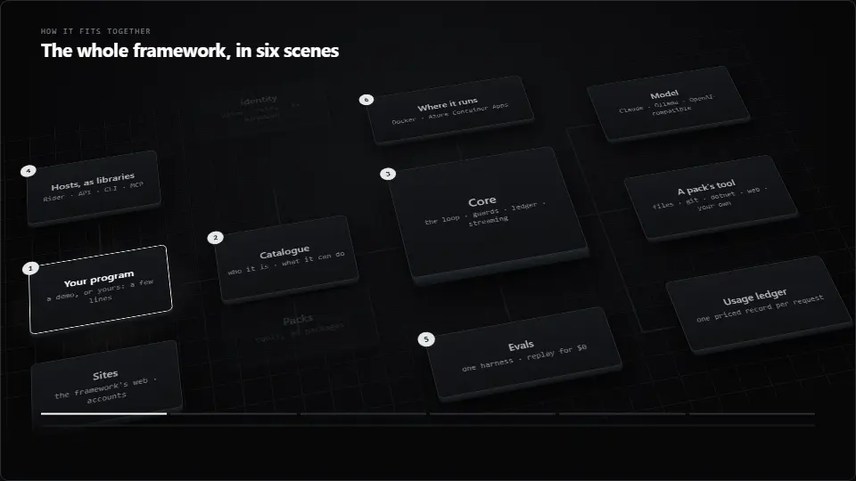
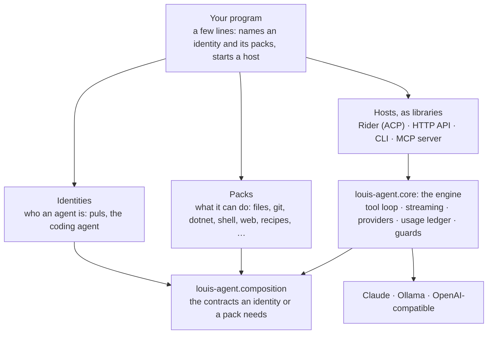

# Louis Agent

**An AI agent framework in C#, and the agents built on it.**

<picture>
  <source media="(prefers-reduced-motion: reduce)" srcset="demos/louis-agent/docs/films/short.png">
  
</picture>

louis-agent is a framework: the engine (the tool loop, streaming, providers, cost tracking and safety guards, built on
[Microsoft.Extensions.AI](https://learn.microsoft.com/dotnet/ai/microsoft-extensions-ai)), the hosts that serve it, and
packs of tools. A few lines of your own say who the agent is (an **identity**: its voice, its modes, its roles) and what
it can do (**packs**: tools and their guides), and start a host. Two agents run on it today: a **coding agent** that works
on your repository, and **Puls**, a South African assistant in everyday Afrikaans.

Everything is C#, on purpose. It runs on Claude by default; Ollama and OpenAI-compatible endpoints work too.

## Why it exists

It's a learning project first. I'm a software engineer becoming an AI engineer, and every layer of a real agent
(tools, context, evals, cost, safety, orchestration) gets built here by hand, measured, and written up.
[src/docs/GOAL.md](src/docs/GOAL.md) has the skill map, and [src/docs/learning/](src/docs/learning/README.md) has the write-ups.

It's also heading for a public release: Puls for the public, and the engine for .NET teams who want to build their
own agents.

## Where it stands

| Works today | Next |
|---|---|
| The engine, with the identities and packs each program names | The cook reads recipes from South African sites, then keeps its own recipe library |
| The coding agent in Rider, the web app, the CLI, the HTTP API and over MCP | Recipe maths and a cook that teaches |
| Puls with five specialists: a researcher, a reader, a historian, an analyst and a cook | Every text from localisation files |
| A recipes pack: 45 South African sites that allow readers, every fetch obeying `robots.txt` | Twelve local Puls specialists (gardener, braaimaster, weatherman and more), on a shared weather and where-to-buy pack |
| **Evals as files:** an eval is a folder of JSON beside its identity, graded by a catalogue of C# checks, written in the portal's studio, replayed for $0 | Then the sales playground, budgets, orchestration, safety and accounts |
| An admin portal: each run opens on its answer, one Evals page, a queue of answers waiting for a person's grade | |
| Cost on every answer, from a usage ledger priced by date; every turn and tool call traced with OpenTelemetry | |
| A website for the engine itself (`demos/louis-agent/web/louis-agent.site`) | |
| A pack runs from a package, with no engine in its dependencies | Publishing the packages to NuGet |

The full order is in the [TODO](TODO.md) and the [platform plan](src/docs/plans/platform.md); what's finished is in the
[work log](src/docs/work-log.md).

## How it's built



The engine ships no agent and holds no tools, and it names no product and no country. A pack needs only the contracts,
never the engine, and never knows about another pack or an identity. Only a demo's own program knows them all
([ADR 0027](src/docs/adr/0027-engine-identities-and-packs.md), [ADR 0076](src/docs/adr/0076-core-ships-no-agent.md)).

```
src/                 the framework: the engine, the hosts as libraries, the eval harness, its tests and docs
packs/               what an agent can do, tools only; packs/evals/ proves them, packs/tests/ tests them
demos/louis-agent/   the coding agent, as your own project would be: identity, programs, web apps, settings, images, a film export tool, tests
demos/puls/          Puls, the same way
```

A few rules hold everywhere:

- **Every request is measured.** The usage ledger records each model call with its tokens and its cost. Every host
  shows what a turn cost (`turn: 3 requests · 28k tokens (26k cached) · $0.006`), and an unknown price stays unknown
  instead of turning into 0 ([ADR 0007](src/docs/adr/0007-measure-every-request.md)).
- **Guards live in code, not in the prompt.** Model text never reaches a shell, file tools stay inside the workspace,
  calls that got cut off never run, and anything the agent writes waits for your `/approve`
  ([ADR 0004](src/docs/adr/0004-arguments-as-data.md), [ADR 0005](src/docs/adr/0005-guard-the-context.md)).
- **Everything streams, and is traced.** You see the thinking and every tool call as they happen, in every host; with
  an OpenTelemetry collector set, each turn and tool call is also a span on a dashboard
  ([ADR 0064](src/docs/adr/0064-observability-through-opentelemetry.md)).
- **A site's no is obeyed.** Every page the agent fetches checks the site's `robots.txt` and its no-AI signals first,
  in code ([ADR 0068](src/docs/adr/0068-every-fetch-obeys-robots-txt.md)).
- **A session keeps its tools.** It names its toolsets when it opens, so its prompt prefix stays cacheable. Prompt
  caching took the old benchmark from $0.66 to $0.13 a run ([ADR 0006](src/docs/adr/0006-toolsets-per-session.md)).
- **Packs stay convertible to MCP.** A pack could be served as an MCP server, and an MCP server could stand in for a
  pack ([ADR 0028](src/docs/adr/0028-packs-stay-convertible-to-mcp.md)).

More detail is in [the architecture](src/docs/architecture/README.md) and in [the docs for each project](src/docs/projects/README.md).

## Puls

**Puls** (*Elke vraag op pad na 'n antwoord*) is a general assistant that speaks everyday South African Afrikaans
(English too). It doesn't answer with tools itself. It hands each task to a **specialist**: a second agent session
that has only the tools that task needs, and a role that says how to work and report back. Then Puls writes the answer
in its own voice.

- **You see the work.** The Werk panel shows each hand-over live: the specialist, its task, each step, the sources it
  read and what it cost.
- **It's local.** Costs show in rand, it knows your time zone, and it uses your location (to about 1 km) only if you
  share it.
- **It's checked.** The cook and the routing are evals, so a prompt change shows up as a score.

```bash
docker compose -f demos/puls/docker/docker-compose.puls.yml --env-file demos/puls/config/.env up -d --build
```

Open **http://127.0.0.1:5070**. The same app runs on Azure ([demos/puls/deploy/azure](demos/puls/deploy/azure/README.md)). Design:
[Puls's identity](demos/puls/docs/projects/louis-agent.identity.puls.md), [Puls's web app](demos/puls/docs/projects/louis-agent.puls.md).

## The coding agent

It works on your repository with real tools: files, git, `dotnet`, Python, PowerShell, bash, web search, Azure DevOps
and Paymo. It can write new skills and build its own tools, and those wait for your approval.

| Host | Project | What it is |
|---|---|---|
| **Rider** | `src/hosts/louis-agent.acp-server` | [Agent Client Protocol](https://agentclientprotocol.com) server for Rider's AI chat |
| **Web app** | `demos/louis-agent/web/louis-agent.code-review` | Blazor chat with a file browser, a Changes view (review, stage, commit) and a Branches view (review, merge) |
| **HTTP API** | `src/hosts/louis-agent.api` | Sessions with answers streamed as Server-Sent Events; it also serves the web app |
| **CLI** | `src/hosts/louis-agent.cli` | Interactive or one-shot prompts in the terminal |
| **MCP server** | `src/hosts/louis-agent.mcp-server` | Hands the tools to any MCP client, which brings its own model |
| **Orchestrator** | `demos/louis-agent/hosts/louis-agent.orchestrator` | A proof of concept: a second agent reads a service's errors and has louis-agent fix and verify them |

Each host is a library; a small program in `demos/louis-agent/hosts` names what it loads and starts it. Pushing always stays
with you.

## Evals

An eval runs a real task and scores the outcome. Every eval runs on one C# harness (`src/evals/`), and each one sits with
the project it proves, apart from what ships ([ADR 0029](src/docs/adr/0029-simulations-in-csharp.md)).

- **An eval is files, a check is code.** A new eval is a folder: `eval.json`, its samples and its rubric, no C#. The
  checks it names come from a catalogue of C# graders, and a pack can bring its own. The portal's studio writes those
  files for you: samples taken from real chats and human review, then compose, try and publish.
- **Code graders first.** Fixed rules are free and give the same score every time. A model judge comes in only where
  code can't decide, and only after it agrees with human labels.
- **pass@k and pass^k.** Run a task k times: did it pass at least once, and did it pass every time? An agent you sell
  needs the second.
- **Re-runs for $0.** A run records the web pages it read, so it can be replayed and re-scored for nothing. Cost always
  comes from the ledger, never from a grader.
- **Everything shows in the admin portal**: each run opens on its answer, and a review queue hands a person the
  answers still waiting for their grade.

The first baseline: Puls's cook passed 23 of 24, its routing 72 of 72, for $0.37 together. How to:
[run the evals](src/docs/guides/run-the-evals.md) · [add an eval](src/docs/guides/add-an-eval.md); design:
[the evals design doc](src/docs/projects/louis-agent.evals.md).

## Quick start

You need Docker Desktop and an [Anthropic API key](https://console.anthropic.com), or the .NET 10 SDK to run it
without Docker.

```bash
cp demos/louis-agent/config/.env.example demos/louis-agent/config/.env
cp demos/louis-agent/config/.env.secrets.example demos/louis-agent/config/.env.secrets   # set ANTHROPIC_API_KEY and AGENT_API_KEY
# in demos/louis-agent/config/.env, set REPOSITORIES_PATH to the folder that holds your repos

docker compose -f demos/louis-agent/docker/docker-compose.yml --env-file demos/louis-agent/config/.env up -d --build api   # web app + API
```

Open **http://127.0.0.1:5080**. Everything listens on `127.0.0.1` only.

- **Rider:** add an agent server in the AI Assistant settings, from
  [config/rider/rider-acp.example.json](demos/louis-agent/config/rider/rider-acp.example.json). Each chat gets its own container.
- **CLI:** `dotnet run --project demos/louis-agent/hosts/louis-agent.coding-cli` (interactive), or add `-- "your prompt"` for one shot.

Every setting is in [src/docs/SETUP.md](src/docs/SETUP.md), and choosing a model is in [src/docs/MODELS.md](src/docs/MODELS.md). For
prompts to try, see the [quick start](demos/louis-agent/docs/QUICK_START_AGENT.md).

## Documentation

All the docs, in reading order, are in **[src/docs/README.md](src/docs/README.md)**. The ones you'll want first:

| To… | Read |
|---|---|
| See what happens when you send a message | [How a turn works](src/docs/architecture/06-runtime-view.md) |
| Connect another program or agent (HTTP API, MCP, agent to agent) | [How the agents and endpoints talk](src/docs/AGENT_COMMUNICATION.md) |
| Build your own identity or pack | [Build an identity](src/docs/guides/build-an-identity.md) · [Build a pack](src/docs/guides/build-a-pack.md) |
| Know why it's built this way | [Architecture decisions](src/docs/adr/README.md) |
| Change the code | [Development guide](src/docs/CLAUDE.md) · [how-tos per project](src/docs/guides/README.md) |

## Licence

**All rights reserved** ([LICENSE](LICENSE), since 2026-10-15). The code is public to read, but you may not use, copy,
change, share or host it without written permission; open an issue to ask. Versions released before under MIT or the
AGPL-3.0 keep that licence. Why: [ADR 0016](src/docs/adr/0016-licence-all-rights-reserved.md). The parts others wrote keep
their own licences: [THIRD-PARTY-NOTICES.md](THIRD-PARTY-NOTICES.md).
