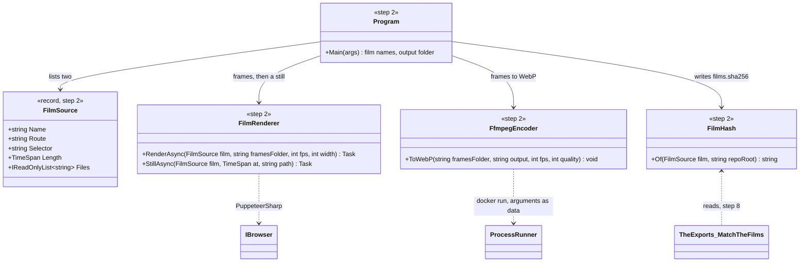
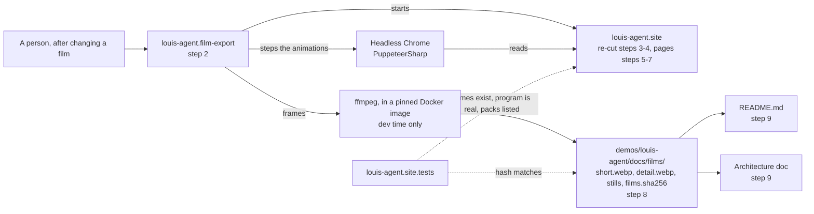
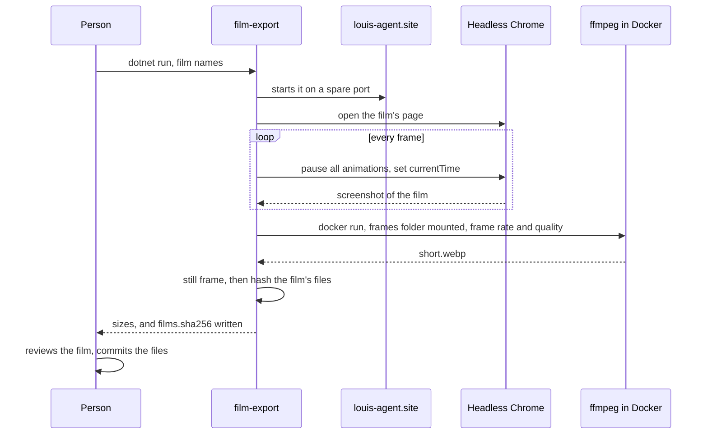
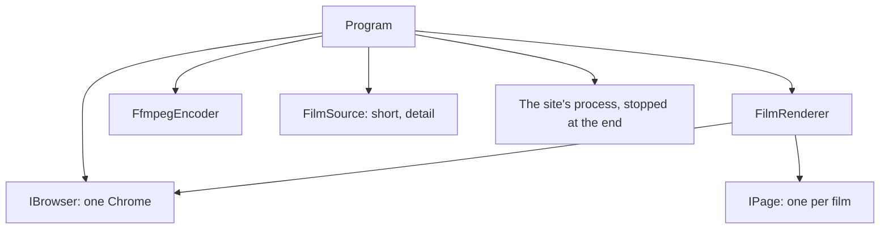

# F57: The site tells the new structure, and its films play on GitHub

> **Plan, approved 2026-11-05.** How the engine's website and its two films catch up with CL29, and how the films reach the
> README. **Elsewhere:** the site as it is in [its design doc](../projects/louis-agent.site.md), why it's static and why its
> films are CSS in [ADR 0066](../adr/0066-the-site-is-static-razor.md), the split itself in
> [ADR 0074](../../../../src/docs/adr/0074-the-folders-say-what-ships.md) and [ADR 0076](../../../../src/docs/adr/0076-core-ships-no-agent.md).

**Status:** approved by Louis, 2026-11-05, with the throwaway push of step 1 · **Branch:** `feature/F57-site-rebuild`, off `main` at #170 · **Cost:** nothing paid: no model
is called anywhere in this plan.

## Context

Louis, 2026-11-05: "rebuild the agent website with the new structure and the animations we should show those animations on the
github also."

Since the site was built (F54), CL29 changed what it describes. The site and README are now wrong in places:

- The films say "Composition: `IDENTITIES + PACKS`", as if settings pick the packs. A demo's program now names them.
- The short film's "Tools" part reads as part of the engine. Tools are packs now, and core has none.
- The detailed film names places that moved, such as `Sessions/SubSessions`.
- The README's diagram calls the composition "the only project that knows every identity and pack". It isn't any more.
- Nothing tells a visitor the main thing: **it's a framework, and you can build on it.**

A film can't run in a README: GitHub strips CSS and scripts from markdown.

## Decisions

Louis's picks, 2026-11-05, each from three options:

| Choice | Picked | Not picked |
|---|---|---|
| Films on GitHub | **Animated WebP**, rendered from the CSS and committed | An uploaded MP4 (needs a click, re-uploaded by hand); a self-contained SVG (41 KB, but not proven on GitHub) |
| How far the rebuild goes | **Update every page, and add two**: the packs, and build your own | Update only; a full redesign |
| The films | **Re-cut both**, keeping their geometry and timing where they can | A third film about the split; one merged film |
| The export tool | **A C# tool, with ffmpeg from a Docker image** | ImageSharp (a licence to judge); GitHub Actions re-exporting (a bot that commits) |

**Measured on the short film** (36 s, 12 frames a second, 960 px wide):

| Format | Size |
|---|---|
| Animated WebP, quality 75 | 2.67 MB |
| Animated WebP, quality 50 | 1.96 MB |
| Animated WebP, 640 px, quality 60 | 1.16 MB |
| MP4 (H.264) | 1.25 MB |
| GIF, 640 px | 9.29 MB |
| GIF | 21.95 MB |

## Design

**What stays:** static Razor with no script of our own, the Console theme, the CSS films as the only source of a film, and the
rule that the site shows only what works today (ADR 0066). The site still references no engine project.

**The new story in the films.** One turn still runs from start to finish. Only what the parts are called and what they say changes:

| Part today | Part after | What it now says |
|---|---|---|
| Host | **Your program** | A demo's few lines start a host: CLI, ACP, API or MCP |
| Composition (`IDENTITIES + PACKS`) | **Catalogue** | The program names who the agent is and what it can do |
| Identity, Packs | Identity, **Packs** | Packs arrive as packages: files, git, dotnet, shell, web, or your own |
| Core | Core | The loop, delegation, guards, ledger, streaming; it holds no tools |
| Tools | **A pack's tool** | The model asks, the engine runs it behind a guard |

**Keeping words true.** Three small tests stop the site drifting from the code again:

- every type a film's card names exists in the repo (`FilmNamesTests`);
- the program shown on *Build your own* is the real `louis-agent.coding-cli/Program.cs` (`BuildYourOwnTests`);
- every folder under `packs/` is on the *Packs* page, so a new pack can't be forgotten (`PacksPageTests`).

**Exports can't go stale.** `films.sha256` beside the exports holds a hash of each film's markup and stylesheets, with line
endings made the same, so Windows and CI agree. `TheExports_MatchTheFilms` fails when a film changes and nobody re-exported.

**The README shows** the short film at the top, with a still frame for reduced motion through `<picture>`. The detailed film goes
in the architecture doc, so the README doesn't pull two animations. Both link to the site's page once it has a domain.

**Honesty on *Build your own*:** the packages aren't on NuGet yet. The page says so, shows the real program, and says what's
proved today: a console app runs a pack from a local package feed with no engine in its dependencies
(`APackInstallsAsAPackageTests`).

### Interface design



```csharp
public sealed record FilmSource(string Name, string Route, string Selector, TimeSpan Length, IReadOnlyList<string> Files);
public sealed class FilmRenderer(IBrowser browser, Uri site) { Task RenderAsync(FilmSource film, string framesFolder, int fps, int width); Task StillAsync(FilmSource film, TimeSpan at, string path); }
public sealed class FfmpegEncoder { void ToWebP(string framesFolder, string output, int fps, int quality); }
public static class FilmHash { string Of(FilmSource film, string repoRoot); }
```

### Architecture



### Communication: exporting a film



### Objects held while exporting



### Folders

Today:

```
demos/louis-agent/
  docs/  hosts/  identity/  tests/  web/louis-agent.site/
```

After:

```
demos/louis-agent/
  docs/films/                          # short.webp, detail.webp, short.png, detail.png, films.sha256 (step 8)
  tools/louis-agent.film-export/       # the export tool (step 2)
  tests/louis-agent.film-export.tests/ # its tests (step 2)
  web/louis-agent.site/Components/Pages/  # Packs.razor, BuildYourOwn.razor (steps 6, 7)
```

### Namespace map

| Type | Folder | Namespace | Step |
|---|---|---|---|
| `FilmSource`, `FilmRenderer`, `FfmpegEncoder`, `FilmHash` | `demos/louis-agent/tools/louis-agent.film-export/` | `LouisAgent.FilmExport` | 2 |
| `FilmHashTests`, `FfmpegEncoderTests` | `demos/louis-agent/tests/louis-agent.film-export.tests/` | `LouisAgent.FilmExport.Tests` | 2 |
| `FilmNamesTests` | `demos/louis-agent/tests/louis-agent.site.tests/Movies/` | `LouisAgent.Site.Tests.Movies` | 3 |
| `ShortMovie`, `DetailedMovie` (changed) | `demos/louis-agent/web/louis-agent.site/Components/Movies/` | `LouisAgent.Site.Components.Movies` | 3, 4 |
| `Hero`, `BuiltOnIt`, `Home`, `HowItWorks`, `BuiltOnItPage`, `Proof`, `SiteLayout` (changed) | `demos/louis-agent/web/louis-agent.site/Components/` | as today | 5 |
| `Packs`, `PacksPageTests` | `.../Components/Pages/`, `.../louis-agent.site.tests/Pages/` | `LouisAgent.Site.Components.Pages`, `LouisAgent.Site.Tests.Pages` | 6 |
| `BuildYourOwn`, `BuildYourOwnTests` | `.../Components/Pages/`, `.../louis-agent.site.tests/Pages/` | as above | 7 |
| `TheExports_MatchTheFilms` | `.../louis-agent.site.tests/Movies/FilmExportTests.cs` | `LouisAgent.Site.Tests.Movies` | 8 |

## Steps

One commit each, test first, with Louis's review stop after each.

1. **Try it on real GitHub.** Export the short film by hand and push a throwaway branch with a test README. Check that the WebP
   plays on github.com in Chrome, Edge, Firefox and Safari, whether `<picture>` with reduced motion survives GitHub's sanitiser, and 12
   against 24 frames a second. **This push needs Louis's ok.** The result picks the settings; if WebP fails, stop and bring it back.
   Nothing is merged and the branch is deleted.
2. **The export tool.** `louis-agent.film-export`, its tests and its solution entry. The ffmpeg image is pinned by version.
   Test first: the hash ignores line endings and changes with a film's files.
3. **Re-cut the short film,** with `FilmNamesTests` first, seen failing on today's stale names. Rewrite its golden and check it frame
   by frame, including the moment 12.5 s in where the Model slab's text runs into the card.
4. **Re-cut the detailed film.** The six middleware slabs stay, in their real order, and `DetailedMovieTests` still holds it.
5. **Every existing page's words,** against the docs: the engine panels, *Built on it*, *Proof*, and the menu. Each number
   still comes from the ledger or an eval run.
6. **The Packs page,** `PacksPageTests` first: what's general, what's a product's, and what a pack is.
7. **The Build your own page,** `BuildYourOwnTests` first: the real program, what ships and what's yours, the honest line about NuGet.
8. **Export both films,** with `TheExports_MatchTheFilms` first. Commit the WebPs, stills and hashes.
9. **The README and the architecture doc:** the short film at the top, the diagram corrected, the layout described. The detailed film
   in the architecture doc.
10. **Finish:** an ADR for films on GitHub, ADR 0066's stale path, the site's design doc and *Change the site* (its export section
    points at a script that isn't in the repo), the TODO, the changelog and the write-up. Rebuild the site's image and restart only its
    container. The whole solution before the PR.

## Verification

- **Tests:** the site's tests, the tool's, and the repo-wide layout and size rules on each step; the whole solution before the PR.
- **By eye, free:** each page at 1440 px and 390 px with no sideways scroll, and each film frame by frame.
- **On GitHub:** step 1 on a throwaway branch, and the README on the PR's branch before merging.
- **No paid run:** no model is called anywhere.

**Done when:** every page and both films describe the structure on `main`, the short film plays by itself at the top of the README
on github.com, and changing a film without re-exporting fails a test.

## Approved during the build

**Step 1, 2026-11-05: animated WebP works on real GitHub.** Tested on a throwaway branch, now deleted.

- Louis picked **24 frames a second, quality 75**: 5.13 MB for the short film, about 8.5 MB estimated for the long one. The tool exports
  at those settings.
- In Chrome and Edge the film plays by itself, from `<picture>`, `` or a plain Markdown image.
- GitHub keeps `<picture>` and its `prefers-reduced-motion` source: with reduced motion on, the viewer gets the still and it stays still.
  The still is the film's first frame, the wide view with every part.
- The README uses `<picture>`: GitHub wraps a bare image in a link to the raw file, and leaves `<picture>` alone.
- **Firefox and Safari are not tested yet.** They get checked on the PR's branch before merging (*Verification*).

## Not in this plan

- F54's leftovers: the contact page's `[YOUR EMAIL]`, a domain and where the site runs. The site stays local until Louis picks; the
  README links to it only once it has an address.
- Publishing the packages to NuGet. *Build your own* says plainly that it hasn't happened.
- Play and pause on the site's films, and a light theme.

## Concepts

- **Docs that a test holds to the code** (steps 3, 6, 7, 8): *18 Testing and shipping* in the [goal](../../../../src/docs/GOAL.md).
- **Generated files with one source, and a check they're fresh** (steps 2, 8): *18 Testing and shipping*.
- **Showing a framework's seams to its users** (steps 6, 7): *20 Extensibility*.

---
[Docs index](../../../../src/docs/README.md) · Related: [Plans](../../../../src/docs/plans/README.md) · [louis-agent.site](../projects/louis-agent.site.md)
