# LouisAgent.CodeReview — design

> **Kind:** web app (Blazor WebAssembly) · **Path:** `demos/louis-agent/web/LouisAgent.CodeReview/` · **Served by:**
> `LouisAgent.CodingApi` (same origin), on 127.0.0.1:5082 · **References:** LouisAgent.Web (with Markdig),
> highlight.js (from a CDN)
> **Also shows:** `component`, `sequence`

## Purpose

The browser front end for the coding agent: chat with it, browse the workspace, review and commit changes, and review
and merge branches, on top of the coding agent's API. It's a small site on
[the framework's web](../../../../src/docs/projects/LouisAgent.Web.md), the second real user of its frames. From
F109.1 to F124 it also carried the framework's website; that is now the framework's own,
[LouisAgent.Site](../../../../src/docs/projects/LouisAgent.Site.md) in `src/site/`, and this app is the chat and the
admin, on this PC.

## How it works

The chat page is the framework's chat shell, given the app's own parts in its slots.

The chat is `ChatShell` with this site's name, its boot screen, its theme picker and links to the packs' screens, at
the root and at `/chat`. A coding agent has no use for credits, a language menu, a place or projects, so `ChatPage`
turns those off, along with what only says it's coming.

A session gets every toolset the API can load.

The admin, in this app's admin frame, holds the overview, the packs' screens and the evals of the demo's agents, the
triage team's among them: the framework's eval pages, named with `.Evals()` in `CodeReviewAreas`, reading the eval
routes the coding agent's API maps behind the admin key.

### 1. Files, Changes and Branches aren't this app's

They're the files and git packs' views, under `packs/web/`, and open as admin screens at `/admin/screens/{name}`.
`Program.cs` registers them with `FilesWebViews.AddTo` and `GitWebViews.AddTo`.

A Review or Ask button opens this chat with the prompt as a draft, and nothing is sent until the person sends it
(`ChatHandoff`).

The app offers three themes, each in a dark and a light style: the framework's glass and flat, and retro, which is
its own. It names them among its areas, `.Glass().Flat().Retro()` in `CodeReviewAreas`, and glass comes first, so
that is what a first visit gets. The frame's own switch, under Settings in the chat and at the foot of the admin's
sidebar, offers them and remembers the pick in this browser. The app has no picker of its own.

Retro shows how a site adds a theme the framework doesn't ship. `RetroTheme` adds one area that carries the theme,
the way `GlassTheme` does. Its values are two sheets, `Styles/retro/_dark.scss` and `_light.scss`, each one block
under the selector for its theme and style, and each sets every name the framework's themes set. Dark is mint on a
near-black green, and light is dark green ink on pale mint paper. A theme is only values
([ADR 0124](../../../../src/docs/adr/0124-a-sites-look-is-a-theme-and-a-style.md)), so retro's terminal dressing,
the block letters, the boot lines, the scanlines and the prompts before a message, is not part of the theme. It is
the app's own rules, in `Styles/retro/_terminal.scss`, written under `:root[data-theme="retro"]` so they apply only
while the page wears retro.

Reviewing a change, the job the app is for:

## Structure

| Path | What's in it |
|---|---|
| `Pages/ChatPage.razor`, `Pages/NotFound.razor` | The thin chat page, at `/`, `/chat` and `/chat/{id}`; the page for an unknown address |
| `Layout/ChatLayout.razor`, `Layout/AdminLayout.razor`, `Layout/AccountLayout.razor` | The chat's bare layout, the router's default; this app's admin frame, on `AdminShell`; its account frame |
| `Components/EmptyChat.razor` | The boot screen above the message box |
| `CodeReviewAreas.cs`, `RetroTheme.cs` | What the app is made of, its three themes among it; retro's id and name, and the area that carries it |
| `Styles/app.scss`, `Styles/chat/_boot.scss`, `Styles/retro/` | The list of the framework's, the themes' and the packs' Sass, this app's few rules, and retro: its two sheets of values and its terminal dressing ([ADR 0085](../../../../src/docs/adr/0085-styles-are-written-in-sass.md)) |
| `wwwroot/index.html` | The host page, which says the theme and style a first visit gets. The CSS is built, and isn't in git |
| `packs/web/LouisAgent.Packs.Files.Web`, `packs/web/LouisAgent.Packs.Git.Web` | Not in this project: the views it registers, with their records, calls and Sass |

## Configuration

None of its own: it's served by the coding agent's API on the same origin, `LouisAgent.CodingApi`, which references
it. If the API needs `AGENT_API_KEY` it's entered under *Settings* in the sidebar, and the admin's key on the admin
page; each stays in this browser.

## Extending it

A control for a pack goes in that pack's web project as a screen
([Build a pack](../../../../src/docs/guides/build-a-pack.md)), not here. A theme is
[Change the code-review web app](../guides/change-the-web-app.md). What would be the same on every site goes in the
framework ([ADR 0084](../../../../src/docs/adr/0084-every-site-is-built-on-the-frameworks-web.md)).

## Tests

`demos/louis-agent/tests/LouisAgent.CodeReview.Tests`, NUnit with bUnit: `Pages/ChatPageTests` renders the whole page
against the stub API, pins the empty page and the page with a turn to golden files, and holds that the chat is the
root and stays; `Pages/SiteRoutesTests` opens a screen's address through this app's router and holds the admin's
sidebar and cards, the evals' among them; `Styles/ThemeTests` and
`Styles/SettingsStyleTests` read what the build made. The packs' views are tested in `packs/tests/`.

## Limits and plans

Screens with real data haven't been seen in a browser yet, only their tests. The chat keeps nothing on the server
between restarts beyond what the API's session holds; a chat that ended says so.

## Related docs

[Quick start](../QUICK_START_AGENT.md) · [LouisAgent.Api](../../../../src/docs/projects/LouisAgent.Api.md) ·
[LouisAgent.Site](../../../../src/docs/projects/LouisAgent.Site.md)

---
[Projects](../../../../src/docs/projects/README.md) · Previous: [LouisAgent.Api](../../../../src/docs/projects/LouisAgent.Api.md) · Next: [LouisAgent.Web](../../../../src/docs/projects/LouisAgent.Web.md)
