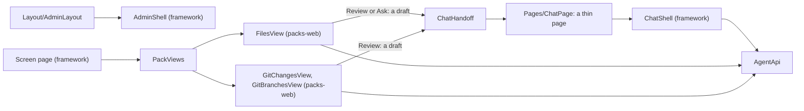

# louis-agent.code-review — design

> **Kind:** Blazor WebAssembly app · **Path:** `demos/louis-agent/web/louis-agent.code-review/` · **Served by:** louis-agent.api (same origin) ·
> **References:** louis-agent.web (with Markdig), highlight.js (from a CDN)

## Purpose

The browser front end for the coding agent: chat with it, browse the workspace, review and commit changes, and review and
merge branches, on top of louis-agent.api. It's a small site on [the framework's web](../../../../src/docs/projects/louis-agent.web.md),
the second real user of its frames.

## How it works

- **The chat** is `ChatShell` with this site's name, its boot screen, its theme picker and links to the packs' screens. A coding agent has no
  use for credits, a language menu, a place or projects, so `ChatPage` turns those off, along with what only says it's coming.
- **A session** gets every toolset the API can load.
- **Files, Changes and Branches aren't this app's.** They're the files and git packs' views, under `packs-web/`, and open as admin screens
  at `/admin/screens/{name}`. `Program.cs` registers them with `FilesWebViews.AddTo` and `GitWebViews.AddTo`.
- **A Review or Ask button opens this chat with the prompt as a draft,** and nothing is sent until the person sends it (`ChatHandoff`).
- **Themes** are `retro`, the default, and `paper`: Sass that sets the framework's colour names, built to `wwwroot/css/themes/`, loaded after
  `app.css` and swapped while the page runs. `wwwroot/js/theme.js` keeps the choice in this browser and across tabs.

## Structure

| Path | What's in it |
|---|---|
| `Pages/ChatPage.razor`, `Pages/NotFound.razor` | The thin chat page, at `/`, `/chat` and `/chat/{id}`; the page for an unknown address |
| `Layout/AdminLayout.razor`, `Layout/MainLayout.razor` | This site's admin frame, on `AdminShell`; the chat's layout |
| `Components/EmptyChat.razor`, `Components/ThemeSwitcher.razor` | The boot screen above the message box; the theme picker, listing `themes.json` |
| `Styles/app.scss`, `Styles/chat/_boot.scss`, `Styles/themes/` | The list of the framework's and the packs' Sass, this site's few rules, and the two themes ([ADR 0085](../../../../src/docs/adr/0085-styles-are-written-in-sass.md)) |
| `wwwroot/index.html`, `wwwroot/js/theme.js`, `wwwroot/css/themes/themes.json` | The host page, the theme's script, and the list of themes. The other CSS is built, and isn't in git |
| `packs-web/louis-agent.pack.files.web`, `packs-web/louis-agent.pack.git.web` | Not in this project: the views it registers, with their records, calls and Sass |

## Configuration

None of its own: it's served by the API on the same origin. The coding agent's program, `louis-agent.coding-api`, references it. If the API
needs `AGENT_API_KEY` it's entered under *Settings* in the sidebar, and the admin's key on the admin page; each stays in this browser.

## Extending it

A control for a pack goes in that pack's web project as a screen ([Build a pack](../../../../src/docs/guides/build-a-pack.md)), not here. A theme is
[Change the code-review web app](../guides/change-the-web-app.md). What would be the same on every site goes in the framework
([ADR 0084](../../../../src/docs/adr/0084-every-site-is-built-on-the-frameworks-web.md)).

## Tests

`demos/louis-agent/tests/louis-agent.code-review.tests`, NUnit with bUnit: `Pages/ChatPageTests` renders the whole page against the stub API and
pins the empty page and the page with a turn to golden files; `Pages/SiteRoutesTests` opens a screen's address through this site's router;
`Styles/StylesheetTests` reads what the build made. The packs' views are tested in `packs-tests/`.

## Limits and plans

- Screens with real data haven't been seen in a browser yet, only their tests. The eval pages move in F59.10, and this site gets them then.
- The chat keeps nothing on the server between restarts beyond what the API's session holds; a chat that ended says so.

## Related docs

[README § Web app](../../../../README.md#web-app) · [Quick start](../QUICK_START_AGENT.md) · [louis-agent.api](../../../../src/docs/projects/louis-agent.api.md)

---
[Projects](../../../../src/docs/projects/README.md) · Previous: [louis-agent.api](../../../../src/docs/projects/louis-agent.api.md) · Next: [louis-agent.web](../../../../src/docs/projects/louis-agent.web.md)
