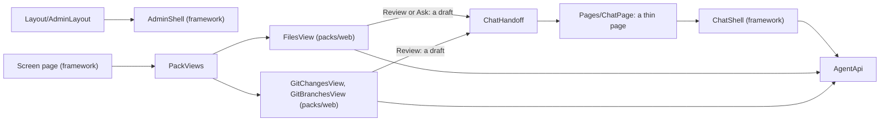
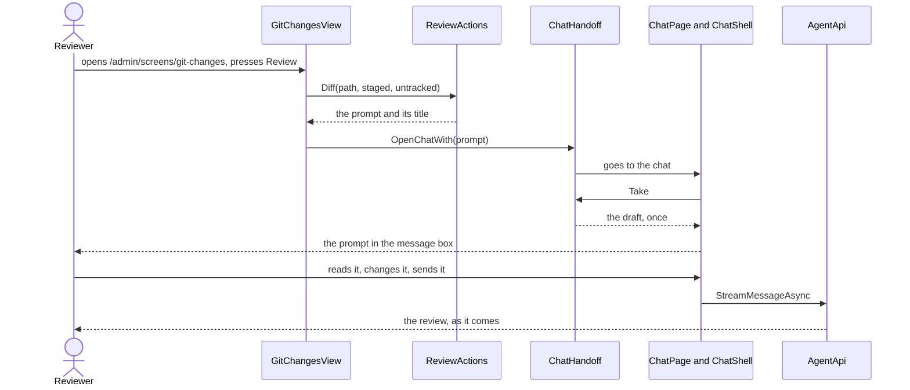
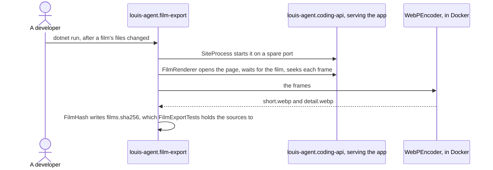

# louis-agent.code-review — design

> **Kind:** Blazor WebAssembly app · **Path:** `demos/louis-agent/web/louis-agent.code-review/` · **Served by:** louis-agent.api (same origin) ·
> **References:** louis-agent.web (with Markdig), highlight.js (from a CDN)

## Purpose

The browser front end for the coding agent: chat with it, browse the workspace, review and commit changes, and review and
merge branches, on top of louis-agent.api. It's a small site on [the framework's web](../../../../src/docs/projects/louis-agent.web.md),
the second real user of its frames, and since F109.1 the coding agent's landing page as well: the
framework's site, its pages and films, with the chat behind *Try it*.

## How it works

- **The chat** is `ChatShell` with this site's name, its boot screen, its theme picker and links to the packs' screens. A coding agent has no
  use for credits, a language menu, a place or projects, so `ChatPage` turns those off, along with what only says it's coming.
- **A session** gets every toolset the API can load.
- **Files, Changes and Branches aren't this app's.** They're the files and git packs' views, under `packs/web/`, and open as admin screens
  at `/admin/screens/{name}`. `Program.cs` registers them with `FilesWebViews.AddTo` and `GitWebViews.AddTo`.
- **A Review or Ask button opens this chat with the prompt as a draft,** and nothing is sent until the person sends it (`ChatHandoff`).
- **Themes** are `retro`, the default, and `paper`: Sass that sets the framework's colour names, built to `wwwroot/css/themes/`, loaded after
  `app.css` and swapped while the page runs. `wwwroot/js/theme.js` keeps the choice in this browser and across tabs.

## Diagrams

**Flow:** the architecture is under *How it works*; this is reviewing a change, the job it's for. The button only fills the message box, and nothing goes to the model until the person sends it.

## The site's pages and films

Since F109.1 the app is also the coding agent's landing page, the demo of the framework it runs on, and since F109.4
the site tells the whole architecture ([ADR 0100](../../../../src/docs/adr/0100-the-site-tells-the-whole-architecture.md)):
`/` (one page that moves, F110: the lockup and the menu on the right in the frame; a section index on the left and a
progress line the frame's module drives; the hero, 100% C# and South Africa up front, the numbers, the short film as
the map of the whole framework, the four concepts, what's built on it, the custom-agents band, the contact strip, each
block revealing as it enters), `/how-it-works` (the detailed film, one turn through core; the
parts in the order a turn meets them; the rules every turn keeps), `/architecture` (every project that ships, by
family), `/identities`, `/packs`, `/build-your-own` (a real program and catalogue), `/proof` (the numbers in dollars
and rand, and how the rand come about), `/built-on-it` (the two demos, what the framework stands on with each licence,
the hosts), `/whats-coming` (the planned features by id, each marked planned) and `/contact`, every one in the site's
frame (`SiteLayout` on the framework's `SiteShell`), the chat at `/chat` in its own bare layout. The pages are written
from the docs the guide in the corner reads, every number from the ledger or an eval run, and each claim is held to
the repo by a test (below); what's planned is on its own page, labelled, never as shipped. The repository is private,
so no page links to it.

**The two films** are CSS alone. `Styles/site/movie/_stage.scss` is what they share: a 1280×720 stage scaled to its
container, a floor seen from above (`perspective` on the camera, the camera's moves a `transform` animation on the
floor), each part a slab raised off the floor, the turn as a light flying above them with its shadow on the floor, a
flat detail card top right, a caption strip at the bottom. `_short.scss` (36 s, six scenes) and `_detail.scss` (60 s,
ten scenes) add where each part stands, the camera's keyframes, when each part lights up, the light's path and when
each card and caption shows, under `.film-short` and `.film-detail`, every keyframe name ending in the film's letter.
The detailed film's six slabs inside core are the chat pipeline's middleware in its real order, outermost first
(`ChatPipeline.cs`), and `DetailedMovieTests` holds that order. The films are the content, so a visitor's
reduced-motion setting stills the hero's typing and never a film (FX35).

**The exports for GitHub** (`docs/films/`) are rendered from the same CSS frame by frame by
`tools/louis-agent.film-export`, which starts `louis-agent.coding-api` on a spare port, seeks each animation in a
headless Chrome and encodes the frames in Docker; `films.sha256` records what each was made of, and
`FilmExportTests` fails until a changed film is re-exported ([ADR 0077](../adr/0077-films-on-github-are-rendered-webp.md)).

## Structure

| Path | What's in it |
|---|---|
| `Pages/ChatPage.razor`, `Pages/NotFound.razor` | The thin chat page, at `/chat` and `/chat/{id}`; the page for an unknown address |
| `Pages/Site/` | The site's pages (F109.1, F109.4): the landing, how it works, proof, built on it, what's coming, contact; under `Framework/`, architecture, identities, packs and build your own |
| `Components/Architecture/` | The Architecture page's families, one component each: `Framework/` (the engine, the hosts, the web, the evals) and `OnIt/` (the packs, the demos, where it runs) |
| `Components/Movies/` | The two films, CSS alone: the short one on the landing, the detailed one on How it works, each pinned to a golden; `FilmFrame`, the frame a page plays a film in, with its pause button outside the film |
| `Layout/SiteLayout.razor`, `Layout/AdminLayout.razor`, `Layout/ChatLayout.razor` | The site's frame, on the framework's `SiteShell`, the router's default; this site's admin frame, on `AdminShell`; the chat's bare layout |
| `Components/Guide/` | `ExpertChat`: the framework's `ChatWidget` wrapped once with the expert identity and the site's words, placed in the frame's corner by `SiteLayout` and placeable on any page (F109.3) |
| `Components/Landing/` | The landing's parts: the hero with its animated turn (`live-turn`, its own class since FX71), the proof tiles, built on it, the contact strip, and `ChatLink`, the way into the chat; the custom-agents band is the page's own |
| `Styles/site/landing/_motion.scss`, `wwwroot/brand/mark.svg` | The look of the landing's motion (the index, the progress line, the reveal keyframes `site-rise` and `site-unmask`, the compact header), which the frame's module drives (F110); the app's own copy of the mark for the lockup |
| `Components/EmptyChat.razor`, `Components/ThemeSwitcher.razor` | The boot screen above the message box; the theme picker, listing `themes.json` |
| `Styles/app.scss`, `Styles/site/`, `Styles/chat/_boot.scss`, `Styles/themes/` | The list of the framework's and the packs' Sass, then the site's look (F109.1: its values and elements right after the framework's, hung off the frame's root `.site` so the chat keeps the framework's; the landing, the films and its phone rules after the packs'), this site's few rules, and the two themes: `console`, the default, the framework's colours as they are, and `retro` to switch to; the picker's list is `wwwroot/css/themes/themes.json` ([ADR 0085](../../../../src/docs/adr/0085-styles-are-written-in-sass.md)) |
| `wwwroot/index.html`, `wwwroot/js/theme.js`, `wwwroot/css/themes/themes.json` | The host page, the theme's script, and the list of themes. The other CSS is built, and isn't in git |
| `packs/web/louis-agent.pack.files.web`, `packs/web/louis-agent.pack.git.web` | Not in this project: the views it registers, with their records, calls and Sass |

## Configuration

None of its own: it's served by the API on the same origin. The coding agent's program, `louis-agent.coding-api`, references it. If the API
needs `AGENT_API_KEY` it's entered under *Settings* in the sidebar, and the admin's key on the admin page; each stays in this browser.

## Extending it

A control for a pack goes in that pack's web project as a screen ([Build a pack](../../../../src/docs/guides/build-a-pack.md)), not here. A theme is
[Change the code-review web app](../guides/change-the-web-app.md). What would be the same on every site goes in the framework
([ADR 0084](../../../../src/docs/adr/0084-every-site-is-built-on-the-frameworks-web.md)).

## Tests

`demos/louis-agent/tests/louis-agent.code-review.tests`, NUnit with bUnit: `Pages/ChatPageTests` renders the whole page against the stub API and
pins the empty page and the page with a turn to golden files; `Pages/SiteRoutesTests` opens a screen's address through this site's router;
`Pages/Site/*Tests` render the site's pages and hold them to the repo (`SiteMapTests`: every project the solution ships is named on a page; `IdentitiesPageTests` and `PacksPageTests`: every identity and pack folder; `BuildYourOwnTests`: the real program; `ProofPageTests`: the rand at the rates file's rate and date; `StandsOnTests`: every package named is referenced, and no page links to the private repository; `WhatsComingTests`: every planned feature is an open TODO row, marked planned), `Components/Guide/GuideKnowsTheSiteTests` holds the expert's voice to every page's address, and
`Layout/SiteLayoutTests` the frame's links; `Movies/*Tests` pin each film's scenes, its names against the code, and its markup to a golden, and `Movies/FilmExportTests` holds the README's exported films to the films as they are (the hash in `docs/films/films.sha256`); `Styles/StylesheetTests` reads what the build made. The packs' views are tested in `packs/tests/`.

## Limits and plans

- Screens with real data haven't been seen in a browser yet, only their tests. The eval pages move in F59.10, and this site gets them then.
- The chat keeps nothing on the server between restarts beyond what the API's session holds; a chat that ended says so.
- The contact page's three mail links go to Louis's address (FX72), in its early-access panel, the custom-agents
  section and the hosted-site offer; *Build your own* says the packages aren't on NuGet yet, and has to change the
  day they are.
- *Try it* and the hero's button lead to the chat until the triage demo (F106.3) gives them a page of their own; the
  brand mark waits for its files (the site keeps its wordmark); the short film's export grew to about 7 MB with its
  twelve parts, where the old one was under 3 MB.

## Related docs

[README § Web app](../../../../README.md#web-app) · [Quick start](../QUICK_START_AGENT.md) · [louis-agent.api](../../../../src/docs/projects/louis-agent.api.md) · [ADR 0066](../adr/0066-the-site-is-static-razor.md) · [ADR 0077](../adr/0077-films-on-github-are-rendered-webp.md)

---
[Projects](../../../../src/docs/projects/README.md) · Previous: [louis-agent.api](../../../../src/docs/projects/louis-agent.api.md) · Next: [louis-agent.web](../../../../src/docs/projects/louis-agent.web.md)
