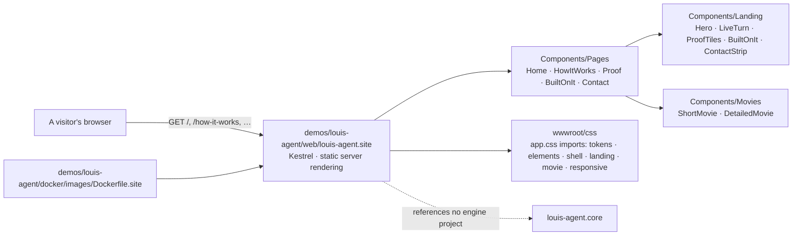

# louis-agent.site — design

> **Explanation.** What the engine's public website is, how it's built and how it's tested. **Elsewhere:** changing
> it in [Change the site](../guides/change-the-site.md); why it's a static Razor site in
> [ADR 0066](../adr/0066-the-site-is-static-razor.md).

> **Kind:** ASP.NET Core app (`net10.0`, static server-rendered Razor components) · **Path:** `demos/louis-agent/web/louis-agent.site/` ·
> **References:** nothing of ours, on purpose · **Used by:** nobody in the solution; a visitor's browser

## Purpose

Tells a .NET developer what the louis-agent engine is, why they'd want it, and shows that it works, in the Console
theme (black, white and metallic grays). It talks about the engine; it doesn't run it. It shows only what works
today, the same rule as Puls's landing page: no feature tile for anything that hasn't shipped.

## How it works

Every page is rendered once on the server into plain HTML and sent; there is no WebAssembly, no interactivity and no
script of our own, so a page is its markup and `css/app.css`. Five pages: `/` (the hero with the live turn, the
numbers, the short film, what's built on it, the contact strip), `/how-it-works` (the detailed film, the parts in
plain words, the rules every turn keeps), `/proof`, `/built-on-it`, `/contact`. `/health` answers a container's check.

**The two films** are CSS alone. `movie/stage.css` is what they share: a 1280×720 stage scaled to its container
(`tan(atan2(100cqw, 1280px))` turns the width ratio into a number), a floor seen from above (`perspective` on the
camera, the camera's moves a `transform` animation on the floor), each part a slab raised off the floor
(`translateZ` plus a stack of 1px shadows for its side), the turn as a light flying above them with its shadow on
the floor, a flat detail card top right, a caption strip at the bottom. `short.css` (36 s, six scenes) and
`detail.css` (60 s, ten scenes) add where each part stands, the camera's keyframes, when each part lights up, the
light's path and when each card and caption shows, under `.film-short` and `.film-detail`, every keyframe name ending
in the film's letter. A scene's window is a share of the loop (a sixth, a tenth); the camera is wide at the start and
the end, otherwise flown in on the part at work and panned to the next. The detailed film's six slabs inside core are
the chat pipeline's middleware in its real order, outermost first (`ChatPipeline.cs`), and `DetailedMovieTests` holds
that order.

**The theme** is `settings/tokens.css`: one dark ground, white for what matters, a gray scale, and "chrome" (a
white-to-steel gradient clipped to the big words). No light mode: the films are drawn for a dark floor. Motion is
off under `prefers-reduced-motion` for the decoration only: the films are the content and play as a video would (FX35).

## Architecture

## Parts

| Folder | Holds |
|---|---|
| `Components/Layout` | `SiteLayout`: the header with the menu, the body, the footer |
| `Components/Pages` | One component per route |
| `Components/Landing` | The home page's parts: `Hero`, `LiveTurn` (the streaming turn in the hero), `ProofTiles`, `BuiltOnIt`, `ContactStrip` |
| `Components/Movies` | `ShortMovie`, `DetailedMovie`: markup only; their behaviour is in `wwwroot/css/movie/` |
| `wwwroot/css` | `app.css` the import list in cascade order; one file per concern, each under 200 lines of rules |

## Settings

None. `ASPNETCORE_URLS` as for any ASP.NET Core app; the container listens on 8080.

## Testing

`demos/louis-agent/tests/louis-agent.site.tests`: the site started in memory with `WebApplicationFactory` (every page answers with its
title and its film, no Blazor script, `/health`); bUnit renders of both films (the scenes counted, the parts numbered
in the order the turn reaches them, core's slabs in the pipeline's order, the markup pinned to a golden beside the
test, `LOUIS_UPDATE_GOLDEN=1` to rewrite); the stylesheet's import list, tokens first, each film's keyframes its own.

## Limits

- The contact page holds a `[YOUR EMAIL]` placeholder until Louis sets the address.
- No light theme, no localisation (F46 will move the texts too), no analytics.
- The films are CSS: no play, pause or scrubbing. The MP4 exports are rendered from the same CSS frame by frame.

---
[Docs index](../../../../src/docs/README.md) · Related: [Projects](../../../../src/docs/projects/README.md) · [Change the site](../guides/change-the-site.md)
