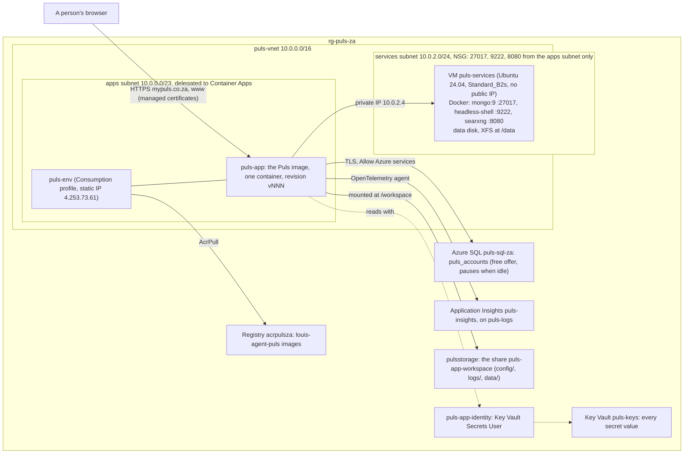
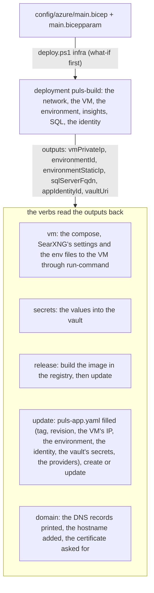
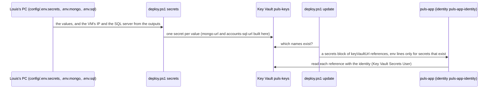

# Puls in Azure: the architecture

> **Explanation.** What runs where for `mypuls.co.za`, how the parts reach each other, where a secret travels and
> where a request goes, in diagrams. **Elsewhere:** the how-to in [README.md](README.md), the build's record in
> `demos/puls/config/azure/main.bicep`, the why in ADR 0096, the whole system's deployment view in
> [07-deployment-view](../../../../src/docs/architecture/07-deployment-view.md). Live since 2026-11-07 (F61.4).

## What runs where

One resource group, `rg-puls-za` in South Africa North. The app is the only thing with a public address; the three
services sit on a VM that nothing outside the network can reach; the accounts are on Azure SQL's free offer; every
secret value is in the vault.



## The build and the verbs

The template is the record: one deployment, `puls-build`, creates what is missing and updates what exists; the
verbs do what a template can't.



## A secret's path

No value is ever in a file under git or on the app: it goes from the git-ignored config files into the vault, and
the app's secrets are references the identity resolves.



## A chat, from the domain to the model

```mermaid
sequenceDiagram
    participant B as Browser
    participant CF as Cloudflare DNS (DNS-only records)
    participant A as puls-app
    participant SQL as Azure SQL
    participant VM as puls-services
    participant M as Anthropic
    B->>CF: mypuls.co.za?
    CF-->>B: 4.253.73.61 (A), www a CNAME to the app's own address
    B->>A: GET / over HTTPS
    A-->>B: the Puls web app
    B->>A: POST /account/login
    A->>SQL: the user (the database resumes after a pause; EF retries)
    A-->>B: Set-Cookie
    B->>A: POST /v1/sessions (cookie + X-Requested-With)
    A->>VM: 27017 Mongo (runs, prices, recipes), 9222 Chrome, 8080 SearXNG
    A->>M: the model's answer
    A-->>B: streamed
```

## What the network lets through

| From | To | Port | Allowed by |
|---|---|---|---|
| The internet | `puls-app` | 443 | the environment's ingress, with the managed certificates |
| The internet | the VM | any | nothing: no public IP, and the NSG denies all inbound but the rule below |
| The apps' subnet | the VM | 27017, 9222, 8080 | the NSG rule `apps-to-services` |
| Louis's IPv4 | the VM | 22 | only while `infra -Ip` set it; `infra` without `-Ip` removes it |
| `puls-app` | Azure SQL | 1433 | the server's "Allow Azure services" rule, TLS 1.2 |
| Louis's IPv4 | Azure SQL | 1433 | the server's rule `home`, from `deploy.ps1 sql-access` |

---
[Docs index](../../../../src/docs/README.md) · Related: [README](README.md) · [Deployment view](../../../../src/docs/architecture/07-deployment-view.md)
