# Change the Puls web app

> **How-to.** Change `demos/puls/web/LouisAgent.Puls`, the general assistant's web app: run it, change the chat, the landing page
> or the admin portal, add a starter, place its words, and test it. **Elsewhere:** how it works in
> [LouisAgent.Puls](../projects/LouisAgent.Puls.md); what it shares with the code-review app in
> [Change the framework's web](../../../../src/docs/guides/change-the-web.md); Puls's voice, roles and packs in
> [Change Puls](change-puls.md), and identities in general in [Build an identity](../../../../src/docs/guides/build-an-identity.md).



Puls is a Blazor WebAssembly app, served by Puls's program, `LouisAgent.PulsApi`, which references it. It has three
parts: the landing page at `/`, the chat at `/gesels` (with its Verken and Studio views), and the admin portal at
`/admin` for the builders. What Puls says and which specialists it calls are the Puls identity's prompts, not this
app. The app shows the chat, the specialists' work in the Werk panel, and what each answer cost.

Every change here follows the same loop: run the app, make the change, run its tests, then look at it in a browser.


## Run it

```bash
docker compose -f demos/puls/docker/docker-compose.puls.yml --env-file demos/puls/config/.env up -d --build          # http://127.0.0.1:5070
dotnet run --project demos/puls/hosts/LouisAgent.PulsApi         # http://127.0.0.1:5071
```

The compose stack runs Puls itself on port 5070, beside the stores and tools it uses: the accounts' database
(`puls-sql`), the store (`puls-mongo`), the search (`puls-searxng`) and the headless browser (`puls-browser`) that the
specialists use. To work on the app from Rider, run the API on its own instead. Its `puls` launch profile serves on
port 5071 and gives it Puls's settings: `IDENTITIES=puls`, its roles, and SearXNG and the browser on the compose
stack's ports. The web app comes along as the program's project reference.

## Change the chat

The page is `Pages/ChatPage.razor`, and all it does is fill the framework's `ChatShell`: the logo, the links, the
profile, the water, the empty chat and the cost line's words. Its code-behind, `ChatPage.razor.cs`, says which view
shows and which toolsets a session asks for.

A change to the frame itself (the sidebar, the top bar, the message box, the work panel, renaming, search) goes in
`LouisAgent.Web`, since every site gets it
([Change the framework's web](../../../../src/docs/guides/change-the-web.md)). Only what's Puls's own is a component
under `Components/Chat/`, with its C# in its `.razor.cs`
([hosts-and-web.md](../../../../.claude/rules/hosts-and-web.md)). Logic that needs no component goes in a plain class
with its test.

A new chat opens its session with the `agents` and `web` toolsets, where the instance has them: Puls answers the web
itself and asks the cook about cooking. An API with no `agents` toolset gets every toolset it has instead. The
session also carries the role `puls/voice-af` (or the chosen language's voice), the user's time zone, and their place
when they've set one. A new session option starts in the API
([Change the API](../../../../src/docs/guides/change-the-api.md#add-a-session-option)), then goes into
`AgentApi.CreateSessionAsync` in the shared library.

Some links still show a "kom binnekort" (coming soon) toast. To make one real, replace its toast with the feature and
keep the label.

## Add a starter

A starter is one line in `Content/Templates.cs`. Verken and Studio show it as a card (`TemplateCard`), and a click
opens a new chat with the starter in the message box.

## Change the landing page

`Pages/LandingPage.razor` lays out the sections in order. Each section is a component in `Components/Landing/`. A
section's single lines sit in its markup, and where it repeats a shape (tiles, questions, prices) its copy is a C#
array in its `.razor.cs`.

The motion (the progress line, the reveals, the pinned tour, the demo) is `wwwroot/js/landing.js`, a module the page
imports (CL31) and starts and stops. Keep a new animation behind the motion switch (`chat.motion`), so a user who asks
for less motion gets none.

## Change the admin portal

The admin pages are the framework's ([Change the eval pages](../../../../src/docs/guides/change-the-eval-pages.md)).
Two things are Puls's own. `Layout/AdminLayout.razor` fills the framework's frame with Puls's logo, its way back, its
live strip and its links. `Content/PulsSites.cs` says which websites the sources chart sorts, so a new shop's address
goes there.

## Words

Puls speaks Afrikaans. The shared components' words are `Text/PulsText.cs` (`PulsText.Afrikaans`, a `ChatText`). A
label in a `.razor` is markup and stays there. A text built in C# goes in `PulsText`, never inline
([ADR 0009](../../../../src/docs/adr/0009-message-text-as-enum-templates.md)). A word the framework's frame shows is a
property of `ChatText` in English, and its Afrikaans goes in `PulsText`.

## Test it

```bash
dotnet test demos/puls/tests/LouisAgent.Puls.Tests
LOUIS_UPDATE_GOLDEN=1 dotnet test demos/puls/tests/LouisAgent.Puls.Tests    # after a deliberate markup change: then read the diff
```

`Pages/ChatPageTests` renders the chat page with bUnit against `FixtureApi`, a stand-in for the API, and streams a
recorded Puls turn (a pancake recipe handed to the cook). The empty page and the turn are pinned to golden files,
`ChatPage.empty.html` and `ChatPage.turn.html`: the expected markup, saved beside the test. The test also lists the
page's JavaScript calls (the modules' imports and the functions called on them), so a new call is a review point.
`Pages/LandingPageTests` pins the landing page (`LandingPage.html`), and `Layout/AdminLayoutTests` the admin frame
(`AdminLayout.html`). `Components/` pins `WorkPanel`, `TemplateCard` and `PulsTile`. The tests under `Styles/` hold
the stylesheets to the colour rules, and the ones under `Deploy/` hold the deploy files.

Then look at it in a browser at a wide, a medium and a phone width (1440, 1100 and 420 px). Below 1200 px the Werk
panel slides in instead of standing as a column, and below 992 px the sidebar does too.

## Before you ask for a review

- [ ] No `@code` in a new `.razor`; new logic is in a plain class with its test.
- [ ] New words are in `PulsText` or in markup, none built inline in C#.
- [ ] New motion is behind the motion switch, and the golden files' diff is the change you meant.

---
[Guides](../../../../src/docs/guides/README.md) · [Docs index](../../../../src/docs/README.md)
