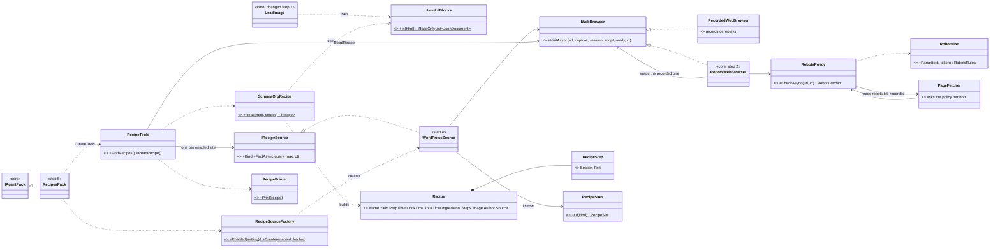
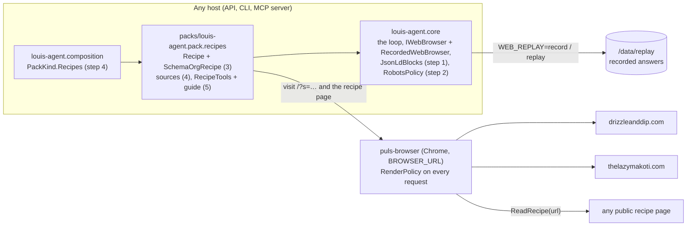
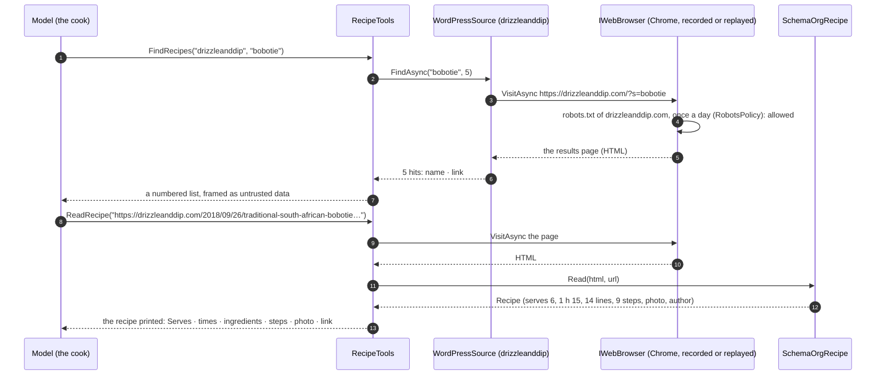
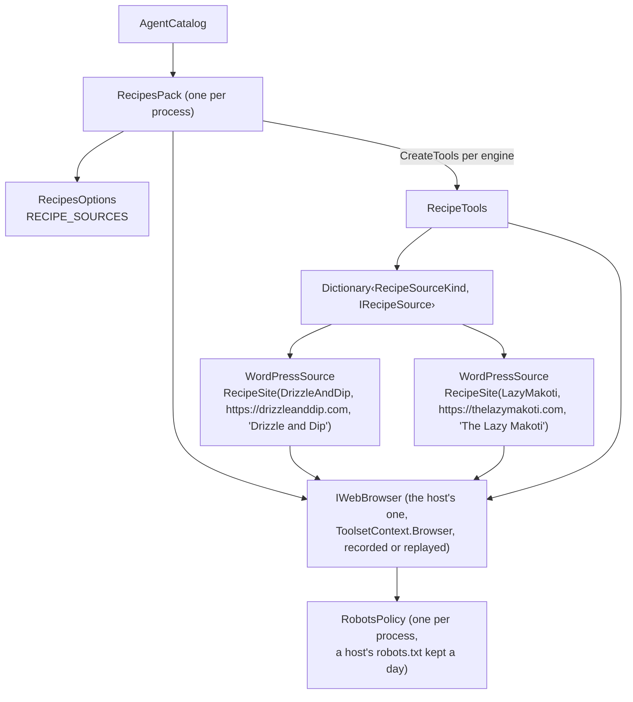

# F35 Recipe sources: the cook reads a recipe from the page's own data

> **What this answers:** how the cook gets a real South African recipe, whole and exact, from the site that
> published it, in code, so that the amounts and steps are the page's and not the model's memory, the answer can link
> its source, and an eval can replay the same pages every run. This is **F35.1**, the first steps of F35, 0 to 5 (the
> JSON-LD reader, the robots policy, the `Recipe` record, the sources and `RecipeTools`); F35.2 (the cook uses them, the recipes eval,
> the write-up) is listed at the end and planned when it starts. Branch `feature/F35.1-recipe-sources`, one PR per
> step to that branch, the branch to `main` at the end. ADRs **0067** and **0068** (0065 is F53.1's and 0066 the website's, claimed in open PRs on 2026-11-03; steps 0 and 2
> take the next free numbers on `main` the day they are written, and nothing else changes).

Status: **draft for Louis, 2026-11-03.** Six findings below, each on its own card. Picked 2026-11-03: A1, B1, **C2** (the
guarded browser, not the HTTP fetcher; the plan below is rewritten for it), D2, F1, **E3** (a robots policy on every fetch, in core: a new step 2 and ADR 0068, written in below) and **G1** (an unreachable `robots.txt` refuses the page for an hour). **Approved on every finding, 2026-11-03 23:32; H to L approved 2026-11-04 (*Approved during the build*).**

## The goal, in Louis's words

"It has to be free" (2026-10-18, on recipe APIs), "recipe providers like shops providers, so it has all the details",
and the pages kept, "because benchmarks need them". The platform plan settled the shape: a `recipes` pack with
`FindRecipes(source, query)` over the sites turned on and `ReadRecipe(url)` over any public page's schema.org
`Recipe` block, the JSON-LD reader as infrastructure in core, each site turned on only after its terms are read
([ADR 0023](https://github.com/bosbevk/louis-agent/blob/main/src/docs/adr/0023-copyleft-beside-us-permissive-linked.md)).
F48 (the cook as a home cook and teacher) builds on F35's `Recipe` record: its ingredient-line reader, scaler and
shopping list work on that record, so what this plan gives the record is what F48 gets.

GOAL skills **4** (tool design: a whole recipe in a small result), **5** (structured outputs: a page's own data over
its text), **7** (context: fewer tokens in), **12** (evals on replayed pages) and **15** (outside data framed as data;
what we read, and may: `robots.txt` obeyed in code).

## Context: what we have today, checked in the code on 2026-11-03

- **The cook reads no recipe as data.** `puls-cook.md` searches the web, `FetchUrl`s a page and reads the recipe from
  the page's text. The amounts are read by the model from prose, the photo is picked from `` lines by
  rules in the prompt, and the prompt carries a list of nine sites that refuse automated readers (`food24.com` among
  them). The eval's `recipe-image` check (`Evals/Cook/eval.json`) grades the photo; nothing grades the recipe against
  its source, because there is no source as data.
- **Core already touches JSON-LD, with a regular expression.** `LeadImage` (FX24, `Tools/Web/Fetching/`) finds the
  page's photo in its JSON-LD with a `[GeneratedRegex]` over `<script type="application/ld+json">`, parses each block
  with `System.Text.Json` and walks `@graph`. ADR 0057 says a regex goes as the code is touched, and step 1 touches
  it.
- **The page fetcher is reusable.** `PageFetcher` (core) is the guarded HTTP client the web tools fetch with: the
  SSRF guard on every hop, an honest user agent (`… louis-agent/1.0`, ADR 0038), a 5 MB cap, 20 s timeout, and
  **record and replay built in** (`RecordedFetchHandler` over the session's `ReplayStore`, F18 step 4b). A pack gets
  the store from `ToolsetContext.Replay`. So the old draft's step 4 (a cassette of our own) is already built, and
  this plan has no such step.
- **The guarded browser** (`IWebBrowser`, Chrome) is there too, with its own record and replay (`RecordedWebBrowser`),
  for a site that renders with script. The three sites below don't (checked: their search results are in the HTML).
- **A pack is a known shape.** `packs/louis-agent.pack.shops` is the template: `ShopsPack : IAgentPack`, one
  `ToolsetDefinition`, `ShopsOptions.FromEnvironment()`, `IShopCatalogue` per provider, `ShopCatalogueFactory.Enabled`
  parsing the setting into an enum, `ShopToolMessage` for every text, the guide in `Prompts/toolsets/shops.md`, and
  `PackKind` in the composition root, whose summary already says "F35 `Recipes`". `ArchitectureTests` already names
  `louis-agent.pack.recipes` in its fixture. [Build a pack](https://github.com/bosbevk/louis-agent/blob/main/src/docs/guides/build-a-pack.md) is the how-to.
- **No HTML parser in core.** Pages are read with hand-written readers and generated regexes (`HtmlText`); there is no
  AngleSharp or HtmlAgilityPack. Finding A decides whether that changes.

### Facts checked for this plan

| Site | Checked 2026-11-03 | What it means |
|---|---|---|
| **drizzleanddip.com** | `robots.txt`: everything allowed for all readers but MJ12bot, no `Crawl-delay`, four sitemaps. WordPress with WooCommerce. The search page `/?s=bobotie` is server-rendered and gave 8 results (a classic bobotie, bobotie phyllo pies, a Cape tomato bredie, the *South African recipes* collection). Its recipe cards show *Servings*, *Prep time* and a *Print Recipe* link, the shape WP Recipe Maker gives | The first source: SA classics, a working search, nothing in its robots against us |
| **thelazymakoti.com** | `robots.txt`: everything allowed, no `Crawl-delay`, one sitemap. WordPress (Site Kit). Recipes with ingredient lists (chakalaka, umngqhosho, soft rolls, tomato gravy). `/?s=chakalaka` answered with the chakalaka post itself, not a results list (a WordPress theme that jumps to a single match) | The second source, SA home food. Its search reader must take a results page **or** a single post |
| **recipesfromsouthafrica.com** | `robots.txt`: everything allowed. WordPress. The posts seen (`/soetkoekies/`, `/soet-cookies/`) are stories with no ingredient list, and `/?s=melktert` found one category page, not a recipe | Thin. Enabled only if step 0's check finds `Recipe` data on its pages; otherwise left out, as the cook's prompt already leaves it |
| **food24.com** | Refuses automated readers (`robots_disallowed` on `/robots.txt` and `/`; the cook's prompt lists it too) | **Out.** A site that says no is not read (ADR 0038); a licence would be a business deal (`research/sa-recipes-api.md`) |
| The JSON-LD `Recipe` block itself | **Checked 2026-11-04 from the PC** with `curl` and the brief's user agent (the raw HTML, scripts included): three recipe pages per site and one search page; the trimmed copies are the fixtures. **drizzleanddip.com**, 3 of 3 recipe pages: a `Recipe` block in its own `application/ld+json` script, not inside the page's `@graph` block (which holds Article, BreadcrumbList, Person, WebPage and WebSite). The plugin is WP Recipe Maker (`wprm-recipe-container` on the page). `recipeYield` is a list with one string (`["6"]`, `["8"]`) on two pages and absent on the third. `recipeInstructions` is a list of `HowToStep` objects only (5, 10 and 11 steps; no `HowToSection`). `image` is a list of strings (1, 1 and 4 URLs). `prepTime` and `cookTime` are ISO durations (`PT10M`, `PT45M`); the milk tart has no `cookTime`; no page has `totalTime`. The search page `/?s=bobotie` lists 12 entries, each an `<article>` with its heading link. **thelazymakoti.com**, 0 of 3 recipe pages: no `application/ld+json` script and no recipe-plugin markup; the ingredients are a plain list (`<ul><li>`) under an *Ingredients:* heading. **recipesfromsouthafrica.com**, 0 of 3 recipe pages and its search page: no `application/ld+json` script, only microdata breadcrumbs. **Then the wider check of 74 sites (2026-11-04, *Approved during the build*) found drizzleanddip's pages carry `<meta name="robots" content="noai, noimageai">`**, which the first trim dropped. The recipe fixtures are now five pages of sites that allow us, one per shape: a `Recipe` alone from the site itself (`foodandhome-pork-bobotie`, `bibbyskitchenat36-bobotie-filo-parcels`), from Penci Recipe in Afrikaans (`rooirose-hoenderpasteitjies`), and WP Recipe Maker's inside a Yoast `@graph` (`wandercapetown-malva-pudding`) and a Rank Math `@graph` (`tantalisemytastebuds-pickled-fish`); the search fixtures are Food & Home's and Tantalise's `/?s=bobotie`. | **drizzleanddip.com is out: it refuses AI readers.** thelazymakoti.com and recipesfromsouthafrica.com allow us but publish no `Recipe` data: they are text sources under Louis's pick of 2026-11-04 (*Approved during the build*). The fixtures show `recipeYield` as a string (`"4 to 6"`), a list (`["6"]`) and empty, `HowToSection`s (Tantalise, Wander Cape Town) and `image` as a string and as an object; step 3's tests build the one shape none shows, `recipeYield` as a number, inline. |
| schema.org `Recipe` | `name`, `image`, `author`, `datePublished`, `description`, `prepTime`, `cookTime`, `totalTime` (ISO 8601 durations, `PT1H15M`), `recipeYield` (a string, a number or a list), `recipeCategory`, `recipeCuisine`, `keywords`, `recipeIngredient` (a list of lines), `recipeInstructions` (text, a list of `HowToStep`, or `HowToSection`s of steps), `nutrition` | The record's fields and the reader's cases, from Google's *Recipe structured data* page and schema.org |

## The findings: seven choices, one card each

Each is put to Louis on its own (rules 10 and 11), with three options, the pattern each one is, and the
recommendation. The plan is written with the recommended option.

### A. Where does the JSON-LD reader live, and how does it find the blocks?

| | Option | Pattern | What it changes | What it costs |
|---|---|---|---|---|
| **A1 (recommended)** | **One reader in core**, `Tools/Web/StructuredData/JsonLdBlocks`: a hand-written walk of the HTML (`IndexOf` of `<script`, its `type` attribute, the closing tag), each block decoded and parsed with `System.Text.Json`; `LeadImage` is moved onto it and its regex goes | Infrastructure the model never calls, shared (the platform plan's own placing); a small reader before a regex (ADR 0057); one reader for every caller (DRY) | Core gains one small class; `LeadImage` loses its regex; the pack gets the blocks for free | About 60 lines in core, with tests for the odd cases (an escaped `</script>` inside a string, HTML entities, a malformed block) |
| A2 | **AngleSharp** (MIT) in core, the reader a query over its DOM | Adopt a library (ADR 0030) | A real HTML parser for this and every later reader (`HtmlText`'s regexes could go too) | A 1 MB dependency and a new way of reading pages beside the existing one; nothing else needs it yet (ADR 0055) |
| A3 | The reader **inside the recipes pack** only; `LeadImage` untouched | Keep it local | Core doesn't change in F35 | Two readers of the same thing in two projects; the next pack (places, `LocalBusiness` blocks) copies it again |

Sources: ADR 0057 (a reader before a regex); the platform plan's *Inside a pack: four kinds of thing* (the JSON-LD
reader is infrastructure, in core); JSON-LD 1.1 §*Embedding JSON-LD in HTML* (w3.org/TR/json-ld11); ADR 0030, 0055.

### B. What is a recipe in code?

| | Option | Pattern | What it changes | What it costs |
|---|---|---|---|---|
| **B1 (recommended)** | **Our own `Recipe` record**, read from the JSON-LD by `SchemaOrgRecipe.Read(JsonElement, Uri)`: name, yield, the three times, the ingredient lines as they are, the steps (with their section), the photo, the author, the source link | Data Mapper (Fowler, PoEAA): one class that knows the page's shape and builds our record; the record a plain value (ADR 0040) | F48 gets exactly the fields it named (name, serves, lines, steps, link); the reader holds every odd case the sites show (`recipeYield` as `"6"`, `6` or `["6", "6 servings"]`; steps as text, `HowToStep` or `HowToSection`) | We write the reader (about 120 lines, tests from the recorded pages) and extend it when a site shows a new shape |
| B2 | **Schema.NET** (MIT): deserialise the block into its `Recipe` type, map to our record | Adopt a library | Every schema.org type at once, maintained by others | Its values are `OneOrMany<T>` and `Values<T1, T2, …>` unions, so the mapping to a plain record is the same work as B1, on top of a 10 MB package; mixed `@graph` documents need our walk anyway |
| B3 | **No record**: `ReadRecipe` hands the model the block's JSON, trimmed | None (pass-through) | Least code | The model reads JSON (more tokens than a table), nothing in C# can check or scale it, and F48's maths has nothing to work on. It fails F48's premise |

Sources: Fowler, *Data Mapper* (PoEAA); ADR 0040 (records for values); Schema.NET's README (its `Values` unions);
the F48 plan's decision *no Cooklang: the maths works on F35's record*.

### C. How does the pack read a site?

| | Option | Pattern | What it changes | What it costs |
|---|---|---|---|---|
| C1 (recommended, not picked) | **Over HTTP with core's `PageFetcher`**: the site's own search page (`/?s=bobotie`) and the recipe page, read as any reader's browser would, no Chrome | Gateway (Fowler): one object wraps the outside system; the fetcher we have, with its guard and its record and replay | The toolset needs no `BROWSER_URL`; a recorded eval replays through the fetcher's store; one page is one request | A site that renders its search with script can't be read this way (none of the three does, checked) |
| **C2 (Louis's pick, 2026-11-03)** | **Through the guarded browser** (`IWebBrowser`, Chrome), as the shops pack does | The same gateway, heavier | Script-rendered sites work | Chrome for a page that doesn't need it: slower, `BROWSER_URL` required, the Puls stack's browser container on every eval |
| C3 | **WordPress's REST API** (`/wp-json/wp/v2/posts?search=`), JSON in, no HTML reading | API client | The cleanest search answer | The precedent is to read a site as its visitors do, not its APIs (ADR 0023's note on F33/F34); a site can switch the API off; and the recipe page still has to be read for its block |

Sources: Fowler, *Gateway* (PoEAA); ADR 0023 (how Checkers is read); ADR 0038 (the fetcher says what it is);
`PageFetcher`'s summary (the guard, the record and replay).

### D. One class per site, or one class for every WordPress site?

| | Option | Pattern | What it changes | What it costs |
|---|---|---|---|---|
| D1 | **One class per site** (`DrizzleAndDipSource`, `LazyMakotiSource`), each behind `IRecipeSource`, as shops has `CheckersCatalogue` | Strategy (GoF), one concrete strategy per site | Each site's quirks in its own file | Three files that differ in a URL and a name; the next WordPress site is a fourth copy |
| **D2 (recommended)** | **One `WordPressSource`** behind `IRecipeSource`, built with the site's row (`RecipeSourceKind`, home URL, display name) from a small table, `RecipeSites`; a site that isn't WordPress gets its own class when it comes | Strategy whose concrete class is parameterised by data (Refactoring.Guru: *Replace Subclass with Fields*); the table a Registry | Three sites are three rows; the interface stays for a different kind of site | The one class must take both search shapes (a results list, or a theme that jumps to the single post) |
| D3 | **No interface**: one static `RecipeSearch` with the table | Simplest | Fewest types | The first non-WordPress site (a site with its own search API) forces the interface back in, and tests can't fake a source |

Sources: GoF, *Strategy*; Refactoring.Guru, *Replace Subclass with Fields*; Fowler, *Registry* (PoEAA); ADR 0003
(provider strategies: one interface, one implementation per provider, picked in one factory).

### E. Who checks that a site may be read?

| | Option | Pattern | What it changes | What it costs |
|---|---|---|---|---|
| E1 (recommended, not picked) | **A person, once, at enable time**: a site is read only where `RECIPE_SOURCES` names it, and it is named only after its `robots.txt` and terms were read (the table above); the source's summary says what was checked, as `CheckersCatalogue` does | Configuration over code; the ADR 0023 precedent (`SHOP_CATALOGUES`) | No code; the check is written down where the next reader looks | A site that changes its `robots.txt` later isn't noticed until someone looks |
| E2 | **`robots.txt` checked in code** when the pack starts: a source whose home disallows `/` or `/?s=` is left unavailable | Guard at start-up | Catches a change | A reader of `robots.txt` (its groups, `Allow` over `Disallow`, wildcards) for three sites that allow everything; the platform plan puts that reader with the collecting job (*Sources as data*), where every page goes through it |
| **E3 (Louis's pick, 2026-11-03)** | **A robots policy on every fetch** in core's `PageFetcher`, and on every page the browser opens | Policy on the gateway | Every tool obeys it, `FetchUrl` too | A design of its own (caching per host, the user agent's group, what to tell the model); out of F35's size |

Sources: ADR 0023; ADR 0038; the platform plan's *Collecting is a job, not a tool*; RFC 9309 (robots.txt) for E2/E3.

### F. What does `ReadRecipe` hand the model?

| | Option | Pattern | What it changes | What it costs |
|---|---|---|---|---|
| **F1 (recommended)** | **Short markdown sections**, framed as untrusted data: the name, *Serves* and the times on one line, the ingredient lines numbered, the steps numbered under their sections, the photo, the author, the link; nothing the page didn't say | The shops pack's table precedent (ADR 0005: bounded, framed output) | The model reads about 400 tokens instead of a 3,000-token page; the cook can quote lines by number | Our own print of the record (one small printer class) |
| F2 | **JSON** of the record | Pass-through | No printer | More tokens than F1, and the model is worse at quoting from JSON than from a list |
| F3 | **Both, by a `format` argument** | Parameterised output | The caller chooses | Two shapes to keep in step and golden; nobody asked for JSON (ADR 0055) |

Sources: ADR 0005 (guard the context); the shops pack's `ShopToolMessage.UntrustedFrame` precedent; Anthropic's tool
writing guidance (small, readable results).

### G. An unreachable `robots.txt` (a 5xx answer or a network error): read the page, or not?

Came with E3. The file *missing* (404) is settled by the RFC: everything is allowed. *Unreachable* is the open case.

| | Option | Pattern | What it changes | What it costs |
|---|---|---|---|---|
| **G1 (recommended)** | **Refuse the page for an hour**, then try the file again; the model is told why | RFC 9309 §2.3.1.4: a crawler MAY assume complete disallow while the file is unreachable | Honest: when a site can't tell us its rules, we don't guess | A site whose `robots.txt` is down (rare; it's a static file) is unreadable for that hour |
| G2 | **Read the page** as if the file allowed it | Fail open | Nothing stops a read | We read where we couldn't check: the opposite of why E3 was picked |
| G3 | **Read, but log a warning** and keep trying the file | Fail open, with a trace | The dashboard shows it | Same as G2 for the site; one more thing to look at |

Sources: RFC 9309 §2.3.1 (unavailable: allowed; unreachable: may disallow); Google's robots.txt specification (the
same table).

## Design: what changes (with the recommended picks)

In plain words: a page that publishes a recipe also publishes it for machines, as a JSON block hidden in its HTML
(JSON-LD, the format Google's recipe cards read). We read that block in code, turn it into a `Recipe` record, and
hand the cook a short, exact print of it. The pack has two tools: `FindRecipes` searches the sites a deployment turned
on, `ReadRecipe` reads one page. Both read through the guarded browser core already has (Chrome behind `IWebBrowser`,
as the shops pack reads Checkers), which already records and replays, so an eval replays them with nothing new.

1. **Core gets one reader** (step 1): `JsonLdBlocks.In(html)` returns every `application/ld+json` block as a parsed
   `JsonDocument`. `LeadImage` uses it; its regex goes.
2. **Core gets a robots policy** (step 2, Louis's pick E3): `RobotsPolicy` reads a host's `robots.txt` once a day
   through the recorded fetcher, keeps the group for `louis-agent` (else `*`), and says whether a path may be read
   (RFC 9309: the longest matching rule wins, `Allow` on a tie, `*` and `$` wildcards). `PageFetcher` asks it before
   every hop (`FetchUrl`, `VerifyQuote`, the pack's reads all go through it), and a `RobotsWebBrowser` decorator asks
   it before the browser opens a page (the page's own loads are the browser's, as any visitor's). A disallowed page is
   refused with the reason, as a private address is. `robots.txt` itself is always fetched; a missing one (4xx)
   allows all; an unreachable one is finding G.
3. **The pack** `packs/louis-agent.pack.recipes` (steps 3 to 5): `Recipe` and `SchemaOrgRecipe` (step 3), the sources
   (step 4), the tools, the guide, the pack class and its registration (step 5).
4. **Settings:** `RECIPE_SOURCES=drizzleanddip,lazymakoti` (comma-separated, case ignored, unset means none, as
   `SHOP_CATALOGUES`), and `BROWSER_URL` for the browser, as shops needs it (the Puls stack sets it).
5. **What's not here:** the cook doesn't use the pack yet (F35.2 changes `puls-cook.md`, adds `recipes` to Puls's
   packs, writes the recipes eval and the `local-sources` check); F48 adds the cache of read recipes its
   `WriteRecipe(link)` needs; the collecting job, `Crawl-delay` and the sitemaps stay with *Sources as data*.

### Interface design

```csharp
// core, Tools/Web/StructuredData (step 1): the blocks a page publishes for machines
public static class JsonLdBlocks
{
    /// Every <script type="application/ld+json"> block of the page, decoded and parsed; a malformed block is skipped.
    public static IReadOnlyList<JsonDocument> In(string html);
}

// core, Tools/Web/Robots (step 2): may this page be read?
public sealed record RobotsRule(bool Allow, string Pattern);                 // "Disallow: /wp-admin/", "Allow: /*.css$"
public sealed record RobotsRules(IReadOnlyList<RobotsRule> Rules)             // the group that applies to us
{
    public bool Allows(string pathAndQuery);                                  // longest match wins; Allow on a tie; nothing matches: allowed
}
public static class RobotsTxt
{
    public static RobotsRules Parse(string text, string userAgentToken);      // our group ("louis-agent"), else "*", else allow all
}
public enum RobotsVerdict { Allowed, Disallowed, Unreachable }
public sealed record RobotsFile(int? Status, string? Text);                   // 200 and the text; 404; 503; null status for a network error
public sealed class RobotsPolicy(Func<Uri, CancellationToken, Task<RobotsFile>> fetchRobots, TimeProvider? clock = null)
{
    public Task<RobotsVerdict> CheckAsync(Uri url, CancellationToken cancellationToken = default);   // one robots.txt per host, kept a day
}
public sealed class RobotsWebBrowser(IWebBrowser inner, RobotsPolicy robots) : IWebBrowser;   // refuses a disallowed page before Chrome opens it
// PageFetcher gains `RobotsPolicy? robots = null` and asks it on every hop; WebBrowserFactory wraps the recorded browser in RobotsWebBrowser.

// pack, Recipes (step 3): what a recipe is, as the page published it
public sealed record Recipe(string Name, string? Yield, TimeSpan? PrepTime, TimeSpan? CookTime, TimeSpan? TotalTime,
    IReadOnlyList<string> Ingredients, IReadOnlyList<RecipeStep> Steps, Uri? Image, string? Author, Uri Source);
public sealed record RecipeStep(string? Section, string Text);
public static class SchemaOrgRecipe
{
    /// The first Recipe entity in the page's JSON-LD (the document, an array or a @graph), or null when there is none.
    public static Recipe? Read(string html, Uri source);
}

// pack, Sources (step 4): a site that can be searched
public enum RecipeSourceKind { DrizzleAndDip, LazyMakoti }             // RecipesFromSouthAfrica only if step 0 finds its data
public sealed record RecipeSite(RecipeSourceKind Kind, Uri Home, string DisplayName);
public static class RecipeSites { public static RecipeSite Of(RecipeSourceKind kind); }
public sealed record RecipeHit(string Name, Uri Url);
public interface IRecipeSource
{
    RecipeSourceKind Kind { get; }
    Task<IReadOnlyList<RecipeHit>> FindAsync(string query, int maxResults, CancellationToken cancellationToken = default);
}
public sealed class WordPressSource(RecipeSite site, IWebBrowser browser) : IRecipeSource;   // /?s={query}; a results list or one post
public static class RecipeSourceFactory
{
    public static IReadOnlyList<RecipeSourceKind> Enabled(string? setting);                  // RECIPE_SOURCES
    public static IReadOnlyDictionary<RecipeSourceKind, IRecipeSource> Create(IReadOnlyList<RecipeSourceKind> enabled, IWebBrowser browser);
}
public sealed class RecipeSourceException(string message) : Exception(message);               // a RecipeToolMessage, never a crash

// pack, Tools (step 5): what the model calls
public sealed class RecipeTools(IReadOnlyDictionary<RecipeSourceKind, IRecipeSource> sources, IWebBrowser browser)
{
    [Description("…")] public Task<string> FindRecipes(string source, string query, int maxResults = 5, CancellationToken ct = default);
    [Description("…")] public Task<string> ReadRecipe(string url, CancellationToken ct = default);   // any public page
}
public sealed class RecipesPack(RecipesOptions options) : IAgentPack;   // Name "recipes", one toolset, Requires []
```



### Architecture



### Communication: the cook asks for a bobotie recipe (F35.2 will do this; here it is the shape the tools serve)



### Objects in one process



### Folder trees

Core, after step 1 (one new folder, one changed file):

```
louis-agent.core/Tools/Web/
├── Browsing/            …, RobotsWebBrowser (the decorator)             ← step 2
├── Fetching/            HtmlText, LeadImage (now on JsonLdBlocks), PageFetcher (asks the policy), PageText
├── Robots/              RobotsRule, RobotsRules, RobotsTxt, RobotsVerdict, RobotsFile, RobotsPolicy   ← step 2
├── StructuredData/      JsonLdBlocks                                   ← step 1
└── …
```

The pack, after step 4 (mirrored in `tests/louis-agent.pack.recipes.tests/`):

```
packs/louis-agent.pack.recipes/
├── louis-agent.pack.recipes.csproj
├── RecipesPack.cs             the pack: one toolset, recipes                  ← step 5
├── RecipesToolset.cs          enum { Recipes }                                ← step 5
├── RecipesOptions.cs          RECIPE_SOURCES                                  ← step 4
├── Recipes/                   Recipe, RecipeStep, SchemaOrgRecipe             ← step 3
├── Sources/                   IRecipeSource, RecipeSourceKind, RecipeSite, RecipeSites,
│                              RecipeHit, RecipeSourceException, RecipeSourceFactory   ← step 4
├── Providers/                 WordPressSource, SearchResultLinks              ← step 4
├── Tools/                     RecipeTools, RecipePrinter                      ← step 5
├── Messages/                  RecipeToolMessage, RecipeLogMessage             ← steps 4, 5
└── Prompts/toolsets/recipes.md                                                ← step 5

tests/louis-agent.pack.recipes.tests/
├── Recipes/SchemaOrgRecipeTests.cs, Fixtures/{site}-{dish}.html (the ld+json block, trimmed)   ← step 3
├── Providers/WordPressSourceTests.cs, Fixtures/{site}-search-{query}.html                    ← step 4
├── Sources/RecipeSourceFactoryTests.cs                                                        ← step 4
├── Tools/RecipeToolsTests.cs, Messages/RecipeToolMessageSnapshot.json (+Tests)               ← step 5
└── RecipesPackTests.cs, RecipesPrompts.cs                                                     ← step 5
```

### Namespace map

| Type | Folder | Namespace | Step |
|---|---|---|---|
| `JsonLdBlocks` | `louis-agent.core/Tools/Web/StructuredData/` | `LouisAgent.Core.Tools.Web.StructuredData` | 1, new |
| `LeadImage` (uses it; regex removed) | `louis-agent.core/Tools/Web/Fetching/` | `LouisAgent.Core.Tools.Web.Fetching` | 1, changed |
| `JsonLdBlocksTests` | `tests/louis-agent.core.tests/Tools/Web/StructuredData/` | `LouisAgent.Core.Tests.Tools.Web.StructuredData` | 1, new |
| `RobotsRule`, `RobotsRules`, `RobotsTxt`, `RobotsVerdict`, `RobotsFile`, `RobotsPolicy` | `louis-agent.core/Tools/Web/Robots/` | `LouisAgent.Core.Tools.Web.Robots` | 2, new |
| `RobotsWebBrowser` | `louis-agent.core/Tools/Web/Browsing/` | `LouisAgent.Core.Tools.Web.Browsing` | 2, new |
| `PageFetcher` (asks the policy per hop), `WebBrowserFactory` (wraps the browser), `WebToolMessage.RobotsDisallows` and `.RobotsUnreachable` | `Fetching/`, `Browsing/`, `Messages/` in core | as they are | 2, changed |
| `RobotsTxtTests`, `RobotsPolicyTests`, `RobotsWebBrowserTests`, a case in `PageFetcherTests` | `tests/louis-agent.core.tests/Tools/Web/Robots/`, `…/Browsing/`, `…/Fetching/` | `LouisAgent.Core.Tests.Tools.Web.…` | 2 |
| `Recipe`, `RecipeStep`, `SchemaOrgRecipe` | `packs/louis-agent.pack.recipes/Recipes/` | `LouisAgent.Packs.Recipes.Recipes` | 3, new |
| `IRecipeSource`, `RecipeSourceKind`, `RecipeSite`, `RecipeSites`, `RecipeHit`, `RecipeSourceException`, `RecipeSourceFactory` | `Sources/` | `LouisAgent.Packs.Recipes.Sources` | 4, new |
| `WordPressSource`, `SearchResultLinks` | `Providers/` | `LouisAgent.Packs.Recipes.Providers` | 4, new |
| `RecipesOptions` | the pack's root | `LouisAgent.Packs.Recipes` | 4, new |
| `RecipeToolMessage`, `RecipeLogMessage` | `Messages/` | `LouisAgent.Packs.Recipes.Messages` | 4 (the source's texts), 5 |
| `RecipeTools`, `RecipePrinter` | `Tools/` | `LouisAgent.Packs.Recipes.Tools` | 5, new |
| `RecipesPack`, `RecipesToolset` | the pack's root | `LouisAgent.Packs.Recipes` | 5, new |
| `PackKind.Recipes`, `Plugins.Create` arm | `src/louis-agent.composition/` | `LouisAgent.Composition` | 5, changed |
| Tests mirror each; `PackConvertibilityTests`, `PluginsTests` get the pack | `tests/louis-agent.pack.recipes.tests/`, `tests/louis-agent.composition.tests/` | `LouisAgent.Packs.Recipes.Tests.…` | 3 to 5 |

## Steps

One commit each, test first, the review stop after each (rule 5). The commit's scope is `f35.1`.

| # | Step and commit | Test first (seen failing, output kept) | Concept (GOAL skill) |
|---|---|---|---|
| 0 | **The plan on its branch, and the free check.** `feature/F35.1-recipe-sources` off `main`; this plan at `docs/plans/F35-recipe-sources.md` with its README row; the TODO's F35 line gets the plan link; ADR 0067 *A page's own data before its text* (below). The check, from Rider on the PC: three recipe pages per site (bobotie, melktert, chakalaka and the like) and one search page per site fetched with `curl`, their `application/ld+json` blocks read by eye; the result goes in this plan's *Facts checked* (which site has the block, which plugin, how `recipeYield` and `recipeInstructions` are written) and the trimmed pages, and each site's `robots.txt`, become the fixtures of steps 2 to 4. `docs(f35.1): step 0 - the F35 plan, ADR 0067 and the sites' data checked` | Docs only; the check's table | Measure before building (12) |
| 1 | **`JsonLdBlocks` in core; `LeadImage` onto it.** `feat(f35.1): step 1 - JsonLdBlocks reads a page's ld+json; LeadImage drops its regex` | `JsonLdBlocksTests`: two blocks on one page; a block with `&quot;` entities; `</script>` escaped inside a JSON string (`<\/script>`); a malformed block skipped, the next read; a `type` written `application/ld+json; charset=utf-8`; no block, an empty list. `LeadImageTests` unchanged and green | A typed reader over a regex (ADR 0057); structured data in the page (5) |
| 2 | **The robots policy in core.** `RobotsTxt`, `RobotsRules`, `RobotsPolicy` (a day's cache per host, on `TimeProvider`), `RobotsWebBrowser`, `PageFetcher` asking the policy on every hop, `WebBrowserFactory` wrapping the browser, `WebToolMessage.RobotsDisallows` and `.RobotsUnreachable`, ADR 0068. `feat(f35.1): step 2 - every fetch obeys robots.txt` | `RobotsTxtTests` on real files (the three sites' from step 0, and the RFC's examples): the `louis-agent` group over `*`; the longest match wins; `Allow` on a tie; `*` and `$`; a `Disallow:` with no path allows all; comments and blank lines; no group for us and no `*` allows all. `RobotsPolicyTests` with a fake fetch and a fake clock: one fetch per host a day (a second check doesn't fetch; a day later it does); 404 allows all; a disallowed path is `Disallowed`; the unreachable case as finding G settles it. `RobotsWebBrowserTests`: a disallowed page throws `WebBrowserException` with `RobotsDisallows` and the inner browser is never called; an allowed one passes through. `PageFetcherTests`: a disallowed hop is refused with the reason, as a private address is; `robots.txt` itself is never checked. The golden file changes (two new `WebToolMessage` texts): its diff read | A policy where every request passes (GoF *Decorator*, the `RecordedWebBrowser` precedent; the per-hop check beside the SSRF guard); the browser says what it is and obeys what it's told (ADR 0038; 15) |
| 3 | **The pack project, `Recipe` and `SchemaOrgRecipe`.** The csproj and the tests project (added to the solution), `Recipe`, `RecipeStep`, `SchemaOrgRecipe.Read`. `feat(f35.1): step 3 - the recipes pack: Recipe read from a page's schema.org data` | `SchemaOrgRecipeTests` on the step-0 fixtures: a WP Recipe Maker page in a `@graph`; `recipeYield` as `"6"`, `6` and `["6", "6 servings"]`; `recipeInstructions` as `HowToStep`s, as `HowToSection`s and as text; `PT1H15M` to 1 h 15; `image` as a string, an object or a list; a page with no `Recipe` gives null; a relative image resolved against the page | A page's data as a record (5, 7); Data Mapper |
| 4 | **The sources.** `RecipeSourceKind`, `RecipeSite`/`RecipeSites`, `IRecipeSource`, `RecipeHit`, `WordPressSource` with `SearchResultLinks`, `RecipeSourceFactory`, `RecipesOptions`, `RecipeSourceException`, the source's `RecipeToolMessage` texts. `feat(f35.1): step 4 - a WordPress site searched as a source` | `WordPressSourceTests` with a fake `IWebBrowser` that returns the recorded search page (as `CheckersCatalogueTests` does): Drizzle and Dip's list gives hits in page order, capped at `maxResults`, links to its own site only, no duplicates; The Lazy Makoti's single-post answer gives one hit (the visit's own URL and the page's title); an empty search gives none; a `WebBrowserException` from the browser (the site refused, a timeout) becomes `RecipeSourceException` with the site and the browser's reason. `RecipeSourceFactoryTests`: `RECIPE_SOURCES` parsed as `SHOP_CATALOGUES` is (case, repeats, an unknown name ignored, unset none) | One contract, one implementation per provider, picked in one factory (ADR 0003; 4) |
| 5 | **The tools, the guide, the pack, registered.** `RecipeTools` (`FindRecipes`, `ReadRecipe`), `RecipePrinter`, the rest of `RecipeToolMessage`, `Prompts/toolsets/recipes.md`, `RecipesPack`, `RecipesToolset`, `PackKind.Recipes` and the `Plugins` arm, the composition's csproj reference, `config/.env.example`, `docs/projects/louis-agent.pack.recipes.md`, the golden files regenerated and their diffs read, the free hand check through the MCP server. `feat(f35.1): step 5 - FindRecipes and ReadRecipe, the recipes toolset` | `RecipeToolsTests` with fake sources and a fake `IWebBrowser`: `FindRecipes` lists hits numbered with their links under the untrusted frame; an unknown source names the enabled ones; `ReadRecipe` prints the record (*Serves 6 · 20 min + 55 min*, the lines numbered, the steps under their sections, the photo, the author, the link); a page with no block says so and suggests `FetchUrl`; an invalid address is refused before any visit, and a private one by the browser's own policy (its `WebBrowserException` comes back as text); `maxResults` capped at 10. `RecipesPackTests`: unavailable without `RECIPE_SOURCES` or `BROWSER_URL` (names the missing one), `ParallelSafe` (the browser opens at most four pages at once), the guide embedded with its header. Composition: `PackConvertibilityTests` and `PluginsTests` pass with the new pack; `ArchitectureTests` green | Tool design: a whole recipe in a small, framed result (4, 15); the pack shape (ADR 0027, 0028) |

**The hand check in step 5, free:** `PACKS=recipes RECIPE_SOURCES=drizzleanddip,lazymakoti` with `BROWSER_URL` pointing at the Puls stack's browser container, on the MCP server, which
exposes tools with no model (ADR 0028), then `FindRecipes("drizzleanddip", "bobotie")` and `ReadRecipe` of a hit from
Rider's MCP client. The result goes in the PR's description: the done-when of F35.1 is *`FindRecipes` and `ReadRecipe`
answer from recorded pages*, which the tests show, and this shows the live site once.

### What to look at closely

- **Step 1:** the reader must not stop at a `</script>` inside a JSON string: JSON-LD written by WordPress escapes it
  as `<\/script>`, but the test holds the case. `LeadImage`'s behaviour must not change: its tests are the proof.
- **Step 2:** the policy must never check `robots.txt` itself (a loop), and must read it through the recorded
  fetcher, so a replay never opens the network. `RobotsWebBrowser` sits **outside** `RecordedWebBrowser`, so a replay
  of an old trial that has no `robots.txt` recording fails as a miss, loudly, never quietly as allowed (ADR 0049):
  the cook eval's recorded trials are re-recorded in F35.2's paid run. The matcher is a plain walk over the pattern
  (`*` and `$` only; ADR 0057). The policy checks the page the browser is asked to open, not the images, scripts and
  frames that page loads: those are what any visitor's browser loads for it.
- **Step 3:** `recipeYield` is the field every plugin writes differently; the record keeps it as the page's text
  (`"6 servings"`), and F48's reader turns it into a number. The ingredient lines are kept **as they are**, for F48.
- **Step 4:** The Lazy Makoti's search answers with the post itself when there is one match; the reader tells the
  two shapes apart by the page's own markup (a results list has many article links; a single post has a `Recipe`
  block). A link that leaves the site is never a hit.
- **Step 5:** every text in `RecipeToolMessage`, nothing inline (ADR 0009); the frame line is the pack's own copy of
  the shops' wording; every visit goes through the browser's `RenderPolicy` (F33), which refuses private and
  link-local addresses on every request the page makes, so the pack can't be used to reach an internal service
  through a recipe link. The browser's cap of four pages at once holds for recipe reads too.

## ADR 0067: a page's own data before its text

**Context.** Twice now, reading a site's data in code beat letting the model read its pages: the shops (0 of 32 prices
right from pages, 31 of 31 from the catalogue, `docs/GOAL.md:33`) and the recipe pages, where a page publishes its
recipe for machines as a schema.org block. The model reading prose costs more tokens, gets amounts wrong, and leaves
nothing C# can check.

**Decision.** *When a page publishes what we need as structured data (JSON-LD, a feed, a catalogue answer), a tool
reads that data in code and hands the model a short, framed print of the record; the model reads the page's text only
where the page has no such data, and then says so.* The reader is infrastructure in core, shared by every pack; the
record is the pack's own; the print is bounded and framed as untrusted (ADR 0005).

**Consequences.** Fewer tokens per answer and exact amounts; a record a check can grade against its source and a
later feature (F48) can compute on; one more reader to keep when a site changes its block; a site without the block
falls back to text, which the tool's answer names.

## ADR 0068: every fetch obeys robots.txt

**Context.** The browser says what it is (ADR 0038), but nothing in core reads what a site says back: `robots.txt`,
the file where a site tells automated readers which paths to leave alone. The cook's prompt carries a hand-kept list
of nine sites that refuse readers, which code can't check and a prompt can forget. Louis's pick (F35, finding E3):
the check belongs on every fetch, not on a person at enable time.

**Decision.** *Every page core fetches or opens for a tool obeys the site's `robots.txt`*: the group for
`louis-agent`, else `*`; the longest matching rule wins, `Allow` on a tie; a disallowed page is refused with the
reason, as a private address is, and the model is told. `robots.txt` is read once a day per host through the
recorded fetcher, so a replay never opens the network; `robots.txt` itself is always read; a missing file (4xx)
allows all; an unreachable one (5xx, a network error) refuses the host's pages for an hour, then the file is tried again (G1). `Crawl-delay` and sitemaps stay with the
collecting job (*Sources as data*).

**Consequences.** A site that says no is never read, by any tool, whatever a prompt says; the cook's hand-kept list
goes in F35.2. One more request per host per day. A recorded trial from before this needs re-recording, since its
`robots.txt` was never saved (ADR 0049: no lenient path). A site that blocks by status (403) or a captcha isn't
`robots.txt`'s business: that stays a refused page, as today.

## Verification

- **Each step:** `dotnet build louis-agent-solution.sln`, the pack's tests and core's (`dotnet test tests/louis-agent.core.tests`,
  `dotnet test tests/louis-agent.pack.recipes.tests`), the composition's in step 4; the whole solution before the PR.
- **Step 2:** core's web tests; the golden file's diff is two new texts. The cook eval's old recordings won't replay
  until F35.2 re-records them (a paid run, on Louis's go).
- **Golden files** (step 5): the pack's `RecipeToolMessageSnapshot.json` is new; Puls's session golden doesn't change
  (Puls doesn't name the pack until F35.2).
- **Free hand check** (step 5): the MCP server call above, on the live sites, once.
- **No paid run** in F35.1. F35.2's eval run (the cook on the recipes pack, and the three-way measure of page text
  against the block against a screenshot) waits for Louis's go, as the platform plan says.

## Concepts this teaches (GOAL skills 4, 5, 7, 12, 15)

| Step | Concept | Where it sits |
|---|---|---|
| 1 | **Structured data in the page.** Sites publish their facts for machines beside the text people read; reading that is cheaper and more exact than reading prose. | Skill 5 (structured outputs), 7 (context: fewer tokens in) |
| 2 | **Obeying a site's rules in code.** `robots.txt` is the web's contract with automated readers; a policy object checks it where every request passes, so no prompt has to remember which sites say no. | Skill 15 (safety: what we read, and may), 4 |
| 3 | **A data mapper.** One class that knows the outside shape (schema.org, in all its variants) and builds our plain record, so nothing else in the code knows the outside shape. | Skill 4 (tool design) |
| 4 | **A provider behind a contract.** The strategy pattern with data where subclasses would only differ in a URL; the setting that turns a provider on is the one place a site is allowed. | Skill 4, 15 (what we read, and may) |
| 5 | **A tool's result is for the model.** Small, numbered, framed as data; the model quotes, it doesn't transcribe. And a pack that stays an MCP server in shape. | Skill 4, 11 (protocols), 15 |
| all | **Record and replay for free.** Reading through the browser we already record makes the eval repeatable with nothing new. | Skill 12 (evaluation) |

## Approved during the build

- **2026-11-04, step 0, at least 25 South African sites, only ones that allow us** (Louis: "we need at least 25 SA
  recipe sites", "it can be blogs, food blogs", "we need ones which allows us"). A site *allows us* when nothing it
  publishes says no: its `robots.txt` (the `*` group and the groups for AI readers: GPTBot, ClaudeBot, anthropic-ai,
  CCBot, Google-Extended, Applebot-Extended and the like), the recipe page's robots meta and `X-Robots-Tag`
  (`noai`, `noimageai`), and a TDM reservation (`tdmrep.json`, `tdm-reservation`). Step 2's robots policy and ADR
  0068 take this in; its design (which reader names count, what a `noai` page answers) is step 2's to put to Louis.
  74 sites were checked from the PC on 2026-11-04, `robots.txt` first and one recipe page each: 45 allow us, 12
  refuse AI readers (News24 and Netwerk24, with Food24, Sarie, Huisgenoot and YOU; Eat Out; Maroela Media; Women's
  Health SA; Food For Mzansi; halaal.recipes; Micaela's Kitchen; Le Creuset; The Pretty Blog; avocado.co.za's
  `noindex`; and **drizzleanddip.com's `noai` meta, so it is out**), 11 answered 403, a challenge or an error, and 11
  were gone or not recipe sites.
- **2026-11-04, step 0, read the 45 by data where they have it, else by their text** (Louis's pick 2 of three; the
  others were the 14 data sites only, and searching on or asking sites). 25 sites with `Recipe` data that allow us
  don't exist among the 74: most magazines, TV cooks and brands publish only Yoast's Article graph. So 14 sites are
  read from their `Recipe` data, as ADR 0067 says, and 31 from their page text, labelled as text, which ADR 0067
  allows where a page has no data. How the text path reads and prints a recipe, how a site without a search we may use
  is found from (12 disallow their search or have none, 4 weren't tried, and 11 aren't WordPress), and whether 45 sites are an
  enum or a table are findings for steps 3 to 5, put to Louis there.

- **2026-11-04, after step 0's review, the five findings the check opened, on cards (picks H2, I1, J2, K1, L1).**
  They settle the design of steps 2 to 5 where the text above still says `DrizzleAndDip` and `LazyMakoti`; the
  prompts carry them, the steps' text above stays as approved.
  - **H2, which `robots.txt` groups bind us:** our own group (`louis-agent`) when the file has one; else the
    **strictest** of the AI-reader groups it names (GPTBot, ClaudeBot, anthropic-ai, Claude-Web, CCBot,
    Google-Extended, Applebot-Extended, Bytespider, PerplexityBot, Meta-ExternalAgent: a path any of them may not
    read, we don't read); else `*`. Beyond RFC 9309 on purpose: we are an AI reader, so a site that says no to the
    named ones says no to us. The token list lives in `RobotsTxt`, its reason in ADR 0068. (H1 was the RFC's own
    group selection, H3 the list as a setting.)
  - **I1, the page's own no-AI signals:** after the fetch, before the page is read, `RobotsPolicy` reads what rides
    on the response and refuses with the reason: `<meta name="robots" content="… noai …">`, `X-Robots-Tag: noai`,
    `Content-Signal: ai-input=no` (Cloudflare's content signals; `ai-train=no` alone allows us, we don't train) and
    `tdm-reservation: 1`. No extra request. (I2 was `robots.txt` only, I3 added `/.well-known/tdmrep.json` per host.)
  - **J2, the 45 sites as content:** no `RecipeSourceKind` enum. A content file in the pack,
    `Prompts/sources/recipe-sites.md`, a table embedded like a prompt (ADR 0011) and read once into `RecipeSite`
    rows: slug, name, home, read by (`data` or `text`), search (`wordpress`, `web` or `none`), checked on, signals
    seen. `RECIPE_SOURCES` names slugs or `*` for every row. A Registry loaded from content (Fowler, PoEAA); the
    stated exception to ADR 0043: a site is a row, not a code path, so a site turning `noai` is a content change.
    (J1 was a 45-member enum, J3 an enum for the 14 data sites and a list in the cook's prompt.)
  - **K1, the text path:** for a page with no `Recipe` data, `ReadRecipe` returns the page's text (core's
    `HtmlText`, as `FetchUrl` makes it), bounded, under its frame and labelled *text, no recipe data*. Nothing new to
    parse; F48 works on the model's rewrite for those sites. (K2 was a heuristic C# reader of the `<ul>` and `<ol>`,
    K3 a model call inside the tool.)
  - **L1, a site with no search we may use (23 of 45):** `IWebSearchProvider`, already on `ToolsetContext`, asked
    with the query limited to the site (`site:thedaleyplate.com bobotie`); two `IRecipeSource` implementations
    picked by the row's search column: `WordPressSearch` where `/?s=` is allowed, `SiteWebSearch` elsewhere (GoF
    Strategy, ADR 0003). The provider's own limits and cost per query hold (Tavily on the sold endpoint, SearXNG for
    dev). (L2 was a sitemap index, L3 no search for those sites.)

| Site | Kind | Read by | Its own search | Notes |
|---|---|---|---|---|
| taste.co.za (Woolworths TASTE) | magazine | data, the site's own | `/?s=` | |
| foodandhome.co.za | magazine | data, the site's own | `/?s=` | fixture |
| bibbyskitchenat36.com | blog | data, the theme's own | `/?s=` | fixture |
| tantalisemytastebuds.com | blog, Cape Malay | data, WP Recipe Maker in Rank Math's `@graph` | `/?s=` | fixture |
| wandercapetown.com | blog | data, WP Recipe Maker in Yoast's `@graph` | `/?s=` | fixture |
| thecinnamonjar.com | blog, an SA-born cook in Sheffield | data, WP Recipe Maker | `/?s=` | |
| saltyginger.com | blog, SA recipes (the author seems to be in NZ) | data, WP Recipe Maker | `/?s=` | |
| thebigtastybite.com | blog, many SA recipes | data, WP Recipe Maker | `/?s=` | |
| bitsofcarey.com | blog (Carey Erasmus) | data, WP Recipe Maker | `/?s=` | |
| simply-delicious-food.com (Alida Ryder) | blog | data, WP Recipe Maker | disallowed | |
| feastandwest.com | blog | data, WP Recipe Maker | disallowed | |
| foodleclub.com | blog | data, WP Recipe Maker | disallowed | |
| woolworths.co.za | retailer | data, the site's own | disallowed | its `robots.txt` allows AI readers by name |
| novanews.co.za/rooirose (Rooi Rose) | magazine, Afrikaans | text (Penci Recipe's block is empty) | disallowed | fixture; `Content-Signal: ai-input=yes, ai-train=no` |
| thelazymakoti.com | blog | text | `/?s=` | |
| recipesfromsouthafrica.com | blog | text | `/?s=` | |
| thekatetin.com | baking blog | text | `/?s=` | a whole recipe in microdata (22 lines), which we don't read |
| cooksister.com | blog, an SA author in London | text | `/?s=` | WP Recipe Maker loaded, none on the 2010 post seen |
| vrouekeur.co.za | magazine, Afrikaans | text | `/?s=` | |
| thefoodfox.com (Ilse van der Merwe) | blog | text | `/?s=` | |
| mykitchen.co.za | recipe site | text | `/?s=` | |
| cupcakesandcouscous.com | blog | text | `/?s=` | |
| sarahgraham.co.za | TV cook | text | `/?s=` | a whole recipe in microdata (22 lines), which we don't read |
| zolanene.com | TV cook | text | `/?s=` | |
| sibamtongana.com | TV cook | text | `/?s=` | |
| braai.com (Jan Braai) | TV cook | text | `/?s=` | |
| realmealrevolution.com | brand | text | `/?s=` | |
| rhodesquality.com | brand | text | `/?s=` | |
| foodloversmarket.co.za | retailer | text | `/?s=` | |
| thesouthafrican.com | news site, food section | text | `/?s=` | |
| finglobal.com | emigration firm with SA recipes | text | `/?s=` | |
| thestarlitpath.com | lifestyle blog | text | `/?s=` | |
| lookatwhatimade.net | mostly crochet, a few recipes | text | `/?s=` | |
| inspiredlivingsa.co.za | blog | text | disallowed | |
| clover.co.za | brand | text | not tried | |
| luckystar.co.za | brand | text | none (it answers the home page) | not WordPress |
| spar.co.za | retailer | text | not tried | not WordPress |
| pnp.co.za | retailer | text | disallowed | an app drawn in the browser; `Crawl-delay: 10` |
| paarman.co.za (Ina Paarman) | brand | text (its `Recipe` has no ingredients or steps) | `/search?q=` | Shopify |
| thedaleyplate.com | blog | text | disallowed | Squarespace |
| jackiecameron.co.za | cooking school | text | disallowed | Squarespace |
| foodiesofsa.com | recipe site | text | not tried | Wix |
| koesister.com | heritage food site | text | not tried | Wix |
| shirleybanting.blogspot.com | blog | text | disallowed | Blogger |
| thesouthafricancookbook.blogspot.com | blog | text | disallowed | Blogger |

- **2026-11-04, step 2's review, two findings (picks M1 and N2).**
  - **N2, `*` binds beside the AI-reader groups:** with no group of our own, the `*` group and every AI-reader group
    bind us together, each read on its own, and a path any of them closes is closed; H2's "else `*`" read literally
    would let us into a path a site closes to everyone whenever it also names an AI reader. (N1 was H2 as written, N3
    `*` plus only an AI group's whole-site `Disallow: /`.)
  - **M1, `ToolsetCatalog.cs` keeps its one changed line:** formatted whole, the file passes 200 lines of code, so
    this step changes only the line that hands the fetcher the policy; splitting the file is a cleanup of its own.
    (M2 was the split in this step, M3 the file on `FileSizeTests`' oversized list.)

- **2026-11-04, step 3, the data sites counted again, three findings (picks O1, P1, Q1).** Step 0's untrimmed pages,
  counted by what a recipe needs: **13 of the 45 sites publish a whole recipe in JSON-LD** (not 14), 2 in microdata
  and 30 neither. Rooi Rose moves to text: its block is empty on the full page, and a second recipe has no block. Most
  of this rests on one page per site: a second page was only got for Bibby's and Rooi Rose, so a text site may have
  data on other posts.
  - **O1, a `Recipe` that isn't whole:** `SchemaOrgRecipe.Read` gives null when the block has no name, no ingredient
    line or no step, so `ReadRecipe` falls back to labelled text (K1) on any page, not only the sites listed as text.
    A guard on the Data Mapper (Fowler, PoEAA). (O2 was a thin record with the check in the tool, O3 no check, the
    table's *read by* column deciding.)
  - **P1, Bibby's fixture:** step 0 saved "Top 20 Dinner Recipes for 2024" under the name
    `bibbyskitchenat36-bobotie-filo-parcels`; the file now holds the real page (23 lines, 6 steps, and a
    `recipeYield` written as the number 6). (P2 also kept the list page as a fixture, P3 only renamed the file.)
  - **Q1, microdata:** Sarah Graham and Kate Tin stay text sources; a microdata reader waits for F35.2's measure to
    ask for it (ADR 0055). (Q2 was a hand-written reader in core, Q3 AngleSharp in core.)

- **2026-11-04, step 4, three findings from step 0's saved search pages (picks R1, S1, T1).** Measured on the saved
  pages of the 28 sites listed with `/?s=`, and three live searches.
  - **R1, how results are found:** every `h2` or `h3` holding a same-site link is a hit. 20 of the 28 give results that
    way; the 8 that give none (Salty Ginger, The Big Tasty Bite, Bits of Carey, MyKitchen, Food Lover's Market, The South
    African, The Starlit Path, Look At What I Made) use web search, so `recipe-sites.md` has 20 `wordpress` and 25 `web`.
    A heading is a hit whatever it links to, so a search can list a page that isn't a recipe. (R2 was articles first,
    then headings, which gave wrong names such as "Main"; R3 a results rule per site.)
  - **S1, no single-post path:** The Lazy Makoti's `/?s=chakalaka` answers with a results list, with no redirect, and
    none of 47 saved search pages jumps to the post; the plan's fact and step 4's case were wrong. (S2 kept the path
    as briefed, S3 kept it only when a page has no result links.)
  - **T1, `read by` stays in the table and the record:** since O1 decides data or text page by page, nothing acts on
    it yet; F35.2's measure uses it. (T2 kept it unparsed, T3 dropped it.)
  - **U1, the site types in `Sources/Sites/`:** the six-file limit on a folder (`FolderSizeTests`) splits `Sources/`, so
    `RecipeSite`, `RecipeReadBy`, `RecipeSearch`, `RecipeSites` and `recipe-sites.md` are in
    `LouisAgent.Packs.Recipes.Sources.Sites`: what a site is, beside how one is searched. (U2 moved the search contract
    to `Searching/` instead, U3 put the folder on the oversized list.)
  - **V1, a home with a path holds its results:** `SiteWebSearch` limits the provider by host, then keeps only results
    under the row's home, so the rest of `novanews.co.za` isn't listed as Rooi Rose. (V2 left it as a note, V3 removed
    the site.)
- **2026-11-04, step 5, two findings from the saved pages and the shops' shape (picks W1, X1).**
  - **W1, how much a recipe makes:** the record keeps the page's last yield text and the print says *Makes*, never
    *Serves*. The first text was wrong on real pages: Foodle Club writes `["1", "1 9\" milk tart"]`, which printed
    *Serves 1* for a whole tart, and The Big Tasty Bite `["10", "10 pies"]`. (W2 kept the first text and printed
    *Makes*, W3 was the brief's *Serves*.)
  - **X1, how the model learns the sites:** `source`'s description is a fixed text with examples and an unknown name
    answers with the enabled ones, as shops does; a description can't name what a deployment turned on. (X2 listed
    every site in the guide, X3 built the description at run time.)
  - **Y1, a quote mark no longer loses a recipe:** the hand check and the saved pages showed `JsonLdBlocks` decoding a
    whole block before parsing it, so `&quot;` inside a string broke the JSON and the block was dropped: Foodle Club and
    The Cinnamon Jar fell to text. It now parses the raw text first and decodes the whole block only if that fails, and
    the mapper decodes each text value (Tolerant Reader, Fowler). Fixed in step 5 by Louis's pick. (Y2 was its own fix
    first, Y3 leaving it as a limit.)
  - **Z1, the `recipes` name scan:** three unrelated tests used the word, so their examples changed and they are fixed
    whole in this commit. (Z2 exempted the lines, Z3 skipped their summaries.)

## F35.2 The cook reads recipes: Puls's cook on the recipes pack, measured

> **What this answers:** how Puls's cook stops reading a recipe out of a page's prose and starts asking the recipes
> pack for it (F35.1: `FindRecipes` over the sites we may read, `ReadRecipe` over any public page), how an eval
> proves the recipe came from a source we're allowed to read, and what the change is worth, measured. The last part
> of F35; when it's done, F35 is done and its plan goes. Branch `feature/F35.2-the-cook-reads-recipes`, one PR per
> step to `main` (rule 2 of `docs/CLAUDE.md`: a child feature, each step its own PR).

Status: **draft for Louis, 2026-11-04.** Six findings below, each on its own card; the plan is written with the
recommended option of each. **M picked 2026-11-04 14:40: M1**, a minion for the search only (step 2b). **E picked 2026-11-04 14:51: E2**, every site
(`RECIPE_SOURCES=*`), told to Rider during step 1; the steps below say `*`.

### The goal, in Louis's words

"Recipe providers like shops providers, so it has all the details" and "benchmarks need them" (the pages kept, so a
run replays). The platform plan's row for it: *the same SA dishes, the old way (search snippets and `FetchUrl`) against
`ReadRecipe` of the page's own block, on recorded pages; measured: the cost per answer and the share of answers that
match their source.* The TODO adds: *once they land, a `local-sources` grader on the cook eval* (the old
`sources_local` score, dropped in F18 step 7c.2d).

GOAL skills **5** (structured outputs: a page's own data, not its prose, is what the model works from), **12**
(evaluation: a code check on the source, a judge on the recipe, a before-and-after on the same scenarios) and **15**
(safety: every recipe from a site whose terms we read).

### Context, checked in the code on 2026-11-04

- **The cook today** (`identities/louis-agent.identity.puls/Prompts/specialists/puls-cook.md`): `WebSearch` for
  *{dish} resep*, skip nine sites that refuse readers, `FetchUrl` up to three pages, read the amounts and steps from
  the text, pick the photo from the text's `` lines by rules in the prompt. Its header declares no toolset;
  the eval's `puls-cook` mode gives it `web` (the manual's table). The `shops` toolset is off since F18 step 5.7.
- **The pack is there and off** (F35.1, PRs #138 to #144): `PACKS=recipes` and `RECIPE_SOURCES` turn it on; Puls's
  identity names only `shops` (`PulsPack`, `PulsIdentity.Packs`); the Puls compose file and the Azure app set
  `BROWSER_URL` but no `RECIPE_SOURCES`.
- **A role declares its toolsets** in its header (ADR 0025, CL27): `metadata: toolsets: shops?`, read by
  `PromptHeaders`, added to what the caller passed; `?` where an instance may lack it.
- **Minions** (F30, `MinionTools.StartMinion`): a specialist hands one task and one of its own tools to a minion on a
  cheap model (`MINION_LLMS`, a cascade, cheapest first); only the minion's short answer comes back, its usage rolls
  up to the turn; at most 16 a turn, two minutes each; the tool must be one the specialist holds. Puls has one minion
  prompt (`puls-minion-web-price-lookup.md`, unused since the shops went off). No measured minion run yet (the TODO's
  Later item: four hand checks on 2026-10-17, a 4B local model invented facts, Haiku 5.5 was fine).
- **The checks** (F49): a check is a catalogue entry (ADR 0056); the generic ones live in `evals/louis-agent.evals`
  (`links-to-host`, `tool-used`, `image-shown`, `routed-to`, `no-error`, the model judge with a rubric); an identity's
  or a pack's own checks sit beside it and are registered through the composition root; an eval is a folder of files
  (`eval.json`, a dataset with `dev` and `held-out` splits, rubrics, `manual.md`). A new eval is files only; a new
  kind of check is C#.
- **The cook eval** (`Evals/Cook`, v13, eight dev scenarios and three held out, modes `puls-tools` and `puls-cook`)
  can't replay its old recordings since step 2 (no `robots.txt` was recorded), so its next run records afresh. Its
  baseline: 23 of 24 with the cook, on run `cf37574d0f23`.

### The findings, one card each

**A. What comes first.** A1 (recommended): F35.2 now, six steps, then F48.1; the cook only benefits from F35.1 once
it calls the tools, and F48's scaler and list work on a recipe the cook got as data. A2: F48.1 first (the TODO's
order), the cook reads recipes after. A3: F35.2's steps 1 and 2 only (the cook calls the tools), the eval and the
measure after F48.1.

**B. How the cook gets `recipes`.** B1 (recommended): the role's header declares `toolsets: recipes`, required: a
Puls that can't read recipes shouldn't offer a cook; every Puls instance sets `RECIPE_SOURCES` (free sites, nothing to
ask, unlike shops). B2: `recipes?`, optional, and the prompt keeps the old search-and-fetch path for an instance
without it (two paths to test and keep right). B3: Puls passes it in the hand-off (`StartSubSession`), so every
caller must know (what ADR 0025 rejected).

**C. The `local-sources` check.** C1 (recommended): one check in the pack, `recipe-from-source`, beside what it proves
(ADR 0029): the answer's *Recipe* link is on a site of the pack's table (the contract's host rule, `Links.IsHost`); the
pack references the checks contract and registers it as F49.1's registry wants; one source of truth for the sites.
C2: the generic `links-to-host` with the sites' hosts listed in `eval.json` (no C#, but 45 hosts copied from the table
and drifting from it). C3: a Puls check beside the cook's (`Evals/Checks/Cook`), reading the pack's table through a
reference from the identity to the pack (an identity reading a pack's internals).

**D. The measure.** D1 (recommended): a new eval `puls-recipes`, files only, ten SA dishes in `dev` and three held
out, one mode (Puls as built, routing to the cook), checks: `no-error`, `routed-to`, `tool-used` (`ReadRecipe`),
`recipe-from-source` (C), `recipe-image`, and the judge on a rubric *recipe-from-source.md* (the amounts and steps in
the answer are the tool's print, scaled to the people); the before-and-after is the cook eval's own re-run against
its baseline on the same scenarios. D2: no new eval, only `recipe-from-source` added to the cook eval and a re-run.
D3: three ways as the platform plan once said (snippets, the page's text, a screenshot read by vision), which needs
`ScreenshotPage` (its own feature) first.

**M. Minions for the recipes (Louis, 2026-11-04: "the cook will make use of the minions"; picked M1).** M1: a
`find-recipe` minion with `FindRecipes` only, which tries the enabled sites and returns one link whose title is the
dish; the cook reads it with `ReadRecipe` itself, so the recipe reaches the cook as the tool printed it and nothing
the minion says is trusted on amounts; the search's misses stay out of the cook's context. M2: a second minion for
the reading, returning the print verbatim or the lines it finds in a text page (amounts through a cheap model). M3:
no minion until step 5's run shows what the search loop costs.

**E. Which sites Puls turns on.** E1 (recommended): the 13 sites that publish a whole recipe in their data
(`read by: data` in the table: taste, foodandhome, bibbyskitchenat36, tantalisemytastebuds, wandercapetown,
thecinnamonjar, saltyginger, thebigtastybite, bitsofcarey, simply-delicious-food, feastandwest, foodleclub,
woolworths), so one `ReadRecipe` gives a whole recipe and the cook never reads prose; the text
sites come in when the measure says the data sites miss too many dishes. E2: `*`, every site in the table (45 slugs
for the model to pick from, most answering text). E3: the 13 plus the two text sites of F35.1's first draft
(thelazymakoti, recipesfromsouthafrica) for SA home food.

### The steps

Each step is one PR to `main` with its test, built in Rider from its prompt (`Downloads\F35\prompts\F35.2-step-N.md`).

| Step | What | Test first | Model |
|---|---|---|---|
| 1 | **Puls names the pack and the cook declares the toolset.** `PulsPack.Recipes`, `PulsIdentity.Packs` adds it, `puls-cook.md`'s header gets `toolsets: recipes` (B1), `PulsToolset.Recipes` for the checks; `RECIPE_SOURCES=*` (E2, every site in the table) in `docker/docker-compose.puls.yml`, `deploy/azure/puls-app.yaml` and the Puls lines of `config/.env.example`; the plan into `docs/plans/F35-recipe-sources.md` under *F35.2* | The identity's tests: its packs, the cook's header; composition: `IDENTITIES=puls` loads `recipes` and the cook's session gets it | Haiku 5.5 high |
| 2 | **The cook reads with the tools.** *The recipe first* rewritten: `FindRecipes` on an enabled site (start with a site that publishes recipe data, `foodandhome`; a wrong name answers with the enabled ones; at most three sites before the web), `ReadRecipe` the hit whose title is the dish (a page that comes back as text is read as prose once, else the next hit), the image line is the print's ``, *Link* is the print's, the amounts scaled to the task's people from the print's lines; the nine-site block list, `FetchUrl` and `ReadRenderedPage` of a recipe page go; `WebSearch` stays for the branch's page and for a dish no enabled site has (then `ReadRecipe` the page it finds, any public page). The cook eval's manual and the `recipe-photos` reader checked against the print | The identity's prompt tests (the lines that must and must not be there); the cook eval's transcripts re-graded unchanged | Sonnet 5.5 medium |
| 2b | **The `find-recipe` minion** (M1): `Prompts/minions/puls-minion-find-recipe.md` (level `minion`, the header's shape of the price-lookup minion): its one tool `FindRecipes`, its task the dish, the people's language and the enabled sites in order; it tries a site, reads the titles, and returns one line `{name} · {site} · {link}` for the first hit whose title is the dish, or `none` with the sites tried; never a recipe, never an amount. The cook's header becomes `toolsets: recipes, minions`; *The recipe first* starts the minion for the search and `ReadRecipe`s the link it returns (a `none` falls back to `WebSearch` as step 2 says); `MINION_LLMS` for the cook in the Puls compose file, the Azure app and `.env.example`, cheapest first. The first measured minion run is step 5's; step 4's checks are `StartMinion` and `ReadRecipe`, because `tool-used` reads the cook's own calls, not a call inside a minion's session (corrected 2026-11-04, *Approved during the build*). **Reviewed, then held on its own branch, unmerged, until the first paid run is recorded (2026-11-04).** **Merged 2026-11-05 on Louis's go, after the before-run `0722c7408705`.** | The identity's prompt tests (the minion file embedded, its header, its one tool named; the cook's header); `MinionTools`' own rule that the tool must be the cook's, on `recipes` | Sonnet 5.5 medium |
| 3 | **`recipe-from-source`, the check in the pack** (C1): `packs/louis-agent.pack.recipes/Checks/RecipeFromSource` (the shops pack keeps its checks in `Checks/`; corrected 2026-11-04) over the first turn's *Recipe* link (`Link:` / `Skakel:`), a pass naming the site, a fail naming the host, Unknown on a broken turn; the pack references `louis-agent.evals.checks` and lists the check for the catalogue; the TODO's `local-sources` line closed | Transcripts: a link on a table site passes, another host fails, no link fails, a broken turn is Unknown | Sonnet 5.5 medium |
| 4 | **The recipes eval as files** (D1): `identities/louis-agent.identity.puls/Evals/Recipes/` with `eval.json` (the checks above), `Dataset/` (ten dishes dev, three held out: bobotie, melktert, chakalaka, potjiekos, malva pudding, vetkoek, boerewors rolls, pap en sous, hoenderpastei, koeksisters; held out: umngqusho, sosaties, bredie), `Rubrics/recipe-as-source.md` (the judge; `recipe-from-source` is the code check's name), `manual.md`; the eval's catalogue entry in Puls; the generic judge is told a tool's results with its `sources` setting (2026-11-04). Goes on `main` before 2b (2026-11-04), so the eval runs without the minion first | The eval files load (`EvalFileReader`), the dataset's hash, the rubric's bytes; a `--split dev` dry run on the stub | Haiku 5.5 high |
| 5 | **The paid runs, on Louis's go, in this order (2026-11-04).** First, with steps 3 and 4 on `main` and 2b unmerged: the Puls stack rebuilt with `RECIPE_SOURCES`; the cook eval re-recorded (`--repeat 1`, dev; about 10 cents) and the recipes eval recorded without the minion, 3 repeats. Its judge's answers are labelled in the review queue, text-page answers among them, and the judge calibrated to the 90% bar. Then 2b is merged, the stack rebuilt and the same recipes eval recorded again, 3 repeats. The numbers of both go into this plan's measure table. If the minion saves nothing, 2b is not merged and M3 is the answer | The runs themselves; a `$0` replay of both afterwards | Louis in the portal; a prompt with the commands |
| 6 | **Docs and close.** The write-up `docs/learning/05-structured-outputs.md` (skill 5; by Claude), GOAL's rows 5, 12 and 15, the Puls identity's design doc and the pack doc's *not in Puls's pack list yet* line, `TODO.md` (F35 done, the `local-sources` leftover gone), the plan's lasting parts into ADR 0067's consequences, and `docs/plans/F35-recipe-sources.md` deleted | Docs only; `ClaudeMdSizeTests` and the links check | Haiku 5.5 high |

**Done when:** in the recipes eval every dev scenario passes `recipe-from-source` (a dish no table site holds may come
from the web when the answer says so; changed 2026-11-05, *Approved during the build*) and `tool-used` (`ReadRecipe`), the
minion's search is on the run's ledger (the first measured minion run), and
the cook eval's score with the cook is not below its baseline (23 of 24) on the re-recorded run; the write-up is
read.

### The measure (filled in at step 5)

The two runs are compared on passes, whether `ReadRecipe` was used, the cost per answer, and the minion's share of
the cost and of the time; 3 repeats a side.

| | Cook eval, baseline `cf37574d0f23` | Cook eval, after step 2 | Recipes eval, without the minion | Recipes eval, with the minion |
|---|---|---|---|---|
| Passes | 23 of 24 | | | |
| `ReadRecipe` used | not measured | | | |
| Recipe link on an allowed site | not measured | | | |
| Amounts and steps as the source (judge) | not measured | | | |
| Cost per answer (ledger) | | | | |
| The minion's share of it (searches, tokens) | none | | none | |
| Time per answer, and the minion's share | | | | |
| Dishes found on an enabled site (F35.3's baseline) | not measured | | of 10 | of 10 |

### Approved during the build

(The picks Rider raises mid-build, each with Louis's choice, as F35.1's.)

- **2026-11-05, the minion, Louis's picks.** A minion always runs a local model, never a paid one and with no fallback: its point is to cut cost without losing accuracy. The test is his: the same accuracy and the same time for less cost, against no minion. The minion on Haiku (`8d9c642016ac`) cost $0.0075 an answer against $0.0070 with none, took 70 s against 60 s, and gained no accuracy, so a free one can at best match no minion on cost. He stopped the local run (`3f3e8fb2529e`, 12 answers in) to put all the fixes in first (F35.5): the minion ranks the plain dish first, labels a variant and never gives another dish; the cook takes a variant and uses every link before the web; a search can skip the sites already asked, for that dish only; a site's top three hits come in any order; a hit that shares no word with the search is dropped; a web recipe says so under *Unsure*, which `recipe-from-source` version 2 reads; the cook writes to the user as *you* and never guesses a shop's address. Those can't be compared with the earlier runs, so the measure restarts on them.

- **2026-11-05, the minion goes, Louis's pick.** On one commit (`fda192dd`), the local minion (`713d617be18b`) matched no minion (`79ea99b3ec08`) on accuracy, 27 of 30 each, but took 60 s against 52 s and cost $0.00626 against $0.00587, so it failed his test. He chose to take it away from the cook and keep the feature in the engine (ADR 0081).

- **2026-11-05, stop and fix everything, Louis's picks.** He stopped the no-minion run (`588c9562f8da`, 29 answers in) and said Puls should show the cook's report and not retype it, which was 96% a copy at the output rate (ADR 0079). Also in before the restart: if a page's plain text is all we have, `recipe-image` version 2 says it can't tell rather than fail, since a page with no photo of the dish correctly has no image; `recipe-as-source` version 2 reads a bare `Makes 12` as not people; the cook works out one factor once, keeps one recipe to one page, names each pantry item it uses and no other (a copied example added sugar to a chakalaka), and lists 500 g or 500 ml or more of a staple as a row; the search keeps a dish's other name (*melktert* and *milk tart*, *hoenderpastei* and *chicken pie*), which the filter had dropped. The nine judge failures of the stopped run were read against the answers first: seven are real cook mistakes of those kinds, and one (turmeric named as *borrie*) is the judge's. Recipes is at version 5, Cook at 19 and Routing at 5. Five of the nine were wrong amounts, so he asked for a calculator pack and an ADR for the rule behind it (ADR 0080): the cook scales with `Calculate`. Whether that helps accuracy or time is for the run to show.

- **2026-11-05, the judge, Louis's picks.** Against his 30 labels the local judge agreed on 26, but all 30 were passes, so nothing tested whether it caught a bad answer. 12 answers broken on purpose showed it didn't: 5 of 12, and no changed amount. He picked a paid judge. Haiku 5.5 with the rubric's water, seasoning and serving-line fix: 27 of 30 on the labels (90%) and 12 of 12 on the broken answers, the bar being 90% of each class. The rubric was fixed on these same 30, so the number may flatter it a little. The before-run is re-scored with this judge, so both sides of the measure have the same one.

- **2026-11-05, the done-when, Louis's pick.** It said every dev scenario passes `recipe-from-source`. Run `0722c7408705` scored 25 of 30: `pap en sous` failed all 3 repeats, since a rough check found it on one site of the 20 searched, and `boerewors rolls` and `chakalaka` failed once each the same way. It now reads: **every dish a table site holds passes; a dish no table site holds may come from the web, when the answer says so under *Unsure*.** F35.3's library is what fills that gap later. This isn't enforced yet: only 2 of those 5 web recipes said so, the prompt doesn't ask for it, and the check doesn't read it. Both change after the measure, since a prompt change now would shift its numbers. Until then the check's score stays as it is and the 5 are read by hand.

- **2026-11-05, F35.4 before the measure.** Louis, looking at the app: "almost every recipe comes from, this is not random". 19 of 21 recipes came from Food & Home, so the measure would have priced a one-site cook. He stopped the run and picked [F35.4](F35.4-many-recipe-sites.md), a search over several sites, first. The measure's table gains a row: **different sites the recipes came from, and the largest site's share**. The minion (2b) changes when the measure reaches it: its task becomes the dish alone, one search with no site names (finding G1).

- **2026-11-05, step 2b merged, Louis's go.** The before-run `0722c7408705` is recorded, so the minion goes on `main` as step 5 orders. Its task already follows G1: the dish alone, no site named, at most three searches, one line per site that has the dish (`{name} · {site} · {link}`), or `none · tried: {sites}`. Next is the same recipes eval with the minion, 3 repeats (paid, on Louis's go).

- **The evals and checks moved (2026-11-04, ADR 0073).** Puls's evals are at
  `identities/louis-agent.identity.puls.evals/Evals/` and the recipes check at `packs/louis-agent.pack.recipes.checks/`;
  the paths above are the ones from before the move.

- **2026-11-04, before step 1, the picks and the sites' terms.** A1, B1, C1 and D1 as recommended. **E2, not E1:
  `RECIPE_SOURCES=*`, all 45 sites, on this PC and on Azure** (Louis: "all everywhere this is public websites", "all
  45"). Before that pick, the terms of the 13 `read by: data` sites were read from their home pages' links (the other 32
  were not read), because this plan's B1 said "free sites, nothing to ask" and ADR 0023 asks for terms to be read first.
  Food & Home (clause 2.9.1: "any non-personal or commercial use of any robot, spider... to monitor or copy" without
  written authority), Taste ("for your personal use only"), Tantalise My Taste Buds ("for commercial use... my direct
  written consent is needed") and Salty Ginger (an excerpt of up to 100 words with a link; "We do not allow re-posting
  an entire recipe") say no to reuse without consent; Feast + West restricts its images; Bibby's, Foodle Club, Wander Cape
  Town, The Cinnamon Jar, Bits of Carey and Simply Delicious give no terms on use and carry a copyright notice; The Big
  Tasty Bite showed neither; Woolworths' terms pages weren't readable. The cook already reads such pages on Azure through
  `FetchUrl`. Louis chose with this in front of him; a reading of terms is not legal advice, and a qualified check is
  worth having before customers depend on it. Of the 45, 25 search through the web provider, so on Azure those are paid
  queries (Tavily), not free as finding B says. The step-5 measure runs on all 45, so expect most answers to come from
  text sites. (E1 was the 13 data sites, E3 the 13 and two text sites.)
- **2026-11-04, step 2, the photo rules stay** (Louis: "we need photo rules"). The brief dropped them because a print has
  one image line or none, but that holds for a data print only: a text print is page text, and 32 of the 45 sites answer
  as text, with logos and share icons among its images. A data print's image line is used whole; a text print keeps the
  old rules (the image link itself, the same page, no icon or logo, a photo only breaks a tie).
- **2026-11-04, step 2, the method is translated, the amounts exact** (Louis's pick). The print's lines are as the page wrote
  them, but the cook answers in the task's language, so an English page's method is written in Afrikaans for an Afrikaans
  task: faithful, step for step, every number, time and temperature unchanged. Step 4's judge must accept a translated
  method as matching its source. (The others were the same with a row under *Unsure* saying so, and quoting as written.)
- **2026-11-04, the order of the steps (Louis).** Step 2b is reviewed but held on its own branch, unmerged. Steps 3 and
  4 go on `main` first; then the first paid run, the recipes eval without the minion; then 2b is merged, the stack
  rebuilt and the same eval run again. The two runs are compared on passes, `ReadRecipe` used, the cost per answer and
  the minion's share of cost and time, 3 repeats a side. If the minion saves nothing, 2b is not merged and M3 is the
  answer. The measure table has a column for each run, and steps 4 and 5 say the same order.
- **2026-11-04, step 2b's picks, held with it.** The `find-recipe` minion tries up to three sites and answers one line per
  site that has the dish (not one link and not the first site only), so the cook has up to three prints to read. A minion
  that errors or times out counts as `none`, and the cook goes on to its web search. Step 4's `tool-used` names
  `ReadRecipe` only: the cook calls it in both runs, so one eval grades both fairly. A check on `StartMinion` would fail
  without the minion, and `tool-used` reads the cook's own calls, not a call inside a minion's session, so a check on
  `FindRecipes` would fail with it. Whether the minion ran shows in the ledger as its share of the cost, a number and not a
  pass or fail. The plan's row saying step 4's checks must see the minion's `FindRecipes` call is corrected.
- **2026-11-04, step 3's picks.** The reader kinds moved to `Readers/Kinds/`, since `ILinkReader` was one too many for the
  folder. `RecipeSite.Covers` is the one rule for what counts as a site, used by the web search and by
  `recipe-from-source`. The reader takes the first valid `Skakel:` or `Link:` line, so a recipe link missing above a shop's
  `Link:` line fails on the shop's host and not on "no link", which is a rare case and still a fail.
- **2026-11-04, step 4's picks.** The generic judge is told a tool's results through a `sources` setting, so it can see
  the page; without the setting its request is exactly what it was. The rubric reads the ingredients from the shopping
  list: a pantry staple the answer names isn't dropped and its amount isn't judged, and a stated swap isn't added or
  dropped, so a wrong amount of a pantry item goes unjudged. The judge compares against the print whose `Link:` is the
  answer's link. It has no labels yet, so the answers of the run without the minion are labelled before the run with it.
  The harness wants a reference transcript per scenario and a known-bad per required check, so 18 are written by hand,
  labelled as fixtures in the manual, and replaced by recordings after step 5.

### What's left out, on purpose

- A number out of the yield (*4 to 6* stays words): F48.1's scaler.
- The text sites' recipes as data (an ingredient-line reader over a page's text): F48.1's reader, if it wants it.
- Vision over a page (`ScreenshotPage`): its own feature when a measure asks for it.
- The pack in the engine's website and in Puls's front end: F50.7 (the specialists shown).
- Our own recipe library in Mongo, filled as people search (F35.3, in the TODO since 2026-11-04): planned after
  this feature's measure says how often the sites have the dish.
