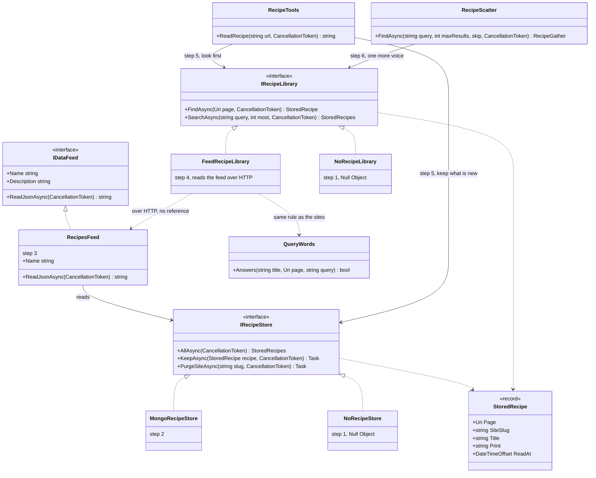
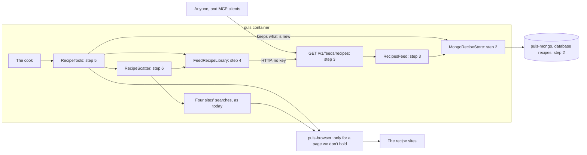
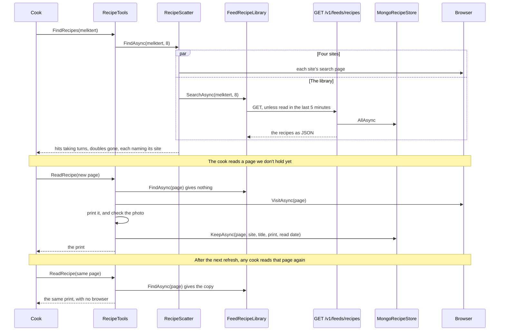
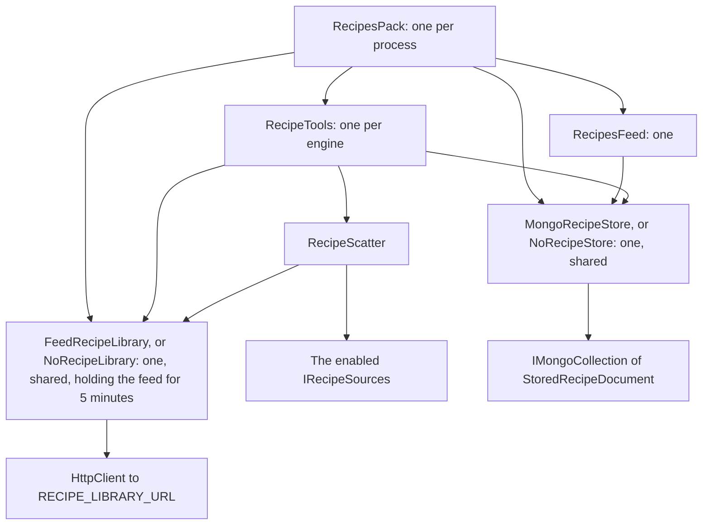

# F35.3 The recipe library

> **Plan, approved 2026-11-05: A1, B1, C1, D1, F1 and H2, with E and G as he said.** How we keep each recipe page the cook reads, publish it as an open feed, read that feed as a
> source, and keep finding new recipes. **Elsewhere:** feeds in
> [ADR 0070](../../../../src/docs/adr/0070-packs-publish-data-feeds.md); the rule for reading pages in
> [ADR 0067](../../../../src/docs/adr/0067-a-pages-own-data-before-its-text.md) and
> [ADR 0068](../../../../src/docs/adr/0068-every-fetch-obeys-robots-txt.md); what F35 taught in the
> [write-up](../../../../src/docs/learning/05-structured-outputs.md).

## The goal, in Louis's words

"we must just store each read from a site we do not have yet, and then we serve those to ourselves. but we must still make
sure we get new recipes, like having different types of milktart etc."

"A copy never goes stale, this becomes a repository of recipes and recipes can never become stale." "It will be served open
via the api, we will read it from there as a source." "we have pack feeds"

So there are five rules, and the rest of this plan only works out how:

1. **Keep each new read.** When the cook reads a page from one of our sites and we don't have it yet, we keep it.
2. **Keep it for good.** It's a repository, so a copy never expires.
3. **Publish it.** The library is the recipes pack's feed, open to anyone at `/v1/feeds/recipes`.
4. **Read it from there.** Our own cook reads that feed as a source, like anyone else would.
5. **Keep finding new recipes.** The library must not freeze us on the melktert we already have.

## Context: what we have today

Checked in the code on 2026-11-05.

- **Nothing is kept.** Every search asks the sites and every read opens the page in the browser. Eval recordings are the only
  copies, and the cook never reads them.
- **Pack feeds exist** (ADR 0070). A pack lists an `IDataFeed`, with a name, a description and `ReadJsonAsync`. The API serves
  it open at `/v1/feeds/{name}` without knowing whose it is, and the MCP server offers it as a resource
  ([ADR 0072](../../../../src/docs/adr/0072-feeds-are-mcp-resources.md)). `ShopPricesFeed` is the example. A feed hands over
  everything it has: it takes no search words.
- **`ReadRecipe(url)`** opens the page, prints its recipe data or its text, and frames it as untrusted data. It reads any
  public page, so a page from a web search comes through here too.
- **`FindRecipes`** asks four of the sites at random through `RecipeScatter`, and the hits take turns.
- **Most pages are text.** In the last run whose answers were sorted by page kind, 17 of 29 answers used a text page, 8 a page
  with recipe data, 3 a page off our table, and 1 no page.
- **How much repeats today.** In the last full run, 30 answers used 25 different pages, so only 5 reused one. **The saving
  starts small and grows with the library.**
- **Mongo is already there.** The shop-prices pack keeps its tables through `IPriceStore`. The driver is `MongoDB.Driver`
  3.12.0, so this adds no new package to the repo, only a new reference to it from the recipes pack.
- **`demos/puls/docs/SITE_OWNERS.md` says we don't republish or index.** That stops being true, so it changes in this feature.

## The findings

Rule 11: each open choice names its pattern, and my pick says why.

### Decided by Louis

| | Question | His pick |
|---|---|---|
| E | When does a copy go stale? | **Never.** It's a repository. A site's page changing, or its photo going, doesn't touch our copy |
| G | Who else sees it? | **Anyone.** It's served open, and we read it from there as a source |
| - | How is it served? | **As a pack feed**, `IDataFeed`, which we already have |

### A. How do we keep finding new recipes? (the main one)

The more we lean on stored recipes, the faster and cheaper an answer gets, and the fewer new ones we find.

| | Option | What it does | New recipes | Saves |
|---|---|---|---|---|
| **A1 (my pick)** | **Scatter-Gather, with the library as one more voice.** Every search asks the sites as today, and the library too. Hits take turns, with the library in a random place | A melktert we hold sits beside others the sites offer | Keep coming on every search, until the sites have nothing new | The reading of any page we hold, whoever listed it. No search time |
| A2 | Library first, sites only when it holds fewer than 3 hits | Answers come from the library once a dish has 3 | **Stop at 3 kinds per dish.** This breaks your rule | The most: the search and the read |
| A3 | Library first, with the sites asked on 1 search in 3 | A middle road, on a setting | Come slowly, at a chosen rate | More than A1, but it adds a dial, and evals get noisier |

**Why A1:** it's the only one that can't freeze the library, and it's the simplest. A hit we hold costs no browser read even
when a site listed it, so savings grow on their own as the library fills.

### B. What do we keep?

| | Option | What it changes | What it costs |
|---|---|---|---|
| **B1 (my pick)** | **The print, as the cook read it** (Memento: keep the finished result): data and text pages alike, with the address, site, title and read date | "Each read" means each read. One shape, and no second reader | A text page keeps whatever that page's text held, so later features can't treat it as a typed recipe |
| B2 | Only pages with recipe data, as `Recipe` records (Data Mapper, as today) | Clean typed data for F48.1 and for whoever reads the feed | Misses most reads: only 8 of 29 answers used one |
| B3 | Both: records for data pages, prints for text pages | Typed where possible | Two shapes and two ways to print, for a benefit no step uses yet |

**Why B1:** it's your rule in its simplest form. Because a copy now never re-reads, a typed record later would need a fresh read
of the page, which is the one cost of this pick.

### C. How does a read use the library?

| | Option | What it changes | What it costs |
|---|---|---|---|
| **C1 (my pick)** | **[Cache-Aside](https://learn.microsoft.com/azure/architecture/patterns/cache-aside):** `ReadRecipe` looks in the library first. If it's not there, it reads the page and keeps it | Any read of a stored page opens no browser, whoever listed the page | A page kept moments ago may be read once more before the next refresh of the feed, which does no harm |
| C2 | Keep every read but always open the page anyway | Always the live page | Saves nothing, so it misses your rule |
| C3 | [Decorator](https://refactoring.guru/design-patterns/decorator): wrap the browser so `VisitAsync` answers from the store | `RecipeTools` doesn't change | The browser sees HTML, so we'd publish whole pages, not prints, at far greater size |

**Why C1:** it's the plainest way to meet the rule. Only pages from our table are kept: `ReadRecipe` also reads web search
results, and a stored page from an unknown site could carry instructions to other people's chats, and now to anyone reading
the feed. A refusal or an empty page is never kept.

### D. How do we search the library?

A feed takes no search words, so this is decided in the source.

| | Option | What it changes | What it costs |
|---|---|---|---|
| **D1 (my pick)** | **Read the feed, hold it for 5 minutes, and filter with `QueryWords`,** as `PriceBookCache` holds the price tables | The feed stays as ADR 0070 made it. *melktert* and *milk tart* meet, and plurals work, with the sites' own rule | The whole library comes over on each refresh. Fine for thousands of recipes, and it wants paging once it's several MB |
| D2 | Teach feeds to search: `/v1/feeds/{name}?q=…`, with a new method on `IDataFeed` | Light on the wire, and handy for other readers | Changes a contract every pack and the MCP mapping share, for one pack, and Mongo's search can't do plurals or *milk tart* |
| D3 | Embeddings (skill 8) | Finds meaning, not just words | A new model and index for a search this small |

**Why D1:** it uses feeds as they are, as you said, and needs almost no new code. It's the first thing the measure watches: how big the feed gets.

### F. What about the evals?

If a run fills the library, the next run isn't comparing like with like, and a stored read leaves nothing for a recording.

| | Option | What it changes | What it costs |
|---|---|---|---|
| **F1 (my pick)** | **Eval trials skip the library by default** (Null Object: a library with nothing in it), with a setting to turn it on for a measured run | Runs stay comparable, and the measure in step 10 still works | `IPackContext` gains one small thing, the kind of growth your option C for it wants to end. That plan can move it |
| F2 | A separate fixed library for evals | Repeatable, and it tests the library | Someone has to build and keep that fixed set |
| F3 | Evals use the live library | No new code | Every run changes the next. It breaks the comparison we rely on |

### H. What does the open feed hand out? (new, because it's now public)

For a text page, the print is that page's text, up to 8,000 characters. That can include menus, other recipes' names and, on
some sites, readers' comments with their names. Keeping that for ourselves is one thing. Publishing it is another.

| | Option | What it changes | What it costs |
|---|---|---|---|
| H1 | **Every print, as it is** | Your rule as said, and the simplest | Readers' comments could be published openly under our name, and text-site pages go out whole |
| **H2 (my pick)** | **Every print, with the text cut to the recipe:** a small reader keeps what lies from the title through the method and drops what follows (Pipes and Filters: one more filter in the print) | Most comments go, the feed reads better, and the cook spends fewer tokens on stored pages | A heuristic that can cut too much or too little on odd pages, so it's tested on real saved pages |
| H3 | Publish only data pages, and keep text pages to ourselves | Nothing odd goes out | We can't read text pages "from there", so it breaks your rule for most reads |

**Why H2:** I checked no real comment section for this, so the size of the problem is a guess, and step 3 starts by looking at saved
prints. If they turn out clean, H2 shrinks to almost nothing.

**One new fact, not a re-run of your decision:** you chose to read all 45 sites knowing their terms, and you've now chosen to
publish whole copies from all of them. Food & Home's clause 2.9.1 names commercial copying. I'll record it as your call in the
ADR, each recipe carries its site and link, and `SITE_OWNERS.md` will say plainly that we publish copies and remove a site's on
request. It isn't legal advice, and a qualified check is worth having before customers depend on it.

## Design: what changes

There are two halves, and they meet only at the feed. **The writing half** keeps a read in Mongo. **The reading half** reads the
open feed over HTTP, as any outsider would. With no `RECIPES_MONGO_URL`, there's nothing to publish. With no `RECIPE_LIBRARY_URL`,
or in an eval trial, the cook reads no library and works as it does today.

- **A site's removal:** the feed publishes a page only while its site is in the table, so taking out a row stops it at once, and
  a small `PurgeSiteAsync` deletes its copies. This is the one way a copy ever leaves.
- **Never who asked:** a stored page has no session or user on it. Nothing in the record can hold one.
- **Framing:** a stored print comes back inside the same untrusted-data frame as a live one, since a feed is outside data too.
- **Doubles:** a page listed by both the library and a site appears once.
- **The credit:** a recipe's link stays the site's own page, and it names the site.
- **If the feed is down:** a read or a search carries on without the library, within a 2-second limit, and logs it.
- **The call to our own API** uses its own `HttpClient` to a set address, as a peer does. The guarded fetcher is for addresses
  the model gives us, and it would rightly refuse `127.0.0.1`.
- **A photo:** kept with the print as it was, and never checked again. A photo that dies later shows as broken, which comes with never re-reading.

### Interface design



```csharp
public interface IRecipeStore
{
    Task<IReadOnlyList<StoredRecipe>> AllAsync(CancellationToken cancellationToken);
    Task KeepAsync(StoredRecipe recipe, CancellationToken cancellationToken);
    Task PurgeSiteAsync(string slug, CancellationToken cancellationToken);
}

public interface IRecipeLibrary
{
    Task<StoredRecipe?> FindAsync(Uri page, CancellationToken cancellationToken);
    Task<IReadOnlyList<StoredRecipe>> SearchAsync(string query, int most, CancellationToken cancellationToken);
}

public sealed record StoredRecipe(Uri Page, string SiteSlug, string Title, string Print, DateTimeOffset ReadAt);
```

### Architecture



### Communication: melktert, the first time and the second



### Objects in one process



### Folder trees

```text
packs/louis-agent.pack.recipes/                     after step 4
├── Library/                                        new
│   ├── Feed/                                       the reading half
│   │   ├── FeedRecipeLibrary.cs
│   │   ├── IRecipeLibrary.cs
│   │   ├── NoRecipeLibrary.cs
│   │   ├── RecipeFeedReply.cs
│   │   └── RecipesFeed.cs
│   ├── Store/                                      the writing half
│   │   ├── IRecipeStore.cs
│   │   ├── MongoRecipeStore.cs
│   │   ├── NoRecipeStore.cs
│   │   └── StoredRecipeDocument.cs
│   ├── RecipeAddress.cs
│   └── StoredRecipe.cs
├── Reading/, Recipes/, Sources/, Tools/            changed as the map below says
packs-tests/
├── louis-agent.pack.recipes.tests/Library/         new
└── louis-agent.pack.recipes.integration-tests/     new: against a real MongoDB
```

### Namespace map

| Type | Folder | Namespace | Step |
|---|---|---|---|
| `StoredRecipe`, `RecipeAddress` (new): one spelling of a page's address | `Library/` | `LouisAgent.Packs.Recipes.Library` | 1 |
| `IRecipeStore`, `NoRecipeStore` (new) | `Library/Store/` | `LouisAgent.Packs.Recipes.Library.Store` | 1 |
| `IRecipeLibrary`, `NoRecipeLibrary` (new) | `Library/Feed/` | `LouisAgent.Packs.Recipes.Library.Feed` | 1 |
| `MongoRecipeStore`, `StoredRecipeDocument` (new) | `Library/Store/` | as above | 2 |
| `RecipesOptions` (changed): `RECIPES_MONGO_URL`, `RECIPES_MONGO_DATABASE`, `RECIPE_LIBRARY_URL` | root | `LouisAgent.Packs.Recipes` | 2, 4 |
| `RecipesFeed`, `RecipeFeedReply` (new) | `Library/Feed/` | as above | 3 |
| `PrintedRecipeText` (new): text cut to the recipe (H2) | `Reading/` | `LouisAgent.Packs.Recipes.Reading` | 3 |
| `RecipesPack` (changed): lists the feed | root | as it is | 3 |
| `FeedRecipeLibrary` (new) | `Library/Feed/` | as above | 4 |
| `RecipeTools` (changed) | `Tools/` | as it is | 5 |
| `RecipeScatter`, `RecipeGather` (changed) | `Sources/Gathering/` | as they are | 6 |
| `RecipeHitPrinter`, `RecipeToolMessage` (changed) | `Tools/`, `Messages/` | as they are | 7 |
| `IPackContext`, `ToolsetContext` (changed): whether this is a trial | composition, core | as they are | 8 |
| `RecipeStoreTests`, `RecipesFeedTests`, `FeedRecipeLibraryTests`, `ReadRecipeLibraryTests`, `RecipeScatterLibraryTests`, `PrintedRecipeTextTests` (new) | `packs-tests/...tests/` | `LouisAgent.Packs.Recipes.Tests...` | 1 to 6 |
| `MongoRecipeStoreTests` (new) | `packs-tests/...integration-tests/` | `LouisAgent.Packs.Recipes.IntegrationTests` | 2 |

## Steps

One commit each, test first. Everything up to step 9 is free. Step 10 is paid and waits for your go. That's right at the ten-step
limit, so I'd split it only if a step grows.

| # | Step | Its test |
|---|---|---|
| 1 | **The contracts.** `StoredRecipe`, both interfaces, both Null Objects, and `RecipeAddress`, so `http://www.a.co.za/x/` and `https://a.co.za/x` are one page | The null ones hold nothing; the address cases |
| 2 | **Mongo.** `MongoRecipeStore` over a typed collection (ADR 0048), with a unique address, and the settings | A real MongoDB: a kept page comes back, keeping twice stays one, a purge removes a site's pages, a read date is never overwritten |
| 3 | **The feed.** `RecipesFeed` lists every kept recipe with its site and link, only for sites in the table, with the text cut to the recipe (H2), first looking at real saved prints | The route serves it with no key; a site out of the table goes unserved; it holds no session or user; real saved pages keep their method |
| 4 | **The reader.** `FeedRecipeLibrary` reads the feed over HTTP, holds it for 5 minutes, and filters with `QueryWords` | *melktert* finds a stored *Milk tart*; a second search within 5 minutes makes no call; a feed that's down costs nothing |
| 5 | **Reads use it (C1).** `ReadRecipe` looks first, reads if it must, and keeps what's new | The second read opens no browser; off the table, refused or empty pages are never kept; a stored print is still framed; an old copy is still served |
| 6 | **Search uses it (A1).** The library is one more voice in `RecipeScatter` | Sites are still asked every time; a page from both appears once; a library error costs nothing |
| 7 | **The texts.** The search says it also asked our library. A stored print looks the same as a live one to the cook | The message golden and Puls's session golden, read before committing |
| 8 | **Evals and settings (F1).** Trials skip the library unless `RECIPE_LIBRARY_IN_EVALS=true`; compose, Azure, `.env` examples, `SETUP.md` | A trial neither reads nor keeps; on with the setting |
| 9 | **The docs.** ADR 0082, `SITE_OWNERS.md`, the pack's doc, and TODO | The links and size tests |
| 10 | **The measure, paid, on your go.** Below | Its numbers go in the write-up |

**Done when:**

- `/v1/feeds/recipes` serves the kept recipes with no key, and the MCP server offers the same feed.
- The second read of a page, after the feed's refresh, opens no browser, in a real chat.
- A new melktert keeps being found: over the measure, the number of different melktert pages kept keeps rising from repeat to repeat.
- With the library on, the judge stays at 27 of 30 or better, sites used don't drop below 13, and neither time nor cost gets worse than with it off.

## Verification

**Free:** the whole unit suite, the Mongo integration tests, `curl` on the open feed with no key, and one real chat asked twice for
the same page, with the logs showing no second visit. The FX46 lesson applies: a fake library proves little, so step 2 runs on a
real database, and the chat goes through the real guards and the real HTTP call.

**Paid, about $0.70 and 90 minutes, on Louis's go of 2026-11-05.** On one commit, with an empty library:

1. **Library off:** 5 repeats of the recipes eval. This also gives the first numbers on the code F35 closed with.
2. **Library on:** 5 repeats. Repeat 1 fills it, and the later repeats show what it gives.

Compared on accuracy, time, cost, how many reads the library served, how many new pages each repeat still found, and how big the
feed got.

**What I expect, so we can be proved wrong:** a small saving at first, since only about 5 of 30 reads repeated last time. The real
test of your rule is that new pages keep arriving.

## Approved during the build

- **2026-11-05, Louis's picks and how it runs.** Built unattended, with a run at the end: 5 repeats library off, then 5 on. Search by meaning (D3) is its own feature straight after this, F35.6, compared with D1 on what this measure records.

- **2026-11-05, what the build changed, unattended, for his review.** `RecipeShelf` is a small Facade over the two halves, so the tools hold one thing and the rules (table sites only, a library that's down costs nothing, a trial leaves it alone) live in one place. The cut to the recipe (H2) applies to live prints as well as kept ones: the cook has no use for comments, so there's one print and fewer tokens. A feed read may take 3 seconds rather than 2, since it can be large. The library's hits are all shuffled, not only its top three, or it would settle on its oldest pages. Names `recipes` can't be written outside their enum, so the database is `recipe_library`, the collection `kept_recipes` and the feed's list `items`. `Reading/` was full, so the photo classes moved to `Reading/Photos/`. H2's reason is now measured: The Kate Tin's page held 92 comments, and Sarah Graham's, Vrouekeur's and FinGlobal's held comments, related recipes or newsletter boxes.

- **2026-11-05, Louis changed C1 during the build: "C, we will literally save those recipes as proper recipes".** Asked whether the read should just be our API's address, the options were A (the site's link as the name, our API behind the shelf, Cache-Aside), B (the same, with an address per recipe) and C (the hit itself carries our API's address, the library as a real source). He picked C. So: a kept recipe is the `Recipe` record field by field, in Mongo and on the feed, instead of a printed block; each has an address, `/v1/feeds/recipes/{id}`; a search hands out that address, also for a page a site listed; and `ReadRecipe` reads it over HTTP and prints what the live page printed, with the site's link. This replaces H2's cut for what's kept: the cut stays for live text prints. C1's look-up by the site's address is gone, as he asked for one way in.

- **What that build chose, unattended, for his review.** Only a page whose recipe data is whole (`SchemaOrgRecipe.Read`: a name, ingredients and steps) is kept: that is what "proper" already means in the code, and a guessed structure would be served for good. It leaves real recipes out: 12 of 30 answers in `79ea99b3ec08` used a page with no recipe data. The id is the first 16 hex characters of the SHA-256 of the page's one spelling, because a site's path has slashes and any length. An item's address is a default method on `IDataFeed` (`ReadItemJsonAsync`, giving nothing), the smallest change that keeps other feeds and the MCP shape as they are, against a separate role interface or a route only this pack knows; the API stays ignorant of recipes. An address counts as ours only on exactly our recipes path with a real id, and the request is built from the setting, so the model can't steer it. A read of one recipe asks the API every time; only the search's list is held five minutes. A search that names a site, and a web search, still give the site's link, and that read goes to the site.

- **2026-11-05, Louis's pick on pages with no recipe data: B of three** (A keep them out, B read their headings in code, C a local model structures them). `PageTextRecipe` keeps a page only with an ingredients heading, a method heading, at least two ingredients and a step, in English or Afrikaans. **For his review:** the cook's first read stays the page's text, so the library-off run stays a fair baseline and a reading mistake can't reach that first answer; a read from us prints the recipe. A link among the ingredients, a line over 200 characters or a long line between steps keeps the page out, since half a recipe kept as whole is the worst outcome. Such a page has no times or author. Tried on the 12 real pages: 8 kept and read against their text, which covers 8 of the 12 answers in `79ea99b3ec08`; 4 have no headings. That check found a cookie notice kept as a step in the first version. The library-off run (`e2b47743f792`) ran before this reader existed, which changes nothing it measures, because the library is off and the print is the same.

- **2026-11-05, after the measure, on Louis's picks.** C on articles such as Taste's *Not your average boerewors*: left out. A on pap en sous: Best Recipes joins the table and search knows the dish's other names; Afrifood Network stays out because its terms bar republishing. A search gives 10 pages and keeps 3 places for pages from outside the library, his rule, which replaces the earlier pick of one result per site and name, as the two clash. The measure missed the win test, so this plan stays open.

## Concepts this teaches

- **Skill 8, memory and retrieval:** the first time the agent reuses what it found, with keyword search before embeddings.
- **Skill 11, protocols:** reading our own open API as an outsider would, so the contract is proved by its first customer.
- **Skill 13, cost and token economics:** whether a cache pays for itself, measured on the whole answer.
- **Exploration against exploitation:** the classic trade-off behind finding A.
- **Skill 15, safety:** what may enter a store that the public and other people's chats will read.

## Left out, on purpose

- Library first, with searches skipped (A2, A3): only once a measure asks for it.
- Paging or searching the feed (D2): once the measure shows the feed is too big.
- A limit on how often the open feed may be called: it's open like the other feeds, and Puls isn't public yet. To look at before it is.
- Typed records for F48.1's `WriteRecipe`: a fresh read of the page can build them when F48.1 starts.
- Embeddings: only when keyword search falls short.

## Sources

[Cache-Aside, Microsoft](https://learn.microsoft.com/azure/architecture/patterns/cache-aside) ·
[Repository, Fowler](https://www.martinfowler.com/eaaCatalog/repository.html) ·
[Decorator, Refactoring.Guru](https://refactoring.guru/design-patterns/decorator) ·
[Text indexes, MongoDB](https://www.mongodb.com/docs/v6.0/core/index-text/)

---
[Plans](../../../../src/docs/plans/README.md) · Related: [the TODO](../../../../TODO.md)
