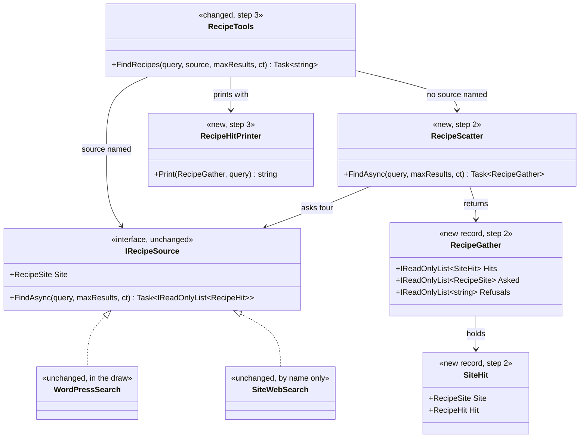
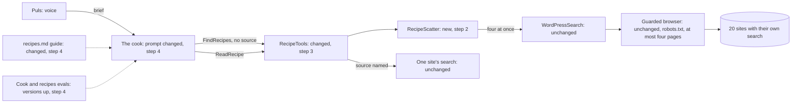
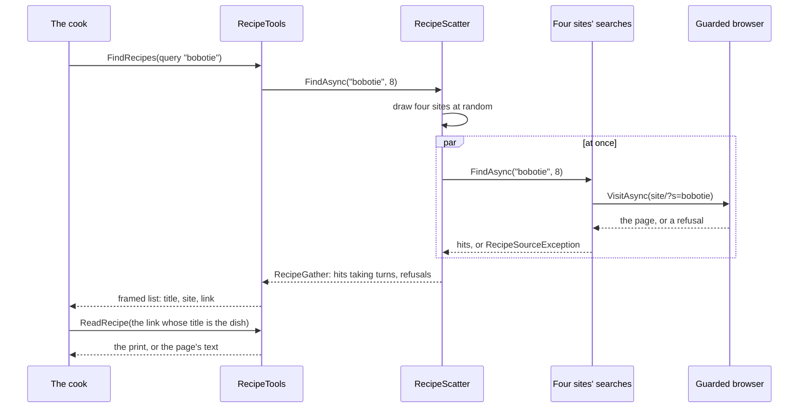
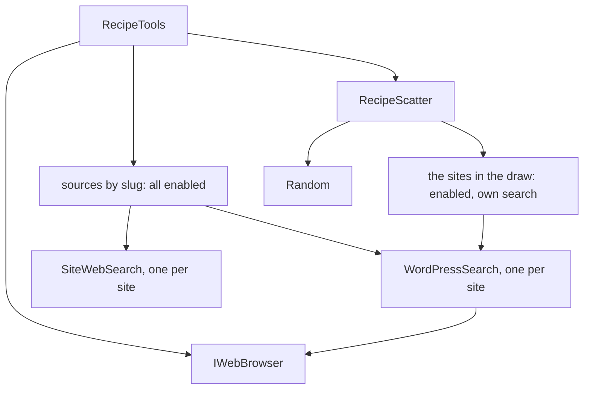

# F35.4 Many recipe sites: the cook stops reading one site

> **What this answers:** how Puls's cook gets its recipes from many sites instead of nearly always Food & Home, and how
> we show that it worked. A child of [F35](F35-recipe-sources.md), built before F35.2's measure resumes. Branch
> `feature/F35.4-many-recipe-sites`, one PR.

Status: **approved by Louis, 2026-11-05: A1, B1, C1, D1, E1, F1, G1.** Scatter-Gather and "before the restart" were
his picks before the plan. The other options stay below, because the measure may send us back to B2 or B3.

## Context

Louis, looking at the app: "almost every recipe comes from, this is not random". He's right, and it's by design:

- The cook's prompt says `start with foodandhome`, because that site publishes clean recipe data.
- The tool's description names it as the example, and the list of sites isn't in the prompt.
- Food & Home has 8 of our 10 dishes, so the cook rarely needs a second site.

In the stored runs, **19 of 21 recipes came from Food & Home**, and the other two came from sites outside the table. None
came from the other 44 sites in the table.

This matters for the measure too. 32 of the 45 sites give page text rather than clean data, and those cost more to read,
so measuring now would price a cook that only ever reads one easy site.

### What the sites really hold

A free check on 2026-11-05: the 20 sites with their own search page, the ten dishes, through the pack's real search code.
A "hit" means a title holding the dish's word, so this is a rough count.

| Dish | Sites with it, of 20 | Chance one search of 4 random sites finds it | Within 3 searches |
|---|---|---|---|
| bobotie, malva pudding | 13 | 99% | over 99% |
| chakalaka | 12 | 99% | over 99% |
| melktert, vetkoek | 10 | 96% | over 99% |
| koeksisters | 8 | 90% | over 99% |
| potjiekos, boerewors rolls | 6 | 79% | 99% |
| pap en sous, hoenderpastei | 1 | 20% | 49% |

- **By site:** finglobal 9 dishes, Food & Home 8, zolanene 7, taste, cooksister and vrouekeur 6 each. Six others have 1 or 2.
- **Reading:** of the 20, 6 publish clean data and 14 give page text.
- **Time:** a plain fetch took a median of 1.1 s, 2.2 s at the 90th percentile, 5.2 s at most. No search failed. The real
  guarded browser will be slower; step 5 measures it.
- **The rare dishes:** `hoenderpastei` probably does better as `chicken pie`, and the check counted only the words I gave
  it. When no site has a dish, the cook's web fallback still applies.

## The findings

Each is a pick for Louis. The design below uses the recommended one.

**A. How many sites does one search ask?**

- **A1 (recommended): four at random, per search.** The browser opens at most four pages at once, so they run together.
  If they miss, the cook searches again and gets another random four. No extra code, but a rare dish can still miss.
- **A2: four, then four more when no title matches.** Better on rare dishes, but the code has to judge titles, and
  `hoenderpastei` against `chicken pie` shows how that goes wrong.
- **A3: all 20, every search.** Finds the most, but it's 20 requests to small sites for one question, several seconds in
  the browser, and a long list for the model to read.

**B. Which sites are in the draw?**

- **B1 (recommended): every enabled site with its own search, 20 today.** Real variety, and we find out what page text
  really costs. The cost per answer may go up, and the measure will show by how much.
- **B2: only the 6 that publish clean data.** Cheapest to read and the most exact, but six sites is thin variety, and
  those six have fewer of the dishes.
- **B3: the 20, always two data sites and two text sites.** Keeps half the reads clean, but it's a rule to maintain, and
  there's no number yet saying it's needed.

The 25 sites searched through the web provider stay out of the draw, since each search there uses the web search. They
can still be asked for by name.

**C. How are the hits merged?**

- **C1 (recommended): taking turns, in the random site order.** Each site's first hit, then each one's second, up to eight
  lines, each naming its site. Each site's best guess comes first, and the model reads the titles and picks.
- **C2: grouped under each site's name.** Easy to read, but it's longer, and the model tends to take the first group.
- **C3: all hits shuffled.** The most random, but it throws away each site's own order, so weak hits can come first.

**D. How does the tool change?**

- **D1 (recommended): `source` becomes optional.** Left out, it searches several; named, it searches that one, as today.
  One tool and a small change. The parameters reorder to `query, source`, which is fine since calls are by name.
- **D2: a second tool, `FindRecipesAnywhere`.** Clearer descriptions, but two tools to choose between, on every request.
- **D3: remove `source`.** The simplest tool, but the 25 web-searched sites could never be asked for.

**E. How is the code shaped?**

- **E1 (recommended): `RecipeScatter`, a small class of its own (Scatter-Gather).** It picks the sites, asks them at once
  and merges the answers. `RecipeTools` calls it and prints. Testable alone, with a seeded random. Sources:
  [Scatter-Gather](https://www.enterpriseintegrationpatterns.com/patterns/messaging/BroadcastAggregate.html).
- **E2: a group that is itself an `IRecipeSource` (Composite, GoF).** It reuses the interface, but the interface promises
  one `Site`, which a group isn't, and a hit no longer says which site it's from.
- **E3: inside `RecipeTools`.** No new class, but that file is at 171 lines of a 200 limit and would mix choosing,
  searching and printing.

**F. What if a site fails during a search?**

- **F1 (recommended): skip it, and use the rest.** One slow or refusing site doesn't sink the search. If all four fail,
  the answer says so with their reasons. A skipped site is logged but isn't shown to the model.
- **F2: fail the whole search.** Simple and strict, but any one of four small sites could break the cook's search.
- **F3: draw a replacement site.** Always four answers, but it means more requests and more code for a rare case, since
  none failed in 200 searches.

**G. What happens to the held minion (#157)?** It tells the minion to try "the sites in order", one at a time.

- **G1 (recommended): change it when the measure reaches it.** After this merges, its task becomes the dish alone, with
  one search and no site names. Then it's measured as planned. This plan builds nothing for it, but #157 grows by one change.
- **G2: drop the minion now.** One search now does what the minion did with up to three, so it may save nothing. That
  skips a measure we've paid for and decided to take, though, and the plan's own rule (M3) is to drop it on numbers.
- **G3: merge it unchanged.** No extra work, but the cook would still name sites, so the minion brings back a fixed order.

## Design

The cook stops naming a site. `FindRecipes` with no `source` draws four sites at random from the enabled ones with their
own search, asks them at once, and returns up to eight hits taking turns, each with its site. The cook reads the titles,
picks the one that is the dish, and calls `ReadRecipe` as it does today. If nothing fits, it searches again, at most three
searches, and then falls back to the web as today.

The guarded browser is unchanged, so `robots.txt`, the page signals and the honest name all still apply on every page. The
sites table is unchanged. Louis's decision on the sites' terms stands (F35.2, 2026-11-04), but more sites will now be read
more often, including the 32 whose terms weren't read for that decision.

### Interface design



```csharp
// Sources/SiteHit.cs and Sources/RecipeGather.cs
public sealed record SiteHit(RecipeSite Site, RecipeHit Hit);
public sealed record RecipeGather(IReadOnlyList<SiteHit> Hits, IReadOnlyList<RecipeSite> Asked, IReadOnlyList<string> Refusals);

// Sources/RecipeScatter.cs: built from the enabled sites with their own search
public sealed class RecipeScatter(IReadOnlyCollection<IRecipeSource> sources, Random random)
{
    public Task<RecipeGather> FindAsync(string query, int maxResults, CancellationToken cancellationToken = default);
}

// Tools/RecipeTools.cs: the random only so a test can seed it
public RecipeTools(IReadOnlyDictionary<string, IRecipeSource> sources, IWebBrowser browser, Random? random = null);
public Task<string> FindRecipes(string query, string source = "", int maxResults = 8, CancellationToken cancellationToken = default);
```

### Architecture



### Communication



### Objects in memory



### Namespace map

No new folders.

| Type | Folder | Namespace | Step |
|---|---|---|---|
| `SiteHit` (new) | `packs/louis-agent.pack.recipes/Sources/` | `LouisAgent.Packs.Recipes.Sources` | 2 |
| `RecipeGather` (new) | `packs/louis-agent.pack.recipes/Sources/` | `LouisAgent.Packs.Recipes.Sources` | 2 |
| `RecipeScatter` (new) | `packs/louis-agent.pack.recipes/Sources/` | `LouisAgent.Packs.Recipes.Sources` | 2 |
| `RecipeScatterTests` (new) | `packs-tests/louis-agent.pack.recipes.tests/Sources/` | `LouisAgent.Packs.Recipes.Tests.Sources` | 2 |
| `RecipeTools` (changed) | `packs/louis-agent.pack.recipes/Tools/` | `LouisAgent.Packs.Recipes.Tools` | 3 |
| `RecipeHitPrinter` (new) | `packs/louis-agent.pack.recipes/Tools/` | `LouisAgent.Packs.Recipes.Tools` | 3 |
| `RecipeToolMessage` (changed) | `packs/louis-agent.pack.recipes/Messages/` | `LouisAgent.Packs.Recipes.Messages` | 3 |
| `RecipeToolsTests` (changed) | `packs-tests/louis-agent.pack.recipes.tests/Tools/` | `LouisAgent.Packs.Recipes.Tests.Tools` | 3 |
| `PulsCookRecipeToolsTests`, `PulsPromptsTests` (changed) | `demos/puls/tests/louis-agent.identity.puls.tests/` | as they are | 4 |

## Steps

One commit each, test first, with a review stop after each.

| Step | What changes | The test that fails first |
|---|---|---|
| 1 | This plan, with Louis's picks, a TODO line and the plans table. | None: docs only. |
| 2 | `SiteHit`, `RecipeGather`, `RecipeScatter`: draw four, ask at once, merge by taking turns, skip a site that fails. | Four of six fakes are asked; hits take turns; a failing site is skipped and its reason kept; fewer than four sites all get asked; a seeded random gives the same draw, and different seeds spread across the sites. |
| 3 | `FindRecipes(query, source = "")`: no source searches several, a named one works as today. New message texts, `RecipeHitPrinter`, the golden files. | No source lists the hits with their sites; none anywhere or all refused says so; no site in the draw says which are enabled; a named site lists only its own hits, as today, up to the same eight. |
| 4 | The cook's prompt drops `start with foodandhome` for "leave `source` out; each search asks other sites; at most three searches". The guide and the tool's description stop naming a first site. The Cook and recipes eval versions go up. | The prompt tests pin the new wording and that `foodandhome` is gone from the cook's prompt and the guide. |
| 5 | Docs and close: the pack's design doc, an ADR (*a recipe search asks several sites*), the changelog, the TODO. This plan is deleted when F35 closes; its lasting parts go in the ADR. Real browser timing noted. | None: docs only. |

## Verification

- **Tests:** the touched projects and the repo-wide rules on every step; the whole solution before the PR.
- **Free checks:** real searches through the guarded browser for the ten dishes, with times.
- **Paid, each on Louis's go:**
  1. One real chat for a dish (about 1 cent), to see the new search in use.
  2. Then F35.2's measure restarts: the Cook re-record (about 10 cents) and the recipes eval, 3 repeats. The old estimate
     was about $0.18; text pages may raise it, and I'll say if the first repeat runs over.
- **A new row in the measure's table:** how many different sites the recipes came from, and the largest site's share.
  No new check, since a check grades one conversation and variety only shows across a run.

**Done when:** across the recipes eval's 3 repeats, no site holds more than a third of the recipes and at least eight
different sites appear; `recipe-from-source` isn't worse than today's 8 of 10; and the cost per answer is on the table.

If cost per answer jumps because of text pages, that's a finding for Louis (B2 and B3 are still there), not a failure.

## Concepts

| Concept | Where | Skill in the goal |
|---|---|---|
| Scatter-Gather: ask many, merge the answers | Step 2 | Tool design (4) |
| A prompt's example steers the model more than its rules | Steps 3 and 4; FX44 showed the same | Prompt design (3) |
| Variety is a property of a run, so it's measured across conversations, not graded in one | Verification | Evaluation (12) |
| Randomness in a tool, and what it does to a repeatable eval | Steps 2 and 5 | Evaluation (12) |
| What a cleverer source costs: page text against clean data | The measure | Cost and token economics (13) |

---
[Docs index](../README.md) · Related: [F35 Recipe sources](F35-recipe-sources.md) · [Recipe sites table](../../../../packs/louis-agent.pack.recipes/Sources/Sites/recipe-sites.md)
