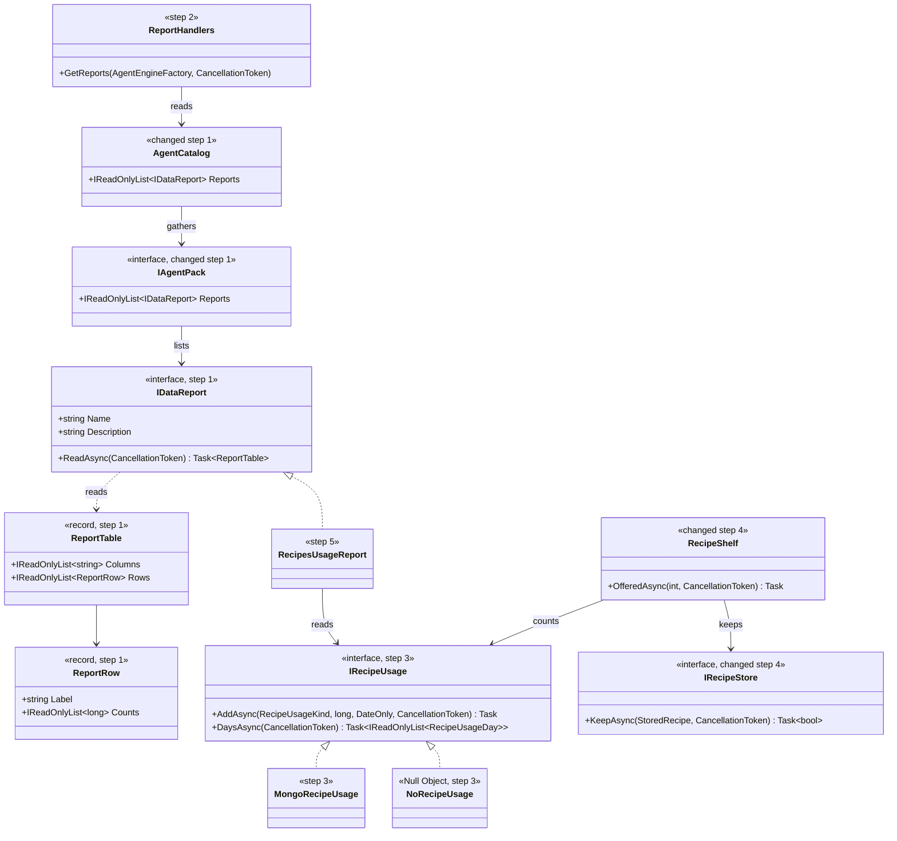
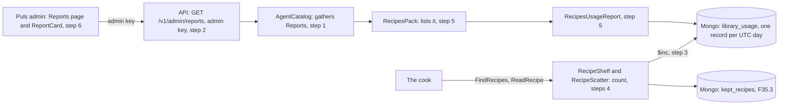
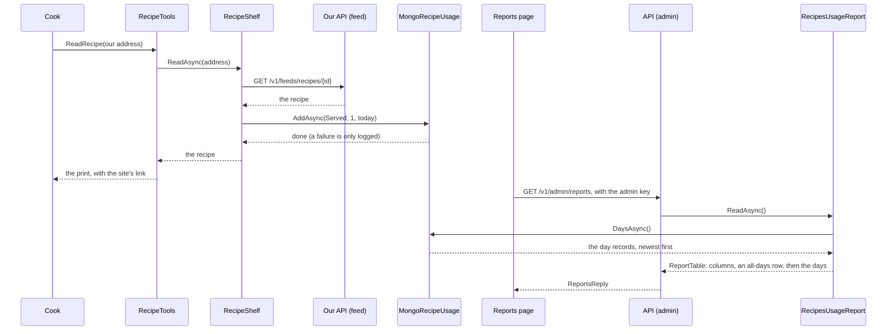
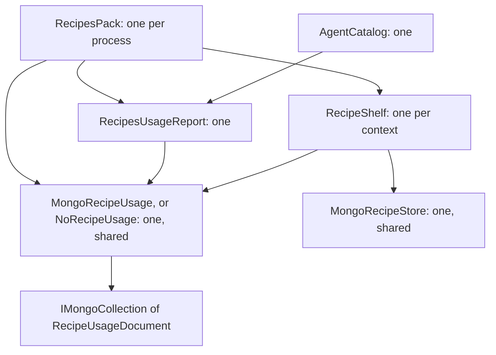

# F35.7 The library's counter

> **Plan, approved 2026-11-05: counting A (daily totals), showing B (a plug-in behind the admin key), and all four proposals as recommended.** How we see, on the admin
> page and without an eval, whether the recipe library is working. **Elsewhere:** the library in
> [ADR 0082](../../../../packs/docs/adr/0082-the-recipe-library-is-an-open-feed.md); the seam this copies in
> [ADR 0070](../../../../src/docs/adr/0070-packs-publish-data-feeds.md).

## The goal, in Louis's words

"the recipes is not saving?" and "so how would we know if our source is working?" Today nobody can tell. An eval can count from its
saved events, and the log lines from F35.3 show events one at a time, but nothing keeps a total.

## Context: what we have today

- **F35.3 keeps recipes, offers them in a search and serves them from our API**, and logs each of those without the user's words.
  Docker's logs don't outlive the container, and they hold no totals.
- **`IDataFeed`** publishes what anyone may read, at `/v1/feeds/{name}`, and the guide says to publish only that. Puls's endpoint is
  sold, so its usage numbers don't belong there.
- **`IDataImport`** is the same seam behind the admin key: a pack lists it, `AgentCatalog` gathers it, `/v1/admin/imports` serves it
  without knowing the pack, and `Pages/Admin/Imports.razor` shows a card for each. This plan copies that shape.
- **The admin page's sidebar** has a *Data* group holding *Uploads*, where a *Reports* link fits.

## The findings

### Decided by Louis

- **How we count: A, one small record per day** with each number added to as things happen (MongoDB's
  [Computed Pattern](https://www.mongodb.com/blog/post/building-with-patterns-the-computed-pattern)). Not one row per event, which
  grows forever, and not .NET's metrics counter, whose values the app doesn't store.
- **How it reaches the page: B, a new plug-in behind the admin key**, using [Plugin (Fowler)](https://martinfowler.com/eaaCatalog/plugin.html).
  Not a second open feed, which makes the numbers public, and not a route only Puls knows about, which would be the first of its kind.

### Proposed here, for your review

| # | Proposal | What it changes | What it costs |
|---|---|---|---|
| 1 | **A fourth number: new recipes kept.** You first asked whether recipes were saving, and three numbers wouldn't tell you | `IRecipeStore.KeepAsync` says whether the page was new, and a *Kept* column appears | One changed signature |
| 2 | **A general table, not a recipes shape.** A report is a title, column names and rows of a label with counts | Any pack's report shows on the page with no web change, and the API stays ignorant of recipes | It can't show more than a table until a plan asks |
| 3 | **Count in the same call, awaited, inside the shelf's `QuietlyAsync`** | A failed count logs and never reaches the cook, and a test can see the number straight after | If Mongo is down, up to 5 s more on that call. A write nobody awaits would lose failures and make tests flaky |
| 4 | **Days are UTC, and the page says so** (ADR 0046) | A chat at 01:00 in Stellenbosch counts on the day before | Slightly odd late at night, against one rule everywhere |

## Design: what changes

**A count is a small write beside the work.** The shelf already holds the rules for keeping and reading, so it counts too, and the
tools stay unaware. A search counts how many of the hits it shows are ours, not how many it held, because a hit that's never shown
was never offered. A trial leaves the counter alone unless it's allowed to use the library, by the same `skip` as everything else,
and a measured run has its own database, so it can't touch the real totals.

**The report is read when the page opens**, from the day records, newest first, under a line that adds them all up. It keeps at most
the last 30 days on screen; the records stay.

**What it can't show:** whether an answer used a recipe. The pack sees a read and never the answer, so that stays with the eval's
saved events. Someone fetching our open feed directly isn't counted either: this measures the cook.

### Interface design



```csharp
public interface IDataReport   // composition, Packs/Reports
{
    string Name { get; }           // "recipe-library": unique in the catalogue
    string Description { get; }    // one sentence, for the page
    Task<ReportTable> ReadAsync(CancellationToken cancellationToken);  // answers with what it has; never throws for a store that's down
}
public sealed record ReportTable(IReadOnlyList<string> Columns, IReadOnlyList<ReportRow> Rows);
public sealed record ReportRow(string Label, IReadOnlyList<long> Counts);

public enum RecipeUsageKind { Kept, Offered, Served, Failed }     // recipes pack, wire names as the stored fields
public sealed record RecipeUsageDay(DateOnly Day, long Kept, long Offered, long Served, long Failed);
public interface IRecipeUsage
{
    Task AddAsync(RecipeUsageKind kind, long by, DateOnly day, CancellationToken cancellationToken);  // $inc with upsert
    Task<IReadOnlyList<RecipeUsageDay>> DaysAsync(CancellationToken cancellationToken);               // newest first
}
```

### Architecture



### Communication: a read, then you open the page



### Objects in one process



### Folder trees

Today, and after, with only what changes:

```
src/engine/louis-agent.composition/Packs/
  Imports/                      (today)
  Reports/                      new: IDataReport, ReportTable, ReportRow
src/hosts/louis-agent.api/Endpoints/Admin/
  Reports/                      new: ReportEndpoints, ReportHandlers
src/hosts/louis-agent.api.contracts/Admin/
  Reports/                      new: ReportRows
packs/louis-agent.pack.recipes/Library/
  Feed/  Store/                 (today)
  Usage/                        new: IRecipeUsage, NoRecipeUsage, MongoRecipeUsage, RecipeUsageDocument, RecipeUsageKind, RecipesUsageReport
demos/puls/web/louis-agent.puls/
  Pages/Admin/                  new: Reports.razor and its code-behind
  Components/Admin/Reports/     new: ReportCard.razor and its code-behind
```

### Namespace map

| Type | Folder | Namespace | Step |
|---|---|---|---|
| `IDataReport`, `ReportTable`, `ReportRow` (new) | `src/engine/louis-agent.composition/Packs/Reports/` | `LouisAgent.Composition.Packs.Reports` | 1 |
| `IAgentPack.Reports` (changed) | `src/engine/louis-agent.composition/Packs/` | `LouisAgent.Composition.Packs` | 1 |
| `AgentCatalog.Reports` (changed) | `src/engine/louis-agent.core/Agent/Catalog/` | `LouisAgent.Core.Agent.Catalog` | 1 |
| `FakeReport` (new, tests) | `src/tests/shared/louis-agent.testing/` | `LouisAgent.Testing` | 1 |
| `ReportEndpoints`, `ReportHandlers` (new) | `src/hosts/louis-agent.api/Endpoints/Admin/Reports/` | `LouisAgent.Api.Endpoints.Admin.Reports` | 2 |
| `ReportsReply`, `ReportReply` (new) | `src/hosts/louis-agent.api.contracts/Admin/Reports/` | `LouisAgent.Api.Contracts.Admin.Reports` | 2 |
| `ReportRouteTests` (new) | `demos/puls/tests/louis-agent.api.tests/Endpoints/Admin/Reports/` | `LouisAgent.Api.Tests.Endpoints.Admin.Reports` | 2 |
| `IRecipeUsage`, `NoRecipeUsage`, `MongoRecipeUsage`, `RecipeUsageDocument`, `RecipeUsageKind` (new) | `packs/louis-agent.pack.recipes/Library/Usage/` | `LouisAgent.Packs.Recipes.Library.Usage` | 3 |
| `RecipeUsageDay` (new) | `packs/louis-agent.pack.recipes/Library/Usage/` | `LouisAgent.Packs.Recipes.Library.Usage` | 3 |
| `MongoRecipeUsageTests` (new) | `packs-tests/louis-agent.pack.recipes.integration-tests/Library/Usage/` | `LouisAgent.Packs.Recipes.IntegrationTests.Library.Usage` | 3 |
| `RecipeShelf`, `RecipeScatter`, `IRecipeStore`, `MongoRecipeStore`, `NoRecipeStore` (changed) | `packs/louis-agent.pack.recipes/Library/`, `Sources/Gathering/` | as today | 4 |
| `LibraryCountTests` (new) | `packs-tests/louis-agent.pack.recipes.tests/Library/` | `LouisAgent.Packs.Recipes.Tests.Library` | 4 |
| `RecipesUsageReport` (new) | `packs/louis-agent.pack.recipes/Library/Usage/` | `LouisAgent.Packs.Recipes.Library.Usage` | 5 |
| `RecipeReportMessage` (new) | `packs/louis-agent.pack.recipes/Messages/` | `LouisAgent.Packs.Recipes.Messages` | 5 |
| `RecipesPack`, `RecipesOptions` (changed) | `packs/louis-agent.pack.recipes/` | as today | 5 |
| `Reports`, `ReportCard` (new) | `demos/puls/web/louis-agent.puls/Pages/Admin/`, `Components/Admin/Reports/` | `LouisAgent.Puls.Pages.Admin`, `LouisAgent.Puls.Components.Admin.Reports` | 6 |

## Steps

One commit each, test first. All free, apart from one chat in the last step, about a cent, for which I'd ask.

| # | Step | Its test |
|---|---|---|
| 1 | **The contract.** `IDataReport`, its two records, `IAgentPack.Reports` defaulting to none, and the catalogue gathering them | Names are unique across packs; a pack with no reports changes nothing |
| 2 | **The route.** `GET /v1/admin/reports`, shape in the contracts, nothing about any pack | It needs the admin key; a fake report comes back as its table; the routes' golden file and rule tests |
| 3 | **The day records.** `IRecipeUsage`, a Null Object, and Mongo with `$inc` and upsert | On a real MongoDB: two adds on one day sum, at once from many callers; days come back newest first |
| 4 | **The counting.** The shelf counts kept, served and failed, the scatter counts what it showed, and `KeepAsync` says if a page was new | A page kept twice counts once; a failed count costs the read nothing; a trial that skips the library counts nothing |
| 5 | **The report.** `RecipesUsageReport` writes the table, and the pack lists it when it has a database | An all-days row, then days, newest first, at most 30; with no database there's no report; a store that's down is an empty table |
| 6 | **The page.** A *Reports* link under *Data*, and a card per report, markup only | Page tests as for *Uploads*: an empty table says so, and a missing key shows the gate |
| 7 | **The docs.** A new ADR for reports, `build-a-pack.md`, the API and pack docs, the changelog, a write-up, and this plan's lifecycle | Links and size tests, then the check below |

## Verification

**Free:** the whole unit suite, the Mongo integration tests on a real server, and `curl` on `/v1/admin/reports` with and without the key.

**About a cent, on your go:** one real chat that keeps a recipe and serves one, then the page in the browser, showing the numbers move. The FX46
lesson applies: fakes prove little, so step 3 runs on a real database and the last check goes through the real stack.

**Done when** the page shows real numbers after a real chat, with no key it refuses, and a counter that's down costs a chat nothing.

## Concepts this teaches

- **Skill 17, observability:** what a system does in real use, as opposed to what an eval proves once. An eval says it can work; a counter says it does.
- **Pre-computed totals:** spending a little on every write so that reading is trivial, and where that trade fits.
- **Plugin seams:** adding a capability to the engine that knows nothing of the product using it.

## Left out, on purpose

- Which recipes get served most: the log lines name them, and a per-recipe count is the event log we chose not to build.
- Charts: a table answers the question. The admin page has chart components if the numbers earn one.
- An MCP resource for reports: they're admin-only, and MCP has no admin key.
- Whether an answer used a recipe: the pack can't see answers, so that stays with the eval's events.
- Counting outside readers of the open feed.

## Sources

[The Computed Pattern, MongoDB](https://www.mongodb.com/blog/post/building-with-patterns-the-computed-pattern) ·
[Plugin, Fowler](https://martinfowler.com/eaaCatalog/plugin.html) ·
[Event Sourcing, Fowler](https://martinfowler.com/eaaDev/EventSourcing.html) ·
[Creating Metrics, Microsoft](https://learn.microsoft.com/en-us/dotnet/core/diagnostics/metrics-instrumentation)

---
[Plans](../../../../src/docs/plans/README.md) · Related: [the TODO](../../../../TODO.md)
