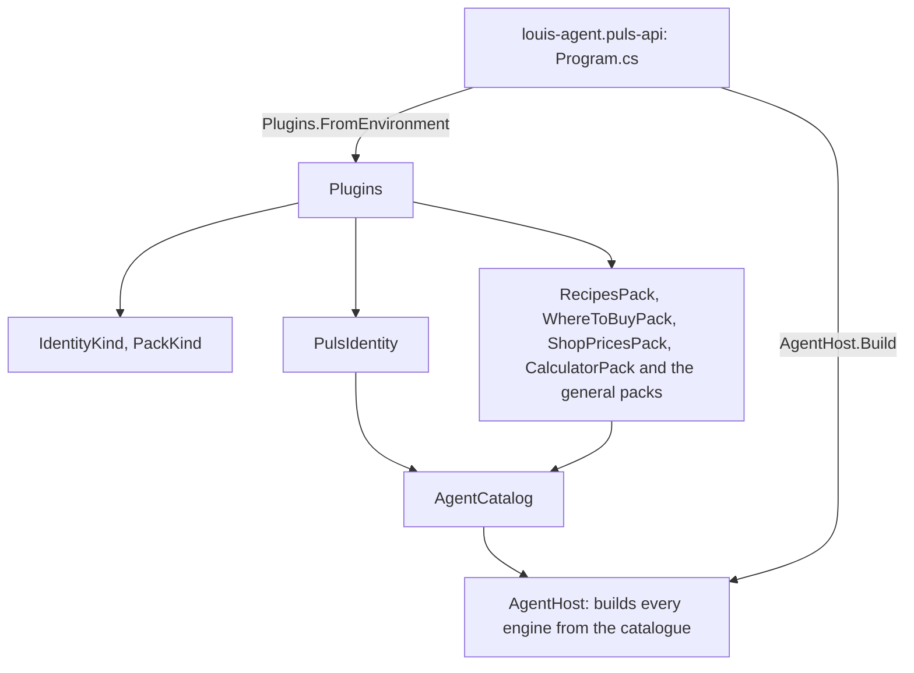
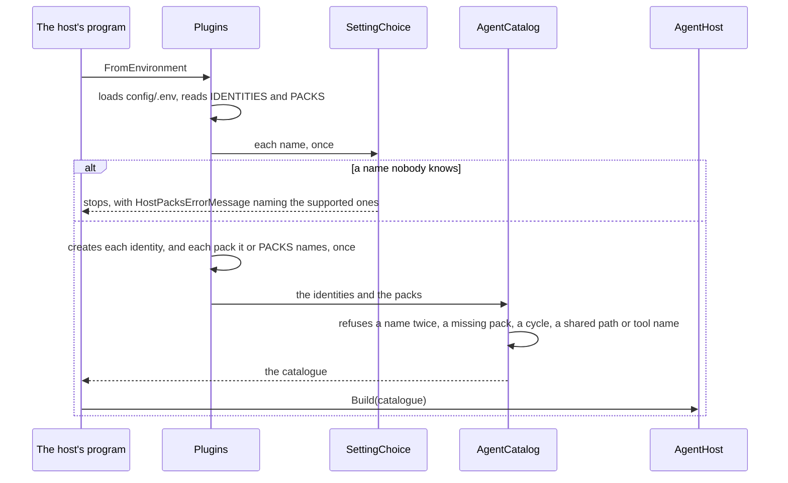

# louis-agent.host-packs — design

> **Kind:** class library (`net10.0`) · **Path:** `demos/puls/hosts/louis-agent.host-packs/` · **References:** louis-agent.core,
> the Puls identity and the packs Puls's programs can load · **Used by:**
> louis-agent.puls-api, louis-agent.puls-eval-runner

## Purpose

Puls's side of the composition: the one project that knows every identity and pack Puls's programs can load, so that nothing else has to
([ADR 0027](../../../../src/docs/adr/0027-engine-identities-and-packs.md)). Core stays the engine and names no product; a host stays
thin and never references an identity or a pack; and which agent a host runs is a setting, not a build.

## How it works

- **One call at start-up.** `louis-agent.puls-api` starts with `AgentHost.Build(Plugins.FromEnvironment())`. `FromEnvironment` loads `config/.env` first, since the hosts load it only inside `Build`, which runs
  after this, then reads `IDENTITIES` and `PACKS`.
- **Names become enums once.** `IDENTITIES=puls` and `PACKS=where-to-buy` are comma separated, case ignored, each name once,
  and parsed with `SettingChoice` into `IdentityKind` and `PackKind` ([ADR 0024](../../../../src/docs/adr/0024-choices-are-enums.md)).
  An unknown name stops start-up with `HostPacksErrorMessage`, naming the supported ones. Unset loads nothing.
- **Identities bring their packs.** Each chosen identity is created, and every pack it names in `Packs` is added to the
  packs named on their own; one instance per pack, however often it is named. A pack is created with its own settings
  (`new ShopPricesPack(ShopPricesOptions.FromEnvironment())`).
- **The catalogue checks the rest.** The result is an `AgentCatalog` (core), which refuses, before any engine is built,
  a name used twice, a pack an identity names but nobody registered, a `Requires` cycle, a prompt path two of them
  share, and a tool name two toolsets share or that is the engine's own. The host hands it to `AgentHost`, which
  registers the prompts with `SkillFileSource` and builds every engine from it.

## Diagrams

**Architecture:** the one project that knows every identity and pack Puls can load, so core and the hosts don't have to. A host's own program is the only thing that calls it.

**Flow:** start-up. Which agent a host runs is a setting, not a build, and any mistake stops it before an engine exists.

## Structure

| File | What's in it |
|---|---|
| `Plugins.cs` | `FromEnvironment`, `FromSettings(identities, packs)`, and one `Create` switch for identities and one for packs |
| `IdentityKind.cs` | The identities a host may load (`Puls`) |
| `PackKind.cs` | The compiled packs a host may load or an identity may name: recipes, where-to-buy, shop-prices, web, calculator, shell, files, git and dotnet |
| `Messages/HostPacksErrorMessage.cs` | The two refusals: an unknown identity, an unknown pack |
| `louis-agent.host-packs.csproj` | References core, the Puls identity and each pack in `PackKind` |

## Configuration

| Setting | What it does |
|---|---|
| `IDENTITIES` | The identities to load, with the packs they name (`puls`). Unset: none |
| `PACKS` | Packs to load on their own. Unset: none beyond the identities' |

Each pack's own settings are read by the pack (see its design doc). Both are in [Setup](../../../../src/docs/SETUP.md); only the Puls
compose sets `IDENTITIES`.

## Extending it

A new identity or pack is three edits here: a member in `IdentityKind` or `PackKind`, its arm in the `Create` switch,
and a project reference. What proves it never comes here: no host carries a check or an eval
([ADR 0073](../../../../src/docs/adr/0073-packs-reference-no-evals.md)). The steps are the registration step of [Build a pack](../../../../src/docs/guides/build-a-pack.md#6-register-it-in-the-composition-root)
and of [Build an identity](../../../../src/docs/guides/build-an-identity.md#5-register-it-in-the-composition-root). A name with a dash is fine: the setting is
matched to the member's `[WireName]`, as with `where-to-buy`.

## Tests

`demos/puls/tests/louis-agent.host-packs.tests`: `PluginsTests` (the named identities load with their packs, a name twice is
one, unset loads none, an unknown name is refused naming the supported ones, `PACKS=where-to-buy` works without an identity,
`config/.env` is read before the settings) and `PackConvertibilityTests`, which builds every `PackKind` and checks
each tool against the MCP SDK's shapes ([ADR 0028](../../../../src/docs/adr/0028-packs-stay-convertible-to-mcp.md)): plain data in, text
out, a `CancellationToken` when it waits, an MCP-safe name, and no identity named in a description. `Copies/UnpricedMarkTests` and `ShopTableTests` hold the
copies a pack and an eval each keep equal.

## Limits and plans

- Synchronous: nothing to await yet. F36's MCP servers as packs connect here, at start-up, so this becomes async, with
  `MCP_PACKS` as a second source beside `PackKind` ([platform plan](../../../../ROADMAP.md)).

## Related docs

[ADR 0027](../../../../src/docs/adr/0027-engine-identities-and-packs.md) · [louis-agent.core](../../../../src/docs/projects/louis-agent.core.md) ·
[louis-agent.identity.puls](louis-agent.identity.puls.md) · [louis-agent.pack.where-to-buy](../../../../packs/docs/projects/louis-agent.pack.where-to-buy.md) · [louis-agent.pack.shop-prices](../../../../packs/docs/projects/louis-agent.pack.shop-prices.md)

---
[Projects](../../../../src/docs/projects/README.md) · Previous: [louis-agent.pack.recipes](../../../../packs/docs/projects/louis-agent.pack.recipes.md) · Next: [louis-agent.cli](../../../../src/docs/projects/louis-agent.cli.md)
