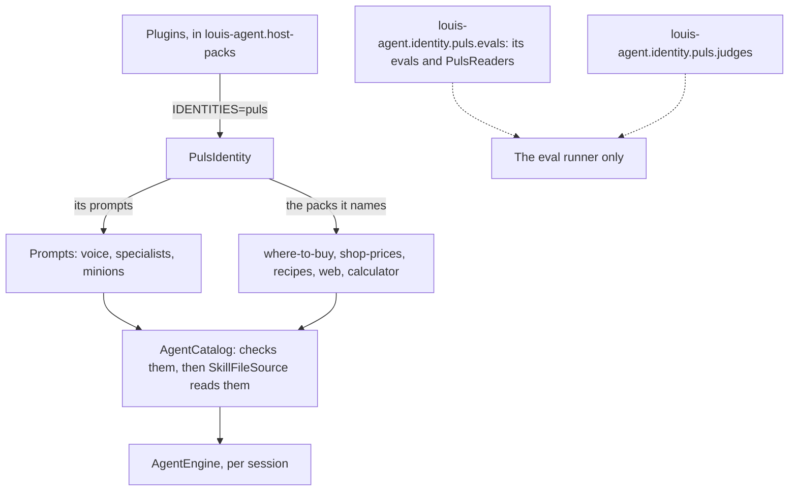
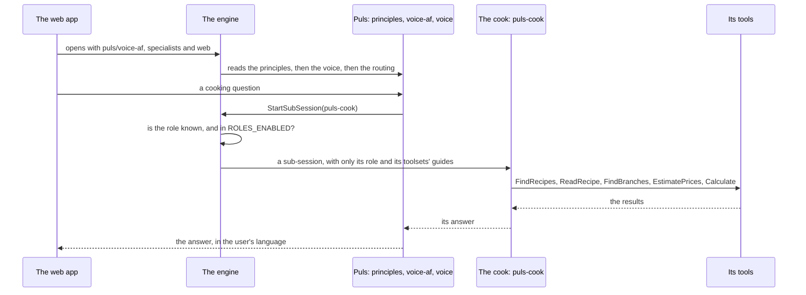

# louis-agent.identity.puls — design

> **Kind:** class library (`net10.0`) · **Path:** `demos/puls/identity/louis-agent.identity.puls/` · **References:**
> louis-agent.core, Microsoft.Extensions.FileProviders.Embedded · **Loaded by:** `IDENTITIES=puls` (the Puls compose
> sets it) · **Names:** the `where-to-buy`, `shop-prices`, `recipes`, `web` and `calculator` packs · **Its evals:**
> `demos/puls/evals/louis-agent.identity.puls.evals/` (`Evals/` below; references the check contract; only the runner
> references it, [ADR 0073](../../../../src/docs/adr/0073-packs-reference-no-evals.md))

## Purpose

Who Puls is: the South African general assistant's voice in Afrikaans and English, its routing, its specialists and its
minion, and the packs it uses. It holds no tools and no settings: what Puls can do comes from core's toolsets and from
the packs it names ([ADR 0027](../../../../src/docs/adr/0027-engine-identities-and-packs.md)). Puls's web app, what the user sees, is a
separate project ([louis-agent.puls](louis-agent.puls.md)).

## How it works

- **One class, the rest is content.** `PulsIdentity` answers three questions: its name (`puls`), its prompts (a
  `ManifestEmbeddedFileProvider` over `prompts/`, so the files keep their folder paths) and its packs
  (`where-to-buy`, `shop-prices`, `recipes`, `web` and `calculator`).
- **Start-up.** With `IDENTITIES=puls`, the composition root builds it and the packs it names; the
  catalogue checks that each pack is registered and that no prompt path is also core's or a pack's. From then on Puls's prompts
  are read through the same reader as core's (`SkillFileSource`).
- **A chat.** The web app opens a session with `role: "puls/voice-af"` (or `puls/voice-en`) and the toolsets
  `specialists` and `web`. The session reads core's principles, then the language's voice (`voice-af.md`), then Puls's
  shared routing (`voice.md`). Puls answers the world itself with `web`, and hands every cooking question to the cook
  with `StartSubSession`, on the same instance (`AGENT_PEERS: puls=http://puls:8080`).
- **The cook.** `specialists/puls-cook.md` opens with the header every prompt has
  ([ADR 0063](../../../../src/docs/adr/0063-a-prompt-says-what-it-is.md)): its name, description and level, and its toolsets, `recipes`,
  `where-to-buy`, `shop-prices` and `calculator`, required (no `?`): a cook that can't read recipes, find a shop, estimate a list or do its sums is refused,
  not left without them. It gets `web` from Puls. A role that needs a toolset always lists it under
  `metadata.toolsets` ([ADR 0025](../../../../src/docs/adr/0025-a-role-declares-its-toolsets.md)).
- **Only checked roles are on.** `ROLES_ENABLED` lists them; the Puls compose defaults to `puls/voice-af`,
  `puls/voice-en`, `puls-cook`, `puls-minion-web-price-lookup` and `puls-minion-find-recipe`, the ones that passed
  their check (F29). The other specialists are written but off.
- **Its evals and their checks.** Puls's four evals, `puls-routing`, `puls-cook`, `puls-recipes-long` and `puls-recipes` (F35.2: the
  cook reads a recipe with `ReadRecipe`; thirteen dishes, a judge told what `ReadRecipe` gave back, not yet recorded),
  are folders of files under `Evals/` (F49.2). Puls ships **readers, not checks** (F49.2b): the cook's file names the general checks
  (`no-error`, `amount-under`, `image-shown`, `number-named`) under the names its grades carry, over Puls's readers
  in `Evals/Readers/` (`rand-total`, `rand-prices`, `servings`, `recipe-photos`: Adapters over the cook's scoring
  code; `recipe-link` reads the `Skakel:` / `Link:` line for the recipes pack's `recipe-from-source`), listed in `PulsReaders.All`, which reaches the runner through the composition's `EvalReaders`. The shop
  rules are the where-to-buy pack's checks project's (F49.3), with the reading of the scenario's shop: Puls has no check of its own left.
  Its readers implement the check contract only; the cook's model judge needs the harness, so it lives apart in
  [louis-agent.identity.puls.judges](louis-agent.identity.puls.judges.md), which only the runner references.

## Diagrams

**Architecture:** one class, and the rest is content. Puls holds no tools: what it can do comes from the engine's toolsets and the packs it names, and what proves it stays apart, so no host carries it.

**Flow:** what a session is made of, and how a cooking question gets to the cook. A role that's off comes back to Puls as a tool error, which it has to report.

## Design notes

What building Puls's specialists settled (F21, F22, F25, F26, F29, F30); the measured story is
[write-up 10](../../../../src/docs/learning/10-multi-agent-orchestration.md):

- **A specialist is a role, one per kind of work,** and a sub-session gets no router: only its role and its toolsets'
  guides, about 1,900 tokens of prefix against Puls's 2,200. A role Puls names is refused before an engine is built
  when it is unknown or off (`ROLES_ENABLED`), with the same answer either way, so a role that's off comes back to
  Puls as a tool error it must report. Turning a role on is one line in `config/.env` and `up -d`, once its eval passes.
- **The prompts and the gate say the same:** the routing keeps the cook, makes the web Puls's own work, and marks the
  rest *not yet*; the specialists guide lists those under *Waiting for validation*, with what each needs (a report
  shape, a relay rule, an eval).
- **Puls shows the cook's report; it doesn't retype it** ([ADR 0079](../../../../src/docs/adr/0079-show-a-specialists-report.md)): the turn ends on the report, and Puls's one line of its own comes before the call.
- **Cooking is never answered from memory** (Louis, 2026-10-15, after Puls answered "ek wil bobotie maak" itself):
  every cooking question goes to the cook, which takes the dish through the whole report and adds *Where to buy*, the
  shops' branches in the user's town. Branches come from OpenStreetMap (Nominatim's search, as JSON), since the shops'
  own store finders draw their content with JavaScript.
- **The user's place travels with the session,** not through the model: Ligging in the web app (typed, or the
  browser's position sent to Nominatim at two decimals, about a town), the time zone with every new chat, and the
  specialists get it in their task. Attachments go by name: the model names the file, the session hands it over and
  remembers it across turns.
- **A follow-up goes to the same specialist** (F26): re-delegating cold would refetch every page, could drift to
  another dish and rewrite the cached prefix. The chat's session keeps its open sub-sessions (core's
  `SubSessionRegistry`, short handles per chat, `sub-1`); at most 3 stay open (the oldest closes); a continue that
  fails or times out closes the sub-session; starts and continues count against the same per-turn limit.
- **The local model reads English, not Afrikaans:** a role written for a small local model is in English, Puls briefs it
  in English and writes the Afrikaans answer itself.
- **No minion is used** (F30, F35.2 step 2b, [ADR 0081](../adr/0081-the-cook-searches-for-itself.md)): a specialist can hand
  one task and one of its own tools to a minion on the model `MINION_LLMS` names, and the web app draws its card inside
  the specialist's. The cook searches with `FindRecipes` itself, because the find-recipe minion cost 7% more and took 8 s
  longer at the same accuracy. The price-lookup minion is built and unused too: four hand checks found a small local
  model unreliable at pricing (wrong products, invented dates), and Haiku minions no better than the cook's own searches.

## Structure

| Path | What's in it |
|---|---|
| `PulsIdentity.cs` | The identity: name, prompts, packs |
| `PulsRole.cs` | The roles Puls offers a session as an enum (the cook, researcher, analyst, historian, reader and the price-lookup and find-recipe minions), each a file of the identity; written with `.Wire()` (F18 step 7.5.4) |
| `PulsPack.cs` | The packs Puls names as an enum of its own, never the pack's enum; the composition root's `PackKind` is checked against the packs it builds (F18 step 7.5.4e) |
| `prompts/agent/puls/voice-af.md`, `voice-en.md` | The voice in each language (*Puls - Stem*, *Puls - Voice*): who Puls is and how it talks; the two have the same sections |
| `prompts/agent/puls/voice.md` | The shared routing (*Puls - Routing*): which work goes to which toolset or specialist, how to brief one (by each line's English name; the labels and the lines Puls says are its voice's, so the routing holds no language), what isn't available yet; no mode of its own |
| `Evals/Cook/` | The cook's eval as a folder of files (F49.2): `eval.json` (version 15, F50.2: its two modes, the cook's tools now `where-to-buy` and `shop-prices`, and ten checks: general checks over Puls's readers under the cook's names, the where-to-buy pack's two shop rules, `unpriced-items` (the general `tool-rows-marked` on `EstimatePrices`, measured, never fails), `routed-to`, the cook's judge `meal-for-people` and a person's review of it), `manual.md`, `Rubrics/meal-for-people.md` (the judge's calibrated rubric), `Dataset/` with the 60 labels, and `Transcripts/` |
| `Evals/Routing/` | The routing eval as a folder of files (F49.2): `eval.json` (its modes, the baseline's toolsets listed, and `routed-to` with only `specialists` delegating), `manual.md`, `Dataset/` and `Transcripts/`; copied to `EvalFiles/identities/louis-agent.identity.puls/…`, where the runner finds it through the composition |
| `Evals/Readers/`, `Evals/PulsReaders.cs` | Puls's readers (F49.2b, F49.3): `RandTotal` (`rand-total`), `RandPrices` (`rand-prices`), `PeopleServed` (`servings`) and `RecipePhotos` (`recipe-photos`), Adapters over the scoring code below, `RecipeLinkLine` (`recipe-link`, string methods over the cook's link line, F35.2), and their list |
| `Evals/Checks/Cook/` | The scenario's expectations (`Expectations/`: the route, the town, the people, the budget), the scoring of prices and servings (`Scoring/`), and `CookMode` |
| `Evals/Checks/Shared/` | Reading a turn (`TurnView`), the shops and their links (`Shops`, `PriceLinks`, `RecipeLinks`), and the names the checks use as enums of their own (`PulsEvalName`, `PulsEvalRole`, `PulsToolset`, `PulsVoice`; ADR 0043) |
| `Evals/Checks/Messages/` | The checks' reasons (`GradeMessage`, `ExpectationMessage`; ADR 0009) |
| `prompts/specialists/puls-cook.md` | The local cook: a recipe from a real page, priced at the shops near the user, with sources (on) |
| `prompts/specialists/puls-researcher.md`, `puls-reader.md`, `puls-analyst.md`, `puls-historian.md` | The web researcher, file reader, numbers and history specialists (written, off until each passes a check) |
| `prompts/minions/puls-minion.md` | What every Puls minion is: one task, one tool, a short answer in its role's fields |
| `prompts/minions/puls-minion-web-price-lookup.md` | One ingredient's price at each named shop, with `WebSearch` (F30); runs only where the instance sets `MINION_LLMS` |
| `prompts/minions/puls-minion-find-recipe.md` | One dish's recipe page on the recipe sites, with `FindRecipes` and no site named: one line per site that has it, `{name} · {site} · {link}`, or `none · tried: {sites}` (F35.2 step 2b); the cook reads the link itself |
| `louis-agent.identity.puls.csproj` | References core alone (`ArchitectureTests` holds it), and the two embedding lines (`GenerateEmbeddedFilesManifest`, the `Prompts\**\*.md` glob); the item that copies `Evals/`'s files is in the evals project's csproj |

## Configuration

None of its own. A Puls stack (`demos/puls/docker/docker-compose.puls.yml`) sets `IDENTITIES=puls`, `ROLES_ENABLED`,
`AGENT_PEERS` (itself), `SHOW_SPECIALIST_REPORTS=true` ([ADR 0079](../../../../src/docs/adr/0079-show-a-specialists-report.md)), `HOST_TIME_ZONE=Africa/Johannesburg` and `BROWSER_USER_AGENT` (who reads and why,
[ADR 0038](../../../../src/docs/adr/0038-the-browser-says-what-it-is.md)), plus the shop prices' store
(`SHOP_PRICES_MONGO_URL`, [louis-agent.pack.shop-prices](../../../../packs/docs/projects/louis-agent.pack.shop-prices.md)), and the recipes pack's `RECIPE_SOURCES=*`, every site in the table
([louis-agent.pack.recipes](../../../../packs/docs/projects/louis-agent.pack.recipes.md)). Every setting is in [Setup](../../../../src/docs/SETUP.md).

## Extending it

The steps are in [Change Puls](../guides/change-puls.md); a new identity from scratch, with Puls as the worked
example, is [Build an identity](../../../../src/docs/guides/build-an-identity.md). In short: a
language is a `voice-{xx}.md` with the same sections as `voice-af.md`; a specialist is `specialists/puls-{name}.md`, a
row in the routing, and a place in `ROLES_ENABLED` once its eval passes. A changed word in any prompt changes the
session golden: regenerate it and read the diff.

## Tests

`demos/puls/tests/louis-agent.identity.puls.tests`: `PulsIdentityTests` (name, packs, one prompt per folder found, the catalogue
refusing Puls without its packs, the cook's declared toolset and no other role's), `PulsPromptsTests` (the modes and roles listed, a language loading its voice then the
routing, the languages with the same sections, the cook's header) and `PulsSessionSnapshotTests` with
`PulsSessionSnapshot.json`, the golden of exactly what the model is sent in Puls's chat and in its cook. `PulsPrompts`
registers the identity's and the pack's prompts first, as a host does. Puls's behaviour is measured by its evals:
the routing eval beside the identity (`Evals/Routing/RoutingEvalTests`: its modes, with the baseline equal to Puls's
toolsets from the composition minus the delegating ones; its dataset's shape, each question for the cook naming its
people and its shop; its references and known-bads conform; its manual), and the cook and its checks in
`Evals/Checks/` (each check on hand-cut answers, a turn the infrastructure broke left Unknown by every check, the
cook's dataset with its versions, hashes and every expected key read, the ids as test constants, the cook's
references and known-bads). The test project references the harness, the composition and the judges for these; the
identity doesn't.

## Limits and plans

- Only the cook has passed its check; each other specialist is turned on after its own eval.
- The first v2 baseline (2026-10-29): `puls-cook` 23 of 24 in its cook mode, 6 of 24 when Puls answers itself;
  `puls-routing` 72 of 72; the local judge agrees 31 of 36 with a blind labeller, below the 90% bar
  ([louis-agent.evals](../../../../src/docs/projects/louis-agent.evals.md#design-notes)). The held-out scenarios still have their older, hand-cut
  references.
- The cook reads its recipes with the `recipes` pack, and goes to the web only for a dish no site has (F35,
  [write-up](../../../../src/docs/learning/05-structured-outputs.md)). The last full recipes run, `79ea99b3ec08`, had 30 of
  30 from a page it read and 27 of 30 by the judge, in 52 s at $0.0059 an answer. The fixes after it are unmeasured: the
  next paid run is the first on them. CL16 moves the cook into a `cooking` pack; the area guide moves here with the
  Places pack ([TODO](../../../../TODO.md), *Puls*).
- Louis's corrections to the Afrikaans, and the eleven official languages, measured → [TODO](../../../../TODO.md).

## Related docs

[Build an identity](../../../../src/docs/guides/build-an-identity.md) · [louis-agent.puls](louis-agent.puls.md) (the web app) ·
[louis-agent.pack.where-to-buy](../../../../packs/docs/projects/louis-agent.pack.where-to-buy.md) · [louis-agent.pack.shop-prices](../../../../packs/docs/projects/louis-agent.pack.shop-prices.md) · [ADR 0019 modes](../../../../src/docs/adr/0019-modes-one-file-per-product.md)

---
[Projects](../../../../src/docs/projects/README.md) · Previous: [louis-agent.core](../../../../src/docs/projects/louis-agent.core.md) · Next: [louis-agent.identity.puls.judges](louis-agent.identity.puls.judges.md)
