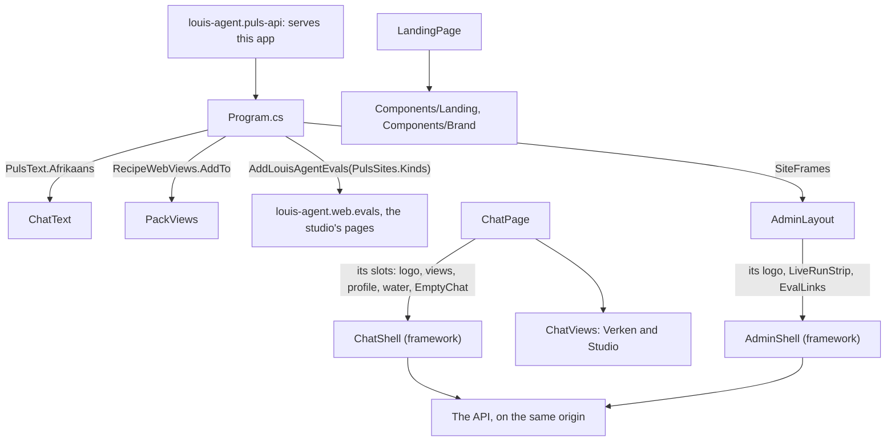
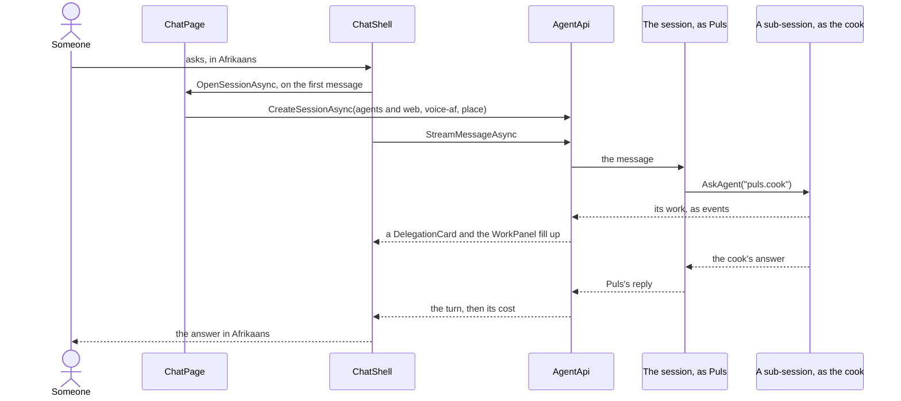

# louis-agent.puls — design

> **Kind:** Blazor WebAssembly app · **Path:** `demos/puls/web/louis-agent.puls/` · **Served by:** louis-agent.api built with
> `louis-agent.puls-api` (`demos/puls/docker/images/Dockerfile.puls`, `demos/puls/docker/docker-compose.puls.yml`, port 5070) · **References:**
> louis-agent.web, Bootstrap 5.3 (CDN, SRI-pinned), highlight.js (CDN), Montserrat (Google Fonts)

## Purpose

Puls is the general assistant's web app: a South African AI assistant in everyday Afrikaans that answers by handing each
task to a specialist (F5) and shows that work as it happens. It's chat only: its sessions load `agents` and `web`
(`AskedToolset`; `specialists` from F29 to F127.3.1), so Puls answers the web itself and asks a specialist on its own instance by its address (`puls.cook`; `AGENT_PEERS` names itself, CL19), whose role
(F21) brings only the toolsets its task needs; only a validated role is on (`ROLES_ENABLED`: the cook, F25). Pay
as you go: every answer shows what it cost, specialists included.

## How it works

- **Pages:** `/` is the landing page (`LandingPage.razor`). The app is one small page, `ChatPage.razor`, at `/gesels`,
  `/gesels/{id}` (old `/chat/{id}` links move there), `/verken` and `/studio`. It fills the framework's `ChatShell` with what's Puls's own
  (see [louis-agent.web](../../../../src/docs/projects/louis-agent.web.md)), and redraws on every address change, since Blazor wouldn't for
  the same page with the same parameters.
- **A chat** opens `POST /v1/sessions` with `toolsets: ["specialists", "web"]` where the instance has them (F29), `role: "puls/voice-{language}"` (`puls/voice-af` by default; F21, CL9, CL14) and, when the user shared it,
  `location` and `time_zone` (F22). Messages stream over SSE; `TurnStream` (shared) folds them, sub-session events
  included, into the turn the page shows.
- **Three panels:** the sidebar (search, Verken, Studio, favourites, projects, recent, archive, profile and settings),
  the chat (top bar, messages with actions, the message box), and the Werk panel (`WorkPanel.razor`: each delegation's
  specialist, toolsets, task, steps and cost, the chat's sources, Puls's and the specialists' cost). Below 1200px the
  Werk panel slides in; below 992px the sidebar does.
- **The admin portal** (English, the builders' screen): *Admin* in the profile menu opens `/admin`. The pages are the framework's
  ([The eval pages](../../../../src/docs/projects/eval-pages.md)); Puls fills their frame in `AdminLayout` with its logo, the live strip and the eval
  links, and says in `PulsSites` which websites matter to it: South African shops, other South African sites and the map.
- **Placeholders** (share, edit, regenerate, feedback, voice, screenshots, image, deep research, other models, language,
  theme, profile, sign-out, buying credits) answer with a "kom binnekort" toast.
- **Stored in the browser:** chats (with favourite and archived), the API key, the currency, the location, whether
  the sidebar and the Werk panel are hidden, and whether the animations are on although the system asks for less
  (`chat.motion`, F24).

## Diagrams

**Architecture:** Puls is a small program on the framework's web. What's here is what makes it Puls: its words, its look, its landing page and which websites matter to it.

**Flow:** someone asks Puls about cooking. The web app opens the session and draws what comes back, and the handing over happens on the server.

## Structure

| Path | What |
|---|---|
| `Pages/LandingPage.razor` | The landing page (F20, moving since F24): the water, the progress line and the section index, then the sections in order, and the JS start and stop |
| `Components/Landing/` | One component per section (W2): `LandingNav`, `Hero`, `Showcase`, `HowItWorks`, `InsideTheApp` (the pinned tour), `Features` (the Kenmerke bento and marquees), `Numbers` (Syfers), `Pricing`, `About`, `Faq` (the accordion), `CallToAction`, `LandingFooter`; a section's copy is a C# array in its own file. `MiniChat` is the little picture of the app the stages and the tour show (a question, a delegation card, the body, sources, usage), six panels from one component; `LandingBars` the example bar heights two sections share. Every section's copy and the brand components' per-instance ids are in `.razor.cs` files (W2b) |
| `Components/Landing/LandingDemo.razor` | The app's three panels in the landing page, playing three scripted turns (example data in `data-turns`, played by `landing.js`) |
| `Components/Brand/` | `PulsLogo` (the ripple logo inline, its rings glow outward), `PulsTile` (the app icon), `PulsMark` (the mark's geometry), `Water` (the four swells behind the landing page and an empty chat) |
| `Pages/ChatPage.razor`, `ChatPage.razor.cs` | Puls on the framework's `ChatShell`: its addresses and what goes in the slots (the logo, Tuis, Verken and Studio, the profile card, the water, the empty chat, the cost line's words); in the code-behind which view shows, the old `/chat/{id}` address and which toolsets a session asks for |
| `Components/Chat/` | `EmptyChat` (the welcome with the message box in the middle), `Sidebar/ProfileCard`, and `Panels/`: `ChatViews`, `ExploreView`, `StudioView` and `TemplateCard` (Verken and Studio). The rest of the chat is in `louis-agent.web` |
| `Layout/AdminLayout.razor` | Fills the framework's `AdminShell` with Puls's own: its logo and way back, the live strip and the eval links |
| `Text/PulsWebRole.cs` | The roles the web app has words for (the cook's work phases), as an enum of its own (ADR 0043) |
| `Text/PulsText.cs` | The shared components' words in Afrikaans (`ChatText`) |
| `Content/` | `Template` and `Templates` (the starters on Verken and Studio), `PulsSites` (the kinds of website the eval pages' sources chart sorts by) |
| `Styles/` | Puls's look, in Sass ([ADR 0085](../../../../src/docs/adr/0085-styles-are-written-in-sass.md)): `app.scss` lists the framework's partials under `web/` and Puls's own in cascade order. Puls's own are its colours (`settings/_tokens.scss`: orange, green, charcoal, a charcoal-tinted white; Montserrat), the landing, and what's only its own in `layout/` and `chat/`: the logo, the water, the empty chat, Verken and Studio. The build makes `wwwroot/css/app.css`, which isn't in git |
| `wwwroot/js/landing.js` | The landing page's motion (F24): progress line, section index, centred links, reveals, counters, the pinned tour, the demo, the accordion; started and stopped by `LandingPage.razor` |
| `wwwroot/index.html` | The start screen with Blazor's real loading count; the saved layout and the motion choice applied before the first paint |
| `wwwroot/brand/` | The logo set: mark, logo, stacked, icon tiles, colour versions |

## Design notes

What the look (F20) and the motion (F24) settled, so a change keeps it:

- **The landing page's demo is the app's own markup.** `LandingDemo` builds its turns from the app's classes
  (`user-message`, `delegation`, `work-item`, `work-step`, `work-cost`), so a change to the app's look changes the demo
  with it; only the frame's layout is its own (`demo-*`). Its turns are example data in C#, serialised into
  `data-turns`, and `landing.js` only plays them. The same goes for the page's copy: tiles, chips, chart heights and
  marquee tags are C# arrays rendered by Razor, so no script builds markup from literals.
- **Numbers on the page are measured ones,** each a line of data with what it is and how it was measured, so a new
  measurement changes one line.
- **The loading count is Blazor's own** (`--blazor-load-percentage-text` on `<html>`, shown in a `::after`); no script
  counts files.
- **One motion switch:** `data-motion="on"` on `<html>`, set by `index.html` before the first paint and changed by
  the framework's `preferences.js` `setMotion` (the sidebar's checkbox and the landing's pill both call it; the landing imports it, CL31); the stylesheets guard their reduced-motion
  blocks with `:root:not([data-motion="on"])`. Text arriving in order is content, not motion, so a reader who asked
  for less motion still sees the demo play at a reading pace; only the loop stops. Moving content that lasts over five
  seconds has a *Stop* or *Pouse* button (WCAG 2.2.2), and a closed FAQ answer is `inert`.
- **Costs count up without touching Blazor's node:** every `[data-count]` runs from the last number shown to the new
  one after a render, writing the text node's value (not `textContent`, which would replace the node Blazor holds),
  keeping the C# formatting the one source of the money text.
- **Traps found by looking:** Bootstrap paints an offcanvas transparent at its breakpoint (the sidebar and Werk panel
  use a gradient); one page on three addresses with the same parameters doesn't redraw (listen to `LocationChanged`);
  a landing class must not collide with a Bootstrap grid class (`cost-row`, not `row`); a finished animation with
  `fill-mode: both` keeps overriding `transform` (reveals rise on `translate`, so the tilt applies); a `filter` on
  `background-clip: text` makes Chrome drop the text (the gradient line rises without the blur); an element that
  rises in with a filled `transform` animation becomes the frame of its fixed children, so a modal inside it is
  clipped (the card that holds the explorer doesn't rise in, `.card-p.holds-modal`).
- **The admin portal is in English** (Louis, 2026-10-17: "afrikaans is just the language puls can be configured for"):
  it's the builders' screen; recorded questions and answers stay in the language they were recorded in. Its charts
  are our own SVG and CSS on Puls's variables, no chart package, and each explains on hover what good and bad look like
  (`ChartInfo`). A way into a row is a button named for where it goes, never a bare chevron or a bar.
- **The Werk panel shows Puls's own cost and the specialists' side by side,** and the turn's usage line includes the
  specialists through the sub-session roll-up (core, *Showing usage*).

## Configuration

None of its own: the API it's served by holds the settings (`AGENT_PEERS` names itself: the specialists, and the minions
they hand pages to (F30), run on the same instance since CL19). The compose file runs `puls` (5070, the app and its API),
`puls-mongo` (the benchmark store, F31) and, on their own `web` network with `puls` (F32),
`puls-searxng` (8888: the search we run, for development and benchmarks; settings in `demos/puls/docker/searxng/settings.yml`, its
secret in `config/.env.searxng`) and `puls-browser` (9222: the headless Chrome that renders pages). Both images are
pinned by digest.

## Extending it

The steps are in [Change the Puls web app](../guides/change-the-puls-app.md). In short: a starter is a line in
`Content/Templates.cs`; a chat piece every site would share goes in `louis-agent.web`, and only what's Puls's own goes under
`Components/Chat/`; a placeholder made real replaces its "kom binnekort" toast and keeps the label. Puls's voice and roles are the Puls identity's prompts
([Build an identity](../../../../src/docs/guides/build-an-identity.md)); built in, so a change is a rebuild.

## Tests

`demos/puls/tests/louis-agent.puls.tests`, NUnit with bUnit: `Pages/ChatPageTests` renders the chat against `FixtureApi`, streams
the recorded Puls turn, lists the page's JavaScript calls and pins `ChatPage.empty.html` and `ChatPage.turn.html`;
`Pages/LandingPageTests` pins the landing page; `Components/` pins `WorkPanel`, `TemplateCard` and `PulsTile`. The layout at 1440, 1100
and 420 px wide is still checked by hand.

## Limits and plans

- Usage figures are per browser (the chats saved here); a user's monthly total belongs to the server-side ledger (F23).
- Buying credits (F23 Credits), a light theme, accounts, and the placeholders above are to come.

## Related docs

[louis-agent.identity.puls](louis-agent.identity.puls.md) (who Puls is) · [louis-agent.code-review](../../../louis-agent/docs/projects/louis-agent.code-review.md) ·
[api](../../../../src/docs/projects/louis-agent.api.md) · [evals](../../../../src/docs/projects/louis-agent.evals.md) · [Multi-agent write-up](../../../../src/docs/learning/10-multi-agent-orchestration.md)

---
[Projects](../../../../src/docs/projects/README.md)
