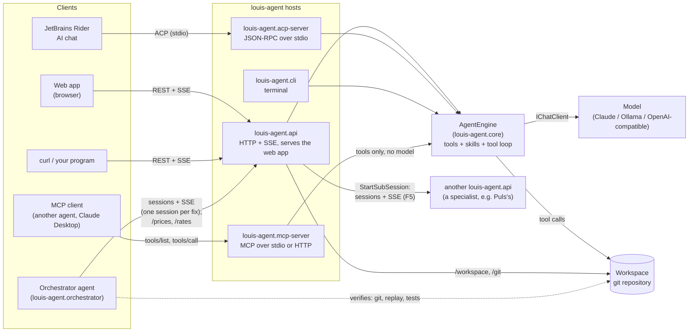
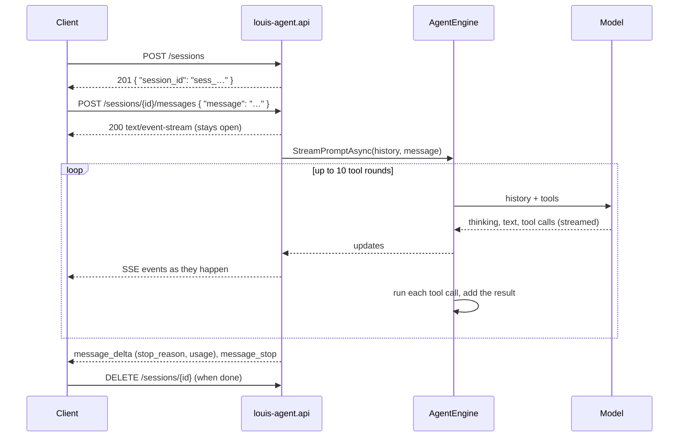
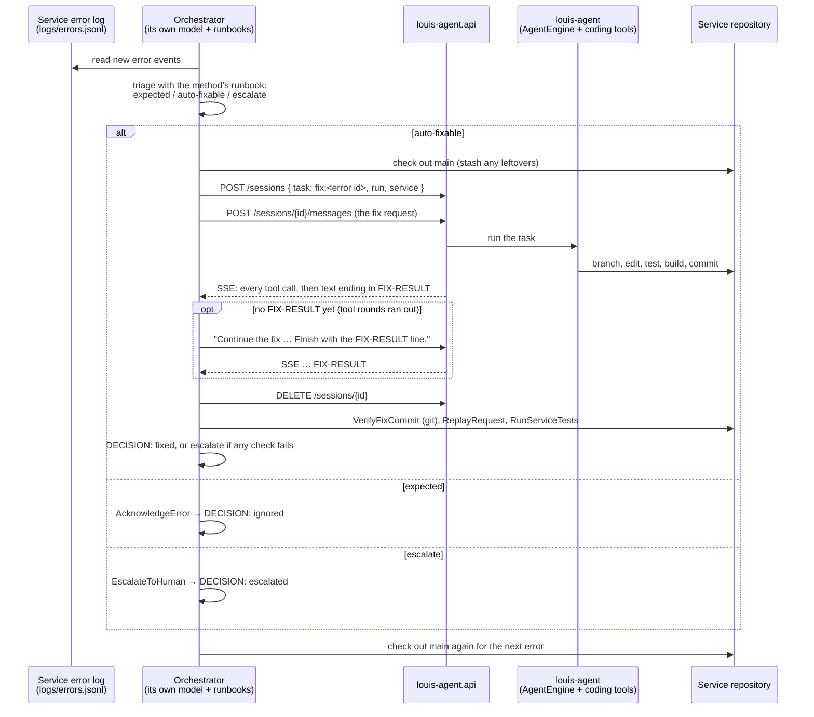

# How the Agents and Endpoints Talk

> **Reference.** The HTTP API, its event stream, the web app, Rider (ACP), MCP, and agent-to-agent messages.
> **Elsewhere:** the components in [Architecture](architecture/README.md), one turn inside the agent in
> [How a turn works](architecture/06-runtime-view.md).

Who connects to louis-agent, over which protocol, and what goes over the wire — from a browser or Rider, from another
program, and from another agent (the orchestrator). For what happens *inside* one turn (the model, tools and skills),
see [AGENT_INTERACTION.md](architecture/06-runtime-view.md).

## The big picture



Every host is a thin adapter around the same `AgentEngine`: it turns its protocol's input into a prompt and the
engine's streamed output (thinking, text, tool calls, tool results) back into its protocol. The MCP server is the
exception: it has no model of its own and only hands out the tools.

## Which interface to use

| You want… | Use | Why |
|---|---|---|
| To chat with the agent in a browser, review its changes, merge branches | Web app (served by **louis-agent.api**) | Chats, Files, Changes and Branches tabs on top of the API |
| To chat inside Rider | **louis-agent.acp-server** | Rider's AI chat speaks the Agent Client Protocol |
| A program (or another agent) to hand louis-agent a whole task and get the result back | **louis-agent.api** sessions | louis-agent runs its own tool loop server-side and streams what it does; the caller only reads the outcome |
| Another agent to use louis-agent's *tools* with its own model, one call at a time | **louis-agent.mcp-server** | MCP hands out raw tools; the calling agent does all the reasoning |
| Quick prompts in a terminal | **louis-agent.cli** | No network at all |

The difference between the last two matters for agent-to-agent setups. Through the **API**, the other agent delegates:
"fix this", and louis-agent decides how. Through **MCP**, the other agent *is* the brain and louis-agent is a toolbox —
no louis-agent judgement is involved. The orchestrator uses the API, because it wants louis-agent to do the whole fix.

## The HTTP API (louis-agent.api)

Base URL: `http://127.0.0.1:5080` for the main Docker setup, `http://127.0.0.1:5081` for the orchestrator demo. Bound
to `127.0.0.1` only.

**Authentication.** When `AGENT_API_KEY` is set, every `/sessions`, `/workspace` and `/git` call must send it as
`x-api-key: <key>` or `Authorization: Bearer <key>`; otherwise the reply is `401`. `/health`, `/prices` and the web
app's own files never need a key.

**Errors** are JSON in Claude's shape, with a matching status code:

```json
{ "type": "error", "error": { "type": "conflict_error", "message": "This session is still answering a message; …" } }
```

| Status | When |
|---|---|
| `400` | Bad input: empty message, a path outside the workspace, nothing staged to commit, a branch that is already merged |
| `401` | `AGENT_API_KEY` is set and the request didn't send it |
| `403` | A secret file (`.env`, keys) or its diff was asked for |
| `404` | Unknown session or branch |
| `409` | The session is still answering; a merge would conflict (it is aborted); uncommitted changes block a merge |
| `413` / `415` | A workspace file is over 1 MB or binary |

### Sessions: talking to the agent

A session is one conversation with its own history. Sessions live in memory (a restart ends them) and are dropped
after 4 hours idle. One message is answered at a time per session.



| Endpoint | Request | Reply |
|---|---|---|
| `POST /sessions` | All optional. `task`, `run`, `service`: tags every usage record of the session (the orchestrator sends `fix:<error id>`, its run id and the service); each at most 200 printable characters. `toolsets`: the toolsets the session loads and keeps (F5; none gives `skills`). `personality`: a built-in one at the session's level (F21, CL8: a mode such as `puls/voice-af` at depth 0; none gives the default mode, `louis-agent/voice`, CL9). `location` and `time_zone` (IANA): where the user is (F22). `depth` (0 or 1) and `parent` are sent by `StartSubSession` for a sub-session | `201 { "session_id", "created_at", "toolsets", "depth", "personality", "task", "run", "service", "parent" }`; a `400` for an unknown toolset, personality or time zone |
| `POST /sessions/{id}/messages` | `{ "message": "…", "attachments": [{ "name", "content" }] }`; each attachment is cut at 100,000 characters | Server-Sent Events (below) |
| `POST /sessions/{id}/cancel` | — | `{ "cancelled": true }`; the stream ends with stop reason `cancelled` |
| `GET /sessions/{id}` | — | `{ "session_id", "created_at", "last_activity", "busy", "toolsets", "depth", "personality", "tools", "task", "run", "service", "usage" }`: `tools` is how many tools the session's engine has; `usage` totals the session's finished turns (the object below), `null` when the API records no usage |
| `DELETE /sessions/{id}` | — | `{ "deleted": true }` |
| `GET /toolsets` | — | `{ "default", "toolsets": [{ "name", "description", "available", "missing_settings" }] }`: what a session can load here, never the tool definitions |
| `GET /personalities` | — | `{ "default": null, "personalities": [...] }` |
| `GET /model` | — | `{ "provider", "model" }` |

Closing the connection also cancels the reply. A message of `/tools`, `/approve <Name>`, `/reject <Name>` or `/usage` (the
session's tokens and cost, by purpose) is answered by the API itself and never reaches the model.

### The event stream

The answer streams as Server-Sent Events shaped like Claude's Messages API. Thinking and text arrive as deltas inside a
block; a tool call and its result each arrive as one whole block. A trimmed example; the usage is the real total of the
order-total fix in [the cached demo run](https://github.com/bosbevk/louis-agent/blob/pre-cl10/samples/sample-output-cached/agent-comms.md) (11 requests):

```text
event: message_start
data: {"type":"message_start","message":{"session_id":"sess_2b84…","role":"assistant"}}

event: content_block_start
data: {"type":"content_block_start","index":0,"content_block":{"type":"text","text":""}}

event: content_block_delta
data: {"type":"content_block_delta","index":0,"delta":{"type":"text_delta","text":"Let me read the failing code:"}}

event: content_block_stop
data: {"type":"content_block_stop","index":0}

event: content_block_start
data: {"type":"content_block_start","index":1,"content_block":{"type":"tool_use","id":"toolu_…","name":"ReadWorkspaceFile","input":{"relativePath":"src/OrderService/Api/OrderTotal.cs"}}}

event: content_block_stop
data: {"type":"content_block_stop","index":1}

event: content_block_start
data: {"type":"content_block_start","index":2,"content_block":{"type":"tool_result","tool_use_id":"toolu_…","content":"namespace OrderService; …","is_error":false}}

event: content_block_stop
data: {"type":"content_block_stop","index":2}

event: message_delta
data: {"type":"message_delta","delta":{"stop_reason":"end_turn"},"usage":{"input_tokens":24,"cache_creation_input_tokens":8899,"cache_read_input_tokens":578353,"output_tokens":2907,"requests":11,"cost":0.008351,"currency":"USD","unpriced":0,"display_cost":0.138068,"display_currency":"ZAR","display_symbol":"R","rate_as_of":"2026-10-09"}}

event: message_stop
data: {"type":"message_stop"}
```

| Event | Meaning |
|---|---|
| `message_start` | The reply has started |
| `content_block_start` | A new block: `thinking`, `text`, `tool_use` (name and input) or `tool_result` (content, `is_error`) |
| `content_block_delta` | More `thinking_delta` or `text_delta` for the open block |
| `content_block_stop` | The block is complete |
| `message_delta` | The stop reason (`end_turn` or `cancelled`) and the turn's `usage` (below) |
| `message_stop` | The stream is complete |
| `error` | The turn failed; the data is the error shape above (type `api_error`), plus the turn's `usage` when a model request had returned before the failure ([FX6](fixes/FX06-usage-on-failed-turns.md)) |

**In another currency** (F14): the usage object keeps `cost` and `currency` as charged and adds `display_cost`,
`display_currency`, `display_symbol` and `rate_as_of`, the cost in the server's display currency (`HOST_CULTURE` /
`DISPLAY_CURRENCY`); when nothing is converted they repeat the charged figures, so a client can always show them.

**Usage** (F3) is Claude's usage object with the same four token fields, summed over every model request of the turn
(a turn can be several: one per tool round, plus any summary). As in Claude's, the four kinds don't overlap:
`input_tokens` is the uncached input. Added: `requests`, `cost` and `currency` (`null` when no request was priced:
"price unknown", never 0), and `unpriced`, the requests without a price. It is left out for commands (`/usage`,
`/tools`), when the API records no usage (`USAGE_LEDGER=off` or no `LOG_DIRECTORY`), and on an `error` before any
request returned. Claude clients ignore the extra fields.

Try it:

```bash
SID=$(curl -s -X POST http://127.0.0.1:5080/sessions | jq -r .session_id)
curl -N -X POST http://127.0.0.1:5080/sessions/$SID/messages \
     -H "Content-Type: application/json" -d '{"message":"What branch am I on?"}'
```

While a turn delegates (`StartSubSession`, F5), the specialist's own stream is passed through as it happens, one
`sub_session` event per event of the sub-session, so a client can show the delegated work live (Puls's Werk panel):

```text
event: sub_session
data: {"type":"sub_session","tool_use_id":"toolu_…","agent":"puls","event":"content_block_start","data":{…}}
```

`tool_use_id` is the `StartSubSession` call it belongs to; `event` and `data` are the sub-session's own event, in the
shapes above. When the specialist finishes, its answer comes back as that call's `tool_result`.

### Workspace and git endpoints

These don't involve the model; the web app uses them to show files and changes and to merge branches. Every path is
checked against the workspace, and secret files are never shown.

| Endpoint | Request | What it does |
|---|---|---|
| `GET /workspace/entries?path=` | — | List a folder |
| `GET /workspace/file?path=` | — | Read a text file (≤ 1 MB) |
| `GET /git/status` | — | Branch and changed files |
| `GET /git/diff?path=&staged=` | — | One file's staged or unstaged diff |
| `POST /git/stage` · `/git/unstage` · `/git/discard` | `{ "paths": [...] }` | Change the index or working tree; returns the new status |
| `POST /git/commit` | `{ "message" }` | Commit what is staged |
| `GET /git/branches` | — | Every branch, with how many commits it is ahead/behind the checked-out branch |
| `GET /git/log?count=` | — | Commits across all branches |
| `GET /git/commit?sha=` | — | A commit and its diff |
| `GET /git/branch?name=` | — | A branch's commits and the diff merging it would bring |
| `POST /git/merge` | `{ "branch" }` | Merge into the checked-out branch (`--no-ff`); a conflict aborts it (`409`) |
| `POST /git/branch/delete` | `{ "branch" }` | Delete a merged branch |
| `GET /health` | — | `{ "status": "ok" }` |
| `GET /prices` | — | The price table the API's usage ledger prices with (`config/prices.json`'s format, comments removed), for other hosts' `PRICES_URL`; `404` when it has none. No key needed |
| `GET /rates` | — | The exchange rates the API loaded (F14), in our `rates.json` format (`{as_of, base, source, rates}`), for other hosts' `RATES_URL` with `RATES_FORMAT=rates-json`; `404` when it has none. No key needed |
| `GET /rates/display` | — | `{ display_currency, display_symbol, base, rate_as_of, symbols }`: the server's display currency and a symbol per currency, for the web app's currency picker. No key needed |

Nothing here pushes: pushing is always left to you.

## The web app and the API

The web app is a Blazor WebAssembly app served by louis-agent.api from the same address, so it calls the API directly.

| Tab | Endpoints it uses |
|---|---|
| Chats | `POST /sessions`, `POST /sessions/{id}/messages` (renders the event stream: thinking, text, tool cards), `/cancel`, `DELETE` |
| Files | `/workspace/entries`, `/workspace/file` |
| Changes | `/git/status`, `/git/diff`, `/git/stage`, `/git/unstage`, `/git/discard`, `/git/commit` |
| Branches | `/git/branches`, `/git/log`, `/git/branch`, `/git/commit`, `/git/merge`, `/git/branch/delete` |

Chats are kept in the browser (`localStorage`); the server only holds the session. In the Branches tab, merges and
deletes are queued: every click is kept and they run one at a time, in order, with each row showing "Merging…",
"Queued" or "deleting…".

## Rider and the ACP server

Rider starts `louis-agent.acp-server` (one container per chat) and talks [Agent Client Protocol](https://agentclientprotocol.com)
JSON-RPC over its stdin/stdout:

| Direction | Message | Meaning |
|---|---|---|
| Rider → agent | `initialize` | Handshake and capabilities |
| Rider → agent | `session/new` | Start a chat (its own history) |
| Rider → agent | `session/prompt` | A message, with attached files as `resource_link` or `resource` blocks |
| Rider → agent | `session/cancel` | Stop the reply |
| agent → Rider | `session/update` | `agent_thought_chunk` (thinking), `agent_message_chunk` (text), `tool_call` and `tool_call_update` (in progress → completed or failed) |

The file open in Rider's editor arrives as a `resource_link` too: the server uses it to find that file's git repository
and works there, but reads into the prompt only the files you attached. As in the API, `/tools`, `/approve <Name>`,
`/reject <Name>` and `/usage` are answered by the server itself; with `USAGE_IN_CHAT` on, each answer ends with its
usage line (F3).

Because stdout carries the protocol, all logging goes to stderr.

## MCP clients and the MCP server

`louis-agent.mcp-server` publishes the engine's tools — files, git, `DotNet*`, scripts, web, skills, agent-built tools
— plus `list_skills`, `get_skill_info` and `get_skill_documentation`. It has no model: the client's own model decides
which tool to call (`tools/list`, `tools/call`), and the tool list updates live (`notifications/tools/list_changed`).

| Transport | For | Auth |
|---|---|---|
| stdio (default) | A local client that starts the server as a subprocess (Rider, Claude Desktop) | None needed: only the parent process can talk to it |
| Streamable HTTP (`MCP_TRANSPORT=http`, port 5090) | A remote client, e.g. an agent built on another SDK | `MCP_API_KEY` (falls back to `AGENT_API_KEY`); without a key it only logs a warning |

Approving agent-built tools is never possible over MCP: that stays with the user.

## Agent to agent: the orchestrator and louis-agent

The orchestrator ([its project doc](projects/louis-agent.orchestrator.md)) is a second agent built on `louis-agent.core`. It reads a
service's error log, decides what each error needs from a runbook per API method ([the runbooks](projects/orchestrator-runbooks.md)), and has
louis-agent fix the ones the runbook allows — over the same session API any client uses. It then checks louis-agent's work itself.

Besides the sessions, it calls `GET /health` at start-up and, in the demo, takes its prices and exchange rates from
louis-agent.api's `/prices` and `/rates` (`PRICES_URL`, `RATES_URL`), so both agents' costs are priced with one table
and shown at one rate. Its triage can run on another model than the fixes, a local one included
(`ORCHESTRATOR_LLM_PROFILE`; see [Local triage](https://github.com/bosbevk/louis-agent/blob/pre-cl10/docs/BENCHMARKS.md#local-triage-2026-10-12)).



### The messages between them

All of it is plain text in the session's messages; the structure comes from fixed formats both sides agree on.

**1. The error event** — what the service logged, one JSON line per exception. It is untrusted (it can contain user
input), so it is always fenced and labelled as data, never instructions:

```json
{ "id": "f47c2696c6ab", "service": "order-service", "method": "order-total", "arguments": "1003",
  "exception_type": "System.Collections.Generic.KeyNotFoundException",
  "message": "The given key 'SUMMER25' was not present in the dictionary.",
  "stack_trace": "   at OrderService.OrderApi.GetOrderTotal(Int32 id) in /demo/order-service/src/OrderService/Api/OrderTotal.cs:line 18 …" }
```

**2. The fix request** (orchestrator → louis-agent, built by `ServiceTools.FixPrompt`): the fenced event, the expected
behaviour taken from the runbook, and fixed steps — branch `fix/<method>-<error id>` from `main`, the smallest change,
a regression test in a new file, build and test, commit (never push or merge), then end with a `FIX-RESULT` line.

**3. The result line** (louis-agent → orchestrator), the last line of its reply:

```text
FIX-RESULT: {"status":"fixed","commit":"6385680","branch":"fix/order-total-f47c2696c6ab","tests":"15/15 passed","summary":"…"}
FIX-RESULT: {"status":"failed","reason":"…"}
```

The orchestrator reads the last such line. A model sometimes writes an unescaped quote inside `summary` or `reason`,
which makes the line invalid JSON; it is then read field by field instead of being lost
([FX8](fixes/FX08-fix-result-quotes.md)).

**4. The follow-up**, when a reply ends without a `FIX-RESULT` (louis-agent has 10 tool rounds per message, and a fix
can need more): `Continue the fix from where you stopped. Finish with the FIX-RESULT line.` The session keeps the
context, so louis-agent carries on where it stopped. The orchestrator sends up to three; in the cached demo run 4 of
the 10 fixes needed one, and none needed more.

**5. The decision** (the orchestrator's own model, last line of its triage):
`DECISION: <fixed|ignored|escalated|failed> - <one sentence>`.

### Trust: a claim is not proof

The `FIX-RESULT` is louis-agent's claim. The orchestrator only reports `fixed` after its own checks pass:

| Check | How |
|---|---|
| `VerifyFixCommit` | In git: the commit exists, is on the reported branch, which is checked out and starts from the tip of `main`; it is not on `main`; it changed files; the working tree is clean |
| `ReplayRequest` | Runs the failing API call again on the fix branch: it must answer `200` |
| `RunServiceTests` | The whole test suite, including louis-agent's regression test, must pass |

`CallLouisAgentFix` runs at most once per error: asked again, it says a fix was already requested and to verify that
one. Each agent also only has the tools its role needs: louis-agent has the coding tools but no access to the error tracker
or deployments; the orchestrator has no file, git-write or shell tools — it can only ask louis-agent, check, acknowledge
or escalate. A human merges the fix branches (in the web app's Branches tab).

### Where the conversation is recorded

Everything the two agents say is written to one Markdown file, `agent-comms.md`: per error, each message the
orchestrator sent (verbatim), each reply (a table of louis-agent's tool calls, its text and the `FIX-RESULT`), the
orchestrator's checks, and a summary — ending with a run summary table. Since F3 it also says what each part cost:
louis-agent's usage under each reply, triage + louis-agent + total in each error's summary, *Tokens* and *Cost*
columns in the run summary, and a run total split by agent (the figure to compare with the usage ledger's total for
the run id, `usage-probe -- --ledger`). Since F14 the costs are shown in the display currency, with the rate and the
USD charged under the run total. A real one from the cached demo run is in
[the cached demo run's `agent-comms.md`](https://github.com/bosbevk/louis-agent/blob/pre-cl10/samples/sample-output-cached/agent-comms.md) (the uncached "before"
is in [the first demo run](https://github.com/bosbevk/louis-agent/blob/pre-cl10/samples/sample-output/agent-comms.md); both at the `pre-cl10` tag); a shortened excerpt:

```text
## 2/13 · `order-total 1003` · KeyNotFoundException
### Orchestrator → louis-agent · message 1 · session `sess_71d9…`        (the fix request)
### louis-agent → orchestrator · reply 1 · 18 tool call(s) · stop: end_turn
Usage: 11 requests · 590k tokens (578k cached) · R0.14
| 3 | CreateBranch       | {"branchName":"fix/order-total-f47c2696c6ab"} | Success (no output). |
| 10 | WriteWorkspaceFile | {"relativePath":"src/OrderService/Api/OrderTotal.cs", …} | Wrote … |
| 14 | DotNetTest         | {"noBuild":true} | Passed!  - Failed: 0, Passed: 15 … |
| 17 | Commit             | {"message":"fix(order-total): treat unknown discount codes as no discount …"} | [fix/order-total-… 6385680] … |
FIX-RESULT: status fixed · commit 6385680 · branch fix/order-total-f47c2696c6ab · tests 15/15 passed
### Orchestrator actions and checks
- VerifyFixCommit(6385680, fix/order-total-f47c2696c6ab) → VERIFIED
- ReplayRequest(order-total 1003) → 200 order-total 1003: 35.00
- RunServiceTests → Passed! - Failed: 0, Passed: 15
### Summary   Decision: fixed
| Usage: triage      | 3 requests · 26k tokens · R0.049 |
| Usage: louis-agent | 11 requests · 590k tokens (578k cached) · R0.14 |
| Usage: total       | 14 requests · 616k tokens (578k cached) · R0.19 |
```

The orchestrator also keeps machine-readable records next to it (`decisions.jsonl`, `fixes.jsonl`,
`escalations.jsonl`, `acknowledged.jsonl`, with costs in USD), and louis-agent.api logs every tool call it ran. Both
agents write to the same usage ledger: the orchestrator's triage requests under `host: orchestrator`, louis-agent's
under the session the orchestrator opened, tagged `task: fix:<error id>`, the run id and the service, so one run's
cost can be totalled across both.

A failed or timed-out request fails that error, not the run: the error stays unprocessed and is triaged again on the
next poll ([FX7](fixes/FX07-timeout-ends-run.md)). Only Ctrl+C ends a run early.

## Agent to agent: Puls and its specialists

Puls (F5, F20–F22) is the same API built with its own web app. Its chats load the `specialists` and `web` toolsets, so for a cooking
task the model calls `StartSubSession(toolsets, message, personality, attachments)`, and the tool:

1. opens `POST /sessions` on the peer named in `AGENT_PEERS` (or the only one), with the toolsets, `depth: 1`, the
   role (`personality`, always named: the peer never derives one, CL10), the parent turn
   (`{session}#{turn}`) and the user's place;
2. sends the task with the named attachments, which come from the session, never through the model's output;
3. reads the specialist's stream to the end, passing each event on as `sub_session`; if the answer is empty (all its
   tool rounds used), asks once more in the same session (FX11);
4. keeps the session open for the chat under a handle (`sub-1`), named in the answer's footer, and returns the answer
   and a usage line as the tool's result (F26). A follow-up on that work is `ContinueSubSession(handle, message)`: a
   second message in the same session, with its context and cached prefix. The chat's session owns its open
   sub-sessions (at most 3; the oldest closed when a fourth starts) and deletes them on the peer when it is deleted or
   dropped as idle; `GET /sessions/{id}` lists them. Outside a chat (an MCP call) the session is deleted at once, as
   before.

A sub-session can't delegate again (`specialists` at depth 1 is a `400`); a turn may make at most 3 sub-session calls
(starts and continues), each stops after 5
minutes, and a specialist's prompt has a budget (`SUB_SESSION_PROMPT_BUDGET`, FX14). The specialist's usage records
carry `parent`, so a ledger can total a chat with its specialists. Measured against one agent answering everything:
[the delegation check](https://github.com/bosbevk/louis-agent/blob/pre-cl10/samples/sample-output-puls-check-repeat/README.md).

## What changes next

Planned features change parts of this page; each one's doc lists updating it in its *Docs* step.

| Feature | What changes here |
|---|---|
| [F8 Reliability](features/F08-reliability.md) (S4) | Results become tool calls: louis-agent reports with a `ReportFixResult` tool and the orchestrator decides with `RecordDecision`, read from the `tool_use` block in the stream; the `FIX-RESULT` and `DECISION` lines stay as a fallback |
| [F10 Route settings](features/F10-route-settings.md) | `POST /sessions` takes a `profile` (`chat` or `task`, with its own tool rounds and thinking); the orchestrator asks for `task`, so most "continue" follow-ups go away |
| [F5 Toolset profiles](features/F05-toolset-profiles.md) | The demo's louis-agent.api loads only the coding tools, so each fix session sends a smaller prefix |
| [F7 Budgets](features/F07-budgets.md) | A turn can stop at a budget: a `budget` stop reason and a `budget_error` event, `POST /sessions/{id}/budget` to raise the limit; the orchestrator defers a fix it can't afford |
| [F11 Usage tab](features/F11-usage-tab-and-reconciliation.md) | New endpoints: `GET /usage`, `GET /usage/sessions/{id}`, `GET /budgets`, `POST /estimates` |
| [F17 Orchestrator agent](features/F17-orchestrator-agent.md) | Triage becomes a routing workflow: a model classifies each error, the known paths (fix and verify, acknowledge, escalate) run as code, and an agent handles only the exceptions; the three checks become one `ConfirmFix` tool; the fix still goes to louis-agent.api the same way, and the comms log names the path |

---
[Docs index](README.md) · Previous: [How a turn works](architecture/06-runtime-view.md) · Next: [Architecture](architecture/README.md)
