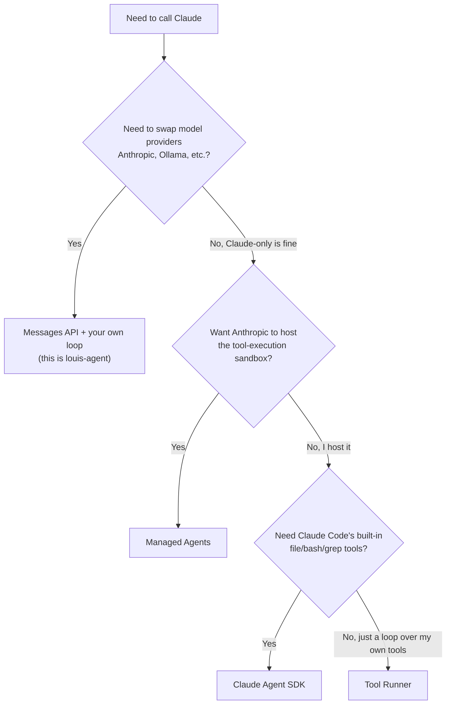
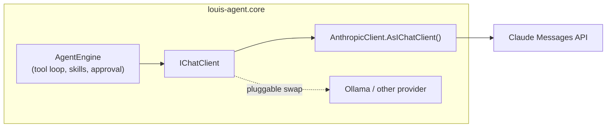

# Louis Agent: Development Guide

## How to work with Louis

Louis is a software engineer learning to become an AI engineer through this project; learning matters more than speed.
The goal and the skill map are in [GOAL.md](GOAL.md).

1. **Louis drives the code.** Implement only what Louis asks for, one step at a time; planning, reviews and learning
   write-ups happen in the Claude project, so don't start the next feature on your own.
2. **Small steps.** Follow the steps in the feature doc. Each step is one commit (or PR) with its test, small enough to
   review in about ten minutes.
3. **Plan first, and keep the plan.** Before the first step of a feature, or of a fix that takes more than one step,
   the plan Louis approved (made here or in the Claude project) is saved to [plans/](plans/README.md) as `Fnn-name.md`
   or `FXnn-name.md` and committed on its branch. Don't rewrite it afterwards: a change Louis approves during the build
   is added under *Approved during the build*; anything else the build learns goes in the feature or fix doc.
4. **Explain every change:** what changed, why this design and not the alternatives, and what to look at closely.
5. **Stop after each step** and wait for Louis to review and understand it before starting the next one.
6. **Teach, don't just do.** Name the AI-engineering concept behind each step and where it sits in the GOAL.md skill map.
7. **Measure, don't assume.** Ask before anything that spends real money (benchmark or demo runs against the API) and
   before pushing.
8. **Write it up.** When a skill or feature finishes, help write its learning write-up in [learning/](learning/).
9. **Source of truth:** [TODO.md](../TODO.md) (what's next), [features/](features/README.md) (how), [plans/](plans/README.md)
   (how we're building it now), [fixes/](fixes/README.md) (what broke and why) and [specs/](specs/) (why). Update them
   rather than duplicating them.

## Quick start

```bash
cp config/.env.example config/.env
cp config/.env.secrets.example config/.env.secrets   # add ANTHROPIC_API_KEY
dotnet build louis-agent-solution.sln
dotnet test tests/louis-agent.core.tests
dotnet run --project src/louis-agent.cli               # interactive CLI
```

Docker (web app + API on http://127.0.0.1:5080):

```bash
docker compose -f docker/docker-compose.yml --env-file config/.env up -d --build api
```

Always pass `--env-file config/.env`; compose needs it for `REPOSITORIES_PATH`. Requires the .NET 10 SDK.

## Project structure

One design doc per project — purpose, structure, key types, settings, extension points, tests and limits — is in
[projects/](projects/README.md).


```
louis-agent.core/             # Namespace = folder path (LouisAgent.Core.Tools.Web); see Project layout
├── Agent/                    # AgentEngine: the turn loop, history and system prompt, a façade over the rest:
│                             # ToolRegistry, ToolCallGuards (cut-off calls, oversized results), SkillTools, AgentBuiltTools
├── Guardrails/               # WorkspaceBoundary, SensitiveFiles, SsrfGuard: pure safety checks (tools and API use them)
├── Hosting/                  # AgentHost (+ AgentHostContext): bootstrap for every host; RiderMcpToolDiscovery
├── Config/                   # LlmOptions (+ CacheLifetime), AgentOptions, EnvFile (finds config/, sets a .env line)
├── Messages/                 # ErrorMessage, LogMessage, ToolMessage, UserText ([Description] templates), MessageText
├── Logging/AgentLog.cs       # File logging (LOG_DIRECTORY): stderr copy per run + JSONL records
├── Llm/
│   ├── LlmClientFactory.cs   # Provider → IChatClient (Anthropic thinking-budget wrapper lives here), wrapped for caching
│   ├── IPromptCachingStrategy.cs, NoPromptCaching.cs, PromptCachingChatClient.cs  # F4
│   ├── IUsageMapper.cs, StandardUsageMapper.cs   # Provider usage → the ledger's token kinds
│   ├── UsageRecordingChatClient.cs  # Middleware inside the tool loop: records each request, streaming or not
│   └── AnthropicProvider/    # AnthropicUsageMapper, AnthropicPromptCaching (Llm/{Name}Provider/ per provider)
├── Skills/                   # MarkdownSkillLoader ("## Skill:" procedures), the skill providers, SkillFiles
├── Tools/
│   ├── ProcessRunner.cs      # Process runner: argument lists, no shell, timeouts
│   ├── Workspace/            # Files, inside the WorkspaceBoundary, never SensitiveFiles
│   ├── Git/, DotNet/, Shell/ # GitTools; DotNetTools; BashTools, PowerShellTools, PythonTools
│   ├── Web/                  # WebTools: WebSearch (Google / DuckDuckGo providers) and FetchUrl (SSRF-guarded)
│   ├── Scripts/              # Agent-built tools (*.tool.md)
│   └── Integrations/         # Paymo/, DevOps/: loaded only when their API keys are set
├── Protocols/Mcp/            # RiderMcpClient: lists tools from Rider's MCP server
├── Usage/                    # Usage ledger (F1): one JSON line per model request in {LOG_DIRECTORY}/usage-YYYY-MM.jsonl
│   ├── UsageRecord.cs, UsageTokens.cs, UsageCost.cs, UsagePurpose.cs, IUsageSink.cs, JsonlUsageSink.cs
│   ├── UsageScope.cs, UsageTags.cs  # Per-turn context (AsyncLocal): host, session, turn, purpose, task/run/service
│   ├── UsageReport.cs        # Reads a ledger back, prices old records, totals per fix / triage / run
│   ├── UsageText.cs, UsageSession.cs  # The usage line and /usage text every host shows (F3); a session's turns
│   └── CacheGaps.cs          # The prefix's cache lifetime from a ledger's request gaps (F4, usage-probe --cache-gaps)
└── Pricing/
    ├── PriceTable.cs, ModelPrice.cs, CostCalculator.cs  # Prices (config/prices.json) and a record's cost (F2)
    ├── PricingUsageSink.cs   # Puts the cost on each record before the ledger writes it
    └── ExchangeRates.cs, IRatesMapper.cs, DisplayCurrency.cs  # Rates (config/rates.json, RATES_URL) and the
                              # currency costs are shown in, from HOST_CULTURE (F14); the ledger keeps what was charged

src/
├── louis-agent.cli/          # Terminal host: ConsoleChat (the interactive loop and single-prompt mode)
├── louis-agent.acp-server/   # Rider (Agent Client Protocol over stdio)
├── louis-agent.api/          # Minimal API: sessions + SSE, /workspace, /git, /prices; serves the web app
│   ├── Program.cs, AgentSessions.cs
│   └── Endpoints/            # Workspace; Git (status, diff, stage/unstage/discard, commit); History (branches, log,
│                             # commit/branch diffs, merge, delete merged branch)
├── louis-agent.web/          # Blazor WebAssembly app (chat, Files, Changes, Branches, themes)
│   ├── Pages/ChatPage.razor, Components/*.razor, Services/*.cs
│   └── wwwroot/css/app.css + css/themes/*.css + themes.json
├── louis-agent.mcp-server/   # Publishes the toolset over MCP (no LLM) - stdio by default, MCP_TRANSPORT=http for remote clients
└── louis-agent.orchestrator/ # POC: watches a service's errors, runbook per API method, delegates fixes to louis-agent.api
    ├── Program.cs            # poll loop: triage each error event with an AgentEngine (own toolset, runbooks as skills)
    ├── Tools/ServiceTools.cs # its only tools: CallLouisAgentFix, VerifyFixCommit, ReplayRequest, RunServiceTests, Escalate/Acknowledge
    ├── LouisAgentClient.cs   # louis-agent.api sessions + SSE parsing, FIX-RESULT
    ├── CommsLog.cs           # Markdown log of every message between the agents
    └── Skills/               # orchestrator.md + {service}/service.md + one runbook per API method

tools/louis-agent.usage-probe/ # Prints a provider's raw token usage and the ledger's mapping (calls the real provider);
                              # --ledger <file> prices and totals a usage ledger, --cache-gaps <file> recommends
                              # LLM_CACHE_TTL (neither calls a model)
tests/louis-agent.core.tests/ # NUnit; folders mirror core's, plus ArchitectureTests (the layout rules)
tests/louis-agent.orchestrator.tests/ # NUnit; error feed, SSE client, verification tools
samples/                      # order-service (demo microservice), run-demo.ps1 [-Short], sample-output*/ (real runs
                              # with their priced ledgers, uncached and -cached), smoke-f4-caching/, see samples/README.md
docker/                       # Dockerfile.{acp-server,api,agent,mcp-server,orchestrator}, docker-compose.yml,
                              # docker-compose.demo.yml (orchestrator demo); the build context's .dockerignore is at the repo root
config/                       # .env and .env.secrets (both ignored), their examples, LLM profiles (.env.anthropic,
                              # .env.ollama), prices.json (model prices), rates.json (exchange rates), Rider config
Skills/                       # personality.md + default.md + *-skills.md (system prompt), tools/ (agent-built tools)
docs/                         # This guide, features/ (planned work), plans/ (approved build plans),
                              # fixes/ (what broke and why), specs/, projects/
```

## Development workflow

### Adding a C# tool

1. Add a public method with `[Description]`s to a tool class (or a new class in `louis-agent.core/Tools/{Toolset}/`):

   ```csharp
   [Description("What this tool does")]
   public string MyTool([Description("What the parameter is")] string input, int limit = 10) => "result";
   ```

2. For a new class, register it in the `AgentEngine` constructor: `_registry.AddPublicMethods(new MyTools(WorkspaceRoot));`
3. Mention it in the relevant `Skills/*.md` so the model knows when to use it.
4. Test it in `tests/louis-agent.core.tests/Tools/{Toolset}/`.

**Every public method on a tool class becomes a tool.** Helpers must be `internal` or `private` (the test project and
`louis-agent.api` can see internals). Tool names must be unique across all classes: a duplicate stops the engine at
start-up.

Return strings the model can act on: say what went wrong and what to do instead. Keep output bounded — results over
50,000 characters get summarised; most toolsets cap their own output at 12,000.

### Project layout

**Folders split the code by concern, and the namespace is the folder path.** Each concern of an agent has one home, so
a change to one (a new provider, a new tool, a new guard) touches one folder:

| Folder (core) | Concern |
|---|---|
| `Agent/` | The loop: turns, history, system prompt, round limits; the tool registry, the tool-call guards that call the model (cut-off calls, oversized results summarised), the skill tools and the agent-built tools (`/approve`) |
| `Llm/` + `Llm/{Name}Provider/` | The model: client factory, `IChatClient` middleware (thinking, caching, usage recording), one folder per provider (`AnthropicProvider/`: a folder named `Anthropic` would hide the SDK's own `Anthropic` namespace) |
| `Tools/{Toolset}/` | What the model can do: one folder per toolset (`Workspace`, `Git`, `DotNet`, `Shell`, `Web`, `Scripts`, `Integrations/Paymo`, `Integrations/DevOps`); `ProcessRunner` beside them |
| `Skills/` | Loading the markdown skills and personality into the prompt |
| `Guardrails/` | Pure safety checks, no model: the workspace boundary, sensitive files, the SSRF guard (the guards that call a model are in `Agent/`) |
| `Usage/` and `Pricing/` | The ledger (records, sinks, scopes, reports); prices, cost, rates and the display currency |
| `Protocols/Mcp/` | Talking to other agents and tools over MCP |
| `Hosting/` | Bootstrap shared by every host: `AgentHost`, and wiring done at start-up (Rider's MCP tools) |
| `Config/`, `Messages/`, `Logging/` | Settings; message enums; file logging (`AgentLog`, later the NLog setup) |

The rules:

1. **Namespace = folder path**, PascalCase (`LouisAgent.Core.Llm.AnthropicProvider`), one top-level type per file, the file
   named after the type. No `Helpers/`, `Utils/`, `Common/` or `Interfaces/` folders: an interface lives beside its
   implementations, a helper beside its one user.
2. **Dependencies point one way:** hosts → `Hosting` → `Agent` → `Llm`, `Tools`, `Skills`, `Usage`, `Pricing`,
   `Protocols` → `Guardrails` → `Config`, `Messages`, `Logging`. A tool never references the agent loop or a model;
   `Agent` never references a provider's SDK (provider differences stay in `Llm/{Name}Provider/`, as in *Changing the
   LLM*).
3. **Prompts are content, not code:** system prompt text and procedures stay in `Skills/*.md`; C# only loads them.
4. **Hosts stay thin:** a host project maps the agent's stream to its protocol (`Endpoints/`, `Services/`) and holds no
   agent behaviour; another agent on core (the orchestrator) keeps its own `Tools/` and `Skills/` the same way.
5. **Tests mirror the source:** `tests/louis-agent.core.tests/Llm/AnthropicProvider/…` tests `Llm/AnthropicProvider/…`.
6. **An architecture test enforces 1 and 2:** namespaces match folders, and no type depends against the arrow.

**Held by a test:** `tests/louis-agent.core.tests/ArchitectureTests.cs` reads core's source and fails on a file whose
namespace isn't its folder path, a file with two top-level types, a folder that isn't in the table, or a `using` against
the arrow. A new concern is a new row here and in the test's layers. Every other project's namespace is PascalCase too
(`LouisAgent.Api`, `LouisAgent.Orchestrator.Tools`); a type never shares its namespace's name (hence `MessageText` in
`Messages/`). The move was CL1 ([plan](plans/CL1-project-layout.md)).

### Messages and logging

**No message text inline in C#.** Every message is a member of a message enum, and its `[Description]` is the text, a
template with **named** holes:

```csharp
public enum ErrorMessage
{
    [Description("Unknown LLM_CACHE_TTL '{Value}'. Use 5m or 1h.")]
    UnknownCacheTtl,
}

throw new ArgumentException(MessageText.Format(ErrorMessage.UnknownCacheTtl, new { Value = other }));
logger.LogWarning(MessageText.Template(LogMessage.RatesFallback), url, reason);   // NLog fills the holes, as structured fields
```

- **What counts:** exception messages, log lines, the error strings tools return to the model, and user-facing text
  (`/usage`, the usage line, CLI help, comms log headings). Enums by kind (`ErrorMessage`, `LogMessage`, `ToolMessage`,
  `UserText`), each member named for what happened, not for its wording.
- **Logging goes through `ILogger` (Microsoft.Extensions.Logging) with NLog as the provider:** levels and targets in
  `nlog.config`, console output to **stderr only** (stdout carries the ACP and MCP protocols), run files and JSON-lines
  records as NLog targets. Holes are named (`{Url}`), so NLog stores them as fields.
- **A unit test checks every message enum:** each member has a `[Description]`, and its template's holes are well formed.
- **Moving there:** the existing ~230 messages (35 files), `Console.Error` and `AgentLog` move in one refactor after F4
  (TODO, *Quality and CI*). Until it lands, new code defines its messages as enum members but still writes logs with
  `Console.Error.WriteLine(MessageText.Format(...))`; the refactor switches those calls to `ILogger`.

### Adding a skill

Create `Skills/{name}-skills.md`. With `AGENT_FUNCTION=louis` every skill file is loaded; otherwise set
`AGENT_FUNCTION={name}`. For a guide that must always load (like `bash-skills.md`), add it to
`AgentHost.AlwaysLoadedSkillFiles` and `SkillFiles.BuiltIn`. Procedures use `## Skill: Name` with an `Execution:` fence
(bash, powershell or python); arguments arrive as `SKILL_ARG_*` environment variables.

### Building another agent on core

Pass `toolsets:` to the `AgentEngine` constructor to give an agent only your tool objects (plus `ExecuteSkill`) instead
of the built-in coding tools, and build its system prompt from your own skill files (`CompositeSkillProvider` +
`MarkdownSkillProvider`). To record its usage, pass `usageSink: AgentHost.CreateUsageSink(options)` and
`usageMapper: clientFactory.CreateUsageMapper(llm)`, and open a `UsageScope` per turn (with a `UsageTags` run id if it
has one). `louis-agent.orchestrator` does exactly this; its `Program.cs` is the example.

### Adding a web theme

Copy `src/louis-agent.web/wwwroot/css/themes/paper.css` to `{id}.css`, set the variables listed at the top of
`css/app.css`, and add `{ "id": "{id}", "name": "…" }` to `themes.json`. Ids are lowercase letters, digits and dashes.

### Changing the LLM

Configuration only — see [MODELS.md](MODELS.md): `LLM_PROFILE` picks `config/.env.anthropic` or `config/.env.ollama`.
A new model also needs its prices in `config/prices.json` (else its cost is recorded as unknown); run
`tools/louis-agent.usage-probe` before trusting a new provider's usage numbers. Provider differences belong in
`LlmClientFactory` (the client, and `CreateUsageMapper` for how it reports usage), never in `AgentEngine` or the tools.
Where providers need different logic for the same concern, write it as a **strategy**: an interface, one implementation
per provider that differs (plus a default), chosen once in `LlmClientFactory`, as `IUsageMapper` is
([Architecture: Provider strategies](ARCHITECTURE.md#provider-strategies)). Never branch on the provider's name
anywhere else.

### Running and debugging

- Tool calls are logged to stderr: `[TOOL] -> Name(args)` and `[TOOL] <- Name: result` (or `failed: …`).
- In Docker, logs persist in `logs/`; `docker logs louis_agent_api` shows the API.
- Write debug output to `Console.Error` (through NLog's stderr target once *Messages and logging* is in place), never
  `Console.Out`: stdout carries the ACP and MCP protocols.
- Every model request is in the usage ledger, `{LOG_DIRECTORY}/usage-YYYY-MM.jsonl` (tokens, cost, host, session,
  turn, fix and run; no prompt text). Total one with
  `dotnet run --project tools/louis-agent.usage-probe -- --ledger logs/usage-YYYY-MM.jsonl`.
- After changing the web app or API, rebuild the `api` image; after changing core, rebuild every image you use. Rider
  chats keep their container until you start a **New Chat**.

### Tests

```bash
dotnet test tests/louis-agent.core.tests
dotnet test tests/louis-agent.core.tests --filter "FullyQualifiedName~AgentEngineTests"
dotnet test tests/louis-agent.orchestrator.tests
dotnet test louis-agent-solution.sln          # everything, including the order-service sample's tests
```

**What the model is sent is pinned by a golden file:** `ModelRequestSnapshotTests` compares the tools, the system
prompt and the engine's fixed texts with `Agent/ModelRequestSnapshot.json`. A deliberate change (a new tool, an edited
description or skill file) regenerates it: `LOUIS_UPDATE_GOLDEN=1 dotnet test tests/louis-agent.core.tests --filter
ModelRequestSnapshotTests`, then review the file's diff before committing.

Tests use `FakeChatClient` (a scripted `IChatClient` that also streams) and `StubHandler` for HTTP — no network, model or
Docker. A few tests skip themselves when git, pip or the network isn't available. The agent runs tests on Linux inside
its containers, so keep them platform-neutral (forward slashes, no Windows-only paths).

The API and web app have no automated tests yet; check them by hand (curl and a browser) after changes. The
orchestrator demo (`samples/run-demo.ps1`, in Docker; see [samples/README.md](../samples/README.md)) exercises the
whole loop against a real model: API sessions, the fix flow, and the web app's Branches view.

## Key design decisions

- **Microsoft.Extensions.AI** — one `IChatClient` across providers; `FunctionInvokingChatClient` runs the tool loop.
- **Provider strategies** — where Anthropic, OpenAI-compatible and Ollama differ (usage, caching, thinking, limits),
  one interface with an implementation per provider, picked in `LlmClientFactory`
  ([Architecture](ARCHITECTURE.md#provider-strategies)).
- **Streaming everywhere** — hosts render `StreamPromptAsync` updates; the finished turn is appended to the history,
  thinking blocks included (Anthropic requires them when continuing after tool calls).
- **Arguments as data** — skill and tool arguments travel as environment variables or argument lists, never through a
  shell, so model text can't become commands.
- **Guard the context** — oversized results are summarised, cut-off calls are never run, failures carry their reason.
- **Hosts stay thin** — each host maps the same stream to its protocol; behaviour lives in core.
- **Measure every request, and show it** — the usage ledger records each model request with its tokens and its cost,
  priced from a table dated by `as_of`, so later price changes never rewrite history; unknown prices are `null`, never
  0. Every host shows a turn's usage from the same records and totals (`UsageReport.Total`), so the views and the
  ledger agree.
- **History is append-only** — newer Claude models (Haiku 5.5 and later) bind thinking blocks to the system prompt,
  tools and earlier messages, so nothing may edit them mid-conversation ([FX1](fixes/FX01-round-limit-tools.md);
  [FX4](fixes/FX04-append-only-history.md) is still open).

## Anthropic integration tiers (reference)

Four ways to build on Claude, from most managed to least. `louis-agent` deliberately sits at the bottom tier — see
"Why `louis-agent` uses the Messages API tier" below.

| Tier | Who hosts the loop | Who hosts the sandbox/tools | OpenAI equivalent |
|---|---|---|---|
| **Messages API** (`POST /v1/messages`) | You | You | Responses API |
| **Tool Runner** (`client.beta.messages.tool_runner`, Anthropic SDK only) | SDK | You | Agents SDK (partial — Anthropic-only, no handoffs/multi-agent) |
| **Claude Agent SDK** (`claude-agent-sdk`, separate package — Claude Code as a library) | SDK | You | Agents SDK (closer — ships built-in coding tools) |
| **Managed Agents** (beta, Anthropic-hosted) | Anthropic | Anthropic | Agents API |

### Decision tree



### Real-world use cases

- **Messages API + your own loop** (what this repo uses): multi-provider portability is a hard requirement, or you
  need custom session/approval/skill semantics a vendor SDK doesn't model. `louis-agent`'s `IChatClient`
  abstraction lets `LlmClientFactory` swap Anthropic for Ollama without touching `AgentEngine` or any tool.
- **Tool Runner**: a single-provider (Claude-only) shop building a straightforward custom-tool agent — e.g. an
  internal ticket-triage bot — that wants approval-gate/logging/retry hooks without hand-writing the
  `while stop_reason == "tool_use"` loop.
- **Claude Agent SDK**: a coding/filesystem-centric agent (a Cursor/Devin-style assistant, a PR-review bot) where
  Claude Code's built-in Read/Write/Edit/Bash/Grep tools already cover the surface you need, and being Claude-only
  is acceptable. Reinventing `WorkspaceTools`/`BashTools` wouldn't have been worth it here either, if this repo
  didn't also need DevOps/Paymo tools, markdown-defined skills, and provider portability on top.
- **Managed Agents**: you don't want to run a sandbox at all — a SaaS feature ("AI cleans up your spreadsheet"), a
  nightly scheduled agent (no cron box of your own to maintain), or persisted/versioned agent configs shared
  across teams with no platform/ops capacity to host it themselves.

### Why `louis-agent` uses the Messages API tier

Both higher tiers trade away something this repo depends on:

- **Managed Agents** would mean Anthropic hosts the tool-execution sandbox — incompatible with owning the Docker
  containers, repo mounts, and scoped DevOps/Paymo credentials this repo runs with (see the `IsSensitive` file
  blocking and the tool-approval flow in `AgentEngine`).
- **Tool Runner and Claude Agent SDK** are both Anthropic-specific packages — picking either locks every model call
  to Claude, which conflicts with the `IChatClient` provider abstraction (`LlmClientFactory`) this repo is built
  around.



### MCP exposes tools, not a model

`louis-agent.mcp-server` hands an *external* client's model the raw tools, one call at a time; it has no model of its
own, so `AgentEngine` never calls its own tools through it. To have louis-agent do a whole task and report back (as the
orchestrator does), call `louis-agent.api`'s session endpoint instead. `MCP_TRANSPORT=http` serves MCP over the network
and needs `MCP_API_KEY` (falls back to `AGENT_API_KEY`). The full comparison, both transports and the agent-to-agent
flow are in [AGENT_COMMUNICATION.md](AGENT_COMMUNICATION.md).

## Known limitations

The same list as the TODO's *Known limitations*: when work removes one, delete it in both places (see
[Finishing a feature](features/README.md#finishing-a-feature)).

1. **Rider MCP discovery only logs** Rider's tools; they aren't callable yet (needs a full MCP client).
   Removed by a full MCP client (TODO *Agent architecture gaps: Protocols*, backlog).
2. **Sessions are in memory** in the API and ACP server; a restart ends them (the web app keeps the transcript).
   Removed by durable sessions ([session architecture](specs/SESSION_ARCHITECTURE.md), backlog).
3. **Ollama tool support is a name heuristic** (`LlmOptions.KnownNoToolsPrefixes`).
4. **Paymo task lookup takes the first match** for a name; ambiguous names can hit the wrong task.
5. **No rate limiting or audit log** beyond the file logs. Removed by TODO *Agent architecture gaps: Safety* (backlog).
6. **10 tool rounds per message** (`MaximumIterationsPerRequest`): a long task stops mid-way and needs a follow-up
   message to continue. The orchestrator does this automatically ("Continue the fix…"); most demo fixes take 2-3 messages.
   Removed by [F10 Route settings](features/F10-route-settings.md).
7. **Running the API with `dotnet run` (unpublished)** only serves the web app in the `Development` environment
   (`ASPNETCORE_ENVIRONMENT=Development`); otherwise `/` returns 404. The Docker images are published, so they're fine.
8. **Local models get a truncated prompt.** The agent sends ~26,000+ tokens (system prompt and tools) and doesn't tell
   Ollama the window, so Ollama uses its own default (2,048 on the version measured here; newer ones pick 4k–256k by
   memory) and drops the rest without an error: the ledger showed `input: 2050`. Removed by
   [F15 Model limits](features/F15-model-limits.md) (sends `num_ctx`) and [F13 Local models](features/F13-local-models.md).
9. **Changing the tools or skills during a chat can break it on Claude Haiku 5.5** (the default). The model rejects a
   changed system prompt or tool list once thinking blocks are in the history (enforced for accounts created on or
   after 2026-08-31). `BeginTurn` sends the engine's live tool list, so a tool the model creates (`CreateTool`) breaks
   the rest of that message; `/approve`, `/reject` and a skill reload break the next one; and in the API every open
   chat shares one tool list. Start a new chat afterwards. Removed by
   [FX4 Append-only history](fixes/FX04-append-only-history.md).

## Common errors

- **"ANTHROPIC_API_KEY (or LLM_API_KEY) is required for provider 'anthropic'"** — set it in `config/.env.secrets`.
- **"prompt is too long"** — something put a huge result into the history; check `logs/oversized-tool-results.jsonl`.
- **"adaptive thinking is not supported on this model"** — a pre-4.6 Claude model not listed in
  `LlmClientFactory.ThinkingBudgetModelPrefixes`; add its prefix.
- **Skill not found** — the file isn't loaded for this `AGENT_FUNCTION`, or the name differs (case-sensitive).
- **bash not found on Windows** — install Git for Windows or set `BASH_PATH` to `bash.exe`; WSL's bash is never used.
- **400 "Invalid `signature` in `thinking` block … bound to a different conversation"** — the system prompt or tool list
  changed under earlier thinking (known limitation 9); start a new chat. See [FX4](fixes/FX04-append-only-history.md).
- **"Price table …"** stopping start-up (not valid, empty, a negative price, or a bad `long_prompt.above_tokens`) — fix
  `config/prices.json` (or the `PRICES_FILE` / `PRICES_URL` table): every model needs all five prices, none negative.
  **"[WARN] No price table"** means costs are recorded as unknown.
- **"Model '…' isn't pulled into Ollama"** (usage probe) or a 404 from Ollama — `docker exec louis_ollama ollama pull <model>`.

## Contributing

Branch off `main`, keep changes focused, run `dotnet build` and `dotnet test`, and write commit messages that explain
why. See [ARCHITECTURE.md](ARCHITECTURE.md) for the design, `config/.env.example` for settings, and
[Skills/default.md](../Skills/default.md) for how the agent is instructed to behave.

---
[Docs index](README.md) · Previous: [Architecture](ARCHITECTURE.md) · Next: [Orchestrator demo](../samples/README.md)
