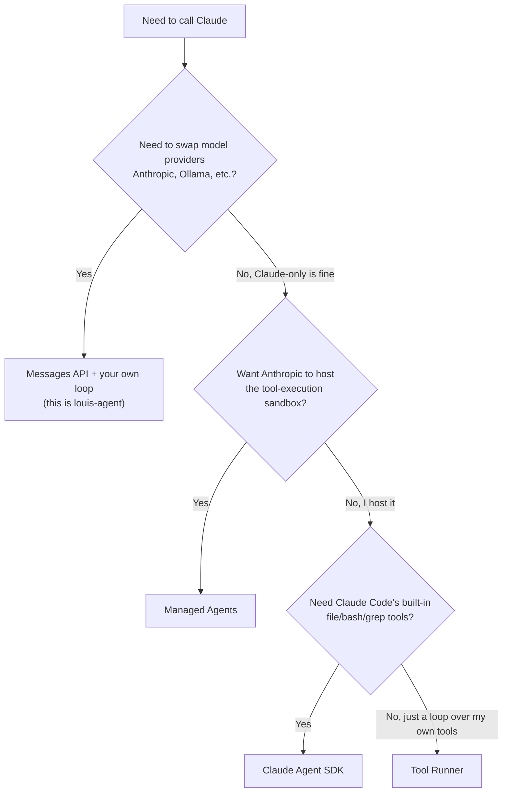
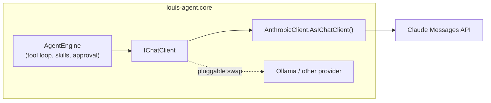

# 0002. The Messages API tier, with our own loop behind `IChatClient`

**Status:** Accepted · **Date:** 2026-10-06 · **Recorded:** 2026-10-14

## Context

There are four ways to build on Claude, from most managed to least:

| Tier | Who runs the loop | Who hosts the tools | Ties us to Claude |
|---|---|---|---|
| Managed Agents | Anthropic | Anthropic | Yes |
| Claude Agent SDK (Claude Code as a library) | The SDK | Us | Yes |
| Tool Runner (`client.beta.messages.tool_runner`) | The SDK | Us | Yes |
| Messages API (`POST /v1/messages`) | Us | Us | No |

louis-agent runs its tools in our own Docker containers, against mounted repositories and scoped DevOps and Paymo
credentials, with its own approval flow and secret-file blocking. It must also run on Ollama and OpenAI-compatible
servers, not only Claude.

## Decision

We call the Messages API tier through Microsoft.Extensions.AI's `IChatClient`, with our own loop in `AgentEngine`
(`FunctionInvokingChatClient` runs the tool rounds). `LlmClientFactory` turns `LLM_PROVIDER` into the client; nothing
else knows which provider it is.

## Consequences

- The provider is configuration: Anthropic, Ollama or an OpenAI-compatible server, with no change to the engine or the
  tools.
- We own what the higher tiers would give us: the loop, sessions, approvals, context guards, caching markers. Each is
  ours to build, test and measure.
- Provider-specific features (prompt caching, thinking, usage details) need a place outside the engine
  ([0003](0003-provider-strategies.md)).

## Links

[Models](../MODELS.md)

## Appendix: choosing a tier

Kept from the architecture doc that arc42 replaced (CL6): how to choose between the four tiers in
general, and where each fits.

### The tiers, with their OpenAI equivalents

| Tier | Who hosts the loop | Who hosts the sandbox/tools | OpenAI equivalent |
|---|---|---|---|
| **Messages API** (`POST /v1/messages`) | You | You | Responses API |
| **Tool Runner** (`client.beta.messages.tool_runner`, Anthropic SDK only) | SDK | You | Agents SDK (partial — Anthropic-only, no handoffs/multi-agent) |
| **Claude Agent SDK** (`claude-agent-sdk`, separate package — Claude Code as a library) | SDK | You | Agents SDK (closer — ships built-in coding tools) |
| **Managed Agents** (beta, Anthropic-hosted) | Anthropic | Anthropic | Agents API |

### Decision tree

### Real-world use cases

- **Messages API + your own loop** (what this repo uses): multi-provider portability is a hard requirement, or you
  need custom session/approval/skill semantics a vendor SDK doesn't model. `louis-agent`'s `IChatClient`
  abstraction lets `LlmClientFactory` swap Anthropic for Ollama without touching `AgentEngine` or any tool.
- **Tool Runner**: a single-provider (Claude-only) shop building a straightforward custom-tool agent — e.g. an
  internal ticket-triage bot — that wants approval-gate/logging/retry hooks without hand-writing the
  `while stop_reason == "tool_use"` loop.
- **Claude Agent SDK**: a coding/filesystem-centric agent (a Cursor/Devin-style assistant, a PR-review bot) where
  Claude Code's built-in Read/Write/Edit/Bash/Grep tools already cover the surface you need, and being Claude-only
  is acceptable. Reinventing `WorkspaceTools`/`BashTools` wouldn't have been worth it here either, if this repo
  didn't also need DevOps/Paymo tools, markdown-defined skills, and provider portability on top.
- **Managed Agents**: you don't want to run a sandbox at all — a SaaS feature ("AI cleans up your spreadsheet"), a
  nightly scheduled agent (no cron box of your own to maintain), or persisted/versioned agent configs shared
  across teams with no platform/ops capacity to host it themselves.

### Where louis-agent sits

