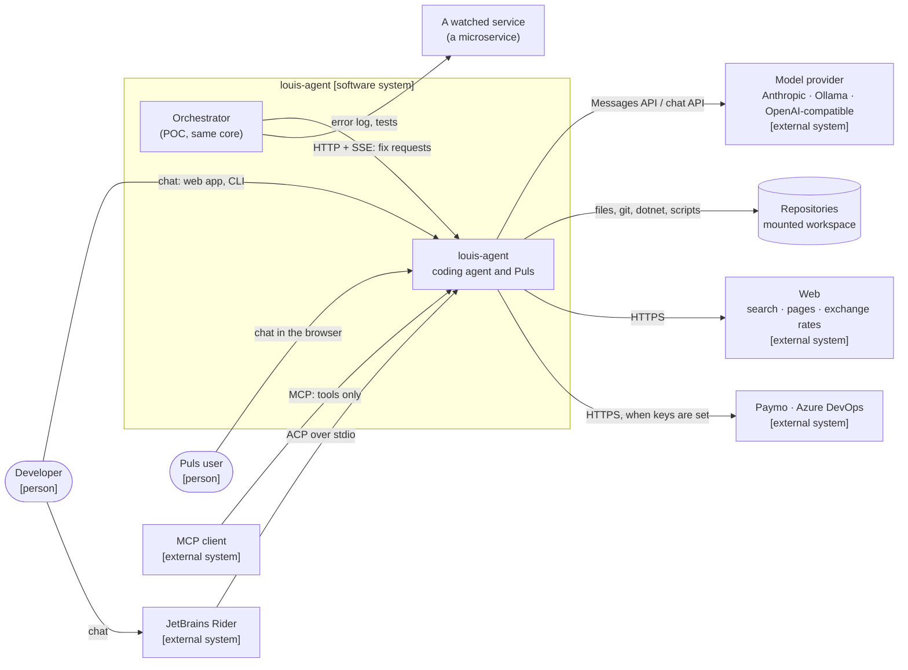

# 3. Context and scope

> **Explanation.** Who and what louis-agent talks to, at [C4](https://c4model.com) level 1 (the system and its
> neighbours). **Elsewhere:** every interface in detail (endpoints, the event stream, ACP, MCP, agent to agent) in
> [AGENT_COMMUNICATION.md](../AGENT_COMMUNICATION.md); what's inside the system in
> [building blocks](05-building-block-view.md).

| Neighbour | What crosses the boundary |
|---|---|
| **Developer** (web app, CLI, Rider) | Messages and attachments in; streamed thinking, text, tool calls and usage out |
| **Puls user** | Chat in Afrikaans, a time zone, a location only if shared; answers with the specialists' work shown |
| **Model provider** | Every request: system prompt, tools, history; replies with usage. The only place a prompt leaves the machine |
| **Repositories** | The workspace the tools read and write, inside the workspace boundary, never secret files |
| **Web** | Web search (Google or DuckDuckGo), `FetchUrl` (SSRF-guarded), exchange rates (Frankfurter) |
| **Paymo, Azure DevOps** | Time entries and work items, only when their API keys are set |
| **Orchestrator** | Fix requests as API sessions; branches and a `FIX-RESULT` back |
| **MCP clients** | The tools, one call at a time; the client brings its own model |

**Out of scope:** hosting for public traffic, durable sessions, and a real error tracker. See
[risks and technical debt](11-risks-and-technical-debt.md).
