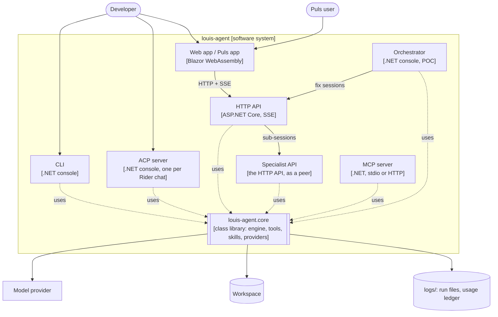
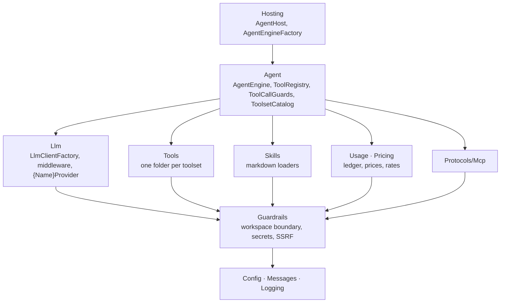

# 5. Building block view

> **Explanation.** The parts of louis-agent, from the containers (C4 level 2) down to core's components (level 3).
> **Elsewhere:** each project's files, types and settings in [projects/](../projects/README.md); how the parts work
> together on a message in [runtime view](06-runtime-view.md).

## Level 2: containers

Every host is thin: it maps the agent's stream to its protocol, and all behaviour is in core
([0010](../adr/0010-folders-by-concern.md)).

## Hosts

Each project also has its own design doc in [projects/](../projects/README.md).

| Host | Project | Bootstrap | Transport |
|---|---|---|---|
| CLI | `src/louis-agent.cli` | `AgentHost.Build()` | Terminal; interactive or one-shot (`louis-agent.cli [prompt]`) |
| ACP server | `src/louis-agent.acp-server` | `AgentHost.Build()` | [Agent Client Protocol](https://agentclientprotocol.com) JSON-RPC over stdio, for Rider's AI chat |
| HTTP API + web app | `src/louis-agent.api`, `src/louis-agent.web` or `src/louis-agent.puls` | `AgentHost.Build()` | ASP.NET Core minimal API; Server-Sent Events; serves one of the two Blazor WebAssembly apps |
| MCP server | `src/louis-agent.mcp-server` | `AgentHost.BuildToolHost()` | Model Context Protocol over stdio (default) or Streamable HTTP (`MCP_TRANSPORT=http`); publishes the tools, the client brings its own model |
| Orchestrator (POC) | `src/louis-agent.orchestrator` | Own `AgentEngine` with `toolsets:` | Not a host for users: an agent that reads a service's error log and calls louis-agent.api for fixes ([samples/README.md](https://github.com/bosbevk/louis-agent/blob/pre-cl10/samples/README.md)) |

### CLI
- Streams the answer as it is written, thinking in grey, one status line per tool call; Ctrl+C stops the current reply.
- `/tools`, `/approve <Name>` and `/reject <Name>` manage agent-built tools (never sent to the model).

### ACP server (Rider)
- Handles `initialize`, `session/new`, `session/prompt` and `session/cancel`; one chat history per session.
- Streams `session/update` notifications: `agent_thought_chunk` (thinking), `agent_message_chunk` (answer text), and
  `tool_call` / `tool_call_update` (in progress → completed/failed, with an output preview).
- Files the user attaches in Rider arrive as `resource_link` blocks and are read into the prompt (Windows paths are
  mapped into the container with `ACP_MOUNT_MAPPINGS`); the file merely open in the editor is not. Embedded `resource`
  blocks are inlined too. Attachments are capped at 100,000 characters.
- Each Rider chat starts its own container (`docker compose run --rm -T acp-server`).

### HTTP API and web app
- In-memory sessions (`AgentSessions`); one reply at a time per session (409 while busy); a client disconnect or
  `POST /sessions/{id}/cancel` stops the reply; idle sessions are dropped after 4 hours.
- **A session chooses its toolsets when it opens** (F5): `POST /sessions` with `{ "toolsets": [...] }` gets the engine of
  that profile from `AgentEngineFactory`, fixed for the session's life; no list means `skills` only; an unknown or
  unavailable name is a 400 listing the valid ones. Sessions with the same list share one engine and one cacheable
  prefix. `GET /toolsets` lists names, descriptions and availability (never tool definitions); `GET /sessions/{id}`
  returns a session's toolsets. A session opened by another agent (`depth: 1`) may not load `specialists`.
- Two web apps share one API codebase and `louis-agent.web.shared`: the code-review app (`louis-agent.web`, every
  toolset; served by default) and **Puls** (`louis-agent.puls`, the general assistant: chats load `specialists` and `web` and
  hand cooking to the cook; served when the API is built with `-p:WebApp=puls`).
- **Live delegation:** while a `StartSubSession` call runs, the specialist's own events stream to the chat as
  `sub_session` events (`SubSessionFeed` → the API's turn stream), and the delegation card shows its thinking, tool
  calls, answer and cost as they happen; the model gets only the answer.
- A message's answer streams as SSE shaped like Claude's: `message_start`, `content_block_start/delta/stop` for
  `thinking`, `text`, `tool_use` and `tool_result`, `message_delta` (stop reason and the turn's usage and cost),
  `message_stop`. Errors use Claude's `{ "type": "error", "error": { "type", "message" } }` shape (plus the turn's
  usage, when a request had returned).
- Read-only workspace browsing (`/workspace/entries`, `/workspace/file`) and a git interface (`/git/status`, `/git/diff`,
  `/git/stage`, `unstage`, `discard`, `commit`, plus history: `/git/branches`, `/git/log`, `/git/commit`, `/git/branch`,
  `/git/merge`, `/git/branch/delete`) for the web app. They reuse `WorkspaceTools`' path and secret-file checks.
- `AGENT_API_KEY`, when set, is required for `/sessions`, `/toolsets`, `/workspace` and `/git`; the app's own files
  stay public.
- The web app (Blazor WebAssembly) is served by the API with `MapStaticAssets` and an `index.html` fallback. It keeps
  chats in the browser's `localStorage`. Themes are CSS files in `wwwroot/css/themes/` listed in `themes.json`.
- The Branches tab queues merges and deletes (`GitHistory`): every click is kept and they run one at a time, in click
  order; only the branch being worked on is marked busy ("Merging…", "Queued").

### MCP server
- Publishes every toolset this instance can load (workspace, git, `DotNet*`, `Python*`, `PowerShell*`, `Bash*`, web,
  skills and agent-built tools, and Paymo, DevOps and agents when their settings are set) plus read-only `list_skills`,
  `get_skill_info`, `get_skill_documentation`.
- Stays in sync with the engine (`AgentEngine.ToolsChanged` → `notifications/tools/list_changed`).
- Approving agent-built tools is user-only and not exposed over MCP.
- Transport: stdio by default, for a local client that launches it as a subprocess (Rider, Claude Desktop).
  `MCP_TRANSPORT=http` serves Streamable HTTP instead (`MapMcp()`), for remote clients. That exposes the shell, git
  and file-write tools over the network, so set `MCP_API_KEY` (`x-api-key` or `Authorization: Bearer`; falls back to
  `AGENT_API_KEY`). With neither set it only logs a warning and accepts unauthenticated requests.

## Level 3: core's components

Dependencies point one way, down this picture; `ArchitectureTests` fails on one that points up
([0010](../adr/0010-folders-by-concern.md)).

## Core abstractions

### `LlmOptions` (`Config/LlmOptions.cs`)
- `LLM_PROVIDER`: `anthropic` | `ollama` | `openai-compatible`. If unset it is inferred: `claude*` → `anthropic`, other
  models → `ollama`, no model → `anthropic`.
- `LLM_MODEL` (default `claude-haiku-5-5`), `LLM_ENDPOINT`, `LLM_API_KEY` (falls back to `ANTHROPIC_API_KEY`),
  `ANTHROPIC_WORKSPACE_ID` (for keys not scoped to a workspace).
- `LLM_SUPPORTS_TOOLS`: override; otherwise Ollama models starting with `llama2`, `codellama`, `deepseek-r1`,
  `deepseek-coder` or `qwen2` run without tools.
- `LLM_THINKING`: `off` | `low` | `medium` | `high`; default `medium` for Anthropic, `off` otherwise.

### `AgentOptions` (`Config/AgentOptions.cs`)
- `WORKSPACE_ROOT` (default: the repository root found from the working directory), `SKILLS_DIRECTORY` (what the agent
  writes), `LOG_DIRECTORY`.
- Keys: `PAYMO_API_KEY`, `DEVOPS_API_KEY`, `WEB_SEARCH_PROVIDER`, `GOOGLE_SEARCH_API_KEY`, `GOOGLE_SEARCH_ENGINE_ID`.
- Sub-sessions (F5): `AGENT_PEERS` (`name=url` pairs) and `AGENT_API_KEY`, sent to the peers.
- Azure DevOps: `DEVOPS_ORGANIZATION`, `DEVOPS_PROJECT`, optional `DEVOPS_TEAM` (sprints live under the team).
- Rider MCP: `RIDER_MCP_ENDPOINT` (default `http://127.0.0.1:64482`), `RIDER_MCP_AUTO_DISCOVER`, `RIDER_MCP_PROJECT_PATH`.

### `LlmClientFactory` (`Llm/LlmClientFactory.cs`)
Maps `LlmOptions` to an `IChatClient`:
- **Anthropic:** `AnthropicClient.AsIChatClient(model, 16000)`. For models before Claude 4.6 (including Haiku 4.5),
  which reject adaptive thinking, a small wrapper turns `ChatOptions.Reasoning` into a fixed thinking budget
  (low 2,048 / medium 4,096 / high 8,192 tokens).
- **Ollama:** `OllamaApiClient`. **OpenAI-compatible:** `OpenAIClient(...).GetChatClient(model).AsIChatClient()`.

### Provider strategies

When Anthropic, OpenAI-compatible endpoints and Ollama each need different logic for the same concern, that concern is
a **strategy**: one interface, one implementation per provider that differs (plus a default for the rest, often a
no-op), chosen once by `LlmClientFactory` from `LLM_PROVIDER`. Callers depend only on the interface, so `AgentEngine`,
the tools and the hosts never branch on a provider's name, and adding a provider means adding implementations, not
editing callers. Use one only when providers really differ; a concern every provider handles the same way needs none.

| Concern | Interface | Implementations | Status |
|---|---|---|---|
| How usage is reported | `IUsageMapper` | `StandardUsageMapper` (default), `AnthropicUsageMapper` (cache writes, and their split by lifetime from the raw response, F4) | Built (F1) |
| Prompt caching | `IPromptCachingStrategy` | `AnthropicPromptCaching` (two markers), `NoPromptCaching` (default: OpenAI-compatible caches prefixes on its own, Ollama), applied by `PromptCachingChatClient` | Built ([F4](../features/F04-prompt-caching.md)) |
| Thinking settings | to be extracted | Anthropic's fixed budget for pre-4.6 models is an inline wrapper in `LlmClientFactory` today | Candidate ([F10](../features/F10-route-settings.md) S4) |
| Context window | to be designed | Ollama needs `num_ctx` sent; Claude's window is fixed | Planned ([F15](../features/F15-model-limits.md)) |
| Errors, retries and limits | to be designed | Each provider reports rate and account limits differently | Planned ([F8](../features/F08-reliability.md)) |

The same pattern is used outside the providers: `IRatesMapper` (exchange-rate sources) and `IWebSearchProvider`
(Google, DuckDuckGo).

### `AgentEngine` (`Agent/AgentEngine.cs`)
Provider-agnostic. Owns the turn loop, the history rules and the client pipeline, and is the façade hosts use; the
rest is in its own classes in `Agent/`: `ToolRegistry` (the tools, in name order), `ToolCallGuards` (the guards around
each call, below), `SkillTools` (`ExecuteSkill`, `CreateSkillFile`, `ReloadSkills` and the skill set the system
prompt is built from) and `AgentBuiltTools` (`CreateTool`, `/approve`, `/reject`). Pure safety checks are in
`Guardrails/` (workspace boundary, sensitive files, SSRF), and the console chat is the CLI's (`ConsoleChat`).
Everything it sends uses LF line endings, whatever the checkout:
- `StreamPromptAsync(history, input)` streams `ChatResponseUpdate`s (text, `TextReasoningContent`, tool calls and
  results) and records the finished turn in `history`; `ProcessPromptAsync` is the non-streaming form.
- `FunctionInvokingChatClient` runs the loop: up to 10 tool rounds per request, detailed errors returned to the model.
- Output limit 16,000 tokens per reply; `LLM_THINKING` sets `ChatOptions.Reasoning`.
- `toolsets:` gives the engine its tool objects (their public methods, plus `ExecuteSkill`): a session's catalogue
  toolsets (`AgentEngineFactory`), or another agent's own tools (the orchestrator's `ServiceTools`); `selfExtension:`
  adds `CreateSkillFile`, `ReloadSkills`, `CreateTool` and `ListAgentTools` (the `skills` toolset).

### Toolsets (`Agent/ToolsetCatalog.cs`, `Hosting/AgentEngineFactory.cs`)
Every toolset is a catalogue entry: a name, a one-line description, the settings it needs, its tool class and factory,
and its guide (docs/CLAUDE.md, *Adding a toolset*). `files`, `git`, `dotnet`, `python`, `powershell`, `bash`, `web`,
`paymo`, `devops`, `specialists` (sub-sessions on a peer, `AGENT_PEERS`) and `skills` (engine-provided). `AgentEngineFactory`
builds one engine per profile, cached by its normalised toolset list, its personality and its level (F21, CL8;
past 16 the least recently used is dropped), with only those tools and only their guides in the system prompt, and logs
each profile's tool count and fixed-prefix estimate. The CLI, ACP server and MCP server use every
toolset the instance can load; the API's sessions choose theirs. A sub-session (`AgentPeerTools.StartSubSession`) runs
on a peer with its own toolsets and its role (`personality`, named by the parent; with none it gets the default mode's voice,
CL10), at most 3 per turn and 5 minutes each, and only its answer and a usage
line come back; its usage records carry the parent turn (`parent`). An empty answer (the specialist used all its tool
rounds) is asked for once more in the same session (FX11). A sub-session gets no routing: its toolsets were chosen for it
and it can't delegate.

## Skills

`AgentHost.LoadSkills(agent, toolsets, personality, level)` builds a `CompositeSkillProvider` whose combined
documentation is the system prompt; every file is plain markdown read by `MarkdownSkillProvider`:
1. the principles (`shared/principles.md`, ADR 0020): never lie, cheat, steal or murder; the same for every agent
2. the personality: at level 0 a mode (ADR 0019), its voice then its routing (which toolset a task needs, and how
   delegation works): the default `louis-agent/voice`, Puls's `puls/voice-af` or `puls/voice-en` (the language, then
   Puls's shared `puls/voice.md`), the orchestrator's `louis-agent/voice-orchestrator`; at level 1 a specialist's role
   (`puls-cook`), which says its function and how to report; no routing below level 0
3. the guide of each of the profile's toolsets (`toolsets/files.md`, `toolsets/git.md`, …) and no other, so the prompt never
   describes tools the session doesn't have
4. with the `skills` toolset only, every function skill the agent wrote (`Skills/agent/functions/*.md`)

The built-in files live in `louis-agent.core/Prompts/`, one folder per level (`agent/`, `specialists/`, `minions/`)
beside `toolsets/` (ADR 0017), and are read only from the assembly (`SkillFileSource`, `ManifestEmbeddedFileProvider`;
ADR 0018), so what the model reads is fixed by the build. Files the agent writes (its function skills, its tools) are
on disk only, in the skills folder: `SKILLS_DIRECTORY`, else the repo's `Skills/` (found by its README).

A markdown **skill** is a named procedure with a fenced script (bash, PowerShell or Python by fence language). The model
runs it with `ExecuteSkill(name, jsonArgs)`; arguments are passed as `SKILL_ARG_*` environment variables and are never
spliced into the script text.

## Tools

Every session also has `GetToday` (`Tools/Clock`, F22): the date and time in the user's time zone when they shared it
(`UserPlace`), else South African time. `Tools/Documents/DocumentText` reads PDF, Word and spreadsheets for
`ReadDocument`, `ReadTable` and `FetchUrl` (PdfPig, DocumentFormat.OpenXml, ExcelDataReader). A sub-session gets the
user's attachments by name (`SessionAttachments`) and their place (`UserPlace`), both set by the API for each turn.

Public methods on the tool classes become tools via `AIFunctionFactory.Create` (so **every public method on a tool class
is exposed to the model** — helpers must be `internal` or `private`). Names and parameter names are exact.

| Class | Tools |
|---|---|
| `WorkspaceTools` | Read / write / append / list / search / find files, directories, copy, rename, delete |
| `GitTools` | Status, diffs, branches, staging, commit, stash, push/pull/fetch, merge/rebase, tags, config |
| `DotNetTools` | `DotNetBuild`, `DotNetTest`, `DotNetRun`, restore, clean, packages, project and SDK info |
| `PythonTools`, `PowerShellTools`, `BashTools` | Run code or scripts (bash is Git Bash on Windows, never WSL) |
| `WebTools` | `WebSearch` (Google or DuckDuckGo via `IWebSearchProvider`), `FetchUrl` (SSRF-guarded) |
| `PaymoTools` | Time entries, tasks, projects, summaries — when `PAYMO_API_KEY` is set |
| `DevOpsTools` | Azure DevOps work items and sprints (empty sprint = the team's current one) — when `DEVOPS_API_KEY`, `DEVOPS_ORGANIZATION` and `DEVOPS_PROJECT` are set |
| `AgentEngine` | `ExecuteSkill`, `CreateSkillFile`, `ReloadSkills`, `CreateTool`, `ListAgentTools` |

**Agent-built tools** (`ScriptTool`): the model can write `Skills/tools/pending/{Name}.tool.md` (typed parameters + a
script) with `CreateTool`. It only becomes a real tool after the user types `/approve <Name>`.

## Bootstrap: `AgentHost`

`AgentHost.Build()` (CLI, ACP, API):
1. Load `config/.env.secrets` then `config/.env` (searching upward from the working directory) and a legacy `./.env`;
   variables already set in the process win.
2. Bind `LlmOptions` and `AgentOptions`; configure logging (`AgentLogging.Configure(LOG_DIRECTORY)`).
3. Create the `IChatClient`, the usage ledger and an `AgentEngineFactory` (with `LLM_THINKING` and the display
   currency); the host's own engine has every toolset this instance can load (approved agent-built tools with `skills`).
4. Start Rider MCP discovery in the background if enabled.

`AgentHost.BuildToolHost()` (MCP server) does the same without an LLM.
