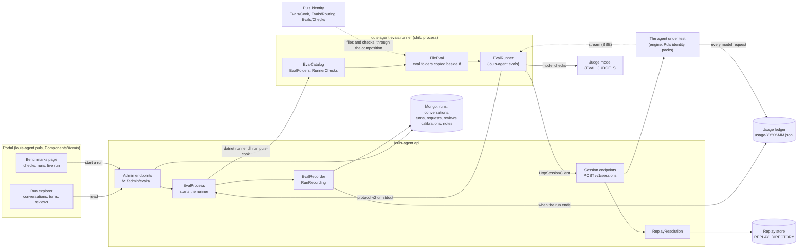
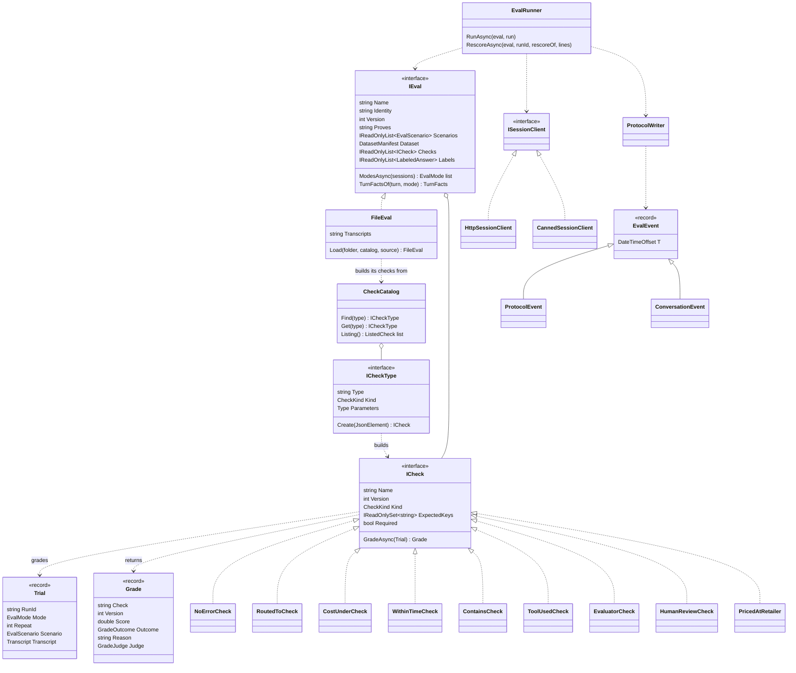
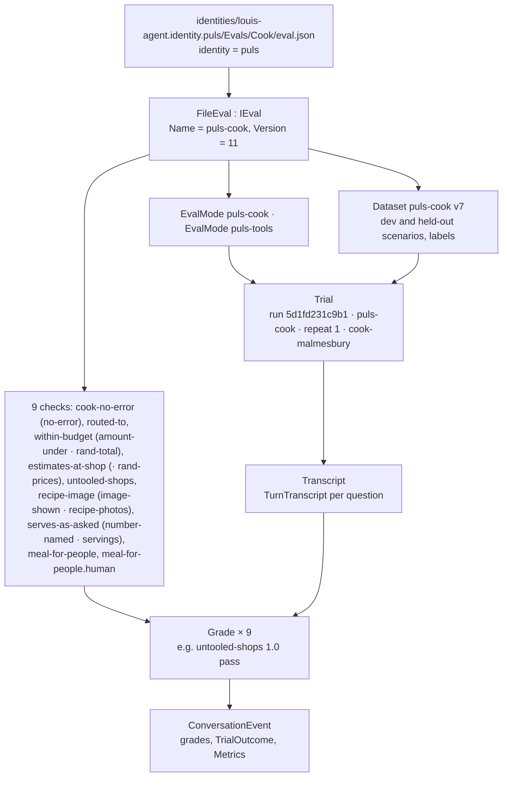
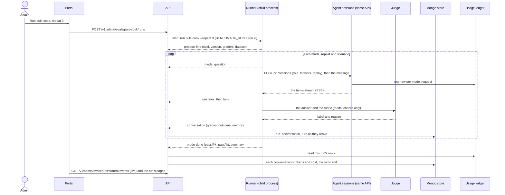

# The evals: architecture and communication

> **Explanation.** How the evals work as built at the end of F49.2 (2026-10-30): which parts there are, how they
> talk, what one run looks like in memory, and the lines the runner writes. **Elsewhere:** running them in
> [Run the evals](../guides/run-the-evals.md); adding one in [Add an eval](../guides/add-an-eval.md); each
> project's files and settings in [projects/](../projects/README.md); why it's built this way in
> [ADR 0029](../adr/0029-simulations-in-csharp.md), [ADR 0047](../adr/0047-protocol-v2-one-event-contract.md) and
> [ADR 0058](../adr/0058-an-eval-is-a-folder-of-files.md).

## In one paragraph

An eval is a folder of files beside the identity it proves: an `eval.json` that names its modes and its checks, with
its dataset, manual and transcripts beside it. It asks the agent real questions and grades the answers. The
**runner** is a small console
app: it opens real chat sessions on the **API**, exactly as a person's chat would, reads what streams back, grades each
conversation with the eval's **checks**, and writes everything it saw as JSON lines on stdout (the **protocol**). The
API starts the runner as a child process when someone presses *Run* in the **portal**, reads those lines as they come,
keeps them in the **store**, joins the cost from the **usage ledger** when the run ends, and the portal shows the
result. The runner never knows the cost and the API never knows how to grade: each side does one job, and the protocol
is the only thing they share.

## The parts



| Part | Project | Its one job |
|---|---|---|
| The check contract | `evals/louis-agent.evals.checks` | What a check reads and returns (`Trial`, `ICheck`, `Grade`), and the catalogue a file names a check from (`ICheckType`, `CheckCatalog`). What a pack can reference to ship a check ([ADR 0056](../adr/0056-a-check-is-a-catalogue-entry.md)). |
| The harness | `evals/louis-agent.evals` | How an eval runs: `IEval`, `FileEval` (an eval read from its folder), the datasets, the general checks and their entries, the protocol writer, re-scoring, conformance, labels and calibration. Names no product. |
| An identity's evals | `identities/louis-agent.identity.puls` (`Evals/`) | What proves Puls: `puls-cook` and `puls-routing` as folders of files, and Puls's own fixed-rule checks (`Evals/Checks/`), which reach the runner through the composition's `EvalChecks` ([ADR 0058](../adr/0058-an-eval-is-a-folder-of-files.md)). |
| An identity's judges | `identities/louis-agent.identity.puls.judges` | Puls's model judge, `meal-for-people`, apart from the identity because it needs the harness; only the runner references it. |
| The runner | `evals/louis-agent.evals.runner` | The command: finds the eval folders and gathers the check catalogue, lists the evals (`--list`), runs one, re-scores a stored run, writes a label sheet, calibrates a judge. |
| The protocol | `evals/louis-agent.evals.protocol` | The eight line records both sides share, and their reader and writer. Records only. |
| The API | `src/louis-agent.api` (`Evals/`, `Endpoints/Admin/`) | Starts the runner, records its lines, prices them from the ledger, serves the portal; also runs the sessions the runner opens. |
| The portal | `src/louis-agent.puls` (`Components/Admin/`) | Start a run, watch it live, read runs and trends, review answers, calibrate a judge, write notes. |
| The replay store | `louis-agent.core` (`Sessions/Replay/`, `Llm/Replay/`, `Tools/Web/Replay/`) | Records a run's web answers, clock and model answers, so the same run can be replayed for free. |

## The types



The three kinds of check (`CheckKind`; on the wire a check is still a `grader`, as stored runs say):

| Kind | What it is | Examples |
|---|---|---|
| `fixed-rule` | Plain C# that reads the transcript. Every eval needs at least one required fixed-rule check. | `NoErrorCheck`, `RoutedToCheck`, `ContainsCheck`, `AmountUnderCheck`, `ImageShownCheck`, `NearCheck` and the rest of the harness's 22; `UntooledShops`, `EstimatesAtShop` (the shops pack's rules, F49.3) |
| `model` | A judge model reads the answer against a rubric. `EvaluatorCheck` wraps Microsoft.Extensions.AI.Evaluation's `IEvaluator`; the grade carries the model and the prompt's hash. | `judge` (the general one over a rubric file); `meal-for-people` (`MealForPeopleCheck`, Puls's own) |
| `human` | A person's verdict in the run explorer, paired with a model check so the two can be compared. | `meal-for-people.human` (`HumanReviewCheck`, the `human` entry) |

An eval's file names its checks by type (`within-time`, `{"seconds": 120}`): each check's entry, an `ICheckType`,
builds it from a typed settings record, and `CheckCatalog` finds the entry. The runner's catalogue is three lists
(`RunnerChecks`): the harness's `GeneralChecks.All` (24 types by family, from `no-error` to `judge` and `human`; the
table is in [Add an eval](../guides/add-an-eval.md#4-choose-the-checks)), every identity's and pack's own through the
composition's `EvalChecks.All` (the shops pack's rules, `ShopsChecks.All`, F49.3), and Puls's judges
(`PulsJudges.All`)
([ADR 0056](../adr/0056-a-check-is-a-catalogue-entry.md), [ADR 0058](../adr/0058-an-eval-is-a-folder-of-files.md)).

**Extract, then compare** (F49.2b): a check that compares a value in the answer with the scenario's (a total with a
budget, a number of people, an image with the pages read) is a general compare plus a *reader* the file names beside
the key (`"reader": "rand-total"`). Readers are a second registry, `ReaderCatalog` (`RunnerReaders`): the harness's
`GeneralReaders.All` (`currency-amount`, `digits`, `markdown-images`) and every identity's through the composition's
`EvalReaders.All` (Puls's `rand-total`, `rand-prices`, `servings`, `recipe-photos`). So an identity ships readers, not
checks, and its eval file keeps its stored names with `name` (`{"type": "amount-under", "name": "within-budget", …}`).

**A pack ships its checks** (F49.3, [ADR 0060](../adr/0060-a-pack-ships-its-checks.md)): the rules that prove a pack's
tools live beside them, in the pack's `Checks/` and its registry (`ShopsChecks.All`), and reference only the check
contract. What an identity knows comes in through a reader the file names: the shops pack's `estimates-at-shop` reads
whether a price is given as fact through Puls's `rand-prices`. Plain markdown reading (tables, links, a site's host)
is the contract's (`Markdown/`), so an identity, a pack and the harness read them the same way.

A grade's score is 0 to 1 with an outcome (pass, fail, unknown) and a reason. A conversation's metrics (calls, hosts,
turns, tokens, seconds, cost) are measured beside the grades and never decide a pass.

## One cook run, in memory



## How a run talks



The other three conversations use the same pieces:

- **A re-score** (`--rescore {runId}`): the API exports the stored run as protocol lines on the runner's stdin;
  `Rescorer` reads the transcripts back (`ProtocolTranscripts`) and grades them again, with no session and no model
  cost unless a judge runs. The new run says `rescore_of`.
- **A replay** (`--replay {runId}`): the runner asks for `replay` on each session; `ReplayResolution` in the API turns
  that into recorded web answers, a recorded clock and recorded model answers (`ModelReplayChatClient`), so the agent
  gives the same answers for nothing. An ask the recording doesn't have is a replay miss: the engine throws
  `ModelReplayMissException`, the API streams it as an error of kind `replay_miss_error` (`StreamErrorKind` in
  `louis-agent.session-stream`), and the runner marks the turn `TurnFailure.ReplayMiss`, so it counts as
  infrastructure, never as the agent's failed answer (FX26). A replay only matches when every request reads the same
  as when it was recorded, so nothing that changes between runs may enter a tool result: a specialist's or minion's
  footer names the child, never what it cost (FX27). The cook recording `dc272b95eaeb` replays as `c0362ff73151` with
  no miss at any of its 20 turns. The portal marks a replay on both pages, leaves it out of the estimate and the
  trend, and starts one from a recorded run's row (`StoredRunRow.ReplayOf` and `Recorded`, read from the run's
  settings by `EvalSettings`; CL26, FX28).
- **A calibration**: `--label-sheet` writes the answers a person labels; `--calibrate` asks the judge about each label
  and reports how often it agrees (the bar is 90% of each class, ADR 0029). From the portal, `POST
  .../runs/{id}/calibrations/{grader}` runs the same command and stores the report.

## The lines the runner writes

One JSON object per line, UTF-8, `"event"` first, every time UTC with `Z`. A line that isn't an event is a log line
for people.

| `event` | Record | When | Carries |
|---|---|---|---|
| `protocol` | `ProtocolEvent` | First line | The eval, its version, the commit, the graders, the models, the split, the dataset |
| `mode` | `ModeEvent` | A mode's repeat starts | The mode, the repeat, its toolsets, role and model, how many scenarios |
| `question` | `QuestionEvent` | A question is sent | Its conversation and turn key, the text |
| `sse` | `SseEvent` | A piece of the turn's stream | The stream event as the session sent it |
| `turn` | `TurnEvent` | A turn ends | Agent and specialist calls, hosts, seconds, error, failure kind |
| `conversation` | `ConversationEvent` | A conversation is graded | Its grades (`GradeInfo`), its `TrialOutcome`, its `Metrics` |
| `mode-done` | `ModeDoneEvent` | A mode's repeat ends | Pass rates so far (`RatesInfo`: pass@k, pass^k), infrastructure failures, retries |
| `summary` | `SummaryEvent` | After a mode's last repeat | The roll-up: overall, per category, per grader, per grader kind |

## Where the files are

```
evals/
├── louis-agent.evals/              # the harness
│   ├── Api/                        # ISessionClient, HttpSessionClient, CannedSessionClient, the session request
│   ├── Conformance/                # references must pass, known-bads must fail
│   ├── Datasets/                   # dataset.json + scenarios/{dev,held-out}/ (Inspect's Sample shape), the loader
│   ├── Grading/                    # Common/ (the general checks, GeneralChecks; Answers/, Tools/), Models/ (the judge), Human/, Outcomes/
│   ├── Labels/                     # the label sheet and the calibration
│   ├── Protocol/                   # ProtocolWriter, ProtocolTranscripts
│   ├── Reports/                    # RunSummary
│   ├── Running/                    # EvalRunner, ScenarioAttempt, TrialChecking, Rescoring/
│   └── Trials/                     # ConversationMetrics
├── louis-agent.evals.checks/       # the check contract: EvalMode, EvalJson; Catalog/ (ICheckType, CheckType, CheckCatalog); Datasets/Scenarios/; Trials/; Grading/ (ICheck, Grade, Verdict); Messages/
├── louis-agent.evals.protocol/     # Events/, Parts/, Kinds/, EvalProtocolJson
├── louis-agent.evals.runner/       # Program, Arguments/, Catalog/ (EvalFolders, RunnerChecks), Calibration/, Evals/Stub/
└── template/Example/               # the folder a new eval starts as a copy of (never listed)
identities/louis-agent.identity.puls/Evals/   # Cook/ and Routing/ (eval.json, manual.md, Dataset/, Transcripts/), Checks/ (Puls's own)
identities/louis-agent.identity.puls.judges/  # meal-for-people, PulsJudges
src/louis-agent.composition/EvalChecks.cs     # every identity's and pack's checks, for the runner
src/louis-agent.api/Evals/          # List/, Runs/, Store/, Reviews/, Calibrations/, Reports/, Export/
src/louis-agent.puls/Components/Admin/  # the portal's pages
```

## What to keep in mind

- **The API decides, the runner asks.** The runner only says it wants a replay; the API's settings decide what a
  session may do (ADR 0029).
- **Cost comes from the ledger, never from a check.** The runner can't see prices; the API joins them after the run
  (ADR 0007).
- **CI grades recorded transcripts only.** Every eval's references and known-bads run in the tests for free; a live
  run waits for Louis's go.
- **An eval is content, a check is code.** A new eval that uses existing checks is a folder of files with no C#; a
  check is a reviewed class with an entry (ADR 0056, ADR 0058).
- **What's next changes this picture.** F49's later children move the shops' checks to the shops pack (F49.3) and add
  a studio to the portal. Each F49 child updates this page.

---
[Architecture](README.md) · Related: [Building block view](05-building-block-view.md) ·
[Runtime view](06-runtime-view.md) · [Run the evals](../guides/run-the-evals.md)
