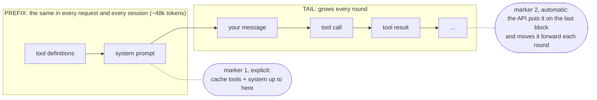
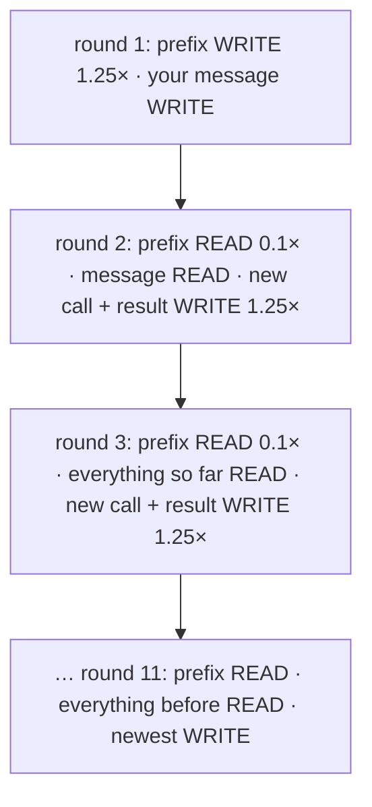
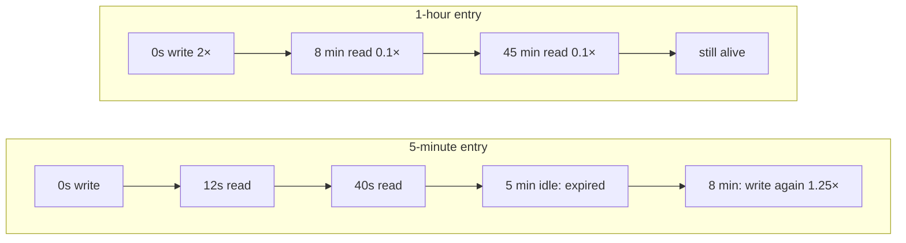
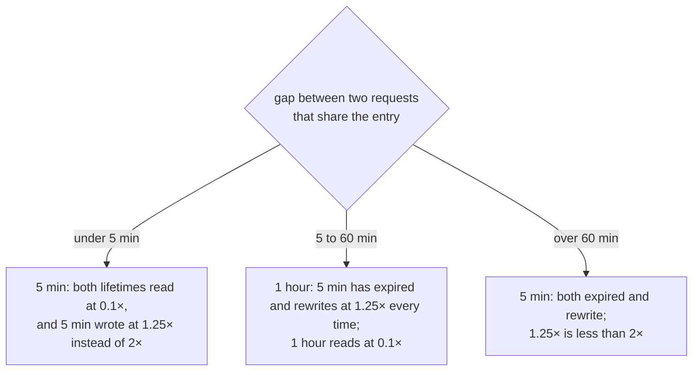
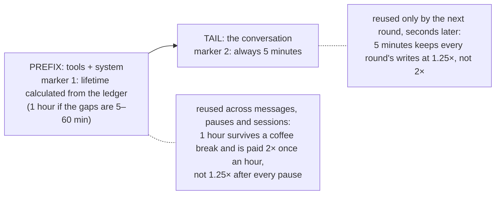
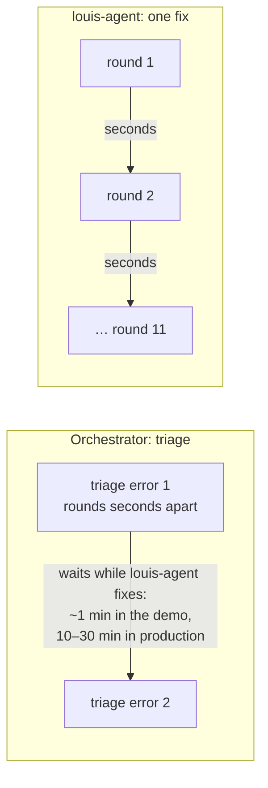

# F4 · Prompt caching (Anthropic)

> **Status:** done (2026-10-11) · **Milestone:** M2 · **Depends on:** F1 (the cache minimum it needs, 512 tokens on Haiku 5.5, is
> noted below; [F15](F15-model-limits.md) records it per model later)
>
> **Spec:** [Optimisation §B](../specs/RESPONSE_OPTIMISATION.md)
>
> **In the TODO:** tick **F4 Prompt caching** under *Now* ([TODO](../../TODO.md)) · **Replaces:** "Wire up Anthropic prompt caching on the system prompt"
> · **Plan:** [plans/F04](../plans/F04-prompt-caching.md)

Every request re-sends ~48,000 tokens (measured in M1) of tool definitions and system prompt that never change. With
cache markers the API serves them at ~0.1× the input price after the first request. The biggest single saving in the
plan.

## How caching works

Prices below are multiples of the model's normal input price, on Claude Haiku 5.5: a cache **write** costs **1.25×**
(5-minute lifetime) or **2×** (1-hour), a **read** costs **0.1×**.

### 1. What a request contains, and where the markers go

Every request re-sends the whole conversation from the start, always in this order. The cache stores "everything up to a
marker", keyed by its **exact bytes**: the next request reads that part back at 0.1× only if it starts with exactly the
same bytes (so the tools must be in a fixed order and the system prompt must not change).

### 2. One fix, round by round

Each block is **written once, then read** by every later round. With M1's numbers (a ~48k prefix, 11.4 requests a fix)
the prefix alone goes from ~547k token-equivalents to ~110k: about **−80%**.

| | Without caching | With caching |
|---|---:|---:|
| The prefix over one fix (11.4 requests) | 11.4 × 48k ≈ **547k** | 48k × 1.25 + 10.4 × 48k × 0.1 ≈ **110k** |

### 3. What a lifetime is

A lifetime is how long an entry survives **after it was last used**: every read restarts the clock, at no extra cost.
When it runs out, the next request writes the entry again.

### 4. Which lifetime is cheaper depends on the gap between requests

For N requests in a session whose pauses are 5–60 minutes: 5 minutes costs **N × 1.25**, 1 hour costs
**2 + (N − 1) × 0.1**. At N = 2 that's 2.50 against 2.10, so 1 hour already pays from the second request after a
pause. The gaps aren't guessed: the usage ledger records every request's time, session and host (F1), so they are
measured.

### 5. A lifetime per marker

The prefix and the tail are reused on different time scales, so each marker gets its own lifetime. Anthropic allows
mixing them in one request as long as **the longer lifetime comes first**, which is the order here.

- **A demo fix:** rounds are seconds apart and the next fix starts within a minute, so every gap is under 5 minutes:
  5 minutes for both markers.
- **A chat in Rider or the web app:** rounds within a turn are seconds apart (the tail stays 5 minutes) but there are
  minutes between your messages, so the prefix on 1 hour keeps its 48k at 0.1× after every pause.

### 6. Two agents, two lifetimes

Each agent caches its own prefix (the orchestrator's tools and runbooks are a different entry from louis-agent's coding
tools and skills), so each gets its own lifetime, from its own gaps. What decides it is **the gap between requests that
reuse the entry**, not how long the run takes: an orchestrator busy every minute for hours is still cheapest on
5 minutes.

| Agent | Gaps between its requests | Prefix (marker 1) | Tail (marker 2) |
|---|---|---|---|
| Orchestrator in the demo | rounds seconds apart; ~1 minute between errors while a fix runs | 5 minutes | 5 minutes |
| Orchestrator in production (errors trickle in, fixes take 10+ minutes) | 5–60 minutes between errors | **1 hour** | 5 minutes |
| louis-agent during a fix | seconds between rounds; the next fix within 5 minutes | 5 minutes | 5 minutes |
| louis-agent with fixes spread out (one every 20 minutes) | 5–60 minutes between fixes | **1 hour**: its 48k prefix is shared across fixes | 5 minutes |

`usage-probe -- --cache-gaps` measures each agent separately, since the ledger records each request's host
(`orchestrator`, `api`) and time. F4 caches louis-agent; the orchestrator's caching and its own lifetime are
[F17](F17-orchestrator-agent.md)'s (until then the demo sets `LLM_CACHE=off` for it).

*To confirm in step 1 (spike) before building on them:* a read refreshes the lifetime; mixed lifetimes are allowed with
the longer one first.

## User stories

**F4-S1 — Cache the fixed prefix.** As an *operator*, I want the tool definitions and system prompt cached, so that I
don't pay full price for them on every tool round.
- *Given* `LLM_CACHE=on` and an Anthropic model *when* the second request of a session runs *then* its
  `cache_read` tokens (F1) are at least the prefix size.
- *Given* the benchmark *then* its input cost falls by ≥ 60% against the M1 baseline, with 10/10 fixes confirmed.

**F4-S2 — Cache the conversation as it grows.** As an *operator*, I want each request to reuse the conversation so far,
so that long tool loops get cheaper per round.
- *Given* round *n* of a turn *then* round *n + 1* reads everything up to round *n* from cache.

**F4-S3 — Never break other providers or the API.** As a *developer*, I want cache markers added only for Anthropic and
never left on stored history, so that other providers are unaffected and requests never exceed the marker limit.
- *Given* Ollama or an OpenAI-compatible provider *then* no request carries cache markers.
- *Given* any request *then* it carries at most 4 markers, and the session's stored history carries none.

**F4-S4 — The lifetime is calculated, per marker.** As an *operator*, I want the prefix's cache lifetime chosen from how
long the gaps between requests really are, so that I don't pay to rewrite it after every pause, or 2× for an hour
nobody uses.
- *Given* the usage ledger *when* I run `usage-probe -- --cache-gaps` *then* it shows, per host, the gaps between
  requests that share the prefix and what 5 minutes and 1 hour would cost on them (diagram 4), and recommends one.
- *Given* `LLM_CACHE_TTL=1h` *then* marker 1 (the prefix) uses the 1-hour lifetime; marker 2 (the tail) always uses
  5 minutes (diagram 5); F2 prices each write at its own lifetime's rate.

## Design

**Two breakpoints, not three.** The prefix order is *tools → system → messages*, so a marker at the end of the system
prompt already caches the tool definitions with it. A separate tool marker only helps when the system prompt changes
but the tools don't (a skills reload) — rare enough to skip; revisit if F1 shows frequent rebuilds. (Update the spec's
table when this lands.)

| # | Marker on | Caches |
|---|---|---|
| 1 | The system message's last text block | Tools + system prompt |
| 2 | The last cacheable block of the newest message (not a thinking block — those can't carry markers) | The whole conversation so far |

New `AnthropicCachingChatClient` (`louis-agent.core/providers/`), a `DelegatingChatClient` that `LlmClientFactory` adds
only for `LLM_PROVIDER=anthropic` and `LLM_CACHE=on`:

1. Copies the message list for this request (a new list, new `ChatMessage` objects for the two messages it changes).
2. Replaces the target content with a **clone** carrying the marker:
   `new TextContent(text).WithCacheControl(new CacheControlEphemeral { Ttl = … })`; for a `FunctionResultContent`,
   a new instance with the same call id and result. Unsupported block types → walk back to the previous block.
3. Sends the copy. The engine's stored history is never touched, so markers can't accumulate past the limit or leak
   into later requests.

Prefix stability (each of these silently disables caching):

- **Deterministic tool order:** `AgentEngine` sorts `_tools` by name after registration (reflection order isn't
  guaranteed); agent-built tools are inserted in sorted position.
- **No volatile text** in the system prompt or tool descriptions (no dates, ids, counters).
- **Thinking and effort fixed per session** (they already are: `AgentEngine.Thinking` is init-only).

Model notes for the default (Claude Haiku 5.5): minimum cacheable prefix **512 tokens** (each model's is in
[F15](F15-model-limits.md); Haiku 4.5's is 4,096) — ours is ~48,000 (M1), and F5's smaller toolsets must stay above it.
Haiku 5.5 keeps earlier turns' thinking in the history, so a *new user message* after a tool loop keeps the message cache
(Haiku 4.5 drops cached thinking and the message cache from there; marker 1 is unaffected on both) — measure it in
step 6.

## Implementation steps

1. **Deterministic tool order.** *Test:* two engines built from the same options list tools in identical order; order
   is alphabetical.
2. **`AnthropicCachingChatClient` marker placement.** *Test (with a recording fake inner client):* the request has a
   marker on the system text and on the last message's last text/tool-result block; thinking blocks are skipped; at most
   2 markers; the caller's list and messages are unchanged afterwards.
3. **TTL setting.** `LLM_CACHE`, `LLM_CACHE_TTL` in `LlmOptions`. *Test:* option parsing; marker carries the TTL.
4. **Factory wiring.** *Test:* `LlmClientFactory` wraps only the Anthropic client when caching is on; Ollama and
   OpenAI-compatible clients are unchanged.
5. **F2 alignment.** Records carry the cache lifetime so writes are priced at the right rate. *Test:* cost of a 1-hour
   write.
6. **Measure.** Benchmark run with caching on; compare against M1; inspect `cache_read`/`cache_write` per round and per
   new user message (the Haiku thinking note). Write the numbers into the features README.
7. **Docs:** MODELS.md (caching, TTL), SETUP settings, spec status and the breakpoint-table update.

## What the build found

**Result** ([benchmark](https://github.com/bosbevk/louis-agent/blob/pre-cl10/docs/BENCHMARKS.md#f4-benchmark-2026-10-11)): the full demo cost **$0.1334 against $0.6586 for M1
(−80%)**, louis-agent's input cost **−87%** (target ≥ 60%), cache-hit rate 98%, **10/10 fixes confirmed**; the prefix
per fix about −88%. The short demo: $0.0488 against $0.2884 uncached (−83%). Saved in
[samples/sample-output-cached/](https://github.com/bosbevk/louis-agent/blob/pre-cl10/samples/sample-output-cached/README.md) and
[-short-cached/](https://github.com/bosbevk/louis-agent/blob/pre-cl10/samples/sample-output-short-cached/README.md); the smoke check in
[samples/smoke-f4-caching/](https://github.com/bosbevk/louis-agent/blob/pre-cl10/samples/smoke-f4-caching/README.md).

**What was built, against the design above:**

- **Two markers, the second automatic** (plan, option B): marker 1 explicit on a *copy* of the system prompt's last
  block, marker 2 the request's top-level `cache_control`, which the API places on the last block and moves forward.
  No message is marked, so stored history is never touched (`WithCacheControl` changes the block it is called on).
- **A provider strategy:** `IPromptCachingStrategy` with `AnthropicPromptCaching` and `NoPromptCaching`, applied by
  the provider-neutral `PromptCachingChatClient`, which `LlmClientFactory.CreatePromptCaching` picks and `Create` wraps
  around every provider's client (innermost, so every tool round is marked). Summary requests go unmarked.
- **A lifetime per marker:** marker 1 takes `LLM_CACHE_TTL` (`5m` default, `1h`), marker 2 is always 5 minutes, so the
  longer one always comes first. `usage-probe -- --cache-gaps <ledger>` replays a ledger's request times against both
  lifetimes per host and model and recommends one; on the demo every gap is under 5 minutes, so 5m.
- **Tools sorted by name** (`AgentEngine.AddTool`, a binary search; a duplicate name stops start-up), so every process
  sends the same bytes.
- **Writes priced at their lifetime** (F2): the ledger's `cache_write_1h` is the 1-hour part of `cache_write`.
- **The orchestrator's triage is not cached** (`LLM_CACHE=off` in the demo): its caching and lifetime are F17's.
- **Marker 1 is shared across sessions:** in the benchmark the prefix (47,424 tokens) was written once per run, and
  every later fix read it in its own session.
- **`tool_choice: none` didn't break the conversation's cache, though Anthropic's docs say a change of `tool_choice`
  invalidates it.** A message that reaches the 10-round limit ends with one more request that keeps the tools but sets
  `tool_choice: none` (FX1: Haiku 5.5 rejects a request without the tools). In both benchmark runs, all 8 of those
  round-11 requests read everything round 10 sent (55,611–59,434 tokens, the prompt minus 2) and wrote only what was
  new. So today the change costs nothing. If the API starts enforcing the documented rule, each such request would
  rewrite the conversation instead: about 56,000 tokens at 1.25× instead of 0.1×, about $0.006 more per round-limited
  message on Haiku 5.5. The ledger would show it as `cache_read` at about the prefix size on round 11; F10 (more rounds
  per route) makes those requests rarer either way.

- **Writes split by lifetime reach the ledger on both paths** (step 6, measured on captured replies through the
  adapter). `UsageDetails` carries only the total (`CacheCreationInputTokens`); the split is on the SDK's own usage: the
  response's `Message` when not streaming, and the `message_start` event when streaming (the closing `message_delta`
  has the total only). The mapper asks the recorder to keep just those objects. So the plan's fallback (every write at
  the 1-hour rate under `LLM_CACHE_TTL=1h`) isn't built; step 7's smoke check confirms the real API sends the split
  on a stream, and a record without it (`cache_write_1h: null`) is priced at 5 minutes, as before F4.

## Done when

- Stories' criteria pass; tests added; suites pass.
- Benchmark: input cost ≥ 60% lower than M1, 10/10 fixes confirmed; numbers recorded.
- **Then finish up** (see [Finishing a feature](README.md#finishing-a-feature)): tick **F4** in the TODO,
  set *Status* to done here and in the features table, and note it in the spec's implementation map.

## Risks

| Risk | Handling |
|---|---|
| Cloning loses a property the adapter needs (e.g. `AdditionalProperties`) | Copy them; test round-trips each content type used in history |
| Cache never hits (prefix differs between requests) | Step 6 shows `cache_read = 0`; diff two consecutive request prefixes from a debug log |

---
[Features](README.md) · Previous: [F3 Show usage](F03-usage-display.md) · Next: [F5 Toolset profiles](F05-toolset-profiles.md)
