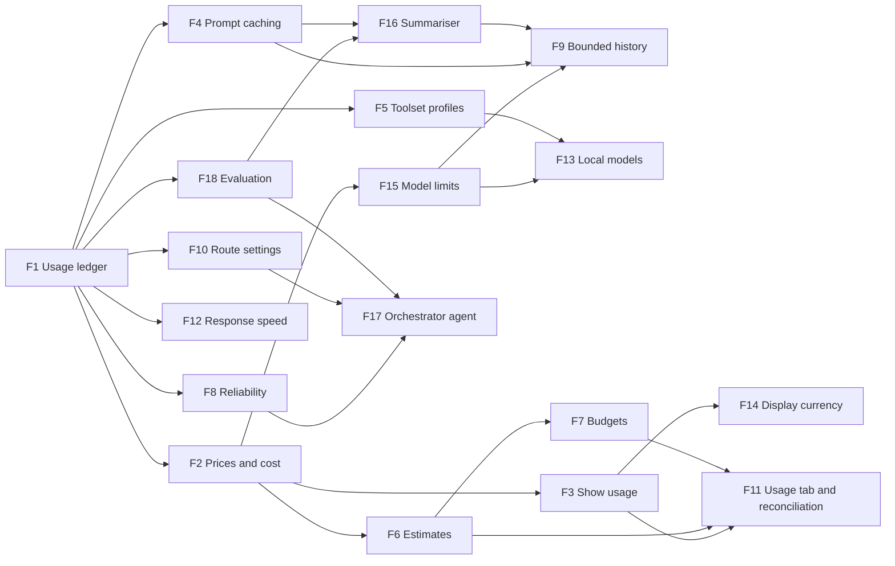

# Features: implementing the usage and optimisation specs

The [goal](../GOAL.md) these features serve: learning AI engineering, one measured skill per milestone. The two specs say **what** to build and why:

- [Usage, estimates and budgets](../specs/USAGE_AND_BUDGETS.md) (`U §n` below)
- [Response optimisation](../specs/RESPONSE_OPTIMISATION.md) (`R §n` below)

This folder says **how**, one feature at a time. Each feature doc has user stories with acceptance criteria, the
design (which code changes and how), step-by-step implementation tasks with their tests, and a definition of done.
Work through them in milestone order: each milestone is useful on its own, and later ones build on earlier ones.

## Features

Each feature is **one line under *Now* in the [TODO](../../TODO.md)** — tick it there when the feature is done. Where a
feature replaces older backlog wording, that wording no longer appears anywhere else in the TODO.

| ID | Feature | Status | Spec | Replaces in the TODO | Depends on | Milestone |
|---|---|---|---|---|---|---|
| [F1](F01-usage-ledger.md) | Usage ledger: record every model request | done | U §4.1, §4.3 · R §A | *Track token usage / cost per session* (with F2, F3, F6, F7, F11) | — | M1 |
| [F2](F02-prices-and-cost.md) | Prices and cost | done | U §4.2 | (as F1) | F1 | M1 |
| [F3](F03-usage-display.md) | Show usage: chat, CLI, Rider, API, comms log | done | U §7.2–7.4 | (as F1) | F1, F2 | M1 |
| [F4](F04-prompt-caching.md) | Prompt caching (Anthropic) | **done** | R §B | *Wire up Anthropic prompt caching* | F1 | M2 |
| [F5](F05-toolset-profiles.md) | Toolset profiles | built; short benchmark done | R §C | — | F1 | M2 |
| [F6](F06-estimates.md) | Cost estimates before a run | planned | U §5 | (as F1) | F1, F2 | M3 |
| [F7](F07-budgets.md) | Budgets: warn, ask, stop | planned | U §6 | (as F1) | F1, F2, F6 | M3 |
| [F8](F08-reliability.md) | Reliability: retries, account limits, fallback, structured results | planned | R §F · U §6.2 | *Retry and back off…*, *Add model fallback*, *Wire up structured outputs* | F1 | M3 |
| [F9](F09-context-management.md) | Bounded history: clear stale tool results, compact old turns | planned | R §D | *Consider context editing and compaction*; first slice of the session architecture | F1, F4, F15, F16, F18 | M4 |
| [F10](F10-route-settings.md) | Settings per route: thinking and tool rounds (the summary model moved to F16) | planned | R §E | Known limitation *10 tool rounds per message* | F1 | M4 |
| [F11](F11-usage-tab-and-reconciliation.md) | Usage tab, usage API, reconciliation with the bill | planned | U §7.1–7.2, §4.4 | (as F1) | F1–F3, F6, F7 | M5 |
| [F12](F12-response-speed.md) | Response speed: time to first token and tokens per second, every provider | planned | U §4.1 · R §A | — | F1 (F3, F11 to show it) | M5 |
| [F13](F13-local-models.md) | Local models: fit every request into a small context window (2,048 tokens) | planned | R §C | Known limitation *local models get a truncated prompt* | F1, F5, F15 | Local |
| [F14](F14-display-currency.md) | Display currency: show costs in a chosen currency (the ledger stays in the bill's) | done | U §4.2, §7 | — | F2, F3 | M5 |
| [F15](F15-model-limits.md) | Model limits: each model's context window and cache minimum, `num_ctx` for local models, and F9's and F13's limits per model | planned | R §B–D | — | F2 | M2 |
| [F16](F16-summariser.md) | Summariser: one measured component for oversized tool results and (later) compaction, with its own model, prompt and no caching | planned | R §D | F10-S3 (summary model) | F1, F4, F18 | M4 |
| [F17](F17-orchestrator-agent.md) | Orchestrator agent: a routing workflow with an agent for the exceptions, its own settings and cache policy, measured against today's | planned | Orchestrator design | — | F4, F8, F10, F18 | M4 |
| [F18](F18-evaluation.md) | Evaluation: a small shared eval harness (cases as data, scorers incl. an LLM judge, cost and baseline per run) | planned | — | Backlog *Evaluation* (first part) | F1, F2 | M4 |
| [F20](F20-puls-look.md) | Puls look: a landing page and a three-panel dashboard, dark, in Puls's colours | done | — | — | F5 | — |
| [F21](F21-personalities.md) | Personalities per session: each session (and sub-session) names its personality | built | — | — | F5 | — |
| [F22](F22-role-tools.md) | Role tools: today's date, attachments to specialists, documents, git history, tables and currency | built | — | — | F21, F5 | — |

## Milestones

| Milestone | Goal | Features | Proof it worked |
|---|---|---|---|
| **M1 — See it** | Every request's tokens and cost recorded and visible | F1, F2, F3 | A demo run produces `logs/usage.jsonl` and a comms log with cost per fix; the web app shows cost per answer |
| **M2 — Cheaper** | Stop paying full price for the same tokens | F4, F5, F15 | Benchmark (demo run) input cost down ≥ 60% against the M1 baseline; 10/10 fixes still confirmed |
| **M3 — In control** | Know the cost before, stop cleanly at a limit | F6, F7, F8 | The demo script estimates the run; a run budget stops it cleanly and `-Resume` finishes it; an account-limit refusal stops the run at once |
| **M4 — Long sessions** | Long chats and tasks don't grow without limit; the parts that summarise and orchestrate are measured | F18, F16, F9, F10, F17 | A 30-turn chat stays under the compaction threshold and still recalls its first turns; the summariser and triage suites hold their baselines at lower cost |
| **M5 — Reporting** | Usage overview, reconciliation and speed | F11, F12, F14 | The Usage tab matches the ledger; the ledger is within 5% of the provider's report; Claude and llama3.1 speeds compared |
| **Local — Local models** | A local model gets everything it is sent | F13 | No ledger record of a local turn has `input` above 2,048; "What branch am I on?" works on `llama3.1` |

## The benchmark

Every milestone is measured the same way, so changes can be compared:

1. **Demo run** — `.\samples\run-demo.ps1` (13 errors, 10 fixes): tokens and cost per fix and in total, cache-hit rate,
   fixes confirmed by the orchestrator.
2. **Scripted chat** — a 30-turn conversation against louis-agent.api on the demo repository (to be written in F9): tokens
   per turn, and whether the last turns can still answer questions about the first.

The M1 run is the baseline. A change lands only if quality holds: 10/10 fixes confirmed, and the chat recall check passes.

To measure a run: `dotnet run --project tools/louis-agent.usage-probe -- --ledger .demo/logs/usage-YYYY-MM.jsonl` prices
the ledger with `config/prices.json` and totals it per fix, triage, purpose and run.

### M1 baseline (2026-10-10)

Full demo on Claude Haiku 5.5 (`run-20261010-193730`, ledger in
[samples/sample-output/](../../samples/sample-output/README.md)), every record priced as it was written, with the
2026-10-10 table. **10/10 fixes confirmed**, 2 ignored, 1 escalated; four fixes needed a second message after using all
10 tool rounds.

| | Requests | Input tokens | Output tokens | Cost |
|---|---|---|---|---|
| A fix (louis-agent): fewest / average / most | 8 / 11.4 / 16 | 425,547 / 608,135 / 863,893 | 2,555 / 3,274 / 3,722 | $0.0442 / $0.0625 / $0.0879 |
| A triage (orchestrator), 13 of them | 2–3 | 14,365–25,453 | 313–967 | $0.0016–0.0030 |
| All fixes | 114 | 6,081,347 | 32,742 | $0.6245 |
| All triage | 36 | 292,935 | 9,502 | $0.0340 |
| **The run** | **150** | **6,374,282** | **42,244** | **$0.6586** |

- **Cache-hit rate: 0%.** Nothing is cached yet, so every request re-sends the ~48,000-token system prompt and tools;
  that is most of the input, and what F4 (prompt caching) and F5 (toolset profiles) go after in M2.
- **Largest request: 57,710 tokens**, under Haiku 5.5's 100,000-token price step.
- **Run-to-run variation:** an earlier run of the same code (`run-20261010-174312`) cost $0.6569 for 149 requests, also
  10/10; a single fix varies more ($0.044–0.088) than the whole run does (0.3%), mostly with whether it needs a second
  message. Compare M2 against the run total, not one fix.
- The short run (`run-demo.ps1 -Short`, 4 fixes): 65 requests, $0.2920 (`run-20261010-193216`); rerun for F3 at 57
  requests, $0.2526 (`run-20261011-005339`, saved in
  [samples/sample-output-short/](../../samples/sample-output-short/README.md)), the difference being fixes that
  finished in one message. Its comms log total equals its ledger total exactly.
- Rerun for F14 (2026-10-11, comms logs in rands; both equal their ledgers exactly): the full run cost $0.7157 for 160
  requests (`run-20261011-083646`, 10/10 fixes; 8.7% above the baseline, mostly one fix's needless follow-ups, fixed
  as [FX8](../fixes/FX08-fix-result-quotes.md)), the short run $0.2884 for 64 (`run-20261011-085011`). Both are now
  the saved samples; the M1 baseline stays `run-20261010-193730`.

### F4 benchmark (2026-10-11)

The full demo with prompt caching on for louis-agent (`run-20261011-183104`, saved in
[samples/sample-output-cached/](../../samples/sample-output-cached/README.md)); the orchestrator's triage is not
cached (F17). **10/10 fixes confirmed**, 2 ignored, 1 escalated, as in M1.

| | M1 baseline | Uncached rerun (F14) | Cached (F4) | F4 vs M1 |
|---|---:|---:|---:|---:|
| louis-agent: input cost | $0.6081 | $0.6641 | $0.0820 | **−87%** |
| louis-agent: cost | $0.6245 | $0.6818 | $0.0991 | −84% |
| A fix: fewest / average / most | $0.0442 / $0.0625 / $0.0879 | | $0.0075 / $0.0099 / $0.0146 | −84% (average) |
| Triage (not cached) | $0.0340 | $0.0340 | $0.0343 | +1% |
| **The run** | **$0.6586** | **$0.7157** | **$0.1334** | **−80%** |
| Cache-hit rate (louis-agent) | 0% | 0% | 98% | |

- **Targets met:** input cost −87% against the ≥ 60% of F4's *Done when*. The prefix per fix: about 12 requests ×
  47,424 tokens at $0.10 per million was $0.054 a fix; it is now read at $0.01 per million and written once a run
  (47,424 at $0.125), about $0.0063 a fix: **−88%**, against the write-up's −80%.
- **The prefix is written once per run, not per fix:** the nine fixes after the first opened in new sessions by reading
  it (marker 1 is shared across sessions); each wrote only its first message, about 1,100 tokens.
- **Continue messages read the whole conversation** and wrote only the new message (30–312 tokens).
- **Short run** (`run-20261011-184153`, [samples/sample-output-short-cached/](../../samples/sample-output-short-cached/README.md)):
  4/4 fixes, $0.0488 against $0.2884 uncached (−83%); louis-agent's input cost −89%.
- **The lifetime:** every gap is under 5 minutes in both agents (`usage-probe -- --cache-gaps`), so the default 5m is
  right for the demo; 1 hour would cost more.
- The smoke check before it is kept in [samples/smoke-f4-caching/](../../samples/smoke-f4-caching/README.md).
- The three paid runs together cost $0.19.

### F5 benchmark, short run (2026-10-13)

The short demo with F5's coding profile for louis-agent's fix sessions (`run-20261013-161416`, saved in
[samples/sample-output-short-f5/](../../samples/sample-output-short-f5/README.md)), against F4's short run. **4/4 fixes
confirmed** and 1 escalated, as before.

| | F4 short (cached) | F5 short | Change |
|---|---:|---:|---:|
| A fix session's prefix (its first request) | ~48,500 tokens | ~24,400 tokens | **−50%** |
| louis-agent: cost | $0.0353 | $0.0243 | −31% |
| louis-agent: cost per fix | $0.0088 | $0.0061 | −31% |
| Triage (not cached) | $0.0135 | $0.0135 | 0% |
| **The run** | **$0.0488** | **$0.0378** | **−23%** |
| Cache-hit rate (louis-agent) | 98% | 95% | |

- **Targets met for the short run:** prefix −50% against F5's ≥ 25%, the cache hits from each fix's second request, every
  fix confirmed. F4's short run never wrote its prefix (the full run before it had left it cached); this one wrote its
  24,475 tokens once, so like for like the saving is a little larger.
- **Left:** the full run (10 fixes) to confirm 10/10, and a sub-session end to end.

### Local triage (2026-10-12)

Can the orchestrator's triage run on a free local model while louis-agent's fixes stay on Claude? The short demo with
`-OrchestratorProfile`, Ollama in the `ollama-nvidia` container on a 4 GB laptop GPU (RTX 3050), three models in turn.
**Yes, with the right model:** the third run matched Claude's result for $0 of triage
([samples/sample-output-short-local-triage/](../../samples/sample-output-short-local-triage/README.md)).

| | `llama3.1` (8B) | `qwen3:4b` (thinking) | `qwen3:4b-instruct-2507` |
|---|---|---|---|
| Result | 1 failed, 4 unknown, 0 fixes | stopped after 2 errors, both failed | **4 fixed, 1 escalated** |
| What went wrong | Timed out once; then wrote the tool call as text (1) or described the workflow instead of acting (3) | Thought for 440+ tokens per reply and timed out every time | Two contradicting calls once; an escalation sent twice |
| Where it ran (32k context) | 8 of 33 layers on the GPU | 14 of 37 layers on the GPU, 5.4 GB | CPU and GPU, ~5 tokens/s |
| Triage cost | $0 | $0 | $0 (the run: $0.0418 against $0.0488 with Claude triage) |

- **Thinking decides speed more than size.** Asked "17 × 3, the number only", `qwen3:4b` wrote 279 tokens (thinking
  left on, which is what the agent sends today: `LLM_THINKING=off` sends nothing, so the model's default applies) and
  454 with `think: false` (the reasoning moved into the answer). The instruct model wrote 3. `ollama show` lists
  `thinking` for both, so measure it.
- **Tool calling decides whether it works at all.** llama3.1 picked the right tool and arguments for shipping-cost and
  wrote them as JSON text; the agent can't act on that. qwen3-instruct made real calls and followed the runbook's
  workflow: fix, verify the commit, replay the request, run the tests, then decide.
- **The context window is memory.** The KV cache costs about 76 KiB a token for qwen3:4b (8-bit cache), so the
  container's 32k-token default needs 2.4 GB on top of 2.4 GB of weights and spills to the CPU. At 8k (the
  orchestrator's prompt is ~4,600 tokens) it fits: 3.2 GB, 100% GPU, ~54 tokens/s, but only with `num_gpu=99`;
  Ollama's own estimate left 1.6 GB of VRAM unused.
- **.NET's 100-second default timeout** cancelled replies Ollama was still writing: the prompt (~4,600 tokens) was
  read in time, the answer wasn't. Ollama's client now waits 10 minutes (`LlmClientFactory.OllamaTimeout`).
- **The ledger misses a cancelled request:** llama3.1's run made five requests and the ledger has four. Free on
  Ollama; on Claude a request the client gave up on may still be charged, and the ledger wouldn't show it
  ([FX9](../fixes/FX09-cancelled-request-usage.md)).
- **The cost:** triage was 28% of the cached short run and is now $0; the fixes are the rest. The run took 2.4 times as
  long (8.4 minutes against 3.5).

**Follow-ups** (not built): send `num_ctx` and `num_gpu` per request for the orchestrator (F15); send `think: false`
when thinking is off (F15); make `EscalateToHuman` idempotent per error and reject contradicting decisions in one
reply (F17); record cancelled requests in the ledger ([FX9](../fixes/FX09-cancelled-request-usage.md)).

## Conventions

- **Stories** are `Fn-Sm`: "As a *role*, I want *something*, so that *benefit*", each with acceptance criteria written
  as *Given / When / Then*.
- **Roles:** *user* (chats in the web app, Rider or CLI), *operator* (runs louis-agent and the orchestrator, sets
  budgets and prices), *developer* (works on this repo), *orchestrator* (the agent itself, where it is the one acting).
- **Tasks** are small enough for one commit each and name their test.
- **Plans:** before step 1, the plan approved for building the feature now is saved in [plans/](../plans/README.md)
  (`Fnn-name.md`) and committed on the feature's branch. This doc stays the *what and why*; the plan is the *how, now*.
- **Definition of done** for every feature: its stories' criteria pass; unit tests added and the existing suites pass
  (`tests/louis-agent.core.tests`, `tests/louis-agent.orchestrator.tests`); the benchmark rerun where the feature
  touches cost; and the steps in *Finishing a feature* below.
- **Status** of each feature is kept in two places that must agree: the top of its doc and the table above
  (*planned → in progress → done*).

## Finishing a feature

When a feature's *Done when* is met, do all of this in the same commit, so the TODO, the specs and these docs never
drift apart:

1. **TODO:** tick the feature's line under *Now*, and add a one-line entry at the top of *Done*.
2. **This folder:** set *Status* to **done** at the top of the feature's doc and in the table above.
3. **Spec:** in the spec's *Implementation* map, mark the feature done; change anything the build proved different
   (for example F4's two cache markers instead of three).
4. **Limitations:** if the feature removes a known limitation (F10: tool rounds), delete it from the
   TODO's [Known limitations](../../TODO.md#known-limitations) (the one list).
5. **Benchmark:** for features that change cost, add the measured numbers to *The benchmark* below.
6. **User docs:** settings in README / [SETUP](../SETUP.md), and anything the feature changes for users.
7. **Goal map:** in [docs/GOAL.md](../GOAL.md#what-im-learning-the-whole-agent-architecture), move what the feature
   delivered into *Have today* and drop it from *Planned* or *Missing*; if it closes a TODO *Agent architecture gaps*
   line, remove that line.
8. **Write-up:** when a skill in the [goal](../GOAL.md#what-im-learning-the-whole-agent-architecture) has nothing left
   missing (usually at a milestone's last feature), add or update its write-up in [docs/learning/](../learning/).

---
[Docs index](../README.md) · Specs: [Usage, estimates and budgets](../specs/USAGE_AND_BUDGETS.md) ·
[Response optimisation](../specs/RESPONSE_OPTIMISATION.md) · [TODO](../../TODO.md)
