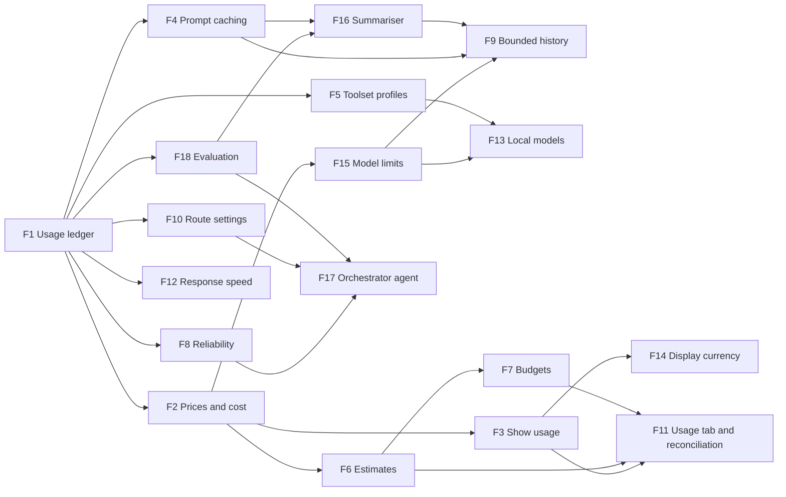

# Features: implementing the usage and optimisation specs

The [goal](../GOAL.md) these features serve: learning AI engineering, one measured skill per milestone. The two specs say **what** to build and why:

- [Usage, estimates and budgets](../specs/USAGE_AND_BUDGETS.md) (`U §n` below)
- [Response optimisation](../specs/RESPONSE_OPTIMISATION.md) (`R §n` below)

This folder says **how**, one feature at a time. Each feature doc has user stories with acceptance criteria, the
design (which code changes and how), step-by-step implementation tasks with their tests, and a definition of done.
Work through them in milestone order: each milestone is useful on its own, and later ones build on earlier ones.

## Features

Each feature is **one line under *Now* in the [TODO](../../TODO.md)** — deleted there when the feature is done. Where a
feature replaces older backlog wording, that wording no longer appears anywhere else in the TODO.

| ID | Feature | Status | Spec | Replaces in the TODO | Depends on | Milestone |
|---|---|---|---|---|---|---|
| [F1](F01-usage-ledger.md) | Usage ledger: record every model request | done | U §4.1, §4.3 · R §A | *Track token usage / cost per session* (with F2, F3, F6, F7, F11) | — | M1 |
| [F2](F02-prices-and-cost.md) | Prices and cost | done | U §4.2 | (as F1) | F1 | M1 |
| [F3](F03-usage-display.md) | Show usage: chat, CLI, Rider, API, comms log | done | U §7.2–7.4 | (as F1) | F1, F2 | M1 |
| [F4](F04-prompt-caching.md) | Prompt caching (Anthropic) | **done** | R §B | *Wire up Anthropic prompt caching* | F1 | M2 |
| [F5](F05-toolset-profiles.md) | Toolset profiles | done | R §C | — | F1 | M2 |
| [F6](F06-estimates.md) | Cost estimates before a run | planned | U §5 | (as F1) | F1, F2 | M3 |
| [F7](F07-budgets.md) | Budgets: warn, ask, stop | planned | U §6 | (as F1) | F1, F2, F6 | M3 |
| [F8](F08-reliability.md) | Reliability: retries, account limits, fallback, structured results | planned | R §F · U §6.2 | *Retry and back off…*, *Add model fallback*, *Wire up structured outputs* | F1 | M3 |
| [F9](F09-context-management.md) | Bounded history: clear stale tool results, compact old turns | planned | R §D | *Consider context editing and compaction*; first slice of the session architecture | F1, F4, F15, F16, F18 | M4 |
| [F10](F10-route-settings.md) | Settings per route: thinking and tool rounds (the summary model moved to F16) | planned | R §E | Known limitation *10 tool rounds per message* | F1 | M4 |
| [F11](F11-usage-tab-and-reconciliation.md) | Usage tab, usage API, reconciliation with the bill | planned | U §7.1–7.2, §4.4 | (as F1) | F1–F3, F6, F7 | M5 |
| [F12](F12-response-speed.md) | Response speed: time to first token and tokens per second, every provider | planned | U §4.1 · R §A | — | F1 (F3, F11 to show it) | M5 |
| [F13](F13-local-models.md) | Local models: fit every request into a small context window (2,048 tokens) | planned | R §C | Known limitation *local models get a truncated prompt* | F1, F5, F15 | Local |
| [F14](F14-display-currency.md) | Display currency: show costs in a chosen currency (the ledger stays in the bill's) | done | U §4.2, §7 | — | F2, F3 | M5 |
| [F15](F15-model-limits.md) | Model limits: each model's context window and cache minimum, `num_ctx` for local models, and F9's and F13's limits per model | planned | R §B–D | — | F2 | M2 |
| [F16](F16-summariser.md) | Summariser: one measured component for oversized tool results and (later) compaction, with its own model, prompt and no caching | planned | R §D | F10-S3 (summary model) | F1, F4, F18 | M4 |
| [F17](F17-orchestrator-agent.md) | Orchestrator agent: a routing workflow with an agent for the exceptions, its own settings and cache policy, measured against today's | planned | Orchestrator design | — | F4, F8, F10, F18 | M4 |
| [F18](F18-evaluation.md) | Evaluation: a small shared eval harness (cases as data, scorers incl. an LLM judge, cost and baseline per run) | planned | — | Backlog *Evaluation* (first part) | F1, F2 | M4 |
| [F20](F20-puls-look.md) | Puls look: a landing page and a three-panel dashboard, dark, in Puls's colours | done | — | — | F5 | — |
| [F21](F21-personalities.md) | Personalities per session: each session (and sub-session) names its personality | built | — | — | F5 | — |
| [F22](F22-role-tools.md) | Role tools: today's date, attachments to specialists, documents, git history, tables and currency | built | — | — | F21, F5 | — |
| [F24](F24-landing-motion.md) | Landing motion: the landing page as a moving page, and the app's empty chat, Werk panel, loading and an *Animasies* switch with it | done | — | — | F20, F5 | — |
| [F25](F25-local-cook.md) | Local cook: Puls's first local specialist, a South African meal priced at the shops near the user; routing and local sources measured | built | — | — | F21, F22, F5 | — |
| [F26](F26-specialist-follow-up.md) | Specialist follow-up: a sub-session stays open for its chat, and Puls continues it by handle instead of starting a specialist cold | built | — | — | F5, F21, F22 | — |
| [F27](F27-admin-portal.md) | Admin portal: an *Admin* menu into a portal of our own (sidebar and cards on Puls's variables) whose first page runs and reads the benchmarks; built to take more pages | done (superseded by F31) | — | — | F20, F25 | — |
| [F28](F28-team-talk.md) | Team talk: Puls briefs its specialist in a fixed note (what the user wants, how they sound, where they are), a per-chat switch for the mood, and the card shows the exchange as a thread | planned | — | — | F5, F21, F25, F26, F27 | — |
| [F29](F29-validated-specialists.md) | Validated specialists: `ROLES_ENABLED` (`PERSONALITIES_ENABLED` before CL14) gates which roles an instance may use; Puls boots with `specialists` (then called `agents`) and `web`, answers the web itself and delegates only cooking until each other role has passed its check | planned | — | — | F5, F21, F25, F27 | — |
| [F30](F30-local-web-peer.md) | Local web peer: a session names its LLM profile; a specialist hands one task and one of its own tools to a minion on a cheap model (`MINION_LLMS`); built, not in use until F31 measures it | built | — | — | F5, F21, F25, F29 | — |
| [F31](F31-benchmarks-portal.md) | Benchmarks in the admin portal: check scripts in `benchmarks/` run only from the portal, each run recorded by the API from the script's stdout protocol into MongoDB (`puls_benchmarks`), with an explorer at every level and trends per check; closes F27 | done | — | TODO *Benchmarks in the admin portal* | F27, F1–F3, F25, F29, F30 | — |
| [F32](F32-self-hosted-web.md) | Self-hosted web: `WebSearch` through SearXNG in Docker, and any page drawn with JavaScript rendered by a headless Chrome (PuppeteerSharp), every request it makes held to the address rule; no key, no credits, for development and benchmarks (the sold endpoint keeps a licensed search API) | done | — | — | F25, FX16, F31 | — |
| [F33](F33-shop-catalogues.md) | Shop catalogues: a shop's products and exact prices read from its own catalogue through the guarded browser (Checkers first), a `shops` toolset the cook uses; off unless `SHOP_CATALOGUES` names the shop | done | — | — | F32, F25, F31 | — |

## Milestones

| Milestone | Goal | Features | Proof it worked |
|---|---|---|---|
| **M1 — See it** | Every request's tokens and cost recorded and visible | F1, F2, F3 | A demo run produces `logs/usage.jsonl` and a comms log with cost per fix; the web app shows cost per answer |
| **M2 — Cheaper** | Stop paying full price for the same tokens | F4, F5, F15 | Benchmark (demo run) input cost down ≥ 60% against the M1 baseline; 10/10 fixes still confirmed |
| **M3 — In control** | Know the cost before, stop cleanly at a limit | F6, F7, F8 | The demo script estimates the run; a run budget stops it cleanly and `-Resume` finishes it; an account-limit refusal stops the run at once |
| **M4 — Long sessions** | Long chats and tasks don't grow without limit; the parts that summarise and orchestrate are measured | F18, F16, F9, F10, F17 | A 30-turn chat stays under the compaction threshold and still recalls its first turns; the summariser and triage suites hold their baselines at lower cost |
| **M5 — Reporting** | Usage overview, reconciliation and speed | F11, F12, F14 | The Usage tab matches the ledger; the ledger is within 5% of the provider's report; Claude and llama3.1 speeds compared |
| **Local — Local models** | A local model gets everything it is sent | F13 | No ledger record of a local turn has `input` above 2,048; "What branch am I on?" works on `llama3.1` |

## The benchmark

Every milestone is measured the same way, so changes can be compared:

1. **Demo run** — `.\samples\run-demo.ps1` (13 errors, 10 fixes): tokens and cost per fix and in total, cache-hit rate,
   fixes confirmed by the orchestrator.
2. **Scripted chat** — a 30-turn conversation against louis-agent.api on the demo repository (to be written in F9): tokens
   per turn, and whether the last turns can still answer questions about the first.

The M1 run is the baseline. A change lands only if quality holds: 10/10 fixes confirmed, and the chat recall check passes.

To measure a run: `dotnet run --project tools/louis-agent.usage-probe -- --ledger .demo/logs/usage-YYYY-MM.jsonl` prices
the ledger with `config/prices.json` and totals it per fix, triage, purpose and run.

The runs so far, with their numbers, are in [BENCHMARKS.md](https://github.com/bosbevk/louis-agent/blob/pre-cl10/docs/BENCHMARKS.md).

## Conventions

- **Stories** are `Fn-Sm`: "As a *role*, I want *something*, so that *benefit*", each with acceptance criteria written
  as *Given / When / Then*.
- **Roles:** *user* (chats in the web app, Rider or CLI), *operator* (runs louis-agent and the orchestrator, sets
  budgets and prices), *developer* (works on this repo), *orchestrator* (the agent itself, where it is the one acting).
- **Tasks** are small enough for one commit each and name their test, which is written and seen failing first
  ([test first](../../tests/CLAUDE.md#test-first)).
- **Plans:** before step 1, the plan approved for building the feature now is saved in [plans/](../plans/README.md)
  (`Fnn-name.md`) and committed on the feature's branch. This doc stays the *what and why*; the plan is the *how, now*.
- **Definition of done** for every feature: its stories' criteria pass; unit tests added and the existing suites pass
  (`tests/louis-agent.core.tests`, `tests/louis-agent.orchestrator.tests`); the benchmark rerun where the feature
  touches cost; and the steps in *Finishing a feature* below.
- **Status** of each feature is kept in two places that must agree: the top of its doc and the table above
  (*planned → in progress → done*).

## Finishing a feature

When a feature's *Done when* is met, do all of this in the same commit, so the TODO, the specs and these docs never
drift apart:

1. **TODO and CHANGELOG:** delete the feature's line under *Now*, and add a one-line entry at the top of the
   [CHANGELOG](../../CHANGELOG.md).
2. **This folder:** set *Status* to **done** at the top of the feature's doc and in the table above.
3. **Spec:** in the spec's *Implementation* map, mark the feature done; change anything the build proved different
   (for example F4's two cache markers instead of three).
4. **Limitations:** if the feature removes a known limitation (F10: tool rounds), delete it from the
   TODO's [Known limitations](../../TODO.md#known-limitations) (the one list).
5. **Benchmark:** for features that change cost or quality, run the check from the admin portal
   (`/admin/benchmarks`, on Louis's go). The run is kept in the benchmark store (F31), so the feature's doc names the
   run's id and its numbers; the runs before CL10 stay in
   [BENCHMARKS.md at `pre-cl10`](https://github.com/bosbevk/louis-agent/blob/pre-cl10/docs/BENCHMARKS.md).
6. **User docs:** settings in README / [SETUP](../SETUP.md), and anything the feature changes for users.
7. **Decisions:** if the feature made a lasting decision, its [ADR](../adr/README.md) is in the same PR; a decision it
   changed is superseded, not edited.
8. **Goal map:** in [docs/GOAL.md](../GOAL.md#what-im-learning-the-whole-agent-architecture), move what the feature
   delivered into *Have today* and drop it from *Planned* or *Missing*; if it closes a TODO *Agent architecture gaps*
   line, remove that line.
9. **Write-up:** when a skill in the [goal](../GOAL.md#what-im-learning-the-whole-agent-architecture) has nothing left
   missing (usually at a milestone's last feature), add or update its write-up in [docs/learning/](../learning/).

---
[Docs index](../README.md) · Specs: [Usage, estimates and budgets](../specs/USAGE_AND_BUDGETS.md) ·
[Response optimisation](../specs/RESPONSE_OPTIMISATION.md) · [TODO](../../TODO.md)
