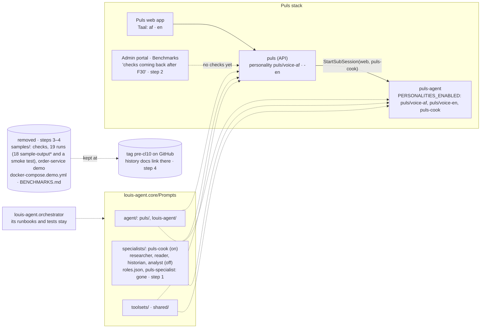

# CL10 · Clear the decks: the old checks, samples and derived roles go before F30's minions

> **Plan.** How the recorded runs, the two checks, the order-service demo, `BENCHMARKS.md` and the derived roles leave
> the repo, so F30's minions start from a clean slate and the checks are rewritten for them. **For:** TODO *Clear the
> decks* (cleanup). **Approved:** 2026-10-17 (Louis, with the changes under *Approved during the build*). **Branch:** `refactor/CL10-clear-the-decks`,
> off `main` (after #49); before F30 step 4.

## Context

Louis (2026-10-17), with CL9 under way: "can we only keep this one active for testing? puls, the others must be removed;
they were there so we could figure out what goes for what, now I know … Then remove all samples and history benchmarks.
We must rework them after minion changes." Then, on the roles: "keep this but make this a toggle; when we test I do not
want anything else loaded except puls and what I'm testing", and on `puls-specialist`: "then we do not need this?".

What that means, checked against the code:

- **Roles.** `PERSONALITIES_ENABLED` (F29) already is the toggle: only the listed roles and modes can be loaded, so the
  researcher, reader, historian and analyst stay as files, off. `specialists/roles.json` and `RoleFor` give a sub-session
  opened without a role one derived from its toolsets; Puls always names its role (the cook), so nothing needs it, and
  its default, `puls-specialist`, has no function of its own: both go. The specialists guide tells the model about
  `roles.json` (`toolsets/specialists.md`), so that line goes too.
- **The checks and their runs.** `samples/puls-check` and `samples/puls-cook-check` (`run_check.py`) and the 18
  `sample-output*` folders (and `smoke-f4-caching`). The admin portal's Benchmarks page (F27) runs those two scripts
  from its catalogue (`BenchmarkCatalog`) and lists the runs saved under `samples/`: its catalogue empties and the page
  says the checks are coming back; the runner stays for the rewritten checks.
- **The order-service demo.** `samples/order-service` (`OrderService` and `OrderService.Tests`, both in the solution),
  `samples/run-demo.ps1`, `samples/docker/`, `docker/docker-compose.demo.yml` and `docs/projects/order-service.md`. The
  orchestrator stays: its tests load its own runbooks (`src/louis-agent.orchestrator/Skills/order-service/`), not the
  demo.
- **`BENCHMARKS.md`** goes; about 60 files link to it or to `samples/`. Current docs (the guides, the architecture, the
  project docs, README, GOAL) drop or reword the links. History docs (plans, features, fixes, learning, specs, ADRs, the
  CHANGELOG) keep what they say: their links point at the same files at a tag, `pre-cl10`, on GitHub, so nothing they
  cite is lost.
- **Two stale comments** the CL9 review left for the next time their files are touched: `ChatPage.razor` ("no agents
  toolset") and `CreateSkillFile`'s description (`'default'`, which no longer exists).

Goal skills: 12, evaluation (old checks out before the rewrite, so nothing measures against a design that's gone), and
18, testing and shipping (a solution that builds and tests without a demo it no longer runs).

## Design

### What goes and what stays

| Goes | Stays |
|---|---|
| `specialists/roles.json`, `Personalities.RoleFor`, `AgentEngineFactory.RoleFor`, `puls-specialist.md` | the researcher, reader, historian, analyst (off by `PERSONALITIES_ENABLED`), the cook (on) |
| `samples/puls-check`, `samples/puls-cook-check`, every `samples/sample-output-*`, `samples/smoke-f4-caching` | the portal's runner and saved-run reader (F27), for the rewritten checks |
| `samples/order-service`, `run-demo.ps1`, `samples/docker`, `docker-compose.demo.yml`, `docs/projects/order-service.md` | the orchestrator and its runbooks and tests |
| `samples/README.md`, `docs/BENCHMARKS.md` | the numbers in the CHANGELOG and the history docs, linked at `pre-cl10` |

- **A sub-session with no role** gets none: below level 0 that is the default mode's voice only, as it was whenever
  `RoleFor` found nothing. Puls names `puls-cook`; the specialists guide says a role is named, not derived.
- **The portal's catalogue is empty by default** (`BenchmarkCatalog`'s built-in checks go); the Benchmarks page shows
  one line, the checks are being rewritten after F30's minions, instead of a run button. Its tests pass their own checks,
  as the catalogue already allows.
- **The tag** `pre-cl10` marks `main` before this branch's first deleting step; pushing a tag is outward, so it waits
  for Louis's go in step 4.

### Architecture: what's left after CL10



### Communication: a sub-session after `roles.json`

```mermaid
sequenceDiagram
    autonumber
    participant P as Puls (puls/voice-af)
    participant A as puls-agent (AgentSessions)
    participant F as AgentEngineFactory

    P->>A: POST /sessions {toolsets: [web], depth: 1, personality: puls-cook}
    A->>F: GetOrCreate([web], puls-cook, Specialist)
    F-->>A: the cook's engine (principles, puls-cook, toolsets/web)
    A-->>P: 201 {personality: puls-cook}
    Note over P,A: the only role Puls names; PERSONALITIES_ENABLED keeps the others off
    P->>A: POST /sessions {toolsets: [web], depth: 1} (no role, e.g. from MCP)
    Note over A: before CL10: RoleFor([web]) → puls-researcher (off) → none<br/>after: no derived role at all
    A->>F: GetOrCreate([web], null, Specialist)
    F-->>A: principles, the default mode's voice only, toolsets/web
    A-->>P: 201 {personality: null}
```

## Steps (one commit each, test first where behaviour changes, stop after each)

| Step | What | Check |
|---|---|---|
| 0 | **Docs:** this plan; the TODO line (already there) points at it; the plans index row | — |
| 1 | **Roles are named, not derived:** `roles.json`, `Personalities.RoleFor`, `RolesFile`, `AgentEngineFactory.RoleFor` and `puls-specialist.md` go; `AgentSessions` no longer derives a role; the specialists guide's `roles.json` line goes; `AgentPeerTools`' "derived" comment | Tests first: a sub-session with no role stays without one (`Personality` null, the default mode's voice only); `puls-specialist` isn't offered; `roles.json` isn't embedded. The derive tests go. Golden file: the guide's line |
| 2 | **The portal without checks:** `BenchmarkCatalog`'s built-in checks go; the Benchmarks page says the checks are coming back after F30 when the catalogue is empty; the runner and saved-run reader stay | Tests first: an empty catalogue by default; `BenchmarkCatalogTests` and `BenchmarkRunnerTests` pass their own checks. The page by hand (step 5) |
| 3 | **The samples go:** both checks, every recorded run, the order-service demo (`OrderService`, `OrderService.Tests` out of the solution), `run-demo.ps1`, `samples/docker`, `docker-compose.demo.yml`, `samples/README.md`, `docs/projects/order-service.md`; `CostCalculatorTests`' comment no longer names a sample | The whole solution builds and tests; nothing in code or tests reads `samples/` |
| 4 | **`BENCHMARKS.md` goes; links follow:** the tag `pre-cl10` (Louis's go to push it); current docs drop or reword their links (README's demo and delegation-check rows, the docs index, GOAL, MODELS, SETUP, the architecture, `docs/CLAUDE.md`'s nav and its `samples/` line, `tests/CLAUDE.md`'s demo paragraph); history docs' links to removed files point at `pre-cl10` on GitHub; the two stale comments (`ChatPage.razor`, `CreateSkillFile`) | The link check over every markdown file clean (the template's placeholder aside); golden file: `CreateSkillFile`'s description only |
| 5 | **Rebuild and check by hand (free):** the Puls stack and the code-review API; the Benchmarks page shows its line; `GET /personalities` unchanged; a sub-session with no role opens with none | By hand |

## Reused, not built

- `PERSONALITIES_ENABLED` (F29) as the toggle; the default mode's voice-only path below level 0 (CL9's `ModeParts`) for a
  sub-session with no role.
- `BenchmarkCatalog`'s injectable checks (F27) for its tests and for the rewritten checks.
- A git tag and GitHub's tree URLs for the history docs' links, rather than copying the runs somewhere else.
- Considered, not used: keeping `roles.json` empty (a dead feature); deleting the portal's Benchmarks page and runner
  (they're the place the rewritten checks will run from); keeping the recorded runs (they measure a design CL8 and CL9
  replaced).

## Risks to watch

- **A client that relied on derived roles** (an MCP caller opening `web` with no role got the researcher, when it was on):
  it now gets no role. The specialists guide and `StartSubSession`'s description say a role is named.
- **ADR links:** ADRs 0006, 0007 and 0012 link to `samples/` or `BENCHMARKS.md`. ADRs are edited only in their status
  line, so their links are repointed at `pre-cl10` as a link fix, not a change of what they decided; Louis decides in
  step 4 whether that's acceptable or whether they keep dead links.
- **The orchestrator has nothing to watch** once the demo service goes; its README section says the demo is coming back.

## Verification

- `dotnet build louis-agent-solution.sln`; `dotnet test` on core and API each step; the whole solution before the PR.
- The golden file changes only in steps 1 (the specialists guide's line) and 4 (`CreateSkillFile`'s description).
- The link check clean after step 4; every image rebuilt and checked by hand in step 5; no paid run.

## Concepts

- **Evaluation hygiene** (goal skill 12): a check measures one design; when the design changes, the old check and its
  numbers go (kept in history), and the new ones are written for what's there.
- **Configuration as the switch** (goal skill 18): a feature off by `PERSONALITIES_ENABLED` costs nothing at run time
  and can be tested alone, so the roles stay without being loaded.

## Approved during the build

- **`samples/` goes entirely; results will live in SQL Server, scripts in `benchmarks/`** (Louis, 2026-10-17, approving:
  "we should get rid of samples, and replace it with benchmarks"; "we will only store benchmarks on my local SQL
  server, db puls_benchmarks"). Step 3 deletes `samples/README.md` too and leaves no `benchmarks/` folder yet (nothing to
  put in it until a check is rewritten). The rest of step 3 is as above.
- **Step 2: the portal stops reading and writing files.** `BenchmarkCatalog`'s built-in checks go, and so does its
  `samples/` root and the saved-run listing from folders (`SavedRun`), since runs will live in `puls_benchmarks`.
  `BenchmarkRunner` stays (a check as a child process, its arguments as a list) but no longer writes a run folder under
  `samples/`; where its results go is the later feature's. `Program.cs` stops passing `samples/`. The Benchmarks page
  says the checks are being rewritten, run from here, results kept in `puls_benchmarks`. Tests first: an empty catalogue
  with no folder root; the catalogue and runner tests pass their own checks; nothing in the API reads `samples/`.
- **Benchmarks in the admin portal is its own feature, before the minions are measured** (Louis: "benchmarks must be
  executed via admin, admin screen must be planned and a proper layout implemented"; "Benchmarks in the admin portal
  must be done before running tests for ollama minions"). Check scripts in `benchmarks/{check}/`, run only from the admin
  portal, results in SQL Server `puls_benchmarks` (its connection in `config/.env.secrets`, the SQL client package chosen
  from three options with Louis), the admin screen planned with a proper layout before it's built. Order: CL10 → F30's
  build steps → *Benchmarks in the admin portal* → F30's hand check and measured run, from the portal. A TODO line now;
  its own plan with both diagrams when its turn comes.
