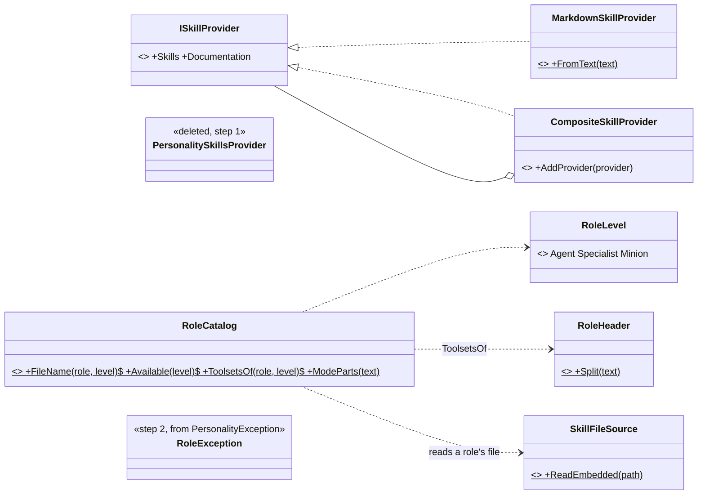
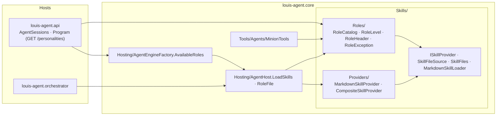
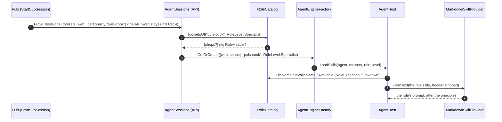

# CL13 · Skills by role: plan

> Approved 2026-10-17 (Louis: the word **role**; the layout **contract + `Providers/` + `Roles/`**; **code now, the
> public contract after**) · Branch: `refactor/CL13-skills-by-role` off `main` (F33 merged 2026-10-17, PR #58) ·
> TODO: *CL13 Skills by role* under *Tooling and repositories*

## Context

`louis-agent.core/Skills/` is one flat folder of eleven files with three concerns mixed: a seam (`ISkillProvider`) with
its implementations, the reading of the built-in prompt files, and the roles a session can take. Every other seam in
core has the shape F32 and F33 settled on: the contract at the folder's top, the implementations in `Providers/`
(`Tools/Web/Search`, `Tools/Web/Rendering`, `Tools/Shops`). Louis (2026-10-17): "we must cleanup to fix the whole
Skills folder namespace. in order to follow the established pattern and naming".

The naming is the second half. The code says **personality** for what a session *is*: a mode at level 0
(`puls/voice-af`), a specialist's role at level 1 (`puls-cook`), a minion's function at level 2. Since F33 the cook's
file declares toolsets (`RoleHeader`, ADR 0025), which is a role's, not a personality's. Of three words offered, Louis
chose **role**.

What the code inspection found:

- **`PersonalitySkillsProvider` is dead.** It loaded `personality.md` from disk; nothing has created one since F5 step 4b
  (`75645d6`) embedded the built-in prompts, and roles load through `MarkdownSkillProvider.FromText`. It and its test
  are deleted, not renamed; `LogMessage.NoPersonality`, its only user's message, goes with it.
- **A class named `Roles` in `…Skills.Roles` breaks a rule** ("a type never shares its namespace's name", core's
  *Project layout*), so `Personalities` becomes **`RoleCatalog`**, the same pattern as `ToolsetCatalog`.
- **The public contract** says personality too: `"personality"` on `POST /sessions`, `StartSubSession(…, personality)`
  (which the model reads), `PERSONALITIES_ENABLED`, `GET /personalities`, the web apps and the benchmarks' Python.
  Louis: code now, contract after. This plan renames only what callers can't see; the error texts keep saying
  "personality" until the contract changes with them (a user reading "Unknown role" for a field called
  `personality` would be lost).

## Design

**`Skills/` in the seams' pattern.** The top keeps the contract and what every provider shares: `ISkillProvider`,
`SkillFileSource` (the embedded prompts), `SkillFiles` (their paths, the reserved names) and `MarkdownSkillLoader` (the
`## Skill:` parser). `Providers/` holds the two implementations. `Roles/` holds what a session *is*: the catalogue of
roles by level, the level itself, a role's header and its error.

**Reuse before building:** nothing is added; one class is deleted, eight types move, four are renamed. The tests move
with their types (*tests mirror the source*), unchanged but for names, which is the safety net: a refactor that needs a
test to change its assertion has changed behaviour.

**A guard against drift:** a new test (`RoleNamingTests`) fails on any type or member in core named `Personalit…`,
except the public contract's own names, listed in the test with "CL14" beside them, so the second part has a checklist.

### Namespaces (new, moved, changed)

| Type | Folder | Namespace | Step |
|---|---|---|---|
| `ISkillProvider`, `SkillFileSource`, `SkillFiles`, `MarkdownSkillLoader` | `Skills/` | `LouisAgent.Core.Skills` | — (stay) |
| `MarkdownSkillProvider`, `CompositeSkillProvider` | `Skills/Providers/` | `LouisAgent.Core.Skills.Providers` | 1, moved |
| `PersonalitySkillsProvider` (+ its test, `LogMessage.NoPersonality`) | — | — | 1, deleted |
| `RoleCatalog` (from `Personalities`) | `Skills/Roles/` | `LouisAgent.Core.Skills.Roles` | 2, moved, renamed |
| `RoleLevel` (from `SkillLevel`) | `Skills/Roles/` | `LouisAgent.Core.Skills.Roles` | 2, moved, renamed |
| `RoleException` (from `PersonalityException`) | `Skills/Roles/` | `LouisAgent.Core.Skills.Roles` | 2, moved, renamed |
| `RoleHeader` | `Skills/Roles/` | `LouisAgent.Core.Skills.Roles` | 2, moved |
| `AgentHost.RoleFile`, `EnabledRoles` (from `PersonalityFile`, `EnabledPersonalities`); parameters `personality` → `role` | `Hosting/` | `LouisAgent.Core.Hosting` | 2, changed |
| `AgentEngineFactory.AvailableRoles` (from `AvailablePersonalities`) | `Hosting/` | `LouisAgent.Core.Hosting` | 2, changed |
| `AgentOptions.RolesEnabled` (from `PersonalitiesEnabled`; still read from `PERSONALITIES_ENABLED`) | `Config/` | `LouisAgent.Core.Config` | 2, changed |
| `ErrorMessage.RoleNameInvalid`, `UnknownRole` (from `PersonalityNameInvalid`, `UnknownPersonality`; texts unchanged) | `Messages/` | `LouisAgent.Core.Messages` | 2, changed |
| Callers: `AgentSessions`, `Program` (API), the orchestrator's `Program`, `MinionTools` | as now | as now | 2, changed |
| `RoleNamingTests` (new); the tests mirror: `Skills/Providers/…Tests`, `Skills/Roles/RoleCatalogTests` (from `PersonalitiesTests`), `MinionRolesTests`, `RoleHeaderTests` | `tests/…/Skills/…` | `LouisAgent.Core.Tests.Skills.…` | 1–2 |

### Interfaces

The signatures don't change, only their names and namespaces:

```csharp
// Skills: the contract, and what every provider shares
public interface ISkillProvider { List<MarkdownSkillLoader.SkillDef> Skills { get; } string Documentation { get; } }
public static class SkillFileSource { IReadOnlyList<string> EmbeddedFiles; string? ReadEmbedded(string path); … }

// Skills/Providers
public class MarkdownSkillProvider : ISkillProvider { public static MarkdownSkillProvider FromText(string text); … }
public class CompositeSkillProvider : ISkillProvider { public void AddProvider(ISkillProvider provider); … }

// Skills/Roles: what a session is
public enum RoleLevel { Agent = 0, Specialist = 1, Minion = 2 }
public static partial class RoleCatalog
{
    public const string AgentFolder, SpecialistsFolder, MinionsFolder, DefaultVoice;
    public static string FolderOf(RoleLevel level);
    public static string FileName(string role, RoleLevel level);
    public static bool IsValidName(string? role);
    public static IReadOnlyList<string> Available(RoleLevel level);
    public static IReadOnlyList<string> ToolsetsOf(string? role, RoleLevel level);   // its RoleHeader
    public static (string Voice, string Routing) ModeParts(string text);
    public static string? LanguageOf(string mode); public static string SharedOf(string mode);
    public static string? MinionBaseOf(string role); public static bool IsMinionBase(string name);
}
public static class RoleHeader { public static (IReadOnlyList<string> Toolsets, string Body) Split(string text); }
public sealed class RoleException(string message) : Exception(message);
```



### Architecture: who uses what



### Communication: a session opening as the cook (unchanged behaviour, new names)



## Steps (one commit each; the existing tests are the safety net, kept green throughout)

| # | Step | Test first | Concept (GOAL skill) |
|---|---|---|---|
| 0 | This plan, the TODO line pointing to it, the plans index | docs only | Design before code (skill 18) |
| 1 | `Skills/Providers/`: `MarkdownSkillProvider`, `CompositeSkillProvider` moved; `PersonalitySkillsProvider`, its test and `LogMessage.NoPersonality` deleted | the moved tests green under their new namespace; `ArchitectureTests` (namespace = folder); golden files unchanged | One seam, one shape (skill 18) |
| 2 | `Skills/Roles/`: `RoleCatalog`, `RoleLevel`, `RoleException`, `RoleHeader`; the members and callers renamed | **`RoleNamingTests`** first: run, it lists every `Personalit…` name in core (fails); then the renames until only the listed contract names remain; the moved tests green; golden files unchanged (the model sees nothing new) | Naming as design: a word that says what a thing is (skill 18) |
| 3 | The docs that name them: core's `CLAUDE.md` (*Project layout*: `Skills/`), `docs/projects/louis-agent.core.md`, *Adding a mode or a role*, the architecture's building blocks; then *Finishing* (TODO, CHANGELOG). Accepted ADRs aren't edited: they're history | links checked | Docs follow the code |

**CL14, the public word, gets its own plan:** `role` on `POST /sessions` and in `StartSubSession` (a tool parameter,
so the golden files move), `ROLES_ENABLED`, `GET /roles`, the web apps, the benchmarks' Python, and the error texts;
the old names accepted for a while, so nothing breaks at once.

## Verification

- Each step: `dotnet build louis-agent-solution.sln`; `dotnet test` on core and the API (both use the renamed types),
  the whole solution before the PR; `python -m unittest discover benchmarks` (untouched, as a check).
- The golden files must **not** change in any step: what the model reads is the same.
- After step 2: rebuild the Puls stack and the API image; a free hand check that a cook session still opens with
  `shops` (its log's `Toolsets web, shops · personality puls-cook`, a line whose wording CL14 changes).

## Risks

- A rename missed in a host: the build fails first; `RoleNamingTests` covers core.
- Git history: moves are made with `git mv`, so `git log --follow` keeps each file's history.
- The log line and error texts still say "personality" until CL14: on purpose, said in the step's explanation.

## Approved during the build

(none yet)

---
[Plans](README.md) · Previous: [F33 Shop catalogues](F33-shop-catalogues.md)
