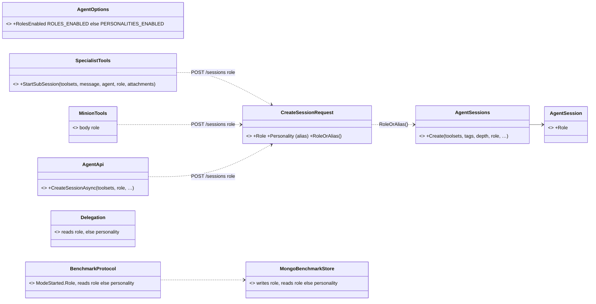
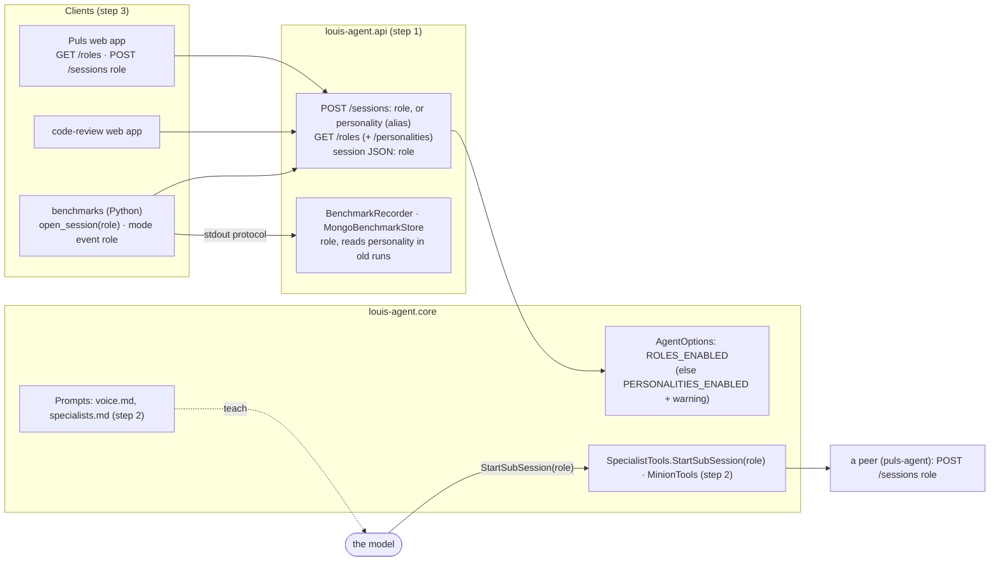

# CL14 · The public word: role: plan

> Approved 2026-10-17 (Louis, in CL13: the word **role**; "code now, the public contract after", the old names
> still accepted for a while) · Branch: `refactor/CL14-public-word-role` off `main` (CL13 merged 2026-10-17, PR #59) ·
> TODO: *CL14 The public word: role* under *Tooling and repositories*

## Context

CL13 renamed the code: a session's mode, a specialist's role or a minion's function is a **role** (`RoleCatalog`,
`RoleLevel`). What callers see still says **personality**, and `RoleNamingTests` lists it as CL14's checklist:

- **the API:** `POST /sessions` takes `"personality"`, and the session's JSON returns it; `GET /personalities`; the
  error texts ("Unknown personality …"); the log line (`· personality puls-cook`);
- **the model:** `StartSubSession(toolsets, message, agent, personality, attachments)`, in its tool schema and in the
  prompts that teach it (`agent/puls/voice.md`, `toolsets/specialists.md`); the voices' headings (`# Puls - Personality`);
- **settings:** `PERSONALITIES_ENABLED` (core, both Puls compose services, `config/.env.example`, `SETUP.md`);
- **the clients:** the web apps (`AgentApi.CreateSessionAsync(personality)`, Puls's language menu reads
  `GET /personalities`, `Delegation` reads a call's `personality`); the benchmarks (`client.open_session(personality=…)`,
  the `mode` event's `personality`, `stream.py` reading the call's argument, the stored runs' `personality` field,
  the settings' `personalities_enabled`);
- **the docs** that describe them.

Every caller is in this repo and ships with it, so the old names matter in three places only: **recorded data**
(benchmark runs in MongoDB, the stream fixture, histories with old tool calls), **a client one deploy behind** (a browser
holding the previous Puls app), and **a setting someone already wrote** (`PERSONALITIES_ENABLED` in a `config/.env`).

## Design

**Write the new word, read both.** Everything this repo writes says `role`; everything that reads what someone else
wrote accepts `personality` too:

| Where | Writes | Also accepts (until the TODO line removes it) |
|---|---|---|
| `POST /sessions` body | — | `role`, and `personality` when `role` is absent; both, differing: `400` |
| Session JSON (`POST`/`GET /sessions`, a sub-session's entry) | `role` | — (readers below fall back) |
| `GET /roles` | `{ default, agent, specialists, minions }` | `GET /personalities`, the same body |
| `ROLES_ENABLED` | — | `PERSONALITIES_ENABLED` when `ROLES_ENABLED` is unset, with a warning at start-up |
| `StartSubSession(…, role, …)` | the model's argument | nothing: the schema is what the model reads; old tool calls in a history stay as they were (append-only, ADR 0008) |
| `SpecialistTools` / `MinionTools` → a peer | `"role"` in the body | reads the peer's `role`, else `personality` |
| `Delegation` (web), `stream.py` (benchmarks) | — | a call's `role`, else `personality` (old transcripts, the fixture) |
| Benchmark protocol `mode` event, stored mode | `role` | `personality` (runs recorded before CL14) |
| Benchmark settings | `roles_enabled` | old runs keep their key; the screen shows what's stored |

**The model's word changes at once**, in one step with its golden files: a tool's parameter is a contract with the
model, and it reads only the current schema. A chat open across the deploy sees a changed tool list, the known
limitation 9 (FX4): start a new chat, as after any tool change.

**What isn't renamed:** the files `voice.md` (a mode's voice is its voice); accepted ADRs and past plans and feature
docs (history); F21's name (*Personalities*, a feature that shipped under that name).

**The aliases go later**, in a TODO line written by step 4: once a deploy has passed and `config/.env` files say
`ROLES_ENABLED`, `personality` on `POST /sessions`, `GET /personalities` and `PERSONALITIES_ENABLED` are removed;
the readers of recorded data keep their fallback for good.

**Reuse before building:** no package; `System.Text.Json`'s optional properties and the existing request record carry
the alias, and `RoleNamingTests` is extended rather than a new mechanism.

### Names (new, renamed, aliased)

| Name | Where | Kind | Step |
|---|---|---|---|
| `CreateSessionRequest.Role` (+ `Personality`, the alias) | `src/louis-agent.api/Program.cs` | request record | 1 |
| `AgentSession.Role`, `AgentSessions.Create(…, role, …)` | `src/louis-agent.api/AgentSessions.cs` · `LouisAgent.Api` | renamed | 1 |
| `GET /roles` (+ `GET /personalities`) | `src/louis-agent.api/Program.cs` | endpoint | 1 |
| Session JSON `role` | `src/louis-agent.api/Program.cs` | field | 1 |
| `ROLES_ENABLED` (+ `PERSONALITIES_ENABLED`), `LogMessage.RolesSettingRenamed` | `louis-agent.core/Config/AgentOptions.cs`, `Messages/` | setting, message | 1 |
| `ErrorMessage.UnknownRole`, `RoleNameInvalid` texts: "Unknown role …", "… isn't a role name …" | `louis-agent.core/Messages/` | text | 1 |
| The log line `· role puls-cook` | `louis-agent.core/Hosting/AgentEngineFactory.cs` | text | 1 |
| `SpecialistTools.StartSubSession(…, role, …)`; the body's and the reply's `role` | `louis-agent.core/Tools/Agents/` · `LouisAgent.Core.Tools.Agents` | tool parameter | 2 |
| `MinionTools`' body `role` | `louis-agent.core/Tools/Agents/` | field | 2 |
| `agent/puls/voice.md`, `toolsets/specialists.md`; the voices' headings `# … - Voice` | `louis-agent.core/Prompts/` | prompts | 2 |
| `AgentApi.CreateSessionAsync(…, role, …)`, `Delegation` | `src/louis-agent.web.shared/` · `LouisAgent.Web.Shared` | renamed, reads both | 3 |
| Puls's language menu: `GET /roles` (else `/personalities`) | `src/louis-agent.puls/Pages/ChatPage.razor` | client | 3 |
| `ModeStarted.Role`, `Mode.Role`, the store's `role` field | `src/louis-agent.api/Services/Benchmarks/` · `LouisAgent.Api.Services.Benchmarks` | renamed, reads both | 3 |
| `BenchmarkSettings`' `roles_enabled` | same | key | 3 |
| `client.open_session(role=…)`, `ROLE`, the `mode` event's `role`, `stream.py` | `benchmarks/` | Python | 3 |
| Compose and `.env.example`: `ROLES_ENABLED` | `docker/`, `config/` | settings | 3 |
| `RoleNamingTests` (core: no exceptions left) and `ApiRoleNamingTests` (the API's names, the aliases listed) | `tests/…` | tests | 1–2 |

### Interfaces

```csharp
// API: the request takes the new word, and the old one for a client one deploy behind
internal sealed record CreateSessionRequest(…, string? Role = null, [Obsolete] string? Personality = null, …)
{
    // role wins; personality only when role is absent; both, differing: a 400 naming the two
    public string? RoleOrAlias();
}
public sealed class AgentSession { public string? Role { get; } … }
public AgentSession AgentSessions.Create(IEnumerable<string>? toolsets = null, UsageTags? tags = null, int depth = 0,
    string? role = null, UserPlace? place = null, string? llm = null, string? tool = null);
// GET /roles  → { "default", "agent": [...], "specialists": [...], "minions": [...] }   (GET /personalities: the same)

// Core: the model's tool and the setting
public Task<string> SpecialistTools.StartSubSession(string toolsets, string message, string? agent = null,
    string? role = null, string? attachments = null, CancellationToken cancellationToken = default);
public IReadOnlyList<string> AgentOptions.RolesEnabled { get; set; }   // ROLES_ENABLED, else PERSONALITIES_ENABLED

// Web: the client
public Task<string> AgentApi.CreateSessionAsync(IEnumerable<string> toolsets, string? role = null, …);
```

```python
# Benchmarks
client.open_session(toolsets=…, role="puls/voice-af", …)       # sends "role"
stream.read_turn(events)["role"]                               # a call's role, else its personality
protocol.emit("mode", …, role=ROLE, …)                         # the API reads role, else personality
```



### Architecture: who speaks the word



### Communication: Puls hands a meal to the cook, after CL14

```mermaid
sequenceDiagram
    autonumber
    participant W as Puls web app
    participant A as puls (API)
    participant M as the model
    participant T as SpecialistTools
    participant P as puls-agent (API)
    W->>A: GET /roles
    A-->>W: { default, agent: [puls/voice-af, puls/voice-en], specialists, minions }
    W->>A: POST /sessions { toolsets, role: "puls/voice-af" }
    A-->>W: { session_id, role: "puls/voice-af", … }
    W->>A: a meal question
    A->>M: the turn (StartSubSession's schema says role)
    M->>T: StartSubSession(toolsets: web, role: puls-cook, message)
    T->>P: POST /sessions { toolsets: [web], role: "puls-cook", depth: 1 }
    P-->>T: { role: "puls-cook", toolsets: [web, shops] }
    Note over W,P: An older client's { personality: … } is still read; GET /personalities still answers
```

## Steps (one commit each, test first, stop after each)

| # | Step | Test first | Concept (GOAL skill) |
|---|---|---|---|
| 0 | This plan, the TODO line, the plans index | docs only | Design before code (skill 18) |
| 1 | **The API and the setting:** `CreateSessionRequest.Role` (+ alias), `AgentSession.Role`, `GET /roles` (+ `/personalities`), the session JSON's `role`; `ROLES_ENABLED` (+ `PERSONALITIES_ENABLED` and its warning); the error texts and the log line | API: `role` opens a cook; `personality` still does; both differing is a `400`; the JSON says `role`; `GET /roles` and `/personalities` answer alike. Core: `ROLES_ENABLED` read, the old name read with a warning, the new one winning. **`ApiRoleNamingTests`**: the API's names say role, but for the aliases | A contract changed without breaking its callers: expand, then contract (skill 18) |
| 2 | **The model's word:** `StartSubSession(…, role, …)`, the bodies and replies `SpecialistTools` and `MinionTools` exchange with a peer; `voice.md` and `specialists.md`; the voices' headings | `RoleNamingTests` with no exceptions (fails until the parameter is renamed); `SpecialistToolsTests`: the body sends `role`, a peer's `personality` reply still read; the golden files regenerated and reviewed | A tool's schema is a contract with the model (skills 4, 7) |
| 3 | **The clients:** the web apps (`AgentApi`, Puls's menu on `GET /roles`, `Delegation`), the benchmarks (Python, the protocol's `mode` event, the store reading old runs, `roles_enabled`), compose and `.env.example` | web: `Delegation` reads `role` and an old transcript's `personality`; API: a `mode` event with `personality` and one with `role` both stored as `role`; an old run read back; Python: `open_session(role=…)` sends `role`, `read_turn` reads both (the fixture keeps the old word) | Recorded data outlives a rename: read both forever (skill 12) |
| 4 | **The docs:** `AGENT_COMMUNICATION.md`, `SETUP.md`, `docs/CLAUDE.md`, the API's and Puls's project docs, the architecture (05, 06, the glossary's *Role*), `README.md`; then finishing: the TODO's CL14 line goes, a line to remove the aliases comes, the CHANGELOG | links checked | Docs follow the code |

## Verification

- Each step: `dotnet build louis-agent-solution.sln`, `dotnet test` on what it touches, `python -m unittest discover
  benchmarks` in step 3; the whole solution before the PR.
- Step 2 is the only one whose golden files change: the tool's parameter, its description, and the two prompts.
- After steps 1 to 3: rebuild Puls and the API image. A free hand check: Puls's language menu still lists Afrikaans and
  English (`GET /roles`); a cook session opened with `role` reports `role` and `web, shops`; one opened with
  `personality` still opens. The admin portal still shows the runs recorded before CL14 with their roles.
- A paid cook check isn't needed (nothing the model does changes but a parameter's name); Louis decides.

## Risks

- A chat open across the deploy sees a changed tool list: on Haiku 5.5 a 400, known limitation 9 (FX4); start a new
  chat.
- A `config/.env` with `PERSONALITIES_ENABLED` keeps working, with a warning, until the alias goes.
- The old runs in MongoDB keep `personality`: every reader falls back, and a test reads one.

## Approved during the build

- **2026-10-17, review of PR #60: the setting is read raw, and the old name always warns.** `ROLES_ENABLED=` (empty:
  every role on) counted as unset, since `Get` turns a blank into null, so an old `PERSONALITIES_ENABLED` beside it
  won; `RolesSetting` now reads both raw (`AnEmptyRolesEnabled_TurnsEveryRoleOn_EvenWithTheOldNameSet`). And Puls's
  compose copies the old name into `ROLES_ENABLED`, so the warning never showed: rather than drop that nested default
  (compose would then always set `ROLES_ENABLED` to its default list and silently ignore an old `.env`), core warns
  whenever the old name is set, `RolesSettingIgnored` when the new one wins (`env_file` passes `config/.env` into the
  containers, so they see both).
- **The hand check (free, 2026-10-17), recorded:** Puls's language menu: `GET /roles` on `puls` lists
  `puls/voice-af, puls/voice-en`; a cook opened on `puls-agent` with `role` and with `personality` both report
  `"role":"puls-cook"` and `web, shops`; both, differing, is a `400`; run `fc7f8ecfdc87` (stored before CL14, its modes
  say `personality` in MongoDB) comes back from the portal's API with each mode's `role`.

---
[Plans](README.md) · Previous: [CL13 Skills by role](CL13-skills-by-role.md)
