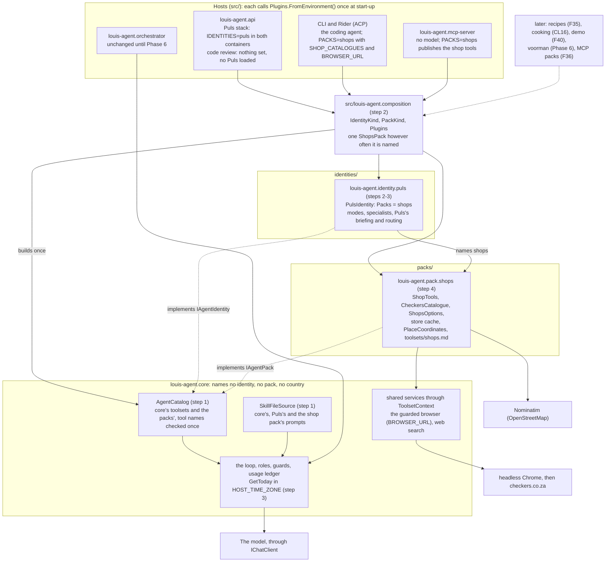
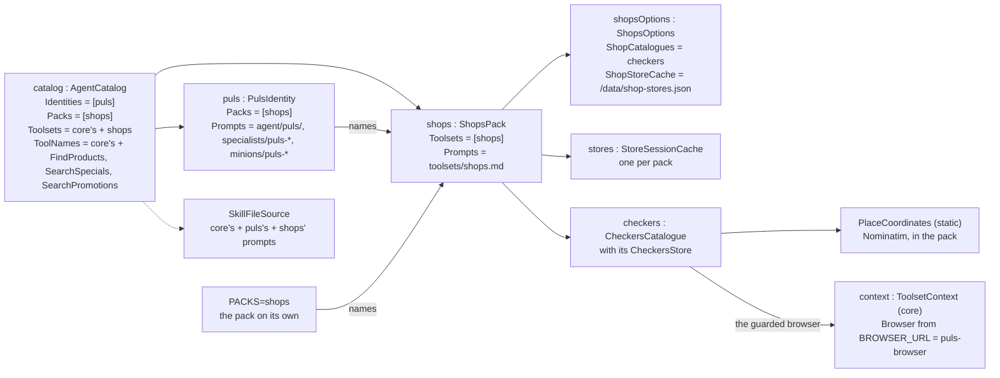
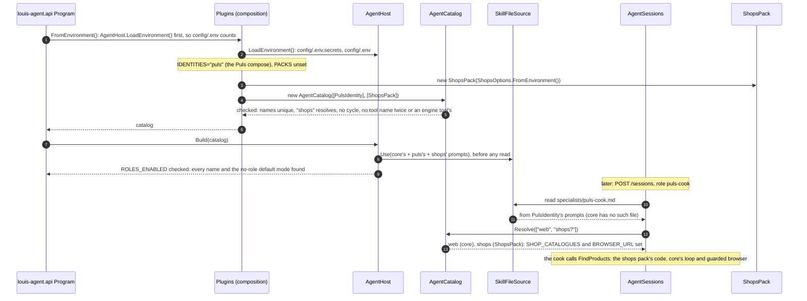

# CL15 · The cut: engine, identities and packs: plan

> Approved 2026-10-19 as Phase 2 of [the platform plan](platform.md) (its section *Phase 2 · CL15 The cut: engine,
> identities and packs*, copied here as approved, with its diagrams, namespace map and folder trees) · TODO: *CL15
> The cut* · Branch: `refactor/CL15-engine-identities-packs` off `main` (PR #70 merged 2026-10-19) · ADRs:
> [0027](../adr/0027-engine-identities-and-packs.md), [0028](../adr/0028-packs-stay-convertible-to-mcp.md)

Branch `refactor/CL15-engine-identities-packs`. Before step 0 this section is copied, as Louis approved it, into
`docs/plans/CL15-engine-identities-packs.md` on that branch, with its four diagrams, namespace map and folder trees;
*Approved during the build* goes in that file, never in `platform.md` (Phase 0 step 1). The phase starts only after
Louis has read the F32 to F34 write-up (*Before Phase 2: the F32 to F34 write-up*, at the end of Phase 1), and it is
done only when he has read its own write-up, written by Claude (step 5). GOAL skills: 4, 18 and 3. Paid runs: one
cook run, in step 3, on Louis's go.

Built before F35 (recipe sources), which then builds a recipes pack, `packs/louis-agent.pack.recipes`.

An independent review of the earlier CL15 draft found it wrong in places, fixed here: Puls also lives in core's shared
guides and in text the model reads; the golden file never pinned a Puls session; `AgentHost.Start` doesn't exist (the
hosts call `Build` and `BuildToolHost`); a frozen static registry can't work as the classes stand, and only 5
production files call `ToolsetCatalog`, not 19; `ROLES_ENABLED` is never checked at start-up; `CompositeFileProvider`
needs its own package; the town geocoder belongs to places in the end, not to shops (the places feature takes it,
behind an `IGeocoder` seam). The checks of this plan's first draft added
more, also fixed here: the geocoder is used only by the Checkers store lookup (`ShopCatalogueFactory.cs:37`), so it
moves with the shops pack now and the places feature takes it later; `GetToday` and the API default to South African
time; core's tests have nowhere to read roles from once Puls's files leave, unless they embed their own; a setting made
only in `config/.env` would be read too late; there are three goldens, not two; and F30's minions, built and never
used, sit in core with Puls's minion roles among them, so the cut moves those too (question 3: keep).

**Why the composition project and `PACKS` are built now.** The challenge recommended deferring the composition project,
`PACKS`, the demo identity and the invoice pitch until a second real consumer exists. They stay, because Louis asked
for packs pluggable on their own ("say the agent needs it it should be [pluggable]") and for a sales playground ("demos is
for selling, the playground"). Phase 4 carries the same line for the demo identity and the invoice pitch.

## Context

louis-agent.core is meant to be the engine every identity runs on, yet today it holds Puls:

| Puls in core today | Where |
|---|---|
| Puls's modes | `Prompts/agent/puls/voice.md`, `voice-af.md`, `voice-en.md` |
| Puls's specialists and minions | `Prompts/specialists/puls-{analyst,cook,historian,reader,researcher}.md`; F30's `Prompts/minions/puls-minion.md` and `puls-minion-web-price-lookup.md`, never given to a session (`docs/features/F30-local-web-peer.md:3`; question 3) |
| **Puls's protocol in the shared guides** | `Prompts/toolsets/specialists.md:26-96` (the briefing with the Afrikaans labels *Vir / Wil hê / Vir hoeveel*, the mood rule and its `[stemming: af]` switch at 68-70, the `puls-cook` routing row at 79, the roles waiting for validation at 81-88, `puls-analyst` at 90-92) and `:127-139` (the Afrikaans relay lines, the footer naming `puls-cook`); `toolsets/minions.md:25,29-31` (the Puls minion table and its Malmesbury example). The two guides are about 13 KB together (10,470 and 2,803 bytes), and every identity that uses specialists reads the first |
| **Text the model reads that names Puls or assumes South Africa** | `ShopTools.cs:29,40,51` ("when Puls gave no place"), `ToolMessage.cs:213,225,228,796` (`puls-searxng`, `puls-browser`, `puls-minion-web-price-lookup`), `MinionTools.cs:78` (`puls-minion-web-price-lookup`), `ClockTools.cs:18-26` (`GetToday`: "South Africa unless they shared another time zone", SAST by default) |
| **South Africa in core's defaults** | `GetToday`'s fallback zone (`ClockTools.cs:18-20,26`) and the API's (`src/louis-agent.api/Program.cs:216`, `"Africa/Johannesburg"`); `VerifyQuote` matches prices in rand only (`WebTools.cs:474-489`) |
| The shops toolset (Checkers) | `Tools/Shops/` (15 files, 835 lines), `Prompts/toolsets/shops.md`, the `shops` entry in `Agent/ToolsetCatalog.cs:73-80`, the coding agent's routing row (`agent/louis-agent/voice.md:62`) |
| Shop state and settings | `ToolsetContext.StoreSessions` (`ToolsetContext.cs:21`), `AgentOptions.ShopCatalogues` / `ShopStoreCache` |
| Shop texts | 17 `ToolMessage` and 8 `LogMessage` members (`Shop…`); the shop code also uses core's shared `ErrorWithReason` |
| The town geocoder | `Tools/Shops/PlaceCoordinates.cs` (OpenStreetMap's Nominatim, South Africa only), with `PlaceUnavailableException.cs`; only the Checkers store lookup uses it (`ShopCatalogueFactory.cs:37`, caught at `CheckersStore.cs:54`): the seed of the places capability |

Outside core, Puls also sits in the API host's benchmarks (`Services/BenchmarkCatalog.cs`, the `puls_benchmarks`
database, `src/louis-agent.api/Config/AdminOptions.cs:16`) and the shared web project's image allow-list
(`src/louis-agent.web.shared/Markdown.cs:41`, Checkers' image host); those stay where they are in Phase 2 and are
listed so nobody is surprised.

So an invoice clerk or the code-review agent would carry Puls's cook, its shops and its Afrikaans briefing without
using them, and every Puls feature (F35 recipes, places, businesses) would land in core.

## One catalogue object, built once

An earlier draft planned a frozen static registry, to avoid "rewriting 19 files". That count was wrong:
`grep -rl ToolsetCatalog --include=*.cs` finds 20 files, and **only 5 production files call it** (`AgentHost`,
`AgentEngineFactory`, `AgentBuiltTools`, and the API's `Program.cs` and `AgentSessions.cs`); the rest are
`ToolsetCatalog.cs` itself, two that name it only in comments (`AgentEngine.cs:121`, `ToolsetDefinition.cs:22`) and 12
test files. And the statics can't be filled first and frozen after: `ToolsetCatalog.All`, `ToolNames` and
`SkillFileSource.EmbeddedFiles` are built the moment they are first read (`ToolsetCatalog.cs:26,124`,
`SkillFileSource.cs:15,18`). So:

- **Toolsets go through an object.** `AgentCatalog` is built once by the host from the identities and packs, checks
  them (a toolset, role or prompt path in two places, a name that resolves to nothing, a `Requires` cycle: start-up
  error), and is passed down from `AgentHost` to `AgentEngineFactory` and the API's sessions. `ToolsetCatalog` keeps
  core's own list. Core's tests build a catalogue with a `FakePack` and no global state.
- **Tool names go through the catalogue too.** Today `ToolsetCatalog.ToolNames` reflects only core's static `All`
  (`ToolsetCatalog.cs:124-128`), so once step 4 takes shops out of it, `CreateTool` would accept an agent-built
  `FindProducts` (`AgentBuiltTools.cs:71`), and an engine with shops would then skip it with a warning
  (`AgentBuiltTools.cs:125-129`) while an engine without shops ran it as the agent's own script. So `ToolNames` moves
  to `AgentCatalog`, built from one private `NamesOf`, and `AgentCatalog.ToolMethodsOf(ToolsetDefinition)` becomes the
  one public rule for which methods are tools, with `AgentCatalog.FunctionOf` building each tool's `AIFunction` exactly
  as `ToolRegistry.AddPublicMethods` does (`ToolRegistry.cs:44-58`, internal today), so the engine and step 4's
  convertibility test use the same rule. `AgentBuiltTools` is built inside `AgentEngine` (`AgentEngine.cs:111`), so
  `AgentEngine` gains one optional init property, `ReservedToolNames` (default `AgentCatalog.CoreOnly.ToolNames`), which
  `AgentEngineFactory` sets and `AgentBuiltTools` reads as it reads `SkillsDirectory` (`AgentEngine.cs:75,111`); the
  constructor, the loop and the orchestrator's direct `new AgentEngine(...)` (`src/louis-agent.orchestrator/Program.cs:51`)
  stay as they are. `ToolNamesOf` and `ToolsetOf` exist only for F30's minions (their only production callers are
  `AgentEngineFactory.cs:113` and `AgentSessions.cs:163`, and the test `MinionToolsTests.cs:254-256` calls `ToolsetOf`),
  and they move to `AgentCatalog` with `ToolNames`, so a pack's tool can be handed to a minion too. A tool name in two
  toolsets, or one that takes an engine tool's name (`ExecuteSkill`, `GetToday`, `CreateSkillFile`, `ReloadSkills`,
  `CreateTool`, `ListAgentTools`, which the engine registers itself, `AgentEngine.cs:141,143,336-342`), becomes a
  start-up error. Today a duplicate shows only when the
  first session that names the profile builds its engine (`ToolRegistry.cs:31-36`). All 123 pinned tool names are
  unique, case ignored (`ModelRequestSnapshot.json`), so the check passes on today's code.
- **Prompts stay one static reader** (ADR 0018: what is embedded is built in). `SkillFileSource` becomes lazy and reads
  core's prompts plus the identities' and packs' through one `CompositeFileProvider`. Only `AgentHost.Build(catalog)`
  and `BuildToolHost(catalog)` call `SkillFileSource.Use`, with the catalogue's prompts, before the first read, and so
  does each test assembly's `[SetUpFixture]`. Prompts already added are skipped, so a host or test that builds twice is
  fine; a new identity or pack added after the first read throws `AgentCatalogException`. Core's tests load **test
  roles** embedded in `tests/louis-agent.core.tests/Prompts/` (a specialist with a `toolsets:` header, a language mode
  with its shared voice), because once Puls's files leave, core embeds no specialist and no language mode
  (`SkillFileSource.cs:15` reads only core's assembly, and `RoleCatalog` lists roles only through it). The API's tests
  reference `louis-agent.identity.puls` and call `Use` with Puls's prompts in their own `[SetUpFixture]`.
- **The packages:** `CompositeFileProvider` ships in `Microsoft.Extensions.FileProviders.Composite` (MIT; 10.0.13, the
  engine research's reading of its nuspec), a new reference beside core's `FileProviders.Embedded` 10.0.13
  (`louis-agent.core.csproj:25`). `SkillFiles.Guide`, which every guide path uses, becomes public with its class
  (both internal today, `SkillFiles.cs:4,29`), so a pack can name its guide.
- **Start-up checks what it can:** every `ROLES_ENABLED` name must resolve, or the host stops with the names it didn't
  find. Today an unknown name is dropped silently, because it simply never matches (`AgentHost.cs:458-462`), so a Puls
  missing from `IDENTITIES` would only show as a 400 at the first chat. The no-role default mode, `louis-agent/voice`
  (`RoleCatalog.cs:28`), is checked the same way: today a session that names no role is given it before any check
  (`AgentHost.cs:434-441`), and a missing file is skipped (`AgentHost.cs:362,467`), so a catalogue without it would open
  such a session with no mode at all, silently. The default is core's own until CL17 moves it to the coding identity,
  so the check stops nothing today and catches that move; `ROLES_ENABLED` still doesn't narrow the default (CL17's, as
  said below).
- **Settings are read only after `config/.env` is loaded:** today `config/.env` and `.env.secrets` are loaded inside
  `AgentHost.Build` and `BuildToolHost` (`AgentHost.cs:122,148`), after which `IDENTITIES`, `PACKS` and
  `SHOP_CATALOGUES` would be too late, so the composition's `Plugins.FromEnvironment()` calls
  `AgentHost.LoadEnvironment()` (`AgentHost.cs:31`) before it reads a setting. Loading twice is harmless: a variable
  already set wins (`AgentHost.cs:55-58`, `overwriteExistingVars: false`).

*Alternative considered: one Puls project with everything.* Smaller, but Checkers and recipes would then be Puls's
alone, which Louis ruled out.

*Considered and left for CL17: the identity naming its default mode* (the engine research's suggestion). A session that
names no role opens the coding agent's `louis-agent/voice` (`RoleCatalog.cs:28`), and `ROLES_ENABLED` doesn't narrow
that default (`AgentHost.cs:434-441`). Moving the default to an identity belongs with the coding agent becoming one.

## F30's minions: kept in core, and what the cut does with them

Louis answered question 3 with *keep* on 2026-10-19: "no we are not removing it, we still need to run test on it and
can be focused on after this plan is implemented". F30 built a third level of delegation: a specialist hands one task
and one of its own tools to a minion on a cheap model (ADR 0021). It took 23 commits (22 scoped `f30` and the merge of
PR #51, `dab9fdc`, in the local checkout), and no session has been given it yet: its doc says "built, not in use
(2026-10-17): no session is given `minions` until F31 measures it" (`docs/features/F30-local-web-peer.md:3`), and the
cook's role declares only `shops?` (`specialists/puls-cook.md:1-3`). So the minions stay in core as a specialist's
toolset: `MinionTools` (`Tools/Agents/MinionTools.cs`, 143 lines), the `minions` toolset (`ToolsetCatalog.cs:105-110`)
and its guide `Prompts/toolsets/minions.md`, level 2 (`RoleLevel.Minion`, `RoleLevel.cs:16-17`) and `MINION_LLMS`
(`AgentOptions.cs:136-141,242`). Testing them is not on this plan's phases or on Puls's track: it is a line in *Later*,
after this plan. The cut moves only what names Puls:

- **Step 1** moves `ToolNamesOf` and `ToolsetOf` (`ToolsetCatalog.cs:130-142`) to `AgentCatalog` with `ToolNames`: a
  minion's one tool (`AgentEngineFactory.cs:113`) and the toolset that builds it (`AgentSessions.cs:163`) then come
  from the catalogue, so a pack's tool can be handed to a minion too. `MinionToolsTests.cs:254-256` call
  `AgentCatalog.CoreOnly.ToolsetOf`.
- **Step 3** moves Puls's minion prompts, `Prompts/minions/puls-minion.md` and `puls-minion-web-price-lookup.md`, into
  Puls's project with its other prompts; splits Puls's minion table and its Malmesbury example out of
  `toolsets/minions.md` (`:25,29-31`) into Puls's project; and takes the Puls name out of `StartMinion`'s description
  (`MinionTools.cs:78`) and `ToolMessage.cs:796` (`MinionRoleInvalid`), the fourth Puls text. Core's test roles add a
  minion base and a minion role, so they cover every level.
- **Step 5** adds `MinionTools.cs:133`'s comment ("Puls's turn") to the comments that stop naming a product.
- **Settings stay:** `ROLES_ENABLED`'s Puls default keeps `puls-minion-web-price-lookup` in both containers
  (`docker/docker-compose.puls.yml:40,82`), and `MINION_LLMS` stays (`:81`).
- **Phase 6** treats `MinionTools` as it treats `SpecialistTools`: A0 fixes F30's 6 vs 16 minions line, A2 makes
  `MinionTools` a thin caller of the delegation function, and A3 counts minions per turn tree, 16 per turn
  (`MinionTools.cs:31,136-142`).

## South Africa out of core's defaults (step 3)

Core's own text and defaults should name no country, so an invoice clerk in another country gets its own time:

- `GetToday`'s default zone (`ClockTools.cs:18-20,26`, SAST) and the API's fallback zone for the first turn's place
  line (`src/louis-agent.api/Program.cs:216`, `"Africa/Johannesburg"`) both read one new setting, `HOST_TIME_ZONE` (an
  IANA name; default: the host's own zone), held as `AgentOptions.HostTimeZone` and passed to `ClockTools`, which the
  engine builds (`AgentEngine.cs:143`). Puls's compose sets it to `Africa/Johannesburg`, and `config/.env.example`
  documents it.
- `GetToday`'s description names no country: "where the user is: the host's time zone unless they shared another"
  (today "South Africa unless they shared another time zone", `ClockTools.cs:22-23`). `ModelRequestSnapshot.json` and
  the Puls golden show the change, reviewed. `UserPlace`'s comment ("null for South African time", `UserPlace.cs:10`)
  follows.
- `VerifyQuote`'s rand-only price matcher (`WebTools.cs:474-489`) stays in core this phase; it becomes a small cleanup
  on the TODO, *VerifyQuote's prices in the host's currency* (`HOST_CULTURE`).
- Step 2's ratchet covers **core's model-visible text** (embedded prompts, `[Description]` attributes, `ToolMessage`
  members): no `puls`, no Afrikaans briefing label, no "South Africa". It follows the ratchet `ArchitectureTests`
  already uses for CL1 (`ArchitectureTests.cs:21-27`): a new entry fails, and so does an entry that no longer holds,
  so the list can only shrink. Core's comments and examples are made to name no product in step 5.
- "The game means the Springboks or Bafana" (`TODO.md:136-137`) is not done anywhere today: no prompt in core names
  either team. It goes to Puls's track (*Local lookups*).

## The shops pack: `packs/louis-agent.pack.shops`

`Tools/Shops/` moved whole (`IShopCatalogue`, Checkers' provider, `ShopTools`, and the town geocoder `PlaceCoordinates`
with `PlaceUnavailableException`, since only the Checkers store lookup uses them), `shops.md`, `ShopsOptions`
(`SHOP_CATALOGUES`, `SHOP_STORE_CACHE`, same names), its `ShopToolMessage` / `ShopLogMessage` (the `Shop…` members, word
for word; `LogMessage.ShopAreaUnavailable`, which the geocoder logs, `PlaceCoordinates.cs:67`, becomes a
`ShopLogMessage` member with the rest). Once those enums leave core, neither guard on message enums sees them: core's
`MessageEnumTests` reads only core's assembly (`MessageEnumTests.cs:11`), and `HostMessageEnumTests` only
`src/*/Messages` and `tools/*/Messages` (`HostMessageEnumTests.cs:10-18`), so step 4 extends the second to `packs/` and
`identities/`. The store cache, today a property of `ToolsetContext` (one per engine factory,
`ToolsetContext.cs:21`), becomes the pack's own. `BROWSER_URL` and the guarded browser stay core's shared services,
reached through `ToolsetContext` (`ToolsetContext.cs:30-31`): the shops toolset loads only when both `SHOP_CATALOGUES`
and `BROWSER_URL` are set (`ToolsetCatalog.cs:75-77`), so every test and hand check that turns shops on sets `PACKS=shops`,
`SHOP_CATALOGUES` **and** `BROWSER_URL` (a running headless Chrome); without `BROWSER_URL` the toolset is listed as
missing that setting. The pack names no identity: the `area` description loses "when Puls gave no place"
(model-visible, reviewed in the golden). The coding agent's routing row for shops (`agent/louis-agent/voice.md:62`)
moves into the pack's guide, so core's prompt routes to no toolset that core doesn't have.

Core keeps no Nominatim and no South Africa. When the places feature comes (Puls's track), it takes the geocoder into
the places pack, behind an `IGeocoder` seam in core that packs reach as a shared service through `ToolsetContext`, so
shops keeps naming places by name only.

The pack holds one provider, Checkers, which took 45 commits, 16 of them fixes, and covers 1 of the 4 supermarket chains
in Malmesbury (Part 2, *How a local shop becomes a provider*). More shops come as rows in *Sources as data* (Puls's
track), and the Shoprite, Pick n Pay and Woolworths providers wait for it.

## Puls: `identities/louis-agent.identity.puls`

`PulsIdentity` (packs: `shops`), Puls's modes and specialists, and **Puls's protocol split out of the shared guide**:
`toolsets/specialists.md` keeps the mechanism (how to start, continue and report), and Puls's briefing labels, mood
rule, routing rows, waiting roles and Afrikaans relay lines move to Puls's own `agent/puls/voice.md`, the routing part
every Puls chat loads (ADR 0019). That changes what the model reads, so it needs **one paid cook run, on Louis's go**
(step 3). The web app stays `src/louis-agent.puls`: the identity project is what the agent loads, the web app what the
user sees. Both of Puls's agent containers (`puls` and `puls-agent`) get `IDENTITIES=puls` from the Puls compose.
`config/.env.example` documents `IDENTITIES` and `PACKS` and leaves them unset, because every compose file passes
`config/.env` to its containers (`env_file`, `docker/docker-compose.yml:9-14`, `docker/docker-compose.puls.yml:8-14`),
so `IDENTITIES=puls` set there would load Puls into the code-review stack too.

**Not in this phase:** the cook as a reusable role (CL16, with its own frame mechanism: the identity's frame is loaded
before a pack's role), the coding agent as its own identity (CL17), Paymo and DevOps (reconciled with CL17), the
orchestrator (Phase 6), the demo (Phase 4), and Puls's checks, which Phase 3 rewrites as simulations. Also not here,
each with its phase: the guards as a decorator around every tool, so calls served over MCP get them too, and
`BuildToolHost` taking a toolset list (Phase 8, F36); a per-tool effects declaration, `ToolEffect` (Phase 7); one
`TurnContext` with the place as a turn input (Phase 6, A4); the MCP client (Phase 8); `VerifyQuote`'s prices in the
host's currency (a small cleanup on the TODO).

## Architecture: what runs after the cut

Solid arrows exist after step 4. A dashed arrow either marks an interface a class implements, which also exists after
step 4, or leads from what comes later, each with its phase or feature.



## Folder structure: the projects before and after

Two new top-level folders, `identities/` and `packs/`, beside `louis-agent.core/`; each new project gets its test
project in `tests/`, named after it, and a line in `louis-agent-solution.sln`. The Dockerfiles copy the whole repo
(`COPY . .`, for example `docker/Dockerfile.api:3` and `docker/Dockerfile.puls:4`), so they need no change; only
`docker-compose.puls.yml` gains `IDENTITIES=puls` and `HOST_TIME_ZONE=Africa/Johannesburg` in both agent containers,
and `config/.env.example` documents `IDENTITIES`, `PACKS` and `HOST_TIME_ZONE`. Only the folders that change are
shown.

**Today (`main`)**

```text
louis-agent/
├── louis-agent-solution.sln
├── louis-agent.core/                      the engine, holding Puls
│   ├── Agent/                             ToolsetCatalog names "shops" and "minions"; ToolsetContext.StoreSessions
│   ├── Config/                            AgentOptions: SHOP_CATALOGUES, SHOP_STORE_CACHE, MINION_LLMS
│   ├── Hosting/AgentHost.cs               ROLES_ENABLED names never checked; config/.env loaded inside Build
│   ├── Messages/                          ToolMessage, LogMessage: 25 Shop… members, 4 naming Puls, 7 Minion…
│   ├── Prompts/
│   │   ├── agent/louis-agent/             the coding agent's modes (stays until CL17); voice.md:62 routes to shops
│   │   ├── agent/puls/                    Puls's modes
│   │   ├── specialists/puls-*.md          5 Puls specialists, the cook among them
│   │   ├── minions/puls-minion*.md        F30, never given to a session
│   │   ├── shared/principles.md
│   │   └── toolsets/                      specialists.md and minions.md hold Puls's protocol; shops.md
│   ├── Sessions/                          UserPlace, SubSessionRegistry, …
│   ├── Skills/SkillFileSource.cs          reads core's assembly only
│   └── Tools/
│       ├── Agents/MinionTools.cs          F30
│       ├── Clock/ClockTools.cs            GetToday: South African time by default
│       └── Shops/                         13 files + Providers/ (CheckersCatalogue, CheckersStore); PlaceCoordinates
├── docker/docker-compose.puls.yml         ROLES_ENABLED's default names the minion; MINION_LLMS
├── src/
│   ├── louis-agent.api/                   one host; -p:WebApp=puls picks Puls's web app; Program.cs:216 Africa/Johannesburg
│   ├── louis-agent.puls/                  Puls's web app (stays: it is what the user sees)
│   └── louis-agent.web/                   the code-review web app
└── tests/
    ├── louis-agent.api.tests/             19 files mention Puls; 14 name Puls's roles
    └── louis-agent.core.tests/
        ├── Agent/ModelRequestSnapshot.json  pins the coding agent with every toolset (never a Puls session)
        ├── Messages/ToolMessageSnapshot.json  every ToolMessage: 17 Shop… entries, 4 Puls texts
        ├── Skills/, Hosting/, Tools/Agents/, …  10 files name Puls's roles (126 lines)
        └── Tools/Shops/                   shop tests, PlaceCoordinatesTests, Fixtures/nominatim-malmesbury.json,
                                           Providers/Fixtures/ (Checkers' recorded answers)
```

**After CL15 (step by step)**

```text
louis-agent/
├── louis-agent-solution.sln               + 6 projects (steps 2, 4)
├── louis-agent.core/                      the engine: names no identity, pack or country
│   ├── Agent/
│   │   ├── IAgentIdentity.cs, IAgentPack.cs   step 1, new
│   │   ├── AgentCatalog.cs                step 1, new: core's + the packs' toolsets and tool names, checked once
│   │   ├── AgentCatalogException.cs       step 1, new
│   │   ├── AgentEngine.cs                 step 1: ReservedToolNames
│   │   ├── ToolsetCatalog.cs              step 1: core's own list, lazy; step 4 drops "shops"
│   │   └── ToolsetContext.cs              step 4: no StoreSessions
│   ├── Config/AgentOptions.cs             step 3: HOST_TIME_ZONE; step 4: no shop settings; MINION_LLMS stays
│   ├── Hosting/AgentHost.cs               step 1: Build and BuildToolHost take the catalogue and call Use; ROLES_ENABLED checked
│   ├── Messages/                          steps 3-4: no Shop… members, none naming Puls; the Minion… members stay
│   ├── Prompts/
│   │   ├── agent/louis-agent/             unchanged (CL17), but voice.md's shops row leaves (step 4)
│   │   ├── shared/principles.md           unchanged: every agent, every identity
│   │   └── toolsets/                      core's guides only: specialists.md and minions.md without Puls (step 3)
│   ├── Skills/SkillFileSource.cs          step 1: lazy, Use(identities' + packs' prompts) before the first read
│   └── Tools/
│       ├── Agents/MinionTools.cs          step 3: names no role of Puls's (:78); step 5: its comment (:133)
│       ├── Clock/ClockTools.cs            step 3: the host's time zone (HOST_TIME_ZONE)
│       └── (Shops/ gone, step 4)
├── identities/                            new: who the agent is
│   └── louis-agent.identity.puls/         step 2 (F40 adds louis-agent.identity.demo beside it)
│       ├── louis-agent.identity.puls.csproj  references core; embeds Prompts/ with a manifest
│       ├── PulsIdentity.cs                step 2; names shops in step 4
│       └── Prompts/                       step 3: moved byte for byte, plus Puls's protocol from the shared guide
│           ├── agent/puls/                voice.md (its routing, now with Puls's briefing), voice-af.md, voice-en.md
│           ├── specialists/               puls-analyst, puls-cook, puls-historian, puls-reader, puls-researcher
│           └── minions/                   puls-minion, puls-minion-web-price-lookup (F30, kept: question 3)
├── packs/                                 new: what an agent can do
│   └── louis-agent.pack.shops/            step 4
│       ├── louis-agent.pack.shops.csproj  references core; embeds Prompts/ with a manifest
│       ├── ShopsPack.cs, ShopsOptions.cs
│       ├── IShopCatalogue.cs, ShopTools.cs, … (from core's Tools/Shops/)
│       ├── PlaceCoordinates.cs, PlaceUnavailableException.cs   the town geocoder, until the places feature takes it
│       ├── Providers/                     CheckersCatalogue.cs, CheckersStore.cs
│       ├── Messages/                      ShopToolMessage.cs, ShopLogMessage.cs
│       └── Prompts/toolsets/shops.md      with the routing line from voice.md:62
├── src/
│   ├── louis-agent.composition/           step 2, new: the one list of identities and packs
│   │   ├── louis-agent.composition.csproj references core, every identity, every pack
│   │   ├── IdentityKind.cs, PackKind.cs   enums (ADR 0024)
│   │   └── Plugins.cs                     FromEnvironment(): LoadEnvironment, then FromSettings(IDENTITIES, PACKS)
│   ├── louis-agent.api/                   Program.cs: Plugins, then AgentHost.Build (step 2); HOST_TIME_ZONE (step 3)
│   ├── louis-agent.cli/                   the same (step 2): PACKS=shops works in the terminal
│   ├── louis-agent.acp-server/            the same (step 2)
│   └── louis-agent.mcp-server/            Plugins, then BuildToolHost (step 2): PACKS=shops publishes the shop tools
└── tests/
    ├── louis-agent.api.tests/             step 3: references identity.puls; a [SetUpFixture] adds Puls's prompts
    ├── louis-agent.composition.tests/     step 2: IDENTITIES and PACKS parsed, a pack named twice created once;
    │                                      step 4: the convertibility test over every PackKind
    ├── louis-agent.core.tests/            Agent/FakePack.cs, AgentCatalogTests.cs (step 1, no global state);
    │                                      Prompts/: test roles, read through a [SetUpFixture] (step 3); Tools/Shops/ leaves (step 4)
    ├── louis-agent.identity.puls.tests/   step 0's Puls golden lives here from step 2; PulsIdentityTests
    └── louis-agent.pack.shops.tests/      step 4: the shop tests, PlaceCoordinatesTests and their fixtures, moved;
                                           ShopToolMessage pinned
```

**At the end of the road** (each line is its own feature; shown so the folders above don't need moving again)

```text
louis-agent/
├── louis-agent.core/                      the loop, contracts, guards, files, web, documents, the browser, specialists,
│                                          minions, skills
├── louis-agent.session-stream/            Phase 3: the one reader of the session stream, no dependencies
├── identities/
│   ├── louis-agent.identity.puls/         CL15
│   ├── louis-agent.identity.demo/         F40: the sales playground
│   ├── louis-agent.identity.coding/       CL17: louis-agent/voice and the code-review web app
│   └── louis-agent.identity.voorman/          F39 part B: the orchestrator
├── packs/
│   ├── louis-agent.pack.shops/            CL15
│   ├── louis-agent.pack.recipes/          F35
│   ├── louis-agent.pack.cooking/          CL16: the cook role
│   ├── louis-agent.pack.places/           Puls's track, after the area guide; takes the geocoder from shops
│   ├── louis-agent.pack.git/  …dotnet/  …shell/  …paymo/  …devops/   CL17
│   ├── louis-agent.pack.triage/  …fixing/         F39 part B
│   └── (orange packs are configuration: MCP servers named in settings, F36)
├── simulations/                           F18: real tasks run end to end and scored
│   ├── louis-agent.simulation/            the harness (Phase 3)
│   ├── louis-agent.simulation.runner/     simulate {name} --repeat N (Phase 3)
│   └── louis-agent.simulations.puls/  …demo/  …voorman/   one per identity (Phases 3, 4 and 6)
└── src/                                   hosts, web apps and the composition project
```

## Interfaces

```csharp
// louis-agent.core/Agent/IAgentIdentity.cs (step 1)
/// <summary>
/// Who an agent is: its name, its modes, its own roles, and the packs it uses, by name. It has no tools of its own:
/// everything it can do comes from packs. It may hold workflow code that uses its own packs' public types (the voorman
/// identity's TriageWorkflow, Phase 6); a pack never references another pack or an identity (ADR 0027).
/// </summary>
public interface IAgentIdentity
{
    string Name { get; }                    // "puls" (F40: "demo"); its modes are agent/{name}/…
    IFileProvider Prompts { get; }          // its modes, its own specialists and its own minion roles: content,
                                            // never converted to MCP
    IReadOnlyList<string> Packs { get; }    // by name: whatever the catalogue holds as "shops" serves, our compiled pack
                                            // today or an MCP server we named "shops" (F36); the identity can't tell
}

// louis-agent.core/Agent/IAgentPack.cs (step 1)
/// <summary>
/// What an agent can do: one capability's toolsets, their guides, its own settings and state (ADR 0027).
/// A pack stays convertible to an MCP server, both ways (ADR 0028), so nothing here assumes it runs in this process:
/// - It is ready when built. Anything slow or async (a connection, a tool listing) happens before the catalogue is
///   built, once when the host starts, and its toolsets and tools never change afterwards (ADR 0006, 0008).
/// - Its tools take plain data (strings, numbers, booleans, enums, lists and records of those; a CancellationToken when
///   they wait) and return text. A failure is text with its reason, never a thrown exception: in our own loop the model
///   sees a thrown message (IncludeDetailedErrors, AgentEngine.cs:125), but served over MCP the SDK replaces it unless it
///   is an McpException (its message is kept; an McpProtocolException becomes a protocol error).
/// - Whatever a tool reads from the session (the user's place) also arrives as a parameter; no description names an
///   identity.
/// - It frames the outside data it returns and bounds its own output: calls served over MCP skip ToolCallGuards.
/// - Its guides are prose with no "## Skill:" procedures, so one can travel as an MCP server's instructions.
/// - It reads its own settings and core's shared services, names the packs it needs, and never references their code.
/// </summary>
public interface IAgentPack
{
    string Name { get; }                                // "shops": lowercase letters, digits, dashes
    IReadOnlyList<ToolsetDefinition> Toolsets { get; }  // the seam: an MCP server arrives as one more ToolsetDefinition
    IFileProvider Prompts { get; }                      // its guides (toolsets/{name}.md) and, from CL16, its roles
                                                        // (the cook, voorman-fixer); over MCP only its tools convert, and
                                                        // a role runs with the identity that loads it (ADR 0028, rule 8)
    IReadOnlyList<string> Requires { get; }             // other packs, by name: cooking requires "recipes"
}

// louis-agent.core/Agent/ToolsetDefinition.cs: shape UNCHANGED in CL15, two comments sharpened
public sealed record ToolsetDefinition(
    string Name,                                                  // what sessions, role headers ("shops?") and GET /toolsets name
    string Description,
    string? GuideFile,                                            // a path in core's or the pack's Prompts
    Func<ToolsetContext, IReadOnlyList<string>> MissingSettings,  // why it can't load here (F36 adds "unreachable at start-up")
    Func<ToolsetContext, IReadOnlyList<object>>? CreateTools,     // cheap and synchronous: anything async happened before the
                                                                  // catalogue was built
    Type? ToolType = null,                                        // how its tool names are known without building it
    bool ParallelSafe = false);                                   // always our call, never a server's readOnlyHint

// louis-agent.core/Agent/AgentCatalog.cs (step 1): built once by the host, passed down; no global state
public sealed class AgentCatalog
{
    /// Start-up checks, each an AgentCatalogException with its own ErrorMessage member:
    /// - a pack, toolset, role or prompt path in two places;
    /// - a name in Packs or Requires that no pack has (the message lists the registered ones);
    /// - a Requires cycle;
    /// - a tool name in two toolsets (the message names both), or one that takes an engine tool's name (ExecuteSkill,
    ///   GetToday, CreateSkillFile, ReloadSkills, CreateTool, ListAgentTools: the message names it as the engine's),
    ///   case ignored as AgentBuiltTools compares.
    public AgentCatalog(IReadOnlyList<IAgentIdentity> identities, IReadOnlyList<IAgentPack> packs);
    public static AgentCatalog CoreOnly { get; }                      // no identity, no pack: everything as today
    public IReadOnlyList<ToolsetDefinition> Toolsets { get; }         // core's + the packs'
    public IReadOnlyList<IAgentIdentity> Identities { get; }
    public IReadOnlyList<IAgentPack> Packs { get; }
    public IReadOnlyList<ToolsetDefinition> Resolve(IEnumerable<string> names, ToolsetContext context); // what ToolsetCatalog.Resolve does today

    // Moved from ToolsetCatalog's statics, so a pack's tools count:
    public IReadOnlySet<string> ToolNames { get; }                    // an agent-built tool may not take one (AgentBuiltTools.cs:71)
    // F30's minions use these two, so they move too:
    public IReadOnlySet<string> ToolNamesOf(IEnumerable<ToolsetDefinition> resolved);  // a minion's one tool (AgentEngineFactory.cs:113)
    public string? ToolsetOf(string tool);                                             // the toolset that builds it (AgentSessions.cs:163)

    // The one rule for which methods are tools and how each becomes a function, public so the convertibility test
    // checks the very function the engine registers and the MCP server publishes (ToolRegistry is internal):
    public static IEnumerable<MethodInfo> ToolMethodsOf(ToolsetDefinition toolset);  // ToolType's public instance methods
    public static AIFunction FunctionOf(MethodInfo method, Func<AIFunctionArguments, object> createInstance);
                                                                      // its Description normalised, as AddPublicMethods does
    private static IEnumerable<string> NamesOf(ToolsetDefinition toolset);  // the ONE place tool names come from:
                                                                            // ToolMethodsOf today; F36 adds "or the listed names"
}

// louis-agent.core/Agent/AgentEngine.cs (step 1): one optional input; the constructor and the loop unchanged
public class AgentEngine
{
    public IReadOnlySet<string> ReservedToolNames { get; init; }      // default AgentCatalog.CoreOnly.ToolNames;
                                                                      // AgentEngineFactory sets the catalogue's
}

// louis-agent.core/Skills: the one static reader of built-in prompts, now lazy
public static class SkillFileSource
{
    // Called only by AgentHost.Build(catalog) and BuildToolHost(catalog), and by each test assembly's [SetUpFixture].
    // Prompts already added are skipped; new ones after the first read: AgentCatalogException.
    public static void Use(IEnumerable<IFileProvider> prompts);
    // ReadEmbedded, Files, EmbeddedFiles as today, over core's + the identities' + the packs' prompts
}

// louis-agent.core/Hosting: the existing entry points take the catalogue
public static class AgentHost
{
    public static AgentHostContext Build(AgentCatalog catalog, ILlmClientFactory? clientFactory = null);   // the API, CLI, ACP
    public static AgentEngine BuildToolHost(AgentCatalog catalog);                                          // the MCP server
}

// packs/louis-agent.pack.shops: a capability, no identity named
public sealed class ShopsOptions                    // the pack's own settings. BROWSER_URL and the guarded browser stay
{                                                   // core's shared services, reached through ToolsetContext
    public string? ShopCatalogues; public string? ShopStoreCache;
    public static ShopsOptions FromEnvironment();
}
public sealed class ShopsPack(ShopsOptions options) : IAgentPack
{
    public string Name => "shops";
    public IReadOnlyList<ToolsetDefinition> Toolsets { get; }    // shops: FindProducts, SearchSpecials, SearchPromotions
    public IFileProvider Prompts { get; }                        // embedded: toolsets/shops.md (2,635 characters, prose)
    public IReadOnlyList<string> Requires => [];
}

// identities/louis-agent.identity.puls: who Puls is
public sealed class PulsIdentity : IAgentIdentity
{
    public string Name => "puls";
    public IFileProvider Prompts { get; }                          // embedded: agent/puls/, specialists/puls-*, minions/puls-*
    public IReadOnlyList<string> Packs => ["shops"];               // F35: "recipes"; CL16: "cooking"; later "places"
}

// src/louis-agent.composition: the one place that knows every identity and pack; every host calls it
public enum IdentityKind { Puls }                                 // F40: Demo
public enum PackKind { Shops }                                    // compiled packs only (ADR 0024): F35: Recipes; CL16:
                                                                  // Cooking; F40: Customers. An MCP server is data, never
                                                                  // a member: F36 adds MCP_PACKS as a second source here
public static class Plugins
{
    // AgentHost.LoadEnvironment() first, so config/.env counts; then FromSettings(IDENTITIES, PACKS).
    public static AgentCatalog FromEnvironment();
    // IDENTITIES=puls and PACKS=shops: each identity with the packs it names, plus the lone packs; one instance per pack.
    // Synchronous in CL15: nothing to await yet.
    public static AgentCatalog FromSettings(string? identities, string? packs);
}

// F36, not built: someone else's MCP server as a pack with the same contract and no new member on it
// public sealed class McpPack : IAgentPack, IAsyncDisposable { one ToolsetDefinition per server: connected and listed
//   once when the host starts, by the composition root, before the catalogue, under one start-up timeout that covers
//   the connect and tools/list; unreachable = unavailable with its reason; tools/list_changed ignored until a restart }
```

`ToolsetDefinition` keeps its shape; ADR 0028 says why it already fits an MCP pack.

```mermaid
classDiagram
    direction LR
    class IAgentIdentity { <<interface, step 1>> +Name +Prompts +Packs }
    class IAgentPack { <<interface, step 1>> +Name +Toolsets +Prompts +Requires }
    class AgentCatalog { <<step 1>> +Toolsets +Identities +Packs +Resolve() +ToolNames +ToolNamesOf() +ToolsetOf() +ToolMethodsOf()$ +FunctionOf()$ }
    class AgentEngine { <<changed, step 1>> +ReservedToolNames }
    class ToolsetCatalog { <<changed, step 1>> core's own list, lazy }
    class SkillFileSource { <<changed, step 1>> lazy, +Use(prompts)$ }
    class ToolsetDefinition { <<record, unchanged>> }
    class AgentHost { <<changed, step 1>> +Build(catalog)$ +BuildToolHost(catalog)$ }
    class FakeIdentity { <<test, step 1>> }
    class FakePack { <<test, step 1>> }
    class PulsIdentity { <<identity, step 2>> Packs: shops }
    class ShopsPack { <<pack, step 4>> +Prompts }
    class ShopsOptions { <<pack settings, step 4>> }
    class McpPack { <<F36, not built>> one toolset, listed at start-up }
    class ShopTools { <<moved, step 4>> }
    class IShopCatalogue { <<interface, moved, step 4>> }
    class CheckersCatalogue { <<moved, step 4>> }
    class PlaceCoordinates { <<moved with the pack, step 4>> }
    class Plugins { <<composition, step 2>> +FromEnvironment()$ +FromSettings(IDENTITIES, PACKS)$ }
    IAgentIdentity <|.. FakeIdentity
    IAgentIdentity <|.. PulsIdentity
    IAgentPack <|.. FakePack
    IAgentPack <|.. ShopsPack
    IAgentPack <|.. McpPack
    PulsIdentity ..> ShopsPack : names shops
    ShopsPack --> ShopsOptions
    ShopsPack ..> ShopTools : shops toolset
    ShopTools --> IShopCatalogue
    IShopCatalogue <|.. CheckersCatalogue
    CheckersCatalogue ..> PlaceCoordinates : town to store
    Plugins ..> AgentCatalog : builds once
    AgentHost --> AgentCatalog : passed down
    AgentHost ..> AgentEngine : ReservedToolNames
    AgentCatalog --> ToolsetCatalog : core's toolsets
    AgentCatalog --> IAgentPack
    AgentCatalog --> IAgentIdentity
    AgentHost ..> SkillFileSource : Use(prompts) once
    IAgentPack --> ToolsetDefinition
```



## Objects: what exists in memory with `IDENTITIES=puls` and `PACKS=shops`

Puls names `shops`, and `PACKS` names it again: one `ShopsPack` object, shared.



## Communication: the Puls API starts and the cook searches Checkers



## Namespaces (new, moved, changed)

| Type | Folder | Namespace | Step |
|---|---|---|---|
| `IAgentIdentity`, `IAgentPack`, `AgentCatalog` (with `ToolNames`, `ToolNamesOf`, `ToolsetOf`, `ToolMethodsOf`, `FunctionOf`), `AgentCatalogException` | `louis-agent.core/Agent/` | `LouisAgent.Core.Agent` | 1, new |
| `AgentEngine.ReservedToolNames` | `louis-agent.core/Agent/` | `LouisAgent.Core.Agent` | 1, changed |
| `ToolsetCatalog` (core's own list, lazy) | `louis-agent.core/Agent/` | `LouisAgent.Core.Agent` | 1, changed |
| `SkillFileSource` (lazy, `Use`), `SkillFiles.Guide` (public) | `louis-agent.core/Skills/` | `LouisAgent.Core.Skills` | 1, changed |
| `AgentHost.Build(catalog)`, `BuildToolHost(catalog)`, the `ROLES_ENABLED` check (with the no-role default mode) | `louis-agent.core/Hosting/` | `LouisAgent.Core.Hosting` | 1, changed |
| `AgentEngineFactory`, `AgentBuiltTools`, the API's `Program.cs` and `AgentSessions` (read the catalogue and its tool names) | `louis-agent.core/Hosting/`, `Agent/Tools/`, `src/louis-agent.api/` | as now | 1, changed |
| `FakeIdentity`, `FakePack`, `AgentCatalogTests` | `tests/louis-agent.core.tests/Agent/` | `LouisAgent.Core.Tests.Agent` | 1, new |
| `PulsSessionSnapshotTests` + its golden (puls/voice-af with specialists and web; puls-cook with web and shops) | `tests/louis-agent.core.tests/Agent/` (step 0), `tests/louis-agent.identity.puls.tests/` (from step 2) | `LouisAgent.Core.Tests.Agent`, then `LouisAgent.Identities.Puls.Tests` | 0, new; 2, moved |
| `PulsIdentity` | `identities/louis-agent.identity.puls/` | `LouisAgent.Identities.Puls` | 2, new |
| `IdentityKind`, `PackKind` (enums), `Plugins` | `src/louis-agent.composition/` | `LouisAgent.Composition` | 2, new; `PackKind.Shops` in 4 |
| Hosts call `Plugins.FromEnvironment`, then `AgentHost.Build` / `BuildToolHost` | `src/louis-agent.{api,cli,acp-server,mcp-server}/Program.cs` | as now | 2, changed |
| The ratchet over core's model-visible text; no pack references another pack or an identity | `tests/louis-agent.core.tests/ArchitectureTests.cs` | `LouisAgent.Core.Tests` | 2, changed |
| Puls's prompts (its minion roles among them), and Puls's protocol split out of `toolsets/specialists.md` and `toolsets/minions.md` | `identities/louis-agent.identity.puls/Prompts/` | (content) | 3, moved and split |
| `ToolMessage` texts and `MinionTools` without Puls names; `AgentOptions.HostTimeZone`, `ClockTools` in the host's zone | `louis-agent.core/Messages/`, `Tools/Agents/`, `Config/`, `Tools/Clock/` | as now | 3, changed |
| The API's place line in the host's zone | `src/louis-agent.api/Program.cs` | as now | 3, changed |
| Test roles and their `[SetUpFixture]` | `tests/louis-agent.core.tests/Prompts/` (content), `tests/louis-agent.core.tests/` | `LouisAgent.Core.Tests` | 3, new |
| The API tests' `[SetUpFixture]` with Puls's prompts | `tests/louis-agent.api.tests/` | as its tests | 3, new |
| `ShopsPack`, `ShopsOptions` | `packs/louis-agent.pack.shops/` | `LouisAgent.Packs.Shops` | 4, new |
| `IShopCatalogue`, `ShopTools`, `ShopKind`, `PlaceCoordinates`, `PlaceUnavailableException`, … | `packs/louis-agent.pack.shops/` | `LouisAgent.Packs.Shops` | 4, moved from `LouisAgent.Core.Tools.Shops` |
| `CheckersCatalogue`, `CheckersStore` | `packs/louis-agent.pack.shops/Providers/` | `LouisAgent.Packs.Shops.Providers` | 4, moved |
| `ShopToolMessage`, `ShopLogMessage` (with `ShopAreaUnavailable`) | `packs/louis-agent.pack.shops/Messages/` | `LouisAgent.Packs.Shops.Messages` | 4, moved from core's enums |
| `ShopToolMessageSnapshotTests` + `ShopToolMessageSnapshot.json` | `tests/louis-agent.pack.shops.tests/Messages/` | `LouisAgent.Packs.Shops.Tests.Messages` | 4, new |
| `HostMessageEnumTests` (also scans `packs/` and `identities/` at any depth; lists `ShopToolMessage`, `ShopLogMessage`) | `tests/louis-agent.core.tests/Messages/` | `LouisAgent.Core.Tests.Messages` | 4, changed |
| `PackConvertibilityTests` (every `PackKind`'s tools through `McpServerTool.Create`, and the rule's shapes) | `tests/louis-agent.composition.tests/` | `LouisAgent.Composition.Tests` | 4, new |
| Tests per new project, each mirroring it | `tests/louis-agent.{composition,identity.puls,pack.shops}.tests/` | `LouisAgent.….Tests` | 2-4 |

## Steps (one commit each, test first, stop after each)

| # | Step | Test first | Concept (GOAL skill) |
|---|---|---|---|
| 0 | **A golden for a Puls session** (`puls/voice-af` with `specialists` and `web`; `puls-cook` with `web` and `shops`, with `SHOP_CATALOGUES` and `BROWSER_URL` set as the coding agent's golden sets them, `ModelRequestSnapshotTests.cs:45-46`), so the moves have a real proof; the plan, the TODO and the ADRs are Phase 0's (its step 2 writes ADRs 0027 to 0031, ADR 0028 among them) | the new golden written from `main` and committed | A golden as a refactor's proof (skill 12) |
| 1 | `IAgentIdentity`, `IAgentPack` (its doc comment carries ADR 0028's rule), `AgentCatalog` passed through `AgentHost.Build` / `BuildToolHost` and `AgentEngineFactory`, read by `AgentBuiltTools` and the API's `Program.cs` and `AgentSessions`; `ToolsetCatalog.ToolNames` moves to `AgentCatalog` through one `NamesOf`, and with it F30's `ToolNamesOf` and `ToolsetOf` (a minion's one tool, `AgentEngineFactory.cs:113`; the toolset that builds it, `AgentSessions.cs:163`), whose test lines `MinionToolsTests.cs:254-256` move to `AgentCatalog.CoreOnly.ToolsetOf`; `ToolMethodsOf` and `FunctionOf` are the one public rule for which methods are tools; `AgentEngine.ReservedToolNames`; a tool name in two toolsets, or an engine tool's name, is a start-up error; `ToolsetCatalog` and `SkillFileSource` lazy, `SkillFileSource.Use` called by `AgentHost`; `SkillFiles.Guide` public; the `ROLES_ENABLED` start-up check, which also resolves the no-role default mode (`louis-agent/voice`); `Microsoft.Extensions.FileProviders.Composite` added; nothing moves yet | a `FakeIdentity` naming a `FakePack`: its toolset resolves through the catalogue; two identities naming one pack get one instance; a name, role or path twice fails; a name that resolves to nothing fails, listing the registered ones; a `Requires` cycle fails; `Use` of new prompts after a read fails, and the same prompts again do nothing; an unknown `ROLES_ENABLED` name stops start-up; so does a no-role default mode that resolves to no file, naming it (given to the check as its input, since core embeds `louis-agent/voice` until CL17; red: today `AgentHost.cs:434-441` hands it out before any check); `CreateTool` refuses a `FakePack` tool's name (red: `ToolsetCatalog.ToolNames` doesn't see it); `ToolsetOf` finds the `FakePack`'s toolset, and a minion may be handed its tool; a `FakePack` tool named like a core tool fails at start-up naming both toolsets, and one named `GetToday` fails naming it as the engine's; `AgentCatalog.CoreOnly`: everything as today, the three goldens unchanged | An extension point: open for packs, closed for change; tool names as data, checked once (skill 4) |
| 2 | `identities/louis-agent.identity.puls` and its tests, `PulsIdentity` (no packs yet); `src/louis-agent.composition` and its tests, called by the API, CLI, ACP and MCP hosts through `Plugins.FromEnvironment()`, which runs `AgentHost.LoadEnvironment()` before it reads a setting; the Puls compose sets `IDENTITIES=puls` in both agent containers, and `config/.env.example` documents `IDENTITIES` and `PACKS`, unset; `ArchitectureTests`: core references no identity or pack, no pack references another pack or any identity, and a ratchet over core's model-visible text (embedded prompts, `[Description]` attributes, `ToolMessage` members): no `puls`, no Afrikaans briefing label, no "South Africa" | `IDENTITIES=puls` loads Puls, unknown refused, unset none; `PACKS`: unknown refused, unset none (a pack loads from step 4); `IDENTITIES=puls` set only in a temporary `config/.env` is honoured; a pack project referencing another pack fails (a fixture the test reads as text, an inline string or a `.csproj.fixture` file, never a loose `.csproj` and never built); the ratchet lists exactly today's pieces | The composition root chooses (skill 18) |
| 3 | Puls's prompts move to Puls's project, its minion roles among them (`minions/puls-minion.md`, `puls-minion-web-price-lookup.md`); Puls's protocol is split out of `toolsets/specialists.md` into Puls's `agent/puls/voice.md`, and Puls's minion table and example out of `toolsets/minions.md` (`:25,29-31`) into Puls's project; the Puls names leave `ToolMessage` and `MinionTools.cs:78`; **South Africa leaves core's defaults** (`HOST_TIME_ZONE` for `GetToday` and the API's place line; `GetToday`'s description names no country; Puls's compose sets `Africa/Johannesburg`); core's tests load test roles embedded in `tests/louis-agent.core.tests/Prompts/` (a specialist with a `toolsets:` header, a language mode with its shared voice, a minion base and a minion role, so they cover every level) through one `SkillFileSource.Use` in a `[SetUpFixture]`, in place of Puls's (126 lines in 10 files); `tests/louis-agent.api.tests` references `louis-agent.identity.puls` and calls `Use` with Puls's prompts in its own `[SetUpFixture]`, and its 19 files that mention Puls run with `IDENTITIES=puls` | `RoleCatalog` lists the Puls roles only with Puls loaded; moved files byte-identical; one of Puls's moved prompts is read through `SkillFileSource` (the project's manifest lines work); `SkillsLayoutTests`' language-mode test runs on the test roles, not vacuously; `GetToday` with no shared place gives the host's zone, and SAST with `HOST_TIME_ZONE=Africa/Johannesburg`; the Puls golden changes only where the split moved text and in `GetToday`'s description, reviewed in its diff; the coding agent's golden loses the Puls lines and shows `GetToday`'s new description, reviewed; `ToolMessageSnapshot.json` changes only in the four Puls texts (`ToolMessage.cs:213,225,228,796`), reviewed; **one paid cook run, on Louis's go** | Prompts belong to their identity; mechanism vs protocol (skill 3) |
| 4 | The shops pack: `Tools/Shops` (with `PlaceCoordinates` and `PlaceUnavailableException`), its tests and fixtures (with `PlaceCoordinatesTests` and `nominatim-malmesbury.json`), `shops.md`, the settings, the store cache and every `Shop…` message (`ShopAreaUnavailable` among them) move to `packs/louis-agent.pack.shops`; the `shops` routing row leaves `agent/louis-agent/voice.md:62` for the pack's guide; `PulsIdentity` names `shops`; `PackKind.Shops`; the `area` text names no identity; a test-only `ModelContextProtocol.Core` 2.2.0 in `composition.tests` (question 9); `HostMessageEnumTests` (`tests/louis-agent.core.tests/Messages/HostMessageEnumTests.cs:10-18`, which reads only `src/*/Messages` and `tools/*/Messages` today) also scans `packs/` and `identities/`, finding a `Messages/` folder at any depth, and `TheHostsHaveMessageEnums` lists `ShopToolMessage` and `ShopLogMessage` | the moved shop tests green in the pack's project; `toolsets/shops.md` read through `SkillFileSource` from the pack; `HostMessageEnumTests` finds `ShopToolMessage` and `ShopLogMessage` and checks their templates (red first: today's scan never reaches `packs/`); core has no `shops` toolset, no Nominatim and no `Shop…` member; the coding agent's golden loses the shop tools and the routing row (reviewed); the Puls golden is unchanged but for the `area` text and the routing line `shops.md` gains; `ToolMessageSnapshot.json` loses the 17 `Shop…` entries, and the pack's `ShopToolMessageSnapshot.json` is byte-equal to them; `PACKS=shops` with `SHOP_CATALOGUES` and `BROWSER_URL` gives the coding agent `shops`, and without `BROWSER_URL` it is listed as missing that setting; **the convertibility test** (`PackConvertibilityTests`, over every `PackKind`): each tool's `AIFunction` built as the engine builds it (`AgentCatalog.ToolMethodsOf` and `FunctionOf`, from its `ToolType` with `AIFunctionFactory.Create(method, createInstance, …)`, so no settings, browser or network), then through the SDK's `McpServerTool.Create`, keeps its name and input schema, and its description equals the function's or starts with it (the SDK appends a *Returns:* line for a `[return: Description]` and rewrites the schema for `[McpHeader]`; the repo has neither today); it returns `string`, `Task<string>` or `ValueTask<string>`; takes only plain data and a `CancellationToken`, which an async tool must take; is named `^[A-Za-z0-9_-]{1,64}\z`; no tool or parameter description names an `IdentityKind` (a whole word, case ignored, so "demonstrate" is not "Demo"); each guide is in the pack's `Prompts` with no `## Skill:` line. Red first on the `area` text, which names Puls; a `FakeUnconvertiblePack` lists exactly its problems | A capability is its own pack, pluggable alone and convertible to MCP (skills 4, 11) |
| 5 | The cut held: the ratchet's list is empty; core's comments and examples name no product (`RoleCatalog.cs`, `AgentHost.cs`, `AgentOptions.cs`, `ClockTools.cs:10`, `ChromeWebBrowser.cs`, `RenderPolicy.cs:10`, `SearxngSearchProvider.cs:12`, `SpecialistTools.cs:66`, `MinionTools.cs:133`, `SkillFileSource.cs:7`, `RoleLevel.cs:10`, `louis-agent.core/CLAUDE.md`); `louis-agent.core/CLAUDE.md`: *Building an identity or a pack* (Puls and the shops pack as the worked example; F40's demo takes over), with ADR 0028's review checklist, and *Adding a toolset* item 3: core's guides may hold `## Skill:` procedures, a pack's may not (a procedure a pack needs becomes a tool); the building-block view; CHANGELOG; **the learning write-up for skills 4 and 18**, written by Claude and read by Louis (new files `docs/learning/04-tool-design.md` and `docs/learning/18-testing-and-shipping.md`, each with its row in `docs/learning/README.md`): an extension point and a composition root, what the three goldens showed, what the catalogue's checks caught. The phase is done only when he has read it | the ratchet's list empty; a search of core's comments finds no product name; links checked | A guard that keeps the boundary; an extension point and a composition root, explained (skills 4, 18) |

## Verification

- Each step: `dotnet build louis-agent-solution.sln`, `dotnet test` on core and every project the step touches; the
  whole solution before the PR.
- **The proof is three goldens:** the coding agent's request (`ModelRequestSnapshot.json`, as today), every
  `ToolMessage` (`ToolMessageSnapshot.json`, `tests/louis-agent.core.tests/Messages/ToolMessageSnapshotTests.cs:19`) and
  the new Puls one from step 0. Steps 1, 2 and 5 leave all three byte-equal; steps 3 and 4 change them where text
  moves, Puls names leave or `GetToday`'s description changes; each diff is reviewed line by line. From step 4 the
  pack's `ShopToolMessageSnapshot.json` pins the shop texts the model reads.
- **Paid, on Louis's go:** one cook run, in step 3 (the shared guide split and `GetToday`'s description); none other in
  this phase.
- Free hand checks: the Puls stack up with `IDENTITIES=puls`: `GET /roles` and `GET /toolsets` list the same as on
  `main`, `puls-minion-web-price-lookup` and `minions` among them; `FindProducts("checkers", "chicken pieces")` from
  `puls-agent`; `GetToday` in a Puls chat gives South African time; the code-review API without `IDENTITIES` lists no Puls role and no `shops`;
  the CLI with `PACKS=shops`, `SHOP_CATALOGUES` and `BROWSER_URL` (a running headless Chrome) answers a price question
  with `FindProducts`; the MCP server with the same three settings lists the shop tools, beside every other toolset it
  can load, `ExecuteSkill`, `GetToday`, the `skills` toolset's four tools and the server's own three skill views
  (publishing one pack alone, its guide as the server's instructions, is Phase 8's). No step adds an MCP package
  outside a test project, and no test makes a network call.

## Risks

- **The shared guide split changes what the model reads** (step 3): that is why it has its own golden diff and a paid
  cook run, and why the cook itself waits for CL16.
- **Step 4 changes two small things the cook reads after that run:** the `area` text and the routing line `shops.md`
  gains. Both are reviewed in the Puls golden's diff. Phase 2 keeps one paid run; if Louis wants the cook measured on
  the finished cut, step 3's run moves to the end of step 4, still one run.
- **Embedded paths:** each project's csproj needs the same `GenerateEmbeddedFilesManifest` and `EmbeddedResource`
  lines as core's (`louis-agent.core.csproj:9,38`), or its prompts silently vanish; step 3's test reads one of Puls's
  moved prompts through `SkillFileSource`, and step 4's reads `toolsets/shops.md`.
- **`SkillFileSource` is still static:** only `AgentHost.Build` / `BuildToolHost` and each test assembly's set-up
  fixture call `Use`, before the first read; prompts already added are skipped, and a new identity or pack after the
  first read fails loudly.
- **Images rebuilt:** every image that uses core changes; the Puls compose gains `IDENTITIES=puls` and
  `HOST_TIME_ZONE`, and with the new start-up check a missing Puls now stops the API at start, loudly.
- **Settings in `config/.env` reach every stack:** every compose file passes it to its containers, so `IDENTITIES` set
  there would load Puls into the code-review stack; the example says to leave it unset and lets the Puls compose set
  it.
- **The contracts are public from step 1:** declaring them with PublicApiAnalyzers and validating each package against
  the last release (`EnablePackageValidation`) come with F44 in Phase 9; until then a change to `IAgentIdentity`,
  `IAgentPack` or `ToolsetDefinition` is a review point, and ADRs 0027 and 0028 say what may change.
- **The convertibility test sees shapes, not behaviour:** throwing instead of returning text, input read only from the
  session, and missing framing or bounds are held by ADR 0028's review checklist, not by the test.
- **Tool names checked at start-up:** a pack whose tool takes a core or engine tool's name now stops start-up, as a
  duplicate role does, instead of failing at its first engine build.
- **The name rule's 64 is unverified:** `^[A-Za-z0-9_-]{1,64}\z` is stricter than MCP's own (dots and 128 characters,
  `AIFunctionMcpServerTool.cs:429` in ModelContextProtocol 2.2.0's source, read, not run); the 64 is the provider-safe
  bound the designs recalled, not re-checked, so it stays one constant to adjust. All 123 of today's names pass (the
  longest is 28 characters).
- **A guide's length is not a test:** Claude Code cuts server instructions, and the description of a tool that loads
  upfront, at 4,096 characters by default; `CLAUDE_CODE_MAX_MCP_DESCRIPTION_LENGTH` changes that, and before v2.1.296
  the cut was 2,048 (code.claude.com/docs/en/mcp.md, as the MCP check read it; not re-read for this plan). `git.md` (4,041 characters)
  and `dotnet.md` (4,054) sit just under the default, so it stays a review note until CL17 makes them packs.
- **The test-only package** `ModelContextProtocol.Core` 2.2.0 in `composition.tests` is one more reference to keep in
  step with the MCP server's `ModelContextProtocol` 2.2.0 (`src/louis-agent.mcp-server/louis-agent.mcp-server.csproj:17`),
  which pins exactly that `Core`; if Louis says no (question 9), the test checks the same shapes by reflection, without
  the SDK's own `McpServerTool.Create`.


## Approved during the build

- **Step 5 adds the shared test project** (Louis, review of step 4, 2026-10-19): three test projects (the identity's,
  the pack's and the composition's) now reference `louis-agent.core.tests` for its fakes (`FakeChatClient`,
  `StubHandler`, `FakePrompts`, `TestPaths`), the trigger flagged at step 2. They move to `tests/louis-agent.testing`,
  referenced by every test project; `core.tests` opens its internals to no other project.
- **The shops pack sorted by concern** (Louis, review of step 5, 2026-10-19; ADR 0010): the flat folder step 4 took over
  from core's `Tools/Shops` gets `Tools/`, `Catalogues/` (the contract a second shop plugs into), `Providers/` (the
  shops behind it, with the throttle and the store cache) and `Places/` (what leaves for a places pack later); namespaces
  follow the folders, the tests mirror them, nothing else changes.
- **Core's `Agent/` sorted by concern** (Louis, core layout review, 2026-10-19; ADR 0010): the loop stays at the top;
  `Agent/EngineTools/` (was `Agent/Tools/`, a clash with the toolsets' `Tools/`) holds what the engine registers itself,
  `Agent/Toolsets/` the toolset definition, context and core's catalogue, `Agent/Catalog/` the contracts an identity or
  a pack implements and the catalogue. One layer still, since the engine reads `AgentCatalog.CoreOnly` and the catalogue
  reads `ToolsetDefinition`; the namespaces in this plan's tables are the step's, the code's are these.
- **Core sorted, one thing per folder** (Louis, core layout review, 2026-10-19): the same for `Guardrails/` (`Auth/`,
  `Network/`, `Workspace/`), `Hosting/SessionLlms/`, `Llm/` (`Caching/`, `UsageMapping/`), `Pricing/` (`Prices/`,
  `Rates/`), `Sessions/SubSessions/` and `Usage/` (`Records/`, `Sinks/`, `Reports/`); the layers still key on the top
  folder. Left for later, each a TODO line: `ToolMessage` split per toolset; Paymo, DevOps and Rider out of core.
- **The API sorted, `Program.cs` start-up only** (Louis, core layout review, 2026-10-19): the routes in `Endpoints/`
  (`SessionEndpoints`, `InfoEndpoints`, `ApiErrors`), a turn's stream in `Sessions/` (`TurnStream`, `ClaudeStyleStream`,
  the session and its view, the request records under `Requests/`), `Admin/` for the gate, `Benchmarks/` as `Runs/`,
  `Store/` and `Reports/`; no `Services/`. Moves only: no route, handler body, JSON shape or text changed.
- **The web apps sorted, one thing per folder** (Louis, core layout review, 2026-10-19; W1 of the web layout): one type
  per file (both `Models.cs`, `AgentApi.cs`, `ChatStore.cs`, Puls's `Sources.cs` and `Templates.cs` split; `Settings`
  renamed `ChatSettings`); C# by concern (the shared library: `Api/`, `Chat/`, `Usage/`, `Storage/`, `Text/`; the
  code-review app: `Workspace/`, `Git/`; Puls: `Text/`, `Content/`) and `Components/` by concern; no `Services/` or
  `Models/`. Moves and splits only: no markup, CSS, JS or behaviour changed. W2 (CSS isolation, one shared `chat.js`,
  `ChatPage`'s code-behind) is its own commit.
- **T1 web tests before the web sort** (Louis, 2026-10-19): bUnit moves forward from Phase 4, so the sort is proved by
  tests, not only by clicking. `tests/louis-agent.web.shared.tests` (the logic with NUnit, the components with bUnit
  2.12.5, MIT, pinned to goldens) and `tests/louis-agent.puls.tests` (its components and a render of `ChatPage` against
  a stub API that streams the recorded turn); the TODO's `UsageFormat` line closes with it.
- **T1b: the two pages W2 still needed pinned** (Louis, 2026-10-19): Puls's landing page and the code-review app's chat
  page (a third web test project, `tests/louis-agent.web.tests`), and `tests/louis-agent.web.testing` for what the three
  web test projects share (the fixture replay, the stub API, the snapshot helper), so no test project copies another.
- **W2, one commit per page** (Louis, 2026-10-19): the three big pages split into components with one concern each,
  behaviour and markup the same, the page snapshots byte-equal under the snapshot rule (indentation beside tags and
  the renderer's handler numbers normalised). First: `ChatRunner` shared by both chat pages, test first; the shared
  `MessageList`, `Composer`, `ChatUsageBar` and `Notice`; Puls's chat page in components (`Components/Chat/Sidebar/`,
  `Header/`, `EmptyChat`, `Toast`, `ComposerTools`, the turn actions), its layout about a hundred lines and its handlers
  in a code-behind. Then the landing page in sections (`Components/Landing/`, one `MiniChat` with parameters for
  the six hand-written demo panels), then the code-review chat page.
- **Two fixes before the PR** (Louis, review of W2's first commit, 2026-10-20): the snapshot rule no longer collapses the
  whitespace between tags, since a space there can be seen (the line breaks beside tags still go); the shared library's
  `Chat/` folder is `Chats/`, so no namespace is named like the `Chat` type.
- **No code in razor** (Louis, 2026-10-20): every `@code` block moves to a code-behind, component-free logic to tested
  plain classes, held by `RazorHasNoCodeTests`; markup, behaviour and the page snapshots stay byte-equal.
- **A file holds at most 200 lines** (Louis, 2026-10-20): a test file 400; split by responsibility, held by
  `FileSizeTests`; behaviour, goldens and snapshots unchanged.
- **W2b.6 deferred to Phase 3 step 7b** (Louis, 2026-10-20): the five admin files (`RunExplorer`, `Benchmarks`,
  `BenchmarkRun`, `TrendChart`, `ChartInfo`) are rebuilt there under the new rules (every eval visible, pass@k, the
  roll-ups by category, human review, the rename to evals), so splitting them now would split code about to be
  replaced. They stay on `PendingCode` and `Oversized` until then, so the lists can't grow; step 7b takes them off
  both ([the platform plan](platform.md), Phase 3).

---
[Plans](README.md) · [The platform plan](platform.md)
