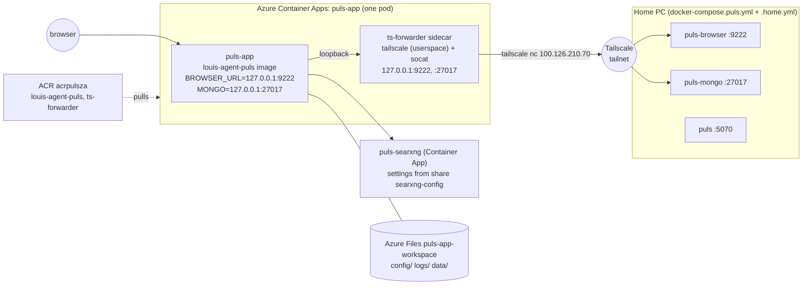
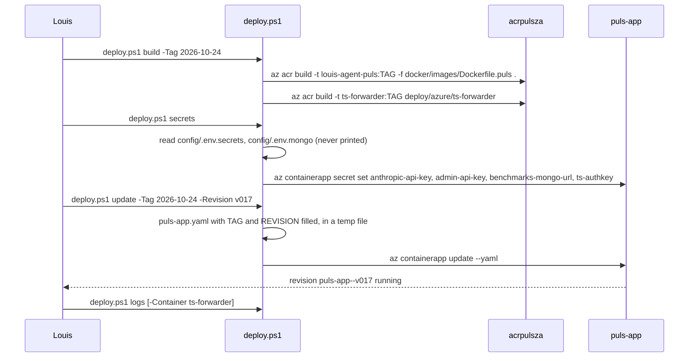

# CL19 Config and Docker by place: local, home and Azure

> **Plan.** How `config/`, `docker/`, `services/` and the Azure definitions are reorganised so each folder holds one
> kind of thing for one place, with no change to the code. Approved by Louis on 2026-10-24.

## Context

Three days of getting Puls onto Azure Container Apps left the configuration spread over four places with no line
between what runs on this PC and what runs in the cloud:

- `config/` holds 18 files of four kinds: the env files the code reads at run time, the two JSON tables, two Rider
  client templates, and `config/azure/` (git-ignored, with every secret inline) holding the Container App yaml and an
  unused sidecar draft.
- `docker/` holds 12 files of four kinds: six Dockerfiles, four compose files (two of them uncommitted copies of the
  Puls stack with everything but one service deleted, one binding Mongo on `0.0.0.0`), the SearXNG settings, and the
  Azure-only Tailscale sidecar.
- `services/` is a third home for Dockerfiles (Ollama).
- The Puls compose has its `puls-agent` service commented out, uncommitted, since Puls now peers with itself.
- Nothing in the repo says what exists in Azure (`rg-puls-za`: two Container Apps, a registry, three file shares) or
  how to deploy to it; today's outage (the app never started for three hours, 44 stray tailnet nodes) came from an
  inline start-up script nobody could read.

Decisions Louis made on 2026-10-24: one `ts-forwarder` sidecar forwarding both ports; the Azure yaml tracked with
`secretRef`s and a script that sets the secrets; `puls-agent` deleted; Mongo stays on the home PC behind the tunnel.

**The one rule the layout follows:** a folder is one kind of thing for one place.

| Folder | Place | Holds |
|---|---|---|
| `config/` | the app, wherever it runs | what the code reads at run time: env files, LLM profiles, `prices.json`, `rates.json`; `rider/` for the IDE client templates |
| `docker/` | this PC | the images (`images/`) and the compose stacks that run here, plus their service settings (`searxng/`) |
| `deploy/azure/` | the cloud | what runs in `rg-puls-za`: the app yamls, the sidecar image, the deploy script, the how-to |

`config/` keeps its name and its env files at its root because the code finds it by name
(`EnvFile.FindConfigDirectory`, `HostEnvironment`, `SessionLlmLoader`, `PriceTableLoader`, `ExchangeRatesLoader`) and
five test files read `RepoRoot/config/prices.json` and `rates.json`. **No C# changes, no test changes, no golden
files.** Compose commands in the docs (`docker compose -f docker/docker-compose.yml --env-file config/.env …`) keep
working unchanged.

## Design

### Folder trees

Today:

```
config/
├── .env, .env.secrets, .env.mongo, .env.searxng        (ignored)
├── .env.example, .env.secrets.example, .env.mongo.example, .env.searxng.example
├── .env.anthropic, .env.ollama, .env.ollama-puls, .env.ollama-triage
├── prices.json, rates.json
├── rider-acp.example.json, .rider-mcp-servers.json
└── azure/  puls-app.yaml, puls-app-update.yaml           (ignored, secrets inline)
docker/
├── Dockerfile.{api,acp-server,agent,mcp-server,orchestrator,puls}
├── Dockerfile.ts-forwarder, ts-forwarder/start.sh        (untracked, Azure only)
├── docker-compose.yml, docker-compose.puls.yml
├── docker-compose.puls.browser.yml, docker-compose.puls.mongo.yml   (uncommitted copies)
└── searxng/settings.yml
services/
└── Dockerfile.ollama, Dockerfile.ollama-nvidia, Dockerfile.ollama-amd, ollama-entrypoint.sh
```

After:

```
config/                                   # what the app reads at run time (the code finds this folder by name)
├── .env, .env.secrets, .env.mongo, .env.searxng          (ignored, as today)
├── .env.example, .env.secrets.example, .env.mongo.example, .env.searxng.example
├── .env.anthropic, .env.ollama, .env.ollama-puls, .env.ollama-triage
├── prices.json, rates.json
└── rider/  rider-acp.example.json, rider-mcp-servers.example.json
docker/                                   # this PC: the images and the stacks that run here
├── docker-compose.yml                    # the code-review app, Rider's servers, Ollama (profiles)
├── docker-compose.puls.yml               # the Puls stack: puls, puls-mongo, puls-searxng, puls-browser
├── docker-compose.puls.home.yml          # override: publish the browser and Mongo on this PC's Tailscale IP for the Azure app
├── images/
│   ├── Dockerfile.{api,acp-server,agent,mcp-server,orchestrator,puls}
│   └── ollama/  Dockerfile.ollama, Dockerfile.ollama-nvidia, Dockerfile.ollama-amd, entrypoint.sh
└── searxng/settings.yml
deploy/
└── azure/                                # the cloud: rg-puls-za
    ├── README.md                         # how-to: what exists there, build, deploy, logs, secrets, the tunnel
    ├── deploy.ps1                        # build images, set secrets from config/.env.secrets, update an app, tail logs
    ├── puls-app.yaml                     # the app + its ts-forwarder sidecar; secrets by secretRef only
    ├── puls-searxng.yaml                 # the SearXNG app, pulled from Azure and stripped of its secret
    └── ts-forwarder/  Dockerfile, start.sh
```

`services/` and `config/azure/` are gone. `.gitignore` loses `config/azure/`; nothing under `deploy/` is ignored
because nothing there holds a secret.

### The Azure shape after the change



Step 5 builds the sidecar and the yaml; step 3 the home override; step 6 the SearXNG yaml and the script.

### How a deploy runs (deploy.ps1)



The four diagrams the conventions ask for: the two above are the architecture and the communication diagram. There
is no interface or object diagram and no namespace map because the change adds, moves or changes no C# type.

### What each piece becomes

**`docker/docker-compose.puls.yml`.** The `puls-agent` block and `PULS_CODER_PORT` go (Louis, 2026-10-24: one Puls
container that peers with itself, `AGENT_PEERS: puls=http://puls:8080`, as the working copy already has it). The
`PULS_BROWSER_BIND` variable added this week goes too: publishing on the Tailscale IP is the override file's job, so
the base stack can never be talked into binding wider than `127.0.0.1`.

**`docker/docker-compose.puls.home.yml`** replaces the two uncommitted copies. A compose *override*, not a copy: it
holds only `ports:` for `puls-browser` and `puls-mongo`, bound to `${PULS_HOME_BIND:?set it to this PC's Tailscale IP}`
(no default, never `0.0.0.0`). Compose merges port lists, so the containers stay on `127.0.0.1` for the local tests
and gain the Tailscale binding:

```
docker compose -f docker/docker-compose.puls.yml -f docker/docker-compose.puls.home.yml --env-file config/.env up -d puls-browser puls-mongo
```

**`docker/images/`.** The six Dockerfiles move as they are; the compose `dockerfile:` lines follow
(`docker/images/Dockerfile.api`, context stays `..`). Ollama's three Dockerfiles and entrypoint move from `services/`
to `docker/images/ollama/`, the compose `context: ../services` becomes `../docker/images/ollama`.

**`deploy/azure/ts-forwarder/start.sh`.** As today, plus one change: `FORWARD_PORTS=9222,27017` (comma list; the
listen port is the target port, all on `FORWARD_TO_HOST`) replaces `FORWARD_TO_PORT`/`FORWARD_LISTEN_PORT`, so one
sidecar and one tailnet node carry both. One `socat … fork` per port in the background, then `wait`. Its Dockerfile's
build context is its own folder.

**`deploy/azure/puls-app.yaml`.** Rewritten from today's `config/azure/puls-app.yaml`:
- two containers: `puls-app` on the plain image, entry point untouched (no `command`/`args`), and `ts-forwarder`;
- every secret a `secretRef` (`anthropic-api-key`, `admin-api-key`, `benchmarks-mongo-url`, `ts-authkey`); no
  `secrets:` block in the file, so an update never overwrites a value;
- `MONGO_INITDB_ROOT_USERNAME/PASSWORD` dropped from the app (they are Mongo's, on the PC);
- the three mounts from today (`/workspace`, `/logs`, `/data` on `puls-app-vol`);
- the image tag and `revisionSuffix` as `TAG` and `REVISION` tokens the script fills; the startup probe's budget
  stays, with a comment that it no longer needs to cover an apt-get.

**`deploy/azure/puls-searxng.yaml`.** `az containerapp show -n puls-searxng -o yaml`, trimmed to the template and
ingress, `SEARXNG_SECRET` as a `secretRef`, so the whole footprint is in the repo. Its settings file is
`docker/searxng/settings.yml` uploaded to the `searxng-config` share (`deploy.ps1 searxng-settings`): one settings
file for both places.

**`deploy/azure/deploy.ps1`.** Five verbs, each a thin wrapper around one `az` command with the names filled in:
`build`, `secrets`, `update`, `searxng-settings`, `logs`. Secrets are read from `config/.env.secrets` and
`config/.env.mongo` and passed to `az` as arguments, never echoed. `TS_AUTHKEY` gets a commented line in
`config/.env.secrets.example` ("deploy only: the Tailscale auth key for the Azure sidecar; make it reusable and
ephemeral").

**`deploy/azure/README.md`.** A how-to that opens with what it answers: what exists in `rg-puls-za` (apps, registry,
environment, storage account and its three shares, which one is unused), first deploy, every-day deploy, logs,
rotating a secret, the tunnel (the home override, the Tailscale IP, deleting stale nodes), and the share's layout.

**Docs that change** (living docs only; plans and fix docs stay as written): `README.md`, `docs/SETUP.md` (the files
table gains `config/rider/`, loses `PULS_CODER_PORT`), `docs/CLAUDE.md` (project structure, the compose notes),
`docs/README.md` (index: the Azure how-to), `docs/QUICK_START_AGENT.md`, `docs/MODELS.md`,
`docs/architecture/07-deployment-view.md` (Ollama's new path; a short Azure section pointing at the how-to),
`docs/projects/louis-agent.puls.md`, `louis-agent.acp-server.md`, `louis-agent.mcp-server.md`,
`src/louis-agent.puls/louis-agent.puls.csproj` (one comment), `CHANGELOG.md`, `TODO.md` (the CL19 line).

### Reuse before building

Nothing new is adopted: compose override files and `extends` are Compose features; `tailscale nc` and `socat` are
already in the sidecar; `az` CLI is already how Louis deploys. A deploy tool (Bicep, `azd`, GitHub Actions) was
considered and left for later: one app, one person deploying, and a yaml plus five `az` calls is the smallest thing
that is readable.

## Steps

Each step is one commit on `refactor/CL19-config-by-place`, reviewed before the next. Every step is configuration or
docs, so there is no test to write first; each ends with `docker compose … config` on every stack it touched, which
is the check that the paths still resolve. Branch: off the current `refactor/CL15-engine-identities-packs` head
(Louis's call: it carries CL15's committed work the compose files depend on); the commits add only the paths each
step names, so CL15's uncommitted code changes stay in the working tree untouched.

1. **The plan and the TODO line.** `docs/plans/CL19-config-by-place.md` (this file), its row in
   `docs/plans/README.md`, a `CL19 Config and Docker by place` line under *Now* in `TODO.md` (it is this week's
   work, not a cleanup waiting for its code to be touched), and a line under *Later* for the public-ingress key
   (see *Concerns*).
2. **`docker/images/`.** Move the six Dockerfiles and the Ollama files; update both compose files' `dockerfile:` and
   `context:` lines, the puls csproj comment, `07-deployment-view.md`, `louis-agent.puls.md`, `docs/CLAUDE.md`'s
   structure. Check: `docker compose -f docker/docker-compose.yml --env-file config/.env config` and the same for
   Puls, then `up -d --build puls` once (free; rebuilds the image per the house rule).
3. **One Puls stack and its home override.** Delete the `puls-agent` block and `PULS_CODER_PORT`; drop
   `PULS_BROWSER_BIND`; delete the two overlay files; add `docker-compose.puls.home.yml` with `PULS_HOME_BIND`;
   `.env.example` and `docs/SETUP.md` follow. Check: `config` with and without the override, then
   `up -d puls-browser puls-mongo` with the override and `Test-NetConnection 100.126.210.70 -Port 9222` from the PC.
4. **`config/rider/`.** Move the two Rider templates (the MCP one renamed `rider-mcp-servers.example.json`, so both
   say they are templates); fix their paths inside (they name `docker/docker-compose.yml`, unchanged) and the five
   docs that point at them.
5. **The Azure app on a sidecar.** `deploy/azure/ts-forwarder/` (moved, multi-port), `deploy/azure/puls-app.yaml`
   (tracked, secretRefs), `.gitignore` (drop `config/azure/`), `.env.secrets.example` (`TS_AUTHKEY`). Delete
   `config/azure/puls-app-update.yaml`; the real `config/azure/puls-app.yaml` is deleted after step 6's first deploy
   succeeds. Check: `az acr build` of the sidecar and a deploy as revision `v017` — **a cloud change, so it waits for
   Louis's go**; then the sidecar's log shows `ts-forwarder: tailnet up`, the app's shows ASP.NET listening, `/health`
   answers on the public FQDN, and `tailscale status` shows one new node, not two.
6. **The script, the SearXNG yaml and the how-to.** `deploy.ps1`, `puls-searxng.yaml`, `deploy/azure/README.md`;
   `docs/README.md`, `README.md`, `CHANGELOG.md`. Check: `deploy.ps1 secrets` then `deploy.ps1 update -Revision v018`
   reproduce step 5's revision through the script (with Louis's go), `deploy.ps1 logs` tails it.

## Verification

- `docker compose … config` resolves for `docker-compose.yml`, `docker-compose.puls.yml`, and Puls with the home
  override; the local Puls stack builds and answers on `http://127.0.0.1:5070` (no model call needed).
- `dotnet build louis-agent-solution.sln` and `dotnet test tests/louis-agent.core.tests` stay green: the tests that
  read `config/prices.json` and `rates.json` are untouched because the files do not move.
- Azure (after Louis's go, steps 5 and 6): revision `v017`/`v018` running with two containers; the app reaches the
  browser (`ReadRenderedPage` in a chat) and Mongo (the admin portal lists runs); `az containerapp logs show` for
  each container; one tailnet node per revision; `git status` shows no secret file and `git grep -i "sk-ant\|tskey"`
  finds nothing.
- The 44 stale `puls-app-N` tailnet nodes are deleted by hand in the Tailscale console (not something the repo does).

## Concerns to decide, not solved here

- **`AGENT_AUTH=off` on a public ingress.** The Azure app is reachable by anyone on the internet without a key, on
  Louis's Anthropic key. Locally that setting is for `127.0.0.1` only. The yaml keeps it for now with a loud comment;
  fixing it needs the Puls web app to send a key, which is a feature, not a tidy-up. Worth a TODO line.
- **Rotate the four secrets** that were pasted into this session in `config/azure/puls-app.yaml` (Anthropic key,
  admin key, Mongo password, Tailscale key) once `deploy.ps1 secrets` exists: that is also its first real run.
- The `mongo-data` share and the `mongo` image in the registry are unused with Mongo on the PC; the how-to lists
  them as such, deleting them is Louis's call.

## Concepts

Configuration as code by environment (one folder per place, templates tracked, values injected), the sidecar pattern
for a pod, compose override files, secrets by reference: the shipping half of skill 18, *Testing and shipping*, in
[GOAL.md](../GOAL.md), the first real step toward its planned deploy pipeline (F44).
