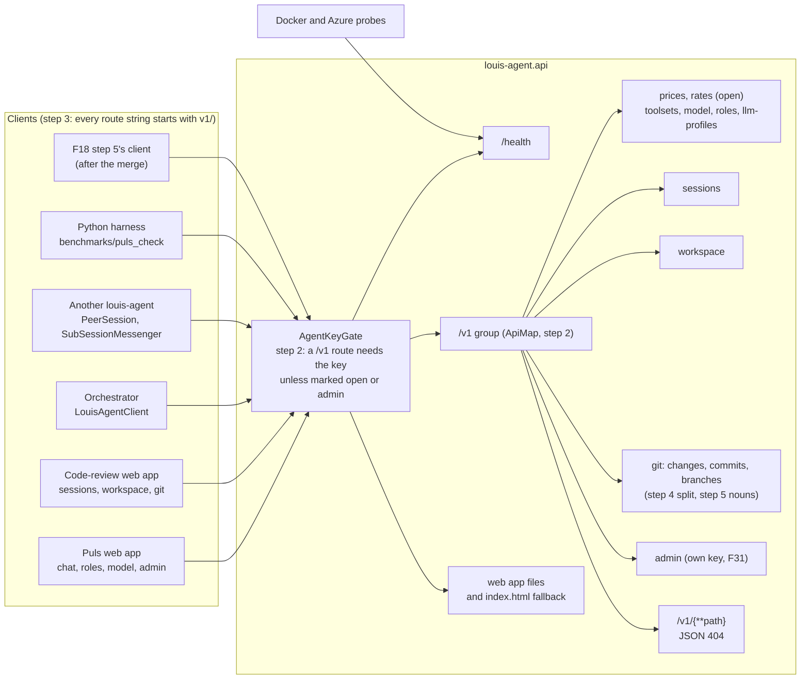
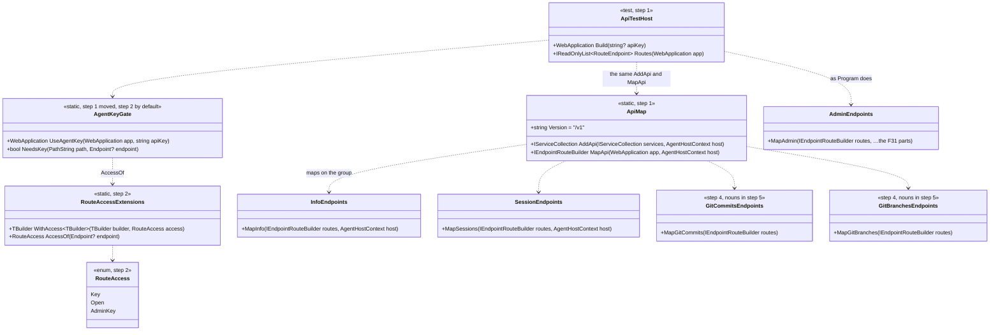
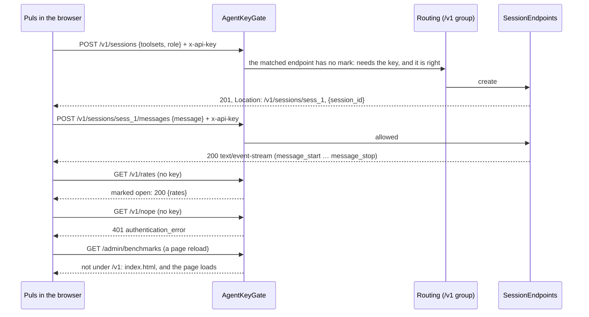
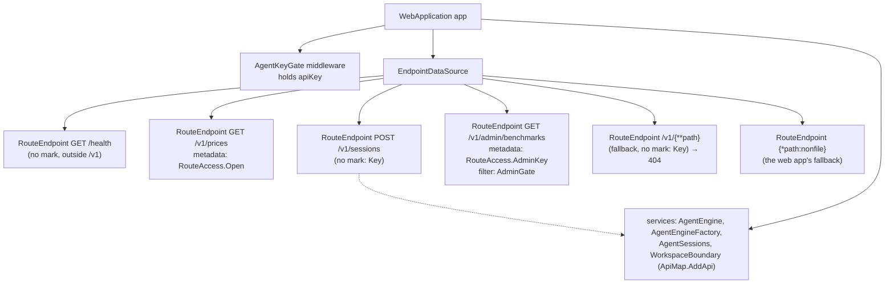

# CL20 API standards: one route rule, under /v1

> **Plan.** How `louis-agent.api`'s routes move under `/v1` and follow one rule (resources are nouns, a create answers
> 201, a delete is `DELETE`, an action is `POST /{resource}/{verb}`, a `GET` changes nothing), how every client
> follows, and how a test pins the whole table. The decision is [ADR 0039](../adr/0039-api-routes-under-v1.md).
> Approved by Louis on 2026-10-25.

## Context

On 2026-10-25 Louis asked how the API compares with common REST practice, and decided "we should conform" and "also
pin this rule". The platform plan put CL20 before F18's step 5, because that step writes the eval harness's HTTP
client against this API, and the engine package's `Hosts.Api` and the Puls gateway (Phase 9) will be built on it too.
CL20 goes on its own branch off `main` (`refactor/CL20-api-standards`), and is merged into F18 when it is done.

A survey of `main` at `74eb79d` found 37 routes, mapped in six files and in `Program.cs`, with these gaps:

- **No version.** Every route sits at the root, so a breaking change can only happen in place.
- **Verbs in paths, and one resource under several names.** `POST /git/branch/delete` deletes. A branch is read at
  `GET /git/branch?name=` and listed at `GET /git/branches`. `/git/commit` both creates (POST) and reads (GET), and the
  commit list is `GET /git/log`.
- **The key check is a list of what needs the key.** `Program.cs` names six prefixes, and anything off the list is
  open. `GET /llm-profiles` (F30) was never added, so it answers without the key today.
- **The pages and the API share paths.** `/admin/benchmarks` is both a Puls page and an API route. Clicking through the
  app works, but reloading that page sends the browser to the API, which answers JSON.
- **An unknown API path gets the web app.** The fallback serves `index.html` for any path, so a mistyped route answers
  200 with HTML.
- **Nothing tests the table.** The next route can break any of this without a test noticing.

The same survey left three things outside CL20: an OpenAPI document (for the engine package's `Hosts.Api`), rate
limits (the TODO's known limitation 5: F42, and the Puls gateway in Phase 9), and the deny-by-default key check, which
CL20 does take in, because the check has to move with the routes anyway (step 2).

## Design

### The rule

Every route of `louis-agent.api` follows these, and ADR 0039 records them:

1. **Every route is under `/v1`, except `/health`.** `/health` is a probe for Docker and Azure, and it answers for any
   version. A breaking change to a route's shape gets a new version beside the old one, and is never made in place.
2. **Resources are nouns, and a collection and its items share one plural name.** For example,
   `GET /v1/git/branches`, `GET /v1/git/branches/{name}` and `DELETE /v1/git/branches/{name}`.
3. **A create is a POST to the collection.** It answers `201 Created`, with a `Location` header naming the new
   resource. A create whose work goes on after the answer (a benchmark run) answers `202 Accepted` with the same
   header. A POST that streams its answer (`POST /v1/sessions/{id}/messages`) answers 200 with the stream.
4. **A delete is `DELETE` on the resource.**
5. **An action that no HTTP method names is `POST /{resource}/{verb}`**, such as `POST /v1/sessions/{id}/cancel` or
   `POST /v1/git/stage`. A `GET` never changes anything.
6. **Every `/v1` route needs the API key, unless the code marks it open.** Today only the prices, the rates and their
   display are open. The admin routes are behind their own key (F31), as before. An unknown `/v1` path answers a JSON
   404, never the web app's page.
7. **A client names the whole route, version included** (`v1/sessions`). The URL it is configured with names only
   the host, so no setting changes, except the two that hold a full URL to this API (`PRICES_URL`, `RATES_URL`).
8. **A test pins the table.** A golden file lists every route, its method and who may call it, so a change to the API
   shows as a diff of that file. Tests check rules 1 to 6 on the real table.

### The routes, before and after

| Today | After CL20 | Who may call | Step |
|---|---|---|---|
| `GET /health` | `GET /health` | open | — |
| `GET /prices`, `/rates`, `/rates/display` | `GET /v1/prices`, `/v1/rates`, `/v1/rates/display` | open | 2 |
| `GET /toolsets`, `/model`, `/roles` | `GET /v1/toolsets`, `/v1/model`, `/v1/roles` | key | 2 |
| `GET /personalities` (CL14's alias for a client one deploy behind) | gone: no client calls it under `/v1` | — | 2 |
| `GET /llm-profiles` (open today, by omission) | `GET /v1/llm-profiles` | key | 2 |
| `POST /sessions` (201, no `Location`) | `POST /v1/sessions` (201, `Location: /v1/sessions/{id}`) | key | 2, 5 |
| `GET`, `DELETE /sessions/{id}`; `POST /sessions/{id}/cancel`, `/messages` | the same under `/v1` | key | 2 |
| `GET /workspace/entries?path=`, `/workspace/file?path=` | the same under `/v1` | key | 2 |
| `GET /git/status`, `/git/diff`; `POST /git/stage`, `/unstage`, `/discard`, `/merge` | the same under `/v1` | key | 2 |
| `POST /git/commit` (200) | `POST /v1/git/commits` (201, `Location: /v1/git/commits/{sha}`) | key | 2, 5 |
| `GET /git/log?count=` | `GET /v1/git/commits?count=` | key | 2, 5 |
| `GET /git/commit?sha=` | `GET /v1/git/commits/{sha}` | key | 2, 5 |
| `GET /git/branches` | `GET /v1/git/branches` | key | 2 |
| `GET /git/branch?name=` | `GET /v1/git/branches/{**name}` | key | 2, 5 |
| `POST /git/branch/delete` | `DELETE /v1/git/branches/{**name}` | key | 2, 5 |
| `/admin/benchmarks/…` (9 routes) | the same under `/v1/admin/benchmarks/…` | admin key | 2 |
| (any other path: the web app's page) | `/v1/{**path}`: a JSON 404 | key | 2 |

A branch name can hold slashes (`feature/F18-evals`), so a branch route ends in a catch-all (`{**name}`), and a client
escapes each part of the name but keeps the slashes. The admin routes only gain the prefix: F18's step 7b reworks them
into the evals' routes, and rule 3's `Location` on a run start lands there.

### Where the version lives

**On the server:** in one place. `ApiMap.MapApi` maps `/health` on the app, and everything else on one
`app.MapGroup("/v1")`. `Program.cs` keeps building the admin portal's parts (F18 changes them) and maps them on the
group `MapApi` returns.

**In the clients:** in each route string (`"v1/sessions"`), never in a base URL. The reasons:

- a reader sees the route a call makes;
- `grep "v1/sessions"` finds the server and every client;
- the web apps' `HttpClient` also loads static files (`ThemeSwitcher` reads `css/themes/themes.json`), so its base
  address can't carry the version;
- `GET /health` stays unversioned for the same clients.

The trap is that a Puls page's `href="admin/benchmarks"` and its `@page "/admin/benchmarks"` are the app's own pages,
not API calls, so they stay as they are.

### The key check, by default

Today a middleware in `Program.cs` asks "is this path on my list?". After step 2 it asks "is this a `/v1` path whose
route isn't marked open or admin?". A route says who may call it with endpoint metadata:

```csharp
v1.MapGet("/prices", …).WithAccess(RouteAccess.Open);
var admin = routes.MapGroup("/admin").WithAccess(RouteAccess.AdminKey).AddEndpointFilter(…);
```

Anything unmarked needs `AGENT_API_KEY`, so a new route is safe until someone decides otherwise. That includes an
unknown `/v1` path, which answers 401 without the key and a JSON 404 with it. `HostAuth` (FX18) keeps its start-up
decision, and `AGENT_AUTH=off` still opens everything. The middleware moves out of `Program.cs` into
`AgentKeyGate`, which the tests use too.

ASP.NET's routing runs before a middleware added with `app.Use`, because `WebApplication` adds `UseRouting` first, so
the gate can read the matched endpoint's metadata.

One side effect: a wrong method on a known `/v1` route (`GET /v1/sessions`) answers 404 instead of 405, because the
`/v1` fallback accepts every method.

### Reuse before building

- **ASP.NET Core route groups** (`MapGroup`) give the prefix, and **endpoint metadata** carries each route's access.
  Both are in the framework.
- **`Microsoft.AspNetCore.TestHost`** (MIT, Microsoft, the same 10.0.x as the repo's other ASP.NET packages) runs
  the API in memory for the tests, with no port and no Docker.
- **`Asp.Versioning.Http`** (MIT, .NET Foundation) was considered and not taken. It negotiates a version by URL, query
  or header, and reports supported and deprecated versions. That pays off when two versions run side by side. With one
  version, a route group is the whole need, and the library's URL-segment style is the same `/v1`, so it can be added
  later without changing a URL.
- **ASP.NET authentication** (an API-key scheme, `RequireAuthorization` on the group and `AllowAnonymous` on the open
  routes) was considered for the key. It is the framework's deny-by-default shape, and it fits once there are users
  who sign in (the Puls gateway, Phase 9). Today there is one key and one admin key, and `HostAuth` is shared with the
  MCP server (FX18). So the gate stays a middleware, and only its rule changes.

### Folder trees

`src/louis-agent.api/Endpoints/` holds 8 files today, more than the about six that ADR 0034 allows, and three of them
are on `FileSizeTests`' oversized list. CL20 puts its own types in `Routing/`, and splits the git endpoints by resource
into `Git/` (step 4), the two routes files that CL20 rewrites. `AdminEndpoints.cs` waits for F18's step 7b.

Today:

```text
src/louis-agent.api/
├── Program.cs                 (maps every route group, and holds the key middleware)
└── Endpoints/
    ├── AdminEndpoints.cs      (231 lines, oversized)
    ├── ApiErrors.cs
    ├── GitEndpoints.cs        (205 lines, oversized)
    ├── HistoryEndpoints.cs    (213 lines, oversized)
    ├── InfoEndpoints.cs
    ├── RolesView.cs           (Routes: /roles and /personalities)
    ├── SessionEndpoints.cs
    └── WorkspaceEndpoints.cs
```

After step 1 (one map) and step 2 (the key by default):

```text
src/louis-agent.api/
├── Program.cs                 (builds the host and the admin parts; maps through ApiMap)
└── Endpoints/
    ├── Routing/
    │   ├── ApiMap.cs          (step 1: AddApi, MapApi; step 2: the /v1 group, the /v1 fallback)
    │   ├── AgentKeyGate.cs    (step 1: moved out of Program.cs; step 2: by default)
    │   ├── RouteAccess.cs     (step 2: Key, Open, AdminKey)
    │   └── RouteAccessExtensions.cs (step 2: WithAccess, AccessOf)
    └── … the eight files, unchanged but for their Map signatures; RolesView loses Routes
```

After step 4 (git by resource) and at the end:

```text
src/louis-agent.api/Endpoints/
├── AdminEndpoints.cs
├── ApiErrors.cs
├── InfoEndpoints.cs
├── RolesView.cs
├── SessionEndpoints.cs
├── WorkspaceEndpoints.cs
├── Git/
│   ├── GitChangesEndpoints.cs   (status, diff, stage, unstage, discard)
│   ├── GitCommitsEndpoints.cs   (the commits: create, list, one)
│   ├── GitBranchesEndpoints.cs  (the branches: list, one, merge, delete)
│   ├── GitProcess.cs            (runs git for an endpoint; its error answer)
│   └── GitOutputParser.cs       (status, commits and a safe diff, parsed from git's output)
└── Routing/ …

tests/louis-agent.api.tests/
├── Endpoints/
│   ├── Routing/
│   │   ├── ApiTestHost.cs              (step 1: the API in memory, on a model that is never called)
│   │   ├── ApiRoutesSnapshotTests.cs   (step 1: the table; Program maps nothing itself)
│   │   ├── ApiRoutesSnapshot.json      (step 1: 37 routes; step 2: /v1 and who may call)
│   │   ├── ApiRouteRuleTests.cs        (step 2: rules 1 and 6; step 5: rules 2 to 5)
│   │   └── AgentKeyGateTests.cs        (step 2: 401, open, admin, unknown → 404)
│   └── Git/
│       └── GitResourceTests.cs         (step 5: 201 and Location on a commit, a branch with a slash)
└── … (Sessions/SessionCreatedTests.cs, step 5: 201 and Location on a session)
```

### Namespace map

| Type | Folder | Namespace | Step |
|---|---|---|---|
| `ApiMap` (`Version`, `AddApi`, `MapApi`) | `src/louis-agent.api/Endpoints/Routing/` | `LouisAgent.Api.Endpoints.Routing` | 1, 2 |
| `AgentKeyGate` (`UseAgentKey`, `NeedsKey`) | `Endpoints/Routing/` | `LouisAgent.Api.Endpoints.Routing` | 1, 2 |
| `RouteAccess` (enum: `Key`, `Open`, `AdminKey`) | `Endpoints/Routing/` | `LouisAgent.Api.Endpoints.Routing` | 2 |
| `RouteAccessExtensions` (`WithAccess`, `AccessOf`) | `Endpoints/Routing/` | `LouisAgent.Api.Endpoints.Routing` | 2 |
| `InfoEndpoints`, `SessionEndpoints`, `WorkspaceEndpoints`, `AdminEndpoints` (on `IEndpointRouteBuilder`) | `Endpoints/` | `LouisAgent.Api.Endpoints` (unchanged) | 1 |
| `GitChangesEndpoints`, `GitCommitsEndpoints`, `GitBranchesEndpoints`, `GitProcess`, `GitOutputParser` | `Endpoints/Git/` | `LouisAgent.Api.Endpoints.Git` | 4 |
| `GitEndpoints`, `HistoryEndpoints` | — | deleted | 4 |
| `ApiUserText.UnknownRoute`, and three texts `POST /git/merge` writes inline today | `Messages/` | `LouisAgent.Api.Messages` (unchanged) | 2, 5 |
| `ApiTestHost`, `ApiRoutesSnapshotTests`, `ApiRouteRuleTests`, `AgentKeyGateTests` | `tests/louis-agent.api.tests/Endpoints/Routing/` | `LouisAgent.Api.Tests.Endpoints.Routing` | 1, 2, 5 |
| `GitResourceTests` | `tests/louis-agent.api.tests/Endpoints/Git/` | `LouisAgent.Api.Tests.Endpoints.Git` | 5 |
| `SessionCreatedTests` | `tests/louis-agent.api.tests/Sessions/` | `LouisAgent.Api.Tests.Sessions` | 5 |

### Architecture



### Interface design



### Communication: Puls opens a session and sends a message



### Objects while the API runs



## Steps

Each step is one commit on `refactor/CL20-api-standards`, reviewed before the next. After each, the whole solution
builds and `dotnet test` passes on the projects the step touches. Every behaviour step starts with its tests, run and
seen failing (ADR 0014).

0. **The plan, the ADR and the TODO line** (docs only). This file, ADR 0039 with its row in `docs/adr/README.md`,
   the plan's row in `docs/plans/README.md`, and a `CL20` line under *Now* in `TODO.md`.
1. **One map, pinned** (no route changes; Sonnet 5.5, medium).
   - **Test first:** `ApiRoutesSnapshotTests` builds the API through `ApiTestHost`. The host uses the same
     `ApiMap.AddApi` and `MapApi` that `Program.cs` uses, maps the admin routes as `Program.cs` does (no store), and
     the test lists every `RouteEndpoint` as `"METHOD /pattern"`, sorted, against `ApiRoutesSnapshot.json`. A second
     test reads `Program.cs` and finds no `Map…(` call but `MapStaticAssets`, `MapFallbackToFile`, `MapApi` and
     `MapAdmin`, so the tests' table is the real one. It fails to build first, because `ApiMap` doesn't exist.
   - **Code:** `ApiMap` holds the four service registrations and the map calls. The six `Map…` methods take an
     `IEndpointRouteBuilder`. The key middleware moves into `AgentKeyGate.UseAgentKey` with its list unchanged.
     `api.tests` gains `Microsoft.AspNetCore.TestHost`.
   - **Check:** the written golden holds exactly the 37 routes of this plan's table, and nothing else changed.
2. **Everything under `/v1`, the key by default** (the server; Sonnet 5.5, medium).
   - **Test first:** `ApiRouteRuleTests`: every route but `/health` starts with `/v1/` (fails on 37). The golden
     gains who may call each route, from `AccessOf`: `/llm-profiles` turns from open to key, and `/personalities`
     goes. `AgentKeyGateTests` run the API in memory with a key:
     - every `Key` route answers 401 without the key;
     - the open ones don't;
     - an admin route answers the admin gate's 403 when no admin key is set;
     - `/v1/nope` with the key is a JSON 404;
     - `/health` is 200.
   - **Code:** the `/v1` group in `ApiMap`, `/health` outside it, `RouteAccess` and its extensions, the open and
     admin marks, the gate's new rule, the `/v1/{**path}` fallback with `ApiUserText.UnknownRoute`, and `RolesView`
     without `Routes`.
   - **Between steps 2 and 3,** the apps on this branch can't reach the API. Hand checks wait for step 3.
3. **Every client calls `/v1`** (Haiku 5.5, high: one change, many places).
   - **Test first:** the fakes expect the new paths. That covers `FixtureApi` (web.testing), `CurrencySwitcherTests`,
     `FakePeer` and the core tests that assert `/sessions`, `SessionTagsTests` (orchestrator), `AdminKeyTests`
     (`v1/admin/…` takes the admin key), and the Python `test_client.py`.
   - **Code:** `AgentApi` and `ChatSettings.KeyFor` (web.shared), `AgentApiWorkspace` (web), Puls's `ChatPage` and
     admin pages and `RunExplorer`, `LouisAgentClient` (its `health` stays), `PeerSession` and `SubSessionMessenger`
     (core), and `benchmarks/puls_check/client.py`.
   - **Check:** this grep finds a route string where a request is made. On `main` it prints 44 lines, and after the
     step it prints nothing:

     ```bash
     grep -rnE '(^\s+|HttpMethod\.[A-Za-z]+, |GetAsync(<[^>]+>)?\(|PostAsync\(|GetTextAsync\(|StreamLinesAsync\(|_request\("[A-Z]+", |new Uri\(peer, )[$f]?"(sessions|git/|workspace/|toolsets|roles|model|llm-profiles|prices|rates|admin/)' src louis-agent.core benchmarks
     ```
4. **The git endpoints by resource** (no route changes; Haiku 5.5, high).
   - `GitEndpoints` and `HistoryEndpoints` become `Endpoints/Git/`, one file per resource plus `GitProcess` and
     `GitOutputParser` (`partial` only for `[GeneratedRegex]`).
   - Each file is under 200 lines, and both old files leave `FileSizeTests`' oversized list.
   - **Check:** the route golden is byte-equal. That is the test that proves a refactor changed no route.
5. **Resources as nouns, creates answer 201** (the server and its two clients; Sonnet 5.5, medium).
   - **Test first:** `ApiRouteRuleTests` gains three rules, which fail on today's git routes:
     - no segment is a verb (`delete`, `remove`, `create`, `add`, `new`, `update`, `edit`, `set`);
     - an action word (`cancel`, `stage`, `unstage`, `discard`, `merge`) is only the last segment of a POST;
     - no two routes use one resource's singular and plural (`branch` and `branches`).

     `SessionCreatedTests` checks `201` and `Location: /v1/sessions/{id}`. `GitResourceTests`, in a temporary git
     repository, checks:
     - a commit answers 201 with `Location: /v1/git/commits/{sha}`;
     - `GET` and `DELETE /v1/git/branches/feature/x` work, slash included.
   - **Code:** the routes in the table's step 5 rows, `Location` on the two creates, `AgentApiWorkspace` following,
     and the three English texts written inline in `POST /git/merge` today becoming `ApiUserText` members (ADR 0009).
   - **Check:** the golden's diff is exactly those rows.
6. **The docs, the prompts and the close** (Haiku 5.5, high).
   - The living docs that name a route: `AGENT_COMMUNICATION.md`, `projects/louis-agent.api.md` and the projects that
     call it (`louis-agent.puls`, `louis-agent.web`, `louis-agent.pack.shops`), `guides/change-the-api.md`,
     `build-a-pack.md`, `build-an-identity.md`, `architecture/05-building-block-view.md`, `SETUP.md`, `MODELS.md`,
     `docs/CLAUDE.md`, and the comments in `config/.env.example` and `.env.secrets.example`.
   - Two prompts say `GET /toolsets` (`agent/louis-agent/voice.md` and `toolsets/specialists.md`), so the golden files
     are regenerated and their diff reviewed.
   - Plans, ADRs, fix docs, feature docs and `CHANGELOG.md` keep the routes of their time.
   - The TODO line moves to `CHANGELOG.md`, with follow-up lines for an OpenAPI document and for the rest of
     `Endpoints/`.
   - A section on API versioning and the route rule opens `docs/learning/11-protocols.md`. Claude writes it, and it is
     given in the step's prompt.

## Merging into F18

F18 changed the same files in a few places, so `git merge main` on `feature/F18-evals` will stop on these:

- `Program.cs`: F18 changed the `MapAdmin(…)` call's arguments, and CL20 calls it on the `/v1` group. Keep F18's
  arguments, and call it on `api`.
- `AdminEndpoints.cs`: F18 moved the rows to `AdminRows`, and CL20 changed the signature and added the access mark.
  Keep both.
- `SessionEndpoints.cs`: F18 added the stream format and the replay to `POST /sessions`, and CL20 added `Location`
  to its answer. Keep both.
- `AgentApi.cs`, `Benchmarks.razor`, `BenchmarkRun.razor`, `LouisAgentClient.cs`, `PeerSession.cs` and
  `SubSessionMessenger.cs`: F18 renamed message enums on nearby lines. Keep F18's names and CL20's `v1/` routes.

After the merge:

- the whole solution's tests pass on F18;
- the route golden is CL20's;
- step 3's grep, run on F18's own new code (`evals/`), prints nothing.

## Verification

- **Tests:** the route golden and the rule tests (`api.tests`), the key gate in memory, the client tests in
  web.shared, web, puls, core and orchestrator, and the Python client's tests.
- **Free checks by hand, after step 3 and again after step 5,** on the local stack
  (`docker compose -f docker/docker-compose.yml --env-file config/.env up -d --build api`):
  - `curl -s http://127.0.0.1:5080/health` is 200;
  - `curl -s http://127.0.0.1:5080/v1/toolsets` is 401;
  - the same with `-H "x-api-key: $AGENT_API_KEY"` is 200;
  - `curl -s http://127.0.0.1:5080/v1/prices` is 200 without a key;
  - `/v1/nope` with the key is a JSON 404;
  - in the browser, the code-review app lists files and git status, and on Puls a reload of `/admin/benchmarks`
    shows the page.
- **No paid run is needed.** Opening a session calls no model. One Puls chat message (a cent or two on Haiku) is the
  only end-to-end check of a streamed turn, and it waits for Louis's go.
- **Deploy all hosts together.** An old client meets 404s. That covers Puls on Azure and the local web peer on this
  PC (F30), the orchestrator, and any `config/.env` whose `PRICES_URL` or `RATES_URL` points at this API, which gains
  `/v1`.

## Concerns to decide, not solved here

- **An OpenAPI document** (`Microsoft.AspNetCore.OpenApi`), for the engine package's `Hosts.Api`: a TODO line in
  step 6.
- **Rate limits:** known limitation 5 (F42), and the Puls gateway in Phase 9.
- **CL14's other aliases:** the `personality` field on `POST /sessions` stays, under the TODO's *Remove CL14's
  aliases, after a deploy*. CL20 takes only the route.
- **The admin routes' shapes** (`/benchmarks/{check}/runs` beside `/benchmarks/checks/{check}/trend`): F18's step 7b,
  which renames them for the evals.
- **The MCP server's endpoint** follows MCP's spec, not this rule. ADR 0039 covers `louis-agent.api` only.

## Approved during the build

(Nothing yet.)

## Concepts

- **An API is a protocol:** a version in the path, resources named as nouns, and status codes that say what happened
  (201 and `Location`, 202, 404 and 405). That is skill 11, *Protocols*, in [GOAL.md](../GOAL.md), and its first
  write-up.
- **Deny by default:** a route is closed until the code opens it, and an unknown path is closed too. That is skill
  15, *Safety and security*.
- **A pinned surface:** the route table as a golden file, rules as tests on the real table, and a refactor proved by
  an unchanged golden (step 4). That is skill 18, *Testing and shipping*.
