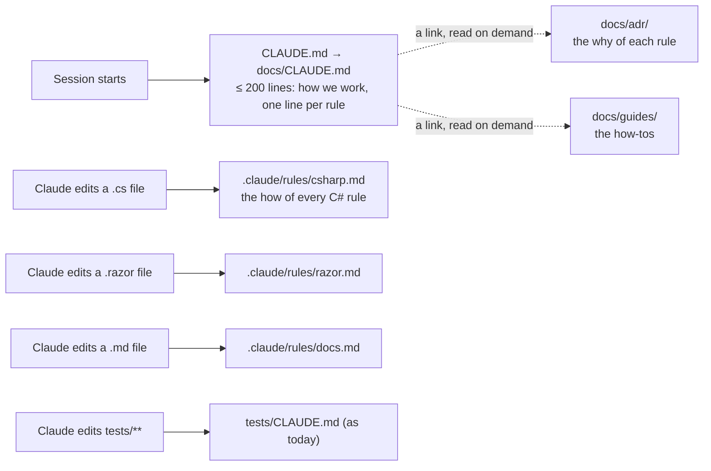

# CL25 · Every CLAUDE.md in 200 lines: plan

> Approved 2026-10-29 (Louis: "refactor the claude.md and keep it to 200 lines, so we need to either move the extra
> to ADRs or Claude-only refs"; his pick on the card: **the ADR keeps the why, a path-scoped rules file keeps the
> how, the how-tos go to `docs/guides/`**; then "make it a rule that CLAUDE.md cannot exceed 200 lines, nor any other
> Claude child file") · Branch: `docs/CL25-claude-md-200-lines` · Docs only, with one test · TODO: *CL25*

## Context

Every Claude Code session loads the root `CLAUDE.md` (ours is one line, `@docs/CLAUDE.md`) once, at start, and
keeps it in the context for the whole session. Claude Code's own docs say to keep it under 200 lines; ours is 558
lines and 45 KB, so every chat, even a one-line docs fix, pays for the 70-line summaries guide and the Docker disk
tip. `louis-agent.core/CLAUDE.md` is 223. The other things Claude Code loads are cheaper:

| What | When it loads | Ours today |
|---|---|---|
| Root `CLAUDE.md` and its `@imports` | Once, at session start | `CLAUDE.md` → `docs/CLAUDE.md` |
| A `CLAUDE.md` in a subfolder | The first time Claude reads or edits a file in that folder | `tests/`, `src/`, `louis-agent.core/` |
| `.claude/rules/{name}.md` with a `paths:` header | The first time Claude reads or edits a file that matches | none yet |
| `.claude/rules/{name}.md` without `paths:` | At session start, like the root | none |
| A doc Claude follows a link to | Only when it reads it | ADRs, guides, projects |

(Claude Code's memory docs, read 2026-10-29: a path-scoped rule has a YAML `paths:` list in its frontmatter, patterns
relative to the repo root, loaded when a matching file is read or edited; the file is committed, so Rider and the
cloud sessions share it.)

## Design

**The rule:** every `CLAUDE.md` in the repo and every file in `.claude/rules/` holds at most 200 lines;
`ClaudeMdSizeTests` holds it. What doesn't fit goes by kind: the *why* of a rule to its ADR, the *how* to a
path-scoped rules file, a how-to to `docs/guides/`.

| Today in `docs/CLAUDE.md` | Lines | After |
|---|---|---|
| *How to work with Louis*, rules 1 to 11 | 50 | Stays, tightened: each rule keeps its sentence; the quotes and dates move to the ADR or rules file that holds the detail |
| *Steps, branches and commits* | 48 | Stays, shorter: test first, finishing as one-liners, branches, commit format. The Rider tooling detail goes to `guides/finish-a-step.md`; in its place one rule, *Rider's tools first* |
| *Rules that always apply*, 33 bullets | 260 | One line per rule with its ADR and, where there is one, its rules file. The how of each C# rule goes to `.claude/rules/csharp.md`, the Razor rules to `razor.md`, the doc rules to `docs.md`; three rules with no ADR get one |
| *Quick start* | 24 | `guides/get-started.md` |
| *Project structure* | 32 | Stays, shorter |
| *Development workflow* table | 10 | Stays, with the rules files and the new guides |
| *Adding a skill* | 30 | `guides/add-a-skill.md` |
| *Adding a mode or a role* | 35 | Into `guides/build-an-identity.md`, which already builds modes and roles |
| *Running and debugging* | 25 | `guides/debug-and-logs.md` |
| *Which Anthropic tier*, *MCP exposes tools* | 14 | One link line each (ADR 0002 and `AGENT_COMMUNICATION.md` say it) |
| *Known limitations* | 7 | One line to the TODO's list |
| *Common errors* | 21 | `guides/common-errors.md` |
| **Total** | **558** | **about 175** |

`louis-agent.core/CLAUDE.md` (223): *Building an identity or a pack* repeats what [Build a pack](../guides/build-a-pack.md)
and [Build an identity](../guides/build-an-identity.md) say; it becomes a short pointer, the heading kept for its
links.

**Rider's tools first** (Louis, 2026-10-29: "make use of the Rider MCP fully without the need to list every tool")
replaces the per-tool list in the step list with one rule; the tool-to-job table per Rider version lives in
`guides/finish-a-step.md`, so a new Rider version is a table change, not a rule change.

**The three rules files:**

| File | `paths:` | Holds (moved, not rewritten) |
|---|---|---|
| `.claude/rules/csharp.md` | `**/*.cs` | Summaries, `<remarks>`, `<seealso>` and *write them like a person*; comments inside a method; no nested conditionals; an endpoint is a named method with `TypedResults`; records for values; JSON through records; Mongo through records; dates are UTC; choices are enums; message text as enums; the size limit; formatting; a rename through Rider |
| `.claude/rules/razor.md` | `**/*.razor`, `**/*.razor.cs` | No `@code` block, a page over a hundred lines splits, the web shows the live results |
| `.claude/rules/docs.md` | `**/*.md` | One type per doc; plans, feature and fix docs and their lifecycle; sub-features; write-ups; docs in English; plain words |

**The ADRs to write** (rules that lean on dated quotes and have no record): 0050 summaries like a person, 0051 flat
conditionals and named endpoints, 0052 edit, never a script (F49.1's ADR then takes the next free number).

### Types

| Type | New / changed | Folder | Namespace | Step |
|---|---|---|---|---|
| `ClaudeMdSizeTests` | new | `tests/louis-agent.core.tests/Docs/` | `LouisAgent.Core.Tests.Docs` | 1 |

No code changes, so the interface, communication and object diagrams don't apply; the flowchart above is the
architecture one.

## Steps

| Step | Commit | What |
|---|---|---|
| 1 | `docs(cl25): step 1 - the plan and the size test` | This plan; `ClaudeMdSizeTests`: every CLAUDE.md and rules file at most 200 lines (red: `docs/CLAUDE.md` 558, `louis-agent.core/CLAUDE.md` 223) |
| 2 | `docs(cl25): step 2 - the how-tos move to guides` | `get-started`, `finish-a-step`, `add-a-skill`, `debug-and-logs`, `common-errors`; modes and roles into `build-an-identity`; core's guide points at the pack and identity guides; the indexes |
| 3 | `docs(cl25): step 3 - ADRs 0050 to 0052` | The three ADRs from the rule text; the ADR README |
| 4 | `docs(cl25): step 4 - the C# and Razor rules files` | `.claude/rules/csharp.md`, `razor.md`; the C# and Razor bullets cut to one line each with their links |
| 5 | `docs(cl25): step 5 - the docs rules file and the working rules` | `.claude/rules/docs.md`; rules 1 to 11 and the step list tightened, *Rider's tools first* in place of the tool list |
| 6 | `docs(cl25): step 6 - the map, the links, done` | Project structure shortened; the folder guides table lists the rules files; links checked; the test green; CHANGELOG and TODO; this plan deleted |

## Done when

Every `CLAUDE.md` and every `.claude/rules/` file is at most 200 lines and `ClaudeMdSizeTests` holds it; every rule
that was in `docs/CLAUDE.md` is reachable in one click (its line, its ADR, its rules file or guide); a `.cs` edit in
Rider loads `.claude/rules/csharp.md` (Louis checks with `/context`).

## Risks

- **Rider's Claude Code version.** Path-scoped rules are recent. If `/context` doesn't show the rule loading on a
  `.cs` edit, the fallback is the lazy folder files we already use (`louis-agent.core/CLAUDE.md` for the C# rules);
  the split itself stays.
- **A rule that reads differently as one line.** Each one-liner is read against its original before the bullet goes;
  the original is one click away in git (the commit before step 4).

GOAL skill 7, context engineering (what every session pays for, and loading the rest on demand), applied to our own
tooling.
