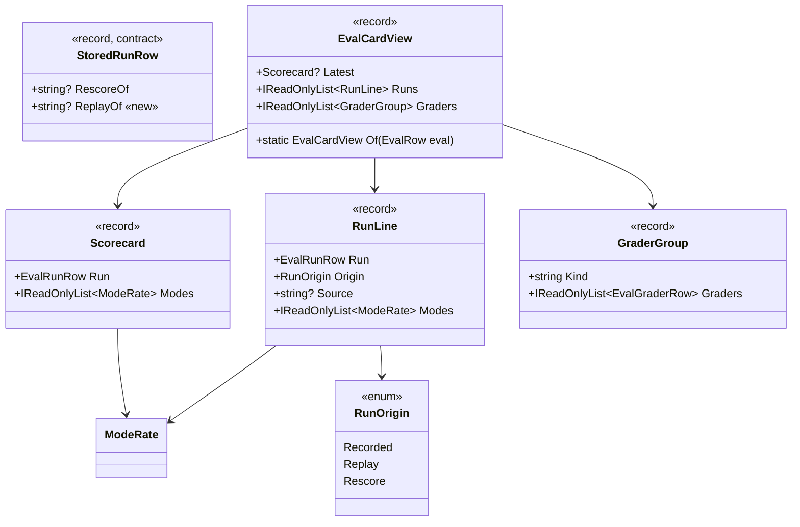
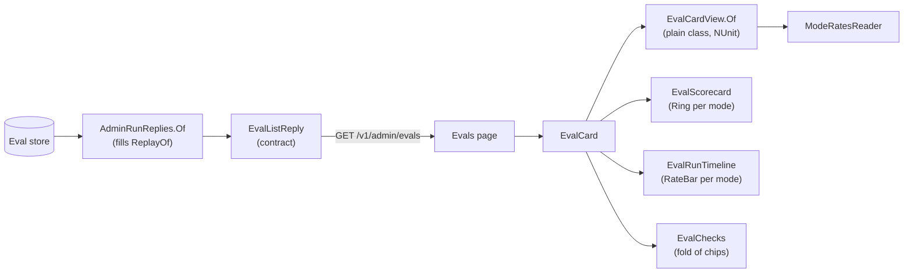
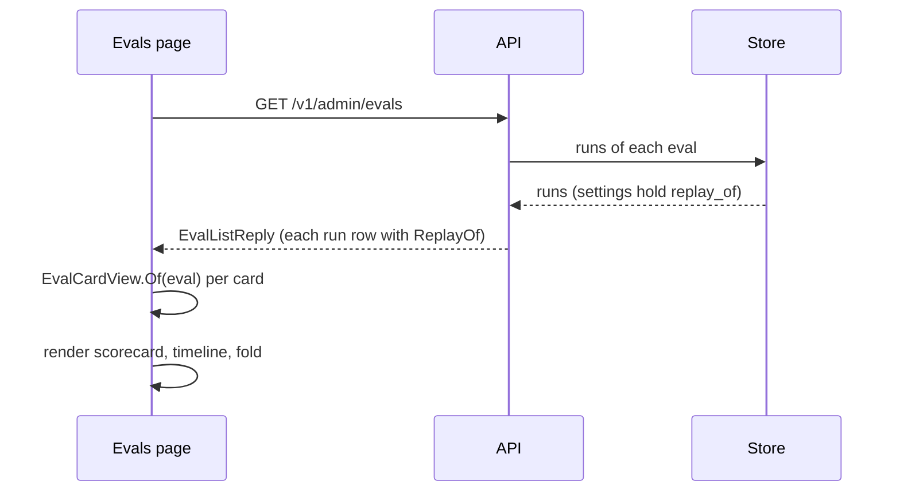

# CL26 · The eval card, reworked: a scorecard and a run timeline: plan

> **Plan.** How the admin portal's Evals page shows an eval: a scorecard of its latest run, its runs as a timeline,
> and what it checks folded away. Approved by Louis on 2026-10-29 · Branch: `refactor/CL26-eval-card`, from `main`.

## Context

The Evals page (F18 step 7b (i), `EvalCard` and `EvalRunTable`) lists each eval as a block of facts and a plain table.
Louis, 2026-10-29: "these screens need a rework, it looks bad, make it fancy and human readable". What reads badly
on `puls-cook`:

- **The facts come first and run long:** nine graders, one per line, push the runs below the fold, though the runs
  are what a person opens the page for.
- **The rates are text:** `puls-cook pass@1 100% · pass^1 100%`, one line per mode per k. Five runs make twenty lines
  of the same words, and nothing shows at a glance which run went well.
- **A replay looks like a recording:** both read `DONE · 1 repeat`; only the R0 hints which was free, and nothing says
  which recording it replayed.
- **The columns jam together:** the run id runs into its date, *Outcome* into *Repeats*.

## Design (Louis's picks, 2026-10-29)

- **Scorecard and run timeline** (pick 1 of 3; the others were a tidied table with chips and a heatmap of runs by
  mode). The patterns, in plain words:
  - **Progressive disclosure** (Nielsen Norman Group): first what most people want, the latest run's result; the
    detail (graders, categories, dataset) one click away, in a fold.
  - **Small multiples** (Tufte): every run gets the same small rate bar per mode, so runs compare by eye, top to
    bottom.
  - **Presentation Model** (Fowler): a plain class works out what the card shows (the latest run, each mode's rates,
    which run is a replay or a re-score, the graders by kind), so the components only place it, and the logic gets
    NUnit tests without a browser.
- **A run says it is a replay** (pick 1 of 3; the others were to drop the tag, or guess from a zero cost): the
  contract's `StoredRunRow` gains `ReplayOf`, beside `RescoreOf`, filled from the stored run's `replay_of` setting. The
  card tags the run *replay of `dc272b9`* with a link, as `RescoredFrom` does for a re-score. No backward reader: an
  older client is rebuilt with it (ADR 0049).
- **Reuse:** `Ring` (one per mode in the scorecard), `RateBar` (the timeline's bars), `ModeRatesReader` (each mode's
  last rates), `RunText` (short id, money, status), the `status-pill` and the `chip`; Puls's orange and green tokens,
  no new colours. No package.

## Steps

One commit each, shown before it is committed; never pushed without asking.

0. **The plan.** This file and its line in `plans/README.md`, the TODO line. Commit `docs(cl26): the plan`.
1. **A run says what it replayed.** Test first in `tests/louis-agent.api.tests` (a stored run with `replay_of` in its
   settings gives a row with `ReplayOf`; one without gives null), then `StoredRunRow.ReplayOf` and its line in
   `AdminRunReplies.Of`. Commit `refactor(cl26): step 1 - a run row says what it replayed`.
2. **What the card shows, worked out.** Test first in `tests/louis-agent.puls.tests/Admin/Evals/EvalCardViewTests.cs`:
   the latest run is the newest; each mode's ring is its last pass@k, with pass^k beside it; a run is a recording, a
   replay (with its source) or a re-score; graders group by kind (rules, model, a person); a mode with no rates shows
   a dash, never 0; an eval that never ran has no scorecard. Then `EvalCardView` (`Puls/Admin/Evals/`) and the
   `EvalText` words it needs. Commit `refactor(cl26): step 2 - the eval card's view`.
3. **The card, reworked.** bUnit tests first (the scorecard has a ring per mode, a replay row links its recording, the
   fold holds every grader), then `EvalScorecard`, `EvalRunTimeline` (in place of `EvalRunTable`, deleted) and
   `EvalChecks`; `EvalCard` places them; the styles in `app.css` beside the Evals page's. Checked by hand in the
   rebuilt Puls at desktop and phone width, with a screenshot in the step. Commit
   `refactor(cl26): step 3 - the eval card as a scorecard and a timeline`.
4. **Finish.** `docs/guides/change-the-puls-app.md` if it describes the card, the CHANGELOG line, the TODO line out,
   the plan deleted (CL24). Commit `docs(cl26): finished`. Then ask before pushing and before a PR.

## Done when

An eval's card leads with its latest run's result per mode, as rings; its runs read as a timeline with a bar per mode,
a replay or a re-score tagged and linked to its source; its graders and categories sit in one fold; it reads at phone
width with no sideways scroll.

## Diagrams

### Interface design

### Architecture

### Communication

### Types

| Type | New / changed | Folder | Namespace | Step |
|---|---|---|---|---|
| `StoredRunRow` | changed: `ReplayOf` | `src/louis-agent.api.contracts/Admin/Runs/` | `LouisAgent.Api.Contracts.Admin.Runs` | 1 |
| `AdminRunReplies` | changed: fills `ReplayOf` | `src/louis-agent.api/Admin/Replies/` | `LouisAgent.Api.Admin.Replies` | 1 |
| `EvalCardView`, `Scorecard`, `RunLine`, `GraderGroup`, `RunOrigin` | new | `src/louis-agent.puls/Admin/Evals/` | `LouisAgent.Puls.Admin.Evals` | 2 |
| `EvalText` | changed: the card's new words | `src/louis-agent.puls/Admin/Evals/` | `LouisAgent.Puls.Admin.Evals` | 2 |
| `EvalScorecard`, `EvalRunTimeline`, `EvalChecks` | new components | `src/louis-agent.puls/Components/Admin/EvalsPage/` | `LouisAgent.Puls.Components.Admin.EvalsPage` | 3 |
| `EvalCard` | changed: places the three | `src/louis-agent.puls/Components/Admin/EvalsPage/` | `LouisAgent.Puls.Components.Admin.EvalsPage` | 3 |
| `EvalRunTable` | deleted | `src/louis-agent.puls/Components/Admin/EvalsPage/` | — | 3 |

## Approved during the build

- 2026-10-29, step 2: no `Scorecard` record (Louis's pick of three). The latest run is a `RunLine` like every run on
  the timeline: it holds the same run, rates and origin, and the scorecard needs the origin too.
- 2026-10-29, during step 3: `main` merged in (FX26, FX27 and CL25 had landed).
- 2026-10-29, during step 3 (Louis: "we need to split app.css, and make it a rule to also split the css"; his picks
  of three each): **CSS files by area in ITCSS order** (settings, base, layout, components; Harry Roberts' Inverted
  Triangle CSS), in folders by concern under `wwwroot/css/`, `app.css` left as the ordered `@import` list, a pure move
  with no rule changed; **a `.css` file holds at most 200 lines**, blank and comment lines not counted, in both web
  apps, held by `FileSizeTests`. Step 4 becomes the rule (test first) and Puls's split, step 5 the code-review app's
  split, step 6 the finish with an ADR for the rule and its line in `.claude/rules/`.
