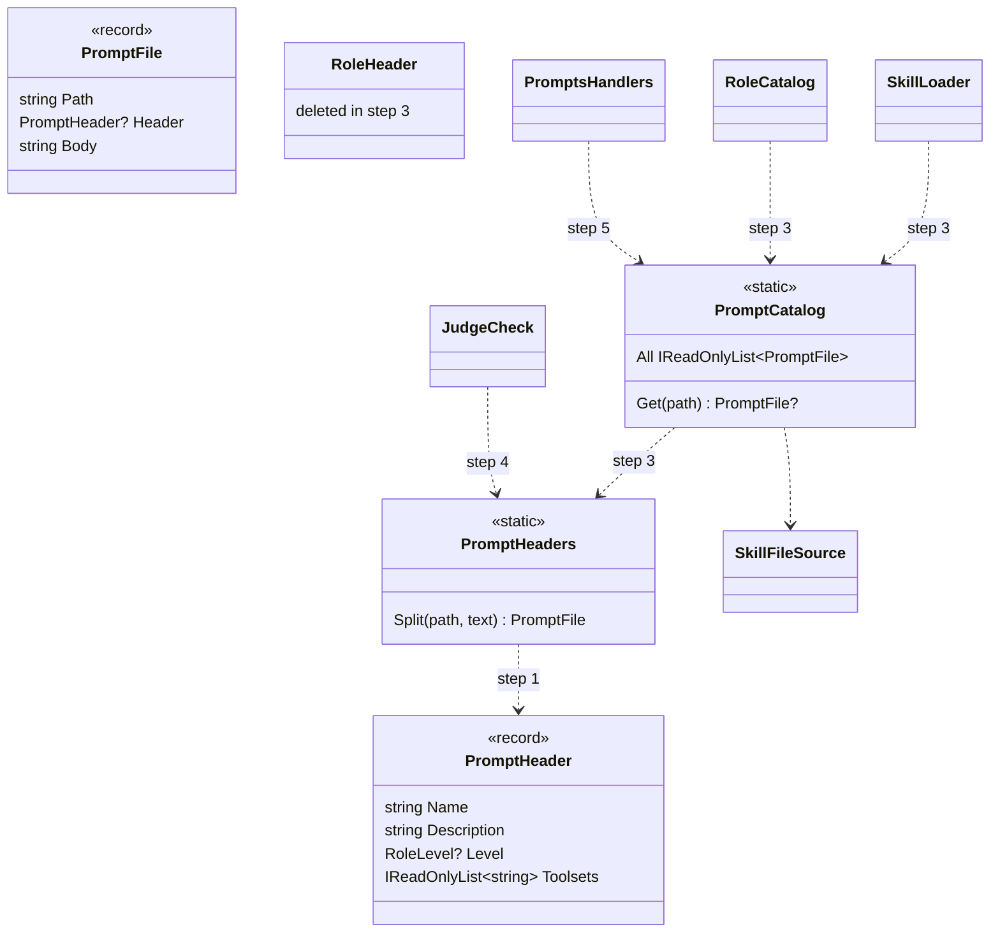
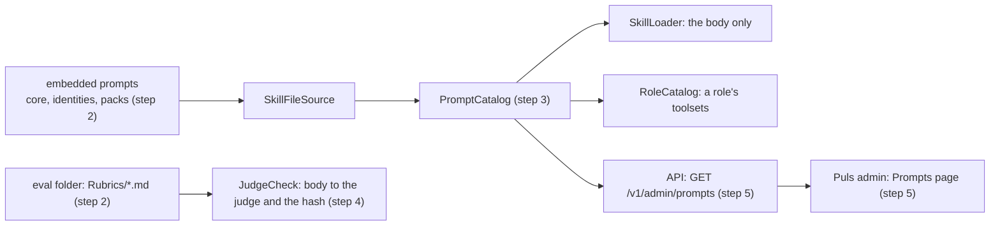
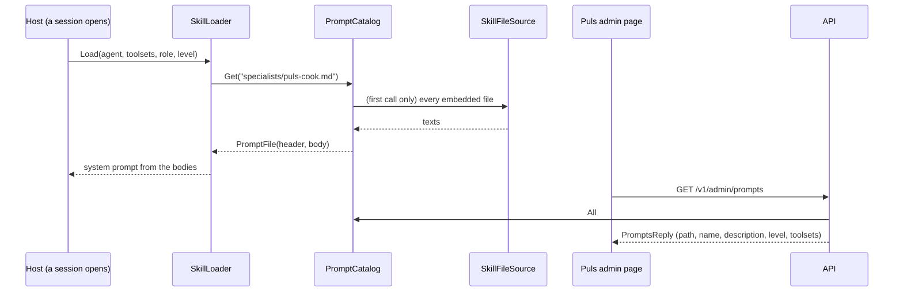
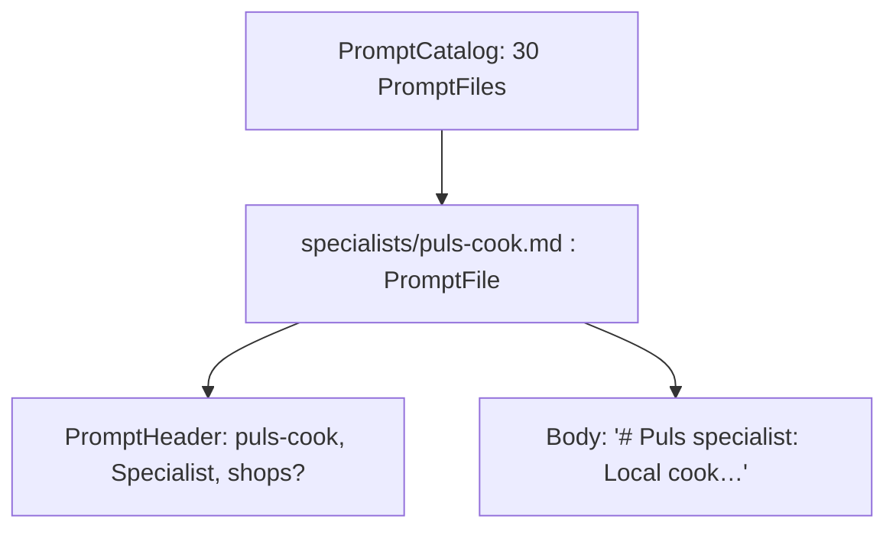

# CL27 Prompt headers

> **What this answers:** how every built-in prompt (each mode, role, minion, guide, the principles and the judge's
> rubric) opens with the same YAML front matter, how the loader reads it once and hands the model only the body, and
> where the portal shows it. A cleanup with its own small plan (TODO's *CL27*). Branch `refactor/CL27-prompt-headers`.

Status: **draft v1, 2026-11-03**, written and built unattended at Louis's word ("finish everything I gave you
unattended, do not ask until done"); the findings carry the picks, for his review on the pull request.

## Context

The TODO line (Louis, 2026-10-30): every role, mode, guide and judge rubric opens with the same YAML front matter, the
Agent Skills spec's `name` and `description`, ours (`level`, `toolsets`) under `metadata`, read once by the skill
loader and shown in the portal; the built-in prompts stay embedded (ADR 0018 holds); the `SKILL.md` folders for
function skills stay with Phase 7.

Today a prompt says what it is only in its first heading and its folder (ADR 0017: `agent/`, `specialists/`,
`minions/`, `toolsets/`, `shared/`). One role has a header: F33's `RoleHeader`, a `---` fence with a `toolsets:` line
read by a hand-written line splitter (`louis-agent.core/Skills/Roles/RoleHeader.cs`), used by `RoleCatalog.ToolsetsOf`
and stripped in `SkillLoader.Read`. The judge's rubric (`identities/…/Evals/Cook/Rubrics/meal-for-people.md`) is read
by `JudgeCheck` and hashed by `RubricHash`, so a stored calibration knows which rubric it measured. `GET /v1/roles`
gives names only.

The Agent Skills spec's front matter: `name` (lowercase letters, digits and hyphens, at most 64, the folder's name),
`description` (at most 1024 characters: what it does and when to use it), optional `license`, `compatibility`,
`allowed-tools`, and `metadata`, a map of string to string for the rest.

## Design

1. **One header, one reader, in core.** `PromptHeader` (a record: `Name`, `Description`, `Level`, `Toolsets`) and
   `PromptHeaders.Split(path, text)`, which reads the front matter with YamlDotNet into a strict record and gives the
   header and the body; it replaces `RoleHeader`. `name` must be the file's name, `metadata.level` one of `agent`,
   `specialist`, `minion` (a `RoleLevel`, by its wire name), `metadata.toolsets` a comma list as F33's line was
   (`shops?`); any other key refuses the file, naming it. A file without a header is still read (the agent's own
   function files on disk have none until Phase 7).
2. **Every built-in prompt carries one**, the body unchanged, so the prompt goldens stay byte for byte the same: that
   is the proof the header never reaches the model.
3. **Read once.** `PromptCatalog` reads every embedded prompt's header once, lazily, from `SkillFileSource`, and keeps
   path, header and body; `SkillLoader.Read` and `RoleCatalog.ToolsetsOf` ask it.
4. **The rubric's header is stripped before the judge and the hash**, so `RubricHash` and every stored calibration stay
   as they were.
5. **The portal shows them**: `GET /v1/admin/prompts` (the admin key) lists every built-in prompt's header, and Puls's
   admin gets a *Prompts* page, grouped by kind.

```
---
name: puls-cook
description: Puls's local cook. A recipe for the people and town asked for, with a shopping list priced at the shops.
metadata:
  level: specialist
  toolsets: shops?
---
# Puls specialist: Local cook
```

### Interface



```csharp
public sealed record PromptHeader(string Name, string Description, RoleLevel? Level, IReadOnlyList<string> Toolsets);
public sealed record PromptFile(string Path, PromptHeader? Header, string Body);
public static class PromptHeaders { public static PromptFile Split(string path, string text); }   // throws PromptHeaderException
public static class PromptCatalog { public static IReadOnlyList<PromptFile> All { get; } public static PromptFile? Get(string path); }
public sealed record PromptsReply(IReadOnlyList<PromptRow> Prompts);                              // step 5, contracts
public sealed record PromptRow(string Path, string Name, string Description, string? Level, IReadOnlyList<string> Toolsets);
```

### Architecture



### Communication



### Objects (one cook sub-session)



### Namespace map

| Type | Folder | Namespace | Step |
|---|---|---|---|
| `PromptHeader`, `PromptFile`, `PromptHeaders`, `PromptHeaderException` | `louis-agent.core/Skills/Headers/` | `LouisAgent.Core.Skills.Headers` | 1 |
| `PromptHeaderMessage` (refusals) | `louis-agent.core/Skills/Messages/` | `LouisAgent.Core.Skills.Messages` | 1 |
| `PromptHeadersTests` | `tests/louis-agent.core.tests/Skills/Headers/` | `LouisAgent.Core.Tests.Skills.Headers` | 1 |
| `EveryPromptHasAHeaderTests` | `tests/louis-agent.composition.tests/` | `LouisAgent.Composition.Tests` | 2 |
| `PromptCatalog` | `louis-agent.core/Skills/Headers/` | `LouisAgent.Core.Skills.Headers` | 3 |
| `RoleHeader`, `RoleHeaderTests` | deleted | | 3 |
| `JudgeCheck` (changed) | `evals/louis-agent.evals/Grading/Models/Rubrics/` | `LouisAgent.Evals.Grading.Models.Rubrics` | 4 |
| `PromptsReply`, `PromptRow` | `src/louis-agent.api.contracts/Admin/Prompts/` | `LouisAgent.Api.Contracts.Admin.Prompts` | 5 |
| `PromptsHandlers` | `src/louis-agent.api/Endpoints/Admin/Prompts/` | `LouisAgent.Api.Endpoints.Admin.Prompts` | 5 |
| `Prompts` page | `src/louis-agent.puls/Pages/Admin/` | `LouisAgent.Puls.Pages.Admin` | 5 |

## Steps (one commit each, test first, stop after each)

| Step | What | Test first |
|---|---|---|
| 1 | `PromptHeader` and `PromptHeaders.Split` with YamlDotNet in core | a header gives its fields and the body; no header gives the text whole; an unknown key, a name not the file's, a bad level each refuse naming the file |
| 2 | The header on every built-in prompt and the rubric; the test fixtures too | every embedded prompt has a header whose name is its file's and whose level is its folder's; the prompt goldens unchanged |
| 3 | `PromptCatalog`; `SkillLoader` and `RoleCatalog` read through it; `RoleHeader` deleted | a role's toolsets come from `metadata.toolsets`; no prompt the model gets starts with `---` |
| 4 | `JudgeCheck` strips the rubric's header before the judge and the hash | the hash of the headed rubric is the hash of its body; the judge never sees the fence |
| 5 | `GET /v1/admin/prompts` and Puls's *Prompts* page | the route lists each prompt's header; bUnit: the page groups them by kind |
| 6 | Docs: ADR 0063 *A prompt says what it is*, the guides (build an identity, build a pack, add a skill), write-up 07, CHANGELOG, TODO (CL27 closes), this plan deleted | the docs tests |

Six steps. Paid runs: none.

## Verification

The unit suites; the prompt goldens (`ModelRequestSnapshotTests`) unchanged after steps 2 and 3; the cook eval's
conformance (its rubric hash unchanged) after step 4; the routes golden after step 5.

## Findings (picked unattended, for review on the PR)

**A. How the header is read.** (1) **YamlDotNet into a strict record** (picked; pro: a real YAML reader, the spec's
format exactly, Louis allowed YamlDotNet on 2026-11-03; con: a package in core); (2) a hand splitter as `RoleHeader`
grown to nested keys (pro: no package; con: a YAML subset by hand, the thing ADR 0030 says to adopt); (3) JSON front
matter (pro: System.Text.Json; con: not the spec).

**B. Where the portal shows it.** (1) **an admin *Prompts* page over `GET /v1/admin/prompts`** (picked; pro: every
kind in one place, behind the admin key; con: a page and a route); (2) names and descriptions added to `GET /v1/roles`
(pro: no new route; con: guides and the rubric aren't roles); (3) only in the logs (con: not "shown in the portal").

**C. How strict.** (1) **an unknown key refuses the file** (picked; ADR 0049, no lenient reader; a typo can't silently
drop a toolset); (2) unknown keys ignored (con: a misspelled `toolset` loads nothing, quietly); (3) the spec's optional
keys allowed, ours strict (con: keys nothing reads).

## Concepts, and where they sit in the skill map

- **A prompt is content with metadata** (#7 context engineering): the model reads only the body; the loader, the
  portal and the tests read what the file says it is.
- **One reader, read once** (#20 extensibility): the same header a `SKILL.md` folder will carry in Phase 7.

## Approved during the build

## Sources

The Agent Skills specification (front matter) · YamlDotNet (MIT) · ADRs 0017, 0018, 0025, 0030, 0049 · F33's
`RoleHeader` · TODO's *CL27* line

---
[Docs index](../README.md) · Related: [Plans](README.md)
