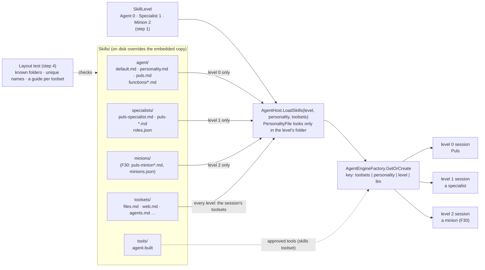
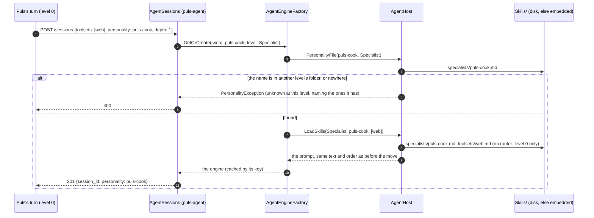

# CL8 · Skills by level: the skill files follow the agent levels

> **Plan.** How the `Skills/` folder is regrouped so its folders follow the levels a session runs at, and how the code
> holds that as a rule. **For:** TODO *Skills by level* (cleanup). **Approved:** 2026-10-16 (Louis).
> **Branch:** `refactor/CL8-skills-by-level`, off `main`, before F30 step 4.

## Context

F30 adds a second level of delegation (minions, level 2) under the specialists (level 1) under the agent the user
talks to (level 0). Each level needs its own prompt files: Puls's voice and the router at level 0, a role per
specialist at level 1, a function per minion at level 2. Today `Skills/` is one flat folder holding four kinds of file
(the prompt's base, toolset guides, function skills, an example) plus `personalities/` (level 0 and level 1 mixed:
`puls.md` beside `puls-cook.md`) and `tools/`.

Louis (2026-10-16): minions get their own skill files; skill files are grouped by folder; **the folders mimic the
levels, and that is a rule.** Done before F30 step 4, so the minion files are written into their folder once and never
moved.

Goal skill: 11, context engineering (what each session's prompt is made of, and who decides).

## Design

### The layout

```
Skills/
  agent/          level 0: the agent the user talks to
                    default.md (the router), personality.md (the default voice), puls.md (Puls's voice)
                    functions/  code-review.md, time-logging.md …   (procedures; AGENT_FUNCTION; CreateSkillFile writes here)
  specialists/    level 1: one role per file
                    puls-specialist.md (the shared base), puls-cook.md, puls-researcher.md, puls-analyst.md,
                    puls-historian.md, puls-reader.md, roles.json
  minions/        level 2: one function per file (F30 fills it: puls-minion.md, puls-minion-*.md, minions.json)
  toolsets/       shared by every level: a toolset's guide is the same whichever level loads it
                    files.md, git.md, dotnet.md, python.md, powershell.md, bash.md, web.md, paymo.md, devops.md,
                    agents.md, self-extension.md
  tools/          agent-built tools (unchanged)
  examples/       HelloWorld.md (not embedded, as today)
```

- **The `-skills.md` suffix goes** inside the folders (`toolsets/web.md`, `agent/functions/code-review.md`): the
  folder already says what the file is. `AGENT_FUNCTION=code-review` reads `agent/functions/code-review.md`.
- **Names stay unique across levels** (a role name means one file), so `PERSONALITIES_ENABLED` (F29) keeps naming
  roles without a level.

### The rule (into *Rules that always apply*, with ADR 0016)

> **Skill files follow the levels.** A prompt file lives in the folder of the level that reads it: `agent/` (level 0),
> `specialists/` (level 1), `minions/` (level 2); what every level shares, the toolset guides, lives in `toolsets/`. A
> session at depth N loads its personality only from level N's folder, so a role is never opened at the wrong level.
> Why: [ADR 0016](../adr/0016-skills-by-level.md).

Held in code, not only in the docs:

- **`SkillLevel`** (core, `Skills/`): `Agent = 0`, `Specialist = 1`, `Minion = 2`, each with its folder; a session's
  level is its depth (`AgentSessions` already knows it).
- **`AgentHost.PersonalityFile(agent, personality, level)`** looks only in that level's folder; a name from another
  level is refused like an unknown one (`ErrorMessage.UnknownPersonality`, a 400 on the API), naming the ones the level
  has. Without a name: level 0 gets `agent/personality.md`; level 1 gets its role from `specialists/roles.json` (as
  today); level 2 must name one (F30).
- **`AgentEngineFactory.GetOrCreate`** takes the level instead of today's `router` flag (router = level 0), so the key
  and the prompt both follow from one value.
- **`GET /personalities`** lists each level: `{ "default": null, "agent": [...], "specialists": [...], "minions": [...] }`.
  Nothing reads the flat list today (checked: the web apps, the benchmark scripts and the portal send `puls` at depth 0
  and roles through `StartSubSession` at depth 1, which is where they belong).
- **A layout test** beside `ArchitectureTests`: every file under `Skills/` is in a known folder; no name is in two level
  folders; every toolset in `ToolsetCatalog` has its guide in `toolsets/`; every embedded resource maps to a file.

### What moves, and what reads it

| Reads | Today | After |
|---|---|---|
| `AgentHost.LoadSkills` | `personality.md`, `default.md` at the root | `agent/personality.md`, `agent/default.md`; the level picks the personality's folder |
| `ToolsetCatalog` (`GuideFile`) | `web-skills.md` … | `toolsets/web.md` … |
| `SkillFiles.BuiltIn`, `FunctionSkillFiles` | file names at the root | `toolsets/…`, `agent/functions/…` |
| `AgentHost.FindSkillsDirectory` | the folder of `default.md` | the folder above `agent/default.md` (the skills root) |
| `DiscoverSkillFiles` (`AGENT_FUNCTION=louis`) | `*-skills.md` at the root | `agent/functions/*.md` |
| `SkillTools.CreateSkillFile` | writes `<name>-skills.md` at the root | writes `agent/functions/<name>.md` (its description changes: golden file) |
| `Personalities` (`Folder`, `RolesFile`, `Available`) | `personalities/` | per level; `specialists/roles.json` |
| `louis-agent.core.csproj` | `Skills.*.md`, `Skills.personalities.*` | one `EmbeddedResource` per folder; `SkillFileSource` already maps `a/b.md` to `Skills.a.b.md` |
| Dockerfiles (`COPY Skills/ ./`), compose (`../Skills:/skills`) | the whole folder | unchanged: the folders come along |
| The orchestrator (`Skills/{service}/` in its own project) | — | not touched |

**What the model reads doesn't change:** the same files, in the same order, with the same text. The golden file
(`ModelRequestSnapshot.json`) therefore must not change in steps 1–3, except `CreateSkillFile`'s description in step 3;
that is the regression test for the move.

### Architecture: where each level's prompt comes from



### Communication: opening a specialist after the move



## Steps (one commit each, test first, stop after each)

| Step | What | Check |
|---|---|---|
| 0 | **Docs:** this plan; ADR 0016 *Skill files follow the levels*; the TODO line; the plans index row | — |
| 1 | **Levels in code, files not moved yet:** `SkillLevel`; `PersonalityFile(…, level)` and `LoadSkills(…, level)`; `GetOrCreate`'s `router` becomes the level; `AgentSessions` passes `depth` as the level; `GET /personalities` per level. Until step 2 every level's folder is `personalities/` (one line to change) | Tests first: a level-1 role refused at level 0 and the other way round, with the level's names in the message; level 0 without a name gets `personality.md`; the key separates levels; `AgentSessionsTests` for the 400. Golden file unchanged |
| 2 | **Move the files** (`git mv`, so history follows) and point every reader at them: the table above; the csproj's embedded resources; `FindSkillsDirectory`'s marker | The whole core and API suites; the golden file **unchanged** (same text, same order); `SkillFileSource` reads every moved file embedded and from disk |
| 3 | **Function skills in `agent/functions/`:** discovery, `AGENT_FUNCTION`, `CreateSkillFile` writes `agent/functions/<name>.md` | `SkillToolsTests` first (where it writes, that it loads); golden file: only `CreateSkillFile`'s description |
| 4 | **The layout test, and the rule written down:** the test above; `docs/CLAUDE.md` *Rules that always apply* and *Adding a skill / a personality*; `louis-agent.core/CLAUDE.md` *Adding a toolset* and *Project layout*; ADR 0011's file names; the building-block view; every doc link to a moved file (a link check over `docs/`) | The layout test fails first on a file planted in the root (then removed); the link check clean |
| 5 | **Rebuild and check by hand (free, no model calls):** every image (core changed); `GET /personalities` on Puls and puls-agent shows the three levels; the start-up logs show each skill file from its folder; the CLI starts with `AGENT_FUNCTION=louis` and lists the function skills | by hand |

## Reused, not built

- `SkillFileSource` already maps a path with folders to its embedded name; `AgentHost.SkillFilePaths` already tries
  `Skills/{path}`; `Personalities.IsValidName` keeps a name inside its folder.
- `AgentSessions`' depth is the level: no new setting.
- Considered, not used: folders by kind only (`personalities/`, `guides/`, `functions/`), which doesn't stop a role
  being opened at the wrong level; a level written inside each file (front matter), which the loader would have to
  parse and a misplaced file would still pass.

## Risks to watch

- **A file someone keeps on disk at the old path** (a copy in a mounted `Skills/` that overrides the embedded one)
  would silently stop overriding: the layout test runs on the repo, and step 5's logs show where each file came from.
- **Users' own skill files** written by `CreateSkillFile` at the root: none in the repo today; the layout test fails
  on any, so they're moved by hand once.
- **Open chats**: the prompt text doesn't change, so no thinking-signature break (FX4); recreating the containers ends
  open sessions anyway.

## Verification

- `dotnet build louis-agent-solution.sln`; `dotnet test` on core and API each step; the whole solution before the PR.
- The golden file unchanged in steps 1–2 (the move's regression test), only `CreateSkillFile`'s description in step 3.
- Every image rebuilt (Louis's standing rule) and the step 5 checks; no paid run.

## Concepts

- **Context engineering** (goal skill 11): a session's prompt is assembled from files by its level and toolsets;
  making the level a folder makes "what this session knows" readable from the tree.
- **Rules in code, not in the prompt or the docs** (ADR 0010's spirit): the loader refuses a wrong-level role, and a
  test refuses a misplaced file.

## Approved during the build

- **ADR 0011 keeps its body; only its status changes** (Louis, step 0, 2026-10-16): accepted ADRs are never edited
  except their *Status* line, so step 4 sets 0011's to *Accepted; file names amended by
  [0016](../adr/0016-skills-by-level.md)* instead of changing its file names. ADR 0016 records the new names.
- **Step 1 moves the named personalities; step 2 moves the rest** (Louis, step 1, 2026-10-16): with every level's
  folder still `personalities/`, a role opened at the wrong level is found and can't be refused, so step 1 couldn't
  test what it adds. Step 1 now moves `puls.md` to `agent/` and the roles and `roles.json` to `specialists/` (with the
  csproj's embedded resources for those two folders); `personality.md` and `default.md` stay at the root until step 2,
  which moves them and the toolset guides.
- **Step 4 also renames the file names the model reads** (Louis, step 2, 2026-10-16): `default.md` (three times) and
  `StartSubSession`'s descriptions (twice) say `agents-skills.md`, which step 2 moved to `toolsets/agents.md`. Step 2
  left them so its golden file stayed unchanged; step 4 says "the agents guide" instead of a file name and regenerates
  the golden file, so its diff shows only those words.
