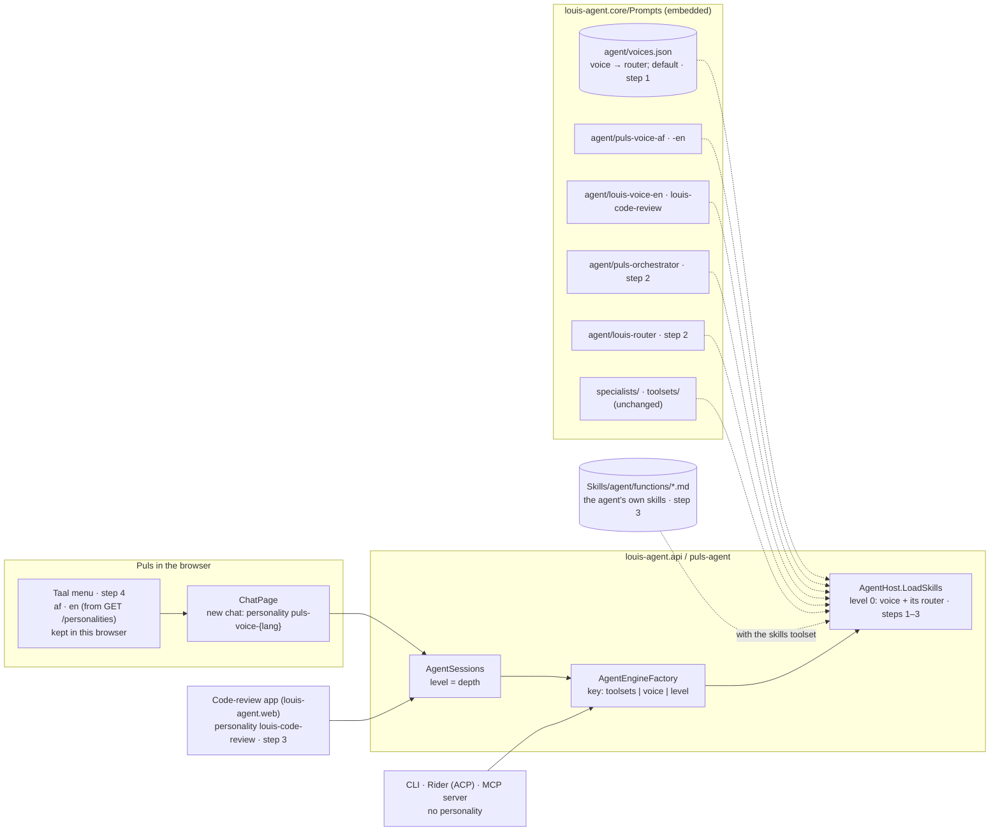

# CL9 · Modes per product: a voice and its router, chosen per session

> **Plan.** How a level-0 session becomes a *mode*, a voice and the router that goes with it, so Puls and the coding
> agent each get only their own routing, Puls speaks Afrikaans or English as its user chose, and `AGENT_FUNCTION`
> goes. **For:** TODO *Modes per product* (cleanup). **Approved:** 2026-10-16 (Louis; the coding router named `louis-router`).
> **Branch:** `refactor/CL9-modes-per-product`, stacked on `refactor/CL8-skills-by-level` and rebased onto `main`
> once CL8 is merged; before F30 step 4.

## Context

CL8 left `louis-agent.core/Prompts/agent/` holding three files that do three different jobs: `personality.md` (Louis's
Minion, the coding agent's voice, for every level-0 session that names none), `puls.md` (Puls's voice, Afrikaans) and
`default.md` (the router, shared by both products). Louis (2026-10-16), reading that folder: "why do we have [these],
could we not just have one, for instance modes puls-voice-af (for afrikaans), puls-voice-en (for english) … and
then puls-orchestrator for the orchestration part"; then "code-review could also be a mode?", "there is no real
reason for agent function", and "there is a lang selector … if that changes update the lang file; we only cater for
af and en".

What the code shows:
- **The shared router costs both products.** `default.md` carries Puls's cook row and its Afrikaans briefing labels
  (`**Vir:**`, `**Wil hê:**`, `**Klink:**`) and the coding rows (files, git, dotnet, Paymo, DevOps) Puls never uses; every
  request of either product pays for the other's rows in its fixed prefix.
- **`AGENT_FUNCTION` selects a placeholder.** CL8 step 6 removed time-logging; what's left is `code-review.md`, whose
  three skills only `echo` (the file says so), and `louis`, which loads every function file. Its default is
  `code-review`. The orchestrator sets it to `orchestrator` and never reads it.
- **The code-review app is a mode, not a function.** `louis-agent.web` opens sessions with every toolset and no
  personality; nothing about it uses the code-review skills.
- **Puls's language is fixed twice.** `ChatPage.razor` sends `personality: "puls"`; the *Taal* menu lists English,
  Nederlands, Deutsch and isiZulu, each "coming soon". Nothing ties a language choice to the voice.

Goal skills: 3, prompt design, and 7, context engineering (each mode's prompt holds only its own routing), and 13, cost (a smaller fixed
prefix per request, measured).

## Design

### Modes

A **mode** is a level-0 voice and the router that goes with it. The voices are what a session names; a router is never
named, it comes with its voice. Specialists (level 1) and minions (level 2) are unchanged: they have no router.

```
Prompts/agent/
  puls-voice-af.md      Puls's voice, Afrikaans (today's puls.md, git mv)
  puls-voice-en.md      Puls's voice, English (new text: Louis writes or approves it)
  puls-orchestrator.md    Puls's router: the world (web), the cook, delegating, briefing and relaying
  louis-voice-en.md     the coding agent's voice (today's personality.md, git mv): CLI, Rider
  louis-code-review.md    the code-review app's voice: how to review a change (new text: Louis approves it)
  louis-router.md   the coding router: files, git, web, scripts, dotnet, paymo, devops, skills
  voices.json             each voice and its router; the default voice
  functions/              (empty of built-ins: the agent's own function skills are on disk, in Skills/)
```

`voices.json` is data, as `specialists/roles.json` is:

```json
{
  "default": "louis-voice-en",
  "voices": [
    { "voice": "puls-voice-af",   "router": "puls-orchestrator" },
    { "voice": "puls-voice-en",   "router": "puls-orchestrator" },
    { "voice": "louis-voice-en",  "router": "louis-router" },
    { "voice": "louis-code-review", "router": "louis-router" }
  ]
}
```

- **A voice picks its router**, from `voices.json`. Considered: deriving it from the name's prefix (`puls-*` →
  `puls-orchestrator`), which hides a rule in a naming habit and breaks on the first voice that doesn't fit it.
- **The voices offered at level 0 are the ones in `voices.json`.** A router isn't a voice, so naming one is refused as
  an unknown personality; `Personalities.IsReserved` and the constants `DefaultFile` and `Router` go.
- **No name means the default voice** (`louis-voice-en`), so the CLI, Rider and the MCP server keep the Minion and
  the coding router with no change on their side.
- **The engine key doesn't change:** the voice is already in it, and the router follows from the voice.
- **`GET /personalities`** keeps its shape; `default` becomes `"louis-voice-en"` instead of `null`.

### Puls's language

- The *Taal* menu offers **Afrikaans** and **English** only. The choice is kept in this browser, as the currency and the
  location are, and defaults to Afrikaans, so Puls behaves as today.
- **New chats** open with `personality: "puls-voice-{af|en}"`; a running chat keeps its voice, as a session keeps its
  personality (its prefix stays cacheable).
- **Linked by data:** the menu lists the languages for which `GET /personalities` offers a `puls-voice-{code}` voice
  (with a name per code in Puls: `af` Afrikaans, `en` English). A voice without a name in Puls, or a name without a
  voice, isn't offered, so the two can't drift; Nederlands, Deutsch and isiZulu come back when their voices exist.
- **The UI's own words stay Afrikaans** (Louis: only the voice follows the language).
- The checks (`samples/puls-check`, `samples/puls-cook-check`) send `puls-voice-af` instead of `puls`.

### `AGENT_FUNCTION` goes

- `AgentOptions.AgentFunction`, its setting and the `louis` / function-name branches in `AgentHost.LoadSkills` go. With
  the `skills` toolset, a session loads every function skill the agent wrote (`Skills/agent/functions/*.md`, on disk);
  there are no built-in ones left once `code-review.md` goes.
- The orchestrator's `agentOptions.AgentFunction = "orchestrator"` goes. An `.env` that still sets `AGENT_FUNCTION` is
  harmless (an unknown variable); `.env.example` drops it.

### The routers' split

- **`puls-orchestrator.md`**: the world (`web`, answered yourself), cooking (`web`, `puls-cook`), delegating, the
  briefing shape, relaying a report, following up; files, git and scripts as *not yet* only if Puls should still say
  so in one line (to decide while splitting, with the delegation check's cases).
- **`louis-router.md`**: files, git, web, python / powershell / bash, dotnet, paymo, devops, skills, agents (a
  coding agent may delegate when it has peers); no cook, no Afrikaans labels.
- Step 1 copies `default.md` into both unchanged, so the rename is proven by the golden file before any text changes;
  step 2 splits the text.

### Architecture: where a session's prompt comes from



### Communication: Puls switches to English

```mermaid
sequenceDiagram
    autonumber
    actor U as User
    participant P as Puls (ChatPage)
    participant A as puls (API)
    participant F as AgentEngineFactory
    participant H as AgentHost
    participant R as Prompts (assembly)

    P->>A: GET /personalities
    A-->>P: {default: louis-voice-en, agent: [puls-voice-af, puls-voice-en], specialists: [puls-cook], …}
    Note over P: Taal lists af and en: a voice exists for each
    U->>P: Taal → English
    Note over P: kept in this browser; the open chat keeps its voice
    U->>P: a new chat: "What can I cook for four tonight?"
    P->>A: POST /sessions {toolsets: [agents, web], personality: puls-voice-en, …}
    A->>F: GetOrCreate([agents, web], puls-voice-en, level Agent)
    F->>H: LoadSkills(…, puls-voice-en, Agent)
    H->>R: agent/voices.json → router puls-orchestrator
    H->>R: agent/puls-voice-en.md, agent/puls-orchestrator.md, toolsets/agents.md, toolsets/web.md
    H-->>F: the prompt (Puls in English, Puls's routing only)
    F-->>A: the engine (cached by its key)
    A-->>P: 201 {session_id, personality: puls-voice-en}
    P->>A: the turn, as today: Puls hands the cooking to the cook
```

## Steps (one commit each, test first, stop after each)

| Step | What | Check |
|---|---|---|
| 0 | **Docs:** this plan; ADR 0019 *A level-0 session is a mode: a voice and its router*; the TODO line; the plans index row | — |
| 1 | **Voices and routers in code, the text unchanged:** `git mv` `puls.md` → `puls-voice-af.md`, `personality.md` → `louis-voice-en.md`; `default.md` copied to `puls-orchestrator.md` and `louis-router.md`, then removed; `voices.json`; `PersonalityFile`, `LoadSkills` and `Available(Agent)` read it; `IsReserved`, `DefaultFile`, `Router` go. Callers: Puls's `ChatPage` (`puls-voice-af`), both checks' `run_check.py`. `SkillsLayoutTests`: every `agent/*.md` is a voice or a router in `voices.json`, and every name there has its file | Tests first: a voice gets its router; no name gets the default voice and its router; a router named as a voice is refused; an unknown voice is a 400 listing the voices; the layout rule. **Golden file unchanged** (same voice, same router text) |
| 2 | **Split the routers' text:** Puls's rows and rules in `puls-orchestrator.md`, the coding rows in `louis-router.md`; the `PersonalitiesTests` that read `default.md` read Puls's router. The fixed prefix before and after, from the start-up log's "about N tokens of fixed prefix", per profile (free) | Tests first (Puls's router has the cook and the briefing shape, the coding router has neither; the coding router has every coding toolset's row); golden file: only the router's text |
| 3 | **`AGENT_FUNCTION` goes; code review is a mode:** the option, its setting and `LoadSkills`' branches go; `code-review.md` goes; with `skills`, every function skill on disk loads; `louis-code-review.md` (draft for Louis); the code-review app names it; the orchestrator's line goes | Tests first (an agent-written function loads with `skills` and no setting; the code-review app's voice is offered; `AgentFunction` is gone); golden file: the code-review section and the router's line about functions |
| 4 | **Puls in English:** `puls-voice-en.md` (draft for Louis's wording, the same sections as the Afrikaans voice); the *Taal* menu as af / en from `GET /personalities`, kept in the browser, new chats only | Tests first: both Puls voices have the same section headings (a structural check that the two languages don't drift); the web app by hand (no Puls test project): pick English, a new chat's `POST /sessions` names `puls-voice-en`, the open chat doesn't change |
| 5 | **Docs and the rule:** *Rules that always apply* (modes); *Adding a personality* becomes *Adding a mode or a role*; `AGENT_FUNCTION` out of SETUP, the views and the glossary; the link check | Link check clean; `SkillsLayoutTests` |
| 6 | **Rebuild and check by hand (free):** every image; `GET /personalities` on both stacks; a Puls session in each language and a code-review session open with the right voice and router in the start-up log; the CLI starts on `louis-voice-en` | By hand |
| 7 | **Measure (Louis's go; a few rand):** the cook check and the delegation check on `puls-voice-af` against their saved baselines (F25, F29): routing right, cost per answer, prefix tokens; one English cook question to see the English voice hand off | `--report` on the saved runs first (no model calls); then the paid run; the numbers in BENCHMARKS.md and the CHANGELOG entry |

## Reused, not built

- `specialists/roles.json` and `Personalities.RoleFor` as the pattern for `voices.json` (a JSON file read through
  `SkillFileSource`, rules as data).
- `CurrencyState`'s way of keeping a choice in the browser, for the language.
- `GET /personalities` as the source of the languages (no new endpoint).
- `SkillsLayoutTests` and the golden file as the regression tests.
- Considered, not used: a `language` field on `POST /sessions` beside the personality (two settings that must agree);
  the router chosen by name prefix (above); keeping one router with per-product sections (both products still pay for
  both).

## Risks to watch

- **Puls's routing after the split** (step 2): rows move, and a row Puls relied on could be lost. The delegation and
  cook checks (step 7) measure it; step 2's tests pin the cook row and the briefing shape in Puls's router.
- **The English voice's quality** is a prompt Louis hasn't tuned; step 7 sends one English cook question, and the
  voice's wording is Louis's call before the step is committed.
- **The name *orchestrator***: `puls-orchestrator` shares a word with `louis-agent.orchestrator`, the microservice POC;
  the coding agent's router is `louis-router` to keep the clash to one file (Louis, 2026-10-16).
- **F30's ADR number moves again:** main's licence took 0016 and CL8 0017–0018, so this plan's ADR is 0019 and F30's
  minions ADR becomes 0020.
- **Open Rider chats** keep their container; a rebuilt image takes effect at a **New Chat**.

## Verification

- `dotnet build louis-agent-solution.sln`; `dotnet test` on core and API each step; the whole solution before the PR.
- The golden file unchanged in step 1; in steps 2 and 3, only the router's and the code-review text.
- Every image rebuilt and checked by hand (step 6); the paid run only with Louis's go (step 7).

## Concepts

- **Context engineering** (goal skill 7, with 3, prompt design): a mode's prompt holds its own routing and nothing else; the voice and its
  router are paired as data, not left to a naming habit.
- **Cost of the fixed prefix** (goal skill 13): every request pays for the router; a smaller one is measured per
  profile, free, from the start-up log, before any paid run.
- **One source of truth across front end and back end:** the language the menu offers is read from the voices the API
  has, so the two can't disagree.

## Approved during the build
- **The skill map** (the review of PR #47, 2026-10-16): context engineering is skill 7 and prompt design skill 3 in
  [GOAL.md](../GOAL.md); 11 is Protocols. The *Context* and *Concepts* above say 3 and 7.
- **`SkillFiles.BuiltIn` goes: what is embedded is built in** (Louis, 2026-10-16). After CL8 the hand-kept list only
  reserves names (a copy on disk can't override a built-in any more), and it can drift from what's embedded. Step 3,
  where `code-review.md` goes, replaces it with a check against `SkillFileSource.EmbeddedFiles`: `CreateSkillFile`
  refuses a name whose function or guide path is embedded, and discovery skips a disk file whose path is. Test first:
  a new toolset's guide is reserved with no list to edit; `SkillFilesTests` stops asserting the list.
- **The voices are `puls-voice-af`, `puls-voice-en` and `louis-voice-en`, not `*-default-*`** (Louis, step 1,
  2026-10-16): "do not call it default, call it puls-voice-af etc." The names above are written that way; which voice
  a session gets when it names none stays `voices.json`'s `default`. `louis-code-review` keeps its name.
- **One file per mode, in a folder per product; `voices.json` goes** (Louis, step 1, 2026-10-17): "each agent only
  loads with one file and one file only without losing current functionality … puls/voice-af.md … louis-agent/voice.md".
  This replaces the voice-and-router pairing above, and the `*-voice-*` names of the previous entry.
  - **A mode is one file:** its voice (the first `# ` section), then its routing (from the second `# ` heading on), in
    `agent/{product}/{mode}.md`: `agent/puls/voice-af.md`, `agent/puls/voice-en.md` (step 4),
    `agent/louis-agent/voice.md` (the coding agent: CLI, Rider, MCP), `agent/louis-agent/voice-code-review.md` (step 3)
    and `agent/louis-agent/voice-orchestrator.md` (the microservice orchestrator's prompt, moved in: step 5 below). A
    session names `puls/voice-af`; a name at level 0 is `{product}/{mode}`. `agent/functions/` stays the function
    skills' folder and is never a product.
  - **The default** (a session that names none) is `louis-agent/voice`, a constant in code as `personality.md` was.
  - **A product's routing is written once per file and kept identical by a test:** among a product's files that have a
    routing part, it must match word for word (Puls's in Afrikaans and English, the coding agent's in `voice` and
    `voice-code-review`); `voice-orchestrator` has its own.
  - **Step 1** writes each mode file as today's voice, a blank line, today's router, so the prompt is byte for byte the
    same and the golden file proves it; `PERSONALITIES_ENABLED`'s default becomes `puls/voice-af,puls-cook`.
  - **Steps:** 1 one file per mode, text unchanged; 2 split the routing text (Puls's rows in `puls/`, the coding rows in
    `louis-agent/`); 3 `AGENT_FUNCTION` and `code-review.md` go, `louis-agent/voice-code-review.md`, `SkillFiles.BuiltIn`
    goes; 4 `puls/voice-en.md` and the *Taal* menu (from `GET /personalities`' `puls/voice-*`); 5 the orchestrator's
    `orchestrator.md` moves to `agent/louis-agent/voice-orchestrator.md`, read from the assembly (its per-service
    runbooks stay in its own `Skills/{service}/`); 6 docs; 7 rebuild and check by hand; 8 measure (Louis's go).
- **No separate code-review mode: `louis-agent/voice.md` covers code review** (Louis, step 1, 2026-10-17). The
  code-review app opens sessions without a personality, so it keeps the default mode. Step 3 drops
  `voice-code-review.md`: `code-review.md` goes, and what it says about reviewing a change (the diff through the git
  tools, then the changed files) moves into `louis-agent/voice.md`. The coding agent's modes are `voice` and
  `voice-orchestrator`.
- **A new step 2: principles every agent loads first** (Louis, after step 1, 2026-10-17): "an MD file which says an
  agent may never lie, cheat, steal or murder, so all agents get it." `Prompts/shared/principles.md` comes first in
  every prompt the hosts build, at every level, and in the microservice orchestrator's; Louis's sentence, then what each
  word means for an agent. It states intent; the guards in code (arguments as data, the SSRF and sensitive-file
  guards, F30's `VerifyQuote`) still hold the line. Its ADR is 0020, so F30's minions ADR becomes 0021. The later
  steps move down one: 3 split the routing, 4 `AGENT_FUNCTION` and `code-review.md` go, 5 `puls/voice-en` and the
  *Taal* menu, 6 the orchestrator's prompt moves in, 7 docs, 8 rebuild and check, 9 measure.
- **No private-network rule for now** (Louis, step 2, 2026-10-17): a line in the principles about private addresses,
  and a step guarding `ReadRenderedPage` with `SsrfGuard`, were drawn and dropped: "remove the ssrf for now because I
  test locally". `FetchUrl`'s guard is unchanged; the steps stay as the previous entry numbers them.
- **Step 4's code review: a row and a rule in the coding agent's routing** (step 4, 2026-10-17): "Reviewing a change"
  goes to `git` and `files`, and a code review reads the diff, then each changed file, and reports by file and line,
  the most serious first; that is what `code-review.md`'s note said, without its echo skills.
- **Puls's shared part is `puls/voice.md`** (Louis, step 4, 2026-10-17: "and then we have a puls/voice.md for shared
  things"). Step 5 splits it out: `puls/voice-af.md` and `puls/voice-en.md` hold only how Puls talks in that language,
  `puls/voice.md` holds Puls's routing, written once; a session naming `puls/voice-af` loads `voice-af.md` then
  `voice.md`. `puls/voice` can't be named on its own. The identical-routing test goes (the routing exists once).
  `louis-agent/voice.md` stays a whole mode, and `voice-orchestrator.md` (step 6) loads only itself.
- **The `agents` toolset becomes `specialists`** (Louis, step 4, 2026-10-17: "this should say specialists since we
  call them that now"). A new step 5, test first: the toolset, its guide (`toolsets/specialists.md`), the routing rows,
  "the specialists guide", Puls's web app (`[specialists, web]`) and the API's sub-session check; a client still
  sending `agents` gets the 400 that names the valid toolsets. It lines up with F30's `minions`. The later steps move
  down one: 6 `puls/voice.md`, `puls/voice-en.md` and the *Taal* menu, 7 the orchestrator's prompt, 8 docs, 9 rebuild
  and check, 10 measure.
- **Step 6's rule for a shared part: a language mode** (step 6, 2026-10-17). `{product}/voice-{xx}` (a two-letter
  code) is a language: the session loads it, then `{product}/voice.md`, which is then not a mode of its own. Puls has
  two (`af`, `en`); `louis-agent/voice` has none, so it stays whole. The *Taal* menu lists the `puls/voice-{code}` that
  `GET /personalities` offers, kept in the browser (`puls.language`); `PERSONALITIES_ENABLED`'s default adds
  `puls/voice-en`. The English voice is a draft of the Afrikaans one, for Louis to change.
- **For CL10: the other specialists stay, off by default** (Louis, step 6, 2026-10-17: "keep this but make this a
  toggle; when we test I do not want anything else loaded except puls and what I'm testing"). `PERSONALITIES_ENABLED` is
  that toggle (F29); CL10 removes `roles.json`, `RoleFor` and `puls-specialist` (nothing would select it), and keeps the
  researcher, reader, historian and analyst, switched off.
- **Step 7: `louis-agent/voice-orchestrator` is a mode a session could name** (step 7, 2026-10-17). It's a level-0 file
  like the others, so `GET /personalities` lists it and an API session could open with it (it would have none of the
  orchestrator's tools); `PERSONALITIES_ENABLED` keeps it off where that's set, as on Puls.
- **Step 10 is skipped** (Louis, 2026-10-17: "skip step 10, finish CL9"). The paid cook and delegation checks against
  their baselines aren't run; the checks are rewritten after F30's minions (CL10), and Puls's routing is measured then.
  Step 9's hand check (free, 2026-10-17): `GET /personalities` on Puls (`:5070`), its specialist (`:5071`) and the
  code-review API (`:5080`) listed `puls/voice-af`, `puls/voice-en` and the cook, default `louis-agent/voice`; a session
  with each language was a 201, `puls/voice` alone, `agents` and `specialists` at depth 1 were 400s; the logs showed
  principles → mode (→ `puls/voice.md`) → guides and no ignored copy; the CLI started on `louis-agent/voice`. Not done:
  a Puls chat in English and an open chat keeping its voice after the language changes, which need a turn in the browser
  (a few cents) and are Louis's to run.
