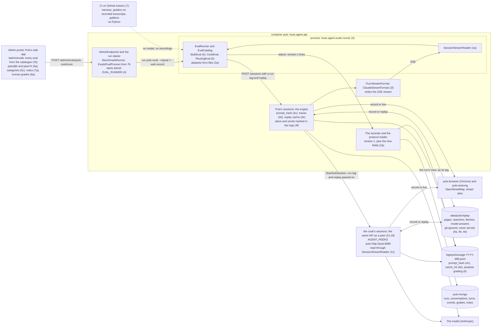
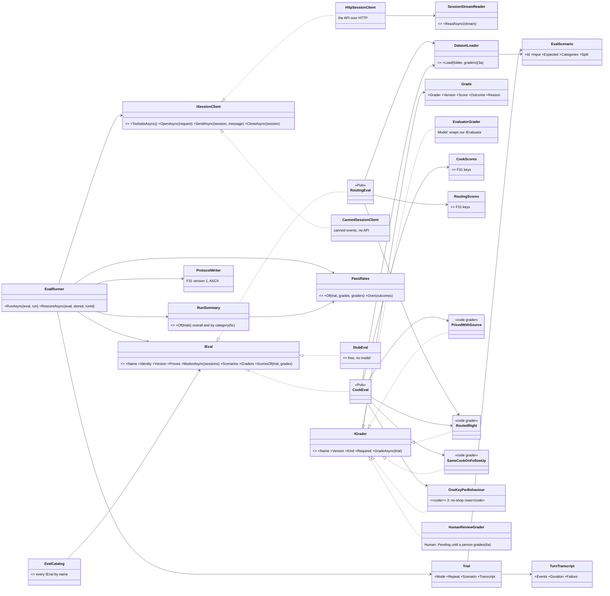
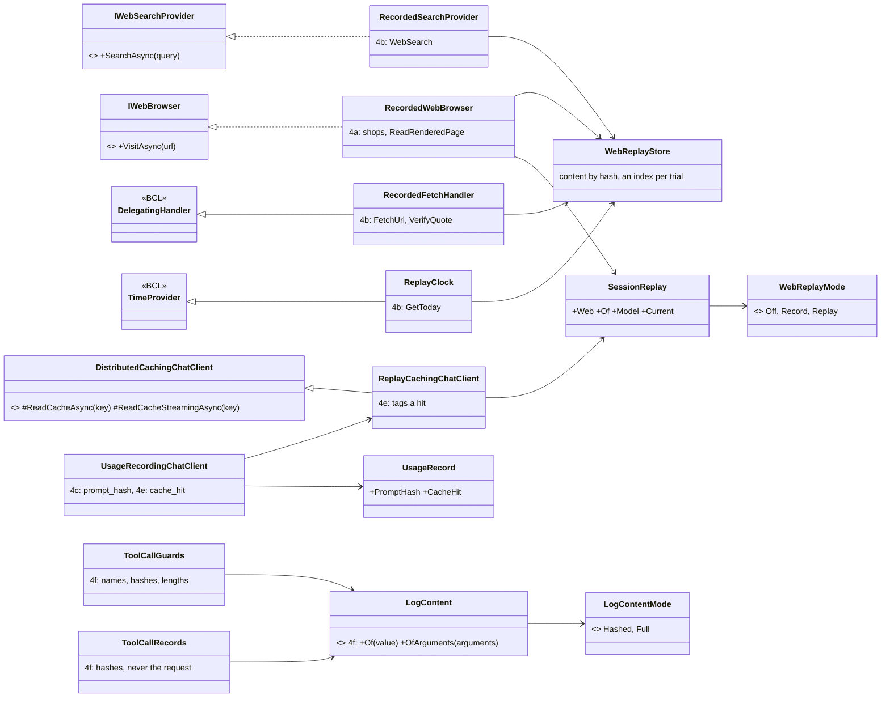
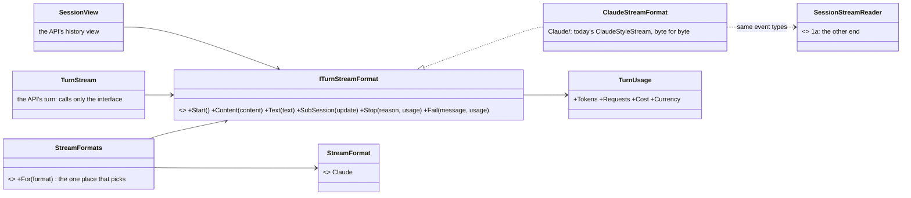
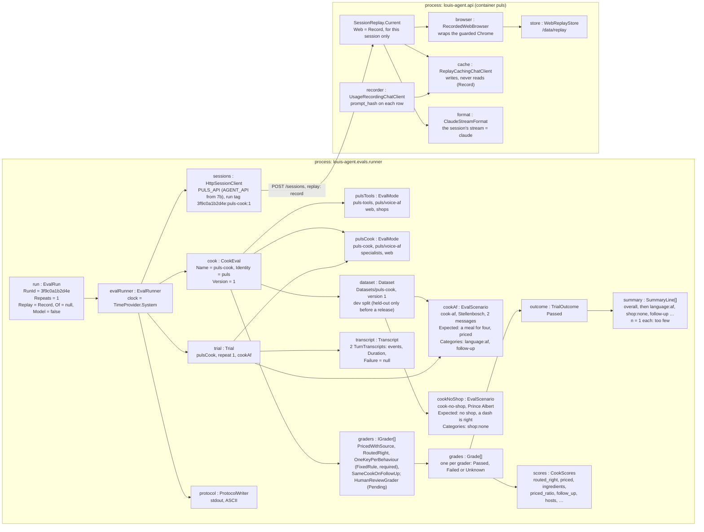

# F18 · Evals in C#: plan

> Approved 2026-10-24 as Phase 3 of [the platform plan](platform.md) (its section *Phase 3 · F18 Simulations in C#*,
> copied here as approved from the plan's working source, with its diagrams, namespace map and folder trees, and the
> decisions of 2026-10-20 and 2026-10-24 folded in; see *What this copy changes from the roadmap*) · TODO: *F18* ·
> Feature: [F18](../features/F18-evaluation.md) · Branch: `feature/F18-evals` off `main` (PR #72 merged 2026-10-20) ·
> ADRs: [0029](../adr/0029-simulations-in-csharp.md) (amended in step 0: the word is *eval*), 0037 (new, step 7b)

What this answers: how Phase 3 is built, step by step: one session-stream reader and writer, a C# eval harness in
place of the Python checks, what the engine adds so an eval is repeatable and cheap (recorded web input, a replay
cache, the prompt's hash, traces, clean logs), Puls's evals scored properly (pass@k, pass^k, categories, a calibrated
model grader, human review), and every eval visible in the admin portal.

It starts after Phase 2, because Puls's evals open sessions on the Puls identity (`IDENTITIES=puls`), and it is done
when Louis has read its write-ups, written by Claude (step 8; Louis, 2026-10-19). GOAL skills: **12** (most steps),
17, 13 and 3, with 18 and 4 in Part A. Paid runs: one cook and one routing run, in step 5, each on Louis's go,
compared with the Python's last runs.

**The word is *eval*, everywhere** (Louis, 2026-10-24). The roadmap called the harness *simulations*; Louis chose
*evals* on 2026-10-20 for what the portal shows, and on 2026-10-24 for the code too: `IEval` in `evals/`
(`louis-agent.evals`, `louis-agent.evals.runner`, `louis-agent.evals.puls`), `/admin/evals`, and the API's
`Benchmarks/` folder becomes `Evals/`. A C# eval still *simulates a real task* (the field's sense, below); ADR 0029
keeps its file name and gains an amendment in step 0.

## What this copy changes from the roadmap

1. **The word:** *simulation* becomes *eval* in every name (above); the runner's verb is `run` (`run puls-cook`).
2. **Step 1e is split** into 1e (the SSE stream's golden, written first) and 1f (the writer's seam), as the CL18 draft
   (`/mnt/project-files/plans/pluggable-stream-format.md`) had it, so the golden is its own commit.
3. **Step 3 gains a test for one behaviour scored two ways** (TODO line 30): Puls alone pricing a town with no shop at
   Checkers' default store was scored `wrong_store` in one run (`14c0907fdff5`, 5 rows) and `unsourced` in another
   (`aeb645d53300`, 3 rows; `docs/learning/07-context-engineering.md:25`). One behaviour gets one key.
4. **Step 7 gains a test that bans `.py` outside `Skills/`** (Louis, 2026-10-20: the engine is 100% C#).
5. **Step 8:** the write-ups are written by Claude for Louis to read (Louis, 2026-10-19), not "by Louis himself".
6. **5b comes before 5c**, because the roll-up's checks re-score stored runs.
7. **Every path re-checked against `main` after CL15, CL19 and FX21** (2026-10-24): the API's benchmark code is in
   `src/louis-agent.api/Benchmarks/{Runs,Store,Reports}/`, the tool loop in `Agent/Turns/ChatPipeline.cs`, the guards
   in `Agent/Turns/`, the shop log lines in the shops pack, Rider's prompt line in `Turns/PromptHandler.cs`, and the
   recorded stream is read by `tests/louis-agent.web.testing/SessionStreamFixture.cs` (there is no
   `SessionStreamFixtureTests` any more); since CL19 the Dockerfiles are in `docker/images/` and Puls is one
   container that peers with itself, so the cook runs beside the runner, not in `puls-agent`.

F18 was *Evaluation: a small shared eval harness* (`docs/features/F18-evaluation.md`); F31 then built that harness in
Python for the admin portal. This phase rewrites it in C#, as evals, and gives every identity its own. Louis: "we
call it simulations, of a real world [task]. So the python [scripts] must be [reworked]. They must follow C# patterns
and standards, and AI engineering standards and patterns this is important". ADR 0029 (written in Phase 0) records it and
amends ADR 0022: the harness becomes C# in `evals/`, the recorded stream moves to
`tests/louis-agent.session-stream.tests/Fixtures/`, and the protocol and the store stand.

It also builds what the thread asked of the engine for evals: web pages recorded and replayed, so a run sees the same
input every time (Louis: "[can we] store those as pics [when it] happens, [reasons] i need to do [benchmarks]"); a
replay cache, so a re-run of a recorded eval costs a known $0; the prompt's hash on every ledger row; traces per
turn and tool call; and the place and the user's text out of the logs (step 4f; the platform plan's Part 3, row 14), beside the traces'
"sensitive data off". F35 (recipe sources, on Puls's track) comes after this phase; the record and replay its draft
planned as its own step 4 (`WEB_CASSETTE`, `RecordingWebBrowser`, `ReplayWebBrowser`, `plans/F35-recipe-sources.md` in the project's files) is
built here instead, in the engine, under the names below, and F35's recipe eval runs on pages recorded this way.
Phase 6 depends on this phase's step 1 in the words used everywhere (Phase 6's own parts): "Part A needs Phase 2's steps 1-2 and Phase 3's step 1
(the reader); Part B needs Phase 2's steps 1-2 and Part A." Here *step 1* is the four commits 1a to 1d below
(1e and 1f, the writer, are not needed by Phase 6).

The checks of this plan's first draft found it wrong in places, fixed here: the routing and follow-up scores are
computed in the checks' own `score()` functions, not in `scoring.py`; a byte-for-byte protocol test can't pass
(Python's separators and escapes, and a wall-clock `t`), so the test compares what the API parses; the manuals and the
fixture's second file also live in `benchmarks/`; the images publish only the API, so the runner had nowhere to run; the
reader sat in `src/` while core would reference it; `EvalRunner` was placed in two projects; a `Grade` could not
hold F31's scores document, which the trends read key by key; a timeout was not a transcript event, so one dead
container would have counted as the agent failing; no step built pass@k, versions or re-scoring; the web input was not
frozen, so a run measured the websites as much as the agent; and a gate on recorded transcripts can't see the agent.

## Context

| Today (checked) | Where | Lines |
|---|---|---|
| The line protocol the portal records (version 1: `@` then one JSON event, ASCII only, with a wall-clock `t`; plain lines for people) | `benchmarks/puls_check/protocol.py` (`:12-16`) | 35 |
| A client of the API and a reader of the session stream | `puls_check/client.py`, `stream.py` | 135 |
| The shared scoring rules: prices with sources, rand amounts, "unknown" marks, deals, the store lines | `puls_check/scoring.py` | 185 |
| Three checks: stub (free), cook, routing; the cook's and the routing's own `score()` functions (routed right, the follow-up, the no-shop rows, the expected role: `cook/run_check.py:75-120`, `routing/run_check.py:59-73`); routing's baseline mode read from the instance at run time (`routing/run_check.py:109`); the stub writes its own lines, not ASCII-only (`stub/run_check.py:30-32`) | `benchmarks/{stub,cook,routing}/run_check.py` | 425 |
| Their tests (74 methods: 27 for scoring, 18 cook, 10 routing, 10 stream, 6 protocol, 3 client), and one for the manuals (4 methods) | `test_*.py` | 658 |
| The manuals, one per check, which name every score it reports; the portal reads them only inside `benchmarks/` | `benchmarks/{stub,cook,routing}/HANDLEIDING.md`; `test_manuals.py`; `src/louis-agent.api/Benchmarks/Reports/BenchmarkManuals.cs:19`, `Benchmarks/Runs/BenchmarkCheck.cs:13` | |
| The readers' contract: one recorded Puls turn (401 KB, 1,503 events, `docs/features/F31-benchmarks-portal.md:179`) and its expected counts, read by `test_stream.py` and by the C# tests through `SessionStreamFixture` | `benchmarks/fixtures/session-stream.sse`, `session-stream.expected.json`; `tests/louis-agent.web.testing/SessionStreamFixture.cs:19-21` (read by `TurnStreamTests` and both web apps' bUnit tests) | |
| Started by the API as `python3 {script}` in the workspace, read and stored by C# | `src/louis-agent.api/Benchmarks/Runs/BenchmarkRunner.cs:13,52-60`, `Benchmarks/Runs/BenchmarkProtocol.cs`, `Benchmarks/Store/MongoBenchmarkStore.cs` | |
| What a run keeps of its settings: provider, model, roles, script and arguments; not the commit, and no eval version | `Benchmarks/Runs/BenchmarkSettings.cs:12-21` | |
| The trend's score is the share routed right per run, not pass@k or pass^k; it reads `routed_right`, `priced`, `ingredients` and `priced_ratio` out of each conversation's scores | `Benchmarks/Reports/BenchmarkTrends.cs:62,83-92` | |
| Shown in the admin portal inside Puls's web app | `src/louis-agent.puls/Pages/Admin/Benchmarks.razor`, `BenchmarkRun.razor`; `Components/Admin/RunExplorer.razor`, `TrendChart.razor`, `ChartInfo.razor` | |
| The images publish only the API into `/app`; the scripts come from the repo mounted at `/workspace` | `docker/images/Dockerfile.puls:5`, `docker/images/Dockerfile.api:4`; `docker/docker-compose.puls.yml:59` | |
| Run in CI as Python unit tests | `.github/workflows/ci.yml:59-60` | |
| The ledger carries no prompt version; nothing caches a model's answer; there is no OpenTelemetry in core or `src/` (a search finds no `ActivitySource`) | `louis-agent.core/Usage/Records/UsageRecord.cs:28-44`; `louis-agent.core/Agent/Turns/ChatPipeline.cs:15-33` | |
| The web input is live on every run: nothing an agent reads is saved, and it comes through three seams, the guarded browser (shops, rendered pages), the search provider and `FetchUrl`'s own `HttpClient` | `louis-agent.core/Tools/Web/Browsing/IWebBrowser.cs:11-19`; `Tools/Web/WebTools.cs:24-25`, `Tools/Web/Fetching/PageFetcher.cs:21,29` | |
| The logs keep the place and the user's words: every tool call's arguments in full and the first 300 characters of its result; the oversized-result record keeps the arguments and 500 characters of the user's request, the truncated-call record the arguments; the shop lines name the town (`{Place}`) and, in the two store-lookup lines, its centre's coordinates to four decimals (`{Latitude}, {Longitude}`); Rider's host logs the request's raw parameters and the first 300 characters of the prompt | `louis-agent.core/Agent/Turns/ToolCallGuards.cs:41,63`; `Logging/ToolCallRecords.cs:15-23,27-32`; `packs/louis-agent.pack.shops/Messages/ShopLogMessage.cs:8-29`; `packs/louis-agent.pack.shops/Providers/CheckersStore.cs:87-88`; `src/louis-agent.acp-server/Turns/PromptHandler.cs:57-58` | |
| One behaviour, two keys: in a town with no shop, a priced row counts as `wrong_store`, but a row priced without a link counts as `unsourced`, so Puls pricing at the default store scored 5 `wrong_store` in one run and 3 `unsourced` in another | `benchmarks/cook/run_check.py:80-83,107-109`; `docs/learning/07-context-engineering.md:25` | |
| The API names its one product: `puls_benchmarks` (the store's default database), `PULS_API` (the runner's address of the API) and `PulsCalls` (a turn's level-0 calls) | `src/louis-agent.api/Config/AdminOptions.cs:17`; `Benchmarks/Runs/BenchmarkRunner.cs:65`; `Benchmarks/Store/BenchmarkDocuments.cs:50` | |
| The API writes the stream in one shape, Claude's, from one class the turn calls directly | `src/louis-agent.api/Sessions/ClaudeStyleStream.cs`, `Sessions/TurnStream.cs`, `Sessions/SessionView.cs` | |

The stream is read four times: by the web apps (`TurnStream.cs`), the orchestrator (`LouisAgentClient`), core
(`SpecialistTools`, through
`SubSessionStream`) and the Python (`benchmarks/puls_check/stream.py`). A new event has to be learnt four times (CL11's
finding). Two of the C# readers frame the stream by hand (`LouisAgentClient.cs:100-101`,
`Tools/Agents/SubSessions/SubSessionStream.cs:22-23`); the web app already uses the BCL's `SseParser` (`src/louis-agent.web.shared/Api/AgentApi.cs:92,117`). `python3` stays in the
images: skills (`Execution: python`) and `PythonRun` use it (`louis-agent.core/Tools/Shell/PythonTools.cs:97`). Only
the checks leave Python.

## Design

**What an eval is, in the field's words** (Anthropic, *Demystifying evals for AI agents*,
https://www.anthropic.com/engineering/demystifying-evals-for-ai-agents, 9 Jan 2026; the page and its date checked
2026-10-18). An *eval* is a **task**: a
scenario, its made-up data and its **success criteria**. It runs as **trials**; each trial leaves a **transcript**
(the session's events, tool calls included, with each turn's time and any infrastructure failure) and ends in an
**outcome** that **graders** score. A run reports **pass@k** (passed at least once in k trials) and **pass^k** (passed
every time in k). Our own addition: a task runs in one or more *modes* (Puls alone against Puls with its cook). Each
trial *simulates a real task* against a running agent, which is why ADR 0029 said *simulation*; the name in the code
and the portal is *eval* (Louis, 2026-10-24).

1. **Grade the outcome, then the path only where the path matters.** The cook's list is priced with sources (outcome);
   it went to the cook and not elsewhere (path, because routing is what is tested).
2. **Code graders first.** Deterministic, free and repeatable: today's scoring rules, ported, the checks' own
   `score()` functions included. A **model grader** only where code can't judge, such as "is this recipe a meal for
   four": our own `IEvaluator` from Microsoft.Extensions.AI.Evaluation, run on our model, and only once it agrees with
   Louis's own labels on at least 9 of 10 stored answers. Its stock Quality evaluators are tuned for one model only
   (each one's remarks in the 10.10.0 package's XML docs name GPT-4o, and say results "can be especially poor when a
   smaller / local model is used"), so none is used uncalibrated. A grade may be **Unknown**, which is shown and never
   counted as a pass.
3. **Repeat for the spread.** Trials per mode, as today; the run reports pass@k and pass^k per scenario and mode,
   because a sold agent needs the second. A trial that failed for the infrastructure (a timeout, a dead container, a
   replay miss) is reported apart and left out of both, so a flake never counts as the agent failing.
4. **Cost from the ledger**, never computed by the harness (ADR 0007), the model grader's requests included; each
   turn's wall-clock seconds measured by the harness, as F31 does today (`benchmarks/cook/run_check.py:140`,
   `benchmarks/routing/run_check.py:91`).
5. **Versioned.** An eval's version (bumped by any change to a scenario, a mode or a grader), each grader's
   version and the commit are recorded with every run, and every ledger row carries the hash of the system prompt and
   the tool list it was sent with, as prices carry `as_of`, so a trend compares like with like.
6. **Free first.** Graders run on stored transcripts without a model, so a grader change re-scores old runs for $0; a
   recorded run replays for $0 through the replay cache; paid runs wait for Louis's go.
7. **Frozen input.** A recorded run saves the web pages, search results and fetches its agents read; a replay reads
   only those, so a difference between two runs comes only from our change, not from the site.
8. **Made-up data only**, never a real customer's (POPIA), and every eval names what it proves.

**What CI can and can't catch.** CI gates the harness and the graders (on recorded transcripts) and what the model
reads (the golden files). An agent regression is caught only by a run: the paid evals before a release, on
Louis's go, or a free local-model run (F15). A free replay (step 4e) sits between the two: it catches a change in what
the model is sent, because a miss names it, but it can't say whether the new behaviour is good; that still needs a
paid run. Replays run where the recordings are, never in CI, because recorded pages stay private and out of the repo.
Step 8's write-up names this limit.

**Frozen input: web pages recorded and replayed** (steps 4a and 4b). Recipe pages and shop prices change and
disappear, so a run that reads the live web measures the website as much as the agent. The pattern is record and
replay:

- **One mode, three values.** `WebReplayMode { Off, Record, Replay }`, set by `WEB_REPLAY` (ADR 0024, parsed with
  `SettingChoice`), is an instance's default for eval sessions; a run may ask for another
  (`run {name} --web record`, `--web replay --of {runId}`), which the runner sends with every session it opens.
  `Off` (the default) reads the live web and saves nothing.
- **Record** reads the live web through the same guards and saves what was asked (a visit's URL, its script and ready
  selector; a search's query and options; a fetch's URL), what came back (the page's HTML, the captured answers and the
  script's result; a search's results; a fetch's body; screenshots once the vision feature adds them), when, and the
  content's SHA-256. The content sits once per hash under `REPLAY_DIRECTORY` (git-ignored: `/data/` at
  `.gitignore:40`; `/data/replay` in the Puls compose, which mounts `data/puls` in the `puls` container,
  `docker/docker-compose.puls.yml:62`), and each trial's index sits under its run's id, so the run in the store
  points to its recordings by the run's id and to each page by its hash.
- **Replay** answers from those files only and never opens Chrome or the network; an ask that was not recorded fails
  with a text naming it (a `ToolMessage` member, ADR 0009), and `GetToday` answers the recorded times.
- **Three seams, one store.** The guarded browser (`IWebBrowser`: the shops and `ReadRenderedPage`) is wrapped by
  `RecordedWebBrowser` (step 4a). The search provider and `FetchUrl`'s `HttpClient` get the same store in step 4b,
  because the cook searches for its recipe and fetches OpenStreetMap without the browser (`identities/louis-agent.identity.puls/Prompts/specialists/puls-cook.md:65`), and a
  run frozen only at the browser would still read a live search.
- **Live chats are never recorded or replayed.** The API takes `replay` only on a session that carries a run tag, and
  refuses it on any other (a 400); a sub-session gets it the way it gets the run tag today
  (`louis-agent.core/Tools/Agents/SpecialistTools.cs:80`), so the cook's pages are recorded too.
- **Saved pages are never served:** no endpoint reads the folder, nothing in it is committed, and the portal shows only
  hashes, URLs and times. In the thread's words, keep them "private, for testing only, never shown to users or put in
  the repo"; the same reply estimated 0.5 to 2 MB a full-page screenshot (an estimate, not measured), which is why an
  eval's set stays at 10 to 50 pages.

**A replay cache, the prompt's hash, traces and clean logs** (steps 4c to 4f). Four small engine changes: the first
three each close a GOAL *Missing* item or half of one; the fourth closes none, but the platform plan's Part 3 (row 14) counts it a release
blocker for a public Puls:

- **The prompt's hash on every ledger row** (step 4c): `prompt_hash`, a SHA-256 over the system prompt and the tool
  list as sent, so a run's prompt version is known (skill 3's "prompt versioning"). Two runs whose rows differ only in
  their hash are an A/B comparison of a prompt change on the same eval.
- **Traces per turn and tool call** (step 4d): Microsoft.Extensions.AI's own `.UseOpenTelemetry()` inside
  `UseFunctionInvocation`, sensitive data off; `FunctionInvokingChatClient` then traces each tool call itself (it uses
  the `ActivitySource` of an OpenTelemetry client inside it, its `_activitySource` field in the 10.10.0 XML docs), so no
  decorator of ours is needed (skill 17's "tracing per turn and tool call"). Exporters, dashboards and `traceparent`
  across processes stay F44's.
- **A replay cache, for recorded evals only** (step 4e). Live chats stay uncached: the platform plan's Part 5 reason for cutting a
  live cache holds. MEAI's `DistributedCachingChatClient` gives no hit signal, and a hit returns the stored response
  with its original usage, so the ledger would price it again. A small subclass overrides `ReadCacheAsync` and
  `ReadCacheStreamingAsync` (both protected virtual members of the 10.10.0 class, overriding `CachingChatClient`'s
  protected abstract ones, so only a subclass can reach them; read from the 10.10.0 assembly's metadata, checked
  2026-10-18) and tags a hit in `AdditionalProperties`; it sits inside `UsageRecordingChatClient`, which writes a tagged
  response as a known 0 with `cache_hit=true` (ADR 0007: a known 0, never unknown). A recorded run writes it and never
  reads it, because pass^k needs independent trials; a free replay (`run {name} --replay {runId}`) reads it with
  the frozen web input, so every request is the same as the recorded run's and costs $0. A **miss** in a replay never
  reaches the provider: it names the first part of the request that changed (the system prompt, a tool, message *n*),
  which is exactly where what the model is sent changed. It closes skill 13's only *Missing* item ("a response cache for
  exactly repeated requests"), measured by the replayed cook run's hit rate and cost against its live run.
- **Personal data out of the logs** (step 4f; Part 3, row 14; POPIA s13, s14 and s19; OWASP LLM02:2025). Today the logs
  keep what the traces of 4d leave out: every tool call's arguments in full and 300 characters of its result
  (`Agent/Turns/ToolCallGuards.cs:41,63`), 500 characters of the user's request in each oversized-result record
  (`Logging/ToolCallRecords.cs:15-23`), the town and its centre's coordinates in the shop lines, and the prompt in
  Rider's host (`src/louis-agent.acp-server/Turns/PromptHandler.cs:58`). A new setting, `LOG_CONTENT` (`hashed`, the default, or `full`),
  makes every such value a length and a keyed hash: the first 12 hex digits of an HMAC-SHA256 under a random key made
  when the process starts and never written down. Equal values in one process's logs still match, so a log still shows
  "the same town twice", but nobody can reverse it by hashing a list of towns, as they could a plain SHA-256 of a town's
  name. Every argument value is hashed, not only the place, because the model copies the user's words into any argument
  (a search query, a sub-session's task), so no list of "personal" fields would be complete. `full` keeps today's lines
  for a developer on their own machine; Puls's compose never sets it.

**Added after the roadmap's first Phase 3 text** (2026-10-19 to 2026-10-24; each one a step below):

- **One stream model at both ends** (steps 1e and 1f; CL18, Louis 2026-10-19: "this should be pluggable"). The reader
  (1a) is one end; the writer is the other. `ClaudeStyleStream` becomes `Claude/ClaudeStreamFormat`, one
  `ITurnStreamFormat` (ADR 0003's strategy shape), picked per session by `"stream"` on `POST /sessions`
  (`StreamFormat { Claude }`, ADR 0024; an unknown name is a 400 before any engine is built), and the turn's usage
  becomes `TurnUsage`, computed once from the ledger and only rendered by a format (ADR 0007). A golden of the bytes
  comes first, so the seam is proved byte-equal; a second format waits for a client that needs it (as ADR 0028 waits
  for a real MCP need).
- **Datasets are files, not code** (step 3a; Louis, 2026-10-20). One folder per eval: `dataset.json` (its version and
  a dated line per change), `scenarios/{id}.json` split into `input` (what the user sends) and `expected` (the
  behaviour asked for, each key read by a named grader, never an exact answer text), `dev/` and `held-out/`,
  `transcripts/` and `labels/`. A held-out set guards against fitting a prompt to the test.
- **Graders by kind** (steps 4, 6 and 6a; Louis, 2026-10-20): `GraderKind { FixedRule, Model, Human }`, each kind in its
  own folder; every eval has at least one required fixed-rule grader, or the catalogue refuses it.
- **One behaviour, one key** (step 3): today's cook scoring counts Puls's default-store prices in a no-shop town as
  `wrong_store` when they carry a link and as `unsourced` when they don't, so one behaviour moved between two keys from
  run to run. The proposed rule, for Louis to confirm when step 3 is reviewed: in a town with no shop, every priced row
  is `wrong_store`, sourced or not, and `unsourced` counts only where the town has a shop; the cook's manual says so.
- **The models a run used** (step 2a; Louis, 2026-10-20: "diff models will give diff results") and **results overall and
  by category** (step 5c), each number with its `n`.
- **Every eval visible in the admin, and the API names no product** (step 7b; Louis, 2026-10-20 and 2026-10-24, *One
  agent API*): the list comes from the runner's catalogue, never a hand-kept list; `Benchmarks/` becomes `Evals/`, and
  `ApiNamesNoProductTests` holds the API to it as a ratchet; ADR 0037 records the rule.
- **100% C#** (step 7; Louis, 2026-10-20): once `benchmarks/` is gone, a test fails on any `.py` file outside `Skills/`
  (skills may still run Python, ADR 0004), so the engine stays one language.

**How it is built, in C#'s terms.** A contract per eval, per grader and per session client; records for
scenarios, trials, transcripts and grades; enums for choices (ADR 0024); message enums for every text (ADR 0009),
checked by `HostMessageEnumTests` once it scans `evals/`; `ILogger` to stderr because stdout is the protocol;
`IHttpClientFactory`, `TimeProvider` and `CancellationToken` throughout; NUnit tests mirroring each project, one test
project per new project. The harness names no identity: Puls's scoring rules live in `louis-agent.evals.puls`,
as Phase 2's cut keeps Puls out of core. **F31's line protocol stays the seam:** the C# runner writes the same
version-1 lines, and what it adds is additive (fields `BenchmarkProtocol` reads when present and a Python run simply
lacks, since it reads every field by name, `Benchmarks/Runs/BenchmarkProtocol.cs:63-72`), so every stored run still reads. The API
starts `dotnet /app/evals/louis-agent.evals.runner.dll` instead of `python3`.

*Alternatives considered.* Keep Python: rejected by Louis, and it keeps a fourth stream reader. Run evals inside
the API process: rejected, a run spends minutes and money and must not take the API down with it. A third hand-written
SSE framer: rejected, the BCL's `System.Net.ServerSentEvents.SseParser` already frames this stream in the web app, so
the reader only maps its items. Microsoft.Extensions.AI.Evaluation's own reporting store: its evaluators and metric
types are reused, but runs stay in F31's store, which the portal and the trends already read; `EvaluatorGrader` calls
`IEvaluator.EvaluateAsync` directly, so no store is needed, and `IEvaluationResultStore` (a public interface in
Microsoft.Extensions.AI.Evaluation.Reporting 10.10.0, checked) could wrap F31's store later. MEAI's
`DistributedCachingChatClient` as it is: rejected, no hit signal, and the ledger would price a hit again. A record and
replay library for HTTP: it would cover search and `FetchUrl` but not the browser's visits, which go to Chrome over its
DevTools protocol (`ChromeWebBrowser.cs:12`), so one small store of ours serves all three seams (no library was
surveyed by name; inferred).

## Architecture: what runs when the portal starts an eval

Each box is marked with the step that adds or changes it. The runner is its own process beside the API in the `puls`
container; since CL19 the cook's sub-session runs in the same container too, because Puls peers with itself
(`AGENT_PEERS: puls=http://puls:8080`, `docs/plans/CL19-config-by-place.md:148-149`).



## Folder structure: the projects before and after

Four new projects, each with its test project in `tests/` named after it and a line in `louis-agent-solution.sln`; the
reader sits at the root beside `louis-agent.core/`, because core references it and `src/` holds only hosts, web apps
and the composition project. Only the folders that change are shown.

**Today (`main`, 3ef03cc)**

```text
louis-agent/
├── benchmarks/                                F31's checks in Python: 1,442 lines in 18 .py files
│   ├── puls_check/                            protocol.py (35), client.py (42), stream.py (93), scoring.py (185), their tests
│   ├── stub/  cook/  routing/                 run_check.py each (102, 184, 139 lines), HANDLEIDING.md each,
│   │                                          test_cook.py, test_routing.py
│   ├── fixtures/                              session-stream.sse, session-stream.expected.json: the readers' contract
│   └── test_manuals.py                        every score a check reports is named in its manual
├── louis-agent.core/
│   ├── Agent/Turns/ChatPipeline.cs            the pipeline: no traces, no cache (:15-33)
│   ├── Agent/Turns/ToolCallGuards.cs          every call's arguments in full (:41), 300 characters of its result (:63)
│   ├── Llm/UsageRecordingChatClient.cs        one ledger row per model request
│   ├── Logging/ToolCallRecords.cs             the arguments and 500 characters of the user's request (:15-23, 27-32)
│   ├── Usage/Records/UsageRecord.cs           no prompt version (:28-44)
│   └── Tools/
│       ├── Agents/SubSessions/SubSessionStream.cs   reads a peer's stream with its own event:/data: loop (:22-23)
│       └── Web/                               Browsing/IWebBrowser.cs, Search/, Fetching/PageFetcher.cs: nothing recorded
├── packs/louis-agent.pack.shops/              Messages/ShopLogMessage.cs: the town and its centre (:8-29)
├── src/
│   ├── louis-agent.acp-server/Turns/PromptHandler.cs   the raw parameters and 300 characters of the prompt (:57-58)
│   ├── louis-agent.api/
│   │   ├── Benchmarks/                        Runs/ (BenchmarkRunner starts python3, BenchmarkCatalog, BenchmarkCheck,
│   │   │                                      BenchmarkProtocol, BenchmarkSettings), Store/ (the recorder, the two
│   │   │                                      stores, puls_benchmarks), Reports/ (BenchmarkTrends, BenchmarkManuals
│   │   │                                      reads benchmarks/ only, BenchmarkLedger, BenchmarkTools)
│   │   ├── Endpoints/AdminEndpoints.cs        /admin/benchmarks/…, the manual at :57-58
│   │   └── Sessions/                          ClaudeStyleStream.cs, TurnStream.cs, SessionView.cs: one wire shape
│   ├── louis-agent.orchestrator/LouisAgentClient.cs   its own event:/data: loop (:100-101)
│   ├── louis-agent.puls/                      Pages/Admin/Benchmarks.razor, BenchmarkRun.razor;
│   │                                          Components/Admin/RunExplorer, TrendChart, ChartInfo (code in razor)
│   └── louis-agent.web.shared/                Chats/TurnStream.cs; Api/AgentApi.cs frames with SseParser
├── tests/
│   ├── louis-agent.api.tests/Benchmarks/      Runs/, Store/, Reports/: 12 test files; StubCheckTests runs python3
│   └── louis-agent.web.testing/SessionStreamFixture.cs   reads benchmarks/fixtures/
├── docker/images/Dockerfile.puls, .api       publish only the API into /app
└── .github/workflows/ci.yml                   dotnet test, then the Python unit tests (:59-60)
```

**After F18 (each line names the step that adds or changes it)**

```text
louis-agent/
├── louis-agent-solution.sln                   + 8 projects: 4 and their tests (steps 1a, 2, 3, 4)
├── louis-agent.session-stream/                1a, new: SSE in (SseParser), typed events out, each with its raw type
│                                              and data; no dependencies; referenced by core, web.shared, the
│                                              orchestrator and the harness
├── louis-agent.core/
│   ├── Agent/Turns/ChatPipeline.cs            4d: UseOpenTelemetry inside UseFunctionInvocation; 4e: the replay cache
│   ├── Agent/Turns/ToolCallGuards.cs          4f: the tool's and arguments' names, keyed hashes and lengths
│   ├── Config/AgentOptions.cs                 4a: WEB_REPLAY, REPLAY_DIRECTORY; 4f: LOG_CONTENT
│   ├── Config/LogContentMode.cs               4f, new: Hashed (the default) or Full
│   ├── Llm/ReplayCachingChatClient.cs         4e, new
│   ├── Llm/UsageRecordingChatClient.cs        4c: prompt_hash; 4e: a hit written as a known 0
│   ├── Logging/                               4f: LogContent (new, the keyed hash); ToolCallRecords; AgentLogging.Configure
│   ├── Sessions/Replay/                       4a, new: WebReplayMode, SessionReplay
│   ├── Usage/Records/                         4c, 4e: UsageRecord.PromptHash, .CacheHit; 6: UsagePurpose.Grading
│   └── Tools/
│       ├── Agents/SubSessions/                1c: SubSessionStream reads through the reader; 4a: replay passed on
│       ├── Clock/ClockTools.cs                4b: the recorded clock in a replay
│       └── Web/Replay/                        4a-4b, new: WebReplayStore, RecordedWebBrowser,
│                                              RecordedSearchProvider, RecordedFetchHandler, ReplayClock
├── packs/louis-agent.pack.shops/              4f: the shop lines name the town's hash, not the town
├── evals/                                     new, beside tests/
│   ├── louis-agent.evals/                     2: the harness, sold with the engine; names no identity
│   │   ├── IEval.cs, EvalMode.cs, EvalScenario.cs, EvalScores.cs, EvalRun.cs, EvalRunner.cs
│   │   ├── Trials/                            Trial, Transcript, TurnTranscript, TrialFailure
│   │   ├── Grading/                           IGrader, GraderKind, Grade, GradeOutcome, TrialOutcome; PassRates (5a),
│   │   │   ├── Models/                        6: EvaluatorGrader (a Microsoft.Extensions.AI.Evaluation bridge)
│   │   │   └── Human/                         6a: HumanReviewGrader
│   │   ├── Datasets/                          3a: DatasetLoader, DatasetManifest
│   │   ├── Reports/                           5c: RunSummary, SummaryLine
│   │   ├── Protocol/                          ProtocolWriter: F31's version-1 lines, plus 2a's fields
│   │   ├── Api/                               ISessionClient, SessionRequest, HttpSessionClient, CannedSessionClient
│   │   └── Messages/                          EvalMessage, EvalLogMessage
│   ├── louis-agent.evals.runner/              4: Program (run, --list; 4a: --web, --of; 4e: --replay;
│   │                                          5b: --rescore; 7b: --list --json), EvalCatalog, StubEval,
│   │                                          Manuals/stub.md (7)
│   └── louis-agent.evals.puls/                3: Grading/FixedRules/ (Puls's graders), CookScores, RoutingScores;
│                                              3a: Datasets/puls-cook/, Datasets/puls-routing/;
│                                              5: CookEval, RoutingEval; 6: Prompts/meal-for-the-people.md;
│                                              7: Manuals/cook.md, routing.md
├── src/
│   ├── louis-agent.acp-server/Turns/PromptHandler.cs   4f: the prompt's lines hashed
│   ├── louis-agent.api/
│   │   ├── Sessions/Streaming/                1f, new: ITurnStreamFormat, StreamFormat, StreamFormats, TurnUsage,
│   │   │                                      Claude/ClaudeStreamFormat (was Sessions/ClaudeStyleStream.cs)
│   │   └── Evals/                             7b: was Benchmarks/; 2a, 5a, 6a, 7a: the store reads the new fields,
│   │                                          human grades and notes; 4: the run starter starts the C# runner
│   │                                          (EVAL_RUNNER), the list from run --list; 7: the manuals from evals/
│   ├── louis-agent.orchestrator/              1d: LouisAgentClient reads through the reader
│   ├── louis-agent.puls/                      5a, 5c: pass@k, pass^k, categories; 6a: human grades; 7a: notes;
│   │                                          7b: Pages/Admin/Evals.razor, EvalRun.razor, each with its .razor.cs;
│   │                                          Components/Admin/ split under 200 lines, no code in razor
│   └── louis-agent.web.shared/                1b: TurnStream and AgentApi read through the reader
├── tests/
│   ├── louis-agent.session-stream.tests/      1a; from 7: Fixtures/session-stream.sse and .expected.json
│   ├── louis-agent.evals.tests/               2, 2a, 3a, 5a, 5b, 5c, 6, 6a: the protocol's lines, the datasets, the pass
│   │                                          rule, the roll-up, the runner, the judge's bridge
│   ├── louis-agent.evals.runner.tests/        4: the catalogue, the arguments, the stub run recorded as the Python stub's was
│   ├── louis-agent.evals.puls.tests/          3, 3a, 5, 7: today's Python test cases, ported, the same scores; the
│   │                                          datasets; the manuals
│   ├── louis-agent.core.tests/                4a-4f: the replay decorators, the hash, the spans, the cache, the logs;
│   │                                          HostMessageEnumTests scans evals/ (2); NoPythonTests (7, new)
│   ├── louis-agent.pack.shops.tests/          4f: a shop line names the town's hash
│   ├── louis-agent.api.tests/                 1e: StreamGoldenTests and its golden file; 7b: Evals/ (was
│   │                                          Benchmarks/), ApiNamesNoProductTests (new)
│   └── louis-agent.web.testing/               7: SessionStreamFixture reads the moved fixture
├── docker/images/Dockerfile.puls, .api       4: the build stage also publishes the runner; the final stage copies it to /app/evals
├── .github/workflows/ci.yml                   7: no Python step
└── (benchmarks/ deleted in step 7)
```

## Interfaces

```csharp
// louis-agent.session-stream (namespace LouisAgent.SessionStream): no dependencies
public static class SessionStreamReader
{
    // Frames with SseParser.Create(stream) (System.Net.ServerSentEvents, in the BCL) and only maps each SseItem.
    public static IAsyncEnumerable<SessionEvent> ReadAsync(Stream stream, CancellationToken cancellationToken);
}
// Every event keeps its raw form, so a writer passes Type and Data on unchanged: TurnStream reads message.toolsets,
// message.session_role, tool_use_id and is_error, which a typed record alone would drop.
public abstract record SessionEvent(string Type, JsonElement Data);
public sealed record MessageStarted(JsonElement Data, IReadOnlyList<string> Toolsets, string? Role) : SessionEvent("message_start", Data);
public sealed record SubSessionStreamed(JsonElement Data, string ToolUseId, SessionEvent Inner) : SessionEvent("sub_session", Data);
// ContentBlockStarted, ContentBlockDelta, ContentBlockStopped, MessageDelta, MessageStopped, UsageReported, Error;
// UnknownEvent for a type the reader doesn't know yet: kept, never dropped.
// Two names are chosen so they never clash. SubSessionStreamed is not core's Sessions.SubSessionEvent (the Werk panel's
// feed item, louis-agent.core/Sessions/SubSessions/SubSessionEvent.cs), which SubSessionMessenger uses today
// (Tools/Agents/SubSessions/SubSessionMessenger.cs:55) and keeps once it reads through the reader (step 1c): with both imported, one simple name would be ambiguous
// (CS0104). UsageReported is not Usage, because a test file in LouisAgent.Core.Tests.* whose usings sit above its
// namespace (ToolCallLogTests.cs does) finds core's namespace LouisAgent.Core.Usage before an imported type of that name.

// evals/louis-agent.evals (namespace LouisAgent.Evals): the harness, sold with the engine
public interface IEval
{
    string Name { get; }                                    // "puls-cook"
    string? Identity { get; }                               // "puls": the identity it proves; null for the stub
    int Version { get; }                                    // bumped by any change to a scenario, a mode or a grader
    string Proves { get; }                                  // one sentence, shown in the portal
    ValueTask<IReadOnlyList<EvalMode>> ModesAsync(ISessionClient sessions, CancellationToken cancellationToken);
                                                            // routing's baseline: every toolset the instance has, minus the delegating ones
    IReadOnlyList<EvalScenario> Scenarios { get; }
    IReadOnlyList<IGrader> Graders { get; }
    EvalScores ScoresOf(Trial trial, IReadOnlyList<Grade> grades);   // F31's scores document, its keys unchanged
}
public sealed record EvalMode(string Name, string Role, IReadOnlyList<string> Toolsets, int Depth = 0, string? Llm = null);
public sealed record EvalScenario(string Id, EvalInput Input, JsonElement Expected, IReadOnlyList<string> Categories,
    DatasetSplit Split);                                    // 3a: one file each; Expected: the success criteria the graders read
                                                            // (no shop in town, the expected role), each key named by a grader;
                                                            // Categories: 5c ("language:af", "shop:none", "follow-up")
public sealed record EvalInput(string? Place, string TimeZone, IReadOnlyList<string> Messages);   // what the user sends
public enum DatasetSplit { Dev, HeldOut }                   // 3a: held-out runs only before a release
public sealed record Trial(string RunId, EvalMode Mode, int Repeat, EvalScenario Scenario, Transcript Transcript);
public sealed record Transcript(IReadOnlyList<TurnTranscript> Turns);
public sealed record TurnTranscript(int Turn, string Session, string Question, IReadOnlyList<SessionEvent> Events,
    TimeSpan Duration, TrialFailure? Failure);              // Duration from the harness's clock, as F31's `seconds`
public enum TrialFailure { Timeout, Transport, ApiError, ReplayMiss }   // not the agent's: reported apart, left out of pass@k and pass^k
public abstract record EvalScores;                    // CookScores, RoutingScores: written snake_case into the `conversation` line's `scores`
public sealed record EvalRun(string RunId, int Repeats, SessionReplay Replay);   // SessionReplay: core's, step 4a

public sealed class EvalRunner(ISessionClient sessions, ProtocolWriter protocol, TimeProvider clock, ILogger<EvalRunner> logger)
{
    public Task RunAsync(IEval eval, EvalRun run, CancellationToken cancellationToken);
    public Task RescoreAsync(IEval eval, StoredRun stored, string runId, CancellationToken cancellationToken);  // 5b: no session, no model
}

// Api/ (namespace LouisAgent.Evals.Api)
public interface ISessionClient
{
    Task<IReadOnlyList<string>> ToolsetsAsync(CancellationToken cancellationToken);               // GET /toolsets
    Task<string> OpenAsync(SessionRequest request, CancellationToken cancellationToken);           // POST /sessions
    IAsyncEnumerable<SessionEvent> SendAsync(string session, string message, CancellationToken cancellationToken);
    Task CloseAsync(string session, CancellationToken cancellationToken);
}
public sealed record SessionRequest(EvalMode Mode, string? Place, string TimeZone, string Task, string RunTag, SessionReplay Replay);
// HttpSessionClient (IHttpClientFactory, the reader); CannedSessionClient (the stub and the tests: canned events, no API)

// Grading/ (namespace LouisAgent.Evals.Grading)
public interface IGrader
{
    string Name { get; }                                    // "priced-with-source"
    int Version { get; }                                    // recorded with each grade
    GraderKind Kind { get; }                                // FixedRule, Model or Human (Louis, 2026-10-20)
    bool Required { get; }                                  // a trial passes when every required grader passes
    ValueTask<Grade> GradeAsync(Trial trial, CancellationToken cancellationToken);
}
public enum GraderKind { FixedRule, Model, Human }        // ADR 0024; each kind in its own folder: Grading/FixedRules/ (in an
                                                            // identity's evals project), Grading/Models/, Grading/Human/
public enum GradeOutcome { Passed, Failed, Unknown, Pending }   // Unknown: shown, never a pass; Pending: a human grade not given yet (6a)
public sealed record Grade(string Grader, int Version, double Score, GradeOutcome Outcome, string Reason);
public enum TrialOutcome { Passed, Failed, Unknown, Infrastructure }
public static class PassRates                               // 5a
{
    public static TrialOutcome Of(Trial trial, IReadOnlyList<Grade> grades, IReadOnlyList<IGrader> graders);
    public static (double? PassAtK, double? PassHatK) Over(IReadOnlyList<TrialOutcome> trialsOfOneScenario);  // Infrastructure left out
}

// Grading/Models/ and Grading/Human/ (steps 6 and 6a)
public sealed class EvaluatorGrader(IEvaluator evaluator, ChatConfiguration judge, string name, int version) : IGrader;   // Kind = Model
public sealed class HumanReviewGrader(IHumanGrades grades) : IGrader;                // Kind = Human; Pending until a person grades
public interface IHumanGrades                                                         // read from the store by the API, handed to the runner
{
    ValueTask<Grade?> GradeOfAsync(string runId, string conversation, CancellationToken cancellationToken);
}

// Datasets/ (namespace LouisAgent.Evals.Datasets), step 3a
public sealed record DatasetManifest(string Name, int Version, string Covers, string ContentHash, IReadOnlyList<string> Changes);
public static class DatasetLoader
{
    // Reads Datasets/{eval}/: dataset.json, scenarios/dev/*.json, scenarios/held-out/*.json; refuses a duplicate id,
    // an unknown field, an expected key no grader reads, and a folder whose hash differs from dataset.json's
    public static Dataset Load(string folder, IReadOnlyList<IGrader> graders);
}
public sealed record Dataset(DatasetManifest Manifest, IReadOnlyList<EvalScenario> Scenarios);

// Reports/ (namespace LouisAgent.Evals.Reports), step 5c
public static class RunSummary
{
    public static IReadOnlyList<SummaryLine> Of(IReadOnlyList<TrialResult> trials);   // the overall line first, then one per category
}
public sealed record SummaryLine(string Slice, int N, double? PassRate, double? PassAtK, double? PassHatK,
    IReadOnlyDictionary<string, double> MeanScores, decimal? CostPerTrial, decimal? CostPerPass);   // null below 5 trials: "too few"

// Protocol/ (namespace LouisAgent.Evals.Protocol)
public sealed class ProtocolWriter(TextWriter stdout, TimeProvider clock);   // ASCII only; `t` from the clock

// src/louis-agent.api/Sessions/Streaming (namespace LouisAgent.Api.Sessions.Streaming), steps 1e-1f
public interface ITurnStreamFormat
{
    IEnumerable<SseItem<string>> Start();
    IEnumerable<SseItem<string>> Content(AIContent content);
    IEnumerable<SseItem<string>> Text(string text);                  // a command's reply
    IEnumerable<SseItem<string>> SubSession(SubSessionEvent update);
    IEnumerable<SseItem<string>> Stop(string reason, TurnUsage? usage);
    IEnumerable<SseItem<string>> Fail(string message, TurnUsage? usage);
}
public enum StreamFormat { Claude }                         // ADR 0024: "stream" on POST /sessions, an unknown name a 400
public static class StreamFormats { public static ITurnStreamFormat For(StreamFormat format); }   // the one place that picks
public sealed record TurnUsage(UsageTokens Tokens, int Requests, decimal? Cost, string? Currency);   // from the ledger, once
public sealed class ClaudeStreamFormat : ITurnStreamFormat;  // Claude/: today's ClaudeStyleStream, byte for byte

// louis-agent.core: the engine's part (steps 4a-4f)
public enum WebReplayMode { Off, Record, Replay }           // Sessions/Replay/: WEB_REPLAY, parsed with SettingChoice
public sealed record SessionReplay(WebReplayMode Web, string? Of, bool Model)   // Sessions/Replay/: Of names the recorded run; Model reads the replay cache
{
    public static SessionReplay? Current { get; }           // set per turn by the host, as UserPlace is; passed to a sub-session
}
public sealed class WebReplayStore(string directory);       // Tools/Web/Replay/: content by its hash, an index per trial
public sealed class RecordedWebBrowser(IWebBrowser inner, WebReplayStore store) : IWebBrowser;                  // 4a
public sealed class RecordedSearchProvider(IWebSearchProvider inner, WebReplayStore store) : IWebSearchProvider; // 4b
public sealed class RecordedFetchHandler(WebReplayStore store) : DelegatingHandler;   // 4b: FetchUrl, VerifyQuote; outside the SSRF guard
public sealed class ReplayClock(WebReplayStore store) : TimeProvider;                 // 4b: GetToday's recorded times
public sealed class ReplayCachingChatClient(IChatClient inner, IDistributedCache cache)
    : DistributedCachingChatClient(inner, cache)            // Llm/, 4e
{
    protected override Task<ChatResponse?> ReadCacheAsync(string key, CancellationToken cancellationToken);   // tags a hit
    protected override Task<IReadOnlyList<ChatResponseUpdate>?> ReadCacheStreamingAsync(string key, CancellationToken cancellationToken);
}
// UsageRecord gains PromptHash (prompt_hash, 4c) and CacheHit (cache_hit, 4e), both left out of a row when null
public enum LogContentMode { Hashed, Full }                 // Config/, 4f: LOG_CONTENT, parsed with SettingChoice; Hashed by default
public static class LogContent                              // Logging/, 4f: set once by AgentLogging.Configure
{
    // Hashed: "#3f9c0a1b2d4e (10)", the first 12 hex digits of an HMAC-SHA256 under a key made when the process starts
    // (never written) and the value's length; Full: the value itself, as today
    public static string Of(string? value);
    public static string OfArguments(IDictionary<string, object?> arguments);   // "query=#… (12), area=#… (10)"
}
```

The harness:



The engine's part:



The API's stream writer (steps 1e and 1f):



Both wrapped interfaces stay as they are: `IWebBrowser.VisitAsync` (`louis-agent.core/Tools/Web/Browsing/IWebBrowser.cs:11-19`)
and `IWebSearchProvider.SearchAsync(WebSearchQuery, CancellationToken)` (`Tools/Web/Search/IWebSearchProvider.cs:19`).

## Objects: one cook run in memory

A recorded cook run with one repeat, as the portal starts it in step 5; the values are examples. Two of the six cook
scenarios are drawn.



## Communication: the portal runs the cook eval, recorded

```mermaid
sequenceDiagram
    autonumber
    participant P as Admin portal
    participant A as louis-agent.api
    participant R as eval runner (own process)
    participant S as Puls's sessions (the same API)
    participant C as the cook (the same API, as a peer)
    participant W as web input (Chrome, SearXNG)
    participant M as the model
    participant L as Usage ledger
    P->>A: POST /admin/benchmarks/cook/runs (repeats 1, recorded; /admin/evals/puls-cook/runs from 7b)
    A->>R: dotnet /app/evals/louis-agent.evals.runner.dll run puls-cook --repeat 1 --web record
    R-->>A: @protocol version 1, eval puls-cook, eval_version, commit, graders
    loop each mode, conversation and repeat
        R->>S: POST /sessions (role, toolsets, place, run tag run:mode:repeat, replay: record)
        R-->>A: @mode, @question
        S->>M: the turn's requests (each answer also written to the replay cache, never read)
        S->>C: StartSubSession (the run tag and replay passed on)
        C->>W: FindProducts, WebSearch, FetchUrl
        W-->>C: live answers, each saved with its URL, time and hash
        C->>M: the cook's requests (written to the replay cache too)
        C-->>S: the cook's answer, its events fed live
        S-->>R: the session stream (written by ClaudeStreamFormat, 1f)
        R->>R: SessionStreamReader: typed events into the transcript, each turn timed
        R-->>A: @sse and @turn lines, as the Python writes them
        R->>R: the graders score the trial, and PassRates gives its outcome
        R-->>A: @conversation with its scores, grades and outcome
    end
    R-->>A: @mode_done
    R->>R: RunSummary: the overall line and one per category (5c)
    A->>L: the run's rows, by its tag: cost, prompt_hash
    A-->>P: the run, its scores, pass@k and pass^k and its cost, recorded in the store
    Note over P,L: later, free: run puls-cook --replay 3f9c0a1b2d4e reads the same pages and the model's recorded answers, every row a known 0 with cache_hit
```

## Namespaces (new, moved, changed)

| Type | Folder | Namespace | Step |
|---|---|---|---|
| `SessionStreamReader`, `SessionEvent` and its records (`SubSessionStreamed` and `UsageReported` among them, named apart from core's `SubSessionEvent` and its `Usage` namespace) | `louis-agent.session-stream/` | `LouisAgent.SessionStream` | 1a, new |
| `TurnStream`, `AgentApi` (read through the reader; `AgentStreamEvent` replaced by `SessionEvent`) | `src/louis-agent.web.shared/Chats/`, `Api/` | as now | 1b, changed |
| `SubSessionStream` (reads a peer's stream through the reader) | `louis-agent.core/Tools/Agents/SubSessions/` | as now | 1c, changed |
| `LouisAgentClient` (reads through the reader) | `src/louis-agent.orchestrator/` | as now | 1d, changed |
| `StreamGoldenTests` and `StreamGolden.sse` | `tests/louis-agent.api.tests/Sessions/` | `LouisAgent.Api.Tests.Sessions` | 1e, new |
| `ITurnStreamFormat`, `StreamFormat`, `StreamFormats`, `TurnUsage` | `src/louis-agent.api/Sessions/Streaming/` | `LouisAgent.Api.Sessions.Streaming` | 1f, new |
| `ClaudeStreamFormat` (was `Sessions/ClaudeStyleStream`) | `src/louis-agent.api/Sessions/Streaming/Claude/` | `LouisAgent.Api.Sessions.Streaming.Claude` | 1f, moved |
| `CreateSessionRequest.Stream`; `TurnStream`, `SessionView` (call only the interface) | `src/louis-agent.api/Sessions/` | as now | 1f, changed |
| `IEval`, `EvalMode`, `EvalScenario`, `EvalInput`, `EvalScores`, `EvalRun`, `EvalRunner` | `evals/louis-agent.evals/` | `LouisAgent.Evals` | 2, new |
| `Trial`, `Transcript`, `TurnTranscript`, `TrialFailure` | `…/louis-agent.evals/Trials/` | `LouisAgent.Evals.Trials` | 2, new |
| `IGrader`, `GraderKind`, `Grade`, `GradeOutcome`, `TrialOutcome` | `…/louis-agent.evals/Grading/` | `LouisAgent.Evals.Grading` | 2, new |
| `ProtocolWriter` | `…/louis-agent.evals/Protocol/` | `LouisAgent.Evals.Protocol` | 2, new; 2a, changed |
| `ISessionClient`, `SessionRequest`, `HttpSessionClient`, `CannedSessionClient` | `…/louis-agent.evals/Api/` | `LouisAgent.Evals.Api` | 2, new |
| `EvalMessage`, `EvalLogMessage` | `…/louis-agent.evals/Messages/` | `LouisAgent.Evals.Messages` | 2, new |
| `HostMessageEnumTests` (also scans `evals/`; `TheHostsHaveMessageEnums` lists `EvalMessage` and `EvalLogMessage`) | `tests/louis-agent.core.tests/Messages/` | as now | 2, changed |
| `BenchmarkProtocol`, `BenchmarkDocuments`, `BenchmarkRecorder`, both stores (the new fields) | `src/louis-agent.api/Benchmarks/Runs/`, `Store/` | as now | 2a, changed |
| `CookScores`, `RoutingScores` | `evals/louis-agent.evals.puls/Grading/` | `LouisAgent.Evals.Puls.Grading` | 3, new (from Python) |
| Puls's fixed-rule graders (`PricedWithSource`, `RoutedRight`, `SameCookOnFollowUp`, `OneKeyPerBehaviour` and the rest of `scoring.py`'s rules) | `evals/louis-agent.evals.puls/Grading/FixedRules/` | `LouisAgent.Evals.Puls.Grading.FixedRules` | 3, new (from Python) |
| `DatasetLoader`, `Dataset`, `DatasetManifest`, `DatasetSplit` | `evals/louis-agent.evals/Datasets/` | `LouisAgent.Evals.Datasets` | 3a, new |
| Puls's datasets (`puls-cook/`, `puls-routing/`: `dataset.json`, `scenarios/dev/`, `scenarios/held-out/`, `transcripts/`, `labels/`) | `evals/louis-agent.evals.puls/Datasets/` | (data, copied to the output) | 3a, new |
| `Program`, `EvalCatalog`, `StubEval` | `evals/louis-agent.evals.runner/` | `LouisAgent.Evals.Runner` | 4, new |
| `BenchmarkRunner` (starts the C# runner, `EVAL_RUNNER`), `BenchmarkCheck` (names an eval), `BenchmarkCatalog` (built from `run --list`); `StubCheckTests` (runs the C# stub) | `src/louis-agent.api/Benchmarks/Runs/`; `tests/louis-agent.api.tests/Benchmarks/Runs/` | as now | 4, changed |
| `WebReplayMode`, `SessionReplay` | `louis-agent.core/Sessions/Replay/` | `LouisAgent.Core.Sessions.Replay` | 4a, new |
| `WebReplayStore`, `RecordedWebBrowser` | `louis-agent.core/Tools/Web/Replay/` | `LouisAgent.Core.Tools.Web.Replay` | 4a, new |
| `AgentOptions.WebReplay`, `.ReplayDirectory`; the API's `replay` on `POST /sessions` | `louis-agent.core/Config/`, `src/louis-agent.api/Sessions/Requests/` | as now | 4a, changed |
| `RecordedSearchProvider`, `RecordedFetchHandler`, `ReplayClock` | `louis-agent.core/Tools/Web/Replay/` | `LouisAgent.Core.Tools.Web.Replay` | 4b, new |
| `UsageRecord.PromptHash`, `UsageRecordingChatClient` | `louis-agent.core/Usage/Records/`, `Llm/` | as now | 4c, changed |
| `ChatPipeline` (`UseOpenTelemetry`) | `louis-agent.core/Agent/Turns/` | as now | 4d, changed |
| `ReplayCachingChatClient` | `louis-agent.core/Llm/` | `LouisAgent.Core.Llm` | 4e, new |
| `UsageRecord.CacheHit` | `louis-agent.core/Usage/Records/` | as now | 4e, changed |
| `LogContentMode` | `louis-agent.core/Config/` | `LouisAgent.Core.Config` | 4f, new |
| `LogContent` (the keyed hash) | `louis-agent.core/Logging/` | `LouisAgent.Core.Logging` | 4f, new |
| `AgentOptions.LogContent` (`LOG_CONTENT`), `AgentLogging.Configure`, `ToolCallRecords`, `ToolCallGuards` | `louis-agent.core/Config/`, `Logging/`, `Agent/Turns/` | as now | 4f, changed |
| The shops pack's lines that name the town (`CheckersStore`); `PromptHandler`'s prompt lines | `packs/louis-agent.pack.shops/Providers/`, `src/louis-agent.acp-server/Turns/` | as now | 4f, changed |
| `CookEval`, `RoutingEval` | `evals/louis-agent.evals.puls/` | `LouisAgent.Evals.Puls` | 5, new (from Python) |
| `PassRates` | `evals/louis-agent.evals/Grading/` | `LouisAgent.Evals.Grading` | 5a, new |
| `BenchmarkTrends` (pass@k, pass^k) and the portal's run and trend views | `src/louis-agent.api/Benchmarks/Reports/`, `src/louis-agent.puls/Pages/Admin/`, `Components/Admin/` | as now | 5a, changed |
| `EvalRunner.RescoreAsync`, the runner's `--rescore` | `evals/louis-agent.evals/`, `evals/louis-agent.evals.runner/` | as above | 5b, changed |
| `RunSummary`, `SummaryLine`, `TrialResult` | `evals/louis-agent.evals/Reports/` | `LouisAgent.Evals.Reports` | 5c, new |
| `UsagePurpose.Grading` | `louis-agent.core/Usage/Records/` | as now | 6, changed |
| `EvaluatorGrader` | `evals/louis-agent.evals/Grading/Models/` | `LouisAgent.Evals.Grading.Models` | 6, new |
| The judge's prompt (`meal-for-the-people.md`, embedded) | `evals/louis-agent.evals.puls/Prompts/` | (content, ADR 0011) | 6, new |
| `HumanReviewGrader`, `IHumanGrades` | `evals/louis-agent.evals/Grading/Human/` | `LouisAgent.Evals.Grading.Human` | 6a, new |
| `BenchmarkManuals` (reads `evals/`) | `src/louis-agent.api/Benchmarks/Reports/` | as now | 7, changed |
| The manuals' test (every score key named in its manual) | `tests/louis-agent.evals.puls.tests/` | `LouisAgent.Evals.Puls.Tests` | 7, new (from `test_manuals.py`) |
| `NoPythonTests` (no `.py` outside `Skills/`) | `tests/louis-agent.core.tests/` | `LouisAgent.Core.Tests` | 7, new |
| `SessionStreamFixture` (reads the moved fixture) | `tests/louis-agent.web.testing/` | as now | 7, changed |
| Notes on a run and on a conversation; `BenchmarkSettings` (the search provider and the page renderer) | `src/louis-agent.api/Benchmarks/Store/`, `Runs/` | as now | 7a, changed |
| The API's eval code: `Benchmarks/{Runs,Store,Reports}/` becomes `Evals/{Runs,Store,Reports}/`, and its types `Eval*` (`BenchmarkRunner` to `EvalProcess`, `BenchmarkRun` to `RunningEval`, `BenchmarkCatalog` to `EvalList`, `BenchmarkCheck` to `EvalEntry`, `IBenchmarkStore` to `IEvalStore`, the rest `Benchmark…` to `Eval…`) | `src/louis-agent.api/Evals/` | `LouisAgent.Api.Evals.*` | 7b, moved |
| `GET /admin/evals`, `/admin/evals/{name}/…` (the old `/admin/benchmarks/…` routes kept until a TODO line removes them) | `src/louis-agent.api/Endpoints/AdminEndpoints.cs` | as now | 7b, changed |
| The admin pages: `Evals.razor`, `EvalRun.razor` (were `Benchmarks.razor`, `BenchmarkRun.razor`), `RunExplorer`, `TrendChart`, `ChartInfo`, each with its `.razor.cs` and split under 200 lines | `src/louis-agent.puls/Pages/Admin/`, `Components/Admin/` | as now | 7b, changed |
| `ApiNamesNoProductTests` | `tests/louis-agent.api.tests/` | `LouisAgent.Api.Tests` | 7b, new |
| The API's eval tests (`Benchmarks/` to `Evals/`) | `tests/louis-agent.api.tests/Evals/` | `LouisAgent.Api.Tests.Evals.*` | 7b, moved |
| Tests per new project, each mirroring it | `tests/louis-agent.{session-stream,evals,evals.runner,evals.puls}.tests/` | `LouisAgent.….Tests` | 1a-5 |

## Steps (one commit each, test first, stop after each)

Each step is one PR off `feature/F18-evals` (or the branch rebuilt on `main` after the previous merge), small enough to
review in about ten minutes; the bigger ones (2, 3, 4, 4e, 7b) say where they split if the review shows they're too big.

### Part A · One stream model, both ends

| # | Step | Test first | Concept (GOAL skill) |
|---|---|---|---|
| 0 | **The plan and the word.** This plan; F18's feature doc (`docs/features/F18-evaluation.md`) rewritten as *Evals*, in the field's words (task, success criteria, trials, transcript, outcome, graders, pass@k and pass^k; modes our own addition); ADR 0029 amended (the harness and its folders are *eval*: `evals/louis-agent.evals`, `evals/louis-agent.evals.{puls,demo,voorman}`; the file name and its *simulates a real task* stay), and docs/CLAUDE.md's *Simulations in C#* rule reworded to match; Microsoft.Extensions.AI.Evaluation 10.10.0 (MIT) pinned to the same version as Microsoft.Extensions.AI (10.10.0 in the repo today) and moved with it (its 10.10.0 depends on Microsoft.Extensions.AI.Abstractions 10.10.0, and Reporting 10.10.0 on Microsoft.Extensions.AI 10.10.0: their nuspecs on nuget.org, checked 2026-10-18, to check again before the package is added); `EvaluatorGrader` will call `IEvaluator.EvaluateAsync` directly, so no result store is needed; the public word *eval* planned expand-then-contract, as CL14 did for *role* (its old names kept as aliases until a TODO line removes them, as `TODO.md:95` does for CL14's) | docs only; links checked | Reuse before building; a word for one concept (12, 18) |
| 1a | **The one session-stream reader** (CL11, done here): `louis-agent.session-stream/` at the root, beside core, with no dependencies, and its test project; it frames with `SseParser` and maps each item to a `SessionEvent` that keeps its raw `Type` and `Data` | the recorded stream (`benchmarks/fixtures/session-stream.sse`, read where it is until step 7) read through the reader gives what `session-stream.expected.json` expects (Puls's tools, the role, the cook's 32 tool calls seen through `sub_session` events (`SubSessionStreamed`), the hosts, the answer's start and length, no error); an unknown event type comes through as `UnknownEvent`, never dropped; each event's `Data` keeps its raw JSON text | One parser per protocol (17, 18) |
| 1b | `TurnStream` and `AgentApi` read through it; `AgentStreamEvent` becomes the reader's `SessionEvent` | `TurnStreamTests` (the recorded stream through `SessionStreamFixture`) and both web apps' tests green unchanged; the golden files unchanged | One parser per protocol (17, 18) |
| 1c | `SubSessionStream` reads a peer's stream through it (its own `event:`/`data:` loop, `Tools/Agents/SubSessions/SubSessionStream.cs:22-23`, goes; `SubSessionStreamTests` stay as the contract); core references the reader | the specialist tests green unchanged (the live feed, the roll-up, the kept sub-session); `ArchitectureTests` green (a reference from core to the reader allowed, the reader referencing nothing); the golden files unchanged | One parser per protocol (17, 18) |
| 1d | `LouisAgentClient` reads through it (`LouisAgentClient.cs:100-101` goes) | the orchestrator's tests green unchanged | One parser per protocol (17, 18) |
| 1e | **The stream's golden, before the seam** (CL18 step 0): a scripted turn on `FakeChatClient` with text, thinking, a tool call, a sub-session event, a command reply, a cancel and an error, written through today's `ClaudeStyleStream` as the exact event lines into `tests/louis-agent.api.tests/Sessions/StreamGolden.sse`, regenerated with `LOUIS_UPDATE_GOLDEN=1` as the other goldens are | the golden test passes against today's code (there is nothing to fail: this step pins the bytes before anything moves); the golden read back through 1a's reader gives the scripted events in order, so reader and writer agree | A golden as the refactor's proof (18) |
| 1f | **The writer's seam, a pluggable stream format** (CL18 step 1, Louis 2026-10-19): `ClaudeStyleStream` becomes `Sessions/Streaming/Claude/ClaudeStreamFormat`, one `ITurnStreamFormat` (`Start`, `Content`, `Text`, `SubSession`, `Stop`, `Fail`), picked per session by `"stream"` on `POST /sessions` (`StreamFormat { Claude }`, ADR 0024, default `claude`, kept for the session as its toolsets are); the turn's usage is `TurnUsage`, computed once from the ledger and only rendered by a format; `TurnStream` and `SessionView` call only the interface. A second format waits for a client that needs it | red first: `"stream": "nope"` on `POST /sessions` is a 400 before any engine is built; then 1e's golden byte-equal through the seam; the recorded fixture read through 1a's reader unchanged; the four goldens unchanged | An extension point at the protocol edge (4, 18) |

### Part B · The harness, Puls's graders and datasets

| # | Step | Test first | Concept (GOAL skill) |
|---|---|---|---|
| 2 | **The harness's contracts and the protocol in C#**: `IEval`, `ISessionClient`, `IGrader`, the records, `EvalRunner`, and `ProtocolWriter` (ASCII only, `t` from a `TimeProvider`); `HostMessageEnumTests` also scans `evals/`, and `EvalMessage` and `EvalLogMessage` join `TheHostsHaveMessageEnums`' list (`tests/louis-agent.core.tests/Messages/HostMessageEnumTests.cs:21-27`). If the review is too big, the records and `ProtocolWriter` go first and `EvalRunner` second | with a fixed clock, every line `ProtocolWriter` writes parses through the API's `BenchmarkProtocol.Parse` to the same record as the Python's line for the same event, and every line is ASCII (the protocol's own rule, `protocol.py:13-14`); `HostMessageEnumTests` finds the two new enums and checks their templates; `EvalRunner` over a `CannedSessionClient` writes the lines of one canned trial in order | A contract as the seam (12) |
| 2a | **What a run ran, recorded:** the `protocol` line gains `eval`, `eval_version` (not `version`, which is the protocol's own), `commit` (stamped into the runner at build; `unknown` when absent), `graders` (each one's name, version and kind) and `models` (Louis, 2026-10-20: "which model a test was done with ... diff models will give diff results"): the model each level ran on (the agent, each specialist or minion role, the model grader), from the session's settings; the `conversation` line gains `grades` and `outcome`; `BenchmarkProtocol` reads them when present and the store keeps them; the protocol stays version 1, because a field it doesn't know is never read; the portal filters runs by model, and a trend line never joins runs of different models | a line with the new fields parses to records that carry them, and a Python line without them parses as before (`BenchmarkProtocolTests` green); both stores keep and return them (`BenchmarkStoreContract`, in memory and on MongoDB); a run whose ledger rows name a model not in its `models` is flagged; a trend over runs on two models gives two lines | Versioned evals: compare like with like (12) |
| 3 | **Fixed-rule graders and the scores document**, in `evals/louis-agent.evals.puls/` (new; Puls's rules don't belong in the harness, which names no identity): `scoring.py`'s rules and the two checks' `score()` functions (`cook/run_check.py:75-120`, `routing/run_check.py:59-73`) as `IGrader`s of kind `FixedRule`, with `CookScores` and `RoutingScores` writing F31's keys; **one behaviour, one key** (TODO line 30): in a town with no shop, a priced row is `wrong_store` whether or not it carries a link, and `unsourced` counts only where the town has a shop (the rule proposed in the *Design*, confirmed by Louis in this step's review); the cook's manual says so | every case of `test_scoring.py`, `test_cook.py` and `test_routing.py` (55 test methods) ported to NUnit in `louis-agent.evals.puls.tests`: for the same input, the C# scores JSON equals the Python dict, key for key, except the one case the new rule changes, which is listed; red first for the new rule: an answer from a no-shop town with one linked and one unlinked default-store price scores `wrong_store` 2 and `unsourced` 0 (today's Python gives 1 and 1); `BenchmarkTrends` reads `routed_right`, `priced`, `ingredients` and `priced_ratio` from it as from a Python run | Graders: outcome first, code first; a metric means one thing (12) |
| 3a | **Datasets as files, one folder per eval** (Louis, 2026-10-20: "we also should have proper datasets, like structured in a folder"): the scenarios leave the code (today `CONVERSATIONS` in `benchmarks/cook/run_check.py:35` and `QUESTIONS` in `benchmarks/routing/run_check.py:31`) for `evals/louis-agent.evals.puls/Datasets/{eval}/`: `dataset.json` (name, version, what it covers, the folder's hash, and a dated line per change), `scenarios/{dev,held-out}/{id}.json` (one `EvalScenario` each, in two parts (Louis, 2026-10-20: "input vs expected behaviour"): `input`, what the user sends (place, time zone, messages), and `expected`, the behaviour asked for, never an exact answer text: each key names the grader that checks it, so a key no grader reads, or a grader no scenario feeds, fails the loader's test), `categories` (step 5c), `dev/` tuned against and `held-out/` run only before a release, so a prompt is never fitted to it; `transcripts/` (recorded transcripts the graders are checked on in CI, exported from the store as step 5 says) and `labels/` (a person's grades, step 6's calibration set); `DatasetLoader` (harness, `LouisAgent.Evals.Datasets`) reads one into `Scenarios`, and a change to any file must bump the dataset's version, which the eval's `Version` carries; no personal data, and recorded web pages stay out (private, never committed) | every file of every dataset loads and matches its schema; two scenarios with one id, an unknown field, an `expected` key no grader reads, or a file changed without its version bumped (the folder's hash kept in `dataset.json`) each fail; the cook and routing scenarios load equal to the Python lists | Datasets are versioned data, kept apart from code; a held-out set guards against fitting the prompt to the test (12, 3) |
| 4 | **The runner and the stub eval**: `evals/louis-agent.evals.runner/` with `Program` (`run {name} --repeat N`, `--list`), `EvalCatalog` (every `IEval` by name, one line per evals project) and `StubEval` (the Python stub's canned events through a `CannedSessionClient`: no session, no model); `BenchmarkCheck` names an eval, and `BenchmarkRunner` starts `dotnet {EVAL_RUNNER} run {name}` for one (cook and routing stay Python until step 5); the API builds `BenchmarkCatalog` from `run --list`, so it references no evals project; `docker/images/Dockerfile.puls` and `Dockerfile.api` also publish `evals/louis-agent.evals.runner` in their build stage (beside the API's, `Dockerfile.puls:5`, `Dockerfile.api:4`) and copy it to `/app/evals` in the final one; `EVAL_RUNNER` defaults to `/app/evals/louis-agent.evals.runner.dll`; every eval must have a grader (Louis, 2026-10-20: "when we go the simulations we will need to have a grader"): `EvalCatalog` refuses one whose `Graders` is empty, or whose required graders are all model or human graders, so no eval can run without a fixed-rule check. If too big to review: the runner and catalogue first, the API and Docker second | in `louis-agent.evals.runner.tests`: the catalogue refuses an eval with no grader, and one with only model or human graders; it lists every eval once and refuses a name twice; the arguments (`--repeat` clamped as `BenchmarkRunner.MaxRepeat` is, 5; an unknown name refused); `StubCheckTests` (`tests/louis-agent.api.tests/Benchmarks/Runs/`, today through `python3`) runs the C# stub and the store holds the same documents, key for key, but the times; then by hand, free: the portal's stub run in the Puls container | Process isolation for long, paid runs (14) |

### Part C · What the engine adds for evals

| # | Step | Test first | Concept (GOAL skill) |
|---|---|---|---|
| 4a | **Web input recorded and replayed: the browser.** `WebReplayMode` and `SessionReplay` (`Sessions/Replay/`), `WEB_REPLAY` and `REPLAY_DIRECTORY` (`AgentOptions`, `config/.env.example`; `/data/replay` in the Puls compose), `WebReplayStore` and `RecordedWebBrowser` around the guarded browser; `POST /sessions` takes `replay` (the web mode, the recorded run, whether the model's answers replay too) only on a session with a run tag; a sub-session gets it as it gets the run tag (`SpecialistTools.cs:80`); the runner's `--web record\|replay` and `--of {runId}` | with a fake browser: a recorded visit (its HTML, captured answers and script result, its URL, its time, its content's hash) replays byte-equal from a browser that throws if called; a visit not recorded fails with a text naming its URL and opens nothing; `Off` passes through; a session without a run tag is never recorded, even with `WEB_REPLAY=record`, and `replay` without one is a 400; no endpoint serves the folder; `ToolMessageSnapshot.json` gains the one replay-miss text, reviewed; `ModelRequestSnapshot.json` unchanged | Frozen inputs make evals repeatable (12) |
| 4b | **The same for search, fetch and the clock:** `RecordedSearchProvider` around `IWebSearchProvider`, `RecordedFetchHandler` outside the SSRF guard under `FetchUrl` and `VerifyQuote`'s `HttpClient` (`Tools/Web/Fetching/PageFetcher.cs:29`, which takes a handler, so one seam serves both), and `ReplayClock` for `GetToday` (`ClockTools` already takes a `TimeProvider`, `ClockTools.cs:14`) | a recorded search and a recorded fetch replay byte-equal with the network stubbed to fail; a fetch to a private address is still refused while recording; `GetToday` in a replayed session answers the recorded time; the golden files unchanged | Frozen inputs make evals repeatable (12) |
| 4c | **The prompt's hash on every ledger row:** `UsageRecord.PromptHash` (`prompt_hash`), a SHA-256 over the system prompt and the tool list as sent, written by `UsageRecordingChatClient`; the run's settings keep the hashes its rows carry; speed on every row (`ttft_ms`, F12-S1) stays F44's first step | two requests with the same system prompt and tools carry the same hash, and a changed tool description or prompt line changes it; the conversation's later messages don't; a ledger written before reads with a null hash, and `UsageReport.Total` gives the same totals; a row's other fields are byte-equal to today's; the golden files unchanged | Prompt versioning (3) |
| 4d | **Traces per turn and tool call:** `.UseOpenTelemetry()` inside `UseFunctionInvocation` (`Agent/Turns/ChatPipeline.cs:15-33`), with `EnableSensitiveData = false` set explicitly, since its default turns on when `OTEL_INSTRUMENTATION_GENAI_CAPTURE_MESSAGE_CONTENT` is `true` (the 10.10.0 XML docs); no exporter yet (F44) | an `ActivityListener` sees one chat span per model request (each round of the loop) and one tool span per call, with our `FunctionInvoker` in place (`ChatPipeline.cs:23`), named by the OpenTelemetry GenAI conventions; no span carries message text or tool arguments, even with that variable set; the golden files unchanged | Tracing per turn and tool call (17) |
| 4e | **A replay cache for recorded evals:** `ReplayCachingChatClient` (as in the design) inside `UsageRecordingChatClient`, which writes a hit as a known 0 (tokens and cost) with `cache_hit=true`; the prompt hash and the model in its key (`CacheKeyAdditionalValues`, a public property of the 10.10.0 class); written in a recorded run and never read there; read only when `replay` asks for the model's answers, and then a miss never reaches the provider and names the first part of the request that changed; each recorded trial kept apart, so repeats never share an answer; core takes an `IDistributedCache` (MEAI 10.10.0 depends on Microsoft.Extensions.Caching.Abstractions, its nuspec checked), and the API brings the store: Microsoft.Extensions.AI.Evaluation.Reporting's `DiskBasedResponseCacheProvider` (public in 10.10.0, a cache on disk per scenario and iteration) is tried first, our own small file store only if it doesn't fit; the runner's `--replay {runId}` is `--web replay --of {runId}` with the model's answers replayed from this cache (`SessionReplay.Model`). If too big to review: the client and the ledger first, the store and `--replay` second | with a fake client: a hit costs a known 0, streamed or not, and the recorder never prices it again; thinking signatures survive the cache's JSON round trip byte-equal; a recorded run writes and never reads; a live session neither reads nor writes; two repeats of one recorded run never share an answer; a replay miss never calls the inner client and names what changed; in `louis-agent.evals.runner.tests`, `--replay {runId}` parses to that request (web `Replay`, `Of` the run, `Model` true); the golden files unchanged | A response cache for exactly repeated requests (13) |
| 4f | **Personal data out of the logs** (the platform plan's Part 3, row 14; POPIA s13, s14 and s19; OWASP LLM02:2025), as in the design: `LOG_CONTENT` (`LogContentMode { Hashed, Full }`, ADR 0024, parsed with `SettingChoice`; `Hashed` the default) read by `AgentLogging.Configure` beside `LOG_DIRECTORY` (its callers: `Hosting/AgentHost.cs:40,56` and the orchestrator's `Program.cs:39`), and `LogContent` in `Logging/`. With `Hashed`, a tool call's line keeps its tool and its argument names, each value written as a keyed hash and its length (`Agent/Turns/ToolCallGuards.cs:41`; `[TOOL] -> FindProducts(query=#… (12), area=#… (10))`), and a result's line its length in place of its first 300 characters (`:63`); a failure keeps its error type, and its reason is written the same way, since an exception's message can quote an argument (`:58`); the oversized-result and truncated-call records do the same for the arguments and the user's request (`Logging/ToolCallRecords.cs:15-23,27-32`); the shops pack's lines that name the town (`packs/louis-agent.pack.shops/Messages/ShopLogMessage.cs:8-29`) write the town the same way, and the town centre's `{Latitude}, {Longitude}` that `ShopStoreForPlace` and `ShopNoStoreForPlace` log beside it (`ShopLogMessage.cs:11,14`, written to four decimals at `Providers/CheckersStore.cs:87-88`) too, since the coordinates name the town as surely as its name does; Rider's raw-parameters and prompt lines (`src/louis-agent.acp-server/Turns/PromptHandler.cs:57-58`) the same way. The arrows, their order, the tool names and the outcomes stay, so the `[TOOL]` lines still show what ran. `Full` keeps today's text, for a developer's own machine; Puls's compose never sets it; docs/CLAUDE.md's *Running and debugging* line (`docs/CLAUDE.md:291`) and `config/.env.example` say so | extending `tests/louis-agent.core.tests/Agent/ToolCallLogTests.cs` (red first: today the line carries the town): with the default, a call whose `area` is a town, in a turn whose place is that town and whose request carries the user's words, leaves neither the town nor the words on stderr or in the run file, only their hashes and lengths; one value hashes the same twice in a process, and two keys hash it differently; an oversized result's record and a truncated call's record carry no argument value and no part of the request in clear; with `LOG_CONTENT=full` today's test's assertions hold unchanged (`[TOOL] -> Ping({"to":"Louis"})`); in `louis-agent.pack.shops.tests` a store-lookup line names the town's hash and its centre's hashes, never the town or its coordinates; `tests/louis-agent.acp-server.tests` (it exists since CL15) checks the prompt line; the ledger and the golden files unchanged | Personal data kept out of logs, as 4d keeps it out of traces (17; skill 15's practice, written up in Phase 7's skill-15 write-up, so Phase 3's skills stay 12, 17, 13 and 3) |

### Part D · Puls's evals, scored properly

| # | Step | Test first | Concept (GOAL skill) |
|---|---|---|---|
| 5 | **Puls's cook and routing evals** (`CookEval`, `RoutingEval`, their datasets from 3a and their modes; routing's baseline read from `GET /toolsets` as the Python does, `routing/run_check.py:109`), in `louis-agent.evals.puls`; the portal's cook and routing start the C# runner | on recorded transcripts (a few of the Python's last runs, exported from the store into the datasets' `transcripts/`, as F31's `session-stream.sse` was), the C# evals score as the Python did, key for key (step 3's one listed change apart); then **one paid run of each, on Louis's go**, recorded (`--web record`), beside the last Python runs; then a free replay of each (`--replay {runId}`): every request a hit, each row a known 0, the scores equal to the recorded run's | Same task, new harness: prove nothing moved (12); a replay measured (13) |
| 5a | **pass@k and pass^k:** a trial passes when every required grader passes, and an `Unknown` never counts as a pass; a trial with a `TrialFailure` is reported apart and left out; the runner retries a transport failure once and logs it; `BenchmarkTrends` and the portal show pass@k (passed at least once in k) and pass^k (passed every time in k) per mode | `PassRates` on made-up outcomes; `BenchmarkTrends` over stored conversations with outcomes gives the expected pass@k and pass^k, an infrastructure failure counted in neither; a run from before step 2a shows none (null, never 0); the retry, with a transport that fails once | A sold agent needs pass^k, not only pass@k (12) |
| 5b | **Re-scoring for $0:** `run {name} --rescore {runId}` re-grades a stored run's turns (the API hands the runner the run's turns and their events, so the runner needs no admin key) and records the scores as a new run that names the one it re-scored (`rescore_of`) | re-scoring a stored run with the same graders gives the same scores; with a grader's version bumped, the new scores sit beside the old and the old run is unchanged; no session opens and no ledger row is written | A grader change costs $0 (12) |
| 5c | **Results rolled up: overall and by category** (Louis, 2026-10-20: "metrics rolled up as overall result and results by category"): each scenario carries `categories` in its file (step 3a; for cook: `language:af`, `shop:none`, `budget`, `follow-up`, `control`), and `RunSummary` (harness, pure) rolls a run's trials up into one overall line and one line per category, per grader and per grader kind: pass rate, pass@k and pass^k (step 5a), the mean of each score, cost per trial and per passed trial (from the ledger), and `n`, the trials behind each number; a line with fewer than five trials says so instead of a percentage; the portal shows the overall line first, the categories under it, and a trend per category per model (step 2a) | on made-up trials: the overall line equals the sum of its parts; a trial in two categories counts in both and once overall; a `TrialFailure` and an `Unknown` grade count as not passed and are listed; a category of three trials shows "too few"; a re-scored run (5b) rolls up from its new grades | Aggregate and slice: an overall number hides where it fails; slices show it (12, 17) |
| 6 | **A model grader where code can't judge:** "a meal for the people asked for", our own `IEvaluator` (Microsoft.Extensions.AI.Evaluation) called through `EvaluatorGrader` (`IEvaluator.EvaluateAsync`, whose 10.10.0 signature takes the messages, the response, a `ChatConfiguration` and evaluation context); no stock Quality evaluator uncalibrated; its prompt a markdown file in `louis-agent.evals.puls/Prompts/` (ADR 0011); its `IChatClient` wrapped in `UsageRecordingChatClient` with a new `grading` purpose and the run's tag, so its cost is in the run's (ADR 0007); its model, prompt hash and version stored with each grade; `Unknown` when it can't tell | Louis labels ten stored answers first (into `labels/`); the judge matches at least 9 of the 10, the disagreements listed; the calibration runs free on a local model (Ollama, F15); if the local model can't reach 9 of 10, the step stops and Louis decides, because a paid judge is not among this phase's paid runs; it never runs in CI | LLM as a judge, calibrated (12) |
| 6a | **Human review as a grader** (Louis, 2026-10-20: "separate graders by type, FixedRule, Model grader and human review"): `HumanReviewGrader` (`GraderKind.Human`) returns `Pending` until a person grades the conversation in the portal (pass, fail or unsure, with a note), kept in the store with who and when; a run's outcome shows its human grades apart and never waits on them; a human grade can be exported to the dataset's `labels/` (step 3a), so the people's grades are the model grader's calibration set; the portal shows, per model grader, how often it agreed with the people | a pending human grade leaves the trial's fixed-rule outcome unchanged; a stored human grade appears on the conversation and in the agreement count; an export writes one label file the dataset loader accepts | Human review keeps the model grader honest: people grade a sample, the judge is measured against them (12) |

### Part E · Python leaves, every eval in the admin

| # | Step | Test first | Concept (GOAL skill) |
|---|---|---|---|
| 7 | **Python leaves:** `benchmarks/` and CI's Python step (`ci.yml:59-60`) deleted; the three manuals move beside their evals (`evals/louis-agent.evals.puls/Manuals/cook.md` and `routing.md`, the stub's to `evals/louis-agent.evals.runner/Manuals/stub.md`), and `BenchmarkManuals` reads from `evals/` (its root at `BenchmarkManuals.cs:19`, the path `BenchmarkCheck.ManualPath` gives, now from `--list`); `test_manuals.py` becomes an NUnit test in `louis-agent.evals.puls.tests`; `session-stream.sse` and `session-stream.expected.json` both move to `tests/louis-agent.session-stream.tests/Fixtures/`, and `SessionStreamFixture` (`tests/louis-agent.web.testing/SessionStreamFixture.cs:19`) and 1a's tests read them there; **`NoPythonTests`**: no `.py` file in the repo outside `Skills/` (git's tracked files; Louis, 2026-10-20: 100% C#); CI's gate is the C# tests: they cover the harness, the graders on recorded transcripts and what the model reads (the golden files), and an agent regression is caught only by a run | `GET /admin/benchmarks/{check}/manual` answers for stub, cook and routing from their new places (red first: it reads `benchmarks/`); the manual test fails when a score key is missing from its manual; `NoPythonTests` red first while `benchmarks/` exists, green once it's gone, and red again for a `.py` added under `src/`; CI runs no Python and the C# tests pass | A regression gate, and what it can't see (12, 18) |
| 7a | **Why a run behaved as it did** (F31 step 11c's rest, on F18's TODO line, `TODO.md:30`): a person's note on a run and on a conversation, kept in the store with when it was written, shown on the run's row and as a marker on its trend point, beside a marker where the prompt hash changed; the search provider and the page renderer (`WEB_SEARCH_PROVIDER`, `PAGE_RENDERER`, `AgentOptions.cs:212,215`) in the run's settings | the store contract test (both stores): a note on a run and on a conversation reads back with its time; a trend point carries its notes and its prompt-hash marker; `BenchmarkSettingsTests`: the provider and the renderer recorded | A run you can explain (12) |
| 7b | **Every eval visible in the admin portal, and the API names no product** (Louis, 2026-10-20: "we need to make all evals visible through admin"; 2026-10-24, *One agent API*, `/mnt/project-files/plans/one-agent-api.md`): the portal's list comes from the runner's `EvalCatalog` (`run --list --json`, step 4), never from a list kept by hand in the API, so an eval added beside any identity or pack appears with no portal code; each one shows what it `Proves`, the identity or pack it proves, its version, dataset and categories, modes, its graders (name, version, kind), the models it was run on (step 2a), its manual, every run (from the portal or the command line, with a store configured) with its outcome and cost from the ledger, its overall and category lines (5c), and its pass@k and pass^k trend (5a); an eval with no run yet is listed as never run, not hidden; `GET /admin/evals` behind the admin gate; the admin pages are rebuilt here under the CL15 rules (no code in razor, 200 lines), which takes `RunExplorer`, `Benchmarks`, `BenchmarkRun`, `TrendChart` and `ChartInfo` off `RazorHasNoCodeTests`' and `FileSizeTests`' lists (W2b.6, deferred to here by Louis, 2026-10-20); the API's `Benchmarks/` becomes `Evals/` and its types `Eval…` (the namespace map), `puls_benchmarks` gives way to `evals` as the store's default database (Puls's compose sets `EVALS_MONGO_DATABASE: puls_benchmarks`, so its stored runs stay; `BENCHMARKS_MONGO_DATABASE` read as an alias), `PULS_API` to `AGENT_API` (the runner reads both until a TODO line), and `PulsCalls` to `AgentCalls`; `ApiNamesNoProductTests` holds it as a ratchet whose exceptions are the web app reference (until Phase 9) and the stored `puls_calls` key, read as an alias until a TODO line removes it; ADR 0037, *One agent API; products get a front door*, records the rule; the old `/admin/benchmarks/…` routes answer until a TODO line removes them. Split for review: (i) the list and `GET /admin/evals`; (ii) the pages rebuilt; (iii) the rename and the ratchet | `ApiNamesNoProductTests` first fails on those three names, then passes; a fake eval in a test catalogue is listed by `GET /admin/evals` with its graders and "never run", then with its run after one is recorded; the list page's bUnit snapshot, empty and with two evals; `RazorHasNoCodeTests` and `FileSizeTests` pass with the five admin files off their lists; the old routes still answer | Evals you can see are evals you run: one catalogue, read by every view (12, 17) |
| 8 | **Docs and the write-ups:** the feature doc's results (*What the build changed*); a design doc in `docs/projects/` for each of the four new projects, and the tests design doc; CHANGELOG; TODO (F18's line closed; the alias-removal lines added); GOAL.md's rows 3, 12, 13 and 17 (what is built now, and what stays missing: 12, a gate that sees the agent; 17, dashboards, with F44; 3, the comparison of two prompt versions as a habit); **the learning write-ups, written by Claude for Louis to read** (Louis, 2026-10-19): skill 12's, new (`docs/learning/12-evaluation.md`, with its row in `docs/learning/README.md`: the field's words, code graders first, a calibrated judge, human review, pass@k against pass^k, datasets with a held-out split, frozen input, and the limit: a gate on recorded transcripts can't see the agent, only a run can), and skill 13's (`docs/learning/13-cost-and-token-economics.md` gains the replay cache: the hit rate and cost of the replayed cook run against its live run), with a paragraph each on traces and the logs' keyed hashes (17), the stream format seam (4) and the prompt hash (3). The phase is done when Louis has read them; a step he can't explain afterwards goes back | links checked | Writing it up (12, 13, 17, 3) |

## Verification

- Each step: `dotnet build louis-agent-solution.sln`, `dotnet test` on the projects the step touches, and the golden
  files; the whole solution before the PR.
- Steps 1a to 1d and 1f leave the golden files byte-equal, and 1f leaves 1e's stream golden byte-equal too. Step 4a adds one `ToolMessage` text (the replay miss), reviewed in
  `ToolMessageSnapshot.json`'s diff; no step changes `ModelRequestSnapshot.json`, because no tool, description or
  prompt changes.
- Step 4f changes no golden file and no ledger row; by hand, free: a Puls chat from Malmesbury leaves neither the town
  nor the question in `logs/puls/` (`docker/docker-compose.puls.yml:61` mounts it), where a search finds only their
  hashes, and the coding agent with `LOG_CONTENT=full` logs as today.
- Steps 2 to 5 keep every key a Python run wrote: a run from the C# runner reads in the store and the portal exactly as
  a Python one did, plus step 2a's fields, which a Python run lacks and every view shows as unknown, never 0.
- Step 3 changes one score on purpose (one behaviour, one key); its ported test lists the case, and the cook's manual
  and trend say from which `eval_version` the rule holds, so old and new runs are never joined on that key.
- Step 7 leaves no `.py` outside `Skills/` (`NoPythonTests`), and step 7b no product name in the API
  (`ApiNamesNoProductTests`), both as ratchets that stay.
- **Paid, on Louis's go:** one cook and one routing run, in step 5, compared with the Python's last runs; both are
  recorded, so their replays (free) measure the replay cache. Step 6's calibration runs free on a local model; a paid
  judge is not among this phase's paid runs.
- Free hand checks: the portal's stub run in the Puls container (from step 4); a live Puls chat leaves no file in
  `data/puls/replay` and no cache entry (steps 4a and 4e); a free replay of each step-5 run, every row with
  `cache_hit` and a known 0; `GET /admin/benchmarks/{check}/manual` for the three checks (step 7); the admin's eval list with every eval, one
  never run (step 7b).
- **What CI can and can't catch:** CI gates the harness and the graders (on recorded transcripts) and what the model
  reads (the golden files). An agent regression is caught only by a run: the paid evals before a release, on
  Louis's go, or a free local-model run (F15).

## Risks

- **A subtle scoring difference between Python and C#:** held by porting every one of the 55 Python test cases first,
  comparing the scores JSON key for key, and by step 5's free comparison on the Python's own recorded transcripts
  before any paid run.
- **The word change breaking stored runs or links** (steps 0 and 7b): expand-then-contract, as CL14 did; the old routes,
  `BENCHMARKS_MONGO_DATABASE` and `PULS_API` keep answering until TODO lines remove them, and the stored data is read
  either way for good.
- **A big rename in one review** (step 7b): split into three commits (the list, the pages, the rename and its ratchet);
  the rename is mechanical, so its review is the namespace map and the green tests, not every line.
- **Changing a score's meaning** (step 3): the cook's `wrong_store` and `unsourced` before and after the rule differ by
  design; the eval's version bumps, and a trend never joins the two.
- **A local judge failing calibration** (step 6): the step stops and Louis decides; the code graders don't need the
  judge, and nothing else in the phase waits for it.
- **A replay hits only while every request is the same:** the same web input, the recorded clock, the same handles
  (`sub-1`, counted per chat, `louis-agent.core/Sessions/SubSessions/SubSessionRegistry.cs:49`), the same prompt, tools and model. A change to any of them misses, by design; the
  miss is reported, never sent, and a fresh recording is a paid run on Louis's go. Part of a Puls answer that varies by
  more than this (an id the API makes up per session, say) would show as a miss in step 5's first replay; finding none
  is that step's evidence.
- **Recorded pages are other people's content:** private, never committed, never served, kept for testing only, and
  never from a live chat. Whether keeping them for tests is allowed is a question for before Puls's paying customers
  depend on it, as the thread said ("I'm not a lawyer").
- **A run tag is not a login:** any caller with the API's key could open a session with a run tag and ask to be
  recorded; that only writes pages to the private folder or reads them back, and reaches no other user. Restricting it
  to the admin comes with F43's accounts.
- **Two processes write one ledger** once the judge runs in the runner (step 6): the sink opens the month's file shared
  and writes each row in one call (`louis-agent.core/Usage/Sinks/JsonlUsageSink.cs:41-42`), as the orchestrator already does
  beside the API.
- **Logs that no longer show what a tool was given** (step 4f): with `hashed`, a `[TOOL]` line shows a call's tool,
  its argument names and their lengths, not the values. The chat's own view still shows each call in full (the web
  apps read each call's input from the stream, `src/louis-agent.web.shared/Chats/TurnStream.cs:43`; Rider gets each call's
  arguments, `src/louis-agent.acp-server/Turns/TurnRelay.cs:51`), and a developer sets `LOG_CONTENT=full` on their own
  machine; Puls's compose never does. The key is new each time a process starts, so equal values match only within
  one process's logs, by design.
- **Images rebuilt:** every image that uses core changes, and the Puls and API images gain `/app/evals`; they are
  SDK images already (`docker/images/Dockerfile.puls:8`), so `dotnet` runs the runner with no new base image.
- **A new package for the API:** `Microsoft.Extensions.AI.Evaluation.Reporting` (MIT) if its disk cache fits step 4e;
  its time to live for entries is a constructor argument, which we set ourselves (its default is unverified).

## Concepts, mapped to the goal

| Concept | Steps | GOAL skill |
|---|---|---|
| The field's words: task, trial, transcript, outcome, grader, pass@k, pass^k | 0, 2, 5a | 12 Evaluation |
| One parser and one writer per protocol; an extension point at the edge | 1a-1f | 17 Observability, 18 Testing, 4 Tool design |
| Code graders first, a metric means one thing | 3 | 12 |
| Datasets as versioned data; dev and held-out splits | 3a | 12, 3 Prompt design |
| Process isolation for long, paid runs | 4 | 14 Reliability |
| Frozen inputs: record and replay | 4a, 4b | 12 |
| Prompt versioning by hash | 4c, 7a | 3 |
| Traces per turn and tool call; personal data out of logs | 4d, 4f | 17 (and 15's practice) |
| A response cache for exactly repeated requests, priced as a known 0 | 4e, 5 | 13 Cost |
| pass^k for a sold agent; aggregate and slice | 5a, 5c | 12 |
| Re-scoring for $0 | 5b | 12, 13 |
| LLM as a judge, calibrated against people; human review | 6, 6a | 12, 16 Human in the loop |
| A regression gate, and what it can't see | 7 | 12, 18 |
| One catalogue read by every view; the API names no product | 7b | 12, 17 |

## Approved during the build

- **Step 7c, protocol v2** (Louis, 2026-10-24). Steps 2 to 7 keep F31's version-1 lines, so the API reads the C#
  runner exactly as it reads the Python, and step 5's "scores equal the Python's" compares one change at a time. Once
  step 7 has deleted the Python, the C# runner is the only writer, and step 7c replaces v1 with v2: one C# event model
  that the runner writes and the API reads (one set of record types, as the session-stream reader is for the session
  stream), with no `@` prefix or ASCII-only rule beyond what stdout mixed with log lines needs. **v1 runs are
  discarded** (Louis: "v1 runs can be discarded"): no migration and no v1 parser kept; `python-protocol.txt` and the
  v1 parse tests go with it, and the trends start again at v2. Before the discard, the last Python cook and routing
  scores are written into the feature doc as numbers, so the baseline stays on record.

---
[Docs index](../README.md) · [Plans](README.md) · [Platform plan](platform.md) · [Feature F18](../features/F18-evaluation.md)
