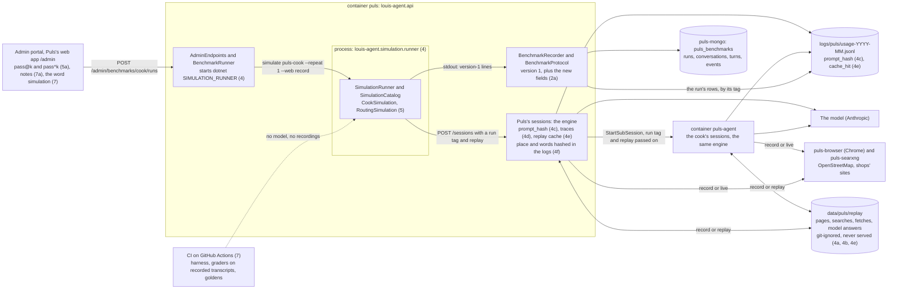
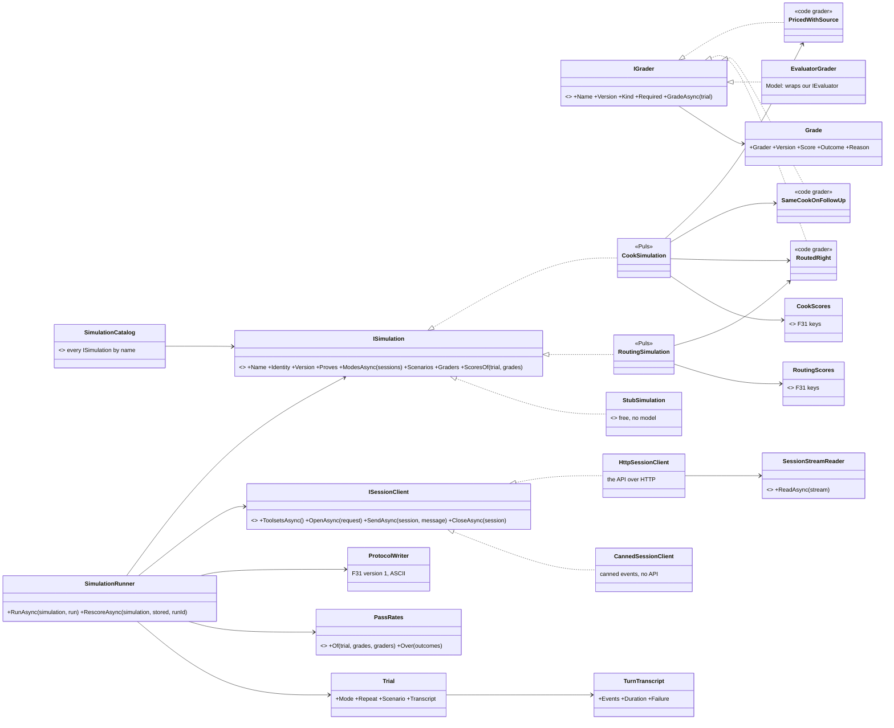
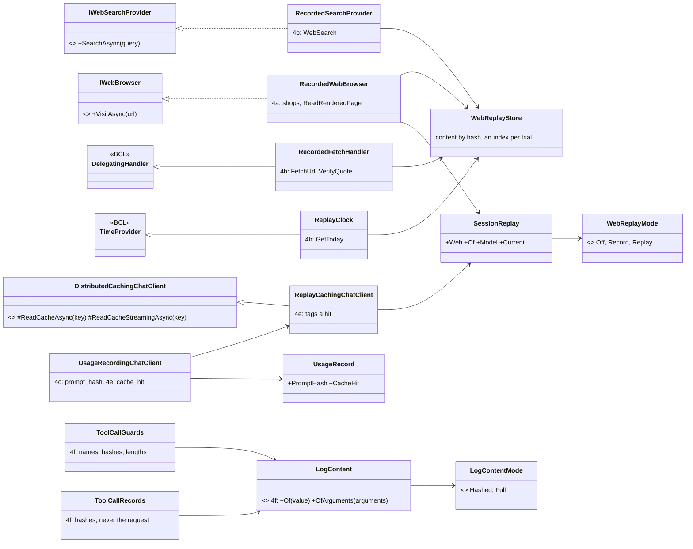
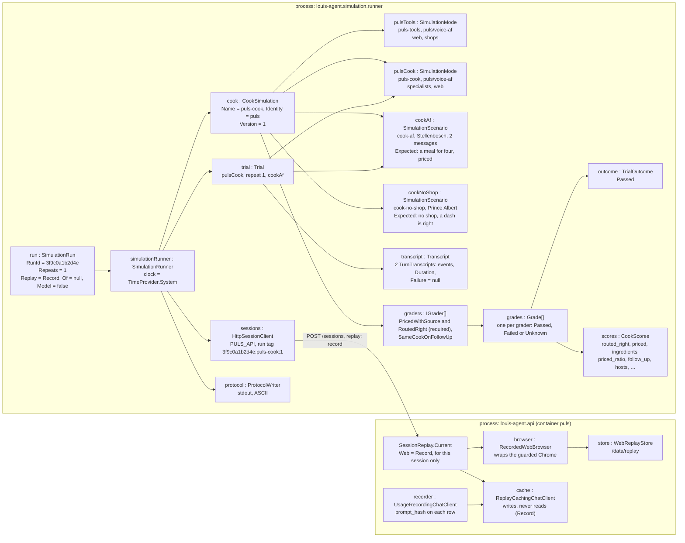
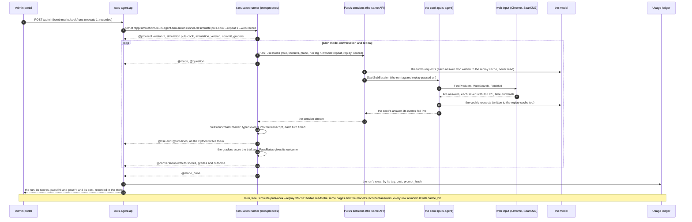

# F18 · Simulations in C#: plan

> Approved 2026-10-19 as Phase 3 of [the platform plan](platform.md) (its section *Phase 3 · F18 Simulations in C#*,
> copied here as approved, with its diagrams, namespace map and folder trees) · TODO: *F18 Simulations in C#* · Branch:
> `feature/F18-simulations` off `main` · ADR: [0029](../adr/0029-simulations-in-csharp.md) (amends
> [0022](../adr/0022-benchmarks-recorded-from-the-protocol.md)) · Feature doc: [F18](../features/F18-evaluation.md)

Branch `feature/F18-simulations`. Before step 0 this section is copied, as Louis approved it, into
`docs/plans/F18-simulations.md` on that branch, with its four diagrams, namespace map and folder trees; *Approved during
the build* goes in that file, never in `platform.md` (Phase 0 step 1). It starts after Phase 2, because Puls's
simulations open sessions on the Puls identity (`IDENTITIES=puls`), and it is done only when Louis has read its
write-up, written by Claude (step 8). GOAL skills: 12, 17, 13 and 3. Paid runs: one cook and one routing run, in step 5, each on
Louis's go, compared with the Python's last runs.

F18 was *Evaluation: a small shared eval harness* (`docs/features/F18-evaluation.md`); F31 then built that harness in
Python for the admin portal. This phase rewrites it in C#, as simulations, and gives every identity its own. Louis: "we
call it simulations, of a real world [task]. So the python [scripts] must be [reworked]. They must follow C# patterns
and standards, and AI engineering standards and patterns this is important". ADR 0029 (written in Phase 0) records it and
amends ADR 0022: the harness becomes C# in `simulations/`, the recorded stream moves to
`tests/louis-agent.session-stream.tests/Fixtures/`, and the protocol and the store stand.

It also builds what the thread asked of the engine for evals: web pages recorded and replayed, so a run sees the same
input every time (Louis: "[can we] store those as pics [when it] happens, [reasons] i need to do [benchmarks]"); a
replay cache, so a re-run of a recorded simulation costs a known $0; the prompt's hash on every ledger row; traces per
turn and tool call; and the place and the user's text out of the logs (step 4f; Part 3, row 14), beside the traces'
"sensitive data off". F35 (recipe sources, on Puls's track) comes after this phase; the record and replay its draft
planned as its own step 4 (`WEB_CASSETTE`, `RecordingWebBrowser`, `ReplayWebBrowser`, `plans/F35-recipe-sources.md`) is
built here instead, in the engine, under the names below, and F35's recipe simulation runs on pages recorded this way.
Phase 6
depends on this phase's step 1 in the words used everywhere: "Part A needs Phase 2's steps 1-2 and Phase 3's step 1
(the reader); Part B needs Phase 2's steps 1-2 and Part A." Here *step 1* is the four commits 1a to 1d below.

The checks of this plan's first draft found it wrong in places, fixed here: the routing and follow-up scores are
computed in the checks' own `score()` functions, not in `scoring.py`; a byte-for-byte protocol test can't pass
(Python's separators and escapes, and a wall-clock `t`), so the test compares what the API parses; the manuals and the
fixture's second file also live in `benchmarks/`; the images publish only the API, so the runner had nowhere to run; the
reader sat in `src/` while core would reference it; `SimulationRunner` was placed in two projects; a `Grade` could not
hold F31's scores document, which the trends read key by key; a timeout was not a transcript event, so one dead
container would have counted as the agent failing; no step built pass@k, versions or re-scoring; the web input was not
frozen, so a run measured the websites as much as the agent; and a gate on recorded transcripts can't see the agent.

#### Context

| Today (checked) | Where | Lines |
|---|---|---|
| The line protocol the portal records (version 1: `@` then one JSON event, ASCII only, with a wall-clock `t`; plain lines for people) | `benchmarks/puls_check/protocol.py` (`:12-16`) | 35 |
| A client of the API and a reader of the session stream | `puls_check/client.py`, `stream.py` | 135 |
| The shared scoring rules: prices with sources, rand amounts, "unknown" marks, deals, the store lines | `puls_check/scoring.py` | 185 |
| Three checks: stub (free), cook, routing; the cook's and the routing's own `score()` functions (routed right, the follow-up, the no-shop rows, the expected role: `cook/run_check.py:75-120`, `routing/run_check.py:59-73`); routing's baseline mode read from the instance at run time (`routing/run_check.py:109`); the stub writes its own lines, not ASCII-only (`stub/run_check.py:30-32`) | `benchmarks/{stub,cook,routing}/run_check.py` | 425 |
| Their tests (74 methods: 27 for scoring, 18 cook, 10 routing, 10 stream, 6 protocol, 3 client), and one for the manuals (4 methods) | `test_*.py` | 658 |
| The manuals, one per check, which name every score it reports; the portal reads them only inside `benchmarks/` | `benchmarks/{stub,cook,routing}/HANDLEIDING.md`; `test_manuals.py`; `src/louis-agent.api/Services/Benchmarks/BenchmarkManuals.cs:17-20`, `Services/BenchmarkCheck.cs:13` | |
| The readers' contract: one recorded Puls turn (401 KB, 1,503 events, `docs/features/F31-benchmarks-portal.md:179`) and its expected counts, read by `test_stream.py` and by `SessionStreamFixtureTests` | `benchmarks/fixtures/session-stream.sse`, `session-stream.expected.json`; `tests/louis-agent.api.tests/SessionStreamFixtureTests.cs:15-16,21,28` | |
| Started by the API as `python3 {script}` in the workspace, read and stored by C# | `src/louis-agent.api/Services/BenchmarkRunner.cs:13,52-54`, `Services/Benchmarks/BenchmarkProtocol.cs`, `MongoBenchmarkStore.cs` | |
| What a run keeps of its settings: provider, model, roles, script and arguments; not the commit, and no simulation version | `Services/Benchmarks/BenchmarkSettings.cs:12-21` | |
| The trend's score is the share routed right per run, not pass@k or pass^k; it reads `routed_right`, `priced`, `ingredients` and `priced_ratio` out of each conversation's scores | `Services/Benchmarks/BenchmarkTrends.cs:17-19,80-93` | |
| Shown in the admin portal inside Puls's web app | `src/louis-agent.puls/Pages/Admin/Benchmarks.razor`, `BenchmarkRun.razor` | |
| The images publish only the API into `/app`; the scripts come from the repo mounted at `/workspace` | `docker/Dockerfile.puls:5`, `docker/Dockerfile.api:4`; `docker/docker-compose.puls.yml:51` | |
| Run in CI as Python unit tests | `.github/workflows/ci.yml:56-58` | |
| The ledger carries no prompt version; nothing caches a model's answer; there is no OpenTelemetry in core or `src/` (a search finds no `ActivitySource`) | `louis-agent.core/Usage/UsageRecord.cs:28-44`; `louis-agent.core/Agent/AgentEngine.cs:117-133` | |
| The web input is live on every run: nothing an agent reads is saved, and it comes through three seams, the guarded browser (shops, rendered pages), the search provider and `FetchUrl`'s own `HttpClient` | `louis-agent.core/Tools/Web/Browsing/IWebBrowser.cs:9-17`; `Tools/Web/WebTools.cs:29,35,49` | |
| The logs keep the place and the user's words: every tool call's arguments in full and the first 300 characters of its result; the oversized-result record keeps the arguments and 500 characters of the user's request, the truncated-call record the arguments; the shop lines name the town (`{Place}`) and, in the two store-lookup lines, its centre's coordinates to four decimals (`{Latitude}, {Longitude}`); Rider's host logs the request's raw parameters and the first 300 characters of the prompt | `louis-agent.core/Agent/ToolCallGuards.cs:40-41,63`; `Logging/ToolCallRecords.cs:15-23,27-32`; `Messages/LogMessage.cs:18-40`; `Tools/Shops/Providers/CheckersStore.cs:83-89`; `src/louis-agent.acp-server/AcpServer.cs:216-217` | |

The stream is read four times: by the web apps (`TurnStream.cs`), the orchestrator (`LouisAgentClient`), core
(`SpecialistTools`) and the Python (`TODO.md:299-305`). A new event has to be learnt four times (CL11's finding). Two
of the C# readers frame the stream by hand (`LouisAgentClient.cs:99-100`, `SpecialistTools.cs:442-443`); the web app
already uses the BCL's `SseParser` (`src/louis-agent.web.shared/Services/AgentApi.cs:97,122`). `python3` stays in the
images: skills (`Execution: python`) and `PythonRun` use it (`louis-agent.core/Tools/Shell/PythonTools.cs:52`). Only
the checks leave Python.

#### Design

**What a simulation is, in the field's words** (Anthropic, *Demystifying evals for AI agents*,
https://www.anthropic.com/engineering/demystifying-evals-for-ai-agents, 9 Jan 2026; the page and its date checked
2026-10-18). A *simulation* is a **task**: a
scenario, its made-up data and its **success criteria**. It runs as **trials**; each trial leaves a **transcript**
(the session's events, tool calls included, with each turn's time and any infrastructure failure) and ends in an
**outcome** that **graders** score. A run reports **pass@k** (passed at least once in k trials) and **pass^k** (passed
every time in k). Our own addition: a task runs in one or more *modes* (Puls alone against Puls with its cook).

1. **Grade the outcome, then the path only where the path matters.** The cook's list is priced with sources (outcome);
   it went to the cook and not elsewhere (path, because routing is what is tested).
2. **Code graders first.** Deterministic, free and repeatable: today's scoring rules, ported, the checks' own
   `score()` functions included. A **model grader** only where code can't judge, such as "is this recipe a meal for
   four": our own `IEvaluator` from Microsoft.Extensions.AI.Evaluation, run on our model, and only once it agrees with
   Louis's own labels on at least 9 of 10 stored answers. Its stock Quality evaluators are tuned for one model only
   (each one's remarks in the 10.10.0 package's XML docs name GPT-4o, and say results "can be especially poor when a
   smaller / local model is used"), so none is used uncalibrated. A grade may be **Unknown**, which is shown and never
   counted as a pass.
3. **Repeat for the spread.** Trials per mode, as today; the run reports pass@k and pass^k per scenario and mode,
   because a sold agent needs the second. A trial that failed for the infrastructure (a timeout, a dead container, a
   replay miss) is reported apart and left out of both, so a flake never counts as the agent failing.
4. **Cost from the ledger**, never computed by the harness (ADR 0007), the model grader's requests included; each
   turn's wall-clock seconds measured by the harness, as F31 does today (`benchmarks/cook/run_check.py:140`,
   `benchmarks/routing/run_check.py:91`).
5. **Versioned.** A simulation's version (bumped by any change to a scenario, a mode or a grader), each grader's
   version and the commit are recorded with every run, and every ledger row carries the hash of the system prompt and
   the tool list it was sent with, as prices carry `as_of`, so a trend compares like with like.
6. **Free first.** Graders run on stored transcripts without a model, so a grader change re-scores old runs for $0; a
   recorded run replays for $0 through the replay cache; paid runs wait for Louis's go.
7. **Frozen input.** A recorded run saves the web pages, search results and fetches its agents read; a replay reads
   only those, so a difference between two runs comes only from our change, not from the site.
8. **Made-up data only**, never a real customer's (POPIA), and every simulation names what it proves.

**What CI can and can't catch.** CI gates the harness and the graders (on recorded transcripts) and what the model
reads (the golden files). An agent regression is caught only by a run: the paid simulations before a release, on
Louis's go, or a free local-model run (F15). A free replay (step 4e) sits between the two: it catches a change in what
the model is sent, because a miss names it, but it can't say whether the new behaviour is good; that still needs a
paid run. Replays run where the recordings are, never in CI, because recorded pages stay private and out of the repo.
Step 8's write-up names this limit.

**Frozen input: web pages recorded and replayed** (steps 4a and 4b). Recipe pages and shop prices change and
disappear, so a run that reads the live web measures the website as much as the agent. The pattern is record and
replay:

- **One mode, three values.** `WebReplayMode { Off, Record, Replay }`, set by `WEB_REPLAY` (ADR 0024, parsed with
  `SettingChoice`), is an instance's default for simulation sessions; a run may ask for another
  (`simulate {name} --web record`, `--web replay --of {runId}`), which the runner sends with every session it opens.
  `Off` (the default) reads the live web and saves nothing.
- **Record** reads the live web through the same guards and saves what was asked (a visit's URL, its script and ready
  selector; a search's query and options; a fetch's URL), what came back (the page's HTML, the captured answers and the
  script's result; a search's results; a fetch's body; screenshots once the vision feature adds them), when, and the
  content's SHA-256. The content sits once per hash under `REPLAY_DIRECTORY` (git-ignored: `/data/` at
  `.gitignore:40`; `/data/replay` in the Puls compose, which mounts `data/puls` in both agent containers,
  `docker/docker-compose.puls.yml:54,97`), and each trial's index sits under its run's id, so the run in the store
  points to its recordings by the run's id and to each page by its hash.
- **Replay** answers from those files only and never opens Chrome or the network; an ask that was not recorded fails
  with a text naming it (a `ToolMessage` member, ADR 0009), and `GetToday` answers the recorded times.
- **Three seams, one store.** The guarded browser (`IWebBrowser`: the shops and `ReadRenderedPage`) is wrapped by
  `RecordedWebBrowser` (step 4a). The search provider and `FetchUrl`'s `HttpClient` get the same store in step 4b,
  because the cook searches for its recipe and fetches OpenStreetMap without the browser (`louis-agent.core/Prompts/specialists/puls-cook.md:65`), and a
  run frozen only at the browser would still read a live search.
- **Live chats are never recorded or replayed.** The API takes `replay` only on a session that carries a run tag, and
  refuses it on any other (a 400); a sub-session gets it the way it gets the run tag today
  (`louis-agent.core/Tools/Agents/SpecialistTools.cs:87`), so the cook's pages in `puls-agent` are recorded too.
- **Saved pages are never served:** no endpoint reads the folder, nothing in it is committed, and the portal shows only
  hashes, URLs and times. In the thread's words, keep them "private, for testing only, never shown to users or put in
  the repo"; the same reply estimated 0.5 to 2 MB a full-page screenshot (an estimate, not measured), which is why a
  benchmark set stays at 10 to 50 pages.

**A replay cache, the prompt's hash, traces and clean logs** (steps 4c to 4f). Four small engine changes: the first
three each close a GOAL *Missing* item or half of one; the fourth closes none, but Part 3 (row 14) counts it a release
blocker for a public Puls:

- **The prompt's hash on every ledger row** (step 4c): `prompt_hash`, a SHA-256 over the system prompt and the tool
  list as sent, so a run's prompt version is known (skill 3's "prompt versioning"). Two runs whose rows differ only in
  their hash are an A/B comparison of a prompt change on the same simulation.
- **Traces per turn and tool call** (step 4d): Microsoft.Extensions.AI's own `.UseOpenTelemetry()` inside
  `UseFunctionInvocation`, sensitive data off; `FunctionInvokingChatClient` then traces each tool call itself (it uses
  the `ActivitySource` of an OpenTelemetry client inside it, its `_activitySource` field in the 10.10.0 XML docs), so no
  decorator of ours is needed (skill 17's "tracing per turn and tool call"). Exporters, dashboards and `traceparent`
  across processes stay F44's.
- **A replay cache, for recorded simulations only** (step 4e). Live chats stay uncached: Part 5's reason for cutting a
  live cache holds. MEAI's `DistributedCachingChatClient` gives no hit signal, and a hit returns the stored response
  with its original usage, so the ledger would price it again. A small subclass overrides `ReadCacheAsync` and
  `ReadCacheStreamingAsync` (both protected virtual members of the 10.10.0 class, overriding `CachingChatClient`'s
  protected abstract ones, so only a subclass can reach them; read from the 10.10.0 assembly's metadata, checked
  2026-10-18) and tags a hit in `AdditionalProperties`; it sits inside `UsageRecordingChatClient`, which writes a tagged
  response as a known 0 with `cache_hit=true` (ADR 0007: a known 0, never unknown). A recorded run writes it and never
  reads it, because pass^k needs independent trials; a free replay (`simulate {name} --replay {runId}`) reads it with
  the frozen web input, so every request is the same as the recorded run's and costs $0. A **miss** in a replay never
  reaches the provider: it names the first part of the request that changed (the system prompt, a tool, message *n*),
  which is exactly where what the model is sent changed. It closes skill 13's only *Missing* item ("a response cache for
  exactly repeated requests"), measured by the replayed cook run's hit rate and cost against its live run.
- **Personal data out of the logs** (step 4f; Part 3, row 14; POPIA s13, s14 and s19; OWASP LLM02:2025). Today the logs
  keep what the traces of 4d leave out: every tool call's arguments in full and 300 characters of its result
  (`ToolCallGuards.cs:40-41,63`), 500 characters of the user's request in each oversized-result record
  (`Logging/ToolCallRecords.cs:15-23`), the town and its centre's coordinates in the shop lines, and the prompt in
  Rider's host (`src/louis-agent.acp-server/AcpServer.cs:216-217`). A new setting, `LOG_CONTENT` (`hashed`, the default, or `full`),
  makes every such value a length and a keyed hash: the first 12 hex digits of an HMAC-SHA256 under a random key made
  when the process starts and never written down. Equal values in one process's logs still match, so a log still shows
  "the same town twice", but nobody can reverse it by hashing a list of towns, as they could a plain SHA-256 of a town's
  name. Every argument value is hashed, not only the place, because the model copies the user's words into any argument
  (a search query, a sub-session's task), so no list of "personal" fields would be complete. `full` keeps today's lines
  for a developer on their own machine; Puls's compose never sets it.

**How it is built, in C#'s terms.** A contract per simulation, per grader and per session client; records for
scenarios, trials, transcripts and grades; enums for choices (ADR 0024); message enums for every text (ADR 0009),
checked by `HostMessageEnumTests` once it scans `simulations/`; `ILogger` to stderr because stdout is the protocol;
`IHttpClientFactory`, `TimeProvider` and `CancellationToken` throughout; NUnit tests mirroring each project, one test
project per new project. The harness names no identity: Puls's scoring rules live in `louis-agent.simulations.puls`,
as Phase 2's cut keeps Puls out of core. **F31's line protocol stays the seam:** the C# runner writes the same
version-1 lines, and what it adds is additive (fields `BenchmarkProtocol` reads when present and a Python run simply
lacks, since it reads every field by name, `BenchmarkProtocol.cs:61-76`), so every stored run still reads. The API
starts `dotnet /app/simulations/louis-agent.simulation.runner.dll` instead of `python3`.

*Alternatives considered.* Keep Python: rejected by Louis, and it keeps a fourth stream reader. Run simulations inside
the API process: rejected, a run spends minutes and money and must not take the API down with it. A third hand-written
SSE framer: rejected, the BCL's `System.Net.ServerSentEvents.SseParser` already frames this stream in the web app, so
the reader only maps its items. Microsoft.Extensions.AI.Evaluation's own reporting store: its evaluators and metric
types are reused, but runs stay in F31's store, which the portal and the trends already read; `EvaluatorGrader` calls
`IEvaluator.EvaluateAsync` directly, so no store is needed, and `IEvaluationResultStore` (a public interface in
Microsoft.Extensions.AI.Evaluation.Reporting 10.10.0, checked) could wrap F31's store later. MEAI's
`DistributedCachingChatClient` as it is: rejected, no hit signal, and the ledger would price a hit again. A record and
replay library for HTTP: it would cover search and `FetchUrl` but not the browser's visits, which go to Chrome over its
DevTools protocol (`ChromeWebBrowser.cs:16`), so one small store of ours serves all three seams (no library was
surveyed by name; inferred).

#### Architecture: what runs when the portal starts a simulation

Each box is marked with the step that adds or changes it. The runner is its own process beside the API in the `puls`
container; the cook runs in `puls-agent`, with the same engine and the same mounted folders.



#### Folder structure: the projects before and after

Four new projects, each with its test project in `tests/` named after it and a line in `louis-agent-solution.sln`; the
reader sits at the root beside `louis-agent.core/`, because core references it and `src/` holds only hosts, web apps
and the composition project. Only the folders that change are shown.

**Today (`main`)**

```text
louis-agent/
├── benchmarks/                                F31's checks in Python: 1,442 lines in 18 .py files
│   ├── puls_check/                            protocol.py (35), client.py (42), stream.py (93), scoring.py (185), their tests
│   ├── stub/  cook/  routing/                 run_check.py each (102, 184, 139 lines), HANDLEIDING.md each,
│   │                                          test_cook.py, test_routing.py
│   ├── fixtures/                              session-stream.sse, session-stream.expected.json: the readers' contract
│   └── test_manuals.py                        every score a check reports is named in its manual
├── louis-agent.core/
│   ├── Agent/AgentEngine.cs                   the pipeline: no traces, no cache (:117-133)
│   ├── Agent/ToolCallGuards.cs                every call's arguments in full (:40-41), 300 characters of its result (:63)
│   ├── Llm/UsageRecordingChatClient.cs        one ledger row per model request
│   ├── Logging/ToolCallRecords.cs             the arguments and 500 characters of the user's request (:15-23, 27-32)
│   ├── Messages/LogMessage.cs                 the shop lines name the town (:18-40; to the shops pack in Phase 2)
│   ├── Usage/UsageRecord.cs                   no prompt version (:28-44)
│   └── Tools/
│       ├── Agents/SpecialistTools.cs          reads a peer's stream with its own event:/data: loop (:442-443)
│       └── Web/                               Browsing/IWebBrowser.cs, Search/, WebTools.cs: nothing recorded
├── src/
│   ├── louis-agent.acp-server/AcpServer.cs    the raw parameters and 300 characters of the prompt (:216-217)
│   ├── louis-agent.api/
│   │   ├── Endpoints/AdminEndpoints.cs        /admin/benchmarks/…, the manual at :56
│   │   └── Services/                          BenchmarkRunner (starts python3), BenchmarkCatalog, BenchmarkCheck,
│   │       └── Benchmarks/                    BenchmarkProtocol, BenchmarkRecorder, the two stores, BenchmarkTrends,
│   │                                          BenchmarkManuals (reads benchmarks/ only), BenchmarkSettings
│   ├── louis-agent.orchestrator/LouisAgentClient.cs   its own event:/data: loop (:99-100)
│   ├── louis-agent.puls/Pages/Admin/          Benchmarks.razor, BenchmarkRun.razor
│   └── louis-agent.web.shared/                TurnStream.cs; Services/AgentApi.cs frames with SseParser
├── tests/louis-agent.api.tests/               10 Benchmark*.cs test files (9 *Tests.cs and BenchmarkStoreContract.cs);
│                                              SessionStreamFixtureTests.cs reads benchmarks/fixtures/
├── docker/Dockerfile.puls, Dockerfile.api     publish only the API into /app
└── .github/workflows/ci.yml                   dotnet test, then the Python unit tests (:56-58)
```

**After F18 (step by step)**

```text
louis-agent/
├── louis-agent-solution.sln                   + 8 projects: 4 and their tests (steps 1a, 2, 3, 4)
├── louis-agent.session-stream/                1a, new: SSE in (SseParser), typed events out, each with its raw type
│                                              and data; no dependencies; referenced by core, web.shared, the
│                                              orchestrator and the harness
├── louis-agent.core/
│   ├── Agent/AgentEngine.cs                   4d: UseOpenTelemetry inside UseFunctionInvocation; 4e: the replay cache
│   ├── Agent/ToolCallGuards.cs                4f: the tool's and arguments' names, keyed hashes and lengths
│   ├── Config/AgentOptions.cs                 4a: WEB_REPLAY, REPLAY_DIRECTORY; 4f: LOG_CONTENT
│   ├── Config/LogContentMode.cs               4f, new: Hashed (the default) or Full
│   ├── Llm/ReplayCachingChatClient.cs         4e, new
│   ├── Llm/UsageRecordingChatClient.cs        4c: prompt_hash; 4e: a hit written as a known 0
│   ├── Logging/                               4f: LogContent (new, the keyed hash); ToolCallRecords; AgentLogging.Configure
│   ├── Sessions/                              4a, new: WebReplayMode, SessionReplay
│   ├── Usage/                                 4c, 4e: UsageRecord.PromptHash, .CacheHit; 6: UsagePurpose.Grading
│   └── Tools/
│       ├── Agents/SpecialistTools.cs          1c: reads through the reader; 4a: passes replay to a sub-session
│       ├── Clock/ClockTools.cs                4b: the recorded clock in a replay
│       └── Web/Replay/                        4a-4b, new: WebReplayStore, RecordedWebBrowser,
│                                              RecordedSearchProvider, RecordedFetchHandler, ReplayClock
├── packs/louis-agent.pack.shops/              4f: the shop lines name the town's hash, not the town
├── simulations/                               new, beside tests/
│   ├── louis-agent.simulation/                2: the harness, sold with the engine; names no identity
│   │   ├── ISimulation.cs, SimulationMode.cs, SimulationScenario.cs, SimulationScores.cs, SimulationRun.cs,
│   │   │   Trial.cs, Transcript.cs, TurnTranscript.cs, TrialFailure.cs, SimulationRunner.cs
│   │   ├── Grading/                           IGrader, GraderKind, Grade, GradeOutcome, TrialOutcome, PassRates (5a),
│   │   │                                      EvaluatorGrader (6: a Microsoft.Extensions.AI.Evaluation bridge)
│   │   ├── Protocol/                          ProtocolWriter: F31's version-1 lines, plus 2a's fields
│   │   ├── Api/                               ISessionClient, HttpSessionClient over the reader, CannedSessionClient
│   │   └── Messages/                          SimulationMessage, SimulationLogMessage
│   ├── louis-agent.simulation.runner/         4: Program (simulate, --list; 4a: --web, --of; 4e: --replay;
│   │                                          5b: --rescore), SimulationCatalog, StubSimulation, Manuals/stub.md (7)
│   └── louis-agent.simulations.puls/          3: Grading/ (Puls's graders, CookScores, RoutingScores);
│                                              5: CookSimulation, RoutingSimulation; 6: the judge's prompt;
│                                              7: Manuals/cook.md, routing.md
├── src/
│   ├── louis-agent.acp-server/AcpServer.cs    4f: the prompt's lines hashed
│   ├── louis-agent.api/                       2a, 5a, 7a: the store reads the new fields; 4: BenchmarkRunner starts the
│   │                                          C# runner (SIMULATION_RUNNER), the catalogue from --list;
│   │                                          7: BenchmarkManuals reads simulations/
│   ├── louis-agent.orchestrator/              1d: LouisAgentClient reads through the reader
│   ├── louis-agent.puls/Pages/Admin/          5a: pass@k and pass^k; 7: the word simulation; 7a: notes
│   └── louis-agent.web.shared/                1b: TurnStream and AgentApi read through the reader
├── tests/
│   ├── louis-agent.session-stream.tests/      1a; from 7: Fixtures/session-stream.sse and .expected.json
│   ├── louis-agent.simulation.tests/          2, 2a, 5a, 5b, 6: the protocol's lines, the pass rule, the runner, the judge's bridge
│   ├── louis-agent.simulation.runner.tests/   4: the catalogue, the arguments, the stub run recorded as the Python stub's was
│   ├── louis-agent.simulations.puls.tests/    3, 5, 7: today's Python test cases, ported, the same scores; the manuals
│   ├── louis-agent.core.tests/                4a-4f: the replay decorators, the hash, the spans, the cache, the logs;
│   │                                          Messages/HostMessageEnumTests.cs scans simulations/ (2)
│   ├── louis-agent.pack.shops.tests/          4f: a shop line names the town's hash
│   └── louis-agent.api.tests/                 SessionStreamFixtureTests.cs reads the moved fixture (7)
├── docker/Dockerfile.puls, Dockerfile.api     4: the build stage also publishes the runner; the final stage copies it to /app/simulations
├── .github/workflows/ci.yml                   7: no Python step
└── (benchmarks/ deleted in step 7)
```

#### Interfaces

```csharp
// louis-agent.session-stream (namespace LouisAgent.SessionStream): no dependencies
public static class SessionStreamReader
{
    // Frames with SseParser.Create(stream) (System.Net.ServerSentEvents, in the BCL) and only maps each SseItem.
    public static IAsyncEnumerable<SessionEvent> ReadAsync(Stream stream, CancellationToken cancellationToken);
}
// Every event keeps its raw form, so a writer passes Type and Data on unchanged: TurnStream reads message.toolsets,
// message.session_role, tool_use_id and is_error, which a typed record alone would drop.
public abstract record SessionEvent(string Type, JsonElement Data);
public sealed record MessageStarted(JsonElement Data, IReadOnlyList<string> Toolsets, string? Role) : SessionEvent("message_start", Data);
public sealed record SubSessionStreamed(JsonElement Data, string ToolUseId, SessionEvent Inner) : SessionEvent("sub_session", Data);
// ContentBlockStarted, ContentBlockDelta, ContentBlockStopped, MessageDelta, MessageStopped, UsageReported, Error;
// UnknownEvent for a type the reader doesn't know yet: kept, never dropped.
// Two names are chosen so they never clash. SubSessionStreamed is not core's Sessions.SubSessionEvent (the Werk panel's
// feed item, louis-agent.core/Sessions/SubSessionEvent.cs:8), which SpecialistTools uses today (SpecialistTools.cs:355)
// and keeps once it reads through the reader (step 1c): with both imported, one simple name would be ambiguous
// (CS0104). UsageReported is not Usage, because a test file in LouisAgent.Core.Tests.* whose usings sit above its
// namespace (ToolCallLogTests.cs does) finds core's namespace LouisAgent.Core.Usage before an imported type of that name.

// simulations/louis-agent.simulation (namespace LouisAgent.Simulation): the harness, sold with the engine
public interface ISimulation
{
    string Name { get; }                                    // "puls-cook"
    string? Identity { get; }                               // "puls": the identity it proves; null for the stub
    int Version { get; }                                    // bumped by any change to a scenario, a mode or a grader
    string Proves { get; }                                  // one sentence, shown in the portal
    ValueTask<IReadOnlyList<SimulationMode>> ModesAsync(ISessionClient sessions, CancellationToken cancellationToken);
                                                            // routing's baseline: every toolset the instance has, minus the delegating ones
    IReadOnlyList<SimulationScenario> Scenarios { get; }
    IReadOnlyList<IGrader> Graders { get; }
    SimulationScores ScoresOf(Trial trial, IReadOnlyList<Grade> grades);   // F31's scores document, its keys unchanged
}
public sealed record SimulationMode(string Name, string Role, IReadOnlyList<string> Toolsets, int Depth = 0, string? Llm = null);
public sealed record SimulationScenario(string Id, string? Place, IReadOnlyList<string> Messages, string TimeZone,
    JsonElement Expected);                                  // the success criteria the graders read: no shop in town, the expected role, the right customer
public sealed record Trial(string RunId, SimulationMode Mode, int Repeat, SimulationScenario Scenario, Transcript Transcript);
public sealed record Transcript(IReadOnlyList<TurnTranscript> Turns);
public sealed record TurnTranscript(int Turn, string Session, string Question, IReadOnlyList<SessionEvent> Events,
    TimeSpan Duration, TrialFailure? Failure);              // Duration from the harness's clock, as F31's `seconds`
public enum TrialFailure { Timeout, Transport, ApiError, ReplayMiss }   // not the agent's: reported apart, left out of pass@k and pass^k
public abstract record SimulationScores;                    // CookScores, RoutingScores: written snake_case into the `conversation` line's `scores`
public sealed record SimulationRun(string RunId, int Repeats, SessionReplay Replay);   // SessionReplay: core's, step 4a

public sealed class SimulationRunner(ISessionClient sessions, ProtocolWriter protocol, TimeProvider clock, ILogger<SimulationRunner> logger)
{
    public Task RunAsync(ISimulation simulation, SimulationRun run, CancellationToken cancellationToken);
    public Task RescoreAsync(ISimulation simulation, StoredRun stored, string runId, CancellationToken cancellationToken);  // 5b: no session, no model
}

// Api/ (namespace LouisAgent.Simulation.Api)
public interface ISessionClient
{
    Task<IReadOnlyList<string>> ToolsetsAsync(CancellationToken cancellationToken);               // GET /toolsets
    Task<string> OpenAsync(SessionRequest request, CancellationToken cancellationToken);           // POST /sessions
    IAsyncEnumerable<SessionEvent> SendAsync(string session, string message, CancellationToken cancellationToken);
    Task CloseAsync(string session, CancellationToken cancellationToken);
}
public sealed record SessionRequest(SimulationMode Mode, string? Place, string TimeZone, string Task, string RunTag, SessionReplay Replay);
// HttpSessionClient (IHttpClientFactory, the reader); CannedSessionClient (the stub and the tests: canned events, no API)

// Grading/ (namespace LouisAgent.Simulation.Grading)
public interface IGrader
{
    string Name { get; }                                    // "priced-with-source"
    int Version { get; }                                    // recorded with each grade
    GraderKind Kind { get; }                                // Code or Model
    bool Required { get; }                                  // a trial passes when every required grader passes
    ValueTask<Grade> GradeAsync(Trial trial, CancellationToken cancellationToken);
}
public enum GraderKind { Code, Model }
public enum GradeOutcome { Passed, Failed, Unknown }        // Unknown: shown, never counted as a pass
public sealed record Grade(string Grader, int Version, double Score, GradeOutcome Outcome, string Reason);
public enum TrialOutcome { Passed, Failed, Unknown, Infrastructure }
public static class PassRates                               // 5a
{
    public static TrialOutcome Of(Trial trial, IReadOnlyList<Grade> grades, IReadOnlyList<IGrader> graders);
    public static (double? PassAtK, double? PassHatK) Over(IReadOnlyList<TrialOutcome> trialsOfOneScenario);  // Infrastructure left out
}

// Protocol/ (namespace LouisAgent.Simulation.Protocol)
public sealed class ProtocolWriter(TextWriter stdout, TimeProvider clock);   // ASCII only; `t` from the clock

// louis-agent.core: the engine's part (steps 4a-4f)
public enum WebReplayMode { Off, Record, Replay }           // Sessions/: WEB_REPLAY, parsed with SettingChoice
public sealed record SessionReplay(WebReplayMode Web, string? Of, bool Model)   // Sessions/: Of names the recorded run; Model reads the replay cache
{
    public static SessionReplay? Current { get; }           // set per turn by the host, as UserPlace is; passed to a sub-session
}
public sealed class WebReplayStore(string directory);       // Tools/Web/Replay/: content by its hash, an index per trial
public sealed class RecordedWebBrowser(IWebBrowser inner, WebReplayStore store) : IWebBrowser;                  // 4a
public sealed class RecordedSearchProvider(IWebSearchProvider inner, WebReplayStore store) : IWebSearchProvider; // 4b
public sealed class RecordedFetchHandler(WebReplayStore store) : DelegatingHandler;   // 4b: FetchUrl, VerifyQuote; outside the SSRF guard
public sealed class ReplayClock(WebReplayStore store) : TimeProvider;                 // 4b: GetToday's recorded times
public sealed class ReplayCachingChatClient(IChatClient inner, IDistributedCache cache)
    : DistributedCachingChatClient(inner, cache)            // Llm/, 4e
{
    protected override Task<ChatResponse?> ReadCacheAsync(string key, CancellationToken cancellationToken);   // tags a hit
    protected override Task<IReadOnlyList<ChatResponseUpdate>?> ReadCacheStreamingAsync(string key, CancellationToken cancellationToken);
}
// UsageRecord gains PromptHash (prompt_hash, 4c) and CacheHit (cache_hit, 4e), both left out of a row when null
public enum LogContentMode { Hashed, Full }                 // Config/, 4f: LOG_CONTENT, parsed with SettingChoice; Hashed by default
public static class LogContent                              // Logging/, 4f: set once by AgentLogging.Configure
{
    // Hashed: "#3f9c0a1b2d4e (10)", the first 12 hex digits of an HMAC-SHA256 under a key made when the process starts
    // (never written) and the value's length; Full: the value itself, as today
    public static string Of(string? value);
    public static string OfArguments(IDictionary<string, object?> arguments);   // "query=#… (12), area=#… (10)"
}
```

The harness:



The engine's part:



Both wrapped interfaces stay as they are: `IWebBrowser.VisitAsync` (`louis-agent.core/Tools/Web/Browsing/IWebBrowser.cs:9-17`)
and `IWebSearchProvider.SearchAsync(WebSearchQuery, CancellationToken)` (`Tools/Web/Search/IWebSearchProvider.cs:19`).

#### Objects: one cook run in memory

A recorded cook run with one repeat, as the portal starts it in step 5; the values are examples. Two of the six cook
scenarios are drawn.



#### Communication: the portal runs the cook simulation, recorded



#### Namespaces (new, moved, changed)

| Type | Folder | Namespace | Step |
|---|---|---|---|
| `SessionStreamReader`, `SessionEvent` and its records (`SubSessionStreamed` and `UsageReported` among them, named apart from core's `Sessions.SubSessionEvent` and its `Usage` namespace) | `louis-agent.session-stream/` | `LouisAgent.SessionStream` | 1a, new |
| `TurnStream`, `AgentApi` (read through the reader; `AgentStreamEvent` replaced by `SessionEvent`) | `src/louis-agent.web.shared/` | as now | 1b, changed |
| `SpecialistTools` (reads a peer's stream through the reader) | `louis-agent.core/Tools/Agents/` | as now | 1c, changed |
| `LouisAgentClient` (reads through the reader) | `src/louis-agent.orchestrator/` | as now | 1d, changed |
| `ISimulation`, `SimulationMode`, `SimulationScenario`, `SimulationScores`, `SimulationRun`, `Trial`, `Transcript`, `TurnTranscript`, `TrialFailure`, `SimulationRunner` | `simulations/louis-agent.simulation/` | `LouisAgent.Simulation` | 2, new |
| `IGrader`, `GraderKind`, `Grade`, `GradeOutcome`, `TrialOutcome` | `…/louis-agent.simulation/Grading/` | `LouisAgent.Simulation.Grading` | 2, new |
| `PassRates` | `…/louis-agent.simulation/Grading/` | `LouisAgent.Simulation.Grading` | 5a, new |
| `EvaluatorGrader` | `…/louis-agent.simulation/Grading/` | `LouisAgent.Simulation.Grading` | 6, new |
| `ProtocolWriter` | `…/louis-agent.simulation/Protocol/` | `LouisAgent.Simulation.Protocol` | 2, new; 2a, changed |
| `ISessionClient`, `SessionRequest`, `HttpSessionClient`, `CannedSessionClient` | `…/louis-agent.simulation/Api/` | `LouisAgent.Simulation.Api` | 2, new |
| `SimulationMessage`, `SimulationLogMessage` | `…/louis-agent.simulation/Messages/` | `LouisAgent.Simulation.Messages` | 2, new |
| `HostMessageEnumTests` (also scans `simulations/`; `TheHostsHaveMessageEnums` lists `SimulationMessage` and `SimulationLogMessage`) | `tests/louis-agent.core.tests/Messages/` | as now | 2, changed |
| `BenchmarkProtocol`, `BenchmarkDocuments`, `BenchmarkRecorder`, both stores (the new fields) | `src/louis-agent.api/Services/Benchmarks/` | as now | 2a, changed |
| `CookScores`, `RoutingScores`, Puls's code graders (`PricedWithSource`, `RoutedRight`, `SameCookOnFollowUp`, and the rest of `scoring.py`'s rules) | `simulations/louis-agent.simulations.puls/Grading/` | `LouisAgent.Simulations.Puls.Grading` | 3, new (from Python) |
| `Program`, `SimulationCatalog`, `StubSimulation` | `simulations/louis-agent.simulation.runner/` | `LouisAgent.Simulation.Runner` | 4, new |
| `BenchmarkRunner` (starts the C# runner, `SIMULATION_RUNNER`), `BenchmarkCheck` (names a simulation), `BenchmarkCatalog` (built from `simulate --list`) | `src/louis-agent.api/Services/` | as now | 4, changed |
| `WebReplayMode`, `SessionReplay` | `louis-agent.core/Sessions/` | `LouisAgent.Core.Sessions` | 4a, new |
| `WebReplayStore`, `RecordedWebBrowser` | `louis-agent.core/Tools/Web/Replay/` | `LouisAgent.Core.Tools.Web.Replay` | 4a, new |
| `AgentOptions.WebReplay`, `.ReplayDirectory`; the API's `replay` on `POST /sessions` | `louis-agent.core/Config/`, `src/louis-agent.api/` | as now | 4a, changed |
| `RecordedSearchProvider`, `RecordedFetchHandler`, `ReplayClock` | `louis-agent.core/Tools/Web/Replay/` | `LouisAgent.Core.Tools.Web.Replay` | 4b, new |
| `UsageRecord.PromptHash`, `UsageRecordingChatClient` | `louis-agent.core/Usage/`, `Llm/` | as now | 4c, changed |
| `AgentEngine`'s pipeline (`UseOpenTelemetry`) | `louis-agent.core/Agent/` | as now | 4d, changed |
| `ReplayCachingChatClient` | `louis-agent.core/Llm/` | `LouisAgent.Core.Llm` | 4e, new |
| `UsageRecord.CacheHit` | `louis-agent.core/Usage/` | as now | 4e, changed |
| `LogContentMode` | `louis-agent.core/Config/` | `LouisAgent.Core.Config` | 4f, new |
| `LogContent` (the keyed hash) | `louis-agent.core/Logging/` | `LouisAgent.Core.Logging` | 4f, new |
| `AgentOptions.LogContent` (`LOG_CONTENT`), `AgentLogging.Configure`, `ToolCallRecords`, `ToolCallGuards` | `louis-agent.core/Config/`, `Logging/`, `Agent/` | as now | 4f, changed |
| The shops pack's lines that name the town; `AcpServer`'s prompt lines | `packs/louis-agent.pack.shops/`, `src/louis-agent.acp-server/` | as now | 4f, changed |
| `CookSimulation`, `RoutingSimulation` | `simulations/louis-agent.simulations.puls/` | `LouisAgent.Simulations.Puls` | 5, new (from Python) |
| `BenchmarkTrends` (pass@k, pass^k) and the portal's run and trend views | `src/louis-agent.api/Services/Benchmarks/`, `src/louis-agent.puls/Pages/Admin/` | as now | 5a, changed |
| `UsagePurpose.Grading` | `louis-agent.core/Usage/` | as now | 6, changed |
| `BenchmarkManuals` (reads `simulations/`) | `src/louis-agent.api/Services/Benchmarks/` | as now | 7, changed |
| The manuals' test (every score key named in its manual) | `tests/louis-agent.simulations.puls.tests/` | `LouisAgent.Simulations.Puls.Tests` | 7, new (from `test_manuals.py`) |
| `SessionStreamFixtureTests` (reads the moved fixture) | `tests/louis-agent.api.tests/` | as now | 7, changed |
| Notes on a run and on a conversation; `BenchmarkSettings` (the search provider and the page renderer) | `src/louis-agent.api/Services/Benchmarks/` | as now | 7a, changed |
| Tests per new project, each mirroring it | `tests/louis-agent.{session-stream,simulation,simulation.runner,simulations.puls}.tests/` | `LouisAgent.….Tests` | 1a-5 |

#### Steps (one commit each, test first, stop after each)

| # | Step | Test first | Concept (GOAL skill) |
|---|---|---|---|
| 0 | F18's feature doc (`docs/features/F18-evaluation.md`) rewritten as *Simulations*, in the field's words (task, success criteria, trials, transcript, outcome, graders, pass@k and pass^k; modes our own addition); Microsoft.Extensions.AI.Evaluation 10.10.0 (MIT) pinned to the same version as Microsoft.Extensions.AI and moved with it (its 10.10.0 depends on Microsoft.Extensions.AI.Abstractions 10.10.0, and Reporting 10.10.0 on Microsoft.Extensions.AI 10.10.0: their nuspecs on nuget.org, checked 2026-10-18); `EvaluatorGrader` will call `IEvaluator.EvaluateAsync` directly, so no result store is needed; the public word *simulation* planned expand-then-contract, as CL14 did for *role* (its old names kept as aliases until a TODO line removes them, `TODO.md:262`) | docs only; links checked | Reuse before building (18) |
| 1a | **The one session-stream reader** (CL11, done here): `louis-agent.session-stream/` at the root, beside core, with no dependencies, and its test project; it frames with `SseParser` and maps each item to a `SessionEvent` that keeps its raw `Type` and `Data` | the recorded stream (`benchmarks/fixtures/session-stream.sse`, read where it is until step 7) read through the reader gives what `session-stream.expected.json` expects (Puls's tools, the role, the cook's 32 tool calls seen through `sub_session` events (`SubSessionStreamed`), the hosts, the answer's start and length, no error); an unknown event type comes through as `UnknownEvent`, never dropped; each event's `Data` keeps its raw JSON text | One parser per protocol (17, 18) |
| 1b | `TurnStream` and `AgentApi` read through it; `AgentStreamEvent` becomes the reader's `SessionEvent` | `SessionStreamFixtureTests` and the web apps' tests green unchanged; the golden files unchanged | One parser per protocol (17, 18) |
| 1c | `SpecialistTools` reads a peer's stream through it (its own `event:`/`data:` loop, `SpecialistTools.cs:442-443`, goes); core references the reader | the specialist tests green unchanged (the live feed, the roll-up, the kept sub-session); `ArchitectureTests` green; the golden files unchanged | One parser per protocol (17, 18) |
| 1d | `LouisAgentClient` reads through it (`LouisAgentClient.cs:99-100` goes) | the orchestrator's tests green unchanged | One parser per protocol (17, 18) |
| 2 | **The harness's contracts and the protocol in C#**: `ISimulation`, `ISessionClient`, `IGrader`, the records, `SimulationRunner`, and `ProtocolWriter` (ASCII only, `t` from a `TimeProvider`); `HostMessageEnumTests` also scans `simulations/`, and `SimulationMessage` and `SimulationLogMessage` join `TheHostsHaveMessageEnums`' list (`tests/louis-agent.core.tests/Messages/HostMessageEnumTests.cs:21-27`) | with a fixed clock, every line `ProtocolWriter` writes parses through the API's `BenchmarkProtocol.Parse` to the same record as the Python's line for the same event, and every line is ASCII (the protocol's own rule, `protocol.py:13-14`); `HostMessageEnumTests` finds the two new enums and checks their templates | A contract as the seam (12) |
| 2a | **What a run ran, recorded:** the `protocol` line gains `simulation`, `simulation_version` (not `version`, which is the protocol's own), `commit` (stamped into the runner at build, checked in this step; `unknown` when absent) and `graders` (each one's name and version); the `conversation` line gains `grades` and `outcome`; `BenchmarkProtocol` reads them when present and the store keeps them; the protocol stays version 1, because a field it doesn't know is never read | a line with the new fields parses to records that carry them, and a Python line without them parses as before (`BenchmarkProtocolTests` green); both stores keep and return them (the store contract test, in memory and on MongoDB) | Versioned evals: compare like with like (12) |
| 3 | **Code graders and the scores document**, in `simulations/louis-agent.simulations.puls/` (new; Puls's rules don't belong in the harness, which names no identity): `scoring.py`'s rules and the two checks' `score()` functions (`cook/run_check.py:75-120`, `routing/run_check.py:59-73`) as `IGrader`s, with `CookScores` and `RoutingScores` writing F31's keys | every case of `test_scoring.py`, `test_cook.py` and `test_routing.py` (55 test methods) ported to NUnit in `louis-agent.simulations.puls.tests`: for the same input, the C# scores JSON equals the Python dict, key for key; `BenchmarkTrends` reads `routed_right`, `priced`, `ingredients` and `priced_ratio` from it as from a Python run | Graders: outcome first, code first (12) |
| 4 | **The runner and the stub simulation**: `simulations/louis-agent.simulation.runner/` with `Program` (`simulate {name} --repeat N`, `--list`), `SimulationCatalog` (every `ISimulation` by name, one line per simulations project) and `StubSimulation` (the Python stub's canned events through a `CannedSessionClient`: no session, no model); `BenchmarkCheck` names a simulation, and `BenchmarkRunner` starts `dotnet {SIMULATION_RUNNER} simulate {name}` for one (cook and routing stay Python until step 5); the API builds `BenchmarkCatalog` from `simulate --list`, so it references no simulations project; `Dockerfile.puls` and `Dockerfile.api` also publish `simulations/louis-agent.simulation.runner` in their build stage (beside the API's, `Dockerfile.puls:5`, `Dockerfile.api:4`) and copy it to `/app/simulations` in the final one; `SIMULATION_RUNNER` defaults to `/app/simulations/louis-agent.simulation.runner.dll` | in `louis-agent.simulation.runner.tests`: the catalogue lists every simulation once and refuses a name twice; the arguments (`--repeat` clamped as `BenchmarkRunner.MaxRepeat` is, 5; an unknown name refused); a stub run is recorded in the store exactly as the Python stub's was (the same documents, key for key, but the times); then by hand, free: the portal's stub run in the Puls container | Process isolation for long, paid runs (14) |
| 4a | **Web input recorded and replayed: the browser.** `WebReplayMode` and `SessionReplay` (`Sessions/`), `WEB_REPLAY` and `REPLAY_DIRECTORY` (`AgentOptions`, `config/.env.example`; `/data/replay` in the Puls compose), `WebReplayStore` and `RecordedWebBrowser` around the guarded browser; `POST /sessions` takes `replay` (the web mode, the recorded run, whether the model's answers replay too) only on a session with a run tag; a sub-session gets it as it gets the run tag (`SpecialistTools.cs:87`); the runner's `--web record\|replay` and `--of {runId}` | with a fake browser: a recorded visit (its HTML, captured answers and script result, its URL, its time, its content's hash) replays byte-equal from a browser that throws if called; a visit not recorded fails with a text naming its URL and opens nothing; `Off` passes through; a session without a run tag is never recorded, even with `WEB_REPLAY=record`, and `replay` without one is a 400; no endpoint serves the folder; `ToolMessageSnapshot.json` gains the one replay-miss text, reviewed; `ModelRequestSnapshot.json` unchanged | Frozen inputs make evals repeatable (12) |
| 4b | **The same for search, fetch and the clock:** `RecordedSearchProvider` around `IWebSearchProvider`, `RecordedFetchHandler` outside the SSRF guard under `FetchUrl` and `VerifyQuote`'s `HttpClient` (`WebTools.cs:42-49`), and `ReplayClock` for `GetToday` (`ClockTools` already takes a `TimeProvider`, `ClockTools.cs:13`) | a recorded search and a recorded fetch replay byte-equal with the network stubbed to fail; a fetch to a private address is still refused while recording; `GetToday` in a replayed session answers the recorded time; the golden files unchanged | Frozen inputs make evals repeatable (12) |
| 4c | **The prompt's hash on every ledger row:** `UsageRecord.PromptHash` (`prompt_hash`), a SHA-256 over the system prompt and the tool list as sent, written by `UsageRecordingChatClient`; the run's settings keep the hashes its rows carry; speed on every row (`ttft_ms`, F12-S1) stays F44's first step | two requests with the same system prompt and tools carry the same hash, and a changed tool description or prompt line changes it; the conversation's later messages don't; a ledger written before reads with a null hash, and `UsageReport.Total` gives the same totals; a row's other fields are byte-equal to today's; the golden files unchanged | Prompt versioning (3) |
| 4d | **Traces per turn and tool call:** `.UseOpenTelemetry()` inside `UseFunctionInvocation` (`AgentEngine.cs:117-133`), with `EnableSensitiveData = false` set explicitly, since its default turns on when `OTEL_INSTRUMENTATION_GENAI_CAPTURE_MESSAGE_CONTENT` is `true` (the 10.10.0 XML docs); no exporter yet (F44) | an `ActivityListener` sees one chat span per model request (each round of the loop) and one tool span per call, with our `FunctionInvoker` in place (`AgentEngine.cs:123`), named by the OpenTelemetry GenAI conventions; no span carries message text or tool arguments, even with that variable set; the golden files unchanged | Tracing per turn and tool call (17) |
| 4e | **A replay cache for recorded simulations:** `ReplayCachingChatClient` (as in the design) inside `UsageRecordingChatClient`, which writes a hit as a known 0 (tokens and cost) with `cache_hit=true`; the prompt hash and the model in its key (`CacheKeyAdditionalValues`, a public property of the 10.10.0 class); written in a recorded run and never read there; read only when `replay` asks for the model's answers, and then a miss never reaches the provider and names the first part of the request that changed; each recorded trial kept apart, so repeats never share an answer; core takes an `IDistributedCache` (MEAI 10.10.0 depends on Microsoft.Extensions.Caching.Abstractions, its nuspec checked), and the API brings the store: Microsoft.Extensions.AI.Evaluation.Reporting's `DiskBasedResponseCacheProvider` (public in 10.10.0, a cache on disk per scenario and iteration) is tried first, our own small file store only if it doesn't fit; the runner's `--replay {runId}` is `--web replay --of {runId}` with the model's answers replayed from this cache (`SessionReplay.Model`) | with a fake client: a hit costs a known 0, streamed or not, and the recorder never prices it again; thinking signatures survive the cache's JSON round trip byte-equal; a recorded run writes and never reads; a live session neither reads nor writes; two repeats of one recorded run never share an answer; a replay miss never calls the inner client and names what changed; in `louis-agent.simulation.runner.tests`, `--replay {runId}` parses to that request (web `Replay`, `Of` the run, `Model` true); the golden files unchanged | A response cache for exactly repeated requests (13) |
| 4f | **Personal data out of the logs** (Part 3, row 14; POPIA s13, s14 and s19; OWASP LLM02:2025), as in the design: `LOG_CONTENT` (`LogContentMode { Hashed, Full }`, ADR 0024, parsed with `SettingChoice`; `Hashed` the default) read by `AgentLogging.Configure` beside `LOG_DIRECTORY` (its callers: `AgentHost.cs:124,152` and the orchestrator's `Program.cs:36`), and `LogContent` in `Logging/`. With `Hashed`, a tool call's line keeps its tool and its argument names, each value written as a keyed hash and its length (`ToolCallGuards.cs:40-41`; `[TOOL] -> FindProducts(query=#… (12), area=#… (10))`), and a result's line its length in place of its first 300 characters (`:63`); a failure keeps its error type, and its reason is written the same way, since an exception's message can quote an argument (`:58`); the oversized-result and truncated-call records do the same for the arguments and the user's request (`Logging/ToolCallRecords.cs:15-23,27-32`); the shops pack's lines that name the town (moved in Phase 2 step 4 from `Messages/LogMessage.cs:18-40`) write the town the same way, and the town centre's `{Latitude}, {Longitude}` that `ShopStoreForPlace` and `ShopNoStoreForPlace` log beside it (today `Messages/LogMessage.cs:21,24`, written to four decimals at `Tools/Shops/Providers/CheckersStore.cs:83-89`) too, since the coordinates name the town as surely as its name does; Rider's prompt lines (`src/louis-agent.acp-server/AcpServer.cs:216-217`) write the prompt the same way. The arrows, their order, the tool names and the outcomes stay, so the `[TOOL]` lines still show what ran. `Full` keeps today's text, for a developer's own machine; Puls's compose never sets it; docs/CLAUDE.md's *Running and debugging* line (`docs/CLAUDE.md:251`) and `config/.env.example` say so | extending `tests/louis-agent.core.tests/Agent/ToolCallLogTests.cs` (red first: today the line carries the town): with the default, a call whose `area` is a town, in a turn whose place is that town and whose request carries the user's words, leaves neither the town nor the words on stderr or in the run file, only their hashes and lengths; one value hashes the same twice in a process, and two keys hash it differently; an oversized result's record and a truncated call's record carry no argument value and no part of the request in clear; with `LOG_CONTENT=full` today's test's assertions hold unchanged (`[TOOL] -> Ping({"to":"Louis"})`); in `louis-agent.pack.shops.tests` a store-lookup line names the town's hash and its centre's hashes, never the town or its coordinates; the ACP server has no test project, so `LogContent`'s own tests cover what it calls; the ledger and the golden files unchanged | Personal data kept out of logs, as 4d keeps it out of traces (17; skill 15's practice, written up in Phase 7's skill-15 write-up, so Phase 3's skills stay 12, 17, 13 and 3) |
| 5 | **Puls's cook and routing simulations** (`CookSimulation`, `RoutingSimulation`, their scenarios and modes; routing's baseline read from `GET /toolsets` as the Python does), in `louis-agent.simulations.puls`; the portal's cook and routing start the C# runner | on recorded transcripts (a few of the Python's last runs, exported from the store as fixtures, as F31's `session-stream.sse` was), the C# simulations score as the Python did, key for key; then **one paid run of each, on Louis's go**, recorded (`--web record`), beside the last Python runs; then a free replay of each (`--replay {runId}`): every request a hit, each row a known 0, the scores equal to the recorded run's | Same task, new harness: prove nothing moved (12); a replay measured (13) |
| 5a | **pass@k and pass^k:** a trial passes when every required grader passes, and an `Unknown` never counts as a pass; a trial with a `TrialFailure` is reported apart and left out; the runner retries a transport failure once and logs it; `BenchmarkTrends` and the portal show pass@k (passed at least once in k) and pass^k (passed every time in k) per mode | `PassRates` on made-up outcomes; `BenchmarkTrends` over stored conversations with outcomes gives the expected pass@k and pass^k, an infrastructure failure counted in neither; a run from before step 2a shows none (null, never 0); the retry, with a transport that fails once | A sold agent needs pass^k, not only pass@k (12) |
| 5b | **Re-scoring for $0:** `simulate {name} --rescore {runId}` re-grades a stored run's turns (the API hands the runner the run's turns and their events, so the runner needs no admin key) and records the scores as a new run that names the one it re-scored (`rescore_of`) | re-scoring a stored run with the same graders gives the same scores; with a grader's version bumped, the new scores sit beside the old and the old run is unchanged; no session opens and no ledger row is written | A grader change costs $0 (12) |
| 6 | **A model grader where code can't judge:** "a meal for the people asked for", our own `IEvaluator` (Microsoft.Extensions.AI.Evaluation) called through `EvaluatorGrader` (`IEvaluator.EvaluateAsync`, whose 10.10.0 signature takes the messages, the response, a `ChatConfiguration` and evaluation context); no stock Quality evaluator uncalibrated; its prompt a markdown file in `louis-agent.simulations.puls` (ADR 0011); its `IChatClient` wrapped in `UsageRecordingChatClient` with a new `grading` purpose and the run's tag, so its cost is in the run's (ADR 0007); its model, prompt and version stored with each grade; `Unknown` when it can't tell | Louis labels ten stored answers first; the judge matches at least 9 of the 10, the disagreements listed; the calibration runs free on a local model (Ollama, F15); if the local model can't reach 9 of 10, the step stops and Louis decides, because a paid judge is not among this phase's paid runs; it never runs in CI | LLM as a judge, calibrated (12) |
| 7 | **Python leaves:** `benchmarks/` and CI's Python step (`ci.yml:56-58`) deleted; the three manuals move beside their simulations (`simulations/louis-agent.simulations.puls/Manuals/cook.md` and `routing.md`, the stub's to `simulations/louis-agent.simulation.runner/Manuals/stub.md`), and `BenchmarkManuals` reads from `simulations/` (its root at `BenchmarkManuals.cs:17`, the path `BenchmarkCheck.ManualPath` gives, now from `--list`); `test_manuals.py` becomes an NUnit test in `louis-agent.simulations.puls.tests`; `session-stream.sse` and `session-stream.expected.json` both move to `tests/louis-agent.session-stream.tests/Fixtures/`, and `SessionStreamFixtureTests` reads them there; CI's gate is the C# tests: they cover the harness, the graders on recorded transcripts and what the model reads (the golden files), and an agent regression is caught only by a run; the portal's word becomes *simulation* (the old `/admin/benchmarks` routes still answer until a TODO line removes them) | `GET /admin/benchmarks/{check}/manual` answers for stub, cook and routing from their new places (red first: it reads `benchmarks/`); the manual test fails when a score key is missing from its manual; CI runs no Python and the C# tests pass; the old routes still answer | A regression gate, and what it can't see (12, 18) |
| 7a | **Why a run behaved as it did** (F31 step 11c's rest, `TODO.md:204-208`): a person's note on a run and on a conversation, kept in the store with when it was written, shown on the run's row and as a marker on its trend point, beside a marker where the prompt hash changed; the search provider and the page renderer (`WEB_SEARCH_PROVIDER`, `PAGE_RENDERER`, `AgentOptions.cs:212,215`) in the run's settings | the store contract test (both stores): a note on a run and on a conversation reads back with its time; a trend point carries its notes and its prompt-hash marker; `BenchmarkSettingsTests`: the provider and the renderer recorded | A run you can explain (12) |
| 8 | Docs: the feature doc's results; a design doc in `docs/projects/` for each of the four new projects, and the tests design doc; CHANGELOG; GOAL.md's rows 3, 12, 13 and 17 (what is built now, and what stays missing: 12, a gate that sees the agent; 17, dashboards, with F44; 3, the comparison of two prompt versions as a habit); **the learning write-ups**, written by Claude and read by Louis: skill 12's, new (`docs/learning/12-evaluation.md`, with its row in `docs/learning/README.md`: the field's words, code graders first, a calibrated judge, pass@k against pass^k, frozen input, and the limit: a gate on recorded transcripts can't see the agent, only a run can), and skill 13's (`docs/learning/13-cost-and-token-economics.md` gains the replay cache: the hit rate and cost of the replayed cook run against its live run), with a paragraph each on traces and the logs' keyed hashes (17) and the prompt hash (3). The phase is done only when he has read them | links checked | Writing it up (12, 13, 17, 3) |

#### Verification

- Each step: `dotnet build louis-agent-solution.sln`, `dotnet test` on the projects the step touches, and the golden
  files; the whole solution before the PR.
- Steps 1a to 1d leave the golden files byte-equal. Step 4a adds one `ToolMessage` text (the replay miss), reviewed in
  `ToolMessageSnapshot.json`'s diff; no step changes `ModelRequestSnapshot.json`, because no tool, description or
  prompt changes.
- Step 4f changes no golden file and no ledger row; by hand, free: a Puls chat from Malmesbury leaves neither the town
  nor the question in `logs/puls/` (`docker/docker-compose.puls.yml:53,96` mount it), where a search finds only their
  hashes, and the coding agent with `LOG_CONTENT=full` logs as today.
- Steps 2 to 5 keep every key a Python run wrote: a run from the C# runner reads in the store and the portal exactly as
  a Python one did, plus step 2a's fields, which a Python run lacks and every view shows as unknown, never 0.
- **Paid, on Louis's go:** one cook and one routing run, in step 5, compared with the Python's last runs; both are
  recorded, so their replays (free) measure the replay cache. Step 6's calibration runs free on a local model; a paid
  judge is not among this phase's paid runs.
- Free hand checks: the portal's stub run in the Puls container (from step 4); a live Puls chat leaves no file in
  `data/puls/replay` and no cache entry (steps 4a and 4e); a free replay of each step-5 run, every row with
  `cache_hit` and a known 0; `GET /admin/benchmarks/{check}/manual` for the three checks (step 7).
- **What CI can and can't catch:** CI gates the harness and the graders (on recorded transcripts) and what the model
  reads (the golden files). An agent regression is caught only by a run: the paid simulations before a release, on
  Louis's go, or a free local-model run (F15).

#### Risks

- **A subtle scoring difference between Python and C#:** held by porting every one of the 55 Python test cases first,
  comparing the scores JSON key for key, and by step 5's free comparison on the Python's own recorded transcripts
  before any paid run.
- **The portal's word change breaking stored runs:** expand-then-contract, as CL14 did; stored data is read either way
  for good.
- **A local judge failing calibration** (step 6): the step stops and Louis decides; the code graders don't need the
  judge, and nothing else in the phase waits for it.
- **A replay hits only while every request is the same:** the same web input, the recorded clock, the same handles
  (`sub-1`, counted per chat, `louis-agent.core/Sessions/SubSessionRegistry.cs:49`), the same prompt, tools and model. A change to any of them misses, by design; the
  miss is reported, never sent, and a fresh recording is a paid run on Louis's go. Part of a Puls answer that varies by
  more than this (an id the API makes up per session, say) would show as a miss in step 5's first replay; finding none
  is that step's evidence.
- **Recorded pages are other people's content:** private, never committed, never served, kept for testing only, and
  never from a live chat. Whether keeping them for tests is allowed is a question for before Puls's paying customers
  depend on it, as the thread said ("I'm not a lawyer").
- **A run tag is not a login:** any caller with the API's key could open a session with a run tag and ask to be
  recorded; that only writes pages to the private folder or reads them back, and reaches no other user. Restricting it
  to the admin comes with F43's accounts.
- **Two processes write one ledger** once the judge runs in the runner (step 6): the sink opens the month's file shared
  and writes each row in one call (`louis-agent.core/Usage/JsonlUsageSink.cs:40-41`), as the orchestrator already does
  beside the API.
- **Logs that no longer show what a tool was given** (step 4f): with `hashed`, a `[TOOL]` line shows a call's tool,
  its argument names and their lengths, not the values. The chat's own view still shows each call in full (the web
  apps read each call's input from the stream, `src/louis-agent.web.shared/TurnStream.cs:41`; Rider gets each call's
  arguments, `src/louis-agent.acp-server/AcpServer.cs:330`), and a developer sets `LOG_CONTENT=full` on their own
  machine; Puls's compose never does. The key is new each time a process starts, so equal values match only within
  one process's logs, by design.
- **Images rebuilt:** every image that uses core changes, and the Puls and API images gain `/app/simulations`; they are
  SDK images already (`docker/Dockerfile.puls:8`), so `dotnet` runs the runner with no new base image.
- **A new package for the API:** `Microsoft.Extensions.AI.Evaluation.Reporting` (MIT) if its disk cache fits step 4e;
  its time to live for entries is a constructor argument, which we set ourselves (its default is unverified).

