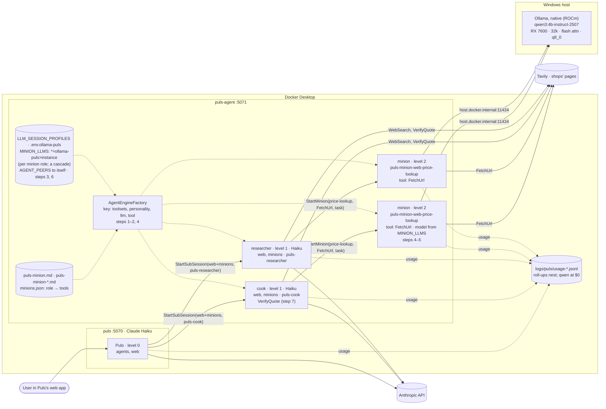

# F30 · Local web peer: plan

> Approved 2026-10-15 · Feature: [F30 Local web peer](../features/F30-local-web-peer.md) · Branch:
> `feature/F30-local-web-peer`, off `main` after #45 (F25–F29)

## Context

Louis's draft (2026-10-15): Puls (Claude Haiku) keeps the reasoning; a local model on Ollama does the web searching
and page reading for prices, and returns a short, checkable report. Measure whether it cuts cost per answer with
quality held. GOAL.md skills 1 (model choice by measured quality and cost), 10 (delegation), 12 (evaluation), 13 (cost).

What changed from the draft, from the code and Louis's answers:
- **F30, not F25** (F25 is the cook), on its own branch off `main` once F25–F29 were merged.
- **The model is chosen per session, not per container** (Louis: "can we switch it on session?"). `puls_agent` keeps
  Haiku for the cook and serves the local model to a sub-session that asks for it. The draft's step 1 (puls-agent on
  `LLM_PROFILE=ollama`) would have moved the cook to Ollama too.
- **Price questions only.** Meals stay with the cook on Haiku (it can't call another specialist: one level deep).
- **qwen3:4b-instruct-2507** (the only local model that made real tool calls, BENCHMARKS.md *Local triage*), on
  Louis's **RX 7600 (8 GB)** through **native Ollama for Windows**: Docker Desktop doesn't pass AMD GPUs to
  containers (`docs/MODELS.md`), and the existing endpoint `http://host.docker.internal:11434` reaches it. Model and a
  32k context fit in 8 GB, so it runs all-GPU. Everything else stays in Docker (Louis's choice); Ollama in Docker
  would be CPU only, ~1–5 minutes just to read a 10–20k-token request, over the 5-minute sub-session timeout.
- **The saving is small in rand** (a Haiku web answer is ~$0.01–0.03); what the run decides is whether a free local
  model is good enough for this task, and step 7 keeps it only if the numbers say so.
- **No `roles.json` change:** prices and research both use `web`, so the rule can't tell them apart; Puls names
  `puls-prices` itself.

## Steps

One commit each, test first, the review stop after each; the Puls image rebuilt after each code step.

| Step | What | Check |
|---|---|---|
| 0 | Feature doc and this plan; TODO line; index rows | — |
| 1 | **A session's LLM profile, in core.** `LLM_SESSION_PROFILES` (e.g. `ollama-web`) lists the profiles a session may name; each read from `config/.env.{name}` into a dictionary and passed to `LlmOptions.FromEnvironment(getVariable)` (no change to the process environment). `AgentHost.Build` creates a client, usage mapper, tools flag and thinking per profile through the same `ILlmClientFactory`; `AgentEngineFactory.GetOrCreate(…, llm)` adds `\|llm:{name}` to its key. An unknown or unlisted name is refused before anything is built | `AgentEngineFactoryTests` first: two `FakeChatClient`s, a session naming the profile gets the second; unknown refused; the key separates them |
| 2 | **The API and `StartSubSession` pass it.** `POST /sessions` takes `"llm"` (kept by the session, like its toolsets; a 400 like an unknown personality); `GET /llm-profiles` lists them; `StartSubSession(…, llm)` sends it in the peer's body | api `AgentSessionsTests`, `AgentPeerToolsTests` (the stub sees `llm`); golden files |
| 3 | **Configuration:** `config/.env.ollama-web` (qwen3:4b-instruct-2507-q4_K_M, `host.docker.internal:11434`); `LLM_SESSION_PROFILES: ollama-web` on `puls-agent` in the Puls compose; MODELS.md: native Ollama on Windows for AMD, `OLLAMA_CONTEXT_LENGTH=32768`, the pull command | by hand: a session with `llm: ollama-web` and `web` answers a price; `ollama ps` shows 100% GPU; the ledger row names the qwen model at $0 |
| 4 | **The `puls-prices` role:** `Skills/personalities/puls-prices.md` on the shared `puls-*` base: per item shop, rand price, date, URL, and the exact words the price came from; `unknown`, never a guess; one sub-session for the whole list. Its row in `agents-skills.md` (`web`, `puls-prices`, `llm: ollama-web`); `puls-prices` in `PERSONALITIES_ENABLED` in the Puls compose (on for the measurement, F29's gate) | `PersonalitiesTests` first; golden files |
| 5 | **`VerifyQuote(url, quote)`** in `WebTools`: fetches through `GetFollowingRedirectsAsync` (the SSRF guard on every hop) and `HtmlToText`, compares with whitespace collapsed and case folded; answers found, not found, page empty (a JavaScript page), or failed with the reason. No model call; texts as `ToolMessage` members; a line in `web-skills.md` | `WebToolsTests` first on `StubHandler`: present, absent, different whitespace or case, page not loading, empty page, blocked address; golden files |
| 6 | **Puls uses a price only when its quote checks out:** a rule in `agents-skills.md`'s relay section (a verified price with its link; otherwise `unconfirmed`, with why) | skills test first; golden files |
| 7 | **Measure (Louis's go first; a few rand).** `run_check.py --prices`: five price questions for Stellenbosch, modes `haiku-web` (`web` only: Puls looks itself) and `haiku-local` (`agents`, `web`: delegates to `puls-prices` on `ollama-web`), as `--personalities` does. Per answer: real, dated prices over the total, quotes that failed `VerifyQuote`, cost from the ledger (the sub-session roll-up, F5; qwen priced 0), seconds. A portal check beside *Puls alleen* | `--report` on a saved run first (no model calls); then the paid run, its numbers in the feature doc and BENCHMARKS.md. Keep the local peer only if real prices hold and cost drops |

## Reused, not built

- `LlmOptions.FromEnvironment(getVariable)`, `ILlmClientFactory.Create` and `CreateUsageMapper` (step 1): no new
  provider code.
- `AgentEngineFactory`'s key and cache (step 1); `AgentPeerTools`' body and limits (step 2: 3 per turn, 5 minutes).
- `WebTools.GetFollowingRedirectsAsync`, `HtmlToText`, `SsrfGuard` (step 5).
- `run_check.py`'s modes, scoring and ledger summary, and the portal catalog's arguments (step 7).
- Considered and not used: a second peer container (Louis chose per session); a model per container (it moves the
  cook).

## Risks

- **A 4B model reading long pages:** FetchUrl returns up to 8,000 characters a page; the role asks for small
  `maxChars` and few pages. Step 3's hand check shows whether it calls tools well with the `web` guide.
- **The quote check fails on JavaScript pages** (empty text): those prices come back `unconfirmed`, which is honest
  but may lower the real-price count against Haiku, which reads Tavily's rendered text. Step 7 reports both.
- **F15 isn't built** (`num_ctx` per request): the context is the server's `OLLAMA_CONTEXT_LENGTH`.

## Verification

- `dotnet build louis-agent-solution.sln`; `dotnet test` on core and api for each step; the whole solution before the PR.
- Golden files regenerated and reviewed on steps 2, 4, 5 and 6.
- Steps 3 and 7 by hand and as a paid run, with Louis's go.

## Approved during the build

- **The profile is `ollama-puls`, not `ollama-web`** (Louis, step 3, 2026-10-16): it is Puls's local model, named for
  who uses it rather than for one toolset. Everywhere above that says `ollama-web` means `ollama-puls`.
- **Step 7's modes are `haiku-puls` and `puls-local`** (Louis, step 3, 2026-10-16), not `haiku-web` and
  `haiku-local`: `haiku-puls` is Puls alone on Haiku looking prices up itself (`web`), `puls-local` is Puls handing them
  to `puls-prices` on `ollama-puls` (`agents`, `web`).
- **Minions: a specialist hands one task and one of its own tools to a minion on the local model** (Louis, step 3,
  2026-10-16; written for Louis to read before step 4). Replaces steps 4–7 above; steps 0–3 stand.

### Why

Drawing the design showed the cook, which prices most of Puls's answers, couldn't reach the local model: sub-sessions
were one level deep. Louis's model for a second level: **a specialist has a toolbox, and can hand a task down to a
minion and give it one tool from that toolbox.**

```
level 0   Puls            talks to the user; delegates to specialists          Claude Haiku
level 1   specialist      a role and a toolbox (toolsets); may use minions      Claude Haiku
level 2   minion          a minion role (one function), one task, one tool      MINION_LLMS (configured)
                          handed down; never delegates
```

**Every minion has a role** (Louis): its one function, as a personality file, named
`puls-minion-{toolset}-{function}`, e.g. `puls-minion-web-price-lookup`. (Louis's `pulse-minion-webquery_price_lookup`,
in the form personality names allow: lowercase letters, digits and dashes, at most 40 characters.)

That is **capability delegation**: a minion can never do more than the specialist that sent it, so any specialist may
use minions without a per-role rule (the gated alternative, `SUB_SESSION_DELEGATION=role>child@llm`, was drawn first
and dropped: every new use would need configuration). What a minion is worth: the page text that makes a Haiku answer
expensive (it is paid for again on every later request) is read by the free local model, and Haiku gets one line back.
A 4B model also does far better with one tool and a ~1–2k-token prompt than with the `web` guide and 10–20k tokens.

**Prior work this follows.** The pattern is the one measured in *Minions: Cost-efficient Collaboration Between
On-device and Cloud Language Models* (Narayan et al., Hazy Research, Stanford; ICML 2025,
[arXiv:2502.15964](https://arxiv.org/abs/2502.15964)): a cloud model coordinates while a small local model reads the
long documents. A free-form chat between the two (their *Minion*) cut cloud cost 30.4× but kept only 87% of the cloud
model's quality; having the cloud model **split the work into small, single-step tasks over short pieces** that the
local model runs (their *MinionS*) cut cost 5.7× and kept 97.9%. Hence one task and one tool per minion, a fixed
answer format, and short pages, never an open conversation with the local model. Level 1 is the orchestrator–workers
pattern (Anthropic, *Building effective agents*); handing down only a tool you hold is capability attenuation. Most
production systems stop at one level (Anthropic's research system, Claude Code's subagents); the second level here is
safe only because a minion can't delegate, has one tool and is counted across the tree, all in code.

### Design

- **Minion roles:** `Skills/minions/puls-minion-*.md`, on a shared minion base (`puls-minion.md`: do this one
  task with this one tool; answer short, in the role's format; say `unknown` rather than guess; English). A role is a
  function, not a voice: `puls-minion-web-price-lookup` says what to read for and gives its answer format
  (shop · R price · date · url · "exact words", or `unknown`). Which tools each role accepts is data, as
  the specialists' `roles.json` is: `Skills/minions/minions.json`, e.g. (the folder is CL8's level 2;
  [CL8](CL8-skills-by-level.md) is built first)
  `{ "role": "puls-minion-web-price-lookup", "tools": ["FetchUrl", "ReadRenderedPage"] }`. That file can only narrow:
  the caller's own toolbox is still checked. Roles go through F29's gate (`PERSONALITIES_ENABLED`) like any other, so a
  minion role is on only once it has passed its check.
- **`minions` toolset** (given to specialists, never to Puls or a minion): `StartMinion(role, tool, task)` and
  `ContinueMinion(handle, message)`. Same code path as `StartSubSession` / `ContinueSubSession` (`AgentPeerTools`):
  the session body, the kept-open registry (F26), live events, the usage roll-up, the timeouts. Separate names so the
  model's choice reads clearly in its prompt and in the logs.
- **The tool must be in the caller's own toolbox and in the role's list**, checked twice in code: `StartMinion` refuses, before any HTTP, a
  tool its session doesn't have (the session's tool names as an ambient, set per turn like `UserPlace.Use`); the peer
  checks again against the parent session (minions run on the specialist's own instance, `AGENT_PEERS` to itself) and
  refuses a minion whose parent it can't find, a role that isn't a minion role (`puls-minion-*` in `minions.json`), and
  a tool the role doesn't accept. Never handed down: the `agents` and `minions` tools and the engine's
  self-extension (`CreateTool`, `ExecuteSkill`).
- **A minion's engine:** its role (on the minion base), one tool, no router, no toolset guides; on the model
  `MINION_LLMS` names for its role. `AgentEngineFactory`'s key gets `|tool:{name}` beside the role; `ToolsetCatalog.BuildTools` builds the tool's toolset and keeps that
  one tool. Depth 2 is a minion; `MaxDepth` 2; a minion's session can't load `agents` or `minions`.
- **A minion's model is configuration, not fixed** (Louis): `MINION_LLMS`, a map from the **minion role** to an LLM
  profile (the role is the function, so it decides how hard the work is), with `*` as the default, e.g.
  `MINION_LLMS=*=ollama-puls,puls-minion-web-summary=instance`. A profile is one from
  `LLM_SESSION_PROFILES`, or `instance` for the instance's own model: **Haiku, when a role needs a stronger model**
  (Louis). So a minion can run on the local model, on Claude, or on another local model, per role, by changing one line and `up -d`, no rebuild. The specialist chooses
  the role, the task and the tool, never the model, so what a minion costs stays configuration, not a prompt. Unset: no
  `minions` toolset; an unknown profile in the map stops start-up.
- **A cascade, when a cheap answer fails its check** (Louis): a role's entry can list models cheapest first,
  `MINION_LLMS=*=ollama-puls>instance` (the local model, then Haiku). This is an LLM cascade as in *FrugalGPT* (Chen,
  Zaharia, Zou, Stanford, 2023, [arXiv:2305.05176](https://arxiv.org/abs/2305.05176): the cheapest model first, the
  next only when the answer is unreliable; it matched GPT-4 at up to 98% less cost). Ours needs no learned scorer:
  the check is `VerifyQuote` (code). When it fails, the specialist calls `StartMinion(role, tool, task, stronger: true)`,
  which runs the same task on the next model in that role's list; it can't name a model, only ask for the next one.
  Once per task, counted in the tree limit, and the ledger shows which model answered.
- **Limits in code:** `MaxMinionsPerTurn` across the whole tree of one Puls turn (6; the specialist's turn carries
  Puls's turn as `parent`, so the count follows it), because Ollama answers one request at a time on one GPU
  (`OLLAMA_NUM_PARALLEL=1`); a minion's timeout (2 min) inside the specialist's (5).
- **Prices:** the `puls-prices` role is dropped. The cook (and the researcher, for a plain price question Puls hands
  it) searches itself (Tavily results are short), hands each page to a `puls-minion-web-price-lookup` minion with `FetchUrl`
  (or `ReadRenderedPage` for a JavaScript shop page), and checks each quote with `VerifyQuote` (code, no model).

### Steps (replacing 4–7 above; one commit each, test first, stop after each)

| Step | What | Check |
|---|---|---|
| 3 | **Configuration** (done): `config/.env.ollama-puls`, `LLM_SESSION_PROFILES` on `puls-agent`, MODELS.md native Ollama, measured | the profile in `GET :5071/llm-profiles` and the start-up log |
| 4 | **A one-tool engine and a minion's session (core + API):** `\|tool:` in the factory's key; the minion base `puls-minion.md`, the first role `puls-minion-web-price-lookup.md`, and `minions.json` (role → tools it accepts); `POST /sessions` takes `tool` (depth 2 only, with `parent` and a minion role), checks the tool against the parent session's tools and the role's list, runs on `MINION_LLMS`' profile for that role; `MaxDepth` 2 | `AgentEngineFactoryTests` (one tool, the role on the minion base, own key), `AgentSessionsTests` (a tool the parent has / hasn't, one the role doesn't accept, a non-minion role, no parent, a delegation tool, depth 3), `PersonalitiesTests` (the base and the role; `minions.json` read like `roles.json`), first |
| 5 | **The `minions` toolset:** `StartMinion(role, tool, task, stronger)`, `ContinueMinion` on `AgentPeerTools`' code; the caller's tools as an ambient; refused before HTTP for a tool it lacks; `MaxMinionsPerTurn` across the tree; the 2-minute timeout; `toolsets/minions.md` (a short guide: when a minion is worth it, the minion roles there are and the tools each takes, one task each); `MINION_LLMS` in `AgentOptions` (parsed; `*`, minion roles, `instance`, a `>` cascade; an unknown profile stops start-up); `stronger: true` runs the next model in the role's cascade (none left: refused with why). ADR 0017 *Minions: one task, one tool, two levels deep* | `AgentPeerToolsTests` first (tool refused, depth 2, the role and `tool` in the body, the tree limit, timeout, roll-up; `stronger` picks the next profile, once, and is refused at the end of the list); golden files |
| 6 | **Compose and roles:** on `puls-agent`, `AGENT_PEERS` to itself and `MINION_LLMS: ${MINION_LLMS-*=ollama-puls>instance}`; `puls-minion-web-price-lookup` added to `PERSONALITIES_ENABLED`'s default; `agents-skills.md` gives specialists `minions` (the cook: `minions, web`); the cook's and researcher's roles say when to use one | configuration + `PersonalitiesTests`; golden files |
| 7 | **`VerifyQuote(url, quote)`** in `WebTools`, as step 5 above, with `ReadRenderedPage`'s text as the fallback for a JavaScript page | `WebToolsTests` first; golden files |
| 8 | **The price rules:** `puls-cook.md` and `puls-researcher.md`: a `puls-minion-web-price-lookup` minion per page with `FetchUrl` (its role gives the answer as shop · R price · date · url · "exact words"); `VerifyQuote` each; a failed quote asks once more with `stronger: true`; still failed: `unconfirmed` with why. Then **the hand check** (Louis's go: cents of Haiku, Tavily credits): the Stellenbosch cook question and one plain price question; `ollama ps`; the ledger's `parent` chain, qwen at $0; seconds against the 2- and 5-minute limits; the nested events in Puls's web app | `PersonalitiesTests` first; golden files |
| 9 | **Measure (Louis's go):** `run_check.py --prices`, modes `haiku-puls` (no minions) and `puls-local` (minions on), five price questions; the cook check with minions against F25's saved baseline. Per answer: real, dated prices over total, failed quotes, how often the cascade went to Haiku, cost from the ledger, seconds; compared with MinionS' 5.7× and 97.9% | `--report` on saved runs first; then the paid run; numbers in the feature doc and BENCHMARKS.md; keep minions only if real prices hold and cost drops |

Already works at depth 2, read in the code: usage nests (the specialist's turn includes its minions' roll-ups, so
Puls's roll-up carries both; the usage probe lists roll-ups and never totals them), `parent` chains through both
levels, and `MaxPerTurn` is per calling turn.

### Risks

- **Time:** minions queue on one GPU; the tree limit and the 2-minute timeout keep a turn inside Puls's 5 minutes.
  Step 8 measures it.
- **A 4B model extracting a price** from a long page: one tool, a short prompt, small `maxChars`, the format fixed,
  and every quote checked in code; a failed one cascades to Haiku once. If the local model fails often, the cascade
  costs more than Haiku alone would (two runs instead of one): step 9 counts it, and `MINION_LLMS` can move that role
  to Haiku outright without a code change.
- **A minion handed a risky tool** (bash, file writes): no escalation (the specialist has it already), and a tool is
  handed down only if a minion role in `minions.json` accepts it, so none of those is, until a role that needs it is
  written and checked.
- **Afrikaans:** tasks to a minion are in English; Puls writes the Afrikaans answer.

### Architecture



### Communication: the cook's main case

```mermaid
sequenceDiagram
    autonumber
    actor U as User
    participant P as Puls (level 0, Haiku)
    participant C as Cook (level 1, Haiku)
    participant M as Minion (level 2, qwen)
    participant W as Web

    U->>P: Stellenbosch, four people, an hour: recipe and prices
    P->>C: POST /sessions {toolsets: [web, minions], personality: puls-cook, depth: 1} + the task
    C->>W: Nominatim: shops; WebSearch: each item at two shops
    C->>C: recipe, list, one page per price
    Note over C: StartMinion(puls-minion-web-price-lookup, FetchUrl, task): FetchUrl in the cook's toolbox and in the role's list; at most 6 minions this Puls turn
    loop each page (2 minutes each, one at a time on the GPU)
        C->>M: POST /sessions {personality: puls-minion-web-price-lookup, tool: FetchUrl, depth: 2, parent: cook#turn} + "1 kg onions at Checkers on url" (English)
        Note over M: the peer checks the role, and FetchUrl against the parent session and minions.json; the minion runs on MINION_LLMS' profile for its role
        M->>W: FetchUrl(url, small maxChars)
        M-->>C: shop · R price · date · url · "exact words", or unknown
        C->>W: VerifyQuote(url, quote): code, no model
        opt the quote isn't on the page
            C->>M: StartMinion(same role, FetchUrl, same task, stronger: true): the next model in the cascade (Haiku), once
            M-->>C: the price and quote again
            C->>W: VerifyQuote again; still failed: "unconfirmed", with why
        end
    end
    C-->>P: recipe, verified prices ("unconfirmed" with why), basket; usage with the minions' roll-ups
    P-->>U: the answer in Afrikaans, verified prices with links
    Note over P,M: ledger: the minions' rows (qwen, $0) name the cook's turn; roll-ups are listed, never totalled
```

- **Rebased onto `main` after CL8, CL9 and CL10** (Louis, 2026-10-17: "F30 first"; steps 0–3 carried over, eight files
  resolved by hand). What the names above mean now: the `agents` toolset is `specialists` and `agents-skills.md` is
  `toolsets/specialists.md` (CL9); `Skills/personalities/` is `louis-agent.core/Prompts/specialists/` and
  `Skills/minions/` is `Prompts/minions/`, embedded and read only from the assembly, so a role change is a rebuild
  (CL8); `roles.json` and `RoleFor` are gone, a role is named, never derived (CL10), so `minions.json` is a new file
  with nothing to be "read like"; the minions ADR is 0021 (0017 to 0020 are taken); `BENCHMARKS.md` is gone and the
  runs' numbers go in the admin portal's store, so step 9 runs from the portal after
  [F31 Benchmarks in the admin portal](F31-benchmarks-portal.md) (order: F30's steps 4–8, then F31, then step 9).
  The `puls-specialist` default role is gone too: a sub-session with no role gets the default mode's voice only.
- **No `minions.json`: the specialist gives the minion its tool** (Louis, step 4, 2026-10-17: "the specialist must give
  him its tools"; asked which is better, tool delegation or tool lookups: delegation, the sender's toolbox is the
  ceiling and the small model picks nothing). A role is one file; the price role answers with `per_kg` and `location`
  lines too (Louis: "add price per kilo", "we should get this by location").
- **`AgentPeerTools` is `SpecialistTools`** (Louis, step 5: "just rename it"): the class behind the `specialists`
  toolset, named for what it is since CL9; the minion tools share its child path. The per-session ambients
  (attachments, tools, place, the kept sub-sessions, the live feed) move out of `Tools/` into `Sessions/` (Louis:
  "should these session classes be in Tools").
- **A step for the front end** (Louis, step 5: "we must also somehow display when a minion was called on the front
  end"): **step 6b**, after step 6: Puls's Werk card shows a minion as an item nested under its specialist's (role, tool,
  model, seconds, cost), from the `sub_session` events the specialist's stream already forwards with the minion's role as
  its agent. Checked by hand; the hand check in step 8 reads it.
