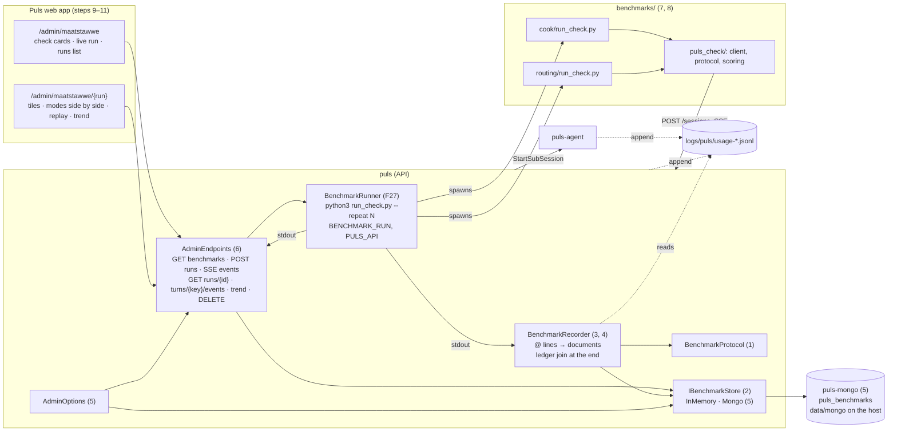
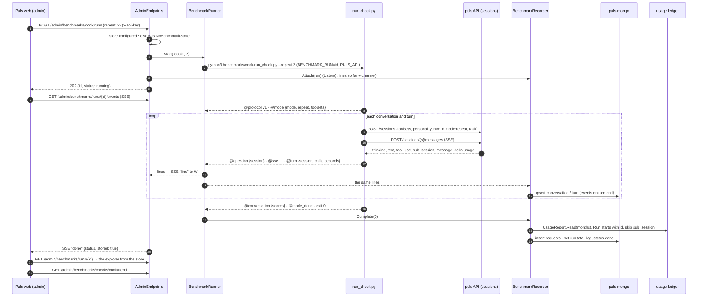

# F31 · Benchmarks in the admin portal: plan

> Approved 2026-10-17 (Louis: MongoDB in Docker with its data on a host folder, `MongoDB.Driver`, the harness with the
> cook and routing checks, charts in-house on Puls's theme; "F30 first", the plan in as a docs-only PR) · Feature:
> [F31 Benchmarks in the admin portal](../features/F31-benchmarks-portal.md) · Branch: `docs/F31-benchmarks-portal-plan`
> for this plan; `feature/F31-benchmarks-portal` off `main` for the steps (F30 merged 2026-10-17, PR #51); F30's
> measured run (its step 9) then goes through the portal.

## Context

CL10 cleared the old checks, their 18 recorded runs and `BENCHMARKS.md` (kept at the tag `pre-cl10`). What's left of
F27: `BenchmarkRunner` (a check as a child process, arguments as a list, `PULS_API` in its environment, one run at a
time, its lines kept and streamed), `BenchmarkRun.Listen()` (the lines so far plus a channel, so a late listener catches
up), `BenchmarkCatalog` (empty by default), the `/admin` gate, the SSE endpoint, and the Benchmarks page with one line
saying the checks are coming back. The explorer, the saved-run reader and the run folders went; the explorer's CSS
(`app.css`, the `/* Admin portal */` section: `.explorer`, `.tiles`, `.xbar` and the `grow`/`rise` keyframes) stayed.

The TODO line (CL10's *Approved during the build*) asks for: check scripts in `benchmarks/{check}/`, runs started only
from the portal, results in a database, the screen planned with a proper layout before it's built, and F30's hand check
and measured run through it. Planning it (2026-10-17), Louis changed the database from SQL Server to MongoDB in Docker,
"with data mapped" (a host folder as the data dir), and put F30 first.

Goal skills: 12 (evaluation: a harness anyone on the team runs and reads, trends before regression gates), 13 and 17
(cost attributed to the unit of evaluation from the ledger), 18 (a store behind a contract test, honest when the real
store isn't there), 11 and 16 (one resource per drill-down level; evaluation as a product surface).

## Design

### The harness speaks a line protocol; the API records it

The script never touches the database. It prints plain lines and `@{json}` lines on stdout: F27's protocol (`mode`,
`question`, `sse`, `turn`, `conversation`, `mode_done`) with three changes: a first line
`@{"event":"protocol","version":1}`; every event carries `repeat`; `question` and `turn` carry `session`. The runner
sets `BENCHMARK_RUN={run id}` and the script tags its sessions `run={run id}:{mode}:{repeat}`. `mode_done` is a
marker; costs are C#'s. A malformed `@` line is kept as a log line, never a failure.

`BenchmarkRunner` streams the lines to the page as today. A new `BenchmarkRecorder` attaches to the same run
(`Listen()`), parses each `@` line (`BenchmarkProtocol.Parse`, pure) and writes documents through `IBenchmarkStore` as
they arrive, so a half-done run is readable and a reloaded page reads finished turns from the store and only the open
turn from the SSE (which also neutralises `BenchmarkRun`'s 100,000-line cap on a five-repeat cook run). On `Complete`
it closes whatever is open, reads the usage ledger (`UsageReport.Read` over the months the run spans, from
`host.Agent.LogDirectory`, the directory `puls` and `puls-agent` share), keeps the rows whose `Run` starts with the run
id, skips `sub_session` roll-ups (`UsageReport.Total` would count them again), resolves each row's turn from its
session (own rows) or `parent = {session}#{turn}` (the specialist's), writes one `requests` document per row and the
run's total with `UsageReport.Total`.

Why not the alternatives: the script writing Mongo needs pymongo (the image's Python has no pip), the connection
string in the script's environment and a second schema in Python; the script POSTing results makes two channels
(stdout for the page, HTTP for the store) that can disagree. The stdout stream is already what the page consumes, so
page and store agree by construction.

### Documents (MongoDB, database `puls_benchmarks`)

| Collection | Key | Holds |
|---|---|---|
| `runs` | `_id`: the runner's 12-character id | check, repeat, status, exit code, started and ended at, `settings` (model, provider, `PERSONALITIES_ENABLED`, git commit, the check's arguments), `modes[]` (name, toolsets, personality, llm), `total` (cost, currency, tokens, requests), `log` (the plain lines, written at completion), `store_error` |
| `conversations` | `{run, mode, repeat, task}` | role, `scores` (a document the check defines), errors, seconds; its cost derived from `requests` |
| `turns` | `{run, mode, repeat, task, n}` | question, answer, role, continued, seconds, calls, hosts, `events[]` (the turn's SSE events, written when the turn ends: replay is one read, and ADR 0005's bounded results keep a turn well under Mongo's 16 MB) |
| `requests` | one per ledger row | run, mode, repeat, task, turn n, at, purpose, session, parent, model, tokens, cost, duration |

Indexes on the keys, `requests` on `{run, mode, repeat, task, turn_n}`, `runs` on `{check, started_at}`. A trend is
computed in C# over a check's `conversations` (tens of runs × eight conversations), so it runs the same on the
in-memory store and its test is honest.

### Settings, containers, tests

- `LouisAgent.Api.Config.AdminOptions.FromEnvironment()`, on `AgentOptions.FromEnvironment`'s pattern, replaces the ad
  hoc reads in `Program.cs`: `AdminKey` (`ADMIN_API_KEY`), `BenchmarkApiUrl`, `BenchmarksMongoUrl`
  (`BENCHMARKS_MONGO_URL`, in `config/.env.secrets`). Without the URL, `POST …/runs` answers 503
  (`ApiUserText.NoBenchmarkStore`, in `AdminClosed`'s voice) and `GET /admin/benchmarks` reports
  `store: {configured, error}` for the page's banner.
- Compose: `puls-mongo` (`mongo:8`, `127.0.0.1:27017:27017`, `../data/mongo:/data/db`, `MONGO_INITDB_ROOT_USERNAME`
  and password from `.env.secrets`); `puls` depends on it; `data/` in `.gitignore`. The container's URL names the
  service (`mongodb://user:pw@puls-mongo:27017`), the tests' names `127.0.0.1`; both in SETUP.
- Tests: an abstract `BenchmarkStoreContract` (write, read back keyed and ordered, runs newest first, close orphans,
  delete) run against `InMemoryBenchmarkStore` always and against `MongoBenchmarkStore` when `BENCHMARKS_MONGO_URL` is
  set (`Assume.That`, database `puls_benchmarks_test`); CI gets a `mongo` service container so it runs there too. The
  protocol parser, the recorder and the ledger join are tested without a process or a store. Endpoints stay checked by
  hand, as the repo does.
- Failures: a script that dies → `Failed`, the open documents closed as they are, the ledger join still runs. A store
  unreachable mid-run → the recorder stops writing, sets `store_error`, logs through `ILogger`, the run keeps
  streaming; `done` carries `stored`. The API restarting → `CloseOrphans()` at start-up marks `running` runs failed.

### Package

`MongoDB.Driver` (Apache-2.0, the official driver), chosen by Louis from three: the EF Core MongoDB provider
(Apache-2.0; a DbContext over the same driver, two packages, no migrations for Mongo) and MongoDB.Entities (MIT, one
maintainer, lags the driver). No chart package (in-house SVG and CSS, as F27 decided); no ephemeral-Mongo test package
(CI's service container).

The server is another matter: `mongo:8` (MongoDB Community) is under the SSPL, which the reuse rule's MIT, Apache or BSD
doesn't cover. It is used only as is, unmodified, in Louis's own stack, for Louis's own benchmark results: it is no
part of a customer's instance and nothing ships it. A store that has to ship goes behind `IBenchmarkStore` with a
server under a permitted licence.

### The page, laid out before it's built

Two routes on `AdminLayout`, in Afrikaans like the rest of Puls, every block a card on Puls's variables; the theme's
look and feel stays (dark, Puls's colours, Montserrat), the existing classes reused (`.admin-shell .page-head .card-p
.segmented .check-card .run-panel .run-table .tree .explorer .tiles .xbar .legend .timeline .compare`), new CSS only
under the `/* Admin portal */` section, the dataviz palette as F27. The motion idioms come from animated chart
templates (Jitter's: bars growing in a cascade, donut segments sweeping, numbers counting up, a line drawing itself),
on the `grow` and `rise` keyframes already there, reduced motion respected.

```
┌ sidebar ────┬──────────────────────────────────────────────────────────────────────┐
│ Puls        │ Maatstawwe                                   [● puls_benchmarks]      │
│ ▸ Maatstawwe│ Die kontroles wat Puls meet.                                          │
│             │ ┌ Kokkontrole ──────────────────┐ ┌ Roeteringkontrole ──────────────┐ │
│             │ │ 2 modes · 4 gesprekke          │ │ 2 modes · 12 vrae               │ │
│             │ │ Herhaal  [1][2][3][4][5]        │ │ Herhaal  [1][2][3][4][5]         │ │
│             │ │ ∿ tendens: koste · telling      │ │ ∿ tendens                        │ │
│             │ │                       [▶ Loop]  │ │                        [▶ Loop]  │ │
│             │ └────────────────────────────────┘ └─────────────────────────────────┘ │
│             │ ┌ Lopie tans ─────────────────────────────────────────────────────────┐ │
│             │ │ mode │ gesprek │ beurt │ rol │ oproepe │ sek │ koste   (live table)  │ │
│             │ │ the open turn typing out (TurnView)        ▸ log (folded)            │ │
│             │ └─────────────────────────────────────────────────────────────────────┘ │
│             │ ┌ Lopies ─────────────────────────────────────────────────────────────┐ │
│             │ │ datum · kontrole · herhaal · status · koste · telling  → explorer    │ │
│ ← Terug     │ └─────────────────────────────────────────────────────────────────────┘ │
└─────────────┴──────────────────────────────────────────────────────────────────────┘

/admin/maatstawwe/{run}:  Lopie › Gesprekke › Beurt › Versoek  (crumbs)
┌ tiles (numbers count up): koste · versoeke · tokens · sek · telling ────────────────┐
┌ modes side by side at every level (F27's rule) ─────────────────────────────────────┐
│ koste per mode: bars grow in a cascade │ token mix: donut sweeps │ per gesprek table │
│ a conversation → its turns (chips: rol, oproepe, sek, koste) → a turn's transcript  │
│ replayed through TurnView from the stored events, every column at once              │
└─────────────────────────────────────────────────────────────────────────────────────┘
Trend (on the check card, full-size in the explorer): a line that draws itself, one
series per mode, cost and score over runs; a point opens that run.
```

Live rule: while `status == running`, finished turns come from the store and the open turn from the SSE; otherwise
everything from the store. `runs/current` tells a reloaded page which run is live.

### Architecture



### Communication: one run



## Steps

One commit each, test first where behaviour changes; the review stop after each.

| Step | What | Check |
|---|---|---|
| 0 | Feature doc and this plan; the TODO line; index rows (this PR) | — |
| 1 | `Services/Benchmarks/BenchmarkProtocol.cs`: an `@` line to a typed event (`protocol`, `mode`, `question`, `sse`, `turn`, `conversation`, `mode_done`) with `repeat` and `session`; malformed or unknown → a log line | Parser tests first |
| 2 | `IBenchmarkStore`, `InMemoryBenchmarkStore`, the abstract `BenchmarkStoreContract` (write, read back keyed and ordered, runs newest first, close orphans, delete) | The contract against the in-memory store, first |
| 3 | `BenchmarkRecorder`: attaches to a `BenchmarkRun` (internals visible to the tests), folds events into upserts, closes documents on `Complete`, swallows and reports store errors (`store_error`, `ILogger`) | Drive a `BenchmarkRun` with `Add` and `Complete`, assert the store; a store that throws |
| 4 | The ledger join: `UsageReport.Read` over the months spanned, the `Run` prefix, `sub_session` skipped, turn keys from session or parent, `requests` written, `UsageReport.Total` on the run | A temp ledger with own, specialist and roll-up rows; the roll-up must not double count |
| 5a | `AdminOptions.FromEnvironment()` (`AdminKey`, `BenchmarkApiUrl`, `BenchmarksMongoUrl`) in place of `Program.cs`'s ad hoc reads; nothing else changes | `AdminOptions` tests first |
| 5b | `puls-mongo` in the compose (`../data/mongo:/data/db`, root user from `.env.secrets`), `data/` ignored; `BENCHMARKS_MONGO_URL`, `MONGO_ROOT_USER`, `MONGO_ROOT_PASSWORD` in `.env.secrets.example` and SETUP (both URLs). **The restart test, first:** write a document, `docker compose restart puls-mongo`, then `down` and `up`, and read it back on Louis's Windows host; if the host folder fails (file locks, permissions, slow fsync), a named volume instead, recorded under *Approved during the build* | Configuration only; the restart test by hand |
| 5c | `MongoDB.Driver` in the API; `MongoBenchmarkStore` (indexes on first use); CI's Mongo service container | The contract against Mongo behind `Assume.That` (database `puls_benchmarks_test`), on Louis's machine and on CI |
| 6a | Wiring: `Program.cs` builds the store and the recorder; the runner sets `BENCHMARK_RUN`; the recorder attaches on `POST`; `POST` 503 without a store; `done` carries `stored`; `CloseOrphans` at start-up; `ApiUserText` members | The runner test for the variable; a run by hand (curl) |
| 6b | The read endpoints: runs and `store` status in `GET /admin/benchmarks`; `GET runs/{id}`; `GET runs/{id}/turns/{key}/events`; `DELETE runs/{id}` | By hand (curl), on 6c's run |
| 6c | **The stub check:** `benchmarks/stub/run_check.py`, standard library only, prints a canned two-mode, two-conversation run in the protocol (with SSE events for the replay) and opens no session, so it costs nothing; in the catalogue as `stub` | An API test that its output parses with no line falling back to a log line (skips without `python3`); the free hand check after 6 |
| 7 | Python: `benchmarks/puls_check/` (`client.py`: sessions and SSE on `urllib`; `protocol.py`: the `@` writer; `scoring.py`) and `benchmarks/cook/run_check.py` from `pre-cl10` minus its ledger code, plus `session`, `repeat` and the run tag from `BENCHMARK_RUN`; modes `puls-only` (`web`) and `puls-cook` (`specialists`, `web`) | `python3 -m unittest discover benchmarks` for the scoring, added to CI |
| 8 | `benchmarks/routing/run_check.py`: the delegation check rewritten (`baseline`: every toolset but `specialists`; `delegated`: `specialists`, `web`; twelve questions; the expected role only for cooking); both checks in the catalogue | Its scoring's unittest; the catalogue test |
| 9 | Web: the list page as laid out (the store banner, check cards with repeats and *Loop*, the live panel with its table, the open turn in `TurnView`, the folded log, the runs list from the store); finished turns from the store while live | By hand on the rebuilt stack with a stub check (free) |
| 10 | Web: the explorer (crumbs, tiles counting up, modes side by side, cost bars in cascade, token donut, conversations and turns, replay from the stored events through `TurnStream.Apply`) | By hand (free, the stub check's run) |
| 11a | The trend: `GET /admin/benchmarks/checks/{check}/trend` in C# over the store, the line on the card and in the explorer | The trend test over the in-memory store first; by hand on stub runs |
| 11b | A **paid** run of the cook check from the page (Louis's go), its numbers in the feature doc | The paid run |
| 11c | *Finishing a feature*: the ADR (results in Mongo, recorded by the API from the harness's stdout protocol), CHANGELOG, GOAL skill 12, the API's and Puls's project docs; *Finishing a feature* step 5 rewritten (`docs/features/README.md`): a measured run is a run in the portal's store, linked from the feature doc, no longer a section of the frozen `BENCHMARKS.md`; **F27 closed** (done, superseded by F31; its TODO line goes) | Docs only; a link check |

Steps 1–5c are C# and configuration and run on CI; 6a–6c are the first integration; 7 and 8 need only 1; 9–11 need
6–8. **Before step 7:** F30's short-quote false *Found* (a quote that is only a price, `R22.99`, matches any product at
that price on the page) is fixed, as FX15 or as a step here (Louis's call), so it never reaches the shared scorer.

## Reused, not built

`BenchmarkRunner`, `BenchmarkRun.Listen()`, `BenchmarkCatalog`, `AdminGate` and the SSE endpoint (F27);
`UsageReport.Read` and `Total`, `UsageRecord` (F1); `AgentApi.StreamLinesAsync`, `TurnView`, `TurnStream.Apply`
(web.shared); the explorer's CSS and keyframes; `AgentOptions.FromEnvironment` as the pattern for `AdminOptions`;
`pre-cl10`'s two check scripts as the source of the rewrite. Considered, not used: the script writing Mongo or POSTing
its results; a per-event collection; a chart package; SQL Server (the TODO's first choice; Louis changed it);
an ephemeral-Mongo test package.

## Risks to watch

- **F30's minions are built but not in use** (merged 2026-10-17, PR #51): no prompt hands work to a minion, so the
  cook check measures the cook as it is. The harness may send F30's `tool` and `llm` session fields; the prices check,
  minions on and off, is F30's measured run on this harness.
- **MongoDB's data on a Windows host folder** (Louis's choice) is a known trouble spot for Docker Desktop: file locks,
  permissions, slow fsync. Step 5b tests a restart first; a named volume is the fallback.
- **F30's short-quote match** must be fixed before step 7 (*Steps*), or a false *Found* reaches every check's score.
- **The F26 attribution gap** (TODO, under F26): a continued sub-session's rows carry the first turn's `parent`, so a
  follow-up turn's specialist cost lands on turn 1. The recorder joins by what the ledger says; the feature doc
  notes it until F26's fix.
- **Two Mongo URLs** (the service name inside Docker, `127.0.0.1` for the tests); SETUP says which is which.
- **The paid run** is one, at the end, on Louis's go; every hand check before it uses a stub check that prints the
  protocol and costs nothing.

## Verification

- `dotnet build louis-agent-solution.sln`; `dotnet test tests/louis-agent.api.tests` each step; the whole solution
  before the PR; `python3 -m unittest discover benchmarks` from step 7.
- The Mongo contract test on Louis's machine with `BENCHMARKS_MONGO_URL` set (the stack's `puls-mongo` on 27017) and
  on CI through its service container.
- Free hand checks with the stub check (6c) on the rebuilt Puls stack after steps 6c, 9 and 10; one paid run in 11b.
- Golden files untouched (no tool, prompt or `ToolMessage` text changes).

## Concepts

- **A line protocol as the contract between harness and host** (skill 17; ADR 0009's cousin): structured events on
  stdout, versioned, tolerant of noise; storage and transport apart, so the same stream feeds the page and the store.
- **The evaluation harness's collector** (skill 12): partial runs are still data; scores are deterministic code over a
  transcript (calls made, hosts read, marks written), not only the answer's text.
- **Cost attributed to the unit of evaluation** (skills 13, 17): the ledger's `run`, `session` and `parent` tags turn
  a month of requests into one run's tree; why the roll-up row exists and when to skip it.
- **A contract test over two stores** (skill 18): the in-memory one keeps CI honest and fast; the real one runs when
  it's there and says so when it isn't.
- **Evaluation as a product surface, trends before gates** (skills 12, 16): a run anyone can start and read, with
  its configuration recorded, is the step before a regression gate in CI.

## Approved during the build

- **2026-10-17, before step 1 (Louis: "Merge F30 first", "fx15"):** F30 merged (PR #51) before F31's code, and the
  short-quote fix the plan calls "FX15" is [FX16](../fixes/FX16-short-quote-match.md) (FX15 was taken), merged
  (PR #54) before step 1. So the harness may send F30's `tool` and `llm` session fields, and a scorer that checks a
  price always passes `VerifyQuote` its product (FX16: a quote with words can still be another product's).
- **2026-10-17, after step 1 (Louis: "yes", to one reader of the session stream):** step 7 adds a recorded session
  stream as the contract between the stream's readers: `benchmarks/fixtures/session-stream.sse`, real turns (a
  delegation with a specialist's tool calls, a minion's card, an error), checked in once. The Python reader's unittest
  parses it to fixed counts (calls, hosts, role, answer); the same counts are asserted in C# against `TurnStream`
  today, against CL11's one reader later. A change to the stream changes the fixture, and both languages' tests fail
  until both readers follow.
- **2026-10-17, step 5b (Louis: "next", on the step's note):** the store's root user is `MONGO_INITDB_ROOT_USERNAME`
  and `MONGO_INITDB_ROOT_PASSWORD` in `.env.secrets`, read by `puls-mongo` itself, instead of `MONGO_ROOT_USER` and
  `MONGO_ROOT_PASSWORD`: compose fills `${…}` only from `config/.env`. The restart test passed, so the host folder
  stays.
