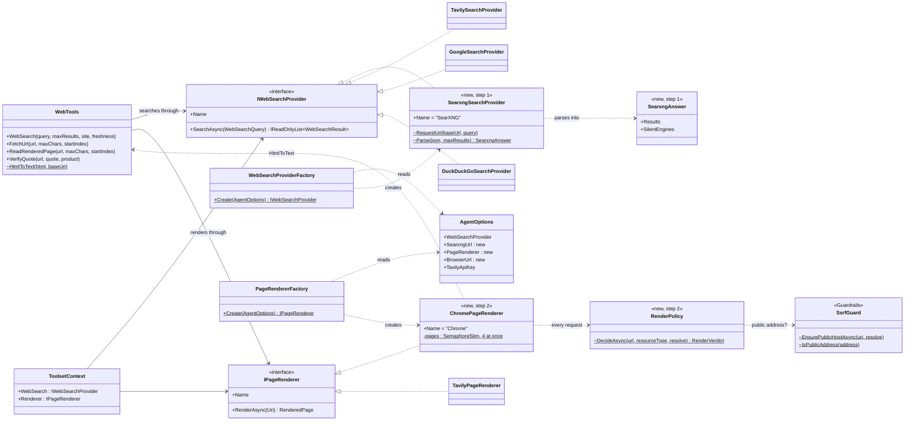
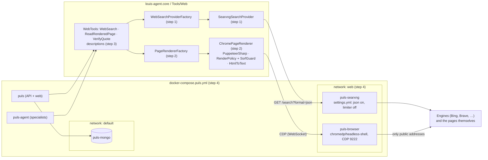
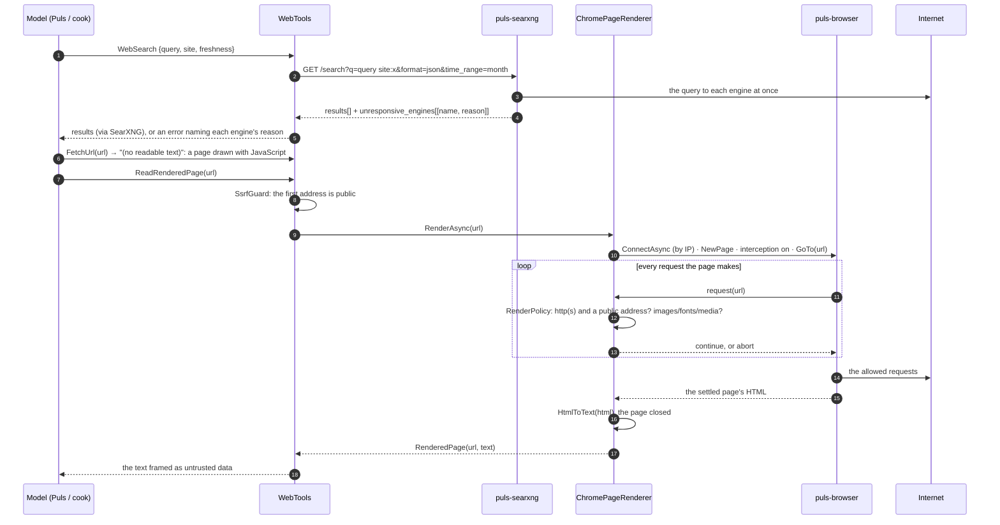

# F32 · Self-hosted web: plan

> Approved 2026-10-17 (Louis: SearXNG in Docker for search, for development and benchmarks only, since the endpoint is sold; "ReadRenderedPage we need this for all pages from all
> providers", rendered by PuppeteerSharp and a headless Chrome container; MCP servers for the model as their own
> feature after this one) · Feature: [F32 Self-hosted web](../features/F32-self-hosted-web.md) · Branch:
> `feature/F32-self-hosted-web` off `main` (F31 merged 2026-10-17, PR #55)

## Context

Tavily's free credits ran out (they reset on 1 November), and with them went both of Puls's web tools that use it:
`WebSearch` and `ReadRenderedPage` (Tavily Extract, F25 step 7), which also backs `VerifyQuote`'s fallback for pages
drawn with JavaScript (FX16). DuckDuckGo, the keyless fallback, let one search through and then refused every one
after it (`DuckDuckGoRefused` in `puls_agent`'s log, 2026-10-17). Google's Custom Search is closed to new customers
and shuts on 2027-01-01, but our texts still recommend it. So the cook check can't measure the cook.

Louis's decisions (2026-10-17):

- Search through **SearXNG in Docker**, **for development, tests and benchmarks only** (Louis: "we sell our
  endpoint"; then "Dev and benchmarks only"): SearXNG scrapes engines whose terms forbid automated querying, so the
  sold endpoint keeps a search API that licenses its results (Tavily; Brave a possible second provider).
- Render pages locally for **all pages, whatever the search provider**, with **PuppeteerSharp** driving a **headless
  Chrome container** (chosen over a Playwright server with Microsoft.Playwright, and over a Crawl4AI container).
  Tavily stays selectable for both.
- **MCP:** Tavily's MCP server spends the same credits, so it doesn't help here. F32 uses plain HTTP and CDP behind our
  own interfaces; a session toolset of MCP servers for the model (their tools wrapped with our guards, versions
  pinned) is its own feature after F32 ("An MCP toolset for the model"), a TODO line in step 0.

Outcome: a Puls stack that searches and reads any page with no key and no credits, and says which engine or page
failed and why, so a benchmark run explains itself.

## Design

**Search: `SearxngSearchProvider`** (`louis-agent.core/Tools/Web/`), the same shape as the existing providers
(`IWebSearchProvider`, picked in `WebSearchProviderFactory`). `GET {SEARXNG_URL}/search?q=…&format=json`; `site` →
`site:` in the query (as `DuckDuckGoSearchProvider` does), `freshness` → `time_range`, `maxResults` cuts the list.
It reads `results[]` (title, url, content) and `unresponsive_engines` ([name, reason]): if no engine answered, a
`WebSearchException` with each engine's reason; if some did, the results, with the silent engines logged
(`ILogger`, stderr); a 403 says JSON output is off in SearXNG's settings. Factory: `WEB_SEARCH_PROVIDER=searxng`;
unset picks Tavily (key), then Google (key and cx), then SearXNG (`SEARXNG_URL` set), then DuckDuckGo.

**Rendering: `ChromePageRenderer`** (`IPageRenderer`, picked in `PageRendererFactory`). PuppeteerSharp (MIT) connects to
the browser over CDP (`Puppeteer.ConnectAsync` with `BrowserURL` from `BROWSER_URL`), so our image downloads no
browser. Chrome answers `/json/version` only for an IP address or `localhost` in the Host header, so the renderer
resolves the service name first and connects by IP. Per call: a new page, request interception on, `GoToAsync`
waiting for the network to settle (30 s cap), `GetContentAsync()`, the page closed. The text is FetchUrl's own
`WebTools.HtmlToText`, so both tools give the same text for the same HTML. Images, fonts and media are aborted
(speed, and nothing the text needs). Factory: `PAGE_RENDERER=chrome|tavily`; unset picks Chrome when `BROWSER_URL`
is set, else Tavily when its key is, else the existing `UnavailablePageRenderer`.

**The address rule holds inside the browser** (ADR 0005's guards; FetchUrl's rule). A browser follows redirects and
loads subresources on its own, so checking the first URL (as `ReadRenderedPage` does today with
`SsrfGuard.EnsurePublicHostAsync`, `louis-agent.core/Guardrails/SsrfGuard.cs`) isn't enough: the interception handler
checks **every request** the page makes with the same guard (`EnsurePublicHostAsync` / `IsPublicAddress`) and aborts
any non-http(s) scheme or non-public address. A pure, tested function (`RenderPolicy.AllowAsync(Uri, resolve)`)
decides; the renderer only applies it. Second layer: the browser and SearXNG sit on their own `web` network with
only `puls` and `puls-agent`, never with `puls-mongo` (whose address would be private anyway).

**Texts the model reads:** `ReadRenderedPage`'s description loses "(Tavily Extract)" and "It costs a credit" (true of
Tavily only) and says it is slower than FetchUrl; `DuckDuckGoRefused` and `Prompts/toolsets/web.md` point at
`WEB_SEARCH_PROVIDER=searxng` instead of Google. Both golden files are regenerated and reviewed.

**Containers** (`docker/docker-compose.puls.yml`): `puls-searxng` (`searxng/searxng`, pinned tag) with
`docker/searxng/settings.yml` (`use_default_settings`, `search.formats: [html, json]`, `server.limiter: false`,
engines kept: Bing, Brave, DuckDuckGo, Google, Mojeek, Startpage, Wikipedia, trimmed to what answers),
`SEARXNG_SECRET` from `.env.secrets`; `puls-browser` (`chromedp/headless-shell`, pinned tag, CDP on 9222). Both on
the `web` network; `127.0.0.1:8888` and `127.0.0.1:9222` for the live tests on Louis's machine. `puls` and
`puls-agent` get `SEARXNG_URL=http://puls-searxng:8080` and `BROWSER_URL=http://puls-browser:9222`.

**Reuse:** `IWebSearchProvider`, `IPageRenderer` and their factories; `SsrfGuard`; `WebTools.HtmlToText`;
`StubHandler` for the HTTP tests; the skip-when-unset pattern of F31's Mongo contract test. New package:
PuppeteerSharp (MIT), Louis's choice. New images: SearXNG (AGPL-3.0, run unmodified as a separate service, never
linked) and chromedp/headless-shell (Chromium, BSD-style). **ADR 0023** records the rule this sets: a copyleft
service may run beside us unchanged, inside a product we sell too, but is never sold as itself; only what we link
must be MIT, Apache or BSD (our own code stays all rights reserved, ADR 0016); and what a service fetches has terms of
its own, which keep SearXNG off the sold endpoint. Considered and not chosen: a Tavily top-up, Brave's API, Google (closed); Playwright, Crawl4AI;
Tavily's, SearXNG's and browser MCP servers (the credits, a container more, and for the browser no per-request check).

### Interfaces

**The two seams stay as they are**; the model's tools (`WebTools`) see only them, built once per engine through
`ToolsetContext` (`AgentEngineFactory` → `WebSearchProviderFactory.Create`; `ToolsetContext.Renderer` →
`PageRendererFactory.Create`):

```csharp
// Tools/Web, unchanged
public interface IWebSearchProvider
{
    string Name { get; }                                   // shown to the model: "SearXNG"
    Task<IReadOnlyList<WebSearchResult>> SearchAsync(WebSearchQuery query, CancellationToken cancellationToken = default);
}
public sealed record WebSearchQuery(string Text, int MaxResults, string? Site = null, string? Recency = null);
public sealed record WebSearchResult(string Title, string Url, string Snippet);
public sealed class WebSearchException(string message) : Exception(message);   // shown to the model as is

public interface IPageRenderer
{
    string Name { get; }                                   // "Chrome", "Tavily"
    Task<RenderedPage> RenderAsync(Uri url, CancellationToken cancellationToken = default);
}
public sealed record RenderedPage(string Url, string Text);
public sealed class PageRenderException(string message) : Exception(message);
```

**New behind them** (one type per file, in `Tools/Web/`):

```csharp
// Step 1: search
public sealed class SearxngSearchProvider(Uri baseUrl, HttpClient? http = null) : IWebSearchProvider
{
    public string Name => "SearXNG";
    public Task<IReadOnlyList<WebSearchResult>> SearchAsync(WebSearchQuery query, CancellationToken cancellationToken = default);

    // Pure, so the tests need no server:
    internal static Uri RequestUri(Uri baseUrl, WebSearchQuery query);   // q (+ " site:x"), format=json, time_range
    internal static SearxngAnswer Parse(string json, int maxResults);    // throws WebSearchException when no engine answered
}
internal sealed record SearxngAnswer(IReadOnlyList<WebSearchResult> Results, IReadOnlyList<string> SilentEngines);

// Step 2: rendering
public sealed class ChromePageRenderer(Uri browserUrl, Func<string, CancellationToken, Task<IPAddress[]>>? resolve = null)
    : IPageRenderer
{
    public string Name => "Chrome";
    // Per call: connect over CDP (by IP), a new page, interception through RenderPolicy, GoTo, the HTML through
    // WebTools.HtmlToText, the page closed, disconnected. No connection is kept, so a browser restart costs nothing;
    // at most 4 pages are open at once across the process (a static SemaphoreSlim), so 16 minions don't open 16 tabs.
    public Task<RenderedPage> RenderAsync(Uri url, CancellationToken cancellationToken = default);
}

internal static class RenderPolicy
{
    // Each request the page makes: Refuse a non-http(s) scheme or a non-public address (SsrfGuard),
    // Skip images, fonts and media (nothing the text needs), Allow the rest.
    internal static Task<RenderVerdict> DecideAsync(Uri url, string resourceType, Func<string, CancellationToken, Task<IPAddress[]>> resolve);
}
internal enum RenderVerdict { Allow, Skip, Refuse }
```

**Settings** (`Config/AgentOptions`, read in `FromEnvironment`): `SearxngUrl` (`SEARXNG_URL`), `BrowserUrl`
(`BROWSER_URL`), `PageRenderer` (`PAGE_RENDERER`: `chrome` or `tavily`). The factories choose:

| Setting | Search (`WebSearchProviderFactory`) | Rendering (`PageRendererFactory`) |
|---|---|---|
| Named | `WEB_SEARCH_PROVIDER=searxng` → SearXNG, or *SearXNG needs `SEARXNG_URL`* | `PAGE_RENDERER=chrome` → Chrome, or *Chrome needs `BROWSER_URL`*; `tavily` → Tavily as today |
| Unset | Tavily (key) → Google (key, cx) → SearXNG (URL) → DuckDuckGo | Chrome (`BROWSER_URL`) → Tavily (key) → *not configured* |
| Unknown name | *Unknown provider, these are supported* | *Unknown renderer, these are supported* |

A setting that's missing or wrong never stops start-up: the `Unavailable…` stand-ins say what to set on the first call,
as they do today.

**Texts** (`Messages/ToolMessage`, so the golden file changes in steps 1 and 2): `SearxngNotConfigured`,
`SearxngJsonOff`, `SearxngNoEngineAnswered` (`{Reasons}`), `SearxngFailed` (`{Status}`, `{Detail}`),
`BrowserNotConfigured`, `BrowserUnreachable` (`{Reason}`), `UnknownPageRenderer` (`{Renderer}`, `{Supported}`); a
refused main page uses the existing `RenderFailed` with the blocked address as its reason. The silent engines and the
refused subresources are log lines (`LogMessage`), not tool text.



### Architecture



### Communication: a search, then a page drawn with JavaScript



## Steps

One commit each, test first, stop after each; on `feature/F32-self-hosted-web`.

| # | Step | Test first | Concept (GOAL skill) |
|---|---|---|---|
| 0 | Docs: the feature doc, this plan, rows in the features, plans and ADR indexes, ADR 0023; TODO lines under *Tooling and repositories*: F32, and *MCP servers as a session toolset* (to plan after F32) | docs only; links checked | Reuse before building; licences |
| 1 | `SearxngSearchProvider`, `SEARXNG_URL` in `AgentOptions`, `searxng` in `WebSearchProviderFactory`, new `ToolMessage` members; `ToolMessageSnapshot` regenerated | `StubHandler`: the query built (site, time_range), JSON parsed and cut at maxResults, every engine down → error with reasons, 403 → JSON-off message, factory choices | A tool as a port with adapters behind one interface (skill 4) |
| 2 | PuppeteerSharp in core; `RenderPolicy`; `ChromePageRenderer`; `BROWSER_URL`, `PAGE_RENDERER` in `AgentOptions`; `PageRendererFactory` choices; the browser's `ToolMessage` members; `ToolMessageSnapshot` regenerated | `RenderPolicy`: private, loopback, link-local, metadata and non-http(s) refused, public allowed, images/fonts/media aborted; factory choices; a live render test that skips without `BROWSER_URL` | Guarding a tool that acts on the world: the check moves to where the requests happen (skill 15, ADR 0005) |
| 3 | The texts the model reads: `ReadRenderedPage`'s description provider-neutral; `DuckDuckGoRefused` and `toolsets/web.md` point at SearXNG; both golden files regenerated and reviewed | the golden diffs | What the model reads is a contract (skill 3) |
| 4 | `puls-searxng` and `puls-browser` in compose on the `web` network, `docker/searxng/settings.yml`, `SEARXNG_SECRET` in `.env.secrets.example`, `.env.example`, SETUP; *Finishing a feature* (CHANGELOG, statuses, GOAL, project docs) | the live tests (search and render) against the running containers, skipping when unset; a hand check from `puls_agent` | Infrastructure as configuration; tests against real services that skip honestly (skill 18) |

Recording which search provider and renderer a benchmark ran with is the TODO line *Why a benchmark run behaved as it
did* (F31's step 11c rest), so F32 doesn't depend on it.

## Verification

- `dotnet build louis-agent-solution.sln`; `dotnet test tests/louis-agent.core.tests` each step; the whole solution before
  the PR. Golden files regenerated in steps 1 and 3, their diffs shown.
- Step 4, free: the stack rebuilt (`docker compose -f docker/docker-compose.puls.yml --env-file config/.env up -d
  --build`); the live tests with `SEARXNG_URL=http://127.0.0.1:8888` and `BROWSER_URL=http://127.0.0.1:9222`; a
  rendered Pick n Pay product page shows its price; a page that redirects to an internal address is refused.
- `config/.env`'s `WEB_SEARCH_PROVIDER=duckduckgo` (set on 2026-10-17, ignored by git) becomes `searxng`.
- Then Louis runs the cook check from the portal (a paid run, on Louis's go): the baseline.

## Risks

- Engines rate-limit one IP at volume: several engines spread it, and the error and log name the silent ones.
- A benchmark on SearXNG measures the agent, not the production search: the run's settings say which provider it
  used (the TODO line *Why a benchmark run behaved as it did*).
- Some shops block headless browsers: the renderer's error says which page and why; Tavily stays selectable.
- Images change often: both tags pinned, so benchmark runs stay comparable.
- The main stack (`docker-compose.yml`) is untouched; it can follow.

## Concepts

- **Ports and adapters for tools** (skill 4): the model sees one `WebSearch` and one `ReadRenderedPage`; what serves
  them is configuration, so a provider running dry is a setting, not an outage.
- **A guard where the action happens** (skill 15): a browser makes its own requests; the address check moves from the
  tool's front door into the browser's request handler, and a separate network is the second layer.
- **Copyleft beside us, not inside us** (ADR 0023): running an AGPL service unchanged over HTTP is not linking it;
  and a licence isn't the only term: what a service fetches can bind a product that's sold.
- **Tests against real services that skip honestly** (skill 18): stubs for the logic, live tests for the containers.

## Approved during the build

- **2026-10-17, after step 1 (Louis, on `WebSearchProviderFactory`'s string switch: "can we make this enums, as the
  next step. This must also be a rule"): step 1b, choices are enums.** `WebSearchProviderKind` (Tavily, Google,
  Searxng, DuckDuckGo; `ddg` an alias) is parsed once in the factory, which switches on it; `SupportedProviders` comes
  from it. `SearchRecency` (Day, Week, Month, Year; the first letter an alias) replaces `WebSearchQuery.Recency`'s
  string, parsed once where `WebSearch` receives the model's `freshness`; each provider writes it in its own words.
  `Config/SettingChoice` is the one parser (tested first). The rule joins *Rules that always apply* with ADR 0024, and
  the choices still made by string are a TODO line. Step 2's `PAGE_RENDERER` is an enum from the start
  (`PageRendererKind`), so the interface design's `PAGE_RENDERER` row reads as that enum.
- **2026-10-17, in step 1b (Louis: "move each type to its type namespace"): the web toolset in folders by kind.**
  `Tools/Web/Search/` (namespace `LouisAgent.Core.Tools.Web.Search`): the search seam, its records, exception, enums,
  factory and every provider; `Tools/Web/Rendering/` (`…Web.Rendering`): the renderer seam, its record, exception,
  factory and renderers, where step 2's `ChromePageRenderer` and `RenderPolicy` go; `WebTools` stays in `Tools/Web/`.
  Then (Louis: "these must also be grouped"; by role): each seam keeps its contract at its top and its
  implementations below, `Search/Providers/` (`…Search.Providers`: DuckDuckGo, Google, SearXNG with `SearxngAnswer`,
  Tavily, the unavailable stand-in) and `Rendering/Renderers/` (`…Rendering.Renderers`: Tavily, the stand-in, and step
  2's `ChromePageRenderer` and `RenderPolicy`). The interface design's "in `Tools/Web/`" reads as these folders; tests
  mirror them.
