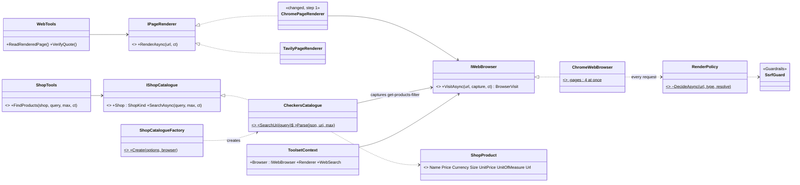
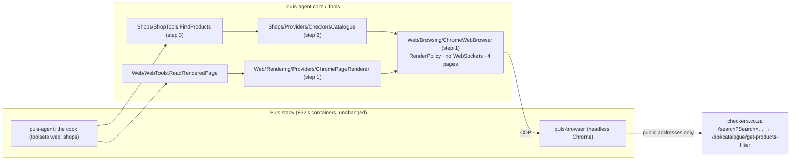
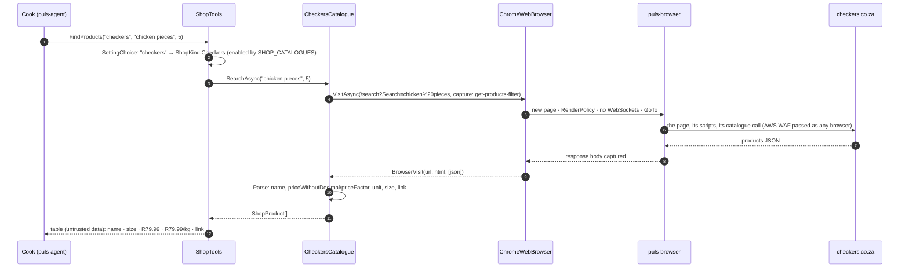

# F33 · Shop catalogues: plan

> Approved 2026-10-17 (Louis: `Tools/Shops/` as its own seam; the provider reads the catalogue JSON through our
> browser; a new `shops` toolset; development and benchmarks first; every plan names its namespaces) · Feature:
> [F33 Shop catalogues](../features/F33-shop-catalogues.md) · Branch: `feature/F33-shop-catalogues` off `main` (F32
> merged 2026-10-17, PRs #56 and #57)

## Context

F32's paid cook check (run `663d065ccca8`, 2026-10-17, $0.057, 66 requests) searched and rendered with no key, yet the
cook priced **0 ingredients with a source**. Free experiments the same day found why: the cook's prompt forbids the
shops' search pages (true of Tavily Extract, not of our Chrome), and it guesses their URLs wrong: Checkers ignores
`/search?q=` ("0 results"); its own search box sends `/search?Search=chicken%20pieces`, which renders **61 results with
prices**, no address needed (a Malmesbury address adds local stock: 69). And the page's own call,
`/api/catalogue/get-products-filter`, answers with **structured products**: `name`, `priceWithoutDecimal: 7999` with
`priceFactor: 100` (R79.99), `unitOfMeasure: KG`, `currency: ZAR`, `id`, `storeId`, `totalCount: 61`.

Louis (2026-10-17): "next up Shops … then we add Checkers … a provider for only checkers product lookup", then:
`Tools/Shops/` as its own seam; the provider reads the catalogue JSON through our browser; a new `shops` toolset with a
`FindProducts` tool; for development and benchmarks first (the endpoint is sold; ADR 0023: what a service fetches has
terms of its own); and **every plan names its namespaces, as a rule**.

Outcome: the cook prices Checkers from Checkers' own catalogue, exact and linked, through a tool that costs no model
tokens to read the shop; the cook check shows priced ingredients with sources, the baseline F31 and F32 couldn't be.

## Design

**Three seams, one browser.** `Tools/Web/Browsing/` (new) holds the guarded headless Chrome, extracted from F32's
`ChromePageRenderer`: connect by IP, `RenderPolicy` on every request, no WebSockets, cancellation that closes the page,
at most 4 pages at once. Two users: `Rendering/Providers/ChromePageRenderer` (the page's HTML → text, unchanged
behaviour) and `Shops/Providers/CheckersCatalogue` (the JSON the page fetches). One place keeps the guards.

**A shop catalogue** (`Tools/Shops/`): `IShopCatalogue` searches one shop's products and returns `ShopProduct`s with
exact prices. `CheckersCatalogue` visits `https://www.checkers.co.za/search?Search={query}` through `IWebBrowser`,
captures the page's `get-products-filter` answer, and parses it (`priceWithoutDecimal / priceFactor`, unit, size from the
name or `variableWeightOptions`); each product links to its page on checkers.co.za (the field is found in step 2 from
the recorded answer; failing that, the search page that shows the price). A recorded answer is a test fixture, so a
renamed field fails a test, not a benchmark. Which shops a deployment may use is an enum setting,
`SHOP_CATALOGUES=checkers` (ADR 0024); unset, the `shops` toolset is unavailable, so the sold endpoint doesn't use it
until someone qualified has read the shops' terms.

**A package of its own, later** (Louis: "I can split it out into a separate package later"): `Tools/Shops` depends only
on `Tools/Web/Browsing`'s contract (`IWebBrowser`, `BrowserVisit`), `Config` (`SettingChoice`, `AgentOptions`) and
`Messages`; nothing in core outside the `shops` toolset's catalogue entry depends on it. So it can move to its own
project (say `louis-agent.shops`) without untangling anything; `ArchitectureTests` keeps the arrow one way meanwhile.

**The tool** (`ShopTools.FindProducts(shop, query, maxResults)`): a short table, framed as untrusted data like web
content: name, size, price, unit price, link; and a line naming the shop and the search. The cook's role gets the
`shops` toolset beside `web`; its prompt prices Checkers through `FindProducts` and keeps `WebSearch` for the rest.

### Namespaces (new, moved, changed)

| Type | Folder | Namespace | Step |
|---|---|---|---|
| `IWebBrowser` (interface), `BrowserVisit` (record) | `Tools/Web/Browsing/` | `LouisAgent.Core.Tools.Web.Browsing` | 1, new |
| `ChromeWebBrowser` | `Tools/Web/Browsing/` | `LouisAgent.Core.Tools.Web.Browsing` | 1, new (from `ChromePageRenderer`) |
| `RenderPolicy`, `RenderVerdict` | `Tools/Web/Browsing/` | `LouisAgent.Core.Tools.Web.Browsing` | 1, moved from `…Web.Rendering.Providers` |
| `ChromePageRenderer` | `Tools/Web/Rendering/Providers/` | `LouisAgent.Core.Tools.Web.Rendering.Providers` | 1, changed (uses `IWebBrowser`) |
| `IShopCatalogue`, `ShopProduct`, `ShopKind` (enum), `ShopCatalogueException`, `ShopCatalogueFactory` | `Tools/Shops/` | `LouisAgent.Core.Tools.Shops` | 2, new |
| `CheckersCatalogue`, `CheckersAnswer` (internal) | `Tools/Shops/Providers/` | `LouisAgent.Core.Tools.Shops.Providers` | 2, new |
| `ShopTools` | `Tools/Shops/` | `LouisAgent.Core.Tools.Shops` | 3, new |
| `AgentOptions.ShopCatalogues` | `Config/` | `LouisAgent.Core.Config` | 3, changed |
| `ToolsetContext.Browser`, `ToolsetCatalog` (`shops`) | `Agent/` | `LouisAgent.Core.Agent` | 3, changed |
| Tests mirror each: `tests/louis-agent.core.tests/Tools/Web/Browsing/`, `Tools/Shops/`, `Tools/Shops/Providers/` | | `LouisAgent.Core.Tests.Tools.…` | 1–3 |

### Interfaces

```csharp
// Tools/Web/Browsing: one guarded browser for every user
public interface IWebBrowser
{
    // Loads url with every request put to RenderPolicy and no WebSockets; keeps the bodies of the responses
    // `capture` picks (the page's own JSON); cancelled, the page closes at once.
    Task<BrowserVisit> VisitAsync(Uri url, Func<Uri, bool>? capture = null, CancellationToken cancellationToken = default);
}
public sealed record BrowserVisit(string Url, string Html, IReadOnlyList<string> Captured);
public sealed class ChromeWebBrowser(Uri browserUrl, Func<string, CancellationToken, Task<IPAddress[]>>? resolve = null) : IWebBrowser;

// Tools/Web/Rendering/Providers: unchanged contract, thinner body
public sealed class ChromePageRenderer(IWebBrowser browser) : IPageRenderer;   // Html → WebTools.HtmlToText

// Tools/Shops: the contract
public enum ShopKind { Checkers }                       // Shoprite, PicknPay, Woolworths later
public interface IShopCatalogue
{
    ShopKind Shop { get; }
    Task<IReadOnlyList<ShopProduct>> SearchAsync(string query, int maxResults, CancellationToken cancellationToken = default);
}
public sealed record ShopProduct(string Name, decimal Price, string Currency, string? Size, decimal? UnitPrice,
    string? UnitOfMeasure, Uri Url);
public sealed class ShopCatalogueException(string message) : Exception(message);   // shown to the model as is
public static class ShopCatalogueFactory
{
    public static IReadOnlyList<string> SupportedShops { get; }                    // SettingChoice.Names<ShopKind>()
    public static IReadOnlyDictionary<ShopKind, IShopCatalogue> Create(AgentOptions options, IWebBrowser? browser);
}

// Tools/Shops/Providers
public sealed class CheckersCatalogue(IWebBrowser browser) : IShopCatalogue
{
    internal static Uri SearchUri(string query);                                      // /search?Search=…
    internal static IReadOnlyList<ShopProduct> Parse(string json, Uri searchUri, int maxResults);   // pure
}

// Tools/Shops: the tool
public sealed class ShopTools(IReadOnlyDictionary<ShopKind, IShopCatalogue> catalogues)
{
    [Description("…")] public Task<string> FindProducts(string shop, string query, int maxResults = 8,
        CancellationToken cancellationToken = default);
}
```



### Architecture



### Communication: the cook prices chicken pieces at Checkers



## Steps (one commit each, test first, stop after each)

| # | Step | Test first | Concept (GOAL skill) |
|---|---|---|---|
| 0 | Feature doc F33, this plan with its namespace map, TODO line, indexes; **the rule:** plans' conventions add "a namespace map: every new, moved or changed type with its folder and namespace" (and a memory) | docs only; links checked | Design before code (skill 18) |
| 1 | `Tools/Web/Browsing/`: `IWebBrowser`, `BrowserVisit`, `ChromeWebBrowser` extracted from `ChromePageRenderer`; `RenderPolicy`, `RenderVerdict` moved; `ChromePageRenderer` over `IWebBrowser`; `ToolsetContext.Browser` | the existing renderer and policy tests, moved, still green; a live test that a visit captures a JSON response the page fetched | One guarded resource behind one seam (skill 15) |
| 2 | `Tools/Shops/`: the contract, `ShopKind`, `ShopCatalogueFactory`; `Providers/CheckersCatalogue` | `Parse` against a recorded, trimmed `get-products-filter` answer (price R79.99 from 7999/100, unit, size, link); `SearchUri`; a fake `IWebBrowser`; no answer captured → `ShopCatalogueException`; a live test skipping without `BROWSER_URL` | A tool reads a source exactly instead of a model reading a page (skills 4, 7) |
| 3 | `ShopTools.FindProducts`, the `shops` toolset (catalogue entry, `toolsets/shops.md`, `SHOP_CATALOGUES` in `AgentOptions`), `ToolMessage` texts; golden files | the table and its framing; an unknown or disabled shop says which are enabled; the toolset is unavailable without `SHOP_CATALOGUES` or `BROWSER_URL` | Tool design: small output, untrusted framing (skill 4) |
| 4 | The cook uses it: `specialists.md` gives `puls-cook` `web, shops`; `puls-cook.md` prices Checkers through `FindProducts`, drops "don't fetch search pages" for shops that have a catalogue; the Puls stack sets `SHOP_CATALOGUES=checkers`; then the cook check, paid, on Louis's go | `PersonalitiesTests` on the cook's prompt; the routing row; a free hand check of `FindProducts` from `puls-agent` | Measure, don't assume (skill 12) |

F32 is finished (`d220e93`): its run `663d065ccca8` is recorded (search and rendering work; 0 priced, for the reasons
above); F33's run is the one that shows prices.

## Verification

- Each step: `dotnet build louis-agent-solution.sln`, `dotnet test tests/louis-agent.core.tests`; the live tests with
  `BROWSER_URL=http://127.0.0.1:9222` against `puls-browser`; golden files regenerated in steps 3 and 4 and reviewed.
- Step 2's fixture is a real answer, trimmed to three products, kept in `tests/…/Tools/Shops/Providers/Fixtures/`.
- Step 4: `FindProducts("checkers", "chicken pieces")` from `puls-agent`, free; then the cook check from the portal
  (paid, Louis's go): priced ingredients with sources on checkers.co.za, the scorer counting them.

## Risks

- Checkers changes its catalogue's fields: the recorded answer's test fails first; the provider's error names the
  missing field.
- The AWS WAF on Checkers may start refusing a headless browser: the error says so; no evasion (ADR 0023's spirit).
- Terms: development and benchmarks only until checked; `SHOP_CATALOGUES` unset elsewhere keeps the toolset off.
- Prices are Checkers' default store's; a delivery area (Louis's Malmesbury idea: Checkers keeps it in cookies) is a
  later step: per-shop store context carried by the browser.

## Concepts

- **One guarded resource behind one seam** (skill 15): the browser's guards (the address rule on every request, no
  WebSockets, cancellation, a page limit) live once, in `Web/Browsing`; renderers and catalogues use it, never Chrome.
- **Read the source, not the page** (skills 4, 7): the shop's own catalogue answer gives exact prices in a few hundred
  bytes per product; a model reading a rendered page pays for every token of it and can misread a split price.
- **A recorded answer as the contract with a site we don't control** (skill 18): the fixture fails a test when the
  shop renames a field, before a benchmark does.
- **Measure, don't assume** (skill 12): F32's run priced nothing; this one should price Checkers with sources, and the
  scorer says whether it did.

## Approved during the build
- **2026-10-17, in step 1: `WebBrowserException`** (`Tools/Web/Browsing/`, `LouisAgent.Core.Tools.Web.Browsing`, new):
  the browser's own error, so each user turns it into its own (`ChromePageRenderer` into `PageRenderException`, the
  catalogue into `ShopCatalogueException`) and the browser depends on neither. Added to the namespace map's step 1.
- **2026-10-17, in step 2: what the recorded answers showed.** The catalogue answer has no product link, but the
  search page's cards link each product as `/product/{name}-{articleNumber}{unit}`, so `CheckersCatalogue.Parse` takes
  the page's HTML too (`Parse(json, html, searchUri, maxResults)`) and links a product to its card, or to the search when
  the page has none. The answer also gives `price` as a decimal and `discountedPrice` (a special), so neither
  `priceWithoutDecimal` nor `priceFactor` is needed. `ShopCatalogueFactory.Create` takes the enabled shops
  (`IReadOnlyList<ShopKind>`), step 3 parsing them from `SHOP_CATALOGUES`; `ShopProduct.UnitOfMeasure` is never null
  ("kg" or "each"). The browser now navigates to `AbsoluteUri` (the escaped address) rather than `ToString()`. The two
  catalogue messages came in step 2, so the golden file moved in step 2 as well as 3.
- **2026-10-17, in step 4: the cook loads `shops` itself, where the instance has it** (Louis: "the cook always load
  the tool, puls should not pass it … here we want the cook to have the tool always"; then, of three places for it,
  "In the role's file"; and optional toolsets for instances without it). The plan had Puls pass `web, shops`; a
  specialist instance without `SHOP_CATALOGUES` (the sold endpoint) would then have refused the cook. Instead:
  - **Optional toolsets:** a name ending in `?` loads when this instance has the toolset and is skipped, logged
    (`LogMessage.OptionalToolsetSkipped`), when it doesn't; an unknown name is refused, `?` or not; named both ways,
    the required one wins (`ToolsetCatalog.NameOf`, `Normalise`, `Resolve`). `AgentSessions` holds the plain names to
    its delegation rules and records the toolsets a session loaded.
  - **A role's header:** `Skills/RoleHeader` (`LouisAgent.Core.Skills`, new) reads `---` / `toolsets: shops?` / `---`
    at the top of a role's file, and the prompt reader strips it, so the model never sees it;
    `Personalities.ToolsetsOf(role, level)` gives them, and `AgentSessions` adds them to what the parent passed, before
    the rules. `puls-cook.md` declares `shops?`; Puls's routing still passes `web` alone.
  - `SHOP_CATALOGUES=checkers` is set on this development machine (`config/.env`, git-ignored), not by the compose file.
