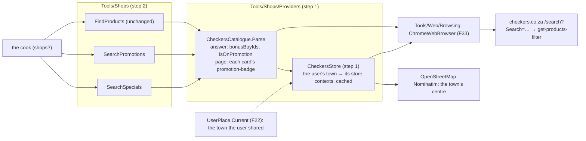
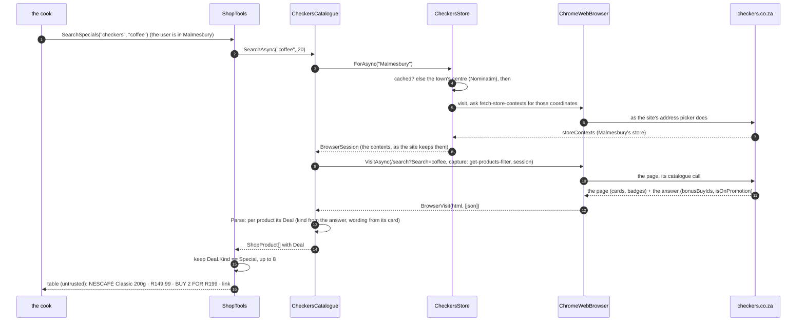

# F34 · Shop deals: SearchSpecials and SearchPromotions: plan

> Approved 2026-10-17 (Louis: "let's just start by adding the 2 new Tools SearchSpecials and SearchPromotions"; both
> take a query and split by the kind of deal; then "the cook may only use shops for who has tools for", and without one,
> the recipe with no prices; and "make sure we set the address in checkersprovider, to make sure we use the correct
> catalogue") · Feature: [F34 Shop deals](../features/F34-shop-deals.md) · Branch:
> `feature/F34-shop-deals` off `main` (CL14 merged 2026-10-17, PR #60)

## Context

The cook prices Checkers through `FindProducts` (F33), and a cheap meal should use what's on special. A free look at
Checkers' live site (2026-10-17, through our guarded browser) found two kinds of deal, and that `FindProducts` shows
neither:

| | Example | In the search answer F33 reads | On the product's card |
|---|---|---|---|
| **Special: a multi-buy** ("bonus buy") | NESCAFÉ Classic 200g, R149.99 | `bonusBuyIds: ["6ac777c3…"]`; `isOnPromotion` false; prices unchanged | a red badge, **"BUY 2 FOR R199"** |
| **Promotion** | Farmer's Choice Drum & Thigh 16-piece | `isOnPromotion: true`; `price` = `discountedPrice` = `oldPrice`; `discount` 0 | a **"SAVE"** badge |

The answer says *which* products have a deal (an id, a flag); only the card says *what* it is. Both are in the one
visit `CheckersCatalogue` already makes: the search page's HTML (which F33 already reads for each product's link) and
its `get-products-filter` answer. So no new request, no new page.

Louis chose two tools, both searching like `FindProducts`, split by the kind of deal:

- **`SearchSpecials(shop, query)`**: the products the query finds that have a multi-buy, with its wording;
- **`SearchPromotions(shop, query)`**: those flagged as on promotion, with their badge's wording.

And Louis, on the plan: **"the cook may only use shops for who has tools for"**. Today the cook prices two shops picked
at random from the town's, through `WebSearch` for those without a catalogue; the Malmesbury chat showed why that fails
(every SearXNG engine refused: Brave too many requests, DuckDuckGo a CAPTCHA, Google and Qwant denied; no price with a
source). With no shop tool for the town, Louis chose: **the recipe and its list, prices `-`**, and a line that no shop
near the user has a catalogue here yet. No web-search prices.

And Louis, on the plan again: **"make sure we set the address in checkersprovider, to make sure we use the correct
catalogue"**. A second free look (2026-10-17) found how Checkers picks the store it answers for:

- the catalogue call names none: its body has `"storeContexts": []`, so Checkers answers for a default store
  (`5ece6935…`, in the `storeContexts` and `storeids` cookies it sets);
- the site turns an address into store contexts with its own call, `POST /api/store/fetch-store-contexts?update=false`
  (`{ address, … }`; behind it, `/api/v3/store-contexts` with the address's `latitude` and `longitude`), then keeps the
  address for a visitor who isn't logged in (`setUnauthAddress`) and sends those contexts with every catalogue call;
- the `/api/address/…` calls (`set-user-delivery-address`, `get-user-addresses`) are a logged-in user's: not ours;
- the same catalogue call has `"filterOptions": { "dealsOnly": false, … }`: Checkers' own filter for deals.

## Design

**The store is the user's** (step 1). The cook's session knows where the user is when they shared it
(`UserPlace.Current.Location`, F22: a town or suburb, passed to the specialist). `CheckersCatalogue` turns it into
coordinates (OpenStreetMap's Nominatim, as the cook already uses for the town's shops; only the town's centre, never
the user's own address), asks Checkers for that place's store contexts the way its own address picker does, and searches
with them, so prices, stock and deals are the local store's. Contexts are kept per town for the instance's life (one
lookup per town). Without a place, or when Checkers serves none there, the search is the default store's, as today, and
the table's header says which (`Products at Checkers (Malmesbury) …` or `(no area: Checkers' default store)`).
How the site keeps the visitor's address (a cookie, or its call with the contexts) is read from a recorded visit at the
start of the step, and the browser gains what it needs to do the same: a visit that runs in a given store's context.

**One search, a deal per product.** `IShopCatalogue.SearchAsync` stays as it is; each `ShopProduct` gains an optional
`Deal`: its kind (an enum, ADR 0024: `ShopDealKind.Special` for a multi-buy, `Promotion` for the flag) and its wording
from the card (`BUY 2 FOR R199`, `SAVE`, `SAVE R25`). `CheckersCatalogue.Parse` reads the kind from the answer
(`bonusBuyIds` not empty, else `isOnPromotion`) and the wording from the product's card on the page: the
`promotion-badge` element in the card its link (`/product/…-{article}{unit}`) belongs to. A product the answer marks
but whose card has no badge keeps the kind with no wording ("a multi-buy; see the link").

**The tools filter, the catalogue doesn't.** `ShopTools.SearchSpecials` and `SearchPromotions` ask the catalogue for
the most it returns (20) and keep the products of their kind, up to `maxResults`; the table is `FindProducts`' with a
*Deal* column. `FindProducts` itself doesn't change (its golden table stays). Both are in the `shops` toolset, so they
come with it wherever it's on (`SHOP_CATALOGUES`, `BROWSER_URL`; the cook's `shops?`).

**Framing:** a deal's wording is the shop's text, inside the same untrusted-data frame as the table. A multi-buy is
not a pack price: the guide says to price the pack, and to name the deal beside it when the recipe uses that many.

**The cook prices only where it has a tool** (step 3). `puls-cook.md` drops the two shops picked at random, the
column completed at other shops, `WebSearch` for prices and the per-site notes on which shops' pages give a price. It
keeps `WebSearch` for a recipe and OpenStreetMap for the town's shops: a shop is priced when a shop tool covers it and it
has a branch in the town (looked up by name, F33's Malmesbury fix); its column is that shop's (`FindProducts`, and
`SearchSpecials` / `SearchPromotions` to name a deal beside the pack's price). With no such shop, the list keeps its
rows with `-` and says so. The shopping list's example and the rules on totals follow.

**Deals through Checkers' own filter where it helps:** the tools may set `dealsOnly` on the search the page makes,
so a query finds more products with a deal than the first 20 of all; decided in step 3 against the live answer.

**Reuse before building:** no package; the browser visit, the parser, the table and its framing are F33's. The badge's
CSS class (`promotion-badge…`) is the one thing new to read, and a recorded card is its test.

### Namespaces (new, moved, changed)

| Type | Folder | Namespace | Step |
|---|---|---|---|
| `IWebBrowser.VisitAsync(…, BrowserSession? session)`, `BrowserSession` (the cookies a visit starts with) | `Tools/Web/Browsing/` | `LouisAgent.Core.Tools.Web.Browsing` | 1, changed (shape settled by the recorded visit) |
| `CheckersStore` (internal: a place's store contexts, cached per town), `CheckersCatalogue` (uses it) | `Tools/Shops/Providers/` | `LouisAgent.Core.Tools.Shops.Providers` | 1, new / changed |
| `PlaceCoordinates` (a town's centre from Nominatim, through the SSRF-guarded fetch) | `Tools/Shops/` | `LouisAgent.Core.Tools.Shops` | 1, new |
| `ToolMessage.ShopProductsFound` (names the store's area) | `Messages/` | `LouisAgent.Core.Messages` | 1, changed |
| `ShopDeal` (record), `ShopDealKind` (enum: `Special`, `Promotion`) | `Tools/Shops/` | `LouisAgent.Core.Tools.Shops` | 2, new |
| `ShopProduct.Deal` | `Tools/Shops/` | `LouisAgent.Core.Tools.Shops` | 2, changed |
| `CheckersCatalogue.Parse` (+ `DealOf`, the card's badge) | `Tools/Shops/Providers/` | `LouisAgent.Core.Tools.Shops.Providers` | 2, changed |
| Fixtures `checkers-deals.json`, `checkers-deals.html`, `checkers-store-contexts.json` (real, trimmed) | `tests/…/Tools/Shops/Providers/Fixtures/` | — | 1–2, new |
| `ShopTools.SearchSpecials`, `SearchPromotions` | `Tools/Shops/` | `LouisAgent.Core.Tools.Shops` | 3, new |
| `ToolMessage.ShopSpecialsFound`, `ShopPromotionsFound`, `ShopNoSpecials`, `ShopNoPromotions` | `Messages/` | `LouisAgent.Core.Messages` | 3, new |
| `Prompts/toolsets/shops.md` (the two tools, when to use them) | `Prompts/toolsets/` | — | 3, changed |
| `Prompts/specialists/puls-cook.md` (only shops with a tool; none: no prices) | `Prompts/specialists/` | — | 4, changed |
| Tests mirror: `tests/…/Tools/Web/Browsing/`, `tests/…/Tools/Shops/Providers/CheckersCatalogueTests`, `CheckersStoreTests`, `tests/…/Tools/Shops/ShopToolsTests`; the cook's in `tests/…/Skills/Roles/RoleCatalogTests` | | `LouisAgent.Core.Tests.…` | 1–4 |

### Interfaces

```csharp
// Tools/Web/Browsing: a visit can start in a session (the cookies a site keeps a visitor's choices in)
public sealed record BrowserSession(IReadOnlyDictionary<string, string> Cookies);
Task<BrowserVisit> IWebBrowser.VisitAsync(Uri url, Func<Uri, bool>? capture = null, BrowserSession? session = null,
    CancellationToken cancellationToken = default);

// Tools/Shops: a town's centre, for a shop that serves by area
internal static class PlaceCoordinates { Task<(double Latitude, double Longitude)?> OfAsync(string place, CancellationToken ct); }

// Tools/Shops/Providers: Checkers' store for a place, cached per town
internal sealed class CheckersStore(IWebBrowser browser)
{
    // The store contexts Checkers serves the place from, as its address picker gets them; null: none, the default store.
    public Task<BrowserSession?> ForAsync(string? place, CancellationToken ct);
}

// Tools/Shops: what a deal is
public enum ShopDealKind { Special, Promotion }                 // a multi-buy (bonus buy); the shop's promotion flag
public sealed record ShopDeal(ShopDealKind Kind, string? Text);  // Text: the card's badge, "BUY 2 FOR R199", "SAVE"
public sealed record ShopProduct(…, Uri Url, Uri? Image = null, ShopDeal? Deal = null);

// Tools/Shops/Providers: unchanged signature, reads one more thing from the same answer and page
internal static IReadOnlyList<ShopProduct> CheckersCatalogue.Parse(string json, string html, Uri searchUri, int maxResults);

// Tools/Shops: the two tools
public sealed class ShopTools
{
    [Description("…")] public Task<string> SearchSpecials(string shop, string query, int maxResults = 8, CancellationToken ct = default);
    [Description("…")] public Task<string> SearchPromotions(string shop, string query, int maxResults = 8, CancellationToken ct = default);
}
```

```mermaid
classDiagram
    direction LR
    class IShopCatalogue { <<interface, F33>> +Shop : ShopKind +SearchAsync(query, max, ct) }
    class CheckersCatalogue { <<changed, step 1>> ~Parse(json, html, uri, max)$ -DealOf(product, html)$ }
    class ShopProduct { <<record, changed, step 1>> Name Price PriceTo Size UnitPrice Url Image +Deal }
    class ShopDeal { <<record, step 1>> Kind Text }
    class ShopDealKind { <<enum, step 1>> Special Promotion }
    class ShopTools { <<step 2>> +FindProducts() +SearchSpecials(shop, query, max) +SearchPromotions(shop, query, max) }
    IShopCatalogue <|.. CheckersCatalogue
    CheckersCatalogue ..> ShopProduct
    ShopProduct --> ShopDeal
    ShopDeal --> ShopDealKind
    ShopTools --> IShopCatalogue : SearchAsync(query, 20), then keeps one kind
```



### Architecture



### Communication: the cook looks for a deal on coffee



## Steps (one commit each, test first, stop after each)

| # | Step | Test first | Concept (GOAL skill) |
|---|---|---|---|
| 0 | Feature doc F34, this plan, the TODO line, the indexes | docs only | Design before code (skill 18) |
| 1 | **The user's store** (Louis): a recorded visit settles how the site keeps a visitor's address; `BrowserSession` on the browser; `PlaceCoordinates`; `CheckersStore` (a place's store contexts, cached per town); `CheckersCatalogue` searches in that store, the default one without a place; the table's header names the area | a fake browser: a place's contexts are asked once per town and the search runs in them; no place, or none served: the default store, said in the header; Nominatim's answer (recorded) to coordinates; a live test: Malmesbury's store id differs from the default's and the search returns products | The data's context is part of the data: the right store's prices (skills 4, 7) |
| 2 | `ShopDeal`, `ShopDealKind`, `ShopProduct.Deal`; `CheckersCatalogue` reads each product's deal (kind from the answer, wording from its card) | against a recorded, trimmed answer and page: NESCAFÉ is a `Special` "BUY 2 FOR R199"; a promoted product is a `Promotion` with its badge; a product with neither has no deal; a marked product whose card has no badge keeps its kind, no wording; a live test (skips without `BROWSER_URL`) | Reading the same source more fully, not a new one (skills 4, 7) |
| 3 | `ShopTools.SearchSpecials`, `SearchPromotions` (with `dealsOnly` if the live answer shows it helps), their messages; the `shops` guide; the golden files | each keeps only its kind, with a *Deal* column, framed as untrusted; none found says so and what to try; a shop not enabled says which are; `FindProducts`' table unchanged; the golden files regenerated and reviewed | Tool design: small, specific tools the model picks between (skill 4) |
| 4 | **The cook prices only shops it has a tool for** (Louis); with none, the recipe and the list with `-`, and a line saying no shop near the user has a catalogue here yet; a deal (`SearchSpecials`, `SearchPromotions`) named beside the pack's price | the cook's prompt: says to price only shops a tool covers, and what to write without one; no longer tells it to pick two at random, complete a column at other shops or `WebSearch` for prices; the example list follows; golden files if they hold the cook (they don't today) | Scope a role to what it can do reliably (skill 7) |

## Verification

- Each step: `dotnet build louis-agent-solution.sln`, `dotnet test tests/louis-agent.core.tests`; the live test with
  `BROWSER_URL=http://127.0.0.1:9222`; the golden files in step 2.
- After step 1: a free hand check that a search for Malmesbury runs in its store (its store id in the captured call)
  and one without a place in the default store.
- After step 3: rebuild the Puls stack; a free hand check that `puls-agent`'s cook session lists the two tools, and the
  live test's search for coffee returns NESCAFÉ's multi-buy.
- After step 4: a cook check from the portal (paid, Louis's go) measures it: priced rows with sources only at Checkers,
  no guessed price, and in a town with no Checkers the recipe with `-` (the scorer counts those rows as listed, not
  priced). Free first: a hand-read of the prompt's diff.

## Risks

- The badge's class or text changes: the recorded page's test fails first; the deal keeps its kind from the answer.
- A multi-buy priced as if one item cost the deal's average: the guide says the pack's price is the price, the deal is
  beside it.
- Promotions may be card (Xtra Savings) prices: the badge's wording is passed on as the shop writes it; nothing is
  inferred.

- **The sold endpoint prices nothing** until it has a shop tool (no `SHOP_CATALOGUES` there, ADR 0023): its cook gives
  recipes and lists without prices. Louis's choice; the cook check's Puls-alone mode is unchanged (Puls answers itself).
- **Fewer shops than before:** Checkers only, until F33's follow-up adds Shoprite and others; in towns without a
  Checkers, no prices.

- **Where the user is goes to two more places:** the town (not the user's address) to OpenStreetMap's Nominatim, as the
  cook already sends it, and its centre's coordinates to Checkers, as any shopper choosing that area would; only when
  the user shared their place.
- **Checkers' store call may change or refuse a browser:** the default store is the fallback, said in the table's
  header, so prices are never silently another area's.

## Approved during the build

- **2026-10-17, step 5, the cook check (Louis: "don't we need to update/add some stuff on the benchmark?", then "yes,
  go ahead I will run the benchmark manually").** The check scored F33's cook: `priced_at_shops` only counted shop pages
  read, which the cook no longer reads. Two conversations: `cook-malmesbury` (Louis's town, a R150 budget for four: the
  store lookup, the N7 Checkers found by name, the deal tools) and `cook-no-shop` (Darling, no Checkers on OpenStreetMap:
  no prices, the no-catalogue line). Scores: `shop_tool_calls`, `deal_tool_calls`, `deals_named`, `untooled_shops` (0
  is right) and `no_catalogue_line`; `priced_at_shops` counts a shop tool too. The manual and the portal's chips name
  them. Louis runs the check himself.
- **2026-10-17, in step 5: proof the address was used (Louis: "how can we verify that the product comes from the
  malmesbury store? that the address was used").** Each product in Checkers' answer names the store that priced it
  (`storeId`). `CheckersCatalogue` names the town only when that store is one the town's lookup named
  (`ShopSearch.Store`, `AreaIgnored`); else it logs `LogMessage.ShopStoreNotUsed` and the header says the town's store
  wasn't used (`ToolMessage.ShopStoreNotUsed`). The header carries the store's id
  (`the store serving Malmesbury, store 655b0c8f`). The benchmark's stream keeps the tools' results, and two scores
  read those headers: `store_for_area` and `store_default`.
- **2026-10-17, a shop without a provider (Louis: "when a shop does not have a provider puls must reply to the user
  politely to take it up with the store in order to get listed", "since they do not have an api", then "use your
  wording").** The cook adds, under the list, a note per shop it can't price (in town without a tool, or one the user
  names): Puls shows prices from shops that make them available online in a form it can read, such as Checkers; that
  shop doesn't yet; the user can ask it to, and the more customers ask, the sooner. Not "a public API": Checkers
  publishes none as such (its own site's catalogue is what's read), and Shoprite is named once its provider exists.
- **2026-10-18, after the cook check `dd992620f6cc` (Louis: "add the area argument and swap the town").** cook-en named
  Pretoria only in its message, so its searches were the default store's: the shop tools take `area`, the town from
  the task, used when Puls shared no place (a shared place wins), and `IShopCatalogue.SearchAsync` takes the place the
  tool chose. Darling priced at Checkers: it's in Malmesbury's municipality and Checkers serves it, so the no-shop
  conversation moves to Prince Albert. Checking it found that Checkers answers any place it has no store for with its
  fallback stores, the default (`5ece6935…`) first: `CheckersStore` counts those as no store for the town, so a header
  never names a town's store that isn't its own.

- **2026-10-17, step 1 split in two (Louis: "yes, go ahead"), after the recorded visit.** Checkers' own address call
  (`POST /api/store/fetch-store-contexts?update=true`, an address with `latitude` and `longitude`) answers a visitor
  who isn't logged in with the area's store contexts and sets three cookies (`storeContexts`, `storeids`,
  `istio-storeIds`); the next search is that store's (Malmesbury: store `655b0c8f…`, 85 chicken products against the
  default's 61), its body still `storeContexts: []`: the cookies carry the store. And every visit shared the browser's
  default context, so cookies carried over: one town's store would have answered every later search.
  - **1a, the browser:** `VisitAsync(url, capture, session, script, ct)`; `BrowserSession` and `BrowserCookie`
    (namespace map: `Tools/Web/Browsing/`); a visit with a session or a script has a browser context of its own,
    dropped after; a script of ours runs once the page has loaded, under the same interception, and its result is the
    visit's (`BrowserVisit.ScriptResult`); such a visit returns the cookies the site set (`BrowserVisit.Cookies`), so the
    store's cookies are Checkers' own, never rebuilt. `ToolMessage.BrowserScriptFailed`.
  - **1b, the user's store:** `PlaceCoordinates`, `CheckersStore` (one lookup visit per town, the site's own call, its
    cookies kept as a `BrowserSession`), `CheckersCatalogue` searching in it.
- **2026-10-17, in step 1b: a search says which store answered.** Only the catalogue knows whether the town's store was
  found, so `IShopCatalogue.SearchAsync` returns `ShopSearch(Products, Area)` (`Tools/Shops/`, new) instead of a list;
  the table's header names the store (`ToolMessage.ShopStoreForArea`, `ShopDefaultStore`, `ShopDefaultStoreNoneFor`).
  The lookup sends only the town's centre (Checkers' call works without the address's text), and a lookup that fails
  isn't kept, so the next search tries again (`LogMessage.ShopAreaUnavailable`).
- **2026-10-17, the list's product photo (Louis, on a screenshot: "can we move the picture into its own to the first
  column", then "no wait keep it there but the text must not go underneath"):** the photo stays in *To buy*; Puls's
  styles give a cell with a photo a lane for it (`.markdown td:has(> img)`), so a long name wraps beside the photo, never
  under it. Not the cook's prompt.
- **2026-10-18, photos (Louis: "always send a product image with a product", "die foto moet altyd eerste wees en dan
  produk desc", "when you click the product image the original must open in a modal").** Puls's brief asks for every
  product's photo; the cook shows it in every table, first in the cell. A shop photo carries its original
  (`data-original`, the same file without the size, from `Markdown.cs`), which `chat.js` opens in a dialog.
- **2026-10-18, the sub-session footer in Puls's answer (Louis: "bug").** The relay rule's "every line under a table"
  took in the tool's `[Sub-session …]` footer; the specialists guide now says the footer is Puls's, never the answer's.

---
[Plans](README.md) · Previous: [CL14 The public word: role](CL14-public-word-role.md)
