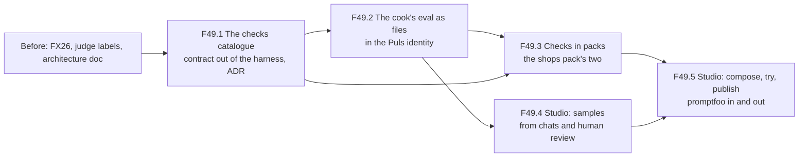
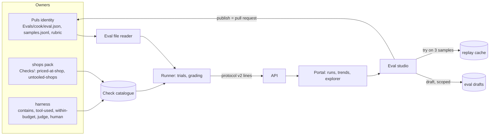
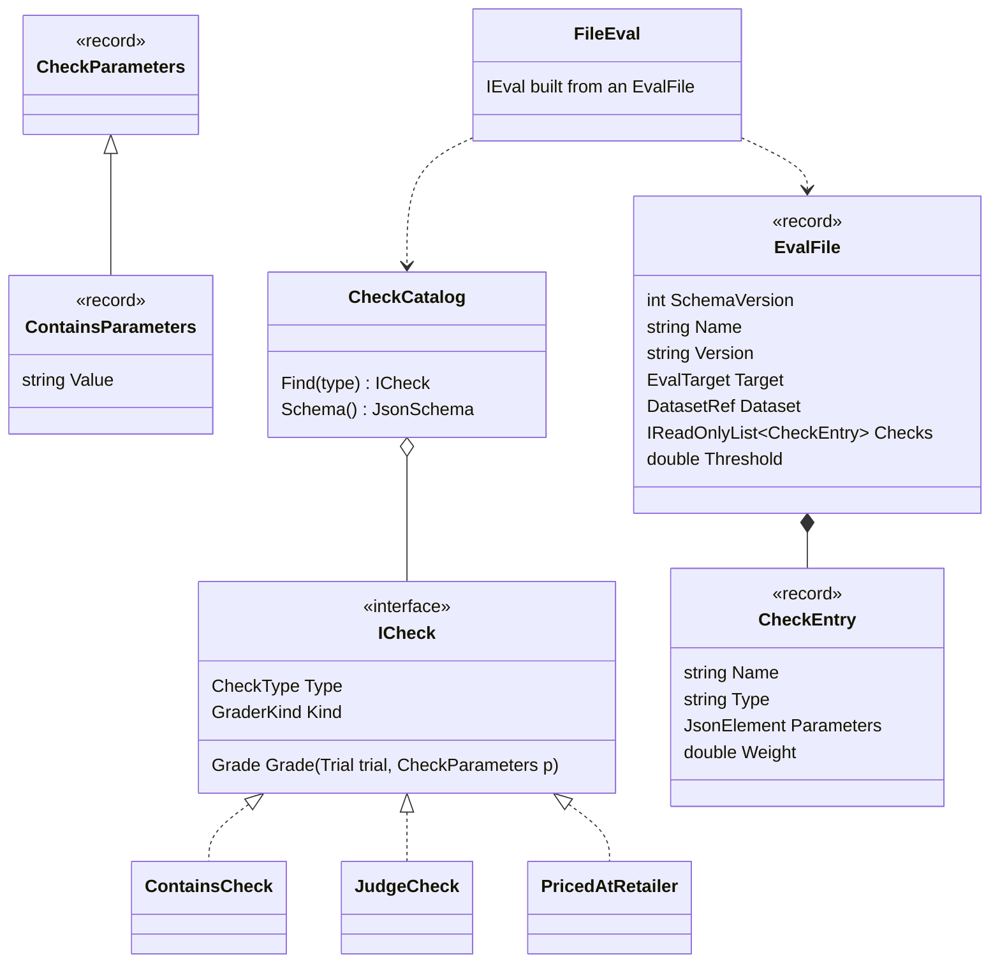
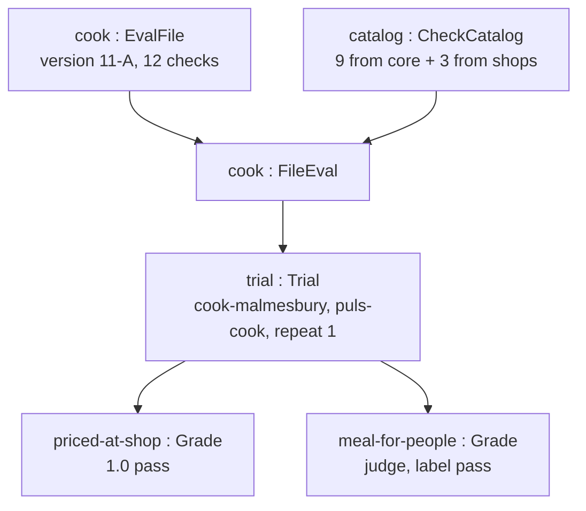
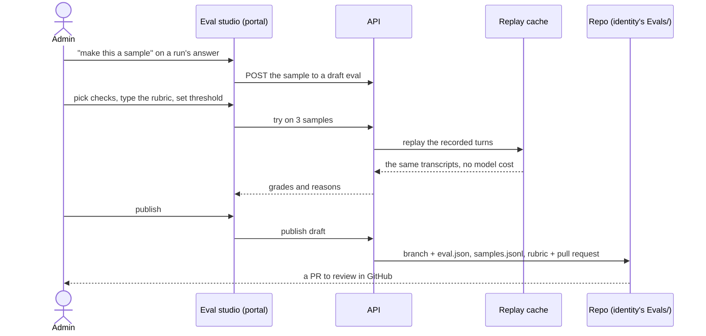

# F49 Evals as content (parent plan, draft)

**What this answers:** what F49 is for, which children it splits into and in what order, what "done" means for each,
and the design questions still open. It is a parent plan: each child gets its own plan file when it starts
(`docs/plans/F49.1-….md`), with its own branch, pull request to `main`, done-when and write-up.

Status: **approved 2026-10-30**, the parent plan; each child has its own plan, branch and pull request. What changed since v1 is under *Since v1* and *Research refresh*; the open findings are at the end and go to Louis one card at a time.

## The goal, in one line

Louis, 2026-10-28: *"it should be simple to make evals, edit them and from the admin panel, living in identity."*

Today one eval is about twenty C# files (`evals/louis-agent.evals.puls/Evals/Cook/` has 20). Every eval tool we
studied keeps three things apart: the **eval as a data file**, the **checks as a catalogue of compiled functions**
picked by name, and the **judge's rubric** as the one bit of free text a person writes
(`research/reports/Declaring evals as files.md`). F49 does the same for us:

- **identity = who, pack = what it can do, eval = how we prove it**, and each lives with its owner (ADR 0027);
- the cook's eval becomes files beside the Puls identity: `eval.json`, `samples.jsonl`, a rubric in markdown;
- a check is a named C# class in a catalogue: core's general ones, plus the ones a pack ships beside its tools;
- the portal gets an **eval studio** that writes those same files, and git stays the truth.

No script engine in the hosted service: .NET has no in-process sandbox, so the escape hatch is a new catalogue entry
(a reviewed C# class), never a script in a file.

GOAL skills: **12 Evaluation** (evals as data, graders as a catalogue, judge calibration) and **18 Testing and
shipping** (evals as a release gate that a non-programmer can extend).

## Before F49 (Louis, 2026-10-29: all three before F49.1)

| Item | What | State on 2026-10-29 evening |
|---|---|---|
| FX26 | A replay miss at the sub-session hand-off gets its own typed kind | **Done**, PR #101 merged |
| Eval architecture doc | `docs/architecture/evals.md`, as built today, four diagrams | **Done**, PR #100 merged |
| Judge check | Louis labels the 36 cook answers himself (`label-sheet`, then `calibrate`); we compare with the judge | **Open**, Louis's own; it does not block F49.1's code, only the judge's rubric wording in F49.2 |

## Since v1 (what landed on 2026-10-29 that F49 builds on)

- **CL26** (PR #104): the admin contract's run row says what a run replayed (`StoredRunRow.ReplayOf`), read from the
  run's settings by the class that writes them (`EvalSettings`, Information Expert); the Evals page's card is a
  scorecard and a timeline. F49.4 and F49.5's studio pages start from that card and the CSS now split by area
  (ADR 0053: a `.css` file holds 200 lines of rules; the studio's styles go under `css/admin/`).
- **FX28** (PR #105): the Benchmarks page marks a replay and starts one from a recorded run's row. F49.5's "try on 3
  samples" is that replay path, scoped to a few samples: no new runner mode.
- **CL25** (PR #103): `docs/CLAUDE.md` is 200 lines and the how of each rule loads from `.claude/rules/`; ADRs 0050 to
  0052 (summaries like a person, flat conditionals, edit never script). Every new class in F49 carries its pattern in
  `<remarks>`. **Next free ADR: 0055.**
- **FX23** (PR #106): `ProcessRunner` no longer fails a script that never reads its input; nothing for F49, listed so
  the TODO's *Now* reads as it is.

## Research refresh (2026-10-29 evening; the 2026-10-28 report stands, these are the deltas)

| Looked at | What it says | What F49 takes from it |
|---|---|---|
| Microsoft.Extensions.AI.Evaluation, as of 2026 ([DevLeader, April 2026](https://www.devleader.ca/2026/04/05/evaluating-ai-agents-with-microsoftextensionsaievaluation-in-c); [.NET blog, agent-quality evaluators](https://devblogs.microsoft.com/dotnet/exploring-agent-quality-and-nlp-evaluators/)) | Scenarios are still C# only (`EvaluationScenario` in code); the library ships judge evaluators (`IntentResolution`, `TaskAdherence`, `ToolCallAccuracy`, `ContentHarm`) and a JSON/Markdown report writer; its abstractions moved between .NET 10 previews | No file format to reuse, so the eval file is ours (ADR 0030 considered it). Its evaluators stay reachable as today through `EvaluatorGrader`, as one catalogue entry type (`meai-judge`) in F49.1, so a file can name them |
| Anthropic, *Develop test cases* ([platform.claude.com](https://platform.claude.com/docs/en/test-and-evaluate/develop-tests)) | "Prioritize volume over quality"; generate more cases from a baseline set; grade by code first, a model second, a person last; a rubric is detailed, asks for a constrained output ("correct" or "incorrect", 1 to 5), lets the grader reason, and runs on a different model from the one graded | F49.2's rubric file gets a fixed head (what to output, the labels, "think first"); F49.4's "make this a sample" is how volume comes from real chats; the catalogue's order of kinds (fixed rule, model, human) is already ours (`GraderKind`) |
| promptfoo's assertion shape ([expected outputs](https://www.promptfoo.dev/docs/configuration/expected-outputs/)) | An assertion is `type`, `value`, `threshold`, `weight`, `metric`; deterministic types (`contains`, `regex`, `is-json`, `latency`, `cost`) beside model-graded ones (`llm-rubric`, `factuality`, `similar`); tests load from CSV with `__expected` columns | `CheckEntry` keeps the same five fields, so F49.5's promptfoo import and export is a rename of types, not a translation; `within-budget` is their `cost`, `within-time` their `latency` |
| Inspect's `Sample` and `FieldSpec` ([datasets](https://inspect.aisi.org.uk/datasets.html)); `inspect eval-set` ([reference](https://inspect.aisi.org.uk/reference/inspect_eval-set.html)) | `Sample` is `input`, `target`, `choices`, `id`, `description`, `metadata` (plus sandbox fields); a `FieldSpec` maps any file's columns onto it; an eval set retries failed tasks with an id and a log dir | `samples.jsonl` keeps the `Sample` shape F18 7d chose, and F49.2's reader gets a small `FieldSpec` so an existing JSONL or CSV needs no rewrite; retries stay the runner's (F18) |
| `JsonSchemaExporter` ([learn.microsoft.com](https://learn.microsoft.com/en-us/dotnet/standard/serialization/system-text-json/extract-schema)) | In the box since .NET 9: a JSON Schema from a record, `required` from the constructor, nullability honoured; a `TransformSchemaNode` copies `[Description]` into the schema; no discriminator for polymorphic types | F49.2's `eval.schema.json` is generated from `EvalFile` with one transform for descriptions and checked into the identity, so an editor (and the studio's form) validates as you type; a check's parameters are one record per type, never a polymorphic base in the schema |

Nothing found that moves the 2026-10-28 recommendation: a JSON eval file, a C# catalogue, the rubric as data, no
script engine.

## The children, in order



| Child | What it builds | Done when | Rough size |
|---|---|---|---|
| **F49.1** The checks catalogue | The check contract (`IGrader`, `Grade`, `Trial`) moves out of the harness to a project a pack can reference; a check is registered under a kebab-case type with a typed parameter record; core's general checks (`contains`, `regex`, `tool-used`, `no-error`, `within-budget`, `within-time`, `routed-to`, `judge`, `human`) are entries; the ADR | A check is a catalogue entry any project can reference, and today's evals run unchanged on it | 6 to 8 steps |
| **F49.2** The cook's eval as files | `eval.json` (and its JSON schema, made from the records), the reader that turns it into an eval, the judge template embedded with the rubric as data, the cook and routing evals moved to `identities/louis-agent.identity.puls/Evals/` | `evals/louis-agent.evals.puls` is empty and the cook's replayed run grades the same as the baseline (`puls-cook 5d1fd231c9b1`) | 7 to 9 steps |
| **F49.3** Checks in packs | A pack lists its checks like its toolsets; the shops pack ships `priced-at-shop`, `untooled-shops`, `estimates-at-shop`; the composition gathers core's and the packs' into one catalogue | A pack lists its checks like its tools, and the cook's eval names them from the shops pack | 4 to 5 steps |
| **F49.4** Studio: samples | "Make this a sample" from the run explorer (later a Puls chat); a human-review fail becomes a known-bad; drafts kept in a scope (ADR 0033) | A sample is made from a chat without Rider | 5 to 7 steps |
| **F49.5** Studio: compose, try, publish | A form over `eval.json` (checks from the catalogue, the rubric, the threshold), "try on 3 samples" against the replay cache, publish as a pull request (or download the files where the host has no repo), promptfoo import and export | A new eval is made, tried and published from the admin panel | 8 to 10 steps |

About 30 to 40 steps in all, so F49 itself has no steps: only its children do.

## Where things live, today and at the end

Today:

```
evals/
├── louis-agent.evals/            # the harness: IEval, IGrader, Grade, Trial, general graders, datasets, protocol writer
├── louis-agent.evals.protocol/   # the event contract (JSON Lines) the runner and the API share
├── louis-agent.evals.puls/       # Puls's evals as C#: Cook (20 files + dataset), Routing, Shared (15 files)
├── louis-agent.evals.runner/     # the runner: catalogue, calibration, arguments
└── louis-agent.evals.template/   # the template for a new eval set
identities/louis-agent.identity.puls/   # Prompts/, PulsIdentity, PulsPack, PulsRole
packs/louis-agent.pack.shops/           # Tools/, Catalogues/, Prompts/, ShopsPack
```

At the end of F49 (names are proposals; F49.1's card settles where the contract lives):

```
evals/
├── louis-agent.evals.checks/     # NEW (F49.1): the check contract a pack may reference (ICheck, Grade, Trial, CheckType)
├── louis-agent.evals/            # the harness: runs an eval file, core's general checks, the judge template
├── louis-agent.evals.protocol/   # unchanged
├── louis-agent.evals.runner/     # reads eval files from every identity it's given
└── louis-agent.evals.template/   # becomes a template FOLDER of files (eval.json, samples.jsonl, rubric.md)
identities/louis-agent.identity.puls/
├── Prompts/
└── Evals/                        # NEW (F49.2)
    ├── cook/
    │   ├── eval.json             # dataset, checks with their parameters, the judge's rubric file, threshold, version
    │   ├── samples.jsonl         # Inspect's Sample shape (as F18 7d)
    │   ├── rubrics/meal-for-people.md
    │   ├── labels/               # human labels for the judge check
    │   └── transcripts/          # reference and known-bad runs
    └── routing/…
packs/louis-agent.pack.shops/
└── Checks/                       # NEW (F49.3): PricedAtRetailer, UntooledShops, EstimatesAtShop
src/louis-agent.web.shared/ (admin)  # NEW pages (F49.4, F49.5): the studio
```

`evals/louis-agent.evals.puls/` is gone.

## Architecture at the end



## Interface at the end (proposal)



## Objects at run time (one cook run, at the end)



## Communication: making an eval in the studio (F49.4 and F49.5)



## Open findings (one card each, in this order)

1. **Where the F18 leftovers go**: decided 2026-10-29, all three before F49.1 (two done, the labels Louis's own).
2. **Where the check contract lives** (F49.1): **decided 2026-10-30, Louis picked its own project
   `evals/louis-agent.evals.checks`** (Separated Interface). The options, for the record:
   - **Its own small project `evals/louis-agent.evals.checks`** (recommended): the contract (`ICheck`, `Grade`,
     `Trial`, `CheckType`, the parameter records) and nothing else, referenced by the harness, every pack and the
     API; the shape `louis-agent.choices` already has (one small project that references nothing, so anyone can
     reference it). Pattern: *Separated Interface* (Fowler, PoEAA). Cost: one more project and test project.
   - **Core**: packs already reference core. Pattern: the engine owns its contracts (ADR 0031 did this for
     orchestration). Cost: core grows an evals concern it never runs, and the harness would reference core only for
     three types; ADR 0027 keeps core free of what a product proves.
   - **The protocol project**: the runner and the API share it already. Pattern: one contract project. Cost: the
     protocol is the wire (JSON Lines events, ADR 0047); `Trial` and `ICheck` are run-time objects, and mixing them
     makes every protocol change a check change.
3. **How a check is found by name** (F49.1, the card on the table):
   - **A registry each owner fills** (recommended): a pack lists its checks as it lists its toolsets
     (`ShopsPack.Checks`), the harness lists core's, and the composition project gathers them into one
     `CheckCatalog`, as `PACKS` and `IDENTITIES` are gathered today. Pattern: *Registry* (Fowler) filled by
     *Plugin* (PoEAA) entries; ADR 0027's "only composition knows them all". Cost: a check forgotten from the list is
     unreachable (a test lists the catalogue, as `PackConvertibilityTests` does).
   - **An attribute scanned by reflection** (`[Check("priced-at-shop")]`): nothing to list. Pattern: *Convention over
     configuration*. Cost: magic a reader can't follow to the list, assembly scanning at start, and composition no
     longer the one place that knows them all.
   - **One enum and a switch in the harness**: the names as `CheckType` members, a switch builds each. Pattern:
     *Factory Method* over an enum (ADR 0024 likes enums). Cost: the harness would have to reference every pack to
     build its checks, the dependency the wrong way round (a pack never references the harness's callers).
4. **What the eval version looks like** (F49.2): **decided 2026-10-30, an integer as today**, bumped by hand
   ([ADR 0058](../adr/0058-an-eval-is-a-folder-of-files.md)).
5. **Where an eval's "turn facts" come from** (F49.2): **decided 2026-10-30, the harness reads them** from the
   engine's events for every eval; `PulsTurnFacts` is gone ([ADR 0058](../adr/0058-an-eval-is-a-folder-of-files.md)).
6. **How "publish" reaches git on a hosted instance** (F49.5): a pull request through the API, a download, or both.

Findings 1 to 5 are decided (F49.1 and F49.2 are built: [write-up 20](../learning/20-extensibility.md)); finding 6
waits for F49.5's plan.

## Paid runs

None in planning. F49.2's "grades the same" uses the replay cache; one live cook run at the end of F49.2 only on Louis's
go. The studio's "try" always hits the replay cache.

Sources: `research/reports/Declaring evals as files.md`; `plans/F18/eval-studio-vision.md`; platform plan Phase 3b and
Part 4's sub-feature table; ADRs 0027, 0028, 0033, 0041, 0043, 0045, 0047.
