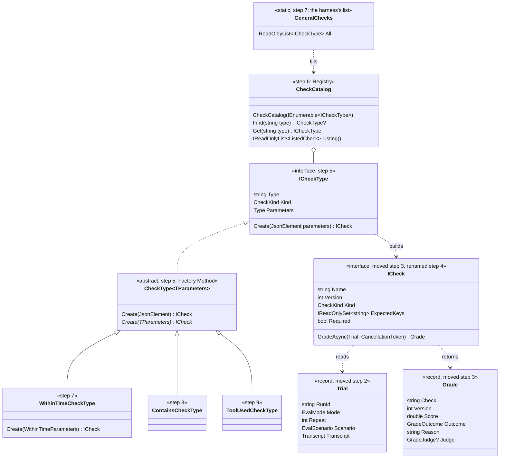
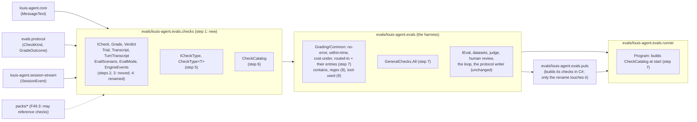
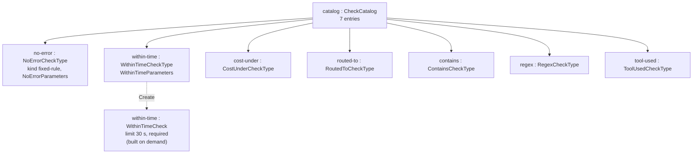

# F49.1 The checks catalogue

> **What this answers:** how we take the check contract out of the eval harness, put it in a small project any pack
> can reference, and make every general check a catalogue entry with typed parameters, so F49.2 can name checks from
> a file and F49.3 can let a pack ship its own. The first child of [F49 Evals as content](F49-evals-as-content.md).
> Branch `feature/F49.1-checks-contract`, ADR 0056 (0055, *Keep it simple*, lands with the plan). The page with the diagrams drawn:
> <https://claude.ai/artifact/YEUt4cAdHc6KDbcRabEwX9>.

Status: **approved 2026-10-30** (Louis: "cool lets start"). Six picks are in (the contract's own project; a
registry each owner fills; the project references core, the protocol and the stream; the namespaces stay; a Factory
Method per entry; `IGrader` becomes `ICheck`). The findings are at the end, each with its pick; nothing is left to ask before step 1.

## Context: why now, and what the parent says

Today a check is a C# class behind `IGrader`, built by hand in an eval's `BuildGraders()`, and the whole contract
(`IGrader`, `Grade`, `Trial`, the turn types) lives inside the harness, `evals/louis-agent.evals`. A pack can't
reference the harness (ADR 0027: a pack references core and nothing else that proves a product), so a pack can't
ship a check, and nothing can build a check from data, because every check is a constructor call.

The parent plan's done-when for F49.1: **a check is a catalogue entry any project can reference, and today's evals
run unchanged on it.** Nothing a run writes changes in F49.1: no protocol line, no stored run, no grade. The Puls
evals keep building their graders in C# until F49.2 reads them from `eval.json`.

Decided on 2026-10-30 (the two cards): the contract lives in its own project `evals/louis-agent.evals.checks`
(*Separated Interface*, Fowler), and a check is found by name in a **registry each owner fills** (Fowler's *Registry*,
with *Plugin* entries): the harness lists the general checks, a pack will list its own (F49.3), and the composition
gathers them, as `PACKS` and `IDENTITIES` are gathered today.

## Design: what changes

Four things, and nothing else:

1. **The contract moves out, then takes the parent plan's word.** What a check reads (`Trial`, `Transcript`, `TurnTranscript`, `TurnFacts`,
   `EvalScenario`, `EvalInput`, `DatasetSplit`, `EvalMode`, `EngineEvents`) and what it returns (`IGrader`,
   `Grade`, `GradeJudge`, `Verdict`, `CommonGradeMessage`) go to `evals/louis-agent.evals.checks`, a pure move
   (ADR 0054). The harness references it and keeps everything that *runs* an eval: `IEval`, the datasets, the judge,
   human review, the loop, the protocol writer. Then one rename through Rider (ADR 0052; finding 9): `IGrader` is
   `ICheck`, `GraderKind` is `CheckKind`, `Grade.Grader` is `Grade.Check`, `IEval.Graders` is `IEval.Checks`, and
   every `*Grader` class is a `*Check`. C# names only: the protocol's records and their JSON keys (`graders`,
   `grader`) stay as they are, so stored runs and the portal read unchanged.
2. **An entry builds a check from parameters.** A new `ICheckType` names a check's type in kebab case
   (`within-time`), its kind, and builds an `ICheck` from a typed parameter record (`WithinTimeParameters(int
   Seconds, bool Required)`), read through the record (ADR 0041), never a dictionary. The catalogue can print each
   record's JSON schema (.NET's `JsonSchemaExporter`), which the studio (F49.5) will read as a form.
3. **A catalogue holds the entries.** `CheckCatalog` is built from entries, refuses a type twice, finds an entry by
   type and lists them. In F49.1 the harness fills it with the general checks (`GeneralChecks.All`), and the runner
   builds it at start, so a bad entry stops the start the way a bad eval does today.

The general checks grow by three the field uses most (promptfoo's `contains`, `regex`; Anthropic's tool-call check):
`contains`, `regex`, `tool-used`, beside `no-error`, `within-time`, `cost-under`, `routed-to`. The `judge` and
`human` entries wait for F49.2, where the rubric becomes a file: an entry with no file to read would be a stub.

### What stays as it is

- `IEval.Checks` (today `Graders`) still returns built `ICheck`s; `CookEval` and `RoutingEval` build theirs as today.
- Every check keeps its name and version, and every wire key its spelling, so stored runs and the trend read the same.
- The runner's `EvalCatalog`, the protocol, the API and the portal: untouched.

### Interface design



The C# beside it (steps 5 and 6; the words after step 4's rename):

```csharp
public interface ICheckType
{
    string Type { get; }                 // "within-time", MCP-safe: letters, digits, '-' and '_'
    CheckKind Kind { get; }
    Type Parameters { get; }             // the record the studio makes a form from
    ICheck Create(JsonElement parameters);
}

public abstract class CheckType<TParameters>(string type, CheckKind kind) : ICheckType
{
    public ICheck Create(JsonElement parameters) => Create(EvalJson.Read<TParameters>(parameters, Type));
    protected abstract ICheck Create(TParameters parameters);
}

public sealed record WithinTimeParameters(int Seconds, bool Required = true);
```

### Architecture



### Communication: the runner starts, and one check is built from data

```mermaid
sequenceDiagram
  participant Program as runner Program
  participant General as GeneralChecks
  participant Cat as CheckCatalog
  participant Entry as WithinTimeCheckType : CheckType
  participant Json as EvalJson
  participant Check as WithinTimeCheck
  Program->>General: All
  General-->>Program: 7 entries
  Program->>Cat: new CheckCatalog(entries)
  Cat->>Cat: refuse a type twice, or an empty type
  Note over Program,Cat: F49.1 stops here; F49.2's eval file reader does the rest
  Program->>Cat: Get("within-time")
  Cat-->>Program: entry
  Program->>Entry: Create({"seconds": 30})
  Entry->>Json: Read<WithinTimeParameters>(json, "within-time")
  Json-->>Entry: WithinTimeParameters(30, true)
  Entry->>Check: new WithinTimeCheck(30 s, required)
  Check-->>Program: ICheck "within-time" v1
```

### Objects at run time (the runner, after start)



### Folder trees

Today (the parts that move are marked):

```
evals/louis-agent.evals/
├── EvalMode.cs                       # moves (step 2)
├── IEval.cs, IEvalSet.cs, EvalJson.cs
├── Datasets/Scenarios/
│   ├── EvalScenario.cs, EvalInput.cs, DatasetSplit.cs   # move (step 2)
│   └── (Dataset.cs, DatasetLoader.cs, EvalFiles.cs, Manifest/, Samples/ stay)
├── Grading/
│   ├── IGrader.cs, Grade.cs          # move (step 3)
│   ├── Common/Verdict.cs             # moves (step 3)
│   ├── Common/{NoError,WithinTime,CostUnder,RoutedTo}Grader.cs   # stay
│   ├── Human/, Models/, Outcomes/    # stay
├── Messages/CommonGradeMessage.cs    # moves (step 3)
└── Trials/
    ├── Trial.cs, Transcript.cs, TurnTranscript.cs, TurnFacts.cs, EngineEvents.cs   # move (step 2)
    └── ConversationMetrics.cs        # stays (internal to the loop)
```

After step 9 (the names after step 4's rename):

```
evals/louis-agent.evals.checks/       # NEW: the contract, referenced by the harness and (F49.3) any pack
├── EvalMode.cs
├── Catalog/
│   ├── ICheckType.cs, CheckType.cs   # step 5
│   ├── CheckCatalog.cs, ListedCheck.cs   # step 6
├── Datasets/Scenarios/EvalScenario.cs, EvalInput.cs, DatasetSplit.cs
├── Grading/ICheck.cs, Grade.cs, Common/Verdict.cs
├── Messages/CommonGradeMessage.cs, CheckCatalogMessage.cs (step 6)
└── Trials/Trial.cs, Transcript.cs, TurnTranscript.cs, TurnFacts.cs, EngineEvents.cs
evals/louis-agent.evals/
├── Grading/Common/
│   ├── NoErrorCheck.cs + NoErrorCheckType.cs, WithinTimeCheck.cs + WithinTimeCheckType.cs,
│   ├── CostUnderCheck.cs + CostUnderCheckType.cs, RoutedToCheck.cs + RoutedToCheckType.cs   # step 7
│   ├── Text/ContainsCheck.cs + ContainsCheckType.cs, RegexCheck.cs + RegexCheckType.cs      # step 8
│   ├── Tools/ToolUsedCheck.cs + ToolUsedCheckType.cs                                        # step 9
│   └── GeneralChecks.cs              # step 7: the harness's registry list
└── (the rest unchanged)
tests/louis-agent.evals.checks.tests/ # NEW, mirrors the project: Catalog/, Grading/, Trials/
```

### Namespace map

Finding 7 decided: a moved type keeps its namespace (the project's root namespace is `LouisAgent.Evals`), so none of
the 118 files that use the contract changes a line:

| Type | Folder | Namespace | Step |
|---|---|---|---|
| `EvalMode` | `evals.checks/` | `LouisAgent.Evals` | 2 (moved) |
| `EvalScenario`, `EvalInput`, `DatasetSplit` | `evals.checks/Datasets/Scenarios/` | `LouisAgent.Evals.Datasets.Scenarios` | 2 (moved) |
| `Trial`, `Transcript`, `TurnTranscript`, `TurnFacts`, `EngineEvents` | `evals.checks/Trials/` | `LouisAgent.Evals.Trials` | 2 (moved) |
| `IGrader`, `Grade`, `GradeJudge` | `evals.checks/Grading/` | `LouisAgent.Evals.Grading` | 3 (moved) |
| `ICheck` (was `IGrader`), `CheckKind` (was `GraderKind`, in the protocol), `NoErrorCheck`, `WithinTimeCheck`, `CostUnderCheck`, `RoutedToCheck` (were `*Grader`) | as they are | as they are | 4 (renamed) |
| `Verdict` | `evals.checks/Grading/Common/` | `LouisAgent.Evals.Grading.Common` | 3 (moved) |
| `CommonGradeMessage` | `evals.checks/Messages/` | `LouisAgent.Evals.Messages` | 3 (moved) |
| `ICheckType`, `CheckType<T>` | `evals.checks/Catalog/` | `LouisAgent.Evals.Catalog` | 5 |
| `CheckCatalog`, `ListedCheck`, `CheckCatalogException` | `evals.checks/Catalog/` | `LouisAgent.Evals.Catalog` | 6 |
| `CheckCatalogMessage` | `evals.checks/Messages/` | `LouisAgent.Evals.Messages` | 6 |
| `NoErrorCheckType`, `NoErrorParameters` (and the three others) | `evals/Grading/Common/` | `LouisAgent.Evals.Grading.Common` | 7 |
| `GeneralChecks` | `evals/Grading/Common/` | `LouisAgent.Evals.Grading.Common` | 7 |
| `ContainsCheck`, `ContainsCheckType`, `RegexCheck`, `RegexCheckType` | `evals/Grading/Common/Text/` | `LouisAgent.Evals.Grading.Common.Text` | 8 |
| `ToolUsedCheck`, `ToolUsedCheckType` | `evals/Grading/Common/Tools/` | `LouisAgent.Evals.Grading.Common.Tools` | 9 |
| `CheckTypeTests`, `CheckCatalogTests` | `tests/evals.checks.tests/Catalog/` | `LouisAgent.Evals.Checks.Tests.Catalog` | 5, 6 |
| `VerdictTests`, `EngineEventsTests` (moved with their types) | `tests/evals.checks.tests/Grading/`, `Trials/` | `LouisAgent.Evals.Checks.Tests.…` | 2, 3 |
| `GeneralChecksTests`, `ContainsCheckTests`, `RegexCheckTests`, `ToolUsedCheckTests` | `tests/evals.tests/Grading/Common/…` | `LouisAgent.Evals.Tests.Grading.Common.…` | 7, 8, 9 |


## Steps (one commit each, test first, stop after each)

| Step | What | Test first (red, then green) |
|---|---|---|
| 1 | The project `evals/louis-agent.evals.checks` and `tests/louis-agent.evals.checks.tests` in the solution, referencing core, the protocol and the session stream (finding 6, decided); the design doc `docs/projects/louis-agent.evals.checks.md` linked in the csproj; ADR 0056 *A check is a catalogue entry* drafted (0055 is *Keep it simple*) | `ArchitectureTests.Checks_ReferencesNoHarnessPackOrIdentity`: red because the csproj doesn't exist |
| 2 | Move the trial's types (`Trial`, `Transcript`, `TurnTranscript`, `TurnFacts`, `EngineEvents`, `EvalMode`, `EvalScenario`, `EvalInput`, `DatasetSplit`) and their tests, a byte-checked pure move (ADR 0054) | No new test: a pure move; the byte check and the whole suite green |
| 3 | Move the grade's types (`IGrader`, `Grade`, `GradeJudge`, `Verdict`, `CommonGradeMessage`) and their tests the same way | Same |
| 4 | The rename, through Rider's *Rename* (ADR 0052), nothing else in the commit: `IGrader` → `ICheck`, `GraderKind` → `CheckKind`, `Grade.Grader` → `Grade.Check`, `IEval.Graders` → `IEval.Checks`, `TrialGrading` → `TrialChecking`, and every `*Grader` class and test → `*Check` (`CommonGradersTests` → `CommonChecksTests`); JSON keys and wire names untouched | No new test: a rename; the protocol tests and the golden files prove the wire didn't move (`graders`, `grader`, `fixed-rule` still there) |
| 5 | `ICheckType` and `CheckType<TParameters>` (Factory Method, finding 8 decided): a type in kebab case, its kind, its parameter record, and `Create` that reads the record from JSON and refuses a bad one naming the type and the field | `CheckTypeTests`: a test entry with `(int Seconds)` builds its check from `{"seconds": 30}`; `{"seconds": "x"}` and `{}` are refused with the type and the field in the reason |
| 6 | `CheckCatalog` (Registry): built from entries, refuses an empty type, a type with a character MCP can't carry, or a type twice; `Find`, `Get` (refuses an unknown type naming the known ones, as `EvalCatalog.Get` does), `Listing()` with each entry's type, kind and parameter schema | `CheckCatalogTests`: two entries found by type; a duplicate and an empty type refused; `Get("nope")` names the two; the listing's schema for `(int Seconds, bool Required = true)` has both fields |
| 7 | The four general checks get entries (`NoErrorCheckType`, `WithinTimeCheckType`, `CostUnderCheckType`, `RoutedToCheckType`, each with its parameter record), `GeneralChecks.All` lists them, and the runner builds the catalogue at start | `GeneralChecksTests`: the catalogue of `GeneralChecks.All` has the four types, and each builds a check with today's name and version from its JSON |
| 8 | `contains` and `regex`: the first turn's answer contains a text (case-insensitive by default) or matches a .NET regex; Unknown on an infrastructure failure, Fail on a streamed error, both entries | `ContainsCheckTests`, `RegexCheckTests`: pass, fail, unknown, and the entry built from JSON |
| 9 | `tool-used`: a tool with this name was called in the trial (read from the session stream's tool-call events through `EngineEvents`); then the docs fold: ADR 0056 final, the project doc, `docs/architecture/evals.md`, the guide `add-an-eval-set.md` section 3, the write-up (20 Extensibility, new), CHANGELOG, TODO's F49.1 ticked, this plan deleted | `ToolUsedCheckTests`: pass, fail, unknown; `ClaudeMdSizeTests` and the docs tests stay green |

Step 8 is the one that may split into two commits (`contains` first, then `regex`) if the review gets long. Nine
steps: one more than the parent plan's eight, for the rename.

## Verification

- `dotnet build` and `dotnet test louis-agent-solution.sln` (unit and integration) green after every step; the whole
  solution before the PR.
- The golden files don't change (no prompt or tool text moves).
- **Free proof that today's evals run unchanged:** CI grades the recorded transcripts on every push; the cook's and
  routing's grades on the reference transcripts are the same before and after. No paid run.
- A re-score of the baseline runs (`puls-cook 5d1fd231c9b1`, `puls-routing 0d3b95e093a6`) from the portal gives the
  same grades: free, one click each, after step 9.

## Done when

A check is a catalogue entry any project can reference (`ICheckType` in `evals/louis-agent.evals.checks`, found in
`CheckCatalog`), the seven general checks are entries, and today's evals run unchanged (CI's recorded grades and the
two re-scores agree with the baseline).

## Findings (each decided on its card, 2026-10-30)

6. **What the contract project references.** **Decided 2026-10-30: A, core, the protocol and the session stream.** The card for finding 2 said "references nothing, like
   `louis-agent.choices`". Reading the code: `Trial` carries the session stream's events, `Grade` carries the
   protocol's kinds, and every reason text is a message enum formatted by core's `MessageText` (ADR 0009). So
   "nothing" was wrong; the options:
   - **A. Reference core, the protocol and the session stream** (recommended): `Verdict` and `CommonGradeMessage`
     move as they are, ADR 0009 holds. Pro: nothing rewritten, a pack references core already (ADR 0027), so a
     pack's check costs no new reference. Con: the contract drags the engine, so it's not a "references nothing"
     project; it is a "references what a pack references" project.
   - **B. The protocol and the session stream only.** `Verdict` takes the reason as text; the infrastructure-failure
     reason is formatted by whoever calls it. Pro: the contract stays engine-free. Con: every check author formats
     the same reason, and the one place a reason template lives (ADR 0009) splits in two.
   - **C. Move `MessageText` to a tiny shared project** (with `louis-agent.choices`). Pro: both promises hold. Con:
     a move through core's 60 message enums and every host, in a plan about evals; scope creep.
7. **The namespace root of the moved types.** **Decided 2026-10-30: A, the namespaces stay.**
   - **A. Keep the namespaces** (`LouisAgent.Evals.Trials` in the new project, root namespace `LouisAgent.Evals`)
     (recommended): the .NET design guideline says namespaces are logical and assemblies physical (System.Collections
     spans assemblies). Pro: steps 2 and 3 are pure byte-checked moves, none of the 118 files that use the contract
     changes. Con: two projects share a namespace root, so a `using` doesn't say which project a type is in.
   - **B. A new root `LouisAgent.Evals.Checks`**, through Rider's *Move to project* (ADR 0052). Pro: the namespace
     says where a type lives. Con: 118 files' usings change in one commit, and the byte check of ADR 0054 can't
     prove the move.
   - **C. A now, B later** as its own cleanup once F49 is done. Pro and con of both, with the churn deferred.
8. **How an entry builds its check from parameters** (step 4). **Decided 2026-10-30: A, a Factory Method per entry.**
   - **A. Factory Method per entry** (GoF; Refactoring.Guru): `CheckType<TParameters>` reads the record from JSON
     and calls the entry's `Create(TParameters)` (recommended). Pro: one small class beside each grader, typed, the
     record gives the schema. Con: a class per entry (seven in F49.1).
   - **B. The grader builds itself**: a static abstract `Create(JsonElement)` on each grader (`ICheckOf<TSelf>`),
     the catalogue keeps a delegate per type. Pro: no entry class. Con: static abstract members read as magic, and
     the parameter record isn't a type the catalogue can print a schema from.
   - **C. Prototype**: the catalogue holds one configured grader per type and copies it `with` new parameters. Pro:
     no factory. Con: graders are classes, not records, so a copy means a clone method on each; a judge's client
     can't be copied.
9. **The words: grader and check.** **Decided 2026-10-30: B, rename now (step 4), C# names only.** The parent plan
   says "check" for everything; the code says `IGrader`.
   - **A. Keep both words, each for one thing** (recommended): a *check* is the catalogue entry (`ICheckType`: a
     type, a kind, parameters), a *grader* is what it builds (`IGrader`: it grades a trial). Pro: no rename, the
     stored runs' "graders" stay true, and the two words tell the reader which object they hold. Con: two words.
   - **B. Rename `IGrader` to `ICheck`** now, through Rider (ADR 0052). Pro: one word, as the parent plan and the
     portal say. Con: a rename through 118 files and the protocol's `GraderKind` on the wire; the stored runs'
     JSON keys stay "graders" (ADR 0049 forbids an alias), so the word survives anyway.
   - **C. Rename in F49.2**, when the file reader makes "check" the word a person types. Pro: the rename lands with
     its reason. Con: F49.2 grows.

Findings 4 and 5 of the parent plan (an eval's version, the turn facts' home) wait for F49.2.

## Approved during the build

- **2026-10-30, step 1:** the architecture test is `Checks_ReferencesOnlyTheEngineTheProtocolAndTheStream` (Louis's
  brief), not the steps table's `Checks_ReferencesNoHarnessPackOrIdentity`: it holds the exact three references, and
  `ForbiddenReferences` the rest.
- **2026-10-30, step 1:** `ArchitectureTests.cs` got its summaries whole in the step's commit (ADR 0050), Louis's pick.
- **2026-10-30, step 2:** `EngineEventsTests` and `AnswerOfTests` stay in `louis-agent.evals.tests` (Louis's pick of
  three): both build their trials with the harness tests' `TrialBuilder`, which seven other tests there use, and a
  test project may not reference another. They move with a shared builder when a second project needs one (F49.3's
  pack checks), not before (ADR 0055). Step 2 is the nine source files only; `checks.tests` gets its first tests in
  step 5.
- **2026-10-30, step 4:** the rename covers the contract and what implements it (Louis's pick of three): `ICheck`,
  `CheckKind`, `Grade.Check`, `IEval.Checks`, `TrialChecking`, every `ICheck` class named `*Grader` and its test
  class. The API's rows, the Mongo documents, the portal's components and the protocol's `GraderInfo`, `GraderCount`
  keep "grader", as their wire does. `Grade.Grader` was renamed by Louis in Rider (Shift+F6): Rider's MCP rename can't
  reach a positional record's parameter. Members that only hold checks (`BuildGraders`, `GraderList`,
  `PulsRoute.Grader()`) keep their names; the guide and `docs/architecture/evals.md` are renamed in step 9's docs fold.

## Concepts, and where they sit in the skill map

- **A typed check catalogue** (skill 12 Evaluation): the same split every eval tool makes, data in the file, logic in
  code; promptfoo's assertion `type` and Inspect's named scorers are this catalogue.
- **Separated Interface, Registry and Plugin** (skill 20 Extensibility; Fowler, PoEAA): a contract project a pack
  can reference without the harness, and a list each owner fills that one place gathers (ADR 0027).
- **Factory Method over a typed record** (skill 20; GoF): a check built from data through its record, never a
  dictionary (ADR 0041), and the record's JSON schema (.NET's `JsonSchemaExporter`) as the studio's form.
- **Architecture tests as the fence** (skill 18 Testing and shipping): the project's references are a test, so
  the dependency rule can't drift.

## Sources

- Fowler, *Patterns of Enterprise Application Architecture*: Separated Interface, Registry, Plugin.
- Gamma et al., *Design Patterns*: Factory Method, Prototype; Refactoring.Guru's pages on both.
- Microsoft, *Framework Design Guidelines*: Names of Namespaces; *System.Text.Json* JSON schema exporter (.NET 9).
- promptfoo, *Expected outputs (assertions)*; Inspect AI, *Scorers*; Anthropic, *Develop tests for your agent*.
- The 2026-10-28 report *Declare the eval in a file, keep every check compiled* (`research/reports/`).
