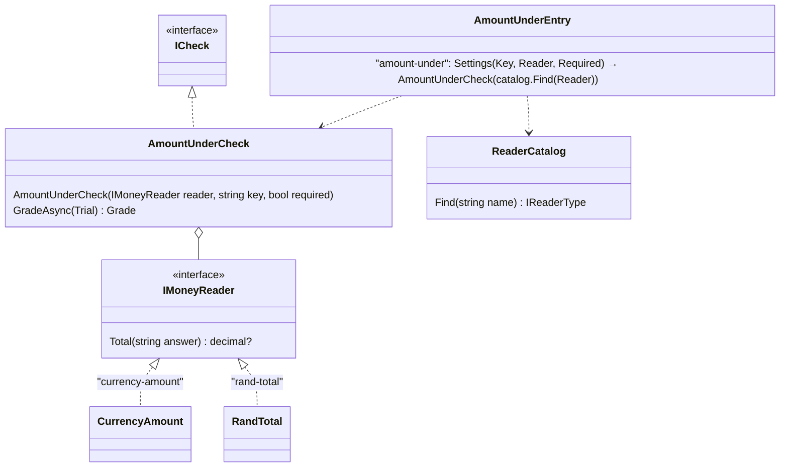

# F49.2b The generic checks

> **What this answers:** how the harness gets the whole generic set of checks every eval tool ships, how a domain
> keeps only its *readers* (the rand parser, the Afrikaans and English words) behind a generic compare, and how the
> cook's three content checks become generic ones with a setting. A child of
> [F49 Evals as content](F49-evals-as-content.md), right after F49.2 and before F49.3 (Louis's pick, 2026-10-30).
> Branch `feature/F49.2b-generic-checks`. The research behind it: *Generic and app specific checks* (2026-10-30).

Status: **draft v2, 2026-10-30 evening**, for Louis's approval. Finding G picked (a reader named in the file, 20:37);
H and J on their cards.

## The goal, in Louis's words

"The checks must be generic" and "we build all the generic tests even if we do not use them today" (2026-10-30
20:18 and 20:36). The general catalogue is a product surface, like a standard library, so it is complete on
purpose: this is Louis's call against ADR 0055's "nothing for a future no plan names", recorded here.

## Context

After F49.2 the cook's eval is a file, but three of its checks still carry Puls knowledge in their verdict logic
(`within-budget`, `serves-as-asked`, `recipe-image`), `cook-no-error` duplicates `no-error`, and the general
catalogue has six entries. The research found that the field's generic set is the same everywhere (text rules,
structure, run facts, tool calls, similarity, model-graded), that it stays generic by *extract, then compare*
(Hamcrest's `FeatureMatcher`, promptfoo's `transform`, dbt's generic tests with arguments), and that of our ten
Puls checks, seven already have generic verdict logic while the Puls part is about 330 lines of readers.

## Design: what changes

1. **The generic set, complete.** Every family a standard eval tool ships gets entries in `GeneralChecks.All`,
   each a small class with a nested `Settings` record and `Entry` (F49.1's shape), tested on its own. The list is
   below; the names are kebab-case types a file uses.
2. **Extract, then compare, with the reader named in the file** (finding G, Louis's pick). A check whose rule is
   "a value read from the answer compared with the scenario's expected value" is split in two: the generic check
   holds the compare, the verdict, the reasons and the `required` flag; a *reader* (a small interface, one method)
   turns text into the value. The file names the reader beside the key:
   `{"type": "amount-under", "name": "within-budget", "parameters": {"key": "budget", "reader": "rand-total"}}`.
   Readers live in a second registry, `ReaderCatalog`, built like `CheckCatalog`: the harness ships the plain ones
   (`digits`, `currency-amount`), an identity ships its own (`PulsReaders.All`), composition gathers them. A file
   that names an unknown reader fails at read time with the catalogue's message, as an unknown check type does.
3. **Puls keeps readers, not checks.** `within-budget` is `amount-under` over Puls's `rand-total` reader (today's
   `Prices.Total` and `Money`: the AF/EN total words, the "unlinked price is a guess" rule); `serves-as-asked` is
   `number-named` over the `servings` reader (today's `Servings`: the AF/EN introducer words, number words one to
   twelve, the unit exclusions); `recipe-image` is `image-shown`, generic as it stands; `cook-no-error` is deleted.
   The file keeps the old names in its `name` field (F49.2's shape), so stored grades and the trend read the same
   and nothing Puls-specific is a check any more. The shop checks (`estimates-at-shop`, `untooled-shops`,
   `priced-at-shop`) are shop knowledge and move to the pack in F49.3.
4. **Reasons follow the split.** The generic checks' reasons go in `CommonGradeMessage`; Puls's `GradeMessage`
   keeps only the shop checks' and the judge's (32 of its 41 members name a Puls thing today; most go with the
   checks that move).

### The generic set

| Family | Type (settings) | Rule | Status |
|---|---|---|---|
| Run facts | `no-error` · `within-time(seconds)` · `cost-under(limit_usd)` | as today | have |
| | `turns-under(count)` · `tokens-under(count)` | the trial's turns, or its total tokens, stay under | new |
| Text rules | `contains(texts)` | as today | have |
| | `not-contains(texts)` · `starts-with(text)` · `length-under(characters)` | plain string rules, case and accents ignored | new |
| | `mentions-expected(key)` | the answer names the scenario's expected value for `key` (the town, the shop) | new |
| Structure | `is-json` | the answer, or its fenced block, parses as JSON | new |
| Tool calls | `tool-used(tool)` · `routed-to(expected_key, delegating_toolsets)` | as today / F49.2 | have |
| | `tool-not-used(tool)` · `tool-used-with(tool, field, value)` · `tool-calls-under(count)` | a tool never called; called with this input field; fewer calls | new |
| Extract, then compare | `amount-under(key, reader)` | the first answer's total, as the reader reads it, is at most the expected amount | new (was `within-budget`) |
| | `number-named(key, reader)` | each turn's answer names the number the scenario expects (a number, or one per turn) | new (was `serves-as-asked`) |
| | `image-shown` | the first answer shows an image that one of the pages it read gave | new (was `recipe-image`) |
| | `links-to-host(hosts)` | the answer links to at least one of these hosts | new |
| Similarity | `near(text, distance)` | Levenshtein distance to the expected text, in code | new |
| | `similar(text, threshold)` | embedding similarity: needs a model (finding H) | finding H |
| Language | `answers-in-language(language)` | finding H: a word-list heuristic, a model, or left out | finding H |
| Model-graded | `judge(rubric, …)` · `human(reviews)` | F49.2 | have |

Twenty-odd entries. Each is under fifty lines of code; the readers are the big part and they already exist.

### Where things live

```
evals/louis-agent.evals/Grading/Common/
├── GeneralChecks.cs                 # All: every entry, by family
├── Facts/      TurnsUnderCheck, TokensUnderCheck (+ NoError, WithinTime, CostUnder move in, pure moves)
├── Answers/    ContainsCheck (have), NotContainsCheck, StartsWithCheck, LengthUnderCheck, MentionsExpectedCheck,
│               IsJsonCheck, NearCheck, AmountUnderCheck, NumberNamedCheck, ImageShownCheck, LinksToHostCheck
├── Answers/Readers/  IMoneyReader + CurrencyAmount, INumberReader + Digits, Links (moved from Puls), Markdown images
└── Tools/      ToolUsedCheck (have), ToolNotUsedCheck, ToolUsedWithCheck, ToolCallsUnderCheck
evals/louis-agent.evals.checks/Catalog/
└── ReaderCatalog.cs, IReaderType.cs   # the second registry: a wire name → a reader; GeneralReaders.All
identities/louis-agent.identity.puls/Evals/
├── Readers/    RandTotal : IMoneyReader ("rand-total", Prices + Money), Servings : INumberReader ("servings")
├── PulsReaders.cs  # All: the two readers, gathered by composition beside PulsChecks
└── Checks/     PulsChecks.All: the shop checks until F49.3, meal-for-people
```

### Interface



Patterns, looked up: *Extract, then compare* is Hamcrest's `FeatureMatcher` (a feature function feeding a generic
matcher) and promptfoo's `transform` before an assertion; the reader is a *Strategy* (Gang of Four) with one
method, chosen by name through a *Registry* (Fowler), the same shape as `CheckCatalog`. The alternatives Louis
passed over: the reader fixed in C# by a Puls entry (named specialisation, dbt's generic test with fixed
arguments) and a subclass with defaults (Great Expectations). His pick keeps every eval line in the file, which
is the point of F49: an identity ships only readers.

## Steps (one commit each, test first, stop after each)

| Step | What | Test first |
|---|---|---|
| 1 | Text rules: `not-contains`, `starts-with`, `length-under`, `mentions-expected`; `Facts/` and `Answers/` folders (pure moves of today's five) | each check on a built trial: pass, fail, Unknown on an infrastructure failure, the entry from its settings |
| 2 | Run facts and structure: `turns-under`, `tokens-under` (from the usage the stream reports), `is-json` | as step 1; tokens read from `message_delta` usage |
| 3 | Tool calls: `tool-not-used`, `tool-used-with`, `tool-calls-under` (agent and specialist calls, as `tool-used`) | as step 1 |
| 4 | The reader registry: `IReaderType`, `ReaderCatalog`, `IMoneyReader` and `INumberReader` with the plain `currency-amount` and `digits`; `amount-under` and `number-named` built through it | the catalogue finds a reader and refuses an unknown name; the compares with the plain readers |
| 5 | `image-shown` (today's `RecipeImage` and `Links.RecipePhotos` moved to the harness, generic), `links-to-host`, `near` | the cook's recipe-image cases pass unchanged under the new name |
| 6 | Puls ships readers: `RandTotal` and `Servings` as `PulsReaders.All`, gathered by composition; the three Puls check classes and `cook-no-error` deleted, `GradeMessage` shrunk; the cook's `eval.json` names the generic types with the old names and its readers | the reference and known-bad transcripts grade the same; the baseline replay compared |
| 7 | Finding H's picks (`similar`, `answers-in-language`), the docs: the general checks table in `add-an-eval.md`, the harness's project doc, write-up 12 extended, CHANGELOG, TODO, plan deleted | the docs tests |

Seven steps. Paid runs: none; the judge is not touched.

## Done when

Every family a standard eval tool ships has entries in `GeneralChecks.All`, each with its test; the cook's eval
names only generic types, its two reader entries and the shop checks; its grades are unchanged on the reference and
known-bad transcripts and on the baseline replay.

## Findings (one card each)

**G. The shape of a generic check** — picked 2026-10-30 20:37: **a reader named in the file** (`"reader":
"rand-total"`, a second registry). Passed over: the reader fixed in C# by a Puls entry (recommended at the time,
less to build) and a subclass with defaults. Consequence: no Puls check class survives for these three; `name`
in the file keeps the stored names, so finding I is settled with it.

**H. The families that need more than code.** `similar` needs embeddings (a model call per grade, cost in the
ledger as the judge's) and `answers-in-language` needs language detection (a word-list heuristic for Afrikaans and
English, or a model). Options: (1) **build `similar` as a model-kind check on the judge's client and
`answers-in-language` as a word-list heuristic for the languages Puls speaks, extensible** (recommended: complete
set, honest kinds); (2) leave both out of F49.2b and list them in the TODO (smaller, but not "all"); (3) both as
model-kind checks through the judge (one shape, but a model call to tell Afrikaans from English is waste).

**I. The names Puls keeps** — settled by G: the file's `name` field keeps `within-budget`, `serves-as-asked` and
`recipe-image` over the generic types, so stored grades and the trend read the same and ADR 0049 is untouched.

**J. Where the reasons live.** (1) **generic reasons in `CommonGradeMessage`, Puls keeps the shop and judge ones**
(recommended); (2) one message enum per check family (more files, no gain); (3) all reasons in the harness (the
harness would name shops).

## Approved during the build

- **2026-10-31, step 2:** `GeneralChecks.All` is listed by family (run facts, text rules, structure, tool calls, then
  the compares, the judge and the person), so `routed-to` sits beside `tool-used`.
- **2026-10-31, step 3 (Louis's two picks):** `tool-used-with` matches the field's value as the same text, case and
  accents ignored, a number or true/false as its JSON text (not "contains"); `tool-calls-under` counts every tool call,
  the engine's hand-overs included.
- **2026-10-31, step 4 (Louis's four picks):** the reader contracts live in the check contract, in
  `evals/louis-agent.evals.checks/Readers/` (its `Catalog/` is full), so step 6's Puls readers implement them from the
  identity without the harness; the registry holds the readers themselves (`IReader`, with `IMoneyReader` and
  `INumberReader`), so there is no `IReaderType`: a reader takes no settings; an entry reaches the catalogue through a
  new `CheckContext.Readers` field (Parameter Object), which `FileEval.Load` fills from the runner's
  `RunnerReaders.Catalog`; the compares and the plain readers live in `Grading/Common/Compare/` and
  `Compare/Readers/`, since `Answers/` is full. `amount-under` and `number-named` grade as `within-budget` and
  `serves-as-asked` do, step for step, so step 6 changes no grade: a scenario that sets no key passes, and
  `amount-under` keeps "at most" and no streamed-error guard.
- **2026-10-31, step 5 (Louis's three picks):** `image-shown(reader, key)` names an image reader, a third kind
  (`IImageReader`): the harness ships the plain `markdown-images` (every ``, read by walking the text, no
  pattern, no filter), and Puls ships `recipe-photos` in step 6 (today's `Links.RecipePhotos` with its furniture
  list, untouched), so the regex stays in the identity rather than moving into the harness; its `key` is optional
  (set, only the scenarios that set it to true are asked; left out, every scenario is); `near` compares the whole
  first answer, trimmed, case ignored. `image-shown` grades as `recipe-image` did at version 2, step for step, reading
  the pages from a new `EngineEvents.ToolResultsOf`; `links-to-host` keeps Puls's host rule (the site or a subdomain),
  beside it in `Compare/`; `near` opens `Similarity/`, where `similar` goes in step 7.
- **2026-10-31, step 6 (Louis's four picks):** `cook-no-error` is the general `no-error` under the old name (a trial
  that both broke and errored now fails instead of Unknown; no transcript has one); the cook's eval goes to version
  11, since `within-budget` and `recipe-image` are now version 1 of the general checks, so the trend starts a new
  line; Puls's readers are Adapters in `Evals/Readers/` over the unchanged scoring code (`RandTotal`, `PeopleServed`
  for `servings`, since `Servings` is the code it wraps, and `RecipePhotos`), listed in `Evals/PulsReaders.cs` and
  gathered by the composition's `EvalReaders`; the proof is `CookGradesTests`, every grade's outcome and score on
  all 26 transcripts pinned before the swap, then a replay of the baseline run on Louis's go.

## Concepts, and where they sit in the skill map

- **Generic versus singular checks** (#12 evaluation): the field's split, and the bar for promoting a check (the
  rule of three, ESLint's core-rule criteria).
- **Extract, then compare** (#20 extensibility): one small domain piece behind a generic rule; the same seam a pack
  uses for its tools.

## Sources

The research report *Generic and app specific checks* (2026-10-30) and its notes · promptfoo assertions reference ·
Inspect AI scorers · dbt generic and singular tests · Hamcrest `FeatureMatcher` · Evans and Fowler, *Specifications* ·
ADRs 0049, 0055, 0056, 0057
