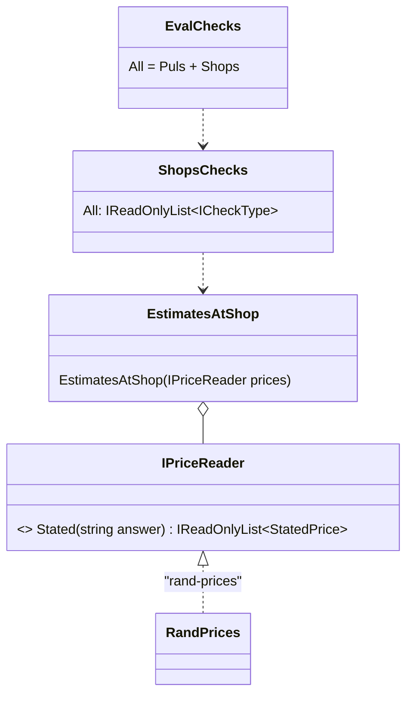

# F49.3 Checks in packs

> **What this answers:** how a pack ships the checks that prove what it does, the way it ships its tools, so that the
> shops pack carries the shop rules and Puls's eval names them from the pack. A child of
> [F49 Evals as content](F49-evals-as-content.md), after F49.2b (the generic checks, PR #111). Branch
> `feature/F49.3-checks-in-packs`.

Status: **draft v1, 2026-10-31**, for Louis's approval. Findings K, L and M on their cards; step 1 runs on the
recommended options and is the same under every pick.

## The goal, in Louis's words

"A pack lists its checks like its tools" (the parent plan's done-when for F49.3, Louis 2026-10-30), and the
platform rule behind it: *identity = who, pack = what it can do, eval = how we prove it*, each with its owner
(ADR 0027). After F49.2b an identity ships readers, not checks (ADR 0059); after F49.3 a pack ships checks too, and
Puls's `Evals/Checks/` holds nothing about shops.

## Context

Two checks in `PulsChecks.All` are shop knowledge: `estimates-at-shop` (no shop looked up, no price as fact, the
estimates line, the branch under Where to buy) and `untooled-shops` (no price column for a shop the pack can't
read). A third, `PricedAtRetailer` (`priced-at-shop`), is kept without an entry for when a retailer gives access.
Around them sit about 600 lines of helpers in `Evals/Checks/Shared/`: `Shops` (the shops' names, sites and tools,
the estimates and no-branch lines), `BranchReading` and `BranchFinding` (the branch under Where to buy),
`ToolHosts` (the sites a turn read), and two plain markdown readers Puls's own reader uses too, `Lists` (a
markdown table) and `Links` (references, hosts, images). The shop rules know the pack's tool names
(`FindProducts`, `SearchSpecials`, `SearchPromotions`, `ReadRenderedPage`) and its shops: they belong beside the
tools they prove. The `shop` the scenario names (`ShopExpectation`: Checkers, PnP, Woolworths, no-branch, any) is
read by `CookExpectations.ShopOf` in Puls.

The shops pack references core only today (its csproj says so); Puls's identity references core and the checks
contract (`evals/louis-agent.evals.checks`), which is how it ships readers. The contract references core, the
session stream and the protocol, never the harness.

## Design: what changes

1. **A pack lists its checks in a registry of its own** (finding K, recommended): `ShopsChecks.All` in
   `packs/louis-agent.pack.shops/Checks/`, the shape of `PulsChecks.All` and `PulsReaders.All` (Registry, Fowler),
   gathered by the composition's `EvalChecks.All` beside Puls's. The pack's csproj gains the checks contract, as
   Puls's did for its readers; `ArchitectureTests` learns that a pack may reference the contract, nothing else new.
2. **Shop knowledge moves to the pack; plain markdown reading moves to the contract** (finding L, recommended):
   `Shops`, `BranchReading`, `BranchFinding`, `ToolHosts` and `ShopExpectation` (with the reading of the scenario's
   `shop`) go to the pack under `Checks/`; `Lists` and `Links` go to the contract under `Text/`, where every owner
   can read a table or a link the same way (Puls's `Prices` and `RecipePhotos` keep using them from there). The
   two checks' reasons go to a `ShopCheckMessage` enum in the pack's `Messages/` (ADR 0009); Puls's `GradeMessage`
   loses its 20 shop members and keeps the judge's.
3. **The price given as fact is read by a reader named in the file** (finding M, recommended): `estimates-at-shop`
   today calls Puls's `Prices.Priced` to see a price stated as fact; the pack must not reference an identity
   (ADR 0027). The check gets a `reader` setting over a new `IPriceReader` in the contract (the amounts an answer
   states as fact, each with its link if any); Puls ships `rand-prices` over `Prices`; the cook's file says
   `{ "type": "estimates-at-shop", "parameters": { "reader": "rand-prices" } }`. The same seam as F49.2b's
   `amount-under` over `rand-total` (ADR 0059).
4. **`priced-at-shop` moves whole**, with its tests and no entry, since it is the pack's rule for the day a
   retailer gives access; ADR 0055 says nothing for a future no plan names, but it is built and tested already and
   deleting it is a separate call for Louis, not this plan's.
5. **Regexes go as touched** (ADR 0057): `Shops`'s `Estimates()` and `NoBranch()` become plain string scans when
   the file moves.

### Where things live

```
packs/louis-agent.pack.shops/Checks/
├── ShopsChecks.cs                  # All: estimates-at-shop, untooled-shops (Registry)
├── EstimatesAtShop.cs, UntooledShops.cs, PricedAtRetailer.cs
├── Shops.cs, BranchReading.cs, BranchFinding.cs, ToolHosts.cs, ShopExpectation.cs
└── ../Messages/ShopCheckMessage.cs
evals/louis-agent.evals.checks/
├── Text/Lists.cs, Text/Links.cs    # plain markdown reading, for every owner
└── Readers/IPriceReader.cs         # the amounts an answer states as fact
identities/louis-agent.identity.puls/Evals/
├── Readers/RandPrices.cs           # "rand-prices", over Prices (stays in Puls)
└── Checks/                         # the judge's expectations and messages only; PulsChecks.All is empty, or goes
src/louis-agent.composition/EvalChecks.cs   # [.. PulsChecks.All, .. ShopsChecks.All]
tests/louis-agent.pack.shops.tests/Checks/  # the moved tests, mirroring the pack
```

### Interface



Patterns, looked up: the registry per owner is Fowler's *Registry* (PoEAA), the same as `PulsChecks` and
`PulsReaders`; the reader is a *Strategy* (Gang of Four) chosen by name, F49.2b's *extract, then compare*
(Hamcrest's `FeatureMatcher`); the move of the plain readers to the contract is Fowler's *Move Method* to where
every caller can reach it without a dependency on a sibling.

## Steps (one commit each, test first, stop after each)

| Step | What | Test first |
|---|---|---|
| 1 | `Lists` and `Links` to the contract (pure move, their tests with them); `ShopsChecks.All` with `untooled-shops` moved (its `Shops` name table, `ShopCheckMessage`), the pack referencing the contract, the composition gathering it | the composition's catalogue has `untooled-shops` from the pack; the moved tests pass unchanged |
| 2 | The shop knowledge to the pack: `Shops` whole (regexes replaced), `BranchReading`, `BranchFinding`, `ToolHosts`, `ShopExpectation` and the reading of the scenario's `shop` | the moved tests pass unchanged; the two regex replacements on their own cases |
| 3 | `IPriceReader` in the contract, `rand-prices` in Puls (finding M); `estimates-at-shop` moved, taking its reader from the file; the cook's `eval.json` names it; `GradeMessage` shrunk | the cook's grades unchanged on the reference and known-bad transcripts (`CookGradesTests`) |
| 4 | `priced-at-shop` moved whole with its tests; `PulsChecks` emptied or deleted; `ArchitectureTests` and `PackConvertibilityTests` updated | the architecture tests |
| 5 | The docs: ADR 0060 *A pack ships its checks*, the pack's design doc and `build-a-pack.md` (a section *Its checks*), `add-an-eval.md`, `architecture/evals.md`, write-up 20, CHANGELOG, TODO, plan deleted | the docs tests |

Five steps. Paid runs: none.

## Done when

A pack lists its checks like its tools: `ShopsChecks.All` holds the shop rules, the composition gathers them, the
cook's `eval.json` names them from the pack, Puls's `Evals/Checks/` holds nothing about shops, and the cook's
grades are unchanged on the reference and known-bad transcripts.

## Findings (one card each)

**K. How a pack lists its checks.** (1) **a static registry beside the pack, `ShopsChecks.All`, gathered by the
composition** (recommended: the shape Puls already has for checks and readers, nothing new to learn, the pack
references the contract as Puls does); (2) `IAgentPack.Checks` on the pack interface (reads as "like its tools",
but `IAgentPack` is core's and core must not reference the checks contract, so the contract's types would have to
move into core); (3) a second interface in the contract, `IShipsChecks`, that `ShopsPack` implements and the
composition asks every pack for (one object per pack, but the pack is built from options the checks never need).

**L. What moves where.** (1) **shop knowledge to the pack, plain markdown reading (`Lists`, `Links`) to the
contract** (recommended: every owner reads a table and a link the same way, no copy, no sibling reference);
(2) everything to the pack and Puls's `Prices` reads tables its own way (a copy of `Lists`, ~80 lines);
(3) everything to the pack and Puls's identity references the shops pack (ADR 0027 forbids it).

**M. The price given as fact.** (1) **a reader named in the file, `IPriceReader` and Puls's `rand-prices`**
(recommended: F49.2b's seam, ADR 0059, the pack stays free of Puls); (2) the pack's own plain rule, an amount in a
list cell with a shop link (duplicates part of `Prices`, in rand only); (3) drop the rule from `estimates-at-shop`
(a weaker check: a price stated as fact would pass).

## Concepts, and where they sit in the skill map

- **A pack proves itself** (#20 extensibility, #12 evaluation): the tools and the checks that prove them travel
  together, so a pack is complete on its own and the identity only composes.
- **Dependencies one way** (#20): identity, pack and contract never reference a sibling; what two owners share
  moves down to the contract.

## Sources

The parent plan's F49.3 row · ADRs 0027, 0055, 0056, 0057, 0059 · Fowler, *Registry* and *Move Method* ·
Hamcrest `FeatureMatcher`
