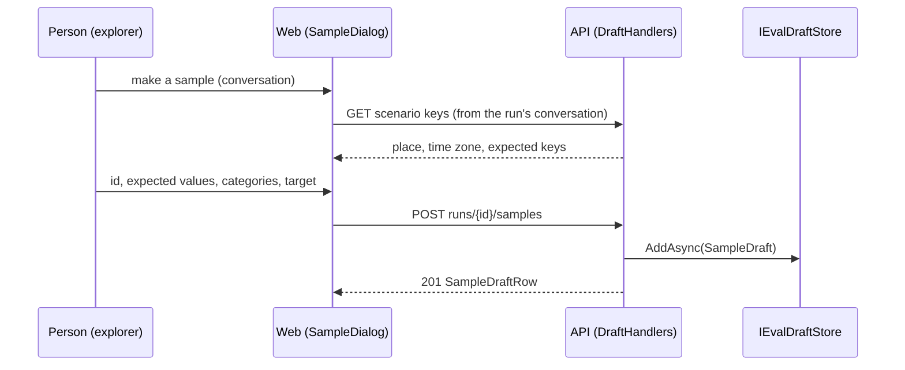

# F49.4 Studio: samples from chats and human review

> **What this answers:** how a sample and a known-bad transcript are made from a stored run in the admin portal,
> without Rider: where a draft lives until F49.5 publishes it, what the API offers, what the pages show. A child of
> [F49 Evals as content](F49-evals-as-content.md), after F49.3 (PR #112) and before F49.5. Branch
> `feature/F49.4-studio-samples`.

Status: **draft v1, 2026-10-31**, for Louis's approval. Findings O and P on their cards; step 1 runs on the
recommended options.

## The goal, in Louis's words

"It should be simple to make evals, edit them and from the admin panel, living in identity" (2026-10-28). The
parent plan's done-when for F49.4: **a sample is made from a chat without Rider.** Anthropic's own advice is to
start from real failures and grow the dataset from use (*Develop test cases*), and the studio sketch's first page
is exactly that: "make this a sample" on a conversation, and a human-review fail kept as a known-bad.

## Context

An eval is a folder beside its identity (ADR 0058): `eval.json`, `Dataset/scenarios/{dev,held-out}/{id}.json`
(Inspect's Sample shape: `id`, `input` messages, `metadata` with `place`, `time_zone`, `follow_ups`, `expected`,
`categories`), `Dataset/labels/`, `Rubrics/`, `Transcripts/{scenario}.reference.txt` and
`{scenario}.bad.{reason}.txt` (the protocol's lines, pinned by `CookGradesTests`). The admin portal already has the
run explorer (a run's conversations and turns, `ConversationCard`, the chats dialog that plays a conversation),
human review (`ReviewPanel`, a `HumanGrade` of pass, fail or unsure per conversation, in `IHumanReviewStore`), and
the Evals page (`EvalCard`). The API keeps runs, conversations, turns and reviews in stores with an in-memory and a
Mongo implementation each (ADR 0048), reaches the eval folders through the workspace root (`EvalManuals` reads
`manual.md`), and does not reference the harness: it runs the runner as a process (`EvalProcess`).

## Design: what changes

1. **A draft is a record in a store, not a file yet** (finding P, recommended): `IEvalDraftStore` beside the review
   store, in memory for the tests and Mongo for Louis's runs (`eval_drafts`, POCO records with `[BsonElement]`,
   ADR 0048), holding two kinds: a *sample draft* (the Sample shape, plus the eval it is for, who made it, when, and
   the run and conversation it came from) and a *transcript draft* (a file name, its protocol lines, reference or
   known-bad, the reason). A draft never changes an eval by itself: F49.5's publish writes the files and opens the
   pull request, git stays the truth. The scope of ADR 0033 is the eval's identity: a draft belongs to one eval.
2. **From a conversation to a sample.** On a stored run's conversation, "make a sample": the first turn's question
   is the `input`, later turns' questions the `follow_ups`, `place` and `time_zone` and the `expected` keys come
   from the scenario the conversation ran (finding O, recommended: the API reads that scenario's file from the
   workspace, as it reads the manual), and the person gives the `id`, edits the expected values, picks categories
   and may type a `target`. The API validates the shape with the same records the runner reads
   (`SampleFile` is the harness's: the contracts project gets its own `SampleDraftRow`, equal by a test, ADR 0045).
3. **From a review to a transcript.** On a conversation with a human verdict, "keep as reference" (a pass) or
   "keep as known-bad" (a fail, with a reason in kebab-case): the conversation's protocol lines, as `GetProtocol`
   serves them, become a transcript draft named `{scenario}.reference.txt` or `{scenario}.bad.{reason}.txt`. An
   unsure verdict offers neither.
4. **The pages show the drafts.** The explorer's `ConversationCard` gets the sample button and its dialog; the
   `ReviewPanel` the keep buttons after a verdict; the Evals page's `EvalCard` lists an eval's drafts (samples and
   transcripts, with their JSON or text, and delete). Markup only in `.razor`, code-behind, split by a hundred lines
   (ADR 0034); styles in `css/admin/studio.css` (ADR 0053).
5. **Endpoints** on the admin group (`/v1/admin/…`, ADR 0039, admin key), named methods returning
   `TypedResults` (ADR 0051), rows as records in the contracts project (ADR 0045):

| Method | Route | Does |
|---|---|---|
| `POST` | `/v1/admin/benchmarks/runs/{id}/samples` | makes a sample draft from `{conversation, id, expected, categories, target}` |
| `POST` | `/v1/admin/benchmarks/runs/{id}/transcripts` | makes a transcript draft from `{conversation, kind, reason}` |
| `GET` | `/v1/admin/evals/{eval}/drafts` | the eval's drafts, samples and transcripts |
| `DELETE` | `/v1/admin/evals/{eval}/drafts/{draft}` | removes a draft |

A Puls chat as a source (the parent plan's "later a Puls chat") waits for F49.5 or the TODO's *Later* line: a chat
has no scenario to take the keys from, so its form is the bigger one.

### Where things live

```
src/louis-agent.api.contracts/Admin/Drafts/   # SampleDraftRow, TranscriptDraftRow, DraftsReply, the requests
src/louis-agent.api/Evals/Drafts/             # EvalDraft records, SampleDrafts.Of(...), TranscriptDrafts.Of(...)
src/louis-agent.api/Evals/Drafts/Store/       # IEvalDraftStore, InMemoryEvalDraftStore, MongoEvalDraftStore
src/louis-agent.api/Endpoints/Admin/Drafts/   # DraftEndpoints, DraftHandlers
src/louis-agent.puls/Components/Admin/Studio/ # SampleDialog, KeepButtons, DraftList (+ code-behind)
src/louis-agent.puls/wwwroot/css/admin/studio.css
tests/louis-agent.api.tests/Evals/Drafts/     # the store contract (both stores), SampleDrafts, the endpoints
tests/louis-agent.puls.tests/Admin/Studio/
```

### Interface



Patterns, looked up: the store is a *Repository* (Fowler, PoEAA) with one interface and two implementations, the
shape of `IHumanReviewStore`; `SampleDrafts.Of` is a static *factory* building one record from another (ADR 0040's
`Of`); the dialog is *parameters down, callbacks up* as the chats dialog is. Passed over: writing the files straight
into the workspace's eval folder (finding P's option 2) and the API referencing the harness for the records
(finding O's option 2).

## Steps (one commit each, test first, stop after each)

| Step | What | Test first |
|---|---|---|
| 1 | The draft records and `IEvalDraftStore`, in memory and Mongo, registered beside the review store | the store contract on both stores: add, list by eval, delete, a transcript's lines kept whole |
| 2 | `SampleDrafts.Of`: a stored run's conversation and its scenario file to a sample draft; the scenario read from the workspace | the first question is the input, later questions the follow-ups, place and keys from the scenario, the person's values on top |
| 3 | The two `POST`s and the `GET`/`DELETE`, their rows and requests in the contracts project | the endpoint tests: 201 with the row, 404 for a run or conversation that isn't there, 400 for a bad id or a transcript from an unsure review |
| 4 | The explorer: the sample button and dialog on `ConversationCard`; the keep buttons on `ReviewPanel` | the component tests (bUnit, as the explorer's) |
| 5 | The Evals page: `DraftList` on `EvalCard`, the drafts count in `EvalRow` | the component tests; the list reply |
| 6 | Docs: ADR 0061 *Evals grow from use* (a draft in a store, published by F49.5), the admin guide, write-up 12, CHANGELOG, TODO (the F49 line drops F49.4), plan deleted | the docs tests |

Six steps. Paid runs: none; Mongo tests run on CI's mongo:7.0 as the review store's do.

## Done when

On a stored run in the admin portal, a conversation becomes a sample draft and a reviewed conversation a reference
or known-bad transcript draft, the Evals page lists them, and nothing in Rider was needed; the drafts wait in the
store for F49.5's publish.

## Findings (one card each)

**O. Where the sample's expected keys come from.** (1) **the scenario the conversation ran, read from the
workspace** (recommended: a sample made from a run is a variant of its scenario, same keys, new values; the API
already reads the eval folder that way); (2) the API references the harness and loads `eval.json` through the
catalogue for the checks' `ExpectedKeys` (exact, but every host would carry the harness, which `EvalProcess` exists
to avoid); (3) free JSON typed by the person, checked only when the runner next loads the file (nothing to build,
easy to get wrong).

**P. Where a draft lives.** (1) **a store (`eval_drafts` in Mongo, memory in tests), published to git by F49.5**
(recommended: works on the hosted instance, the parent plan's line, the review store's shape); (2) straight into the
workspace's eval folder as files, git status shows them (simplest on Louis's PC, nothing on Azure, and a half-made
sample sits in the checkout); (3) both: a store, and a "write to the workspace" button where the host has a repo
(F49.5's publish, early).

## Concepts, and where they sit in the skill map

- **Evals grow from use** (#12 evaluation): real conversations and human verdicts become samples and known-bads;
  volume over polish, the person stays the gate.
- **The studio writes what git keeps** (#18 testing and shipping): a draft is a record, a published eval is files in
  a pull request.

## Approved during the build

Step 1 follows its prompt (`SampleDraft` and `TranscriptDraft`, the store wired in at once); Louis's picks on what
the prompt left open, 2026-11-01:

- **The shape test lives in `louis-agent.evals.tests`**, which references both the harness and the API:
  `SampleBodyShapeTests` reads every scenario file as a `SampleBody` and as the harness's `SampleFile` and holds the
  two equal. `louis-agent.api.tests` doesn't reference the harness, as the prompt assumed.
- **A draft's id is `ShortId.New()`**, the run's private `NewId` moved to `Evals/Store/ShortId` (Extract and Move
  Function, Fowler), so runs and drafts make ids in one place.
- **One `eval_drafts` collection with a `kind` field**: `SampleDraftDocument` and `TranscriptDraftDocument` are two
  typed views of it, each filtered on its kind, so the driver needs no polymorphism.
- **Two typed gets**, `GetSampleAsync(id)` and `GetTranscriptAsync(id)`, in place of one `GetAsync(id)`: whoever reads
  a draft knows which kind it wants.

Step 2, Louis's picks, 2026-11-01:

- **The runner's listing names the eval's folder** (`folder`, from `FileEval`'s source; `IEval.Folder`, null for the
  stub), and the API reads the scenario from it behind the guard the manuals use, now `EvalPaths`.
- **Expected values overlay the scenario's, key by key; a key the scenario doesn't have is refused** (finding O: same
  keys, new values).
- **`Evals/Drafts/` splits by kind:** `Samples/` (the body, the draft, the choices, `SampleDrafts`, `ScenarioFiles`)
  and `Transcripts/` (the draft, step 3's `TranscriptDrafts`); `EvalDrafts` and `Store/` stay.

## Sources

The parent plan's F49.4 row · the studio sketch (`plans/F18/eval-studio-vision.md`) · Anthropic, *Develop test
cases* · Inspect's `Sample` · ADRs 0033, 0034, 0039, 0040, 0045, 0048, 0051, 0053, 0058 · Fowler, *Repository*
