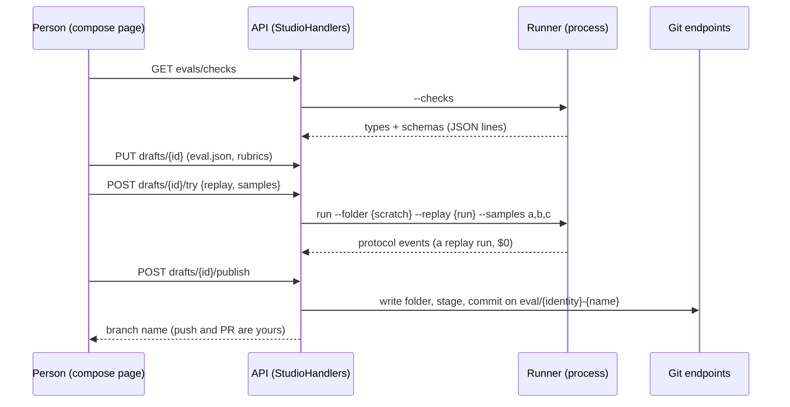

# F49.5 Studio: compose, try, publish

> **What this answers:** how a new eval is composed in the admin portal from the catalogue, tried on a few samples
> against the replay cache, and published to the repo, with promptfoo's file in and out. The last child of
> [F49 Evals as content](F49-evals-as-content.md), after F49.4. Branch `feature/F49.5-studio-compose`.

Status: **draft v1, 2026-10-31**, for Louis's approval. Findings R, S and T on their cards; step 1 runs on the
recommended options and is the same under every pick.

## The goal, in Louis's words

"A new eval must only be a json file" and "it should be simple to make evals, edit them and from the admin panel,
living in identity" (2026-10-28 and 2026-10-30). The parent plan's done-when for F49.5: **a new eval is made, tried
and published from the admin panel.** Git stays the truth; the studio is a convenience (the lesson of the hosted
eval formats that died, in the research of 2026-10-28).

## Context

After F49.4 the admin portal makes sample and transcript drafts from stored runs and keeps them in
`IEvalDraftStore`. An eval is a folder (`eval.json`, `Dataset/`, `Rubrics/`, `Transcripts/`, `manual.md`,
ADR 0058); the runner reads it strictly (`FileEval.Load`, `EvalJson.Strict`) and resolves each check by type from
the catalogue, whose `Listing()` already gives every type with the JSON schema of its settings record (F49.1). The
API never carries the harness: it runs the runner as a process (`EvalProcess`, `EvalListing.ForRunner` with
`--list`), and a replayed run (`--replay {runId}`) costs nothing (FX28 marks it). The API's git endpoints stage,
commit, branch and merge in the workspace, and never push: "pushing is left to the user".

## Design: what changes

1. **The runner is the studio's one validator and executor** (finding R, recommended): two new commands,
   `--checks` (the catalogue's listing as JSON lines, each type with its kind, its settings' schema and the readers
   it takes) and `--check {folder}` (load an eval folder strictly and print ok or the refusal, the same words the
   runner would give). The API calls both as it calls `--list`; nothing of the harness enters a host.
2. **An eval draft is a record in the store** beside F49.4's drafts: the identity, the name, the file's JSON as the
   person composed it, the rubric texts, who and when. The API writes a draft out as a folder in a scratch place
   (the JSON, the rubrics, the sample drafts of that eval from F49.4) whenever the runner must read it: to check,
   to try, to publish.
3. **Compose** is a form over `eval.json`: name, identity, proves, the modes, the checks picked from `--checks`
   (each check's fields drawn from its schema, a reader picked from the readers list), the rubric in a text box,
   the threshold and version; "View JSON" shows the file; "Check" runs `--check` and shows the refusal where it
   points. Markup only, split by a hundred lines, `css/admin/studio.css` (ADR 0034, 0053).
4. **Try on a few samples** is a replayed run: the runner's `run` gets `--folder {path}` (an eval folder outside
   `EvalFiles/`) and `--samples a,b,c`; the API starts it as it starts a replay, so the run page shows its grades and
   the Benchmarks page marks it a replay (FX28). A fresh run stays today's button, on Louis's go.
5. **Publish** writes the folder into the workspace's identity (`identities/…/Evals/{Name}/`, with the sample and
   transcript drafts), stages and commits it on a branch `eval/{identity}-{name}` through the git endpoints, and
   leaves the push and the pull request to the person (finding S, recommended); where the host has no workspace,
   it gives the folder as a zip to download. The draft stays until the person deletes it.
6. **promptfoo in and out** (finding T): the runner gets `--import-promptfoo {file}` (a promptfoo YAML to an eval
   folder: `tests[].vars` to samples, `assert[].type` to our types by a table, `llm-rubric` to `judge`) and
   `--export-promptfoo {eval}`; YamlDotNet (MIT) in the runner only. The API offers both on the drafts.

| Method | Route | Does |
|---|---|---|
| `GET` | `/v1/admin/evals/checks` | the catalogue: types, kinds, settings' schemas, readers |
| `POST`/`PUT`/`GET`/`DELETE` | `/v1/admin/evals/drafts[/{id}]` | an eval draft |
| `POST` | `/v1/admin/evals/drafts/{id}/check` | the runner's verdict on the folder |
| `POST` | `/v1/admin/evals/drafts/{id}/try` | a replayed run on `{replay, samples}` |
| `POST` | `/v1/admin/evals/drafts/{id}/publish` | the folder in the workspace, committed on a branch, or a zip |
| `POST` / `GET` | `/v1/admin/evals/drafts/import` · `…/{id}/export` | promptfoo in and out |

### Where things live

```
evals/louis-agent.evals.runner/Arguments/   # --checks, --check, --folder, --samples, --import-promptfoo, --export-promptfoo
evals/louis-agent.evals.runner/Promptfoo/   # the mapping table and the converter (YamlDotNet)
src/louis-agent.api.contracts/Admin/Studio/ # CheckTypeRow, EvalDraftRow, the requests
src/louis-agent.api/Evals/Studio/           # EvalDraft, DraftFolder (writes a draft out), Publisher
src/louis-agent.api/Endpoints/Admin/Studio/
src/louis-agent.puls/Components/Admin/Studio/ComposePage/   # the form, split: Head, Modes, Checks, Rubric, Json
src/louis-agent.puls/wwwroot/css/admin/studio.css
tests/… mirroring each
```

### Interface



Patterns, looked up: the runner as the one executor is a *Facade* (Gang of Four) over the harness that every host
reaches through a process boundary, the shape `EvalProcess` already has; the draft store is a *Repository* (Fowler);
the promptfoo converter is an *Adapter* with a mapping table (ADR 0043: the type names as an enum). Passed over:
the API referencing the harness (R's option 2), a GitHub token in the API (S's option 2).

## Steps (one commit each, test first, stop after each)

| Step | What | Test first |
|---|---|---|
| 1 | Runner `--checks`: the listing as JSON lines (type, kind, schema, readers); the API's `GET evals/checks` through a process call like `--list` | the runner prints every general and pack check with a schema; the API parses the lines and refuses a bad one |
| 2 | The eval draft record, in the draft store; `POST/PUT/GET/DELETE` drafts | the store contract; the endpoints |
| 3 | Runner `--check {folder}`; `DraftFolder` writes a draft out (JSON, rubrics, F49.4's samples); `POST …/check` | a good folder is ok, a bad type or reader gives the runner's words |
| 4 | The compose page: head, modes, checks from the catalogue, rubric, "View JSON", "Check" | bUnit: a check's fields come from its schema; the JSON shown is the file |
| 5 | Runner `--folder` and `--samples`; `POST …/try` as a replayed run | a try run is marked a replay and grades only the named samples |
| 6 | Publish: the folder into the workspace, staged and committed on `eval/{identity}-{name}` through the git endpoints; a zip where there is no workspace | the files land where `EvalFolders` finds them; the commit exists on the branch; the zip holds the folder |
| 7 | promptfoo import and export in the runner, with the mapping table; the API's two endpoints | a promptfoo file round-trips through our folder and back |
| 8 | Docs: ADR 0062 *The studio writes what git keeps*, the admin guide, write-ups 12 and 18, CHANGELOG, TODO (the F49 line closes, CL27 next), the parent plan's lasting parts to `architecture/evals.md`, both plans deleted | the docs tests |

Eight steps. Paid runs: none; a try replays a stored run, a fresh run only on Louis's go.

## Done when

A new eval is composed from the catalogue, checked, tried on three samples against a replayed run, and published as a
folder on a branch in the workspace (or a zip), from the admin panel; a promptfoo file imports and exports; F49's
parent done-when (the cook's eval runs as files, a new eval is made and edited without Rider) is met.

## Findings (one card each)

**R. Who validates and lists the checks** — picked 2026-11-01: option 1. (1) **the runner, through `--checks` and `--check`** (recommended; pro:
one reader of eval files, nothing of the harness in a host; con: a process call per check, about a second);
(2) the API references the harness (pro: in-process, exact; con: every host carries the harness, which
`EvalProcess` exists to avoid); (3) the API keeps its own copy of the records (pro: no process; con: two readers
that drift).

**S. How publish reaches git** — picked 2026-11-01: option 1. (1) **the folder written into the workspace and committed on a branch through the
git endpoints; the push and the pull request are the person's; a zip where there is no workspace** (recommended;
pro: reuses what exists, no secret in the API; con: on Azure it is a download, not a PR); (2) a GitHub token in the
API that pushes and opens the PR (pro: one click everywhere; con: a secret and a GitHub dependency in the API);
(3) a zip only (pro: smallest; con: Louis's PC gets no commit either).

**T. promptfoo in and out.** (1) **a runner command pair with YamlDotNet and a mapping table** (recommended; pro:
the parent plan's promise, a customer brings their evals; con: a YAML package and a table to keep); (2) in the API
(con: the API would read eval files, finding R again); (3) the TODO's *Later* line (pro: smallest; con: F49's
done-when as written is not met).

## Concepts, and where they sit in the skill map

- **Git stays the truth** (#18 testing and shipping): the studio writes files a pull request carries; no hosted
  eval store to outlive.
- **A process boundary as the seam** (#20 extensibility): the runner is the one program that reads an eval, and
  every host asks it.

## Approved during the build

Every step ran unattended at Louis's word ("finish everything I gave you unattended, do not ask until done",
2026-11-03); each pick took the option closest to the plan and the code beside it, and waits for his review on the
pull request:

- **Step 1: one process runner for the runner's quick commands.** `RunnerProcess` (Extract Class from
  `EvalListing`) starts `--list` and `--checks` alike, its failure texts naming the command; `CheckList` caches a
  successful catalogue only, so a runner not yet there is asked again. The Puls client gets no `GetChecksAsync`
  yet: no client class exists (pages call `AgentApi` directly), and step 4's page reads the route itself.
- **Step 2: the eval draft's names come from its file.** `EvalDraft` keeps the file's text as typed and reads only
  `name` and `identity` from it (kebab-case), so the two can't disagree; it lives in `Evals/Drafts/Composed/` beside
  the other kinds, so the store doesn't reach into the studio. The rubrics are files of `Rubrics/` (kebab-case `.md`).
- **Step 3: the runner seals and judges; the route is `…/verdict`.** The dataset hash is the harness's, so the API
  writes the manifest with it empty and `--check` fills it in (`ManifestSeal`) before loading the folder and running
  the conformance gate CI runs; it prints one line per problem, then `{"ok": …}`, and exits 0 whenever it could look.
  The draft's folder holds the sample and transcript drafts filed under its name (`DraftFolder`), so what is checked
  is what is published. The route is `POST /v1/admin/evals/drafts/{id}/verdict`, not `…/check`: a resource may not be
  named both singular and plural, and `/evals/checks` is the catalogue. The runner-backed parts reach `MapAdmin` as one
  `StudioRunner` (Introduce Parameter Object), so steps 5 and 6 add a member, not a parameter.
- **Step 4: the page is `EvalStudio` at `/admin/studio`.** The form is plain classes (`EvalComposition`,
  `ModeEntry`, `CheckEntry`, `RubricEntry`) the components change in place; a check's fields come from its schema
  (`SchemaFields`: a property named `reader` is a pick of the catalogue's readers), a value that doesn't parse as its
  kind is written as text for the runner to name. *Check* saves first, then asks the verdict. The page is named
  `EvalStudio`, not `Studio`, since the folders' namespaces end in `.Studio` and would shadow it.

## Sources

The parent plan's F49.5 row · the studio sketch · promptfoo's assertion reference and test format · Inspect's
`Sample` · YamlDotNet (MIT) · ADRs 0030, 0034, 0039, 0043, 0045, 0048, 0051, 0053, 0055, 0058 · Gang of Four
*Facade*, *Adapter* · Fowler *Repository*
