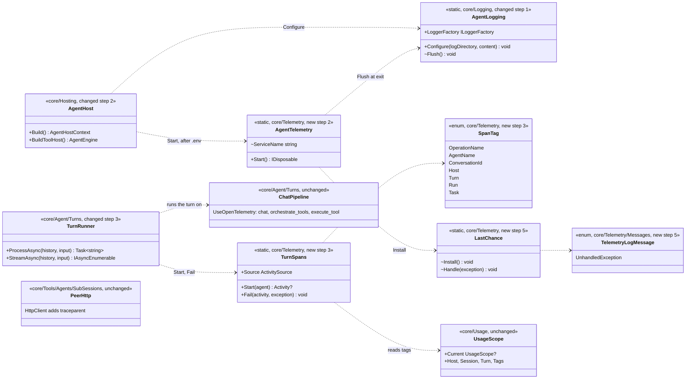
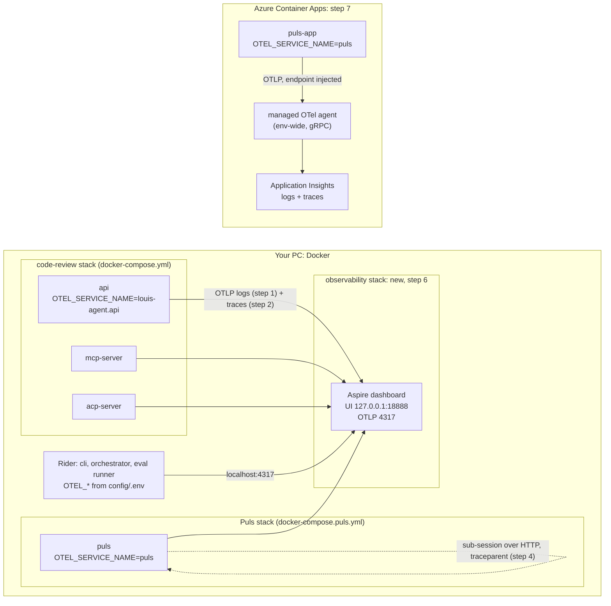
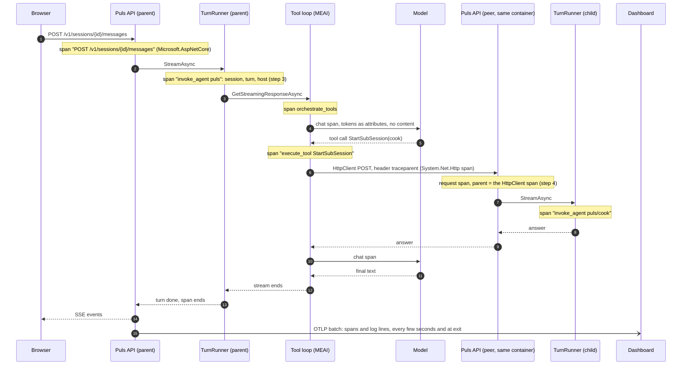
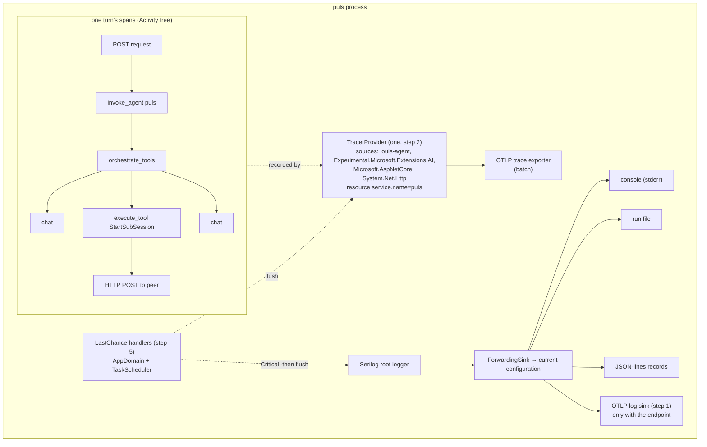

# F52 Observability through OpenTelemetry

> **What this answers:** how every host sends its logs and its traces out of the process in the standard way, so
> that on your PC one dashboard shows what every host did, and on Azure Application Insights does the same, with
> nothing of our own in the settings. Branch `feature/F52-opentelemetry`, one PR per step to that branch, the
> branch to `main` at the end. ADR **0064** (the TODO line's "ADR 0058" is stale: 0058 is F49.2's).

Status: **approved 2026-11-03 19:57**: Louis picked the recommended option on all six findings (A1, B2, C1, D1, E2, F1), so the plan below stands as written. The plan below is written with the
recommended option of each; a different pick changes the step it names and nothing else.

## The goal, in Louis's words

"Plug each project into Exceptionless, each with its own log file and/or key", then "it does not have to be
Exceptionless, if the research says OpenTelemetry or something else, come back with the plan" (2026-10-30), and
"yes" to the proposal: **OTLP per host through `OTEL_SERVICE_NAME`, the Aspire dashboard on the PC, Application
Insights on Azure, not Exceptionless.** Those four are settled and not asked again here. The research is
`research/reports/logging-and-error-tracking.md` in the Claude project.

GOAL skill **17, Observability**: this closes *"exporters, latency and error dashboards"* for traces and logs (the
metrics stay with F44).

## Context: what we have today, checked in the code on 2026-11-03

- **Logs:** `AgentLogging` (`louis-agent.core/Logging/`) is the one Serilog setup for every process: the console on
  stderr, a run file per process (`agent-{host}-{time}-{pid}.log`), and JSON-lines record files. Message text is
  enum templates (ADR 0009), so every hole is already a named property. Personal values are hashed at the call
  (`LogContent`, `LOG_CONTENT=hashed` by default), so anything the logs carry anywhere is hashed too.
- **Spans already exist, but nobody listens.** F18 step 4d put Microsoft.Extensions.AI's `UseOpenTelemetry()` in
  `ChatPipeline`, inside the tool loop, with sensitive data off. So every model request is a `chat` span, the loop
  is an `orchestrate_tools` span and every tool call an `execute_tool` span (`ChatPipelineTests` proves the shape
  with an `ActivityListener`). The spans come from the `Experimental.Microsoft.Extensions.AI` source (checked in the
  10.10.0 package). No exporter is wired, so they die in the process.
- **Missing:** no span for a whole turn (`invoke_agent`); a sub-session runs **over HTTP** on a peer (`PeerHttp`,
  `PeerSession`), even on the same instance, so its spans land in a different request with no link back; no
  last-chance handler, so a crash logs nothing; no dashboard in the compose stacks; nothing on Azure.
- **Who sets up a process:** `AgentHost.Build` and `AgentHost.BuildToolHost` (the CLI, ACP, API, Puls, MCP) load
  `config/.env` first (`HostEnvironment.Load`) and then call `AgentLogging.Configure`. The orchestrator calls
  `AgentLogging.Configure` itself; the eval runner only takes loggers.
- **The platform plan's F44.1** (Phase 9) holds "an OTLP exporter, dashboards, W3C `traceparent`", plus `ttft_ms`
  and metrics. F52 takes the exporter, the dashboards and the `traceparent`; F44.1 keeps speed and metrics. The last
  step trims F44.1's line.

### Facts checked for this plan

| Fact | Where checked |
|---|---|
| `Serilog.Sinks.OpenTelemetry` 4.2.0 (Apache 2.0) reads `OTEL_EXPORTER_OTLP_ENDPOINT`, `_PROTOCOL`, `_HEADERS`, `OTEL_SERVICE_NAME` and `OTEL_RESOURCE_ATTRIBUTES` itself, and they win over code; default gRPC on `localhost:4317` | The strings in the 4.2.0 package's `net8.0` DLL; nuget.org page |
| The OpenTelemetry .NET SDK and OTLP exporter are at 1.20.1 | api.nuget.org, 2026-11-03 |
| MEAI's source is `Experimental.Microsoft.Extensions.AI`; the names `invoke_agent` and `orchestrate_tools` are in it | The 10.10.0 package |
| The Container Apps managed agent: App Insights takes **logs and traces, not metrics**; it injects `OTEL_EXPORTER_OTLP_ENDPOINT`, `OTEL_EXPORTER_OTLP_PROTOCOL=grpc` (gRPC only) and `OTEL_RESOURCE_ATTRIBUTES`; no compute cost; one per environment; still marked preview | learn.microsoft.com, *Collect and read OpenTelemetry data in Azure Container Apps* |
| The standalone dashboard image is `mcr.microsoft.com/aspire/dashboard` (pin a tag); UI 18888, OTLP gRPC 18889, OTLP HTTP 18890; `ASPIRE_DASHBOARD_UNSECURED_ALLOW_ANONYMOUS=true` skips the login on your PC; in memory unless a volume is mounted | aspire.dev, *Run the dashboard standalone* |

## The findings: six choices, one card each

Each is put to Louis on its own (rules 10 and 11), with three options, the pattern each one is, and the
recommendation. The plan is written with the recommended option.

### A. How do logs and traces leave the process?

| | Option | Pattern | What it changes | What it costs |
|---|---|---|---|---|
| **A1 (recommended)** | Logs through **Serilog's OTLP sink** in `AgentLogging`, beside the console and file; traces through the **OpenTelemetry SDK's** `TracerProvider` with the OTLP exporter | One exporter per signal (OpenTelemetry's own *SDK + exporter* model); the sink is one more branch of the Serilog pipeline we have | Logs keep their one pipeline (templates, hashing, tags in one place); traces use the reference implementation that Azure's doc expects and that every instrumentation plugs into | Two packages plus the exporter; two places read `OTEL_*`, both by the spec |
| A2 | **Serilog for both**: SerilogTracing turns spans into Serilog events and the same sink sends them as spans | Adapter (spans adapted into log events), one pipe | One package path, one config | A third-party bridge between two standards; the SDK's instrumentations don't plug in; less common, so less help when it breaks |
| A3 | **The SDK for both**: its `ILoggerProvider` beside Serilog, Serilog kept for console and file | Composite logger factory (two providers) | Microsoft's documented shape for ASP.NET apps | Two logging stacks in one process; our `LoggerFactory` is Serilog's, so it needs a composite factory and the hashing and tags happen in only one of them |

Sources: OpenTelemetry .NET *Getting started*; Serilog.Sinks.OpenTelemetry README; Fowler, *Adapter* (GoF);
Microsoft, *.NET observability with OpenTelemetry*.

### B. Which spans beyond Microsoft.Extensions.AI's?

| | Option | Pattern | What it changes | What it costs |
|---|---|---|---|---|
| B1 | Ours only: a turn span | | Smallest | A sub-session's work is a separate trace on the peer, with no link to the tool call that opened it, which is the case we most want to see |
| **B2 (recommended)** | Ours plus **.NET's built-in sources**: `Microsoft.AspNetCore` (a span per request) and `System.Net.Http` (a span per outgoing call, and the W3C `traceparent` header on it) | W3C Trace Context (context propagation) | A sub-session nests under its `execute_tool` span across the HTTP hop; every API request is a span; no extra package | The built-in spans carry fewer attributes than the instrumentation packages (no filters, so static files are spans too, until we want a filter) |
| B3 | B2 through the **OpenTelemetry instrumentation packages** (`Instrumentation.AspNetCore`, `.Http`) | Same, packaged | Richer attributes, filters (drop `/health`, static files) | Two more packages, the ASP.NET one only in web hosts, so core can't hold it alone |

Sources: W3C Trace Context; OpenTelemetry semantic conventions for HTTP; .NET's `System.Net.Http` and
`Microsoft.AspNetCore` activity sources.

### C. Where does a turn's span open?

| | Option | Pattern | What it changes | What it costs |
|---|---|---|---|---|
| **C1 (recommended)** | In **`TurnRunner`**, one `invoke_agent` span around `ProcessAsync` and `StreamAsync`, its tags read from `UsageScope.Current` (host, session, turn, run, task) | Decorator-like wrapper at the one place a turn runs (Template Method's *hook*: the runner already owns "one turn") | Every host gets it, sub-sessions too (they run a turn on the peer), nothing in the hosts changes | The streamed form must make the span current again after each `yield` (an async iterator loses it), the gotcha `UsageScope.Activate()` already solves for the ledger |
| C2 | **`UsageScope` opens the span** when it begins and ends it when disposed | Unit of Work (one object per turn holds both) | Hosts already open a scope at the right place; the iterator problem is solved once | One class with two concerns, cost and tracing (ADR 0034) |
| C3 | **Each host** opens its own span | Explicit per host | Each host names its span as it likes | Seven copies of the same lines, and a host that forgets has no turn span |

Sources: GoF *Decorator* and *Template Method*; Fowler, *Unit of Work*; OpenTelemetry GenAI conventions
(`invoke_agent`).

### D. Where do the hosts switch it on?

| | Option | Pattern | What it changes | What it costs |
|---|---|---|---|---|
| **D1 (recommended)** | Inside **`AgentHost`**, the bootstrap the CLI, ACP, API, Puls and MCP share, right after `.env` loads: `AgentTelemetry.Start()` starts the tracer, installs the last-chance handler and flushes both at exit; the orchestrator and the eval runner call `AgentTelemetry.Start()` themselves | Composition Root (Seemann): the one place a process is put together | Five hosts get it with no change; `config/.env` is loaded first, so `OTEL_*` there works under Rider too | Two hosts outside `AgentHost` need their own line, and a crash before `.env` loads is not caught |
| D2 | **Every `Program.cs`** calls `using var telemetry = AgentTelemetry.Start();` | Explicit composition per host | Plain to read in each host; the `using` flushes at exit | Seven call sites, a test to make sure none forgets, and it must still come after `.env` loads |
| D3 | The **generic host's** `services.AddOpenTelemetry()` in the web hosts, by hand in the others | Microsoft's hosting extension | The documented ASP.NET way | Two ways in one repo: the CLI, ACP and MCP stdio hosts have no generic host |

Sources: Mark Seemann, *Composition Root*; Microsoft, *OpenTelemetry in ASP.NET Core* (`AddOpenTelemetry`).

### E. One dashboard for both compose stacks?

| | Option | Pattern | What it changes | What it costs |
|---|---|---|---|---|
| E1 | A dashboard service **in each** compose file | Copy per stack | Each stack is whole on its own | Two definitions; running both stacks needs two ports and gives two dashboards, so a Puls specialist's trace and the code-review API's are never side by side |
| **E2 (recommended)** | **Its own** `docker/docker-compose.observability.yml`, started once; both stacks send to `host.docker.internal:4317` | One shared backing service (twelve-factor *backing services*) | One dashboard sees every host, whatever stack runs; the stacks don't change shape | One more `docker compose up` to remember (the guide and the stacks' header comments say it); if it is down, the exporters drop their batches quietly |
| E3 | One file, pulled into both stacks with Compose's **`include:`** | Include | One definition | Running both stacks starts it twice and the ports clash |

Sources: The Twelve-Factor App, *IV. Backing services*; Docker, *Compose include*; aspire.dev, standalone dashboard.

### F. The log levels: sweep now, or as touched?

Today: 64 Information, 61 Warning, 6 Error, 2 Trace, **no Critical** (counted 2026-10-30). The research's table
says what each level means.

| | Option | Pattern | What it changes | What it costs |
|---|---|---|---|---|
| **F1 (recommended)** | The table goes in `debug-and-logs.md` and the ADR; **levels are fixed as a file is touched**, no sweep | Boy Scout Rule (the ADR 0057 precedent) | No extra step; the rule is written down where a reviewer checks it | Wrong levels stay until someone edits the file |
| F2 | One extra step: **every call checked** against the table, wrong ones moved | Sweep | All 133 right at once, before the dashboard shows them | About 30 files in one step; mechanical, but long to review |
| F3 | A **Roslyn analyzer** that flags, say, `Warning` on a caught-and-rethrown exception | Automated rule | It keeps holding | An analyzer project for a rule with judgment in it; CL23 already parks analyzers |

Sources: the research's level table (ASP.NET team's logging guidelines, Serilog's authors); Robert C. Martin, *the
Boy Scout Rule*; ADR 0057.

## Design: what changes (with the recommended picks)

1. **Logs leave over OTLP** (A1): `AgentLogging.Configure` adds `WriteTo.OpenTelemetry` **only when
   `OTEL_EXPORTER_OTLP_ENDPOINT` is set**, beside the console and the run file, excluding the JSON-lines records as
   the console does. The sink reads the `OTEL_*` variables itself. The one thing we give it is a default
   `service.name`: the entry assembly's name (`louis-agent.api`), the same name the run file carries, which
   `OTEL_SERVICE_NAME` overrides. No setting of our own.
2. **Traces leave over OTLP** (A1, B2, D1): a new `AgentTelemetry.Start()` in `louis-agent.core/Telemetry/`, called
   by `AgentHost` after `.env` loads and by the orchestrator and runner. With the endpoint set it builds a
   `TracerProvider` listening to four sources: ours (`louis-agent`), MEAI's, `Microsoft.AspNetCore` and
   `System.Net.Http`, with the same default service name; without it, nothing. It returns once per process and
   flushes the tracer and Serilog at exit (`AppDomain.ProcessExit`).
3. **A turn is a span** (C1): `TurnSpans.Start` in `Telemetry/` opens `invoke_agent {agent}` around a turn in
   `TurnRunner`, with the GenAI names (`gen_ai.operation.name`, `gen_ai.agent.name`, `gen_ai.conversation.id` for the
   session) and ours (`louis_agent.host`, `louis_agent.turn`, `louis_agent.run`, `louis_agent.task`) as a
   `SpanTag` enum with `[WireName]`s (ADR 0043). A failed turn sets the span's status to error and records the
   exception on it (`Activity.AddException`). No content, ever: the tags are ids and counts.
4. **A sub-session nests across the hop** (B2): nothing new to write. `HttpClient` puts `traceparent` on the
   peer call when a span is current, and ASP.NET Core reads it on the peer, so the child's `invoke_agent` sits
   under the parent's `execute_tool`. The step is a test that proves both halves.
5. **A crash is logged once** (D1): `LastChance` in `Telemetry/` handles `AppDomain.UnhandledException` and
   `TaskScheduler.UnobservedTaskException`: one Critical log with the exception object (not its message), then
   flush. A `TelemetryLogMessage` enum holds the text (ADR 0009).
6. **One dashboard on the PC** (E2): `docker/docker-compose.observability.yml` runs the dashboard, its image
   pinned to a tag, anonymous on `127.0.0.1` only; `config/.env.example` gets `OTEL_EXPORTER_OTLP_ENDPOINT`; each
   compose service sets its own `OTEL_SERVICE_NAME` (`louis-agent.api`, `puls`, `louis-agent.mcp-server`, …).
7. **Application Insights on Azure:** the Container Apps environment's managed agent sends traces and logs to an
   Application Insights resource (`deploy.ps1` gets a `telemetry` verb, `deploy/azure/README.md` the how-to);
   `puls-app.yaml` sets `OTEL_SERVICE_NAME=puls`. The agent injects the endpoint and gRPC, which both exporters
   speak by default. `LOG_CONTENT` stays hashed on Azure (POPIA).
8. **The rules written down:** ADR 0064 *Observability through OpenTelemetry, and what to log at which level*; the
   level table in `docs/guides/debug-and-logs.md` (F1).

What stays out (ADR 0055): **metrics** (the ledger is the cost source, ADR 0007; tokens on spans are for finding
a slow call, never a second total), **alert rules** (by hand in App Insights first), **the browser apps** (Blazor
sends nothing; the API logs what matters), **GlitchTip** (only if an errors inbox is missed after a month).

### Interface design



```csharp
// louis-agent.core/Telemetry/AgentTelemetry.cs (step 2)
public static class AgentTelemetry
{
    /// Starts tracing when OTEL_EXPORTER_OTLP_ENDPOINT is set (once per process; a second call returns the same handle),
    /// installs the last-chance handler (step 5) and flushes the tracer and the logs when the process exits.
    public static IDisposable Start();
    internal static string ServiceName { get; }   // OTEL_SERVICE_NAME wins; else the entry assembly's name
}

// louis-agent.core/Telemetry/TurnSpans.cs (step 3)
public static class TurnSpans
{
    public static readonly ActivitySource Source = new("louis-agent");
    public static Activity? Start(string agent);               // tags from UsageScope.Current; null when nobody listens
    public static void Fail(Activity? span, Exception exception);  // status Error, the exception recorded
}

// louis-agent.core/Telemetry/SpanTag.cs (step 3): wire names are the GenAI conventions' where they have one
public enum SpanTag
{
    [WireName("gen_ai.operation.name")] OperationName,
    [WireName("gen_ai.agent.name")] AgentName,
    [WireName("gen_ai.conversation.id")] ConversationId,
    [WireName("louis_agent.host")] Host,
    [WireName("louis_agent.turn")] Turn,
    [WireName("louis_agent.run")] Run,
    [WireName("louis_agent.task")] Task,
}
```

### Architecture



### Communication: one Puls turn with a specialist



### Objects in one Puls process



### Folder trees

Today:

```
louis-agent.core/
├── Logging/               AgentLogging, ForwardingSink, LevelTagEnricher, MessageLogging, RecordFormatter, ToolCallRecords
│   ├── Content/           LogContent, LogContentMode
│   └── Messages/          LoggingErrorMessage, LoggingLogMessage
docker/
├── docker-compose.yml
└── docker-compose.puls.yml
```

After step 5 (step 6 adds the compose file):

```
louis-agent.core/
├── Logging/               (step 1: AgentLogging adds the OTLP sink)
│   ├── Content/
│   └── Messages/
└── Telemetry/             new: one concern, traces and the process's last word
    ├── AgentTelemetry.cs  step 2
    ├── TurnSpans.cs       step 3
    ├── SpanTag.cs         step 3
    ├── LastChance.cs      step 5
    └── Messages/
        └── TelemetryLogMessage.cs   step 5
docker/
├── docker-compose.yml               step 6: OTEL_SERVICE_NAME per service
├── docker-compose.puls.yml          step 6
└── docker-compose.observability.yml step 6, new
tests/louis-agent.core.tests/
├── Logging/AgentLoggingOtlpTests.cs step 1
├── Telemetry/                       steps 2, 3, 5
└── TestOtlp/OtlpReceiver.cs         step 1: a tiny in-test OTLP/HTTP listener
```

### Namespace map

| Type | Folder | Namespace | Step |
|---|---|---|---|
| `AgentLogging` (changed) | `louis-agent.core/Logging/` | `LouisAgent.Core.Logging` | 1 |
| `AgentTelemetry` | `louis-agent.core/Telemetry/` | `LouisAgent.Core.Telemetry` | 2 |
| `AgentHost` (changed) | `louis-agent.core/Hosting/` | `LouisAgent.Core.Hosting` | 2 |
| orchestrator and runner `Program.cs` (one line each) | `src/louis-agent.orchestrator/`, `evals/louis-agent.evals.runner/` | top-level | 2 |
| `TurnSpans`, `SpanTag` | `louis-agent.core/Telemetry/` | `LouisAgent.Core.Telemetry` | 3 |
| `TurnRunner` (changed) | `louis-agent.core/Agent/Turns/` | `LouisAgent.Core.Agent.Turns` | 3 |
| `LastChance` | `louis-agent.core/Telemetry/` | `LouisAgent.Core.Telemetry` | 5 |
| `TelemetryLogMessage` | `louis-agent.core/Telemetry/Messages/` | `LouisAgent.Core.Telemetry.Messages` | 5 |
| `OtlpReceiver` (test helper) | `tests/louis-agent.core.tests/TestOtlp/` | `LouisAgent.Core.Tests.TestOtlp` | 1 |
| `AgentLoggingOtlpTests` | `tests/louis-agent.core.tests/Logging/` | `LouisAgent.Core.Tests.Logging` | 1 |
| `AgentTelemetryTests`, `TurnSpansTests`, `LastChanceTests` | `tests/louis-agent.core.tests/Telemetry/` | `LouisAgent.Core.Tests.Telemetry` | 2, 3, 5 |
| `PeerTraceTests` | `tests/louis-agent.api.tests/Sessions/` | `LouisAgent.Api.Tests.Sessions` | 4 |

## Steps

Each step is one commit and one PR to the feature branch, test first (the failing output kept for the
explanation), about ten minutes to review, then stop for Louis. **No step spends money**: every test uses fakes or
a replay, and the measurement in step 8 replays a recorded eval run.

| # | What | Test first | Rider model |
|---|---|---|---|
| 0 | The plan, copied as approved to `docs/plans/F52-opentelemetry.md` on the branch, the TODO line's ADR number fixed | none (docs) | with step 1 |
| 1 | **Logs leave over OTLP.** The sink in `AgentLogging` when the endpoint is set; default service name; the records stay out | `OtlpReceiver` (an `HttpListener` on a free port taking OTLP/HTTP protobuf) gets a log line whose bytes hold the service name and the template's property name; no endpoint, no request. `[NonParallelizable]`, the `OTEL_*` variables set and cleared by the fixture | Sonnet 5.5, medium |
| 2 | **Traces leave over OTLP, every host starts them.** `AgentTelemetry.Start()`, the four sources, flush at exit; `AgentHost` calls it after `.env`, the orchestrator and runner too | a model request through `ChatPipeline` with a fake client reaches the receiver as a `chat` span from `louis-agent.core.tests`; a second `Start()` returns the same handle; no endpoint, no provider | Sonnet 5.5, medium |
| 3 | **A turn is a span.** `TurnSpans`, `SpanTag`, the span in `TurnRunner` whole and streamed, a failure recorded | with an `ActivityListener` (as `ChatPipelineTests`): one `invoke_agent` holding `orchestrate_tools`, the session and turn from the scope as tags, no content tags; streamed and whole alike; a throwing fake client gives status Error and one exception event | Sonnet 5.5, medium |
| 4 | **A sub-session nests across the hop.** Only tests, unless one fails | `PeerHttp` with a recording handler sees a `traceparent` carrying the current span's trace id; a request to the test API with a `traceparent` header gives an `invoke_agent` span with that trace id and parent | Sonnet 5.5, medium |
| 5 | **A crash is logged once.** `LastChance`, its message enum, installed by `Start()` | `Handle(exception)` writes exactly one Critical event with the exception object (its type and stack, not just the message) and flushes; the unobserved-task path is marked observed so the process isn't killed twice | Sonnet 5.5, medium |
| 6 | **One dashboard on the PC.** `docker-compose.observability.yml`, `OTEL_SERVICE_NAME` per service, `config/.env.example`; `debug-and-logs.md` gets *Traces and the dashboard* and the *What to log at which level* table | none (configuration); `docker compose -f … config` validates each file, output in the explanation | Haiku 5.5, high |
| 7 | **Application Insights on Azure.** `deploy.ps1 telemetry` (check `az containerapp env telemetry app-insights set --help` first: the doc gives only the ARM shape), `puls-app.yaml`'s `OTEL_SERVICE_NAME`, the README | none (configuration); the script's `-WhatIf` print of the az command, in the explanation | Haiku 5.5, high |
| 8 | **Measured, written down, closed.** The measurement below; ADR 0064; GOAL row 17; `louis-agent.core.md`'s folder table; TODO's F52 line done and its ADR number right; the platform plan's F44.1 line keeps only speed and metrics; the plan deleted. The write-up `docs/learning/17-observability.md` is written in the Claude project | `ClaudeMdSizeTests` and the docs' link tests stay green | Sonnet 5.5, medium |

### What to look at closely

- **Step 1:** the OTLP sink must sit behind the same filter as the console (no JSON-lines records), and
  `ignoreEnvironment` must stay **false**, so Azure's injected endpoint and gRPC win over anything in code.
- **Step 2:** `service.name`: our default first, then the environment detector, so `OTEL_SERVICE_NAME` wins (the
  order of the resource calls matters). Flush at exit has a time limit (a few seconds), so a dead dashboard never
  holds a CLI exit.
- **Step 3:** the streamed turn. An async iterator loses `Activity.Current` at each `yield`; the span must be made
  current again for each step, or the tool loop's spans become roots. The test runs both forms for this reason.
- **Step 5:** the exception object goes to the logger, never `ex.Message` alone, and only once: nothing logs it
  again on the way out.
- **Everywhere:** no prompt, answer, tool argument or result on a span or a log line beyond what `LogContent`
  already hashes. `ChatPipelineTests`' `ContentTags` check is copied for `invoke_agent`.

## Verification

- **Tests:** steps 1 to 5 as above; the whole solution before the branch's PR to `main`.
- **Free manual check (your PC):** start the observability stack and Puls, ask Puls a cooking question, open
  `http://127.0.0.1:18888`: one trace shows the request, `invoke_agent puls`, the tool loop, the `chat` spans and,
  nested under `execute_tool`, the cook's own `invoke_agent`. The *Structured logs* tab shows the same turn's log
  lines with `service.name=puls`. Kill the container mid-turn: nothing; throw in a test endpoint: one Critical.
  With no dashboard running, everything works as before, with no error lines.
- **The measurement (free, step 8):** replay a recorded eval run (the replay store, F18 step 4e: no model cost) with
  the exporter **off** and **on**: the run's wall time and each turn's duration, before and after, so we know what
  observability costs. Then one question timed both ways: *which tool call made the slowest turn slow?*, by grep in
  the run files and by a click in the dashboard. Both numbers go in the write-up.
- **Azure (step 7):** after Louis runs `deploy.ps1 telemetry` (a change to a running resource: his go first), one
  Puls question shows up in App Insights' *Transaction search* within a few minutes. App Insights' first 5 GB a
  month is free; nothing else is paid.

## Approved during the build

- **2026-11-03, step 2, the runner's settings** (Louis's pick B of three): the API starts the eval runner with an
  allowlist of settings (FX25), so the `OTEL_*` ones don't reach it in a container. Step 6 adds
  `OTEL_EXPORTER_OTLP_ENDPOINT` and `OTEL_EXPORTER_OTLP_PROTOCOL` to that allowlist and gives the runner its own
  `OTEL_SERVICE_NAME`; not `OTEL_EXPORTER_OTLP_HEADERS`, which can carry a collector's key. A collector that needs a
  key gets no runner spans.
- **2026-11-03, step 3, the span's agent name** (Louis's pick G1 of three, 20:47): `AgentEngineFactory` names the
  engine it builds for the profile's role, else the default mode; an engine built by hand is named for its host.
  `gen_ai.agent.name` is that name, so a trace tells the cook's turn from the chat's.
- **2026-11-03, step 4, the collector's own traffic** (Louis's pick H1 of three, built and merged as step 4b): the
  Serilog sink sends its log batches on a plain `HttpClient`, which the tracer listens to since step 2, so every
  batch became a `POST` span. `OwnTrafficFilter`, a processor before the exporter, drops an `HttpClient` span whose
  address starts with `OTEL_EXPORTER_OTLP_ENDPOINT`. And the parent's test runs `PeerHttp` over a real
  `HttpClient` to a loopback listener (`TestHttp/HeaderEcho`), not the recording handler the table says: .NET writes
  `traceparent` in the handler a real client sends through, which a handler fake bypasses.
- **2026-11-03, step 5, the lost task's level** (Louis's pick I1 of three, 21:39): an exception nothing caught is
  Critical, and the logs and spans flush, as the process ends; a faulted task nobody awaited is an Error with no
  flush, marked observed, because since .NET 4.5 it doesn't end the process. The level says whether the process
  lived on, which is what the level table (F1) is for.
- **2026-11-03, step 6, each host's name in the dashboard** (Louis's pick J1 of three, 21:55): every host is named
  by its project's short name (`api`, `acp-server`, `mcp-server`, `cli`, `evals.runner`), so compose sets
  `OTEL_SERVICE_NAME` only for `puls`, whose project is the API's. The runner's own name (pick B) is its project's,
  so the allowlist lets the endpoint and protocol through and keeps `OTEL_SERVICE_NAME` out, else it would be `puls`.
- **2026-11-03, step 7, where Application Insights comes from** (Louis's pick K1 of three, 22:18): `deploy.ps1
  telemetry` creates `puls-insights` on the Log Analytics workspace the environment already logs to, so its traces
  and logs sit beside the container logs, and switches on the environment's managed agent; Louis runs it himself
  after the merge, `-WhatIf` first.

## Concepts this teaches (GOAL skill 17, with 15 and 18)

| Step | Concept | Skill |
|---|---|---|
| 1 | **Structured logs as data**: a template's holes become searchable fields in a backend, not text to grep | 17 |
| 2 | **The OpenTelemetry model**: SDK, sources, exporters, the resource (`service.name`), and OTLP as the one wire | 17 |
| 3 | **Spans and the GenAI conventions**: a turn as `invoke_agent`, the parent-child tree that makes "which call was slow" a click | 17, 10 |
| 4 | **Context propagation** (W3C Trace Context): one trace across two processes, the multi-agent case | 17, 10 |
| 5 | **The last-chance handler** and *log an exception once, where it is handled* | 14, 17 |
| 6, 7 | **Vendor-neutral backends**: the same data to a local dashboard or a cloud one by a setting, not code | 17, 18 |
| all | **Privacy in telemetry**: no content on spans, hashed values in logs, POPIA on Azure | 15 |

---
Sources: OpenTelemetry .NET (opentelemetry.io/docs/languages/dotnet); OpenTelemetry GenAI semantic conventions
(opentelemetry.io/docs/specs/semconv/gen-ai); W3C Trace Context (w3.org/TR/trace-context); Serilog.Sinks.OpenTelemetry
(github.com/serilog/serilog-sinks-opentelemetry); Microsoft, *Collect and read OpenTelemetry data in Azure Container
Apps* (learn.microsoft.com/azure/container-apps/opentelemetry-agents); aspire.dev, *Run the dashboard standalone*;
Mark Seemann, *Composition Root*; GoF, *Decorator*, *Template Method*, *Adapter*; Fowler, *Unit of Work*; The
Twelve-Factor App, *Backing services*.
